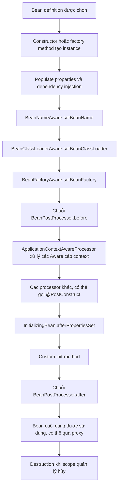

# Thứ tự callback Aware trong chu trình tạo bean của Spring

## 1. Aware là gì và vì sao thứ tự quan trọng?

Trong Spring Framework Core Container, các interface có hậu tố **`Aware`** cho phép một bean do Spring quản lý được thông báo về một đối tượng hạ tầng của container, ví dụ tên bean, `BeanFactory`, `ApplicationContext`, `Environment`, `ResourceLoader` hoặc `ApplicationEventPublisher`. Bean khai báo nhu cầu đó bằng cách implement interface và cung cấp một phương thức callback như `setBeanName(...)` hoặc `setApplicationContext(...)`.

Ví dụ:

```java
public class AuditCoordinator implements BeanNameAware {
    private String beanName;

    @Override
    public void setBeanName(String beanName) {
        this.beanName = beanName;
    }
}
```

Đây là **đoạn minh họa**, cần import `org.springframework.beans.factory.BeanNameAware` và đăng ký class thành một Spring bean để callback được container gọi; đoạn này không phải một ứng dụng chạy độc lập.

Điểm mấu chốt của bài học:

> **Trong chu trình khởi tạo bean thông thường, các callback Aware chạy sau khi bean được tạo và các properties/dependencies được điền, nhưng trước các initialization callbacks như `InitializingBean.afterPropertiesSet()` và custom `init-method`. Không phải mọi Aware đều được thực hiện tại một điểm duy nhất: một nhóm được `BeanFactory` gọi trực tiếp, một nhóm khác được các `BeanPostProcessor` chuyên trách gọi.**

Do đó phải phân biệt **thứ tự được Spring đảm bảo trong đường xử lý chuẩn**, **thứ tự giữa các `BeanPostProcessor`**, và **thời điểm các dependencies đã được constructor injection cung cấp**.

## 2. Dòng thời gian của một bean thông thường

Một bean singleton điển hình được tạo bởi `ApplicationContext` có dòng thời gian rút gọn:



Sơ đồ diễn tả thứ tự điển hình trong `ApplicationContext` mặc định. **Hai khối H và I nằm trong cùng chuỗi before-initialization**: nếu có các `BeanPostProcessor` tự đăng ký hoặc processor đặc biệt, thứ tự tương đối giữa các processor có thể thay đổi. Không biến sơ đồ minh họa thành lời hứa rằng mọi loại `Aware` và mọi custom processor trong mọi ứng dụng đều có một thứ tự toàn cục tuyệt đối.

Một trật tự hữu ích để nhớ là:

1. Tạo object: constructor hoặc factory method.
2. Hoàn thiện dependency injection/properties phù hợp.
3. Các callback do bean factory xử lý trực tiếp: `BeanNameAware` → `BeanClassLoaderAware` → `BeanFactoryAware`.
4. Các callback cấp application context qua `ApplicationContextAwareProcessor` trong chuỗi `postProcessBeforeInitialization`.
5. Lifecycle annotation callbacks như `@PostConstruct`, do một `BeanPostProcessor` khác xử lý trong pha before-initialization.
6. `InitializingBean.afterPropertiesSet()`.
7. Custom init method đã cấu hình.
8. Chuỗi `BeanPostProcessor.postProcessAfterInitialization()`, có thể trả wrapper/proxy.
9. Bean được sử dụng; sau này chạy destruction callbacks khi lifecycle phù hợp.

`@Autowired` không phải một interface Aware. Injection dựa trên `@Autowired` có thể diễn ra tại constructor hoặc khi populate properties thông qua infrastructure post-processing; không được nghĩ rằng phải chờ tới `setApplicationContext()` thì mọi dependency mới được tiêm.

## 3. Ba callback Aware do BeanFactory xử lý trực tiếp

Trong đường tạo bean tiêu chuẩn của `AbstractAutowireCapableBeanFactory`, Spring thực hiện callback Aware của ba interface sau trong thứ tự cụ thể khi bean có implement chúng:

| Thứ tự | Interface | Callback | Giá trị nhận | Ý nghĩa |
|---|---|---|---|---|
| 1 | `BeanNameAware` | `setBeanName(String name)` | Tên bean trong bean factory | Giúp bean biết tên được đăng ký |
| 2 | `BeanClassLoaderAware` | `setBeanClassLoader(ClassLoader loader)` | Class loader được bean factory dùng | Hỗ trợ hạ tầng cần nạp class |
| 3 | `BeanFactoryAware` | `setBeanFactory(BeanFactory beanFactory)` | BeanFactory sở hữu bean | Cho phép truy cập API factory nếu thực sự cần |

Ba callback này được Spring gọi trong `invokeAwareMethods(...)` của `AbstractAutowireCapableBeanFactory`, sau quá trình điền properties và trước việc áp dụng `BeanPostProcessor.postProcessBeforeInitialization()` trong đường khởi tạo thông thường.

Điều kiện “khi bean implement” rất quan trọng. Một bean chỉ implement `BeanFactoryAware` sẽ **không** nhận các callback khác chỉ vì chúng nằm phía trước nó trong bảng. Không có việc Spring tự gọi các method `setBeanName` cùng tên trên một class không implement interface tương ứng.

### 3.1. BeanNameAware

```java
public class NamedComponent implements BeanNameAware {
    @Override
    public void setBeanName(String name) {
        System.out.println("BeanNameAware: " + name);
    }
}
```

Đây là **snippet tích hợp**, cần import `BeanNameAware` và đăng ký class làm bean. Tên truyền vào là bean name dùng khi tạo instance, **không nhất thiết là tên Java class**. Với bean khai báo `@Bean("primaryLedger")`, callback có thể nhận `primaryLedger`. Các bean name aliases, inner bean hoặc framework-generated names có thể cần được hiểu theo bean definition thực tế; không dùng giá trị callback làm khóa nghiệp vụ bất biến xuyên qua mọi context.

### 3.2. BeanClassLoaderAware

```java
public class PluginBridge implements BeanClassLoaderAware {
    private ClassLoader beanClassLoader;

    @Override
    public void setBeanClassLoader(ClassLoader beanClassLoader) {
        this.beanClassLoader = beanClassLoader;
    }
}
```

Đây là **snippet tích hợp**, cần import `BeanClassLoaderAware`. Callback nhận loader mà factory dùng để tải bean classes; nó hữu ích với thư viện, plugin, instrumentation và hạ tầng class loading. Ứng dụng nghiệp vụ thông thường không nên tự nạp classes chỉ vì Spring cấp class loader.

### 3.3. BeanFactoryAware

```java
public class FactoryInspector implements BeanFactoryAware {
    private BeanFactory factory;

    @Override
    public void setBeanFactory(BeanFactory beanFactory) {
        this.factory = beanFactory;
    }
}
```

Đây là **snippet tích hợp**, cần import `BeanFactoryAware` và `BeanFactory` từ `org.springframework.beans.factory`. Callback cung cấp factory tạo bean, nhưng **không khuyến nghị gọi `getBean()` tùy tiện ngay trong callback**. Lúc này bean hiện tại chưa hoàn tất toàn bộ initialization; yêu cầu tạo thêm bean có thể kích hoạt chuỗi dependency sớm, tạo circular reference hoặc truy cập một object chưa sẵn sàng.

Phần lớn ứng dụng nên dùng constructor injection cho dependency bắt buộc hoặc `ObjectProvider<T>` khi cần lookup đúng thời điểm, thay vì giữ cả `BeanFactory` trong code nghiệp vụ.

## 4. Những callback Aware được xử lý bởi ApplicationContextAwareProcessor

`ApplicationContextAware` và một số interface context-related khác **không được gọi trong bộ ba `invokeAwareMethods` nêu trên**. Khi dùng `ApplicationContext`, Spring thêm `ApplicationContextAwareProcessor` vào danh sách `BeanPostProcessor`. Processor này gọi các callback tương ứng ở **pha `postProcessBeforeInitialization()`**.

Trong implementation thông dụng của Spring Framework 6.x, `ApplicationContextAwareProcessor` kiểm tra các interface theo thứ tự sau đối với một bean cùng implement nhiều interface:

| Vị trí trong processor | Interface | Callback | Giá trị được cấp |
|---|---|---|---|
| 1 | `EnvironmentAware` | `setEnvironment(Environment)` | `Environment` của context |
| 2 | `EmbeddedValueResolverAware` | `setEmbeddedValueResolver(StringValueResolver)` | Resolver cho embedded value placeholders/expressions theo cấu hình |
| 3 | `ResourceLoaderAware` | `setResourceLoader(ResourceLoader)` | Loader cho Spring resources |
| 4 | `ApplicationEventPublisherAware` | `setApplicationEventPublisher(ApplicationEventPublisher)` | Bộ phát events của application context |
| 5 | `MessageSourceAware` | `setMessageSource(MessageSource)` | Hạ tầng xử lý message/i18n |
| 6 | `ApplicationContextAware` | `setApplicationContext(ApplicationContext)` | Chính context chứa bean |

Đây là thứ tự nội bộ của **processor cụ thể** trong đường mặc định, không phải danh sách tất cả mọi `Aware` tồn tại trong Spring. Các interface như `ServletContextAware`, `ServletConfigAware`, `LoadTimeWeaverAware`, `ImportAware` hoặc `NotificationPublisherAware` thuộc những môi trường hoặc processor khác, nên không áp một thứ tự chung của bảng này cho chúng.

**Ví dụ về khoảng cách giữa BeanFactoryAware và ApplicationContextAware:**

```java
public class ContextInspector
        implements BeanFactoryAware, ApplicationContextAware {

    @Override
    public void setBeanFactory(BeanFactory beanFactory) {
        System.out.println("1 - BeanFactoryAware");
    }

    @Override
    public void setApplicationContext(ApplicationContext applicationContext) {
        System.out.println("2 - ApplicationContextAware");
    }
}
```

Đoạn này là **mã tích hợp**, cần import `BeanFactoryAware`, `BeanFactory`, `ApplicationContextAware` và `ApplicationContext`, cùng bean definition phù hợp. Trong `ApplicationContext` mặc định, `BeanFactoryAware` được gọi ở `invokeAwareMethods` rồi `ApplicationContextAware` được `ApplicationContextAwareProcessor` gọi trong chuỗi before-init.

### 4.1. ApplicationContextAware khác BeanFactoryAware thế nào?

`BeanFactory` là giao diện trung tâm để quản lý/lấy bean; `ApplicationContext` mở rộng môi trường IoC với resources, events, messages, environment và nhiều tiện ích tích hợp. Bean nhận cả hai có thể dùng chúng cho nhu cầu khác nhau, nhưng giữ một context trong field đồng nghĩa bean bị liên kết trực tiếp với Spring container.

Nếu chỉ cần publish event, inject `ApplicationEventPublisher`. Nếu chỉ cần đọc config, inject `Environment` hoặc `@Value`. Nếu chỉ cần lấy bean prototype ở thời điểm làm việc, inject `ObjectProvider<T>`. Các lựa chọn đó cụ thể hóa dependency và thường dễ kiểm thử hơn việc gọi `applicationContext.getBean(...)` ở khắp nơi.

### 4.2. Callback Aware và @PostConstruct

`@PostConstruct` được Spring xử lý qua lifecycle annotation `BeanPostProcessor` (thông dụng là `CommonAnnotationBeanPostProcessor`, dựa trên `InitDestroyAnnotationBeanPostProcessor`). Đối với context annotation tiêu chuẩn, các callback Aware ở trên xảy ra trước những init callbacks như `afterPropertiesSet()` hoặc custom init; `@PostConstruct` cũng thuộc chuỗi BPP-before.

Trong setup mặc định, `ApplicationContextAwareProcessor` được đăng ký sớm, vì vậy thường thấy `ApplicationContextAware` chạy **trước** `@PostConstruct`. Nhưng đừng khái quát thành quy tắc rằng **mọi custom `BeanPostProcessor.before` luôn chạy trước `@PostConstruct`**. Điều đó phụ thuộc thứ tự các processor. Nếu ứng dụng có custom BPP có ordering đặc biệt, cần kiểm tra thứ tự thực tế.

### 4.3. Nếu chỉ implement Aware thì sao?

Interface gốc `org.springframework.beans.factory.Aware` là marker interface. Tự implement **chỉ `Aware`** không cung cấp một method callback tiêu chuẩn nào để Spring gọi:

```java
public class MarkerOnly implements Aware {
    // Không có setSomething(...) được định nghĩa bởi riêng Aware.
}
```

Đây là **snippet minh họa** cần import `Aware`. Muốn nhận callback xác định, implement subinterface tương ứng, như `BeanNameAware` hoặc `EnvironmentAware`. Một số interface trong họ Aware yêu cầu hạ tầng và `BeanPostProcessor` chuyên biệt, nên việc implement interface không tự bảo đảm callback trong mọi loại `BeanFactory`.

## 5. Ví dụ Java 17+ chạy độc lập: quan sát thứ tự callback Aware

Bài thực hành dùng `AnnotationConfigApplicationContext` để tạo một bean được đăng ký qua `@Bean`. Bean implement **nhiều interface Aware cùng lúc** và các initialization/destruction callbacks. Một custom `BeanPostProcessor` in dấu mốc ngay **trước** và **sau** init.

Mục tiêu là chứng minh bằng thứ tự stdout:

- Constructor chạy trước.
- Bộ ba `BeanNameAware`, `BeanClassLoaderAware`, `BeanFactoryAware` được gọi theo thứ tự.
- Sáu callback context-related do `ApplicationContextAwareProcessor` xử lý nằm giữa bộ ba trước đó và custom processor `before` được đăng ký thông thường trong ví dụ.
- `InitializingBean.afterPropertiesSet()` và custom init theo sau.
- Custom `BeanPostProcessor.after` rồi code ứng dụng; destruction chỉ xảy ra khi đóng context.

Ví dụ không khai báo `@PostConstruct` nhằm giữ số lượng và thứ tự log của demo tập trung hoàn toàn vào họ Aware. Cơ chế `@PostConstruct` được giải thích riêng ở các phần khác.

**Yêu cầu:** Java 17+, Maven 3.9+, dependency Spring Framework 6.2.0. Không cần Spring Boot, server hoặc database.

Cấu trúc:

```text
aware-order-demo/
├── pom.xml
└── src/main/java/example/AwareOrderDemo.java
```

**Tệp `pom.xml`:**

```xml
<project xmlns="http://maven.apache.org/POM/4.0.0"
         xmlns:xsi="http://www.w3.org/2001/XMLSchema-instance"
         xsi:schemaLocation="http://maven.apache.org/POM/4.0.0
                             https://maven.apache.org/xsd/maven-4.0.0.xsd">
    <modelVersion>4.0.0</modelVersion>
    <groupId>example</groupId>
    <artifactId>aware-order-demo</artifactId>
    <version>1.0.0</version>
    <properties>
        <maven.compiler.release>17</maven.compiler.release>
        <project.build.sourceEncoding>UTF-8</project.build.sourceEncoding>
    </properties>
    <dependencies>
        <dependency>
            <groupId>org.springframework</groupId>
            <artifactId>spring-context</artifactId>
            <version>6.2.0</version>
        </dependency>
    </dependencies>
    <build>
        <plugins>
            <plugin>
                <groupId>org.apache.maven.plugins</groupId>
                <artifactId>maven-compiler-plugin</artifactId>
                <version>3.13.0</version>
            </plugin>
            <plugin>
                <groupId>org.codehaus.mojo</groupId>
                <artifactId>exec-maven-plugin</artifactId>
                <version>3.5.0</version>
            </plugin>
        </plugins>
    </build>
</project>
```

**Tệp `src/main/java/example/AwareOrderDemo.java`:**

```java
package example;

import org.springframework.beans.factory.BeanClassLoaderAware;
import org.springframework.beans.factory.BeanFactory;
import org.springframework.beans.factory.BeanFactoryAware;
import org.springframework.beans.factory.BeanNameAware;
import org.springframework.beans.factory.DisposableBean;
import org.springframework.beans.factory.InitializingBean;
import org.springframework.beans.factory.config.BeanPostProcessor;
import org.springframework.context.ApplicationContext;
import org.springframework.context.ApplicationContextAware;
import org.springframework.context.ApplicationEventPublisher;
import org.springframework.context.ApplicationEventPublisherAware;
import org.springframework.context.EmbeddedValueResolverAware;
import org.springframework.context.EnvironmentAware;
import org.springframework.context.MessageSource;
import org.springframework.context.MessageSourceAware;
import org.springframework.context.ResourceLoaderAware;
import org.springframework.context.annotation.AnnotationConfigApplicationContext;
import org.springframework.context.annotation.Bean;
import org.springframework.context.annotation.Configuration;
import org.springframework.core.env.Environment;
import org.springframework.core.io.ResourceLoader;
import org.springframework.util.StringValueResolver;

public class AwareOrderDemo {

    public static void main(String[] args) {
        try (var context = new AnnotationConfigApplicationContext(Config.class)) {
            TracedBean bean = context.getBean(TracedBean.class);
            System.out.println("15 application: " + bean.status());
        }
    }

    @Configuration(proxyBeanMethods = false)
    public static class Config {

        // Dùng static @Bean để processor được đăng ký đủ sớm.
        @Bean
        public static LoggingProcessor loggingProcessor() {
            return new LoggingProcessor();
        }

        @Bean(name = "tracedBean",
              initMethod = "customInit",
              destroyMethod = "customDestroy")
        public TracedBean tracedBean() {
            return new TracedBean();
        }
    }

    public static final class LoggingProcessor implements BeanPostProcessor {
        @Override
        public Object postProcessBeforeInitialization(
                Object bean, String beanName) {
            if ("tracedBean".equals(beanName)) {
                System.out.println("11 BPP.before");
            }
            return bean;
        }

        @Override
        public Object postProcessAfterInitialization(
                Object bean, String beanName) {
            if ("tracedBean".equals(beanName)) {
                System.out.println("14 BPP.after");
            }
            return bean;
        }
    }

    public static final class TracedBean implements
            BeanNameAware,
            BeanClassLoaderAware,
            BeanFactoryAware,
            EnvironmentAware,
            EmbeddedValueResolverAware,
            ResourceLoaderAware,
            ApplicationEventPublisherAware,
            MessageSourceAware,
            ApplicationContextAware,
            InitializingBean,
            DisposableBean {

        public TracedBean() {
            System.out.println("01 constructor");
        }

        @Override
        public void setBeanName(String name) {
            System.out.println("02 BeanNameAware: " + name);
        }

        @Override
        public void setBeanClassLoader(ClassLoader classLoader) {
            System.out.println("03 BeanClassLoaderAware");
        }

        @Override
        public void setBeanFactory(BeanFactory beanFactory) {
            System.out.println("04 BeanFactoryAware");
        }

        @Override
        public void setEnvironment(Environment environment) {
            System.out.println("05 EnvironmentAware");
        }

        @Override
        public void setEmbeddedValueResolver(StringValueResolver resolver) {
            System.out.println("06 EmbeddedValueResolverAware");
        }

        @Override
        public void setResourceLoader(ResourceLoader resourceLoader) {
            System.out.println("07 ResourceLoaderAware");
        }

        @Override
        public void setApplicationEventPublisher(
                ApplicationEventPublisher publisher) {
            System.out.println("08 ApplicationEventPublisherAware");
        }

        @Override
        public void setMessageSource(MessageSource messageSource) {
            System.out.println("09 MessageSourceAware");
        }

        @Override
        public void setApplicationContext(ApplicationContext context) {
            System.out.println("10 ApplicationContextAware");
        }

        @Override
        public void afterPropertiesSet() {
            System.out.println("12 InitializingBean.afterPropertiesSet");
        }

        public void customInit() {
            System.out.println("13 custom init");
        }

        public String status() {
            return "ready";
        }

        @Override
        public void destroy() {
            System.out.println("16 DisposableBean.destroy");
        }

        public void customDestroy() {
            System.out.println("17 custom destroy");
        }
    }
}
```

Từ thư mục chứa `pom.xml`, chạy:

```bash
mvn -q compile exec:java -Dexec.mainClass=example.AwareOrderDemo
```

**Stdout của chương trình**, không tính log Maven nếu môi trường hiển thị:

```text
01 constructor
02 BeanNameAware: tracedBean
03 BeanClassLoaderAware
04 BeanFactoryAware
05 EnvironmentAware
06 EmbeddedValueResolverAware
07 ResourceLoaderAware
08 ApplicationEventPublisherAware
09 MessageSourceAware
10 ApplicationContextAware
11 BPP.before
12 InitializingBean.afterPropertiesSet
13 custom init
14 BPP.after
15 application: ready
16 DisposableBean.destroy
17 custom destroy
```

### 5.1. Giải thích chính xác từng pha

**Dòng 01:** `AnnotationConfigApplicationContext(Config.class)` refresh context ngay trong constructor, đọc `@Configuration` và tạo singleton `tracedBean` theo bean definition. Factory method gọi `new TracedBean()`.

**Dòng 02–04:** Spring gọi trực tiếp ba callback do `BeanFactory` quản lý theo thứ tự `BeanNameAware`, `BeanClassLoaderAware`, `BeanFactoryAware`. Do `@Bean(name="tracedBean")`, tên được in là `tracedBean`, không phải `TracedBean`.

**Dòng 05–10:** `ApplicationContextAwareProcessor` gọi các callbacks cấp context trong chuỗi before-initialization. Ở ví dụ này có đủ sáu interface, nên ta quan sát được thứ tự nội bộ của processor trong Spring 6.2.0.

**Dòng 11:** `LoggingProcessor` cũng là một `BeanPostProcessor`. Processor được Spring đăng ký trong context, và in khi bean name là `tracedBean`. Trong cấu hình chuẩn, `ApplicationContextAwareProcessor` đã đăng ký sớm và được áp dụng trước custom `LoggingProcessor`.

**Dòng 12–13:** `InitializingBean.afterPropertiesSet()` chạy rồi tới custom `@Bean(initMethod="customInit")`. Đó là hai callback khởi tạo chuẩn, không phải Aware callbacks.

**Dòng 14:** `LoggingProcessor.postProcessAfterInitialization()` chạy sau init và trả lại cùng `TracedBean`. Vì ví dụ không sinh proxy, caller lấy chính object đã được init.

**Dòng 15:** Application code gọi `status()` sau khi context đã khởi tạo đầy đủ.

**Dòng 16–17:** Khi khối `try-with-resources` thoát, `AnnotationConfigApplicationContext.close()` chạy; Spring gọi `DisposableBean.destroy()` rồi custom `destroyMethod="customDestroy"` cho singleton. Các dòng này thuộc destruction, **không phải** `Aware` callbacks hoặc `BeanPostProcessor.after`.

**Cần phân biệt:** danh sách thứ tự trong demo có chủ đích để minh họa **Spring 6.2.0 + AnnotationConfigApplicationContext + những interface được chọn**. Nó không có nghĩa một `BeanFactory` thuần luôn gọi toàn bộ nhóm context-aware, cũng không bảo đảm mọi custom `BeanPostProcessor` khác tuân cùng mốc 11 khi ứng dụng tự sửa thứ tự đăng ký.

## 6. Hai cơ chế gọi Aware khác nhau

Hiểu cơ chế nội bộ giúp tránh ghi nhớ bảng máy móc.

### 6.1. BeanFactory xử lý bộ ba cơ bản

Một đoạn mã tương đương logic của `AbstractAutowireCapableBeanFactory.invokeAwareMethods` (chỉ để giải thích, **không phải source copy nguyên văn Spring**):

```java
// Pseudocode, chỉ biểu diễn thứ tự điều kiện.
if (bean instanceof BeanNameAware a) {
    a.setBeanName(beanName);
}
if (bean instanceof BeanClassLoaderAware a) {
    a.setBeanClassLoader(beanClassLoader);
}
if (bean instanceof BeanFactoryAware a) {
    a.setBeanFactory(beanFactory);
}
```

Ba callback này xảy ra sau phần khởi tạo object và populate properties, nhưng trước chuỗi BPP-before trong đường tạo bean thông thường. Do chúng thuộc bean factory, ngay cả khi không có một `ApplicationContextAwareProcessor` thì một `BeanFactory` hỗ trợ lifecycle tiêu chuẩn vẫn có thể gọi bộ ba Aware này.

### 6.2. ApplicationContextAwareProcessor xử lý nhóm cấp context

Một đoạn mã ý tưởng tương tự:

```java
// Pseudocode bên trong một BeanPostProcessor.before.
if (bean instanceof EnvironmentAware a) {
    a.setEnvironment(context.getEnvironment());
}
if (bean instanceof EmbeddedValueResolverAware a) {
    a.setEmbeddedValueResolver(valueResolver);
}
if (bean instanceof ResourceLoaderAware a) {
    a.setResourceLoader(context);
}
if (bean instanceof ApplicationEventPublisherAware a) {
    a.setApplicationEventPublisher(context);
}
if (bean instanceof MessageSourceAware a) {
    a.setMessageSource(context);
}
if (bean instanceof ApplicationContextAware a) {
    a.setApplicationContext(context);
}
```

Đây là **pseudocode**, không phải mã biên dịch độc lập: các biến `bean`, `context`, `valueResolver` minh họa cho context nội bộ. Khi dùng `ApplicationContext` thực, Spring xử lý hạ tầng và phụ thuộc theo triển khai. Kết quả quan trọng không phải là caller tự viết logic này, mà là **group callbacks được thực thi bởi `BeanPostProcessor`**.

### 6.3. Còn những Aware khác?

`Aware` là interface gốc dùng làm marker. Spring có nhiều nhánh như:

| Interface | Môi trường hoặc mục tiêu | Có thuộc một trong hai nhóm demo? |
|---|---|---|
| `ServletContextAware` | Truy cập `ServletContext` của ứng dụng Servlet | Không; cần web-aware context/processor liên quan |
| `ServletConfigAware` | Truy cập `ServletConfig` | Không; chỉ có ý nghĩa ở servlet environment phù hợp |
| `ImportAware` | Nhận metadata về annotation `@Import` đã khai báo | Không; gắn với xử lý cấu hình Spring |
| `LoadTimeWeaverAware` | Nhận `LoadTimeWeaver` khi load-time weaving được cấu hình | Không; có processor/hạ tầng chuyên biệt |
| `NotificationPublisherAware` | Hạ tầng JMX notifications | Không; cần Spring JMX exporter phù hợp |
| `ApplicationStartupAware` | Tham gia hạ tầng application startup observations | Không khái quát vào chuỗi demo |
| `BeanNameAware` | Tên bean | Nhóm BeanFactory |
| `ApplicationContextAware` | Context chứa bean | Nhóm ApplicationContextAwareProcessor |

Không cố gắng gán vị trí thứ 7, 8, 9... cho tất cả các interface Aware tồn tại. Mỗi extension có hợp đồng kích hoạt riêng. Đặc biệt, chỉ implement `ServletContextAware` trong context không có web infrastructure sẽ không làm Spring tự tạo một servlet context giả để cấp vào callback.

## 7. Mối liên hệ với @PostConstruct và BeanPostProcessor

Một sơ đồ rút gọn có `@PostConstruct`:

```text
Constructor / factory method
    |
Populate dependencies
    |
BeanNameAware
BeanClassLoaderAware
BeanFactoryAware
    |
BeanPostProcessor.before chain
    |-- ApplicationContextAwareProcessor -> nhóm Aware cấp context
    |-- CommonAnnotationBeanPostProcessor -> có thể gọi @PostConstruct
    |-- những BPP khác theo registration/order
    |
InitializingBean.afterPropertiesSet
    |
Custom init-method
    |
BeanPostProcessor.after chain
    |
Bean cuối cùng (có thể proxy)
```

`CommonAnnotationBeanPostProcessor` có logic xử lý lifecycle annotations dựa trên `InitDestroyAnnotationBeanPostProcessor`. `@PostConstruct` thuộc pha before-init vì callback này được xử lý trong `postProcessBeforeInitialization` của processor đó. BPP-after chạy **sau** `afterPropertiesSet` và custom init; nó **không đồng nghĩa `@PreDestroy`**.

Khi bean được bọc bằng Spring AOP proxy, một BPP-after có thể trả proxy; caller cuối cùng nhận proxy thay vì instance gốc mà các callback Aware đã được gọi trên đó. Không dựa vào `getClass() == SomeClass.class` hoặc object identity ở một điểm tùy ý để suy rằng toàn bộ quá trình không có wrapper.

**Thứ tự callback Aware với @PostConstruct:** dưới `AnnotationConfigApplicationContext` tiêu chuẩn, context-aware processor được đăng ký sớm nên các Aware context callbacks thường đã chạy trước `@PostConstruct`. Nhưng có thể có processor khác trong pha before, và API không hứa mọi processor người dùng tự thêm sẽ luôn nằm sau processor `@PostConstruct` hoặc trước nó.

## 8. Trường hợp BeanFactory thuần, ApplicationContext và context con

### 8.1. Một BeanFactory không đồng nghĩa ApplicationContext

`DefaultListableBeanFactory` có thể tạo bean với nhiều cơ chế lifecycle và xử lý bộ ba `BeanNameAware`, `BeanClassLoaderAware`, `BeanFactoryAware`. Nhưng `ApplicationContextAwareProcessor` là hạ tầng do `ApplicationContext` cấu hình. Nếu chỉ tạo một `BeanFactory` thủ công và không đăng ký processor phù hợp, `ApplicationContextAware` không tự được cấp reference như trong context hoàn chỉnh.

Vì vậy, câu “mọi implementation của Aware đều chắc chắn được gọi” là sai. Callback phụ thuộc **loại container** và **processor được đăng ký**.

### 8.2. Parent và child context

Trong hệ thống có nhiều context, mỗi bean thuộc một context/factory sở hữu. `ApplicationContextAware` cấp reference tới context **gắn với bean đó**, không tự cung cấp “root context” bất kể bean được khai báo ở đâu. Bean ở child context có thể tham chiếu child context, còn bean thuộc parent có lifecycle của parent.

Một bean parent được child lookup không đồng nghĩa bean bị tạo lại trong child hoặc callback `setApplicationContext(child)` tự chạy lại. Callback gắn với thời điểm **bean instance được container sở hữu tạo và khởi tạo**. Cần phân biệt luồng lookup xuyên hierarchy và lifecycle sở hữu bean.

### 8.3. ApplicationContextAware với constructor injection

Nếu chỉ cần `ApplicationContext`, có thể inject trực tiếp vào constructor do Spring hỗ trợ resolving infrastructure dependencies phù hợp:

```java
public class MetadataReader {
    private final Environment environment;

    public MetadataReader(Environment environment) {
        this.environment = environment;
    }
}
```

Đây là **mã minh họa**: cần import `org.springframework.core.env.Environment` và bean được Spring quản lý qua constructor injection. `Environment` ở đây đã có từ construction time; không bắt buộc đợi `EnvironmentAware.setEnvironment`.

Nếu class thực sự cần sử dụng `ApplicationContext`, constructor injection có thể nhận `ApplicationContext` trực tiếp trong nhiều setup. Nhưng về thiết kế, đưa dependency hẹp như `Environment`, `ResourceLoader`, `ApplicationEventPublisher` thường dễ đọc và dễ test hơn.

## 9. Những vấn đề về an toàn và thiết kế

### 9.1. Aware làm code phụ thuộc Spring

Một lớp implements `BeanFactoryAware` hoặc `ApplicationContextAware` phụ thuộc interface của Spring. Điều này hợp lý với thư viện hạ tầng, tích hợp framework, bean factory utility hoặc plugin loader, nhưng phần lớn business service không cần tiếp xúc cả container.

Ví dụ không nên lạm dụng:

```java
public class PaymentService implements ApplicationContextAware {
    private ApplicationContext context;

    @Override
    public void setApplicationContext(ApplicationContext context) {
        this.context = context;
    }

    public void pay() {
        PaymentGateway gateway = context.getBean(PaymentGateway.class);
        gateway.charge();
    }
}
```

Đây là **mã minh họa phụ thuộc** class `PaymentGateway` có method `charge()`, cùng import Spring cần thiết. Nó hoạt động về mặt ý tưởng nhưng biến domain class thành service locator. Nếu `PaymentGateway` bắt buộc, constructor injection trực tiếp thường rõ ràng hơn. Nếu cần prototype mới mỗi lần, `ObjectProvider<PaymentGateway>` diễn đạt động cơ lookup muộn mà không cần mang toàn bộ context.

### 9.2. Không gọi getBean quá sớm trong Aware

Khi callback `setBeanFactory()`/ `setApplicationContext()` được gọi, **bean hiện tại chưa đi qua toàn bộ initialization callbacks**. Một lệnh `getBean()` khác có thể gây tạo bean thứ hai, vòng dependency, hoặc truy cập trạng thái chưa hoàn chỉnh. Điều này đặc biệt khó debug nếu callback Aware làm cả thao tác network hoặc kích hoạt một job chạy song song.

Nên dùng callback chủ yếu để **lưu reference hạ tầng cần thiết**. Khởi động công việc dựa trên bean đã hoàn chỉnh nên thuộc init/lifecycle hook phù hợp hoặc business method được gọi sau startup. Với thao tác cần toàn bộ singleton đã sẵn sàng, có thể cân nhắc `SmartInitializingSingleton` hoặc startup/application event phù hợp, chứ không ép vào `setApplicationContext`.

### 9.3. Không nhầm Aware với thread-safe hoặc lifecycle destroy

Callback Aware không đảm bảo bean thread-safe, không tạo scope mới, không tự biến một bean thành singleton, và **không phải destruction callback**. Đối với bean prototype, các callback Aware có thể chạy ở mỗi lần container tạo instance. Nhưng khi `ApplicationContext.close()`, Spring không tự destroy mọi prototype đã cấp; caller vẫn chịu trách nhiệm dọn những prototype giữ resources.

Với singleton bean, Aware callbacks thường chạy một lần khi singleton được tạo; gọi `context.getBean()` nhiều lần không làm `setBeanName()` hoặc `setApplicationContext()` chạy lặp, vì object đã được init.

## 10. Những lỗi hiểu nhầm phổ biến

| Nhầm lẫn | Sự thật | Cách xử lý |
|---|---|---|
| “Mọi Aware interface được Spring gọi cùng một lượt” | Có nhiều cơ chế xử lý: trực tiếp bởi BeanFactory và qua các BPP chuyên trách | Phân biệt ba BeanFactory Aware với nhóm context-aware |
| “`ApplicationContextAware` luôn chạy trước `BeanNameAware`” | Trong Spring context thông thường `BeanNameAware` được BeanFactory gọi trước BPP cấp context | Quan sát thứ tự demo |
| “Implement `Aware` là đủ” | `Aware` là marker, không khai báo callback cụ thể | Implement đúng subinterface cần thiết |
| “`setApplicationContext` chạy trước constructor” | Callback diễn ra sau khi object được tạo và qua phần DI thích hợp | Phân biệt construction, population và initialization |
| “`BeanFactoryAware` và `ApplicationContextAware` cùng một tham số” | Một callback nhận `BeanFactory`, một nhận `ApplicationContext` | Chọn hợp đồng đúng, tránh cast vô cớ |
| “`@PostConstruct` luôn sau tất cả BPP.before” | `@PostConstruct` do một processor nằm **trong chuỗi before** gọi | Xét processor registration/ordering |
| “Spring gọi `ServletContextAware` trong CLI context” | Cần web-specific infrastructure | Không mong Servlet context trong app CLI |
| “Tất cả callbacks chạy mỗi `getBean()`” | Singleton được tái sử dụng, không init lại mỗi lookup | Phân biệt scope và số lần tạo instance |
| “Có callback Aware thì auto-start được worker” | Aware chỉ cấp hạ tầng; `Lifecycle`/`SmartLifecycle` quản lý start/stop | Chọn đúng extension point |
| “`setBeanFactory()` thích hợp để gọi mọi `getBean` ngay lập tức” | Dễ gây tạo bean sớm/circular dependencies | Tránh lookup sớm, dùng DI/provider |
| “`ApplicationContextAware` luôn được cấp trong BeanFactory thuần” | Cần `ApplicationContextAwareProcessor` hoặc tương đương | Kiểm tra container và BPP đã đăng ký |
| “Aware callbacks là `@PreDestroy`” | Aware thuộc setup/initialization, không phải cleanup | Dùng destruction callbacks đúng scope |

## 11. Checklist kiểm chứng khi callback chạy sai thứ tự

Khi thấy log Aware khác kỳ vọng, hãy kiểm tra:

1. **Container thật sự là gì?** `ApplicationContext` được refresh hoàn chỉnh, hay chỉ có `DefaultListableBeanFactory` tự dựng?
2. **Bean do ai tạo?** Được tạo bởi container (từ constructor/`@Bean`) hay tự `new` ngoài Spring?
3. **Bean implement những interface nào?** Callback chỉ được gọi cho các subinterfaces tương ứng và khi processor phù hợp hoạt động.
4. **Có custom BeanPostProcessor không?** Những callback cấp context được thực hiện trong pha BPP-before; trật tự với custom processors phụ thuộc registration/ordering.
5. **Có `@PostConstruct` không?** Callback này nằm trong pha before của annotation processor. Không áp thứ tự BPP đơn giản hóa sai.
6. **Bean là singleton/prototype?** Đếm số instance thực sự được tạo, thay vì số lần code gọi `getBean`.
7. **Có proxy không?** Callback có thể chạy trên target trong khi caller nhận wrapper sau init.
8. **Có parent/child context không?** Bean của parent không tự nhận lại Aware callback với child context.
9. **Callback có yêu cầu bean khác quá sớm không?** `getBean()` từ Aware có thể thay đổi thời điểm các bean được tạo và xuất hiện log xen kẽ.
10. **Có listener hoặc infrastructure init trước không?** Không suy thứ tự toàn cục của mọi bean từ log một bean; nhiều beans có thể được tạo theo dependency graph.

**Cách test hữu ích nhất** là gắn log hoặc sequence recording ngay trong callback Aware của **một bean**, thay vì so số thứ tự stdout trên hàng trăm bean khác nhau. Nếu cần test chặt chẽ, dùng một context tối giản, tên bean rõ ràng và chỉ đăng ký những processor cần thiết.

### 11.1. Mô phỏng dữ liệu đủ để test mà không phụ thuộc Spring

Với unit test thuần Java, có thể gọi trực tiếp các setter Aware như các method Java thông thường, nhưng điều đó **không kiểm tra** rằng Spring sẽ gọi đúng thứ tự. Test như vậy chỉ xác minh code trong callback. Muốn kiểm thử thứ tự lifecycle thực tế, phải tạo Spring `ApplicationContext` và lấy bean qua container.

Đừng viết test giả lập `ApplicationContext` với quá nhiều API chỉ để gọi `setApplicationContext` nếu lớp có thể nhận một dependency hẹp hơn trong constructor. Khi thiết kế cho phép, chuyển sang constructor injection thường giảm nhu cầu test lifecycle đặc thù.

## 12. Bài tập tự kiểm tra

**1. `BeanNameAware` chạy trước hay sau constructor và dependency injection?**  
Trong đường tạo bean thông thường, callback chạy sau khi object đã được tạo và điền các properties/dependencies tương ứng; trước các init callbacks.

**2. Thứ tự của `BeanNameAware`, `BeanClassLoaderAware`, `BeanFactoryAware` là gì?**  
Theo thứ tự đó trong `AbstractAutowireCapableBeanFactory.invokeAwareMethods` ở Spring Framework 6.x.

**3. `ApplicationContextAware` được xử lý ở cùng method với ba interface trên không?**  
Không. Trong `ApplicationContext`, nó được `ApplicationContextAwareProcessor` xử lý ở pha `BeanPostProcessor.before`.

**4. Nếu bean implement `EnvironmentAware`, `ResourceLoaderAware`, `ApplicationContextAware`, callback nào chạy trước trong processor tiêu chuẩn?**  
`EnvironmentAware`, rồi `ResourceLoaderAware`, rồi `ApplicationContextAware` (nếu chỉ xét ba interface đó). Nếu bean còn implement các interface khác trong bảng, các callback tương ứng sẽ nằm xen theo vị trí của chúng.

**5. `@PostConstruct` có phải một phương thức Aware không?**  
Không. Nó là lifecycle annotation callback, được Spring kích hoạt qua một `BeanPostProcessor` chuyên trách trong pha before-init.

**6. Vì sao một BPP tự viết có thể log after trước client sử dụng bean?**  
Vì `postProcessAfterInitialization` là hook xử lý bean sau initialization thông thường nhưng trước khi tham chiếu bean cuối cùng được đưa cho caller.

**7. Dùng `BeanFactoryAware` có thay thế constructor injection tốt cho mọi business service không?**  
Không. Nó tăng phụ thuộc vào Spring container và có thể tạo lookup sớm. Ưu tiên dependency injection trực tiếp hoặc `ObjectProvider` khi cần.

**8. `BeanNameAware` có chạy khi `new YourClass()` ngoài container không?**  
Không tự động. Java chỉ thực hiện constructor; Spring phải tạo/quản lý bean mới có callback.

**9. Với prototype bean, Aware callback chạy bao nhiêu lần?**  
Thường mỗi lần Spring tạo một instance prototype tương ứng; không phải mỗi method call trên một instance đã có.

**10. Nếu bean đã nhận `ApplicationContextAware`, liệu `@PreDestroy` có được gọi khi đóng context với mọi scope không?**  
Không. Destruction phụ thuộc scope; Spring không tự quản lý destruction của prototype đã được cấp phát.

## Tài liệu tham khảo chính thức

- [Spring Framework Reference — ApplicationContextAware and BeanNameAware](https://docs.spring.io/spring-framework/reference/core/beans/factory-nature.html#beans-factory-aware): ý nghĩa Aware callback và thời điểm so với initialization.
- [Spring Framework Reference — Other Aware Interfaces](https://docs.spring.io/spring-framework/reference/core/beans/factory-nature.html): các interface Aware và tài nguyên container cung cấp.
- [Spring Framework API — AbstractAutowireCapableBeanFactory](https://docs.spring.io/spring-framework/docs/6.2.0/javadoc-api/org/springframework/beans/factory/support/AbstractAutowireCapableBeanFactory.html): cơ chế initializeBean và callback Aware cơ bản.
- [Spring Framework API — ApplicationContextAwareProcessor](https://docs.spring.io/spring-framework/docs/6.2.0/javadoc-api/org/springframework/context/support/ApplicationContextAwareProcessor.html): post processor điều phối các Aware cấp context.
- [Spring Framework API — BeanPostProcessor](https://docs.spring.io/spring-framework/docs/6.2.0/javadoc-api/org/springframework/beans/factory/config/BeanPostProcessor.html): hai callback before/after initialization và hợp đồng trả object.
- [Spring Framework Reference — Lifecycle Callbacks](https://docs.spring.io/spring-framework/reference/core/beans/factory-nature.html#beans-factory-lifecycle): thứ tự `@PostConstruct`, `afterPropertiesSet()`, custom init và destruction.
