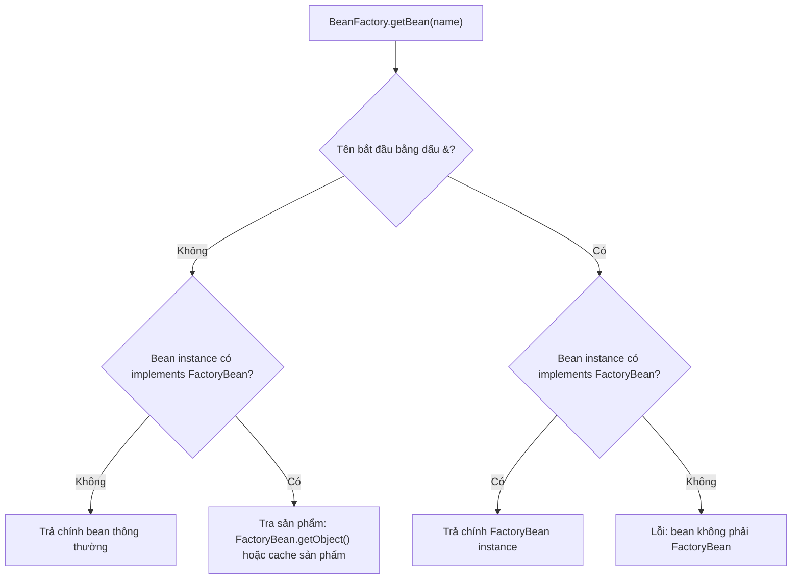

# Lấy sản phẩm theo tên và lấy nhà máy bằng tiền tố & trong Spring FactoryBean

## 1. Hai đối tượng đứng sau một tên bean

Trong Spring Core Container, `FactoryBean<T>` là một cơ chế cho phép **một bean đóng vai trò nhà máy tạo ra một đối tượng khác**. Khi container có bean tên `greeting` mà bean đó implement `FactoryBean<Greeting>`, có hai đối tượng cần phân biệt:

1. **FactoryBean (nhà máy)**: instance triển khai `FactoryBean<Greeting>`; Spring quản lý nó như một bean và sử dụng nó để tạo sản phẩm.
2. **Product (sản phẩm)**: đối tượng kiểu `Greeting` được trả về từ `FactoryBean.getObject()` theo cơ chế của container.

Khác với lookup bean thông thường, tên `greeting` được Spring hiểu là **tên logic để lấy sản phẩm** của `FactoryBean`. Muốn yêu cầu **chính instance nhà máy** đó, người gọi thêm **tiền tố `&`** vào bean name.

```java
Object product = context.getBean("greeting");
Object factory = context.getBean("&greeting");
```

Đây là **đoạn mã theo ngữ cảnh**: `context` phải là Spring `ApplicationContext` chứa một `FactoryBean` tên `greeting`. Quy tắc không phải một cú pháp đặc biệt của Java; `"&greeting"` chỉ là chuỗi truyền đến API Spring `BeanFactory.getBean(...)`.

> **Ghi nhớ:** `getBean("name")` lấy **sản phẩm** nếu bean `name` là một `FactoryBean`; `getBean("&name")` lấy **chính FactoryBean**, tức nhà máy. Nếu `name` là bean bình thường, `getBean("name")` lấy chính bean và `&name` không biến nó thành một nhà máy.

Dấu `&` là một phần **cách diễn giải bean name tại điểm tra cứu**, không phải yêu cầu đổi ID trong `@Bean`, `@Component` hay XML thành một tên bắt đầu bằng `&`.

## 2. FactoryBean không phải BeanFactory

Tên rất dễ gây nhầm:

| Khái niệm | Vai trò | API tiêu biểu |
|---|---|---|
| `BeanFactory` | **Container** quản lý bean definitions, scopes, lookup và lifecycle | `getBean(...)`, `containsBean(...)` |
| `FactoryBean<T>` | **Một bean đặc biệt** mà container gọi để tạo sản phẩm kiểu `T` | `getObject()`, `getObjectType()`, `isSingleton()` |
| `@Bean` factory method | **Cách khai báo bean bằng Java configuration** | Method `@Bean` trả một bean instance |
| Sản phẩm của `FactoryBean` | Object được công bố dưới tên bean của nhà máy | Thường lấy bằng `getBean("name")` |

`BeanFactory` có thể quản lý nhiều `FactoryBean`. Một method `@Bean` có thể trả `FactoryBean<T>`, nhưng **không phải mọi `@Bean` method đều tạo một FactoryBean**. Phần lớn `@Bean` methods trả trực tiếp đối tượng nghiệp vụ và không cần đến cú pháp `&`.

Ví dụ:

```java
@Configuration
class FactoryConfiguration {
    @Bean("greeting")
    GreetingFactoryBean greetingFactory() {
        return new GreetingFactoryBean();
    }
}
```

Đây là **mã cấu hình minh họa**, cần imports `@Configuration`, `@Bean`, cùng class `GreetingFactoryBean` implement `FactoryBean<Greeting>`. Dù tên method là `greetingFactory`, tên bean được chỉ định là **`greeting`**: tra `"greeting"` là lấy sản phẩm, tra `"&greeting"` là lấy nhà máy. Không phải thêm `&` vào `@Bean("...")`.

## 3. Cơ chế lookup phía sau getBean("name") và getBean("&name")



Với một `FactoryBean` tên `greeting`, từng lời gọi có ý nghĩa khác nhau:

```java
Greeting a = context.getBean("greeting", Greeting.class);
FactoryBean<?> maker = context.getBean("&greeting", FactoryBean.class);
```

Đây là snippet minh họa tích hợp, với bean `greeting` đã được đăng ký và imports Spring phù hợp. Overload `getBean(String, Class<T>)` kiểm tra kiểu đối tượng **được Spring trả về theo tên lookup**:

- `getBean("greeting", Greeting.class)`: yêu cầu **sản phẩm** là `Greeting`.
- `getBean("&greeting", FactoryBean.class)`: yêu cầu **nhà máy** là một `FactoryBean`.
- `getBean("greeting", GreetingFactoryBean.class)`: sẽ không lấy được factory khi bean name thuộc quy tắc FactoryBean; kiểu yêu cầu không phù hợp với **product** và có thể gây `BeanNotOfRequiredTypeException`.
- `getBean("&greeting", Greeting.class)`: cũng sai kiểu, vì dấu `&` yêu cầu nhà máy chứ không phải sản phẩm.

Nếu đối tượng đứng sau tên `ordinary` là một bean bình thường, `context.getBean("&ordinary")` không hợp lệ để lấy nhà máy, bởi Spring nhận thấy bean đó **không implement `FactoryBean`**. Lỗi thường dùng cho tình huống này là `BeanIsNotAFactoryException`.

### 3.1. Dấu & là prefix lookup, không phải một bean name thứ hai

Đối với cùng một bean definition, `"greeting"` và `"&greeting"` **không tạo ra hai định nghĩa bean độc lập**. Spring biết tên canonical của factory là `greeting` và diễn giải dấu `&` như yêu cầu “factory dereference”.

Thành phần `BeanFactory.FACTORY_BEAN_PREFIX` là hằng chuỗi `"&"`. Spring cũng có tiện ích xử lý tên bean và factory dereference trong các API nội bộ/hỗ trợ, nhưng code nghiệp vụ thường chỉ cần truyền `"&name"` hoặc nối prefix với một tên do ứng dụng kiểm soát.

Nếu cấu hình có alias cho một FactoryBean, Spring xử lý alias theo quy tắc tên bean của container. Người lập trình vẫn phải sử dụng đúng **tên có hiệu lực trong container** và không suy rằng thêm `&` vào bất kỳ chuỗi bất kỳ sẽ nhận đúng factory.

### 3.2. Spring có thể gọi getObjectType mà không tạo sản phẩm

Khi `getBean("greeting")` được gọi, Spring phải resolve factory rồi lấy sản phẩm. Tuy nhiên, trong một số thao tác khác, ví dụ **tra cứu theo kiểu** hoặc chuẩn bị autowiring, Spring có thể hỏi `FactoryBean.getObjectType()` để biết loại sản phẩm **mà không cần gọi `getObject()`**.

Vì vậy `getObjectType()` nên trả về `Class<?> ` có ý nghĩa khi có thể xác định sớm, tránh side effects và không dựa vào state chỉ được đặt sau khi factory đã init hoàn toàn. Nếu trả `null` khi type vẫn chưa biết, một số thao tác phát hiện/autowire theo type sẽ không tìm thấy sản phẩm đó.

Không nên dùng `getObjectType()` để mở network connection, tạo product tốn kém hoặc đổi trạng thái chỉ nhằm đoán type; container có thể hỏi phương thức này nhiều lần, vào những thời điểm khác nhau.

## 4. Ba phương thức quan trọng của FactoryBean

Interface có tên đầy đủ `org.springframework.beans.factory.FactoryBean<T>`. Nó xác định ba method để container làm việc với factory:

```java
public interface FactoryBean<T> {
    T getObject() throws Exception;

    Class<?> getObjectType();

    default boolean isSingleton() {
        return true;
    }
}
```

Đây là **trích lược để học**, không phải code cần tự copy định nghĩa interface Spring. `getObjectType()` có thể trả `null` khi chưa xác định được type (annotation nullability được lược bỏ ở đây). Trên Spring Framework hiện đại, `isSingleton()` có default implementation trả `true`; bạn vẫn nên override rõ ràng khi contract sản phẩm có ý nghĩa khác.

### 4.1. getObject(): tạo hoặc cung cấp sản phẩm

`getObject()` trả object mà người dùng sẽ thấy khi lookup bằng tên **không có `&`**. Tùy contract, factory có thể xây product ngay hoặc giữ một instance đã tạo. Nếu quá trình tạo lỗi, factory có thể báo exception phù hợp; container sẽ trình bày lỗi theo cơ chế bean creation/lookup.

```java
@Override
public Greeting getObject() {
    return new Greeting("hello");
}
```

Đây là method minh họa thuộc một class implement `FactoryBean<Greeting>` có class `Greeting` và constructor tương ứng. Nếu `isSingleton() == true`, factory cần tuân hợp đồng cung cấp đối tượng dùng chung; không phải cứ trả một object mới vô điều kiện trong `getObject()` mà lại khai báo singleton là thiết kế đúng.

### 4.2. getObjectType(): loại sản phẩm được công bố

```java
@Override
public Class<?> getObjectType() {
    return Greeting.class;
}
```

Type `Greeting.class` cho phép container xử lý lookup bằng `Greeting.class`, resolve dependencies, và kiểm tra type mà không phải luôn dựng product. Nếu factory trả `null`, autowiring theo type có thể bỏ qua factory vì chưa biết kiểu sản phẩm.

Phân biệt rõ **kiểu nhà máy** (ví dụ `GreetingFactoryBean.class`) với **kiểu sản phẩm** (`Greeting.class`). Method `getObjectType()` cung cấp **kiểu sản phẩm**, không phải loại của chính `FactoryBean`.

### 4.3. isSingleton(): sản phẩm có được dùng chung?

`FactoryBean.isSingleton()` trả `true` khi factory công bố **một sản phẩm dùng chung**, cho phép container cache tham chiếu product trong điều kiện phù hợp. Nếu trả `false`, container không coi kết quả `getObject()` là một sản phẩm singleton được cache; những lookup tiếp theo có thể gọi lại factory để lấy kết quả khác.

Đặc biệt:

- **Scope của FactoryBean instance** và **singleton contract của product** là hai chiều khái niệm khác nhau. Một factory có thể là bean singleton do container quản lý, nhưng sản phẩm của nó **không singleton**.
- `isSingleton() == false` **không tự bảo đảm** factory trả một đối tượng hoàn toàn mới ở mọi lần gọi: đó vẫn là trách nhiệm implementation của `getObject()`. `SmartFactoryBean` có thêm thông tin về prototype products.
- `isSingleton() == true` không có nghĩa product là “Singleton GoF toàn JVM”; nó nói về chia sẻ/caching trong mô hình của bean factory/container và factory instance tương ứng.
- `getBean("&name")` tra factory instance theo **scope của factory bean definition**, không dựa đơn thuần vào `isSingleton()` của sản phẩm.

Có thể dùng một factory singleton cho nhiều sản phẩm mới, miễn contract sản phẩm được khai báo phù hợp. Ví dụ thực hành bên dưới cố ý đặt factory singleton nhưng `TicketFactoryBean.isSingleton() == false`, để hai lần `getBean("ticket")` cho thấy product khác nhau trong khi factory vẫn là một bean singleton.

## 5. Ví dụ Spring Java 17+ hoàn chỉnh: product và factory dưới cùng tên

Thí nghiệm gồm ba bean names:

1. `greeting`: một `FactoryBean<Greeting>` có sản phẩm dùng chung (`isSingleton() == true`).
2. `ticket`: một `FactoryBean<Ticket>` nhưng **mỗi lookup product tạo vé mới** (`isSingleton() == false`).
3. `ordinary`: bean `String` bình thường, **không phải FactoryBean**.

Ta sẽ lấy sản phẩm theo tên, lấy factory bằng `&`, kiểm tra object identity, nhận product theo type và thử tình huống dấu `&` sai trên bean thường.

**Yêu cầu:** Java 17+, Maven 3.9+; ví dụ dùng Spring Framework 6.2.0, không cần Spring Boot, web server, database.

Cấu trúc:

```text
factorybean-dereference/
├── pom.xml
└── src/main/java/example/FactoryBeanDemo.java
```

Tệp `pom.xml`:

```xml
<project xmlns="http://maven.apache.org/POM/4.0.0"
         xmlns:xsi="http://www.w3.org/2001/XMLSchema-instance"
         xsi:schemaLocation="http://maven.apache.org/POM/4.0.0
                             https://maven.apache.org/xsd/maven-4.0.0.xsd">
    <modelVersion>4.0.0</modelVersion>
    <groupId>example</groupId>
    <artifactId>factorybean-dereference</artifactId>
    <version>1.0.0</version>

    <properties>
        <maven.compiler.release>17</maven.compiler.release>
        <project.build.sourceEncoding>UTF-8</project.build.sourceEncoding>
    </properties>

    <dependencies>
        <dependency>
            <groupId>org.springframework</groupId>
            <artifactId>spring-context</artifactId>
            <version>6.2.0</version>
        </dependency>
    </dependencies>

    <build>
        <plugins>
            <plugin>
                <groupId>org.apache.maven.plugins</groupId>
                <artifactId>maven-compiler-plugin</artifactId>
                <version>3.13.0</version>
            </plugin>
            <plugin>
                <groupId>org.codehaus.mojo</groupId>
                <artifactId>exec-maven-plugin</artifactId>
                <version>3.5.0</version>
            </plugin>
        </plugins>
    </build>
</project>
```

Tệp `src/main/java/example/FactoryBeanDemo.java`:

```java
package example;

import java.util.concurrent.atomic.AtomicInteger;
import org.springframework.beans.factory.BeanIsNotAFactoryException;
import org.springframework.beans.factory.FactoryBean;
import org.springframework.context.annotation.AnnotationConfigApplicationContext;
import org.springframework.context.annotation.Bean;
import org.springframework.context.annotation.Configuration;

public class FactoryBeanDemo {

    public static void main(String[] args) {
        try (var context = new AnnotationConfigApplicationContext(Config.class)) {

            Greeting first = context.getBean("greeting", Greeting.class);
            Greeting again = context.getBean("greeting", Greeting.class);
            GreetingFactoryBean factory =
                    context.getBean("&greeting", GreetingFactoryBean.class);

            System.out.println("greeting product: " + first.message());
            System.out.println("greeting product cached: " + (first == again));
            System.out.println("greeting by type: "
                    + (first == context.getBean(Greeting.class)));
            System.out.println("greeting factory different: " + (factory != first));
            System.out.println("greeting factory same: "
                    + (factory == context.getBean("&greeting")));
            System.out.println("factory built products: " + factory.builds());

            Ticket firstTicket = context.getBean("ticket", Ticket.class);
            Ticket secondTicket = context.getBean("ticket", Ticket.class);
            TicketFactoryBean ticketFactory =
                    context.getBean("&ticket", TicketFactoryBean.class);

            System.out.println("tickets different: " + (firstTicket != secondTicket));
            System.out.println("ticket factory same: "
                    + (ticketFactory == context.getBean("&ticket")));
            System.out.println("ticket product singleton: "
                    + context.isSingleton("ticket"));

            System.out.println("ordinary bean: " + context.getBean("ordinary"));
            try {
                context.getBean("&ordinary");
                System.out.println("unexpected factory");
            } catch (BeanIsNotAFactoryException ex) {
                System.out.println("ordinary has no FactoryBean");
            }
        }
    }

    @Configuration(proxyBeanMethods = false)
    public static class Config {

        @Bean("greeting")
        public GreetingFactoryBean greetingFactory() {
            return new GreetingFactoryBean();
        }

        @Bean("ticket")
        public TicketFactoryBean ticketFactory() {
            return new TicketFactoryBean();
        }

        @Bean("ordinary")
        public String ordinary() {
            return "plain";
        }
    }

    public record Greeting(String message) {
    }

    public static final class GreetingFactoryBean implements FactoryBean<Greeting> {
        private Greeting cached;
        private int created;

        @Override
        public synchronized Greeting getObject() {
            if (cached == null) {
                cached = new Greeting("Hello from product");
                created++;
            }
            return cached;
        }

        @Override
        public Class<?> getObjectType() {
            return Greeting.class;
        }

        @Override
        public boolean isSingleton() {
            return true;
        }

        public int builds() {
            return created;
        }
    }

    public record Ticket(int number) {
    }

    public static final class TicketFactoryBean implements FactoryBean<Ticket> {
        private final AtomicInteger sequence = new AtomicInteger();

        @Override
        public Ticket getObject() {
            return new Ticket(sequence.incrementAndGet());
        }

        @Override
        public Class<?> getObjectType() {
            return Ticket.class;
        }

        @Override
        public boolean isSingleton() {
            return false;
        }
    }
}
```

Lệnh chạy tại thư mục chứa `pom.xml`:

```bash
mvn -q compile exec:java -Dexec.mainClass=example.FactoryBeanDemo
```

Stdout dự kiến chỉ tính các dòng `System.out.println` trong chương trình (không bao gồm log riêng của Maven):

```text
greeting product: Hello from product
greeting product cached: true
greeting by type: true
greeting factory different: true
greeting factory same: true
factory built products: 1
tickets different: true
ticket factory same: true
ticket product singleton: false
ordinary bean: plain
ordinary has no FactoryBean
```

### 5.1. Giải thích từng kết quả

- `greeting product`: `getBean("greeting", Greeting.class)` hỏi Spring lấy **sản phẩm** từ `GreetingFactoryBean.getObject()`.
- `greeting product cached: true`: `GreetingFactoryBean.isSingleton()` trả `true`. Container có thể cache product; bản thân `GreetingFactoryBean.getObject()` trong ví dụ cũng trả cùng cached object, tuân contract factory singleton.
- `greeting by type: true`: `getObjectType()` trả `Greeting.class`, cho phép Spring xác định kiểu sản phẩm khi tra theo type. Chỉ có một product bean kiểu này trong demo.
- `greeting factory different: true`: factory khác product về identity và trách nhiệm; `GreetingFactoryBean` tạo `Greeting`, không phải một `Greeting`.
- `greeting factory same: true`: cả hai lần `getBean("&greeting")` truy xuất cùng factory singleton được khai báo bởi `@Bean`.
- `factory built products: 1`: phương thức `getObject()` có bộ đệm riêng, tạo đối tượng `Greeting` tối đa một lần; nhiều lookup không tạo thêm product.
- `tickets different: true`: `TicketFactoryBean.getObject()` tạo `Ticket` mỗi lần, `isSingleton() == false` khiến Spring không cache một product singleton cho tên này.
- `ticket factory same: true`: `TicketFactoryBean` vẫn là **factory singleton** thông thường. Việc product không singleton **không biến factory thành prototype**.
- `ticket product singleton: false`: `context.isSingleton("ticket")` xét bean name biểu diễn sản phẩm qua FactoryBean; trong demo product không singleton.
- `ordinary bean: plain`: `String` thông thường trả chính giá trị do method `@Bean` tạo.
- `ordinary has no FactoryBean`: `&ordinary` là yêu cầu factory dereference nhưng bean `ordinary` không implement `FactoryBean`, nên Spring báo `BeanIsNotAFactoryException` và code bắt lại có chủ đích.

**Một lưu ý quan trọng:** hai lần `getBean("ticket")` không có nghĩa hai **factory bean instances** được tạo; chỉ có product mới. Nếu đổi scope của chính `ticketFactory` bằng `@Scope("prototype")`, điều đó mới tác động đến **instance factory** mà container tạo theo yêu cầu, kéo theo những hệ quả caching/lifecycle khác.

### 5.2. Vì sao dùng record cho sản phẩm?

`Greeting` và `Ticket` là Java records (có từ Java 16), chạy trên Java 17. Chúng là những kiểu dữ liệu bất biến đơn giản, thích hợp để chứng minh object identity và tách rời nhà máy khỏi sản phẩm.

Phương thức `message()` và `number()` được record tạo tự động. `GreetingFactoryBean` và `TicketFactoryBean` là các class riêng implement `FactoryBean`; chúng không kế thừa từ product và không cần cast factory sang product.

### 5.3. Vì sao không cần component scanning?

Toàn bộ bean definitions trong demo đến từ `Config.class` được truyền cho `AnnotationConfigApplicationContext`. Hai `@Bean` methods trả hai FactoryBean instances và một method trả `String` thông thường. `AnnotationConfigApplicationContext(Config.class)` refresh context ngay trong constructor.

Nhờ vậy ví dụ ít phụ thuộc cấu hình phụ, dễ kiểm chứng sự khác nhau của tên và dấu `&`. Không cần Spring Boot, `@ComponentScan` hoặc classpath scanning để factory/product hoạt động.

## 6. Truy xuất FactoryBean khi cần cấu hình, chẩn đoán hoặc điều khiển nhà máy

Cú pháp `&` thường hữu ích khi bạn **thật sự muốn làm việc với đối tượng nhà máy**: kiểm tra thống kê khởi tạo sản phẩm, đọc cấu hình factory, kiểm thử product caching, hoặc truy cập API đặc biệt mà factory cung cấp.

```java
GreetingFactoryBean factory =
        context.getBean("&greeting", GreetingFactoryBean.class);

int createdSoFar = factory.builds();
```

Đây là đoạn mã theo ngữ cảnh có `context` và `GreetingFactoryBean` như demo. Nếu code nghiệp vụ chỉ muốn gửi greeting, **không nên lấy `&greeting` rồi tự gọi `factory.getObject()`**. Việc gọi trực tiếp phương thức factory có thể bypass một phần orchestration/caching mà container áp dụng tại lookup `getBean("greeting")`, làm semantics khác dự kiến.

Điểm cần nhớ là **sử dụng product theo đường container** để giữ hợp đồng scope, post-processing và lookup phù hợp. Lấy factory trực tiếp dành cho yêu cầu đặc biệt, không phải thao tác thông thường của một business service.

### 6.1. Tra cứu theo kiểu và autowiring

Khi factory khai báo:

```java
@Override
public Class<?> getObjectType() {
    return Greeting.class;
}
```

container có thể xử lý injection/lookup của kiểu `Greeting` thông qua product được factory công bố. Nếu có nhiều FactoryBean cùng `getObjectType() == Greeting.class`, lookup theo kiểu có thể nhập nhằng, giống những bean cùng type khác; giải quyết bằng `@Qualifier`, `@Primary` hoặc tập hợp beans phù hợp.

Không nên khai báo `getObjectType() == GreetingFactoryBean.class` nếu `getObject()` thật ra trả `Greeting`: type metadata sai sẽ làm container suy luận sai dependency. Nếu factory chưa biết type ngay lúc đầu và trả `null`, cần hiểu rằng nhiều thao tác autowiring theo type có thể **không phát hiện** product. Ưu tiên thiết kế factory biết kiểu sản phẩm từ cấu hình, tránh lookup product tốn kém chỉ để biết kiểu.

Nếu muốn tiêm **chính factory**, Spring có những quy tắc autowiring theo kiểu FactoryBean phù hợp. Tuy nhiên, khi mục tiêu là diễn đạt rõ factory dereference theo tên, `getBean("&name", FactoryType.class)` là phương pháp trực quan nhất để học và kiểm tra.

### 6.2. Lấy nhà máy bằng XML

Một bean triển khai `FactoryBean` cũng có thể được khai báo từ XML:

```xml
<beans xmlns="http://www.springframework.org/schema/beans"
       xmlns:xsi="http://www.w3.org/2001/XMLSchema-instance"
       xsi:schemaLocation="http://www.springframework.org/schema/beans
          https://www.springframework.org/schema/beans/spring-beans.xsd">

    <bean id="greeting" class="example.GreetingFactoryBean" />
</beans>
```

Đây là **cấu hình minh họa**, giả định class `example.GreetingFactoryBean` là class thực sự có trên classpath (không phải nested class từ demo). Với bean definition `greeting`, `getBean("greeting")` vẫn là product còn `getBean("&greeting")` vẫn là factory.

Trong XML attribute có chứa dấu `&` như một **ký tự literal**, phải tuân escaping XML (ví dụ `&amp;`) theo vị trí sử dụng. Điều đó khác với cú pháp chuỗi Java `"&greeting"` và khác việc đặt bean ID: không viết `id="&greeting"` để “bật” FactoryBean dereference.

## 7. Phân biệt FactoryBean.isSingleton với @Scope trên factory

Hai cơ chế đều có từ “singleton” nhưng hỏi **hai đối tượng khác nhau**.

Một `FactoryBean` bean definition được khai báo:

```java
@Bean("ticket")
public TicketFactoryBean ticketFactory() {
    return new TicketFactoryBean();
}
```

Vì không có `@Scope` khác, chính `TicketFactoryBean` là **singleton bean instance** trong context. Tuy nhiên, factory có thể khai báo:

```java
@Override
public boolean isSingleton() {
    return false;
}
```

Vì vậy `getBean("&ticket")` thường lấy lại cùng factory, nhưng `getBean("ticket")` có thể lấy những products khác nhau. Đây chính là điều ví dụ đầy đủ chứng minh.

Ngược lại, một `FactoryBean` có `isSingleton() == true` chưa đủ để kết luận **bất kỳ cách đăng ký factory nào** cũng làm mọi truy xuất product trên toàn ứng dụng chia sẻ đúng một instance. Phải xét factory được quản lý trong context nào, scope của chính factory và cơ chế caching sản phẩm. Không đồng nhất “singleton trong BeanFactory” với “duy nhất một đối tượng trên toàn JVM”.

Một FactoryBean sản xuất nhiều object khác nhau có thể trả `isSingleton() == false`. Nhưng “false” không có nghĩa nó bắt buộc trả một object khác trên mọi call trong tất cả trường hợp: hợp đồng `FactoryBean` cho phép factory kiểm soát sản phẩm; `SmartFactoryBean` còn có phương thức `isPrototype()` để công bố rõ hơn tính độc lập.

## 8. Khi FactoryBean tạo product thất bại hoặc trả null

`FactoryBean.getObject()` có thể khai báo `throws Exception` và có tình huống bean chưa sẵn sàng tạo sản phẩm, ví dụ factory nằm trong một vòng tham chiếu. Spring cung cấp `FactoryBeanNotInitializedException` cho tình huống thích hợp.

```java
@Override
public Client getObject() throws Exception {
    if (!ready) {
        throw new FactoryBeanNotInitializedException(
                "Client factory is not initialized");
    }
    return existingClient;
}
```

Đây là **snippet minh họa**, cần class `Client`, biến `ready`, `existingClient`, import `FactoryBeanNotInitializedException`, và đặt bên trong một implementation `FactoryBean<Client>`. Không phải class runnable độc lập.

Một factory có thể trả `null` trong những điều kiện API cho phép. Container có biểu diễn nội bộ đối với null product, nên không giả định `getBean("name")` sẽ trả ra một null tham chiếu thông thường hoặc Spring luôn ném `FactoryBeanNotInitializedException` thay cho null. Đối với một dependency bắt buộc, cách dễ hiểu hơn là cấu hình factory có khả năng tạo product đúng hợp đồng hoặc báo lỗi rõ ràng khi chưa sẵn sàng.

Nếu `getObjectType()` trả `null`, đây là **chưa biết type**, không phải bảo đảm `getObject()` sẽ trả null. Hai method khác trách nhiệm; đừng nhập nhằng.

## 9. Vòng đời: factory bean và sản phẩm khác nhau

Khi Spring tạo `GreetingFactoryBean`, **bản thân factory** là một Spring bean, có thể nhận dependency injection, `BeanPostProcessor`, `InitializingBean`/`@PostConstruct` theo cấu hình và destruction callbacks trong scope phù hợp.

**Sản phẩm** được cung cấp qua `FactoryBean.getObject()`. Spring có thể áp dụng một số `BeanPostProcessor` sau initialization cho product được FactoryBean công bố, và có cơ chế cache khi sản phẩm singleton. Tuy nhiên không suy rằng product được tạo bằng `new` bên trong factory tự động đi qua **toàn bộ** lifecycle như một bean definition độc lập với riêng constructor injection, `@PostConstruct`, `@PreDestroy` và custom destroy mà container quản lý.

Với object giữ tài nguyên (client/network/socket/executor), factory phải thiết kế ownership và cleanup thật rõ:

- Factory có thể giữ tài nguyên và đóng tài nguyên trong destruction callback của **factory bean** nếu resource đó thuộc factory.
- Nếu factory trả một product tự quản lý tài nguyên, hãy xác định trách nhiệm đóng product: factory, caller, một resource manager, hoặc chính bean scope khác.
- Không tự gọi `close()` trên shared singleton product sau mỗi lần sử dụng nếu nhiều consumers còn cần.
- Đặc biệt với prototype products hoặc factory tùy biến, không giả định tất cả products sẽ được Spring tự destroy chỉ vì context được đóng.

Nguyên tắc cần giữ nguyên là: **factory lifecycle, product lifecycle và caching contract không mặc nhiên là một**. Nếu không xác định rõ, resource leak và double-close rất dễ xuất hiện.

## 10. Những nhầm lẫn thường gặp

| Hiểu sai / lỗi | Thực tế | Cách sửa |
|---|---|---|
| “Tên `greeting` là tên class factory nên `getBean("greeting")` trả factory” | Khi bean đó implement `FactoryBean`, lookup không tiền tố trả **product** | Dùng `&greeting` nếu thật sự muốn nhà máy |
| “Phải khai báo `@Bean("&greeting")`” | `&` là tiền tố **khi lookup** | Giữ bean name `greeting`, gọi `getBean("&greeting")` |
| “Mọi method `@Bean` đều cần `&` để lấy factory” | `@Bean` method thông thường không đồng nghĩa `FactoryBean` | Xét đối tượng được đăng ký có implement `FactoryBean` không |
| “`getBean("greeting", GreetingFactoryBean.class)` là lấy nhà máy” | Kiểu thứ hai kiểm tra object được Spring trả về từ lookup không tiền tố | Dùng `getBean("&greeting", GreetingFactoryBean.class)` |
| “`getBean("&ordinary")` tạo được một nhà máy” | Bean thường không phải `FactoryBean` | Không dùng `&` với bean bình thường |
| “`isSingleton() == true` là factory bean scope singleton” | Đây là contract của **product**; factory có scope riêng | Kiểm tra `@Scope` và `FactoryBean.isSingleton()` độc lập |
| “`isSingleton() == false` chắc chắn là GoF Prototype” | Product contract không khẳng định Java design pattern | Kiểm tra `getObject()`, `SmartFactoryBean.isPrototype()` nếu cần |
| “`getObjectType()` trả factory class” | Phương thức báo **product type** | Trả class của object mà `getObject()` tạo |
| “Bị `NoSuchBeanDefinitionException` khi inject product nghĩa là factory không tồn tại” | Có thể factory tồn tại nhưng `getObjectType()` không công bố type, scan thiếu hoặc candidate không hợp lệ | Kiểm tra bean name, type metadata và autowiring |
| “Lấy `&name` rồi gọi `getObject()` tương đương mọi mặt với `getBean("name")`” | Có thể bỏ qua một số semantics container caching/post-processing | Lookup product theo đường container khi dùng bình thường |
| “FactoryBean tự động đóng mọi product từng tạo” | Không có hợp đồng chung như vậy | Thiết kế owner và cleanup rõ ràng |
| “Có hai lần `getBean("ticket")` tức có hai factory instances” | Factory có thể singleton, mỗi lần chỉ tạo product mới | So sánh `&ticket` và products riêng |
| “`FactoryBean` là `BeanFactory`” | Một cái là bean nhà máy, một cái là container | Phân biệt vai trò theo interface và API |

### 10.1. Cách debug khi Spring trả đối tượng sai kiểu

1. Kiểm tra tên bean thực sự: `@Bean("greeting")`, tên method mặc định, XML ID hoặc alias.
2. Xem đối tượng bean definition tạo ra có implements `FactoryBean<T>` hay không.
3. Thử lookup theo tên: `getBean("greeting")`; xác nhận class của **product**, không mặc nhiên class của factory.
4. Thử `getBean("&greeting")` với **factory type** phù hợp.
5. Nếu lookup theo type không ra bean, xem `getObjectType()` có trả kiểu đúng và sớm hay không.
6. Nếu product bị cache ngoài ý muốn, kiểm tra `FactoryBean.isSingleton()` và cách factory tự cache.
7. Nếu factory bị tạo lại ngoài ý muốn, kiểm tra bean definition scope của **factory**, không chỉ `isSingleton()` của product.
8. Nếu có proxy, xem processor/lifecycle đã bao bọc product hay factory ở đường nào; không suy trực tiếp từ `getClass()` trong mọi trường hợp.
9. Nếu có nhiều products cùng type, xét qualifier/primary/candidate resolution thay vì đổi tên ngẫu nhiên.
10. Khi cleanup lỗi, xác định ai sở hữu resource và callback nào thuộc factory hoặc product.

### 10.2. Unit test và integration test

Unit test cho `GreetingFactoryBean` có thể gọi trực tiếp `getObject()` để kiểm tra cách factory tự cache object, nhưng **không** thể chứng minh Spring diễn giải `&` đúng chỉ bằng test thuần Java. Để kiểm tra dereference, phải có Spring `BeanFactory`/`ApplicationContext` thực và bean definition của một `FactoryBean`.

Một assertion điển hình trong integration test:

```java
Greeting product = context.getBean("greeting", Greeting.class);
GreetingFactoryBean factory =
        context.getBean("&greeting", GreetingFactoryBean.class);
boolean correct = product != null && factory != null;
```

Đây là **mã kiểm chứng theo ngữ cảnh** từ ví dụ phần 5. Trong bài test thật, nên assert luôn identity/behavior cần thiết, chẳng hạn hai lần lookup product singleton trả cùng tham chiếu, hai lần lookup product non-singleton khác nhau, và `&` luôn trả factory theo bean definition scope.

## 11. Câu hỏi tự kiểm tra

**1. Một bean `shipping` implement `FactoryBean<ShippingClient>`. `context.getBean("shipping")` trả gì?**  
Trả **sản phẩm** kiểu `ShippingClient` mà factory công bố, không phải chính FactoryBean.

**2. Muốn lấy FactoryBean đã đăng ký dưới tên `shipping`, viết thế nào?**  
`context.getBean("&shipping")`; có thể dùng overload typed `context.getBean("&shipping", ShippingFactoryBean.class)` nếu biết type nhà máy.

**3. Vì sao không đặt bean ID là `&shipping`?**  
Dấu `&` là tiền tố đặc biệt được Spring diễn giải tại **lookup time**, không phải yêu cầu đặt ID cho factory.

**4. `isSingleton()` báo scope của factory hay của product?**  
Nó là contract **product** của `FactoryBean`; factory bean instance có bean definition/scope riêng.

**5. Một factory singleton nhưng `isSingleton() == false` có thể tạo hai product khác nhau không?**  
Có. Chính factory có thể một instance, còn hai lời gọi `getBean("name")` nhận product mới theo implementation của `getObject()`.

**6. `getObjectType()` nên trả type nào?**  
Kiểu sản phẩm mà `getObject()` công bố, không phải class của chính FactoryBean.

**7. Điều gì xảy ra khi gọi `getBean("&plain")` mà `plain` là một `String` bean bình thường?**  
Yêu cầu factory dereference không hợp lệ; Spring thường ném `BeanIsNotAFactoryException`.

**8. Khi nào nên trực tiếp dùng `getBean("&name")`?**  
Khi cần làm việc với nhà máy: chẩn đoán, cấu hình đặc thù, kiểm thử hoặc truy cập API của factory. Code nghiệp vụ thông thường dùng `getBean("name")`/dependency injection để lấy sản phẩm.

**9. `FactoryBean` có phải tên khác của `@Bean` không?**  
Không. `FactoryBean` là interface cho bean đóng vai trò factory; `@Bean` là annotation khai báo một bean qua method.

**10. Nếu `getObjectType()` trả `null`, `getBean("name")` có nhất thiết không thể hoạt động?**  
Không nhất thiết. `null` là thông tin chưa biết product type, ảnh hưởng discovery/autowiring theo type; lookup tên vẫn có thể gọi `getObject()` nếu factory sẵn sàng.

## Tài liệu tham khảo chính thức

- [Spring Framework Reference — Customizing Instantiation Logic with a FactoryBean](https://docs.spring.io/spring-framework/reference/core/beans/factory-extension.html#beans-factory-extension-factorybean): mô tả `getBean("name")` là product và `getBean("&name")` là factory.
- [Spring Framework 6.2 API — FactoryBean](https://docs.spring.io/spring-framework/docs/6.2.0/javadoc-api/org/springframework/beans/factory/FactoryBean.html): hợp đồng `getObject()`, `getObjectType()`, `isSingleton()`, factory/product lifecycle.
- [Spring Framework 6.2 API — BeanFactory](https://docs.spring.io/spring-framework/docs/6.2.0/javadoc-api/org/springframework/beans/factory/BeanFactory.html): lookup và hằng `FACTORY_BEAN_PREFIX`.
- [Spring Framework Reference — Container Extension Points](https://docs.spring.io/spring-framework/reference/core/beans/factory-extension.html): phân biệt `FactoryBean`, `BeanPostProcessor` và các extension khác.
- [Spring Framework Reference — Bean Scopes](https://docs.spring.io/spring-framework/reference/core/beans/factory-scopes.html): singleton/prototype và vòng đời container.
