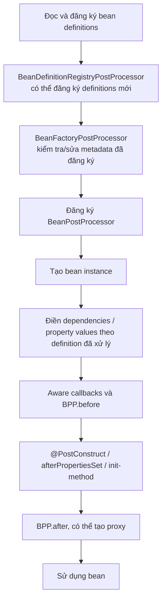

# BeanFactoryPostProcessor và thời điểm can thiệp metadata trong Spring Core Container

## 1. Tại sao cần can thiệp metadata trước khi bean được tạo?

Spring IoC container không chỉ lưu những đối tượng Java đã được tạo. Trước giai đoạn khởi tạo nhiều bean ứng dụng, container giữ một tập **bean definitions** mô tả cách tạo và cấu hình các bean đó: class, scope, constructor arguments, property values, lazy initialization, phụ thuộc cần xử lý, factory method và các thuộc tính khác.

`BeanFactoryPostProcessor` (viết tắt **BFPP**) là extension point để **đọc hoặc điều chỉnh cấu hình của bean factory và các bean definitions trước khi các bean ứng dụng thông thường được khởi tạo**. Đây là lúc lý tưởng để chuẩn hóa hoặc biến đổi **metadata**, chứ không phải để sửa một đối tượng nghiệp vụ đã được tạo.

Ví dụ một definition ban đầu nói:

```text
Bean name       : greeting
Bean class      : Greeting
property message: "giá trị mặc định"
scope           : singleton
```

Một BFPP có thể sửa metadata `message` thành `"giá trị sau BFPP"` trong bean definition. Khi Spring **sau đó** tạo bean `greeting`, container sử dụng cấu hình đã sửa để gọi setter hoặc thực hiện quy trình property population tương ứng.

Cần nắm ba ý chính:

1. **BFPP xử lý định nghĩa/cấu hình (metadata)**, không phải từng bean instance. Nó có quyền truy cập `ConfigurableListableBeanFactory` và từ đó các `BeanDefinition` thích hợp.
2. **BFPP chạy trong pha chuẩn bị container**, trước khi những singleton không lazy thông thường được pre-instantiate và trước các callback `BeanPostProcessor.before/after` của những bean đó.
3. **BFPP không phải cơ chế tự động sửa mọi instance đã tồn tại**. Nếu code đã tạo bean sớm, sửa definition về sau không quay ngược thời gian để thay đổi constructor hoặc initialization của object cũ.

Đặt trong bài toán cụ thể: khi một cấu hình muốn tác động đến **cách Spring sẽ tạo bean**, BFPP có thể phù hợp. Khi một extension muốn tác động đến **một instance sau khi được tạo**, lựa chọn cần xem là `BeanPostProcessor`.

## 2. Khái niệm BeanDefinition và bean instance

`BeanDefinition` là mô hình metadata mà Spring dùng để quản lý cách tạo bean. Nó không đồng nghĩa với một object nghiệp vụ.

| Thuộc tính / khái niệm | Metadata trong bean definition | Trạng thái ở bean instance |
|---|---|---|
| Bean class hoặc factory method | Spring sẽ tạo object bằng cách nào | Object thực tế đã được tạo |
| Scope | Singleton, prototype hoặc scope khác | Số lượng/thời điểm instance được tạo |
| Constructor arguments | Giá trị/bean reference sẽ truyền khi khởi tạo | Constructor đã chạy, state có thể đã cố định |
| Property values | Những giá trị sẽ được điền trước initialization | Field/setter state sau khi Spring populate |
| Lazy-init | Có trì hoãn tạo singleton hay không | Instance đã tồn tại hoặc chưa |
| Init method | Tên callback Spring sẽ gọi trong creation lifecycle | Callback đã chạy hay chưa |
| Depends-on | Metadata quy định dependency startup/destruction | Những dependency thực tế đã được resolve |
| Role, description, attributes | Thông tin định nghĩa/hạ tầng | Không nhất thiết là property trên object |

Một BFPP gọi:

```java
BeanDefinition definition = beanFactory.getBeanDefinition("greeting");
definition.getPropertyValues().add("message", "được sửa bởi BFPP");
```

Đây là **snippet nằm trong phương thức `postProcessBeanFactory`**, cần biến `beanFactory` kiểu `ConfigurableListableBeanFactory`, import `BeanDefinition` và một definition tên `greeting`. Nó không trực tiếp gọi `greeting.setMessage(...)`: đối tượng `Greeting` có thể còn chưa được tạo.

Spring dùng bean definitions từ nhiều nguồn: XML, `@Component` scanning, `@Configuration`/`@Bean`, hoặc đăng ký chương trình. Cách definition được tạo có thể khác nhau, nhưng BFPP vẫn có thể làm việc với metadata sau khi definitions phù hợp đã xuất hiện trong registry.

## 3. Thời điểm chính xác trong ApplicationContext.refresh()

Điểm mốc quan trọng là trình tự của `AbstractApplicationContext.refresh()`. Dưới đây là **sơ đồ rút gọn**, không phải mã người dùng cần tự chạy:

```text
1. prepareRefresh()
2. obtainFreshBeanFactory() / chuẩn bị bean factory
3. prepareBeanFactory(...)
4. postProcessBeanFactory(...)
5. invokeBeanFactoryPostProcessors(...)    <-- BeanDefinitionRegistryPostProcessor + BFPP
6. registerBeanPostProcessors(...)          <-- đăng ký BeanPostProcessor
7. initMessageSource(), initApplicationEventMulticaster(), ...
8. registerListeners()
9. finishBeanFactoryInitialization(...)     <-- pre-instantiate singleton không lazy
10. finishRefresh()                          <-- lifecycle processor / context event
```

Các bước nội bộ, loại context và extension có thể bổ sung hành vi khác, nhưng **đường thời gian quan trọng không đổi**: xử lý bean definition metadata phải diễn ra trước bước tạo hàng loạt các singleton application beans thông thường.



Sơ đồ tách pha BFPP khỏi pha tạo bean. Với **prototype** hoặc bean `@Lazy`, việc tạo instance có thể xảy ra muộn hơn nữa, khi có lookup thật sự. BFPP không tự ép tất cả prototype được tạo trong lúc `refresh()`.

### 3.1. BFPP chạy trước hay sau BeanPostProcessor?

**BFPP chạy trước khi container đăng ký tập BPP tự động cho các bean ứng dụng thông thường.** Sau khi BFPP hoàn tất, Spring mới bước vào giai đoạn tạo và init những application beans thích hợp với chuỗi `BeanPostProcessor`.

Hai extension khác nhau về thời điểm:

```text
[Bean definitions]
       |
       v
BeanFactoryPostProcessor.postProcessBeanFactory(...)
       |
       v
Tạo object → Dependency injection → Aware
       |
       v
BeanPostProcessor.postProcessBeforeInitialization(...)
       |
       v
InitializingBean / custom init
       |
       v
BeanPostProcessor.postProcessAfterInitialization(...)
       |
       v
[Bean cuối cùng]
```

Vì thế, đừng gọi `BeanPostProcessor` để thay một hàng loạt constructor/property definitions nếu thật sự muốn can thiệp trước instantiation. Ngược lại, BFPP không được truyền từng bean instance nên không thích hợp để tạo proxy của một object đã init.

### 3.2. Lưu ý: không phải hoàn toàn “không bean nào được tạo trước BFPP”

Một số **infrastructure beans** như các factory/post-processors và những dependencies thật sự cần thiết để chạy chúng có thể phải được khởi tạo sớm. Do đó, câu nói chính xác là: BFPP chạy **trước việc khởi tạo những bean ứng dụng thông thường**, không phải một cam kết rằng trong JVM vẫn tuyệt đối chưa có đối tượng Spring nào được tạo.

Điều này giải thích cảnh báo của tài liệu: **không tương tác với bean instances trong BFPP, nhất là không chủ động gọi `getBean()` để khởi tạo application beans**. Làm vậy có thể khiến những bean ấy được tạo **quá sớm**, chưa đủ điều kiện nhận trọn vẹn các post-processors như auto-proxying hoặc annotation-based processing theo cấu hình ứng dụng.

## 4. API BeanFactoryPostProcessor

Interface nằm trong package `org.springframework.beans.factory.config`:

```java
public interface BeanFactoryPostProcessor {
    void postProcessBeanFactory(
            ConfigurableListableBeanFactory beanFactory)
            throws BeansException;
}
```

Đây là **chữ ký rút gọn để học**, không phải source đầy đủ cần tự định nghĩa lại trong ứng dụng. Khi viết code thật, import interface có sẵn từ Spring.

Tham số `ConfigurableListableBeanFactory` cho phép xem các definition đã đăng ký và những thông tin cấu hình phù hợp. Các thao tác thường dùng gồm:

```java
String[] names = beanFactory.getBeanDefinitionNames();
BeanDefinition bd = beanFactory.getBeanDefinition("myBean");
bd.setScope("prototype");
bd.getPropertyValues().add("timeoutMillis", 5000);
bd.setLazyInit(true);
```

Đây là **snippet tích hợp**, chỉ minh họa API; yêu cầu đang ở bên trong `postProcessBeanFactory(...)`, bean `myBean` tồn tại và class đích có property `timeoutMillis` phù hợp. Không phải chương trình độc lập. Việc đặt scope, lazy-init, property/constructor metadata phải tuân hợp đồng bean definition cụ thể và kiểm tra tương thích với component đang sử dụng.

Một BFPP có thể **chỉ đọc**, chẳng hạn phát hiện các bean definitions có metadata sai trước khi tạo singleton. Khi cần điều chỉnh metadata, nên sửa **có mục đích, có điều kiện và trước khi bean bị tạo**; không ghi đè mù quáng những giá trị do người cấu hình cố tình đặt.

### 4.1. Mutation không thay đổi đối tượng đang tồn tại

Giả sử bean singleton `myBean` đã được tạo từ trước. Việc sửa `bd.getPropertyValues().add(...)` không tự gọi setter lại trên instance đó và không tái khởi tạo constructor. Với instance mutable đang tồn tại, nếu cần thay đổi ở runtime phải dùng cơ chế quản lý trạng thái/config động được thiết kế riêng.

Đặc biệt, `@ConfigurationProperties` hay runtime refresh từ những thư viện khác **không đồng nghĩa** BFPP chạy lại mỗi khi một cấu hình đổi. Một BFPP thông thường thực thi khi bean factory được chuẩn bị; trong một `ApplicationContext` đã refresh, nó không phải listener tự động theo dõi các biến môi trường mới.

## 5. Ví dụ Java 17 + Maven: BFPP sửa property trước constructor/initialization

Mục tiêu là chứng minh bằng stdout:

1. BFPP nhìn thấy bean definition `greeting` và **đặt property `message`**.
2. Spring **sau đó** mới tạo object `Greeting`.
3. Spring điền property `message` bằng setter theo definition đã sửa.
4. `InitializingBean.afterPropertiesSet()` nhìn thấy giá trị mới.
5. Code ứng dụng lấy bean và sử dụng; khi đóng context, destruction callback của singleton chạy.

**Yêu cầu:** Java 17+, Maven 3.9+ và `spring-context` 6.2.0; không cần Spring Boot, web server hay database.

Cấu trúc:

```text
bfpp-metadata-demo/
├── pom.xml
└── src/main/java/example/BfppMetadataDemo.java
```

**Tệp `pom.xml`:**

```xml
<project xmlns="http://maven.apache.org/POM/4.0.0"
         xmlns:xsi="http://www.w3.org/2001/XMLSchema-instance"
         xsi:schemaLocation="http://maven.apache.org/POM/4.0.0
                             https://maven.apache.org/xsd/maven-4.0.0.xsd">
    <modelVersion>4.0.0</modelVersion>
    <groupId>example</groupId>
    <artifactId>bfpp-metadata-demo</artifactId>
    <version>1.0.0</version>
    <properties>
        <maven.compiler.release>17</maven.compiler.release>
        <project.build.sourceEncoding>UTF-8</project.build.sourceEncoding>
    </properties>
    <dependencies>
        <dependency>
            <groupId>org.springframework</groupId>
            <artifactId>spring-context</artifactId>
            <version>6.2.0</version>
        </dependency>
    </dependencies>
    <build>
        <plugins>
            <plugin>
                <groupId>org.apache.maven.plugins</groupId>
                <artifactId>maven-compiler-plugin</artifactId>
                <version>3.13.0</version>
            </plugin>
            <plugin>
                <groupId>org.codehaus.mojo</groupId>
                <artifactId>exec-maven-plugin</artifactId>
                <version>3.5.0</version>
            </plugin>
        </plugins>
    </build>
</project>
```

**Tệp `src/main/java/example/BfppMetadataDemo.java`:**

```java
package example;

import org.springframework.beans.factory.DisposableBean;
import org.springframework.beans.factory.InitializingBean;
import org.springframework.beans.factory.config.BeanDefinition;
import org.springframework.beans.factory.config.BeanFactoryPostProcessor;
import org.springframework.context.annotation.AnnotationConfigApplicationContext;
import org.springframework.context.annotation.Bean;
import org.springframework.context.annotation.Configuration;

public class BfppMetadataDemo {

    public static void main(String[] args) {
        try (var context = new AnnotationConfigApplicationContext(Config.class)) {
            Greeting greeting = context.getBean("greeting", Greeting.class);
            System.out.println("05 application: " + greeting.getMessage());
        }
    }

    @Configuration(proxyBeanMethods = false)
    public static class Config {

        // Static @Bean: BFPP được tạo sớm mà không cần tạo Config.
        @Bean
        public static BeanFactoryPostProcessor updateGreetingDefinition() {
            return beanFactory -> {
                BeanDefinition bd = beanFactory.getBeanDefinition("greeting");
                bd.getPropertyValues().add(
                        "message", "hello from bean definition");
                System.out.println("01 BFPP: set message metadata");
            };
        }

        @Bean("greeting")
        public Greeting greeting() {
            return new Greeting();
        }
    }

    public static final class Greeting
            implements InitializingBean, DisposableBean {

        private String message = "default";

        public Greeting() {
            System.out.println("02 constructor");
        }

        public void setMessage(String message) {
            this.message = message;
            System.out.println("03 setter: " + message);
        }

        public String getMessage() {
            return message;
        }

        @Override
        public void afterPropertiesSet() {
            System.out.println("04 init: " + message);
        }

        @Override
        public void destroy() {
            System.out.println("06 destroy");
        }
    }
}
```

Chạy từ thư mục chứa `pom.xml`:

```bash
mvn -q compile exec:java -Dexec.mainClass=example.BfppMetadataDemo
```

**Stdout dự kiến** từ `System.out.println` của chương trình (không bao gồm log Maven nếu môi trường hiển thị):

```text
01 BFPP: set message metadata
02 constructor
03 setter: hello from bean definition
04 init: hello from bean definition
05 application: hello from bean definition
06 destroy
```

### 5.1. Vì sao thứ tự này đúng?

- Constructor `new AnnotationConfigApplicationContext(Config.class)` tạo và **refresh context ngay**. Nó parse `Config`, đăng ký bean definitions từ các `@Bean` methods và tiến hành gọi BFPP.
- `updateGreetingDefinition()` là **static `@Bean`** trả `BeanFactoryPostProcessor`, để Spring nhận diện và tạo processor sớm, tránh tạo đối tượng cấu hình chỉ để gọi factory method của processor.
- Trong `postProcessBeanFactory`, `getBeanDefinition("greeting")` lấy metadata của bean `greeting`. Lệnh `getPropertyValues().add(...)` bổ sung property `message`, **chưa tạo `Greeting` instance**.
- Sau khi các BFPP hoàn thành, Spring đăng ký BPP và tạo singleton `greeting`. Factory method `greeting()` gọi constructor và in dòng 02.
- Spring áp dụng `MutablePropertyValues` trong bean definition lên object bằng setter `setMessage(String)`; dòng 03 xảy ra trước init callback.
- `afterPropertiesSet()` thấy `message` đã được điền, in dòng 04.
- Ứng dụng lấy singleton đã init và in dòng 05. Khối `try-with-resources` gọi `context.close()`, làm `DisposableBean.destroy()` in dòng 06.

Ví dụ này cho thấy **metadata ảnh hưởng cách Spring tạo object**, chứ không phải BFPP trực tiếp thao tác trên instance `Greeting`. Việc thử `beanFactory.getBean("greeting")` từ BFPP để ép tạo `Greeting` ngay có thể làm xáo trộn vòng đời và là điều **không nên làm**.

### 5.2. Lưu ý về @Bean factory method và property values

Mặc dù `greeting` được khai báo bằng factory method `@Bean`, nó vẫn có **bean definition** trong container. Spring gọi factory method để có instance rồi còn xử lý các property values đã khai báo trên definition ở giai đoạn populate, nên `setMessage(...)` nhận giá trị do BFPP đặt.

Nếu `Greeting` chỉ có constructor nhận `message` và không có setter/property phù hợp, việc thêm `"message"` bằng `getPropertyValues().add(...)` như trên **không tự biến property thành constructor argument**. Khi đó cần chỉnh metadata constructor arguments/factory method hoặc thay thiết kế sao cho bean nhận dependency qua cách phù hợp. Không cố thay một value đã đi vào tham số constructor khi instance đã được tạo.

Ngoài ra, nếu `message` là property read-only, setter không tồn tại, Spring sẽ gặp lỗi population kiểu `NotWritablePropertyException` (có thể được bao bọc trong exception của bean creation). Một BFPP có quyền sửa metadata nhưng **không biến metadata không hợp lệ thành một cấu hình hợp lệ**.

## 6. So sánh BeanFactoryPostProcessor và BeanPostProcessor

Hai tên gần giống nhau, nhưng là **hai tầng extension khác nhau**.

| Tiêu chí | BeanFactoryPostProcessor (BFPP) | BeanPostProcessor (BPP) |
|---|---|---|
| Đầu vào | `ConfigurableListableBeanFactory` | Một `Object bean`, `String beanName` |
| Tác động chính | Bean definitions và cấu hình container | Bean instance trong quá trình initialization |
| Thời điểm thông thường | Trong `refresh()`, **trước** tạo singleton ứng dụng non-lazy | Khi **mỗi bean instance** đủ điều kiện được tạo |
| Method | `postProcessBeanFactory(...)` | `postProcessBeforeInitialization(...)`, `postProcessAfterInitialization(...)` |
| Dùng để sửa property metadata | Có | Không phải mục đích chính |
| Dùng để trả proxy thay instance | Không theo hợp đồng thông thường | Có thể, nếu trả wrapper/proxy hợp lệ |
| Số lần chạy | Theo vòng chuẩn bị của bean factory/context | Theo số lần tạo bean instance thích hợp |
| Thao tác với prototype | Sửa definition dùng cho các lần tạo về sau | BPP được gọi trên từng prototype instance khi nó được tạo |
| Tương tác với `@PostConstruct` | BFPP đi trước phần init bean thông thường | Lifecycle annotation được xử lý qua BPP trong pha before-init |
| Rủi ro đặc trưng | Ép tạo bean quá sớm hoặc ghi sai metadata | Thay object không tương thích hoặc thao tác side effects lúc init |

Ví dụ use-case:

- Muốn thay `BeanDefinition.scope` theo chính sách hạ tầng **trước instantiation**: BFPP.
- Muốn kiểm tra `BeanDefinition.propertyValues` từ cấu hình: BFPP.
- Muốn phát hiện một custom annotation trên **instance** sau DI và thực hiện validation theo state: BPP hoặc init callback thích hợp.
- Muốn tạo AOP proxy cho method invocation: một cơ chế proxy/BPP do Spring hỗ trợ, không phải sửa scope metadata bằng BFPP.
- Muốn một bean duy nhất load cache sau DI: `@PostConstruct`/custom init, không cần tự tạo BFPP toàn container.

Không dùng BFPP vì thấy chữ “PostProcessor” rồi lầm tưởng nó nhận object bean trong thời điểm after-init.

## 7. BeanDefinitionRegistryPostProcessor khác gì BFPP?

`BeanDefinitionRegistryPostProcessor` (BDRPP) là **giao diện mở rộng `BeanFactoryPostProcessor`**. Ngoài `postProcessBeanFactory(...)`, nó có thêm:

```java
void postProcessBeanDefinitionRegistry(BeanDefinitionRegistry registry)
        throws BeansException;
```

Đây là chữ ký rút gọn; interface chuẩn nằm trong package `org.springframework.beans.factory.support`. Ý nghĩa: cho phép **đăng ký những bean definitions mới trước khi các BFPP thông thường được gọi**.

```text
parse / register initial definitions
    |
    v
BDRPP.postProcessBeanDefinitionRegistry(...)
    |  tạo thêm definitions, có thể phát hiện tiếp BDRPP mới
    v
BDRPP.postProcessBeanFactory(...)
    |
    v
BFPP.postProcessBeanFactory(...)
    |
    v
register BPP / instantiate application beans
```

Sơ đồ minh họa quan hệ giai đoạn; ở chi tiết runtime, Spring có thứ tự `PriorityOrdered`/`Ordered`, xử lý lặp khi phát hiện thêm registry processors, và phân biệt processors đăng ký bằng tay hay được phát hiện từ bean definitions.

### 7.1. Khi nào dùng BDRPP thay BFPP?

Nếu bài toán là **đưa thêm một bean definition vào registry** trước khi container tạo singleton, BDRPP là extension point chuyên dụng. Nếu chỉ cần **chỉnh các definitions đã có**, BFPP thường đơn giản hơn.

Mã minh họa BDRPP:

```java
public final class AddProbeDefinition
        implements BeanDefinitionRegistryPostProcessor {

    @Override
    public void postProcessBeanDefinitionRegistry(
            BeanDefinitionRegistry registry) {
        if (!registry.containsBeanDefinition("auditProbe")) {
            BeanDefinition definition =
                    BeanDefinitionBuilder
                            .genericBeanDefinition(AuditProbe.class)
                            .getBeanDefinition();
            registry.registerBeanDefinition("auditProbe", definition);
        }
    }

    @Override
    public void postProcessBeanFactory(
            ConfigurableListableBeanFactory beanFactory) {
        // Không cần sửa thêm metadata ở ví dụ này.
    }
}
```

Đây là **snippet tích hợp**, chưa chạy độc lập: cần imports `BeanDefinitionRegistryPostProcessor`, `BeanDefinitionRegistry`, `BeanDefinitionBuilder`, `BeanDefinition`, `ConfigurableListableBeanFactory`, một class `AuditProbe` có thể tạo được, và một cách đăng ký processor đủ sớm. Nếu đăng ký BDRPP bằng Java configuration, chú ý `static @Bean` khi thích hợp.

**Đừng làm điều ngược lại:** tránh tự lấy `DefaultListableBeanFactory` rồi ép cast từ mọi `ConfigurableListableBeanFactory` chỉ để đăng ký definitions mới bên trong một BFPP; không phải tất cả implementation đều bảo đảm kiểu cast đó. BDRPP đưa đúng `BeanDefinitionRegistry` cần thiết cho việc thêm definitions.

### 7.2. ConfigurationClassPostProcessor là một ví dụ hạ tầng quan trọng

Spring dùng `ConfigurationClassPostProcessor` để xử lý configuration class, `@ComponentScan`, `@Import` và `@Bean` definitions. Nó là một BDRPP; quá trình này xảy ra ở pha chuẩn bị metadata trước khi những bean ứng dụng thông thường được tạo.

Điều này giải thích vì sao static `@Bean` BFPP trong ví dụ **có thể nhìn thấy** definition `greeting`: Spring đã xử lý cấu hình và đăng ký definition trước khi gọi BFPP sửa metadata. Tuy nhiên, nếu ứng dụng custom hóa sâu registry processing, cần hiểu thứ tự phát hiện definitions, không giả định mọi definition từ plugin tải động đã hiện diện ngay từ đầu.

## 8. Đăng ký BFPP đúng cách

Có nhiều cách đăng ký:

1. Khai báo một class implement `BeanFactoryPostProcessor` dưới dạng bean definition (ví dụ một component trong vùng scan phù hợp).
2. Khai báo `@Bean` trả BFPP trong class `@Configuration`; **ưu tiên static `@Bean`**.
3. Đăng ký chương trình qua `ConfigurableApplicationContext.addBeanFactoryPostProcessor(...) ` **trước khi `refresh()`**.
4. Với container thuần `BeanFactory` không phải `ApplicationContext`, tự tạo BFPP và **gọi thủ công** `postProcessBeanFactory(beanFactory)` vào thời điểm phù hợp; không giả định `DefaultListableBeanFactory` sẽ tự tìm và gọi toàn bộ BFPP definitions như `ApplicationContext.refresh()`.

### 8.1. Vì sao static @Bean quan trọng?

Một BFPP là **infrastructure bean phải sẵn sàng sớm** để tham gia xử lý definitions trước ứng dụng. Nếu bạn khai báo:

```java
@Configuration
class BrokenConfig {
    @Bean
    BeanFactoryPostProcessor processor() {
        return beanFactory -> { /* metadata mutation */ };
    }
}
```

Đây là **mã minh họa một cấu hình không được khuyến nghị**; nó không nhất thiết luôn ném lỗi nhưng có thể khiến Spring phải tạo instance `BrokenConfig` quá sớm chỉ để gọi `processor()`, trước khi class cấu hình và dependency của nó được xử lý đầy đủ bởi hạ tầng.

Cách rõ ràng hơn:

```java
@Configuration(proxyBeanMethods = false)
class CorrectConfig {
    @Bean
    static BeanFactoryPostProcessor processor() {
        return beanFactory -> { /* metadata mutation */ };
    }
}
```

Hai snippet chỉ minh họa cách đăng ký, cần imports phù hợp; không phải chương trình độc lập. Method `static` không cần instance `CorrectConfig` để tạo BFPP, nhờ đó giảm nguy cơ khởi tạo configuration bean sớm và bỏ lỡ một số bean lifecycle/post-processing. Đây là quy tắc thực hành đặc biệt quan trọng với `BeanFactoryPostProcessor` và `BeanPostProcessor` được khai báo bằng `@Bean`.

**Không inject business services vào BFPP** chỉ để tính một property metadata, vì dependency injection đó có thể ép tạo business bean trước khi chuỗi xử lý hoàn thiện. Nếu cần cấu hình, ưu tiên `Environment`, property sources hoặc dữ liệu định nghĩa có thể đọc mà không khởi tạo object nghiệp vụ.

### 8.2. Đăng ký chương trình trước refresh

```java
var context = new AnnotationConfigApplicationContext();
context.register(AppConfig.class);
context.addBeanFactoryPostProcessor(
        beanFactory -> beanFactory.getBeanDefinition("greeting")
                .setLazyInit(true));
context.refresh();
```

Đây là **snippet minh họa**, cần `AppConfig` đăng ký bean definition `greeting`, import Spring và context; đoạn này chưa phải chương trình độc lập. Processor thêm bằng `addBeanFactoryPostProcessor` phải có mặt **trước khi refresh**; nếu thêm sau, đừng kỳ vọng các steps của refresh được Spring chạy lại tự động.

Với `new AnnotationConfigApplicationContext(AppConfig.class)`, constructor đã refresh context, vì vậy không còn “khoảng thời gian trước refresh” để thêm BFPP theo cách trên. Nếu cần đăng ký bằng tay, dùng constructor rỗng rồi register definitions và refresh tường minh.

## 9. Thứ tự nhiều BFPP và tác động khi có xung đột

Khi có nhiều processor sửa metadata, ví dụ A đặt `message="A"` và B đặt `message="B"`, **thứ tự áp dụng quyết định giá trị cuối cùng** nếu cả hai cùng ghi một property. Không nên dựa vào thứ tự tên class hoặc thứ tự khai báo methods trong source.

Trong `ApplicationContext` tiêu chuẩn, Spring hỗ trợ `PriorityOrdered`, `Ordered` và quy tắc sắp xếp dành cho processors được tự động phát hiện. BDRPP có giai đoạn registry riêng, được xử lý trước các BFPP thông thường. Các BFPP được thêm chương trình bằng `addBeanFactoryPostProcessor` được xử lý theo cơ chế/đường đăng ký riêng; không nên áp máy móc thứ tự annotation lên tất cả loại registration.

Nếu một metadata mutation phải **sau** quá trình đăng ký beans hoặc xử lý `@Configuration`, kiểm tra rằng processor được gọi trong giai đoạn thích hợp. Khi nhiều extension độc lập cùng chỉnh definition, thay vì trông đợi “ai ghi sau thắng”, hãy:

- Quy định rõ một owner cho metadata đó, hoặc tách nhiệm vụ để tránh trùng.
- Dùng ordering contract phù hợp và test với context hoàn chỉnh.
- Kiểm tra bean definition trước và sau processor trong integration test.
- Chỉ sửa giá trị khi có condition rõ ràng; tránh overwrite giá trị đã được application khai báo chủ động.
- Ném exception thông báo cấu hình mâu thuẫn nếu hệ thống không cho phép hai policies đồng thời.

Một BFPP nên nhanh, side-effect tối thiểu và không gọi service ngoài mạng. Vì nó chạy lúc bootstrap, lỗi có thể khiến context không refresh được.

## 10. PropertySourcesPlaceholderConfigurer: trường hợp BFPP quen thuộc

`PropertySourcesPlaceholderConfigurer` là một processor hỗ trợ giải quyết placeholder kiểu `${...}` trong bean definition property values và đăng ký cơ chế embedded value resolver thích hợp cho cấu hình Spring. Nó thể hiện rõ tư duy “xử lý metadata trước khi tạo bean”.

Ví dụ XML truyền thống:

```xml
<beans xmlns="http://www.springframework.org/schema/beans"
       xmlns:xsi="http://www.w3.org/2001/XMLSchema-instance"
       xsi:schemaLocation="http://www.springframework.org/schema/beans
                           https://www.springframework.org/schema/beans/spring-beans.xsd">

    <bean class="org.springframework.context.support.PropertySourcesPlaceholderConfigurer" />

    <bean id="serviceConfig" class="example.ServiceConfig">
        <property name="endpoint" value="${service.endpoint}" />
    </bean>
</beans>
```

Đây là **XML minh họa**, giả định `example.ServiceConfig` có writable property `endpoint` và `service.endpoint` được cấu hình qua property sources. Trong file XML cấu hình hoàn chỉnh, namespace/resource loading còn phụ thuộc application setup.

BFPP xử lý placeholder trong definition `endpoint` để Spring sử dụng giá trị đã resolve khi tạo `serviceConfig`. Trong ứng dụng Java config hiện đại, có thể đăng ký static `@Bean` trả `PropertySourcesPlaceholderConfigurer` nếu cấu hình yêu cầu, song một `ApplicationContext` mặc định cũng có cơ chế embedded value resolution riêng. Không tự nhận định “mọi `@Value` đều bắt buộc bạn phải đăng ký BFPP này” trong mọi cấu hình Spring/Spring Boot.

Các hạ tầng phổ biến khác cũng thao tác metadata, ví dụ `ConfigurationClassPostProcessor` ở pha registry; không vì thế mà một BFPP tùy chỉnh cần tự implement parsing annotation của Spring.

## 11. Lưu ý về lazy/prototype và can thiệp sau refresh

### 11.1. Metadata sửa lúc bootstrap áp dụng cho lần tạo bean về sau

Khi BFPP sửa một bean definition trước khi bean được tạo:

- **Singleton eager**: định nghĩa đã sửa được dùng khi container pre-instantiate singleton trong `refresh()`.
- **Singleton lazy**: định nghĩa đã sửa vẫn sẽ được dùng khi singleton được resolve lần đầu về sau.
- **Prototype**: định nghĩa đã sửa được dùng mỗi lần container tạo instance mới theo scope prototype.

Ngược lại, khi bean instance đã tồn tại, việc sửa definition không tự cập nhật instance đó. Đó là khác biệt với một cơ chế runtime configuration refresh có tính reactive/rebinding được thiết kế riêng.

### 11.2. Không dùng BFPP như dynamic feature toggle

Một anti-pattern là lưu một `BeanDefinition` trong BFPP, rồi sau refresh tiếp tục sửa `propertyValues` khi nhận lệnh từ admin UI với kỳ vọng service singleton thay đổi ngay lập tức. Singleton đã có state của riêng nó; Spring không tự populate lại từ metadata mới.

Nếu mục tiêu là runtime config thay đổi thường xuyên, hãy sử dụng một configuration service/wrapper động, `AtomicReference`, một interface đọc configuration tại thời điểm sử dụng, hoặc giải pháp được framework hỗ trợ tương ứng. Không lạm dụng BFPP để tái cấu hình objects đã init.

### 11.3. Không tự tạo application beans trong BFPP

```java
@Override
public void postProcessBeanFactory(
        ConfigurableListableBeanFactory beanFactory) {
    Object bean = beanFactory.getBean("paymentService"); // Anti-pattern
    // ...
}
```

Đây là **mã minh họa lỗi**, nằm trong một BFPP class. Nó có thể tạo `paymentService` sớm khi chưa đăng ký đủ `BeanPostProcessor`, gây bỏ lỡ một số xử lý như AOP auto-proxy hoặc các extension khác, nhất là khi bean khác tham gia dependency chain.

Nếu chỉ cần xem kiểu hoặc metadata, ưu tiên `getBeanDefinition`, `getBeanDefinitionNames`, `getBeanNamesForType` với cẩn trọng về eager initialization và `FactoryBean`; không dùng `getBean` chỉ để biết cấu hình. Ngay cả type lookup có thể kích hoạt một số factory initialization tùy overload/cấu hình, nên đọc API và cân nhắc những thao tác an toàn khi bootstrap.

## 12. Kiểm thử BFPP theo hai tầng

### 12.1. Unit test chỉ kiểm tra metadata

Có thể tạo một `DefaultListableBeanFactory` với một `BeanDefinition` rồi tự gọi BFPP. Kết quả cần kiểm tra là **metadata thay đổi**; test này không khẳng định bean đã được khởi tạo.

Mã Java rút gọn:

```java
DefaultListableBeanFactory factory = new DefaultListableBeanFactory();
RootBeanDefinition bd = new RootBeanDefinition(Greeting.class);
factory.registerBeanDefinition("greeting", bd);

BeanFactoryPostProcessor processor = beanFactory ->
        beanFactory.getBeanDefinition("greeting")
                .getPropertyValues()
                .add("message", "test");

processor.postProcessBeanFactory(factory);

Object value = factory.getBeanDefinition("greeting")
        .getPropertyValues().get("message");
System.out.println(value); // test
```

Đây là **snippet minh họa**, yêu cầu imports từ `org.springframework.beans.factory.support` cho `DefaultListableBeanFactory`, `RootBeanDefinition` và `BeanFactoryPostProcessor` từ `config`. Ngoài ra class `Greeting` phải tồn tại; có thể lấy từ ví dụ phần 5. Đoạn này không phải chương trình độc lập vì lược bỏ class chứa `main`.

Kỳ vọng: definition `greeting` có property `message = "test"`. Trong test định hướng lifecycle, có thể chứng minh `Greeting` constructor **chưa** chạy cho đến khi test thực sự gọi `factory.getBean("greeting")`.

### 12.2. Integration test quan sát thứ tự thực tế

Một integration test Spring có thể:

- Đăng ký BFPP từ `@Configuration` qua static `@Bean`.
- Đăng ký application bean definition bình thường.
- Ghi event trace `BFPP`, `constructor`, `setter`, `afterPropertiesSet`, `BeanPostProcessor.before/after`.
- Refresh context và assert BFPP trace xuất hiện trước constructor của bean ứng dụng.
- Kiểm tra state sau init và destruction callbacks khi close.
- Thử cấu hình metadata invalid để xác nhận failure xảy ra có thông báo.

Không nên chỉ xem một log “BFPP called” rồi kết luận toàn bộ ứng dụng đã an toàn. Giá trị của test là chứng minh **definition đã được sửa trước khi đối tượng liên quan được tạo** và không có application bean nào bị pre-instantiate ngoài ý muốn.

## 13. Bẫy phổ biến và cách tránh

| Hiểu nhầm/lỗi | Vì sao sai | Cách khắc phục |
|---|---|---|
| “BFPP nhận từng bean object để chỉnh sửa” | Nó nhận `ConfigurableListableBeanFactory`, xử lý metadata/container | Dùng BPP hoặc init callback nếu muốn xử lý instance |
| “BFPP chạy sau `@PostConstruct`” | BFPP xảy ra trước initialization của các application beans thông thường | Đọc đúng trình tự `refresh()` |
| “BFPP được gọi mỗi lần `getBean()`” | BFPP thuộc pha xử lý factory/context, không chạy theo lookup bean | Dùng BPP cho mỗi instance nếu đúng mục đích |
| “Có thể `getBean()` thoải mái trong BFPP” | Ép tạo bean sớm, có thể mất post-processing/AOP | Chỉ thao tác bean definitions nếu có thể |
| “Sửa definition sẽ cập nhật singleton đã tạo” | Instance đã có state của riêng nó | Thiết kế cơ chế config động riêng |
| “`@Bean` BFPP non-static luôn an toàn” | Có thể phải instantiate `@Configuration` sớm | Ưu tiên static factory method |
| “`BeanFactoryPostProcessor` và `BeanPostProcessor` tương đương” | Một bên metadata, một bên instance | Chọn extension theo thời điểm và đối tượng |
| “BFPP nên đăng ký bean definitions mới qua ép cast registry” | Không phải mọi factory đều cho ép cast phù hợp | Dùng `BeanDefinitionRegistryPostProcessor` |
| “`PriorityOrdered` khiến mọi registration type có thứ tự giống nhau” | Processor phát hiện bằng bean definition và processor đăng ký bằng tay có đường xử lý khác | Test ordering trong context thực tế |
| “Thêm property name tùy ý vào definition vẫn được Spring chấp nhận” | Property có thể không tồn tại hoặc thiếu setter | Kiểm tra JavaBeans property và conversion |
| “`@Lazy` có nghĩa BFPP chạy khi lookup bean lazy” | BFPP chạy khi bootstrap factory; bean lazy mới tạo muộn | Phân biệt definition processing với instance creation |
| “BFPP là nơi thích hợp gọi network service để lấy cấu hình” | Tạo side effects/timing phụ thuộc ngoài hệ thống ngay trong refresh | Sử dụng property sources/cache cấu hình được chuẩn bị trước |
| “BeanFactory thuần luôn tự gọi mọi BFPP được đăng ký” | Tự động phát hiện và gọi là trách nhiệm ApplicationContext bootstrap | Với BeanFactory thuần, gọi processor thủ công đúng thời điểm |
| “Muốn thay annotation @Autowired thì sửa mọi bean bằng BFPP” | Autowire còn có processor SPI riêng và dependency graph | Chỉ can thiệp đúng bean definition semantics, tránh thay framework internals tùy tiện |

### 13.1. Không bỏ qua độ khó của metadata mutation

Bean definition có nhiều trường liên quan: parent/child inheritance, constructor arguments, property values, scope, role, bean class, factory method và các attributes. Nếu sửa một trường không tương thích, context có thể không refresh được hoặc lỗi chỉ xuất hiện khi bean lazy/prototype được tạo sau này.

Với custom BFPP trong thư viện dùng chung, nên:
- Chỉ áp dụng cho bean definitions mục tiêu bằng tên, role, metadata marker hoặc điều kiện rõ ràng.
- Không overwrite những cấu hình mà người dùng đã cung cấp nếu không có lý do.
- Ném thông báo lỗi đủ rõ về bean name và thuộc tính sai.
- Viết integration tests cho ít nhất singleton eager, singleton lazy và prototype khi extension can thiệp các thuộc tính vòng đời.
- Ghi chú chính xác Spring version/contract mà extension phụ thuộc.
- Tránh thao tác `BeanDefinition` tùy ý sau khi container đã bắt đầu dùng nó để tạo nhiều bean.

## 14. Khi nào nên dùng BFPP trong kiến trúc thực tế?

BFPP hữu ích cho **thư viện tích hợp Spring** hoặc **cấu hình hạ tầng** cần đọc/sửa toàn bộ nhóm bean definitions trước startup: ví dụ áp chính sách mặc định lên beans thuộc một module, chuẩn hóa metadata, resolve placeholders, validate cấu hình, hoặc điều chỉnh lazy/scopes có chủ đích trước initialization.

Trong service ứng dụng thông thường, nhu cầu như “khi xây một service hãy tiêm dependency X” được constructor injection giải quyết tốt hơn. “Sau DI hãy mở tài nguyên Y” có thể thuộc `@PostConstruct` hoặc custom init. “Mỗi method call phải có transaction” thuộc Spring AOP/declarative infrastructure. “Mỗi HTTP request phải có state riêng” thuộc bean scope/proxy hoặc provider.

Bảng quyết định:

| Câu hỏi chính | Giải pháp nên xét |
|---|---|
| Cần sửa **định nghĩa** bean trước khi Spring tạo instance? | `BeanFactoryPostProcessor` |
| Cần **thêm definitions** trong giai đoạn registry bootstrap? | `BeanDefinitionRegistryPostProcessor` |
| Cần xử lý **mỗi bean instance** trước/sau initialization? | `BeanPostProcessor` |
| Cần một bean biết khi nào **chính nó** đã được inject? | `@PostConstruct`, `InitializingBean`, custom init |
| Cần lifecycle start/stop của worker? | `Lifecycle` hoặc `SmartLifecycle` |
| Cần đối tượng mới mỗi lần dùng trong singleton? | Scope prototype kết hợp `ObjectProvider<T>` hoặc factory thích hợp |
| Cần đóng tài nguyên khi context shutdown? | Destruction callbacks và ownership của scope phù hợp |

Không phải mọi thay đổi cách khởi tạo đều cần BFPP; một bean definition khai báo đúng từ đầu thường dễ hiểu và ít rủi ro hơn một post-processor can thiệp ngầm.

## 15. Câu hỏi tự kiểm tra

**1. `BeanFactoryPostProcessor` xử lý bean instance hay bean definition?**  
Nó xử lý cấu hình `ConfigurableListableBeanFactory` và bean definition metadata, không nhận một bean instance cụ thể làm callback đầu vào.

**2. Trong `ApplicationContext.refresh()`, BFPP chạy trước hay sau pre-instantiation singleton non-lazy?**  
Trước. Spring gọi BFPP ở pha `invokeBeanFactoryPostProcessors`, sau đó mới đăng ký BPP và pre-instantiate singleton thông thường.

**3. `BeanPostProcessor.before` có cùng vai trò BFPP không?**  
Không. `BeanPostProcessor.before` nhận **object đã được tạo** và chạy trước initialization callbacks của object đó.

**4. Vì sao không nên gọi `beanFactory.getBean("service")` từ BFPP?**  
Nó có thể tạo service sớm, trước khi các BPP/hạ tầng cần thiết được đăng ký, khiến service thiếu post-processing hoặc kích hoạt dependency chain sớm.

**5. `BeanDefinitionRegistryPostProcessor` khác gì BFPP?**  
Nó mở rộng BFPP bằng callback trên registry để có thể đăng ký thêm bean definitions trước các BFPP thông thường.

**6. Với Java configuration, vì sao static `@Bean` được khuyến nghị cho BFPP?**  
Nó cho phép Spring tạo processor sớm mà không cần instantiate `@Configuration` object chỉ để gọi method tạo processor.

**7. Nếu BFPP sửa property `message`, constructor và setter thấy giá trị thế nào trong demo?**  
Constructor tạo object với state ban đầu; trong giai đoạn property population, Spring gọi setter theo definition đã sửa. Init callback và code ứng dụng nhìn thấy giá trị mới.

**8. Sửa bean definition sau khi singleton đã tạo có tự gọi lại `afterPropertiesSet()` không?**  
Không. Metadata mutation không phải runtime reinitialization.

**9. Có thể dùng BFPP để sửa metadata của một prototype bean không?**  
Có, nếu definition tồn tại và được sửa trước khi instance được tạo; các lần tạo prototype về sau dùng definition đã xử lý.

**10. Nếu muốn thay đổi cấu hình của ứng dụng đang chạy theo thời gian thực, BFPP có phải lựa chọn mặc định không?**  
Không. Cần một cơ chế configuration/state động có hợp đồng riêng; BFPP là extension trong bootstrap factory.

## Tài liệu chính thức

- [Spring Framework Reference — Customizing Configuration Metadata with a BeanFactoryPostProcessor](https://docs.spring.io/spring-framework/reference/core/beans/factory-extension.html#beans-factory-extension-factory-postprocessors): mục đích xử lý metadata và cảnh báo không tương tác bean instances.
- [Spring Framework Reference — Container Extension Points](https://docs.spring.io/spring-framework/reference/core/beans/factory-extension.html): so sánh BFPP, BPP và FactoryBean.
- [Spring Framework 6.2 API — BeanFactoryPostProcessor](https://docs.spring.io/spring-framework/docs/6.2.0/javadoc-api/org/springframework/beans/factory/config/BeanFactoryPostProcessor.html): contract callback và giai đoạn xử lý.
- [Spring Framework 6.2 API — BeanDefinitionRegistryPostProcessor](https://docs.spring.io/spring-framework/docs/6.2.0/javadoc-api/org/springframework/beans/factory/support/BeanDefinitionRegistryPostProcessor.html): đăng ký definitions trước BFPP thông thường.
- [Spring Framework 6.2 API — ConfigurableListableBeanFactory](https://docs.spring.io/spring-framework/docs/6.2.0/javadoc-api/org/springframework/beans/factory/config/ConfigurableListableBeanFactory.html): truy xuất bean definitions và factory metadata.
- [Spring Framework 6.2 API — AbstractApplicationContext](https://docs.spring.io/spring-framework/docs/6.2.0/javadoc-api/org/springframework/context/support/AbstractApplicationContext.html): thứ tự `refresh()` và các extension.
