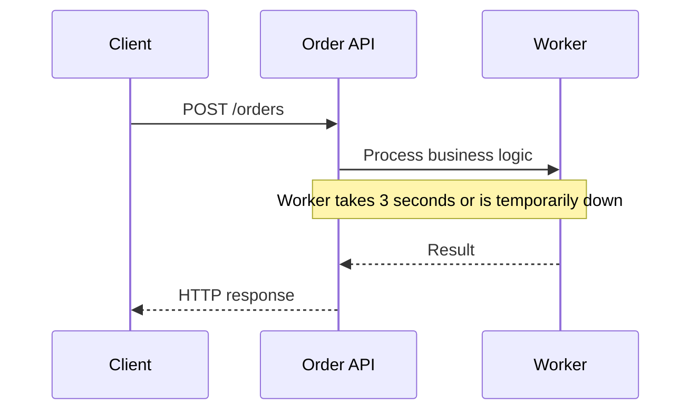
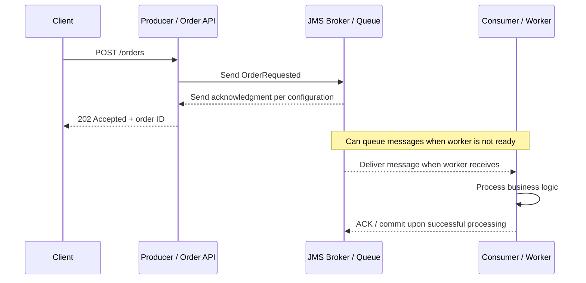

# Decoupling Senders and Receivers by Processing Time in JMS

> **Scope:** JMS Overview (Java Message Service / Jakarta Messaging). This lesson focuses on *temporal decoupling*: the sender can finish delivering a message before the receiver actually processes the business logic. JMS is the API; storing, routing, and delivering messages are handled by the JMS provider/message broker.

## 1. Why Is Temporal Decoupling Needed?

Suppose an API receives an order creation request. Sending an email, generating an invoice, or syncing inventory can take several seconds, and sometimes the processing service must undergo maintenance. If the API calls directly and waits for each task to complete, response times and the ability to accept requests become tied to the speed and state of downstream services.

- **Synchronous call:** the sender calls the receiver and waits for the business result. A slow, overloaded, or paused receiver directly impacts the current request.
- **Delivery via a JMS queue:** the sender hands a message to the broker. Once the broker accepts the send under the active configuration, the sender can reply to the client; the receiver picks up and processes the message at a later time.
- **Key value:** the two sides do not need to be running, idle, or processing at the same cadence. The queue absorbs speed differences within the broker's capacity limits and retention policies.

**Temporal decoupling does not mean zero dependencies:** the producer still needs a connection and successful delivery to the broker (unless the application has its own local storage/outbox mechanism). An "accepted for processing" response is fundamentally different from "processing finished".

## 2. Timeline Before and After Using JMS

### When Processing Synchronously



The worker's processing time sits directly on the request's waiting path. A direct call timeout can cause the request to fail even while the backend business logic is still running.

### When Using a JMS Queue



Illustrative example (not a timing guarantee): at 10:00:00 the producer delivers the message to the broker and returns `202 Accepted`; at 10:00:05 the worker starts running; at 10:00:08 the worker finishes processing and commits. The user does not have to hold the HTTP connection open waiting until 10:00:08. In return, the system must track asynchronous state and notify of processing errors later.

## 3. How Does JMS Achieve This Decoupling?

1. **Producer:** creates the message content and sends it to a `Destination` via Spring's `JmsTemplate` or the `jakarta.jms` API.
2. **Broker/provider:** accepts, routes, and can store the message in a queue. Survival across restarts depends on the delivery mode, persistent storage, and provider policies; a queue is not an infinite store.
3. **Queue:** holds pending work. With the point-to-point model, a message is delivered to one consumer among competing consumers, rather than broadcast to all.
4. **Consumer:** can receive messages via an asynchronous listener (`@JmsListener`) or actively invoke synchronous receive. The worker does not need to be present at the exact moment the producer sends, provided the broker retains the message long enough.
5. **ACK/transaction:** defines when the broker may consider reception successful. If the receiving session is transacted and the listener fails before commit, the delivery can roll back and the message can be redelivered according to broker policy.

Distinguish three independent milestones: **(A) broker accepts the message**, **(B) consumer receives the message**, **(C) business processing succeeds**. A send API completing at A does not prove B or C has occurred.

### Temporal Independence Has Limits

| Scenario | Expected Outcome and Conditions |
| --- | --- |
| Consumer down, broker still running | Producer can continue sending; the queue holds messages if retention policy, capacity, and TTL allow. |
| Consumer processes slower than send rate | Queue accumulates backlog; processing latency grows and the broker may apply flow control, quotas, or overflow policies. |
| Consumer restarts | Consumer can resume taking unfinished messages or receive redeliveries according to transaction/ACK and broker policies. |
| Broker cannot accept sends | Producer can still error, timeout, or block; JMS does not automatically guarantee successful sends when the broker is offline. |
| Message expires or is evicted per retention | Consumer will no longer receive that message; TTL, alerting, and failure handling must be designed. |

## 4. Two Important Misconceptions

**"JMS is asynchronous" does not mean "sending is always non-blocking".** `JmsTemplate.convertAndSend(...)` normally executes the send call on the current thread and may wait on I/O or the broker; what is decoupled is *when business processing completes at the consumer*. JMS also has an asynchronous send API, but that is a different mechanism from the worker processing later.

**Queue does not mean Topic.** A queue fits when each job needs one worker in a group to process it. A topic uses the publish/subscribe model for multiple subscribers; regular subscribers can miss messages while offline. Receiving missed messages while absent requires configuring an appropriate durable subscription or shared durable subscription and broker retention. You cannot extrapolate a queue's offline retention to every topic.

## 5. Spring Boot Example: Fast Order-Accepting API, Deferred Worker Processing

This example uses **Java 17+, Spring Boot 3.3.x, Jakarta JMS, and ActiveMQ Artemis**. A single application contains both the API and the listener for easy testing; in a real system they can be two independently deployed applications connecting to the same broker. To run the test, an Artemis broker must be running at `localhost:61616` with username/password matching the configuration.

**`build.gradle`** (new Gradle project, e.g., with Spring Boot 3.3.5):

```groovy
plugins {
    id 'java'
    id 'org.springframework.boot' version '3.3.5'
    id 'io.spring.dependency-management' version '1.1.6'
}

group = 'com.example'
version = '0.0.1-SNAPSHOT'

java {
    toolchain { languageVersion = JavaLanguageVersion.of(17) }
}

repositories { mavenCentral() }

dependencies {
    implementation 'org.springframework.boot:spring-boot-starter-web'
    implementation 'org.springframework.boot:spring-boot-starter-artemis'
}
```

**`src/main/resources/application.yml`:**

```yaml
spring:
  artemis:
    mode: native
    broker-url: tcp://localhost:61616
    user: ${ARTEMIS_USER:artemis}
    password: ${ARTEMIS_PASSWORD:artemis}
  jms:
    pub-sub-domain: false
    listener:
      session:
        transacted: true
```

`pub-sub-domain: false` selects queues. The example enables JMS transactions for the listener to illustrate the post-processing commit milestone; actual behavior also depends on broker and transaction manager configuration. Do not leave default credentials in deployed environments.

**`src/main/java/com/example/jms/JmsDecouplingApplication.java`:**

```java
package com.example.jms;

import org.springframework.boot.SpringApplication;
import org.springframework.boot.autoconfigure.SpringBootApplication;
import org.springframework.http.ResponseEntity;
import org.springframework.jms.annotation.JmsListener;
import org.springframework.jms.core.JmsTemplate;
import org.springframework.stereotype.Component;
import org.springframework.web.bind.annotation.PathVariable;
import org.springframework.web.bind.annotation.PostMapping;
import org.springframework.web.bind.annotation.RestController;

@SpringBootApplication
public class JmsDecouplingApplication {
    public static void main(String[] args) {
        SpringApplication.run(JmsDecouplingApplication.class, args);
    }
}

@RestController
class OrderController {
    private final JmsTemplate jmsTemplate;

    OrderController(JmsTemplate jmsTemplate) {
        this.jmsTemplate = jmsTemplate;
    }

    @PostMapping("/orders/{orderId}")
    public ResponseEntity<String> enqueue(@PathVariable String orderId) {
        jmsTemplate.convertAndSend("orders.pending", orderId);
        return ResponseEntity.accepted().body("ENQUEUED " + orderId);
    }
}

@Component
class OrderWorker {
    @JmsListener(destination = "orders.pending")
    public void process(String orderId) throws InterruptedException {
        System.out.println("START " + orderId);
        Thread.sleep(3_000); // Simulate slow business processing
        System.out.println("DONE " + orderId);
    }
}
```

Execution flow explanation:

- The controller sends a `String` to the `orders.pending` queue; Spring uses the default message converter to create/receive the corresponding payload.
- Once `convertAndSend` succeeds, the API returns **HTTP 202** with the text `ENQUEUED`. This only indicates delivery to the messaging layer per configuration, **not that the order is complete**.
- The listener is invoked by Spring's container on a dedicated receiving thread. `Thread.sleep(3_000)` simulates slow business logic; you should not block threads needlessly in production code.
- With listener transactions enabled, if the listener throws an exception before commit, that delivery rolls back and may be redelivered; redelivery/DLQ policies must be configured on the broker. Do not treat this example as an exactly-once guarantee for all side effects.

**Test run:** start Artemis and create/allow auto-creation of the `orders.pending` queue per broker configuration. In the project directory, run `./gradlew bootRun` (Linux/macOS) or `gradlew.bat bootRun` (Windows). Then call:

```bash
curl -i -X POST http://localhost:8080/orders/A-101
curl -i -X POST http://localhost:8080/orders/A-102
```

Example response from the first command:

```http
HTTP/1.1 202
Content-Type: text/plain;charset=UTF-8

ENQUEUED A-101
```

Illustrative log of one possible sequence (actual order and timing depend on listener count, broker, and scheduling):

```text
START A-101
DONE A-101
START A-102
DONE A-102
```

What to observe: the HTTP response can appear **before** the `DONE` log; there is no need to wait for the worker to finish. To demonstrate that the consumer can go offline independently, split the controller and listener into two processes connected to the same broker, stop only the listener process, send messages, and then restart the listener; the test condition is that the broker remains able to accept and retain the queue.

## 6. When Handling Errors: "In the Queue" Is Not Yet "Success"

In asynchronous systems, failures can occur after the producer has already replied to the user. Each type must be distinguished:

| Problem | Required Behavior/Design Approach |
| --- | --- |
| Error before broker accepts | The sending API must report an appropriate failure or apply controlled retry; do not return false success. |
| Worker throws an exception | Transaction/ACK determines redelivery; attempt limits, retry delays, and a dead-letter queue prevent infinite loops. |
| Worker updated DB but has not committed ACK | The message may reappear, causing duplicate side effects. Design an **idempotent** consumer keyed by `messageId`/business ID. |
| DB write succeeded but producer failed to send JMS | The two resources are not automatically in the same transaction; consider a **transactional outbox** to record the send intent in the same DB transaction, then have a publisher deliver to JMS with retry. |
| Producer sends faster than worker processes | Monitor queue depth, oldest message age, send/receive rates, and retries/DLQ; scale consumers in a controlled manner and handle backpressure. |
| Client needs to know the final outcome | Issue a request ID, persist states `PENDING → PROCESSING → DONE/FAILED`, and provide a query API or separate callback/event mechanism. |

### Reliability Depends on Configuration

- **`PERSISTENT`** is commonly used when you do not want to lose messages due to broker failure; you must still verify broker persistent storage, HA, quotas, policies, and ACKs. Delivery mode does not guarantee data lives forever in a queue.
- **TTL/expiration:** if a task becomes meaningless once expired (e.g., an OTP notification), configure a time-to-live. If a task must complete (e.g., invoice generation), using TTL requires an explicit handling policy.
- **Redelivery:** a rollback or connection drop can cause a message to be redelivered. A business operation must tolerate executing more than once even if the sender only sent once.
- **Ordering:** multiple consumers/parallelism and redelivery can alter the *completion* order. Do not rely on global ordering without appropriate partition/group/sequence design.
- **The broker is an operational component:** monitor latency, disk usage, connections, queued messages, DLQ, and network failures; temporal decoupling does not remove resource limits.

## 7. Designing Messages So Deferred Processing Remains Correct

A message must carry enough reference data for the consumer to understand the request when it runs minutes or hours later: a unique `eventId`/`requestId`, event or command type, entity ID, creation timestamp, schema version, and required business data. Do not send raw internal Java objects and assume a different consumer version will deserialize them.

Example design-level JSON payload (requires configuring a JSON `MessageConverter` if sending/receiving JSON objects instead of `String` as in the example above):

```json
{
  "eventId": "b5a1f074-52c8-4c62-9024-7c5692b1e721",
  "type": "OrderRequested",
  "schemaVersion": 1,
  "orderId": "A-101",
  "createdAt": "2026-10-30T01:00:00Z"
}
```

The consumer should check `schemaVersion`, validate the data, and record processed `eventId` values via a unique constraint or equivalent mechanism tied to the business action. If the same `eventId` is redelivered, the outcome must not be duplicated. Because the worker processes later, re-querying current order data must account for the possibility that the data has changed; explicitly choose between using a send-time snapshot or looking up the latest state.

## 8. When to Use and When Not to Use This Model?

**Good fit:** sending emails, generating thumbnails, syncing third-party systems, generating reports, processing imports, updating search indices, or business steps that can complete later. Users typically receive a job ID and check status.

**Consider a direct call:** tasks that must immediately return a decisive result before proceeding (e.g., validation required to accept a request). They can be combined: mandatory validation runs synchronously, while post-processing tasks run via JMS.

**Avoid a misconception:** putting everything into a queue does not automatically make the system faster in total duration. Queues improve how the system absorbs load and reduce *timing* coupling; overall throughput and completion latency still depend on worker and broker resources.

## 9. Self-Check Questions

1. If the worker stops for 10 minutes while the broker stays up, under what conditions can the producer keep sending? Consider retention, TTL, queue capacity, and broker ACK.
2. Why can an API returning `202 Accepted` not be considered a successfully processed order? How do the three milestones A/B/C differ?
3. If a worker finishes writing to the DB and crashes before committing the JMS session, why is deduplication required? What idempotency key would you choose?
4. When backlog grows continuously, does increasing the number of workers always solve the problem? What downstream limits should be observed?
5. For notifications sent to multiple recipients where one may be offline, how do a regular queue and a durable topic subscription differ?

**Conclusion:** A JMS queue lets a producer hand off work to an intermediary and lets a consumer execute it later, thereby reducing coupling in each other's *active timing*. For this property to be meaningful in practice, you must manage the broker, retention, transactions/ACK, redelivery, idempotency, backlog, and final outcome state.

### References

- [Jakarta Messaging 3.1 Specification](https://jakarta.ee/specifications/messaging/3.1/jakarta-messaging-spec-3.1.html) — queues, consumers, persistence, ACK, and redelivery.
- [Spring Framework: JMS annotated listener endpoints](https://docs.spring.io/spring-framework/reference/integration/jms/annotated.html) — `@JmsListener` mechanism and listener containers.
- [Spring Framework: Receiving a Message](https://docs.spring.io/spring-framework/reference/integration/jms/receiving.html) — synchronous receiving, asynchronous receiving, and transactions.
- [Spring Boot: JMS with Artemis](https://docs.spring.io/spring-boot/3.4/reference/messaging/jms.html) — Artemis configuration, `JmsTemplate`, and automatic listener setup.