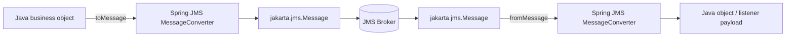

# Spring JMS MessageConverter: Converting Between Java Objects and JMS Messages

> **Module:** Spring Framework – JMS · **Knowledge Group:** Data Conversion.  
> This lesson covers the `MessageConverter` contract, Spring JMS built-in converters, bidirectional configuration for producers/consumers, a runnable example with **Java 21 + Spring Boot 3.3.5 + ActiveMQ Artemis**, writing a custom converter, testing, and considerations for schema, security, and transactions.

## 1. What Problem Does MessageConverter Solve?

In the domain layer, an application processes Java objects such as `OrderCreated`, `PaymentCaptured`, or `InventoryAdjusted`. However, a JMS provider sends and receives `jakarta.jms.Message` objects, such as `TextMessage`, `BytesMessage`, `MapMessage`, and `ObjectMessage`.

Using the plain JMS API, the producer has to construct the message manually:

```java
// Fragment: jakarta.jms.Session session and String json are available.
TextMessage message = session.createTextMessage(json);
message.setStringProperty("eventType", "OrderCreated");
// A MessageProducer is still needed afterward to send the message.
```

If every service writes its own JSON serialization, type checks, header creation, and receive-side parsing, the code becomes repetitive, hard to version, and prone to incompatibility.

`MessageConverter` is the **conversion strategy** between:

- **Java object → JMS Message** when sending.
- **JMS Message → Java object** when receiving.



**Do not misunderstand:** the converter lives on the **Spring application side**, not as a step executed automatically by the broker. The broker typically stores/forwards message bytes and metadata according to the protocol; the Spring producer and Spring consumer must agree on a **wire contract** to read messages correctly.

## 2. Core Interface and Conversion Lifecycle

The interface to import is:

```java
import org.springframework.jms.support.converter.MessageConverter;
```

It has two methods:

```java
// Simplified API signature to focus on the mechanism:
Message toMessage(Object object, Session session)
        throws JMSException, MessageConversionException;

Object fromMessage(Message message)
        throws JMSException, MessageConversionException;
```

In the signature above, `Message` and `Session` belong to **`jakarta.jms`**; `MessageConversionException` belongs to **`org.springframework.jms.support.converter`** and is a Spring runtime exception. This is a **signature description**, not standalone compilable code outside the interface.

### `toMessage(object, session)`

- Takes a business Java object.
- Uses the `Session` provided by Spring/JMS to create the corresponding JMS message.
- Serializes/encodes the payload according to a strategy: String, JSON, XML, binary, map, etc.
- Can attach technical JMS properties such as a type ID needed for decoding.
- Returns a `jakarta.jms.Message` for `JmsTemplate` to send.

### `fromMessage(message)`

- Checks the type of the received JMS message.
- Reads the body, type ID, or metadata according to the protocol.
- Deserializes/decodes back into a Java object.
- Throws a conversion error when the message format is invalid, the version is missing, or the payload is invalid.

The two methods do not necessarily guarantee a **100% round-trip for every object**. For example, if a Java class holds runtime information that is not written on the wire, it cannot be restored identically. You need to define the fields of the message schema precisely.

### Who Calls Those Two Methods?

| Where Used | When Called | Output |
| --- | --- | --- |
| `JmsTemplate.convertAndSend(...)` | Before sending | JMS Message |
| `JmsTemplate.receiveAndConvert(...)` | After synchronous receive | Java object |
| `MessageListenerAdapter` | When the adapter converts a raw JMS Message into a payload for the delegate | Object produced by the converter |
| `@JmsListener` method | Via the listener container/adapter and the Spring Messaging infrastructure, based on the configured converter | Payload object matching the listener signature |
| `JmsTemplate.send(MessageCreator)` | **Does not force using a converter**: callback builds the message | JMS Message constructed by the application |

Example:

```java
// Fragment: JmsTemplate bean template and a valid event already exist.
template.convertAndSend("orders.created", event);

// This converts from a JMS Message to a Java object during active receive:
Object received = template.receiveAndConvert("orders.created");
```

`receiveAndConvert` can block depending on the timeout and **actually consumes the message**; do not use it merely to "peek" at a message sitting on a queue. For asynchronous listeners, `@JmsListener` is usually more suitable.

## 3. Distinguishing MessageConverter Types in the Spring Ecosystem

Spring has several abstractions with the same name. The easiest way is to check the **package and parameter types**:

| Type | Package | Converts Between What? |
| --- | --- | --- |
| **Spring JMS `MessageConverter`** | `org.springframework.jms.support.converter` | `Object` ↔ `jakarta.jms.Message` |
| **Spring Messaging `MessageConverter`** | `org.springframework.messaging.converter` | Payload/Spring `Message<?>` ↔ payload and message at the messaging layer |
| **Spring HTTP `HttpMessageConverter`** | `org.springframework.http.converter` | HTTP request/response body ↔ Java object |
| **Jackson `ObjectMapper`** | `com.fasterxml.jackson.databind` | JSON ↔ Java object; can be the tool used by a JMS converter |
| **`MessagingMessageConverter` in Spring JMS** | `org.springframework.jms.support.converter` | Wraps a payload converter and `JmsHeaderMapper` to handle Spring Messaging messages/headers |

**Do not confuse them:** an `ObjectMapper` bean **does not automatically replace** a `MessageConverter` bean in JMS; and registering `MappingJackson2HttpMessageConverter` for REST **does not mean** `JmsTemplate` automatically sends JSON. Use the exact `org.springframework.jms.support.converter.MappingJackson2MessageConverter`.

When `@JmsListener` has a parameter of type `org.springframework.messaging.Message<OrderCreated>` or `@Header`, Spring also performs a step mapping JMS headers/properties to Spring Messaging headers. Those steps are related, but **they do not turn the JMS converter into a router or a transaction manager**.

## 4. `SimpleMessageConverter`: A Useful Default, Not Magic

`org.springframework.jms.support.converter.SimpleMessageConverter` is the default strategy normally used by `JmsTemplate` when no other converter is configured. It supports four main groups:

| Java Object When Sending | Which Message Type? | Object When Reading via `fromMessage` |
| --- | --- | --- |
| `String` | `TextMessage` | `String` |
| `byte[]` | `BytesMessage` | `byte[]` |
| `Map` of JMS-valid values | `MapMessage` | `Map` |
| `Serializable` | `ObjectMessage` | Java-deserialized object |

Example sending text:

```java
jmsTemplate.convertAndSend("demo.text", "Hello JMS");
```

Example sending a map with flat fields:

```java
Map<String, Object> payload = new LinkedHashMap<>();
payload.put("orderId", "ORD-42");
payload.put("itemCount", 3);
payload.put("totalMinor", 125_000L);

jmsTemplate.convertAndSend("demo.map", payload);
```

The map snippet requires importing `java.util.Map` and `java.util.LinkedHashMap`. With `SimpleMessageConverter`, the `Map` payload is converted into a `MapMessage`; not JSON.

### What `SimpleMessageConverter` Does Not Do

- Does not automatically convert **arbitrary POJOs** to JSON.
- Cannot represent arbitrary `List`, nested `Map`, `BigDecimal`, or entity graphs inside a `MapMessage`. JMS `MapMessage` only allows primitives, their corresponding wrappers, `String`, and `byte[]`.
- Does not automatically version schemas or guarantee that a listener in another system has the exact Java class needed.
- Does not handle transactions, message delivery, redelivery, or retries.

A record that does not implement `Serializable` and is not a `Map`/`String`/`byte[]` typically causes the default converter to throw `MessageConversionException` when calling `convertAndSend`.

### Why You Should Not Rely on `ObjectMessage` in Broad Integration

`ObjectMessage` uses Java native serialization. This can introduce coupling to Java classes/packages/classloaders/`serialVersionUID`, untrusted data deserialization issues, and difficulty integrating with consumers written in other languages. Domain entities can also contain lazy proxies, circular references, or sensitive fields.

For business events between services, you should use **independent DTOs**, a wire format with schema/versioning, and an explicit converter, such as JSON `TextMessage` or a managed binary schema.

## 5. `MappingJackson2MessageConverter`: JSON with TextMessage or BytesMessage

Spring Framework 6.1 provides `MappingJackson2MessageConverter` to serialize objects to JSON using Jackson 2 and deserialize them back.

Typical configuration:

```java
@Bean
MessageConverter jmsMessageConverter(ObjectMapper objectMapper) {
    MappingJackson2MessageConverter converter =
            new MappingJackson2MessageConverter(objectMapper);

    converter.setTargetType(MessageType.TEXT);
    converter.setTypeIdPropertyName("_type");
    converter.setTypeIdMappings(Map.of(
            "order-created-v1", OrderCreated.class));

    return converter;
}
```

This is a **`@Bean` method fragment** placed inside a `@Configuration` class, with imports for the corresponding classes and an existing `OrderCreated` DTO. You can use the default constructor, but the constructor taking `ObjectMapper` helps reuse the Jackson configuration already active in Spring Boot.

Three important properties:

1. **`setTargetType(MessageType.TEXT)`:** when converting object → JMS Message, creates a `TextMessage` containing JSON. **The default of this converter is `MessageType.BYTES`**, not TEXT.
2. **`setTypeIdPropertyName("_type")`:** the name of the JMS **property** holding the class/format ID that the receiving converter uses during `fromMessage`. By default, the property name is not set; it must be set for normal deserialization.
3. **`setTypeIdMappings(Map.of("order-created-v1", OrderCreated.class))`:** maps a logical type ID to an actual class. Cross-service contracts do not have to depend on Java class names.

If a type ID mapping does not exist for a Java class, the converter may fall back to the **Java class name** (depending on the implementation/version) when setting the type ID. Mapping is not an **absolute security allowlist**: for untrusted input, you need to control allowed event types, send/receive permissions, versions, and verify type ID values before deserialization.

### Result on the Wire

```text
JMS TextMessage
├── Headers
│   └── JMSCorrelationID = "order:ORD-42"
├── Properties
│   ├── _type = "order-created-v1"    (String)
│   ├── eventType = "OrderCreated"   (String)
│   └── schemaVersion = 1           (int)
└── Text body:
    {"eventId":"evt-123","orderId":"ORD-42",
     "totalMinor":125000,"currency":"VND"}
```

`_type` is a JMS message property, **not inside the JSON body**. This property is used for decoding, while `eventType` and `schemaVersion` can be used for selectors/monitoring. Other names can be chosen if both sides agree. Do not assume JSON body fields are visible to a JMS selector.

### When to Use BytesMessage JSON?

`MappingJackson2MessageConverter` also supports JSON inside a `BytesMessage`. This fits when raw bytes and encoding/transfer control are needed, provided the consumer converter is aligned. When using `MessageType.BYTES`, you may care about `setEncoding`/`setEncodingPropertyName` if interoperability requires it. Do not treat TEXT/BYTES as interchangeable wire types: a different listener or converter may fail to decode them properly.

## 6. `MarshallingMessageConverter` and `SmartMessageConverter`

Besides the default and Jackson, Spring JMS also has:

- **`MarshallingMessageConverter`:** uses `org.springframework.oxm.Marshaller` and `Unmarshaller` to encode/decode, typically useful when there is an XML schema or an OXM contract; can target `TextMessage` or `BytesMessage` via the `marshalTo` setting.
- **`MessagingMessageConverter`:** combines a payload `MessageConverter` with `JmsHeaderMapper` to support the `org.springframework.messaging.Message<?>` abstraction along with headers. It does not mean the broker understands Spring Messaging objects directly.
- **`SmartMessageConverter`:** extends the JMS converter with a **conversion hint**, such as a JSON view/serialization context in flows supported by the framework. Do not use hints as a mechanism to attach business message properties; they do not replace `MessagePostProcessor`.

Choose a converter based on the **wire contract + consumer requirements**, not just the object on the producer side. When a system needs a binary schema (Avro/Protobuf), you can implement a custom `MessageConverter` for `BytesMessage` and manage the schema registry/versioning separately.

## 7. Complete Practical Example: Spring Boot + JMS JSON MessageConverter

This example provides a simple project: an HTTP endpoint publishes `OrderCreated`, the converter produces a JSON `TextMessage`, Artemis routes the message through a queue, and the listener uses the same converter to receive the record.

**Versions and external dependencies:** Java 21; Spring Boot 3.3.5 (Spring Framework 6.1); Gradle; an Artemis broker running at `tcp://localhost:61616`. The broker needs the `orders.created` queue/appropriate address routing or authorized auto-creation. A Spring Boot application **does not guarantee automatic physical queue creation on every broker**.

### 7.1. Create the Project

`settings.gradle`:

```groovy
rootProject.name = 'jms-message-converter-demo'
```

`build.gradle`:

```groovy
plugins {
    id 'java'
    id 'org.springframework.boot' version '3.3.5'
    id 'io.spring.dependency-management' version '1.1.6'
}

group = 'com.example'
version = '0.0.1-SNAPSHOT'

java {
    toolchain {
        languageVersion = JavaLanguageVersion.of(21)
    }
}

repositories {
    mavenCentral()
}

dependencies {
    implementation 'org.springframework.boot:spring-boot-starter-artemis'
    implementation 'org.springframework.boot:spring-boot-starter-web'
    testImplementation 'org.springframework.boot:spring-boot-starter-test'
}

tasks.named('test') { useJUnitPlatform() }
```

`spring-boot-starter-artemis` uses the Jakarta Messaging/JMS API; `spring-boot-starter-web` provides Spring MVC and Jackson `ObjectMapper`. Do not mix old `javax.jms` examples into a Boot 3.x project.

`src/main/resources/application.yml`:

```yaml
spring:
  artemis:
    mode: native
    broker-url: ${JMS_BROKER_URL:tcp://localhost:61616}
    user: ${JMS_USER:artemis}
    password: ${JMS_PASSWORD:artemis}
  jms:
    pub-sub-domain: false

server:
  port: 8080
```

`pub-sub-domain=false` specifies queue semantics, not topic. The example username/password are for a local broker; production deployments must use a secret manager, TLS, and environment-appropriate ACLs.

### 7.2. Runnable Java Source

Create `src/main/java/com/example/jms/ConverterDemoApplication.java`:

```java
package com.example.jms;

import java.util.Map;
import java.util.UUID;

import com.fasterxml.jackson.databind.ObjectMapper;

import org.springframework.boot.SpringApplication;
import org.springframework.boot.autoconfigure.SpringBootApplication;
import org.springframework.context.annotation.Bean;
import org.springframework.http.ResponseEntity;
import org.springframework.jms.annotation.EnableJms;
import org.springframework.jms.annotation.JmsListener;
import org.springframework.jms.core.JmsTemplate;
import org.springframework.jms.support.converter.MappingJackson2MessageConverter;
import org.springframework.jms.support.converter.MessageConverter;
import org.springframework.jms.support.converter.MessageType;
import org.springframework.stereotype.Component;
import org.springframework.web.bind.annotation.PathVariable;
import org.springframework.web.bind.annotation.PostMapping;
import org.springframework.web.bind.annotation.RestController;

@SpringBootApplication
@EnableJms
public class ConverterDemoApplication {

    public static void main(String[] args) {
        SpringApplication.run(ConverterDemoApplication.class, args);
    }

    // Message contract: dedicated DTO, not a JPA entity.
    public record OrderCreated(
            String eventId,
            String orderId,
            long totalMinor,
            String currency) {
    }

    @Bean
    MessageConverter jmsMessageConverter(ObjectMapper objectMapper) {
        MappingJackson2MessageConverter converter =
                new MappingJackson2MessageConverter(objectMapper);
        converter.setTargetType(MessageType.TEXT);
        converter.setTypeIdPropertyName("_type");
        converter.setTypeIdMappings(
                Map.of("order-created-v1", OrderCreated.class));
        return converter;
    }
}

@RestController
class OrderEventController {

    private final JmsTemplate jmsTemplate;

    OrderEventController(JmsTemplate jmsTemplate) {
        this.jmsTemplate = jmsTemplate;
    }

    @PostMapping("/demo/orders/{orderId}")
    ResponseEntity<String> publish(@PathVariable String orderId) {
        ConverterDemoApplication.OrderCreated event =
                new ConverterDemoApplication.OrderCreated(
                        UUID.randomUUID().toString(),
                        orderId,
                        125_000L,
                        "VND");

        jmsTemplate.convertAndSend("orders.created", event, message -> {
            // The fields below live outside the JSON body.
            message.setStringProperty("eventType", "OrderCreated");
            message.setIntProperty("schemaVersion", 1);
            message.setJMSCorrelationID("order:" + orderId);
            return message;
        });

        return ResponseEntity.accepted()
                .body("QUEUED " + orderId);
    }
}

@Component
class OrderCreatedConsumer {

    @JmsListener(
            destination = "orders.created",
            selector = "eventType = 'OrderCreated' AND schemaVersion = 1")
    public void handle(ConverterDemoApplication.OrderCreated event) {
        System.out.printf(
                "RECEIVED order=%s amount=%d currency=%s%n",
                event.orderId(), event.totalMinor(), event.currency());
    }
}
```

**Step-by-step explanation:**

1. `@SpringBootApplication` creates the Spring application context; `@EnableJms` enables listener annotations.
2. `@Bean MessageConverter jmsMessageConverter(...)` creates **one** JMS converter bean. When Boot auto-configures `JmsTemplate` and the default `jmsListenerContainerFactory`, this converter bean is applied to both the send and listener flows.
3. `MappingJackson2MessageConverter` uses the Boot-provided Jackson `ObjectMapper`, turns `OrderCreated` into a JSON `TextMessage`, and automatically writes the JMS property `_type="order-created-v1"` according to the type mapping.
4. `MessagePostProcessor` in `convertAndSend` adds `eventType`, `schemaVersion`, and `JMSCorrelationID`. The order is **convert → postprocess → send**.
5. `@JmsListener` has a selector that only uses **JMS properties**, not reading the body. When the broker delivers the message, Spring converts it back into `OrderCreated` before invoking `handle`.
6. `long totalMinor` represents the monetary amount in the smallest unit to avoid binary floating-point drift from `double`; `currency` indicates the unit. In a real system, domain validation is required for these values.
7. `UUID` generates a new `eventId` **for every HTTP call**. If the caller retries the same event, a production design must preserve a stable event ID to support idempotency.
8. `JmsTemplate.convertAndSend` can throw exceptions; HTTP 202 in the demo is returned **only when the send call returns normally**. HTTP 202 does not mean the listener has finished processing.

### 7.3. Running and Sample Output

Ensure Artemis is running and the `orders.created` queue has send/consume permissions:

```bash
# Linux/macOS, inside a project with the Gradle wrapper:
./gradlew bootRun

# Windows:
gradlew.bat bootRun
```

In another terminal:

```bash
curl -i -X POST http://localhost:8080/demo/orders/ORD-42
```

When the broker accepts the send command, an example response is:

```http
HTTP/1.1 202
Content-Type: text/plain;charset=UTF-8

QUEUED ORD-42
```

When the listener receives and deserializes successfully, the business log prints:

```text
RECEIVED order=ORD-42 amount=125000 currency=VND
```

Only the content above is predictable from the demo code; the **log timing** relative to the HTTP response, startup logs, UUID, and JMSMessageID are nondeterministic. If the broker is not running, credentials are wrong, or the queue is not provisioned/auto-created, successful output cannot be expected.

### 7.4. Inspecting the Message on the Broker

If you temporarily pause the listener **in a test environment** so it does not consume immediately, use the broker console/CLI to check:

- Body is JSON inside a `TextMessage`, not a Java `ObjectMessage`.
- Property `_type` is String `order-created-v1`.
- Property `eventType` is String `OrderCreated`.
- Property `schemaVersion` is **int 1** (not String `"1"`).
- Header `JMSCorrelationID` is `order:ORD-42`.
- Destination is queue `orders.created` with appropriate routing/ACL.

Consumers should not have to act as "JMSMessage object readers": inspecting the wire type and broker metadata helps catch conversion bugs when two services use different technologies.

## 8. Registering a Converter in Spring Boot vs. Manual @Bean

### 8.1. Boot Auto-Configuration

In an application with the Artemis starter and no infrastructure overrides, Boot automatically creates `ConnectionFactory`, `JmsTemplate`, and the default listener container factory. When an `org.springframework.jms.support.converter.MessageConverter` bean is present, Boot can wire it into the auto-configured template and factory.

You do not need to manually define three beans just to use the Jackson converter if the defaults suffice. If multiple `MessageConverter` beans exist, you may need to mark one as primary or configure templates/factories by name.

### 8.2. Explicit Registration for Producer

A `@Bean` method (fragment, requires a `@Configuration` class and appropriate imports):

```java
@Bean("ordersJmsTemplate")
JmsTemplate ordersJmsTemplate(
        ConnectionFactory connectionFactory,
        MessageConverter jmsMessageConverter) {

    JmsTemplate template = new JmsTemplate(connectionFactory);
    template.setMessageConverter(jmsMessageConverter);
    template.setPubSubDomain(false);
    return template;
}
```

Imports: `jakarta.jms.ConnectionFactory`, `org.springframework.jms.core.JmsTemplate`, `org.springframework.jms.support.converter.MessageConverter`, `org.springframework.context.annotation.Bean`. When creating a custom template, do not assume it will automatically pick up the converter bean from Boot like the auto-configured template does; attach it explicitly.

### 8.3. Explicit Registration for Consumer

The listener factory also needs a consistent converter:

```java
@Bean("ordersListenerFactory")
DefaultJmsListenerContainerFactory ordersListenerFactory(
        ConnectionFactory connectionFactory,
        MessageConverter jmsMessageConverter) {

    DefaultJmsListenerContainerFactory factory =
            new DefaultJmsListenerContainerFactory();
    factory.setConnectionFactory(connectionFactory);
    factory.setMessageConverter(jmsMessageConverter);
    factory.setPubSubDomain(false);
    factory.setSessionTransacted(true);
    return factory;
}
```

Additional import: `org.springframework.jms.config.DefaultJmsListenerContainerFactory`. The listener must specify `@JmsListener(destination="orders.created", containerFactory="ordersListenerFactory")` for Spring to pick the right factory. If `containerFactory` is omitted, the infrastructure normally looks up the default `jmsListenerContainerFactory` bean.

With Boot 3.3.x, `DefaultJmsListenerContainerFactoryConfigurer` can help preserve Boot's default transaction/converter/settings when creating additional factories. If `ConnectionFactory` is a caching wrapper on the producer side, the listener container must be wired to the native provider factory or a compatible mechanism to manage recovery/lifecycle properly. Do not copy code samples specific to Boot 3.4+ and import `ConnectionFactoryUnwrapper` into 3.3 because that utility does not exist in the demo version.

### 8.4. Multiple Message Types

If one application needs JSON for events and `BytesMessage` for files/another protocol, do not mutate a global converter on a singleton `JmsTemplate` between calls. Create multiple named templates/factories, each pair with its own converter. Or design a custom converter that intentionally branches by **wire message type + version/type ID**, backed by a contract and tests.

## 9. Writing a Custom MessageConverter for Specialized Formats

You are not forced to use Jackson. Implement the exact `org.springframework.jms.support.converter.MessageConverter` interface, without confusing it with the HTTP converter.

Example of a **bidirectional converter dedicated to a non-negative integer count**; this is a compilable Java class when placed in the proper path/package with Spring JMS dependencies added. It demonstrates the mechanism and is not meant to replace the JSON event DTO in Section 7:

```java
package com.example.jms.codec;

import jakarta.jms.JMSException;
import jakarta.jms.Message;
import jakarta.jms.Session;
import jakarta.jms.TextMessage;

import org.springframework.jms.support.converter.MessageConversionException;
import org.springframework.jms.support.converter.MessageConverter;

public final class NonNegativeCountConverter implements MessageConverter {

    @Override
    public Message toMessage(Object object, Session session)
            throws JMSException {
        if (!(object instanceof Integer count) || count < 0) {
            throw new MessageConversionException(
                    "Expected a non-negative Integer");
        }

        // Application-defined wire schema: decimal text.
        TextMessage message = session.createTextMessage(count.toString());
        message.setStringProperty("codec", "count-v1");
        return message;
    }

    @Override
    public Object fromMessage(Message message) throws JMSException {
        if (!(message instanceof TextMessage text)) {
            throw new MessageConversionException(
                    "Expected a TextMessage");
        }

        if (!"count-v1".equals(text.getStringProperty("codec"))) {
            throw new MessageConversionException(
                    "Unsupported codec version");
        }

        String value = text.getText();
        try {
            int result = Integer.parseInt(value);
            if (result < 0) {
                throw new MessageConversionException(
                        "Negative count not allowed");
            }
            return result;
        } catch (NumberFormatException ex) {
            throw new MessageConversionException(
                    "Invalid decimal count", ex);
        }
    }
}
```

Explanation:

- `toMessage` validates the **Java input type**, rather than accepting any object and calling `toString()` arbitrarily.
- `session.createTextMessage` determines that the wire body is text. The converter sets the `codec` property to distinguish the protocol and version.
- `fromMessage` validates the **JMS message type**, version property, parsing, and data constraints.
- Format errors are translated into `MessageConversionException`, a runtime exception that Spring JMS can handle in the pipeline.
- The sample uses `Integer` so the symmetric mapping is easy to observe: `Integer(12) → TextMessage("12") → Integer(12)`. For complex schemas, use an escaped/length-prefixed codec, JSON, or a formal binary format rather than fragile manual `a|b|c` string concatenation.

**Important:** this custom converter is only for `Integer`. If you attach it as the shared converter of a `JmsTemplate` that sends `OrderCreated`, sending `OrderCreated` will be rejected. Every converter needs a **clear usage scope**; do not register a specialized converter application-wide unless all messages follow that contract.

## 10. Testing Conversion Without a Broker: Verifying Both Directions

For `MappingJackson2MessageConverter`, you can use Mockito to mock JMS `Session` and `TextMessage` without creating a real connection. Verify **payload + type-id**, not merely that a bean exists.

File `src/test/java/com/example/jms/JmsJsonConverterTest.java`:

```java
package com.example.jms;

import java.util.Map;

import com.fasterxml.jackson.databind.ObjectMapper;
import jakarta.jms.Session;
import jakarta.jms.TextMessage;

import org.junit.jupiter.api.Test;
import org.springframework.jms.support.converter.MappingJackson2MessageConverter;
import org.springframework.jms.support.converter.MessageType;
import org.mockito.ArgumentCaptor;

import static org.junit.jupiter.api.Assertions.assertEquals;
import static org.junit.jupiter.api.Assertions.assertTrue;
import static org.mockito.ArgumentMatchers.anyString;
import static org.mockito.Mockito.mock;
import static org.mockito.Mockito.verify;
import static org.mockito.Mockito.when;

class JmsJsonConverterTest {

    @Test
    void convertsDtoToJsonAndBack() throws Exception {
        MappingJackson2MessageConverter converter =
                new MappingJackson2MessageConverter(new ObjectMapper());
        converter.setTargetType(MessageType.TEXT);
        converter.setTypeIdPropertyName("_type");
        converter.setTypeIdMappings(Map.of(
                "order-created-v1",
                ConverterDemoApplication.OrderCreated.class));

        ConverterDemoApplication.OrderCreated event =
                new ConverterDemoApplication.OrderCreated(
                        "evt-1", "ORD-42", 125_000L, "VND");

        Session session = mock(Session.class);
        TextMessage textMessage = mock(TextMessage.class);

        when(session.createTextMessage(anyString()))
                .thenReturn(textMessage);

        converter.toMessage(event, session);

        ArgumentCaptor<String> json =
                ArgumentCaptor.forClass(String.class);
        verify(session).createTextMessage(json.capture());
        verify(textMessage)
                .setStringProperty("_type", "order-created-v1");

        assertTrue(json.getValue()
                .contains("\"orderId\":\"ORD-42\""));

        // Simulate the data received by the consumer on the wire.
        when(textMessage.getText()).thenReturn(json.getValue());
        when(textMessage.getStringProperty("_type"))
                .thenReturn("order-created-v1");

        Object restored = converter.fromMessage(textMessage);
        assertEquals(event, restored);
    }
}
```

The test uses `spring-boot-starter-test`, JUnit 5, and Mockito from the Gradle file in Section 7. Run:

```bash
./gradlew test
```

If all assertions pass, Gradle reports build/test success; there is **no fixed business stdout** in the test. This test confirms that the converter produces JSON and attaches `_type`, then decodes it back from the mocked `TextMessage`.

**Unit test limitations:** `Session`/`TextMessage` here are mocks; this does not verify broker ACLs, actual byte encoding on transport, queue/topic mode, transactions, retries, or whether the listener factory actually uses the converter bean. An **integration test with Artemis** is required to prove the full send–receive path.

## 11. Conversion Errors vs. Transport Errors vs. Business Errors

Three error categories must be separated:

| Category | Example | Handling Strategy |
| --- | --- | --- |
| **Conversion failure before send** | Unsupported Java object, JSON serialization failure, wrong converter bean | Fix DTO/schema/config; do not wastefully retry connections if the input is always invalid. |
| **Conversion failure after receive** | Wrong `_type`, message is `MapMessage` when converter expects `TextMessage`, invalid JSON | Record message ID/version, classify as permanent error, DLQ/quarantine after retry limit. |
| **JMS transport/broker error** | Broker down, ACL denied, unprovisioned destination, timeout | Connectivity/authorization/configuration, retry with backoff, avoid duplicate sends after uncertain state. |
| **Business processing error** | Invalid order, DB timeout, downstream error | Decide whether to retry, transactions, idempotency, and DLQ. |

In Spring, `MessageConversionException` belongs to the runtime `JmsException` hierarchy; checked provider `jakarta.jms.JMSException` instances are typically translated by Spring into an appropriate `org.springframework.jms.JmsException` when going through a template. Do not lump all failures under the label "cannot connect to broker".

### Conversion Errors in a Listener Can Trigger Redelivery

If the listener factory uses a transacted JMS session, an unhandled exception can cause a rollback and the broker redelivers the message according to its redelivery policy. A corrupted JSON payload may **never** decode regardless of how many times it is retried. You need a retry limit, DLQ/parking lot, alerts, and a manual handling mechanism; do not catch the error and return normally if you intend to roll back.

If the framework catches the error into an error handler, determine whether the handler rethrows or not: swallowing the error in some configurations causes the message to be ACKed/committed as processed. Final behavior also depends on the container, transaction, and broker.

## 12. Safe and Compatible Schema Design

A converter does not replace the contract between two services. For JSON events:

1. **Field names/types:** `totalMinor` is a `long` in minor units, `currency` is a String ISO currency code, `orderId` is a String.
2. **Required/optional fields:** distinguish a missing field from `null` and `0`; add validation at the boundary.
3. **Versioning:** `schemaVersion` property of type `int`, `_type` using a stable logical ID. Do not change an existing field's type without creating a migration.
4. **Time/decimal:** use `Instant` and ISO-8601 JSON with appropriate Jackson modules, or epoch milliseconds with an explicit unit; money uses integer minor units or a decimal string per contract.
5. **Type IDs:** mapping is not a certification of safe input; proactively allowlist permitted event types and authenticate producer identity, especially when the broker accepts messages from multiple sources.
6. **Payload security:** do not send JPA entity graphs, passwords, tokens, or unnecessary PII; enforce size limits, TLS, ACLs, and restrict body logging.
7. **Producer/consumer compatibility:** test across previous/next versions; Jackson configurations may handle unknown fields differently depending on settings. Do not implicitly assume every schema extension is compatible.
8. **Serialization stability:** do not let package refactoring/`serialVersionUID` dictate the wire contract; prefer DTO + logical schema.

An illustrative JSON contract example:

```json
{
  "eventId": "evt-1001",
  "orderId": "ORD-42",
  "totalMinor": 125000,
  "currency": "VND"
}
```

In the live demo, `eventId` uses a random UUID, so it will not match the sample above.

## 13. MessageConverter Does Not Guarantee Transactions or Exactly-Once

When `JmsTemplate.convertAndSend` returns normally, that **does not automatically confirm** that the listener has run, that the receiving database has committed, or that the message cannot be duplicated. When an uncommitted JMS transaction is active, the API returning does not even mean the send has committed on the broker.

Scenarios that require design:

- DB commits the order and the app crashes before JMS publish ⇒ event may be **lost**. Consider the **transactional outbox**: write domain + outbox in the same DB transaction, then publish with retries.
- Consumer writes to DB but crashes before JMS ACK/commit ⇒ broker redelivers; requires an **idempotent consumer** with a stable `eventId` and unique constraint.
- Producer times out after the broker actually received the message ⇒ retries can create duplicate events; do not generate a new `eventId` on each retry of the same event.
- Even with a valid JSON converter, expired broker TTL, DLQ policies, disk quota, or connection downtime can prevent an event from reaching the intended consumer.

`MessageConverter` is responsible for **data representation**; transaction managers, `DeliveryMode`, destination provisioning, retries, health checks, and outbox are the responsibilities of other layers.

## 14. Quick Troubleshooting of Common Issues

| Symptom | Possible Cause | Resolution |
| --- | --- | --- |
| `convertAndSend(record)` throws `MessageConversionException` | Using `SimpleMessageConverter`, record is not Serializable | Register a JMS JSON converter or custom codec. |
| Sending JSON but `BytesMessage` appears | Jackson converter defaults to target BYTES | Set `setTargetType(MessageType.TEXT)` if the contract requires text. |
| Consumer receives `String` instead of domain record | Sender has JSON converter but listener factory uses `SimpleMessageConverter` | Configure the same converter policy on the receiving factory. |
| Type ID missing when reading | `setTypeIdPropertyName` was not called or a postprocessor modified/removed the property | Configure the type ID and inspect the message on the broker. |
| `fromMessage` fails on unknown type ID | Missing mapping or unreadable raw Java class | Manage IDs/versions, allowlists, and DLQ invalid messages. |
| Selector `schemaVersion = 1` does not match | Version sent only in JSON body or as String property `"1"` | Call `setIntProperty("schemaVersion", 1)`. |
| Converter bean exists but custom `JmsTemplate` still sends wrong type | Custom bean did not have converter set | Call `template.setMessageConverter(...)`. |
| Custom listener factory does not convert properly | Created a new container factory but forgot to set converter | Call `factory.setMessageConverter(...)` or use the Boot configurer. |
| JSON serialization fails on an entity | Lazy proxy/circular reference/Jackson modules | Send an independent DTO; do not serialize entities directly. |
| Message is processed multiple times | Failed listener, rollback, ACK before/after side effect | Retry policy, DLQ, idempotency key. |
| Consumer finished processing but HTTP caller still sees no result | Sending and processing are asynchronous | Status/event callback; HTTP 202 is not business completion. |
| Code importing `javax.jms` fails to compile on Boot 3 | Using legacy API instead of Jakarta JMS | Switch imports to `jakarta.jms` matching dependencies. |
| Type ID using class FQCN breaks on refactor | Wire contract coupled to Java package/class | Use logical ID mappings and controlled version migrations. |
| Mock tests pass but production queue receives nothing | Converter test does not verify broker/destination/ACL | End-to-end Artemis integration test and monitoring. |

## 15. Self-Check Exercises

1. State the separate responsibilities of `JmsTemplate`, `MessageConverter`, `ConnectionFactory`, and the broker. Why does the converter not decide routing?
2. Write the signatures of the two methods of JMS `MessageConverter`; what is the `Session` parameter used for?
3. With `SimpleMessageConverter`, what JMS message types do `String`, `byte[]`, `Map`, and `Serializable` become?
4. Why can a non-Serializable Java record fail when sent with the default converter?
5. Does `MappingJackson2MessageConverter` create `TextMessage` or `BytesMessage` by default? Which property must be set to change it?
6. What problem do `setTypeIdPropertyName("_type")` and `setTypeIdMappings(...)` solve on the receiving side?
7. Why should type ID mapping not be treated as the sole security allowlist for untrusted payloads?
8. Distinguish between `MessagePostProcessor`, `MessageConverter`, and `JmsHeaderMapper`. Which one sets business properties for selector filtering?
9. If you define custom `JmsTemplate` and listener factory beans, where must the converter be attached so both directions remain consistent?
10. When should you write a custom `MessageConverter` instead of using the Jackson converter? Why must a custom converter validate both the message type and version?
11. Why can unit tests using a mocked `Session` not prove that a production application sends/receives successfully through a broker?
12. Identify the differences between a serialization error before sending, a JSON parse error after receiving, and a transport error.
13. Why does infinite retrying of an invalid JSON message not help? Design a DLQ/quarantine strategy for it.
14. Why does a successful `convertAndSend` not guarantee exactly-once delivery? When should you apply outbox and consumer idempotency?

**Remember:** Spring JMS `MessageConverter` is the **Object ↔ jakarta.jms.Message** contract. `SimpleMessageConverter` handles basic types; `MappingJackson2MessageConverter` serves JSON DTOs with target type/type ID; custom converters serve specialized protocols. You must configure **both producer and consumer**, test bidirectional conversion, inspect wire metadata on the broker, and design schema/transactions/idempotency outside the converter.

### Official References

- [Spring Framework 6.1 – JMS MessageConverter API](https://docs.spring.io/spring-framework/docs/6.1.21/javadoc-api/org/springframework/jms/support/converter/MessageConverter.html) — `toMessage` and `fromMessage` interface.
- [Spring Framework 6.1 – SimpleMessageConverter](https://docs.spring.io/spring-framework/docs/6.1.8/javadoc-api/org/springframework/jms/support/converter/SimpleMessageConverter.html) — supports String, byte[], Map, Serializable.
- [Spring Framework 6.1 – MappingJackson2MessageConverter](https://docs.spring.io/spring-framework/docs/6.1.11/javadoc-api/org/springframework/jms/support/converter/MappingJackson2MessageConverter.html) — JSON TEXT/BYTES, type ID, Jackson config.
- [Spring Framework – Sending a Message](https://docs.spring.io/spring-framework/reference/integration/jms/sending.html) — `JmsTemplate` and converter/postprocessor.
- [Spring Framework – Annotation-driven Listener Endpoints](https://docs.spring.io/spring-framework/reference/integration/jms/annotated.html) — `@JmsListener`, payload parameters, and listener container.
- [Spring Boot – JMS support](https://docs.spring.io/spring-boot/3.4/reference/messaging/jms.html) — auto-config for JmsTemplate and converter bean; the Java/Gradle example here pins Boot 3.3.5.
- [Jakarta Messaging 3.1 Specification](https://jakarta.ee/specifications/messaging/3.1/jakarta-messaging-spec-3.1.html) — JMS message kinds, metadata, selectors, delivery, and transactions.
