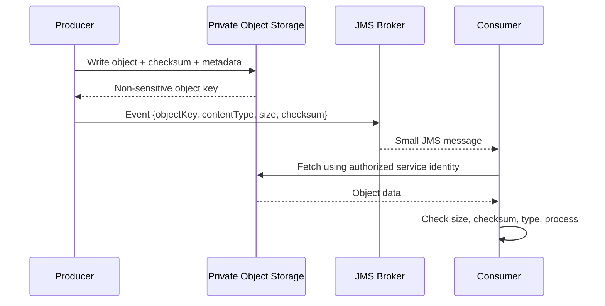

# Limiting Body Size and Avoiding Sensitive Data When Converting JMS Messages

## 1. Goal and Context

When converting a Java object into a `TextMessage` or `BytesMessage` in Spring JMS, an application should not send every single field simply because the serializer can. Two risks must be addressed **before sending**:

1. **Oversized body:** serialization, network, broker memory/disk, message storage, retries, redelivery, dead-letter queues (DLQs), and multiple subscribers all pay the cost. An abnormally large payload can slow down or exhaust resources on both producer and consumer.
2. **Body containing sensitive data:** passwords, tokens, personal data, health records, payment data, secret keys, or internal data can end up not only in Queues/Topics, but also in logs, broker consoles, DLQs, traces, backups, and replayed messages.

**Lesson principle:** *Minimize and classify data before conversion; enforce size limits by the byte count of the serialized wire representation; re-enforce limits on the consumer; never treat the broker, logs, or message converter as automatic protection for sensitive data.*

### Real-World Scenario

The Order Service wants to publish a new-order event. Database records may contain the customer's name, phone number, shipping address, internal notes, and payment details. The Payment Service **does not need all that data** just to know a new order exists.

**Do not** send the entire entity or HTTP request:

```json
{
  "eventId": "E501",
  "orderId": "501",
  "status": "CREATED",
  "customerName": "Sample User",
  "phone": "000-000-0000",
  "address": "Sample Address",
  "accessToken": "example-token-do-not-use",
  "cardNumber": "sample-sensitive-field"
}
```

The example above uses **dummy values** solely to identify fields that should not be put into an event. In the hands-on lab, the safe message contains only:

```json
{
  "eventId": "E501",
  "orderId": "501",
  "status": "CREATED"
}
```

This field list is an **allowlist based on consumer needs**, not character masking to hide data. `orderId` and `eventId` can still be linked back to a subject in a real system, so they are **not automatically public data**: appropriate access controls, logging rules, and retention periods must apply.

## 2. Distinguishing Types of Size Limits

In JMS **there is no single universal maximum body limit across all brokers, protocols, and Spring configurations**. Distinguish:

| Limit Type | Who Decides? | Example | Key Understanding |
| --- | --- | --- | --- |
| **Business/application budget** | Development team | Max 1 KiB or 64 KiB of UTF-8 JSON body | Checked by the application before sending; the number is an *app-specific policy*, not a JMS default. |
| **Serialized size** | Serializer, charset, format | UTF-8 JSON, Avro, Protobuf, XML, `byte[]` | Can be larger or smaller than the original object and String. |
| **JMS provider encoding** | Driver/provider | `TextMessage` has its own encoding/overhead; plus headers/properties | Does not necessarily equal the UTF-8 JSON byte count. |
| **Broker large-message threshold** | JMS broker/client configuration | Artemis `minLargeMessageSize` | Threshold enabling **large message** handling, **not** a rejection limit for large sizes. |
| **Broker quotas, address policy** | Broker operators | Quotas, paging, max address size, full policy | Manages resources/backpressure; not inherently a *per-message* byte limit. |
| **Consumer budget** | Consumer | Rejects bodies exceeding the agreed limit | Protects against misbehaving or untrusted producers. |
| **Storage/network limits** | Infrastructure | Heap, disk, timeouts, frame size, bandwidth | Can still fail even when the app-level body is within budget. |

**Do not confuse:** the length of a Java string, the size of a JSON file, the on-wire size, the size in the broker journal, and the limit where the broker actually rejects a message. These are distinct quantities.

### 2.1. Bytes, Characters, and Code Points Are Not the Same

`String.length()` returns the **number of UTF-16 code units**, not the number of UTF-8 bytes:

- ASCII string `"A"`: 1 UTF-16 code unit, 1 UTF-8 byte.
- String `"Tiếng Việt"`: 10 UTF-16 code units, **14 UTF-8 bytes**.
- Emoji `"📦"`: **2 UTF-16 code units**, **4 UTF-8 bytes**, yet only 1 Unicode code point.

For a policy stating "JSON body must not exceed 1024 UTF-8 bytes", check:

```java
import java.nio.charset.StandardCharsets;

int bytes = json.getBytes(StandardCharsets.UTF_8).length;
if (bytes > 1024) {
    throw new IllegalArgumentException("Message body too large");
}
```

This snippet requires a `json` variable holding the **exact string prepared for sending**. In systems using another serialization format, measure the **size of that format's output**, rather than forcing every data type into UTF-8.

### 2.2. Count Before or After Conversion?

Good order:

```text
Large or sensitive business object
   ↓ pick permitted fields / create small event DTO
Minimal DTO, with schema and version
   ↓ serialize (JSON / bytes / chosen format)
Actual payload ready to send
   ↓ check byte budget
JMS MessageConverter / Session.createTextMessage(...)
   ↓ send, broker policy
Broker → Queue/Topic → consumer
   ↓ consumer re-checks size/type/schema
Deserialize → validate → business processing
```

Do not use the in-heap size of a Java DTO as the benchmark, because serializers add field names, quote escaping, special characters, encoding, and metadata. When using `MappingJackson2MessageConverter` with an input object, control the size of the output the converter actually produces; one transparent approach is **serializing to a checked JSON String and sending it as a `TextMessage`**.

### 2.3. UTF-8 Budget Is Not the Broker-Wire Budget

A `TextMessage` typically holds a Java `String`; the payload size when transmitted/written by the provider may differ from the UTF-8 byte count. Apache ActiveMQ Artemis documentation on *large messages* notes that **Artemis's Core message encoding may use 2 bytes per character** in client calculations. Therefore, do not cite an example like "100 KiB" in Artemis as a JMS standard limit on allowed UTF-8 JSON.

If you need tight bounds on total frame/message bytes on the wire, measure and test against the **actual provider and protocol** including headers/properties and infrastructure. The application budget should sit comfortably below infrastructure limits with headroom.

## 3. Defining a Body Size Policy

A clear policy must define:

- **Scope:** specific event type/destination; e.g. `orders.created.v1`.
- **Unit:** UTF-8 byte count of the **serialized body**; use `KiB = 1024 bytes`, not an ambiguous "1K characters".
- **Limit:** e.g. `MAX_BODY_BYTES=1024` in the demo; this number is not a JMS or Artemis standard limit.
- **Checkpoints:** producer *before send*, consumer *before deserialization*, plus broker-side controls per provider capabilities.
- **Behavior when exceeded:** controlled rejection, never randomly truncating JSON; never put the rejected payload into logs; record a metric with error name and safely observable size bucket.
- **Version compatibility:** if adding fields increases body size, test the contract against both limit and version.
- **Policy ownership:** agreed upon jointly by producer, consumers, infrastructure, and security teams.

For small events, a 1 KiB limit can illustrate the concept well, yet never impose 1 KiB on images, PDF invoices, large records, or every business domain. For large data types, switch to the **small payload + external object reference** strategy.

### Never Truncate JSON Strings with `substring` to Fit a Limit

Wrong:

```java
String truncated = json.substring(0, 1024);
jmsTemplate.convertAndSend("orders.created", truncated);
```

Because `1024` here counts UTF-16 code units, not UTF-8 bytes; worse, the truncated string may no longer be valid JSON, may lose required fields, or may slice mid-escape-sequence/surrogate-pair.

Right: check byte length, **reject** oversized messages, or redesign the schema; if trimming is needed, **drop fields at the DTO level** per contract rather than arbitrarily slicing bytes.

## 4. Protecting Sensitive Data: Not Just the Body

When using Spring JMS, data can appear across multiple surfaces:

| Surface | Data That May Appear | Controls to Consider |
| --- | --- | --- |
| `TextMessage.getText()` / `BytesMessage` body | JSON, documents, tokens, PII, payment data | Data minimization, schema allowlist, byte limits, app-level encryption if needed. |
| JMS properties | `eventType`, `userId`, `tenantId`, `email`, sometimes misused for tokens | Omit unnecessary secrets/PII; enforce same permissions and retention as messages. |
| JMS headers | `JMSCorrelationID`, `JMSReplyTo`, `JMSType`, and identifiers | Correlation headers are not a place to hide credentials; IDs can also be linkable data. |
| Application logs | Logging `message.toString()`, JSON bodies, stack traces with payloads | Log allowlists, redaction, structured logging, restricted access. |
| Broker management console | Message browsing, Queues, subscriptions, headers/properties | RBAC; access auditing; never treat the console as public data. |
| DLQ, expiry queues, and retry stores | Copies of unprocessable messages | Same data classification, retention limits, auditing, and secure deletion. |
| Distributed traces/metrics | Baggage, span tags, exception attributes | Keep bodies/tokens/PII out of high-cardinality tags or unintended tracing vendors. |
| Backups, snapshots, replays | Copies persisting long after consumer ack | Storage encryption, retention, and policy-driven deletion mechanisms. |

**Warning:** removing PII from the body while leaving email/tokens in `JMSCorrelationID` or `setStringProperty("authorization", token)` **does not fix the leak**. Some admin tools display headers/properties even more prominently than the body.

### 4.1. Classify Data Before Writing a Converter

Examples of data that **should generally not appear** in ordinary events:

- Passwords, API tokens, OAuth access/refresh tokens, session cookies, OTPs, private keys, configuration secrets.
- Full payment card numbers/CVVs, bank account numbers, or sensitive financial credentials.
- Health records, government IDs, addresses, or phone numbers when the consumer does not need them.
- Raw HTTP requests/responses containing Authorization headers, file uploads, or unfiltered customer data.
- Database entities carrying many attributes irrelevant to the receiving business logic.

**Conditionally allowed** small business identifiers such as `orderId`, `eventId`, `schemaVersion`, `eventType` when genuinely required. IDs can trace back to customers; access controls and logs must still classify them properly.

### 4.2. Allowlist DTOs Are Better Than Field Blacklists

Do not do this:

```java
// Anti-pattern illustration: easily leaks new fields when the entity evolves.
jmsTemplate.convertAndSend("orders.created", customerOrderEntity);
```

If `passwordResetToken` or `internalNotes` is later added to the entity, a generic serializer may silently ship those fields in messages without anyone noticing.

Instead, create a **small event DTO containing only permitted fields**:

```java
public record SafeOrderEvent(
        String eventId,
        String orderId,
        String status) {
}
```

On the publisher side, **explicitly map** each field from the domain object to `SafeOrderEvent`; never pass the raw entity to the converter. Any newly added field must go through schema review, data classification, and contract tests.

### 4.3. Pseudonymization, Tokenization, and Encryption

- **Pseudonymization:** replace names, emails, and phone numbers with surrogate IDs; reduces direct exposure though IDs remain linkable to source data.
- **Tokenization:** replace values with tokens and store mappings in a separately authorized system; avoid putting tokens in events that grant unauthorized access.
- **Encryption in transit:** TLS protects data on the wire **when configured properly**, yet does not protect decrypted content inside apps, broker logs, or DLQs.
- **Encryption at rest:** encrypts broker storage/backups with key management and access controls; does not replace removing unnecessary fields.
- **Application-level encryption:** consider when the broker or certain consumers must not read content; requires serious key management, versioning, and rotation/recovery mechanisms.

Encryption **does not reduce size** and does not replace payload limits; ciphertexts, nonces, authentication tags, and encodings (e.g. Base64) can make the body larger.

## 5. Spring `MessageConverter` and Data Conversion Risks

`org.springframework.jms.support.converter.MessageConverter` converts between Java objects and `jakarta.jms.Message` when using `JmsTemplate.convertAndSend(...)` or receive-side conversion.

The default `SimpleMessageConverter` supports basic mappings:

| Java Input | Typical JMS Message | Controls Needed |
| --- | --- | --- |
| `String` | `TextMessage` | Serialized UTF-8 length; never log raw text. |
| `byte[]` | `BytesMessage` | Direct byte size; format and version require a contract. |
| Valid `Map` | `MapMessage` | Field count, element types, PII in keys/values. |
| JSON DTO with dedicated converter | Usually `TextMessage` or `BytesMessage` per config | Serializer policy, schema, type mapping, and byte budget must be verified. |

Never assume every DTO automatically converts to JSON simply because Jackson is on the classpath. With custom converters like `MappingJackson2MessageConverter`, configure the right message type and type metadata. **Whichever converter is used, input data must have an allowlist and a post-serialization size limit.**

### Why `ObjectMessage` Is Not a Safe Default Choice

JMS `ObjectMessage` can hold Java-serialized objects. Java native deserialization on untrusted data poses severe security risks without strict object-type controls, deserialization filters, and library patching. For cross-service events, prefer **explicit schemas and data formats** (JSON, Avro, Protobuf...), checking type/size before parsing. Never treat "send the whole Java object" as a shortcut to bypass data classification.

### Which Steps Consume Memory?

`mapper.writeValueAsString(event)` allocates the JSON string on the heap; `json.getBytes(UTF_8)` allocates another byte array. For **small, controlled events**, this is simple and clear. Yet for untrusted inputs of hundreds of megabytes, constructing the entire string/array before checking the limit is too late for memory safety.

For large inputs, **enforce limits at the source**—field count, individual field lengths, request sizes, collection element counts—or serialize with a **bounded streaming output** that caps bytes while writing, alongside external storage patterns. The hands-on example bounds the DTO structure and runs an early length check before allocating another `byte[]`.

## 6. Standalone Java 17 Program: Counting UTF-8 Bytes

To see why `String.length()` is insufficient, create **`ByteBudgetDemo.java`**:

```java
import java.nio.charset.StandardCharsets;

public final class ByteBudgetDemo {
    private static final int MAX_BODY_BYTES = 12;

    static void requireUnderBudget(String body) {
        int byteCount = body.getBytes(StandardCharsets.UTF_8).length;
        if (byteCount > MAX_BODY_BYTES) {
            throw new IllegalArgumentException(
                    "Body exceeds " + MAX_BODY_BYTES + " UTF-8 bytes");
        }
    }

    public static void main(String[] args) {
        String ascii = "A";
        String vietnamese = "Tiếng Việt";
        String emoji = "📦";

        System.out.println("ASCII chars=" + ascii.length()
                + ", bytes=" + ascii.getBytes(StandardCharsets.UTF_8).length);
        System.out.println("Vietnamese chars=" + vietnamese.length()
                + ", bytes=" + vietnamese.getBytes(StandardCharsets.UTF_8).length);
        System.out.println("Emoji chars=" + emoji.length()
                + ", bytes=" + emoji.getBytes(StandardCharsets.UTF_8).length);

        try {
            requireUnderBudget(vietnamese);
        } catch (IllegalArgumentException expected) {
            System.out.println("REJECTED: above 12 UTF-8 bytes");
        }

        requireUnderBudget("abc");
        System.out.println("ACCEPTED: abc");
    }
}
```

Compile and run with JDK 17, saving the source file as UTF-8:

```bash
javac -encoding UTF-8 ByteBudgetDemo.java
java ByteBudgetDemo
```

**Exact stdout** of the program (with a Unicode-capable console):

```text
ASCII chars=1, bytes=1
Vietnamese chars=10, bytes=14
Emoji chars=2, bytes=4
REJECTED: above 12 UTF-8 bytes
ACCEPTED: abc
```

`12 bytes` is an **intentionally chosen limit for the exercise** so the Vietnamese string is rejected; it is not a JMS limit. The output shows `"Tiếng Việt"` has 10 UTF-16 code units yet 14 UTF-8 bytes, while the single-code-point emoji has 2 UTF-16 code units.

## 7. Building a Safe Event Schema Before Sending

A clean data flow in the Order system:

```text
Database order entity
  ├─ Order ID         ──────┐
  ├─ Event ID         ──────┼─> SafeOrderEvent(eventId, orderId, status)
  ├─ Status           ──────┘             │
  ├─ Customer name    ─ X (not copied)    │
  ├─ Delivery address ─ X (not copied)    │
  ├─ Payment details  ─ X (not copied)    │
  └─ Access token     ─ X (not copied)    │
                                          ↓
                              Serialize JSON + check UTF-8 bytes
                                          ↓
                               JmsTemplate.convertAndSend
                                          ↓
                                TextMessage to Queue
```

The DTO must be built from **required fields**, never relying solely on "serialize then redact"; key-based redaction can miss newly added fields, deeply nested structures, or raw text outside JSON.

### 7.1. Enforce Limits on Both Structure and Bytes

An event with only a few fields can still be huge if `orderId` is 10 million characters long. Therefore validate before serialization:

- `eventId`: bounded format and length, e.g. short internal identifier.
- `orderId`: bounded format and length.
- `status`: enum/allowlist, rejecting arbitrary text.
- Collections, nested objects, file attachments: excluded from the minimal schema.
- Final JSON: check UTF-8 byte count.

**Two layers of checks** reduce both the risk of memory exhaustion during serialization and the risk of the broker/consumer receiving unsuitable bodies.

## 8. Integration Demo: Spring Boot 3 + Artemis + Jackson

The demo creates a **minimal JSON `TextMessage`**, checks size on the producer **before sending** and on the consumer **before deserializing**. No names, emails, addresses, or tokens are sent. The receiving side prints only a status message, never the body.

### 8.1. Requirements

- Java 17+, Maven 3.6.3+, Docker (or a compatible external Artemis broker).
- Localhost port `61616` free.
- Spring Boot 3.3.5 using the `jakarta.jms` namespace.
- Queue `demo.safe.orders`, with one publisher and one listener in the same demo application.

Start a local Artemis broker:

```bash
docker run --detach --rm --name artemis-safe-body-demo \
  -e ARTEMIS_USER=artemis \
  -e ARTEMIS_PASSWORD=artemis \
  -p 127.0.0.1:61616:61616 \
  -p 127.0.0.1:8161:8161 \
  apache/artemis:latest-alpine
docker logs artemis-safe-body-demo
```

The demo broker normally supports Queue creation by default policy; if auto-create is disabled in your environment, create the Queue/routing first. The username and password here are **for local demo only**. Production needs secrets, network policies, TLS, and per-destination authorization.

### 8.2. Project Structure

```text
jms-safe-body/
├── pom.xml
└── src/main/
    ├── java/demo/safe/
    │   ├── SafeBodyApplication.java
    │   ├── SafeOrderEvent.java
    │   ├── PayloadBudget.java
    │   ├── SafePublisher.java
    │   └── SafeConsumer.java
    └── resources/application.properties
```

### 8.3. `pom.xml`

```xml
<project xmlns="http://maven.apache.org/POM/4.0.0"
         xmlns:xsi="http://www.w3.org/2001/XMLSchema-instance"
         xsi:schemaLocation="http://maven.apache.org/POM/4.0.0 https://maven.apache.org/xsd/maven-4.0.0.xsd">
    <modelVersion>4.0.0</modelVersion>

    <parent>
        <groupId>org.springframework.boot</groupId>
        <artifactId>spring-boot-starter-parent</artifactId>
        <version>3.3.5</version>
        <relativePath/>
    </parent>

    <groupId>demo</groupId>
    <artifactId>jms-safe-body</artifactId>
    <version>1.0.0</version>

    <properties>
        <java.version>17</java.version>
    </properties>

    <dependencies>
        <dependency>
            <groupId>org.springframework.boot</groupId>
            <artifactId>spring-boot-starter-artemis</artifactId>
        </dependency>
        <dependency>
            <groupId>com.fasterxml.jackson.core</groupId>
            <artifactId>jackson-databind</artifactId>
        </dependency>
    </dependencies>

    <build>
        <plugins>
            <plugin>
                <groupId>org.springframework.boot</groupId>
                <artifactId>spring-boot-maven-plugin</artifactId>
            </plugin>
        </plugins>
    </build>
</project>
```

`spring-boot-starter-artemis` provides the Spring JMS/Artemis client; the Jackson dependency version is managed by the Spring Boot parent. This is a **client connecting to the Docker broker**, not an in-JVM embedded broker.

### 8.4. `application.properties`

```properties
spring.artemis.mode=native
spring.artemis.broker-url=tcp://localhost:61616
spring.artemis.user=artemis
spring.artemis.password=artemis
spring.jms.pub-sub-domain=false
```

If the app runs inside a container, `localhost` points to the app container itself; replace the URL with the DNS/port reaching the broker container/service. Never put production credentials in committed config files.

### 8.5. `SafeOrderEvent.java` – Allowlist DTO

```java
package demo.safe;

public record SafeOrderEvent(
        String eventId, String orderId, String status) {

    public SafeOrderEvent {
        if (eventId == null || !eventId.matches("E[0-9]{1,12}")) {
            throw new IllegalArgumentException("Invalid eventId");
        }
        if (orderId == null || !orderId.matches("[0-9]{1,12}")) {
            throw new IllegalArgumentException("Invalid orderId");
        }
        if (!"CREATED".equals(status) && !"CANCELLED".equals(status)) {
            throw new IllegalArgumentException("Invalid status");
        }
    }
}
```

The record **contains only the three approved fields**; validation blocks overly long or non-contract-compliant data right before serialization. In a real project, bounds and status values come from the business schema rather than copying demo regexes for all IDs.

### 8.6. `PayloadBudget.java` – Checking Bytes After Serialization

```java
package demo.safe;

import java.nio.charset.StandardCharsets;

public final class PayloadBudget {
    public static final int MAX_BODY_BYTES = 1_024;

    private PayloadBudget() {
    }

    public static int requireAllowed(String json) {
        if (json == null) {
            throw new IllegalArgumentException("Missing body");
        }

        // Reject overly long strings early to avoid allocating a large byte[]
        // when handling untrusted input.
        if (json.length() > MAX_BODY_BYTES) {
            throw new IllegalArgumentException("Body exceeds byte budget");
        }

        int byteCount = json.getBytes(StandardCharsets.UTF_8).length;
        if (byteCount > MAX_BODY_BYTES) {
            throw new IllegalArgumentException("Body exceeds byte budget");
        }
        return byteCount;
    }
}
```

`json.length()` is a **fast rejection** before allocating `byte[]`, not a replacement for the UTF-8 byte check. For a valid string, the number of UTF-8 bytes is never less than the number of corresponding UTF-16 code units; the final check remains the policy standard.

For inputs that could reach hundreds of megabytes, enforce limits **before creating a String** and use bounded streaming; the demo intentionally uses a small-field DTO so `getBytes` will not blow up memory.

### 8.7. `SafePublisher.java` – Convert Then Send `TextMessage`

```java
package demo.safe;

import com.fasterxml.jackson.core.JsonProcessingException;
import com.fasterxml.jackson.databind.ObjectMapper;
import org.springframework.jms.core.JmsTemplate;
import org.springframework.stereotype.Service;

@Service
public class SafePublisher {
    private final JmsTemplate jmsTemplate;
    private final ObjectMapper mapper;

    public SafePublisher(JmsTemplate jmsTemplate, ObjectMapper mapper) {
        this.jmsTemplate = jmsTemplate;
        this.mapper = mapper;
    }

    public void publish(SafeOrderEvent event) throws JsonProcessingException {
        // 1. Allowlist DTO -> JSON; never serialize the raw entity.
        String json = mapper.writeValueAsString(event);

        // 2. Application policy; if over budget, DO NOT send.
        PayloadBudget.requireAllowed(json);

        // 3. Default SimpleMessageConverter turns String -> TextMessage.
        jmsTemplate.convertAndSend("demo.safe.orders", json, message -> {
            message.setStringProperty("eventType", "OrderChanged");
            message.setIntProperty("schemaVersion", 1);
            return message;
        });
    }
}
```

`MessagePostProcessor` runs after the converter creates the message and before sending; add only **non-sensitive metadata** per contract. Never put customer information or access tokens in message properties.

### 8.8. `SafeConsumer.java` – Check Before Parsing and Log Minimally

```java
package demo.safe;

import java.util.concurrent.CountDownLatch;
import java.util.concurrent.TimeUnit;

import com.fasterxml.jackson.core.JsonProcessingException;
import com.fasterxml.jackson.databind.ObjectMapper;
import jakarta.jms.JMSException;
import jakarta.jms.TextMessage;
import org.springframework.jms.annotation.JmsListener;
import org.springframework.stereotype.Component;

@Component
public class SafeConsumer {
    private final ObjectMapper mapper;
    private final CountDownLatch received = new CountDownLatch(1);

    public SafeConsumer(ObjectMapper mapper) {
        this.mapper = mapper;
    }

    @JmsListener(destination = "demo.safe.orders")
    public void handle(TextMessage message)
            throws JMSException, JsonProcessingException {

        // For TextMessage, read String and validate before deserializing.
        String text = message.getText();
        PayloadBudget.requireAllowed(text);

        SafeOrderEvent event =
                mapper.readValue(text, SafeOrderEvent.class);

        // Never log raw JSON/message, email, token, or real IDs.
        if (event.eventId().isBlank()) {
            throw new IllegalArgumentException("Missing event ID");
        }
        System.out.println("RECEIVED: valid SafeOrderEvent");
        received.countDown();
    }

    public boolean await(long seconds) throws InterruptedException {
        return received.await(seconds, TimeUnit.SECONDS);
    }
}
```

The consumer **does not trust that every other publisher follows the limit**. Re-checking protects the parser and curbs schema errors. In a real system, configure transactions, bounded retries, DLQs, and safe exception handlers; repeatedly throwing on oversized bodies without a dead-letter policy can trigger a redelivery loop.

In a hostile environment with huge payloads, `message.getText()` itself may perform a large allocation before you inspect it. To reject earlier, add broker-side max-message controls, controlled protocols/streaming, quotas, and ingress size limits; a consumer check after `getText()` **alone is not an absolute DoS defense**.

### 8.9. `SafeBodyApplication.java` – Send a Test Event

```java
package demo.safe;

import org.springframework.boot.ApplicationRunner;
import org.springframework.boot.SpringApplication;
import org.springframework.boot.autoconfigure.SpringBootApplication;
import org.springframework.context.annotation.Bean;
import org.springframework.jms.annotation.EnableJms;

@SpringBootApplication
@EnableJms
public class SafeBodyApplication {
    public static void main(String[] args) {
        SpringApplication.run(SafeBodyApplication.class, args);
    }

    @Bean
    ApplicationRunner sendDemo(
            SafePublisher publisher, SafeConsumer consumer) {
        return args -> {
            publisher.publish(
                    new SafeOrderEvent("E501", "501", "CREATED"));

            if (!consumer.await(10)) {
                throw new IllegalStateException(
                        "Timed out waiting for JMS consumer");
            }
            System.out.println("DEMO: completed");
        };
    }
}
```

`@SpringBootApplication` lets Spring Boot auto-configure `ConnectionFactory`, `JmsTemplate`, and Jackson `ObjectMapper` when the right dependencies are on the classpath. `@EnableJms` enables `@JmsListener` detection. `SafeOrderEvent` contains no sensitive data; the app prints minimal output after the consumer signals receipt.

### 8.10. Running and Stdout

From the `jms-safe-body` directory:

```bash
mvn spring-boot:run
```

When the broker is ready, the Queue allows auto-creation (or was pre-created), and no stale invalid messages sit on the demo Queue, the **two lines printed by the example code itself** appear in order:

```text
RECEIVED: valid SafeOrderEvent
DEMO: completed
```

Spring, Maven, and Artemis may print extra logs. `CountDownLatch` ensures `DEMO` prints **after** the receive callback prints `RECEIVED`. The program uses `JmsTemplate.convertAndSend`, where default `SimpleMessageConverter` creates a `TextMessage` from `String`; the consumer receives `TextMessage` and parses with Jackson.

If the Queue already holds a non-conforming backlog, the consumer may throw; use a fresh demo broker or a clean test queue. When finished, stop the app with `Ctrl+C`, and stop the broker if needed:

```bash
docker stop artemis-safe-body-demo
```

A `--rm` container without a volume is unsuitable for proving persistence across container removal.

### 8.11. Why Is This a Demo About Body Limits, Not Just Sending and Receiving?

- **DTO construction step:** only three fields are allowed.
- **Conversion step:** Jackson creates JSON from the DTO, never pulling from the whole entity.
- **Budget step:** JSON **is checked by UTF-8 byte count** before entering JMS.
- **Send step:** `convertAndSend` converts the JSON String into a `TextMessage`; metadata uses an allowlist.
- **Receive step:** re-checks the byte budget before deserializing; never logs the body.
- **Error step:** invalid bodies are rejected. Production must connect this rejection to DLQ, monitoring, and safe response strategies.

## 9. Testing Oversized Bodies and Sensitive Data

### 9.1. Testing a Body Exceeding 1024 Bytes

Since `SafeOrderEvent` restricts fields, to test the policy independently without altering the schema, add a unit test:

```java
String big = "A".repeat(1_025);

try {
    PayloadBudget.requireAllowed(big);
    throw new AssertionError("Should reject");
} catch (IllegalArgumentException expected) {
    System.out.println("REJECTED: oversized body");
}
```

This snippet is **not a standalone program**; run it inside the project where `PayloadBudget` exists inside a valid test/`main` method. Stdout for the passing test branch:

```text
REJECTED: oversized body
```

Also test payloads with Vietnamese characters/emojis: strings with UTF-16 code-unit counts below the threshold can still exceed the byte limit. Tests should assert **zero JMS sends occurred** when the producer rejects, using a mocked `JmsTemplate` or asserting an empty queue on a test broker.

### 9.2. Testing That Forbidden Fields Do Not Leak

A DTO serialization test can verify that JSON does not contain forbidden field names:

```java
String json = mapper.writeValueAsString(
        new SafeOrderEvent("E501", "501", "CREATED"));

if (json.contains("password")
        || json.contains("accessToken")
        || json.contains("customerName")
        || json.contains("cardNumber")) {
    throw new AssertionError("Unexpected sensitive field");
}
```

This is only a **simple smoke test**, not a replacement for schema review. Sensitive values could still appear under an innocent-looking key name. Controlling **DTO allowlists + contract reviews** is far stronger than scanning JSON for keywords.

### 9.3. Testing That Logs Do Not Contain Payloads

Try sending a mock event with invalid fields and check log capture: logs must not emit raw JSON, tokens, or full converter stack traces embedding sensitive values. Log **error category, destination alias, schema version, size bucket, and classified event correlation** instead of message bodies.

Never take a parser's default exception message and ship it straight to centralized logging without checking, as some serializers/exceptions embed excerpts of the offending body in the error message.

### 9.4. Testing Consumer Behavior Against a Non-Compliant Publisher

Create a test publisher intentionally placing a payload longer than 1024 bytes onto the Queue. Verify the consumer rejects it, the handler performs no business side effects, the message is not retried infinitely, and the DLQ/expiry storage has proper access controls. With transaction rollback, the broker may redeliver the message; **without a DLQ and max delivery attempts policy**, the test can trigger an error storm.

### 9.5. End-to-End Limit Verification

Build a test matrix:

| Case | Producer | Broker | Consumer |
| --- | --- | --- | --- |
| Valid small JSON | Allows send | Receives/delivers | Validates + processes |
| JSON exactly 1024 bytes | Allows send per `<=` policy | Subject to broker policy | Processes |
| JSON 1025 bytes | **Rejects before send** | Receives nothing from compliant producer | Never called via this producer |
| JSON rich in Unicode | Counts actual UTF-8 bytes | Checks separate encoding/limits | Checks bytes and parses |
| Event with forbidden field | Allowlist DTO omits, schema review | Never stores omitted field | Cannot read unsent field |
| Another publisher sends oversized body | Outside current producer's control | Enforces ingress/provider limits if configured | Rejects before deserializing when possible |
| Message fails to decode | Emits no raw error secrets | Retry/DLQ per policy | Logs minimal metadata, no raw payload |
| Broker restart / replay | Stable event ID | May redeliver | Idempotent, no duplicate side effects |

The number `1024` in the table is only a *demo application budget*. In production, replace it with measured, approved policies per event type.

## 10. When Bodies Are Truly Large: Alternative Architectures

Never stuff PDF files, images, videos, Excel reports, or massive JSON dumps into a `TextMessage` just because "one JMS API feels convenient".

### 10.1. Object Storage + Reference Pattern

Instead of sending the entire file through the broker:



The small message can contain:

```json
{
  "eventId": "E502",
  "objectKey": "private/orders/E502/document",
  "contentType": "application/pdf",
  "sizeBytes": 20480,
  "sha256": "service-generated-checksum"
}
```

This is an **illustrative data layout**; the `sha256` string is not a real checksum. An object key must not be treated as a secret or access pass. Consumers need separate authorization to read storage; avoid putting long-lived presigned URLs, access tokens, or credentials directly inside the JMS body.

Benefits: the broker keeps messages small, metadata stays stable, and large files live in storage with dedicated lifecycle and access controls. Trade-off: you must manage **consistency** (object uploaded yet event unsent; event sent yet object deleted), retention, permissions, checksums, retries, and idempotency. Verify checksums after download and delete objects under a clear policy.

### 10.2. Chunking Is Not the Default Solution

Splitting a body across many small messages (chunking) requires chunk IDs, ordering, checksums, timeouts, missing-chunk handling, retries, deduplication, temporary storage, and preventing unbounded consumer memory accumulation. Therefore, the object-reference pattern is usually much easier to govern for large files.

### 10.3. Compression Must Account for Security Too

Compression shrinks bytes on the wire, yet does not reduce the original size when the consumer decompresses. Enforce limits on **both compressed size and decompressed size** to prevent decompression bombs. Never rely on "compress before sending" as a DoS defense. Encodings like Base64 increase size and provide no data redaction.

## 11. Artemis: Large Message Is Not "Max Body Size"

Apache ActiveMQ Artemis has a **large messages** mechanism so the broker does not have to hold the entire payload of every large message in memory. Per Artemis documentation:

- The Core client has a `minLargeMessageSize` option; the default threshold is described as **100 KiB** in several versions.
- Clients can split large messages into fragments and the server stores large message bodies under `large-messages-directory` when using a file journal.
- `compressLargeMessage` can alter how messages are sent and transmitted sizes.
- Artemis notes that internal text encoding may use **2 bytes per character**, so the large-message threshold does not align with `json.getBytes(UTF_8).length`.

**That is a processing-optimization threshold, not a security rule saying "messages over 100 KiB will be rejected".** Nor does it mean consumers will never allocate a huge body when calling `getText()`.

### 11.1. Broker Settings to Review Separately

- Address quotas/capacities, paging/full-policy, and memory budgets.
- Max message size or ingress limits if supported by the broker/protocol/version.
- Disk space and large-message directory paths; backup and cleanup capabilities.
- Max connections/consumers, send permissions per Queue/Topic.
- Max delivery attempts, retry delays, expiry addresses, DLQ retention.
- Body/schema size limits at the **gateway and application**, not only the broker.
- Test environments matching production protocols/encodings and versions.

For instance, `max-size-bytes` in some brokers' address settings relates to **total address capacity** and paging/backpressure behavior, **not automatically** a hard `MAX_BODY_BYTES` cap per message. Never replace producer-side body checks with a broker parameter whose semantics you have not verified.

## 12. Logging, Tracing, and Error Handling Without Leaking Messages

### 12.1. Log Patterns to Use

Useful logs let operations triage incidents **without exposing the body**:

```text
jms.publish.rejected reason=body_too_large destination=orders.created sizeBucket=1-2KiB
jms.consume.rejected reason=unsupported_schema destination=orders.created schemaVersion=4
jms.consume.failed reason=downstream_unavailable destination=orders.created retryable=true
```

Avoid:

```java
// DO NOT DO THIS:
logger.error("Cannot process payload: " + rawBody);
logger.debug("JMS message: {}", message);
logger.warn("Authentication failed token={}", accessToken);
```

If logging `JMSMessageID` or `JMSCorrelationID`, evaluate linkability risks to individuals/customers, cap lengths, and avoid arbitrary client-supplied strings. Never print unvetted exception messages when parsers may embed snippets of malformed input.

### 12.2. Log Injection and Cardinality

Even strings that *look non-sensitive* can contain newlines or control characters that corrupt log structure. For untrusted values, use structured logging and sanitize/encode; **never pass raw input directly** into logs. Never use full emails, user IDs, or document IDs as metric labels/tracing tags, which explodes cardinality and risks leaks through observability platforms.

### 12.3. DLQ, Retries, and Replay Must Also Be Secured

- DLQs may retain **verbatim copies** of failed messages; if bodies hold PII, the DLQ holds PII.
- Message viewers/consoles may expose bodies or properties: enforce strict RBAC and access auditing.
- Replaying from DLQ back to the main Queue must never skip schema validation, size checks, and idempotency.
- Message TTL and DLQ/backup retention are **two different policies**; setting a short TTL is not enough to purge all sensitive copies.
- Establish data-deletion workflows per applicable policy, covering archives, diagnostics, and backups where feasible.

## 13. Common Mistakes and Fixes

| Symptom / Misconception | Why It Is Wrong | Fix |
| --- | --- | --- |
| "`json.length() < 1000` so body is under 1000 bytes" | `length()` counts UTF-16 code units | Measure `getBytes(UTF_8).length` on the serialized string. |
| "Artemis 100 KiB default means >100 KiB cannot be sent" | `minLargeMessageSize` is a large-message handling threshold | Configure app budgets and broker ingress controls separately. |
| Checking DTO size before serialization is enough | Field names, escaping, encoding/metadata change size | Check the serialized body after conversion before sending. |
| Using `substring` to trim JSON to fit | Can produce invalid JSON, drop required fields, miscount bytes | Reject or design a smaller DTO/different format. |
| Calling `String.getBytes` with default charset | Contract drifts across environments | Explicitly specify `StandardCharsets.UTF_8`. |
| Passing raw JPA entities to the converter | New fields can leak PII/secrets into messages | Use allowlist event DTOs and review schemas. |
| "No token in body means the message is safe" | Tokens can hide in JMS properties/headers/logs | Audit **every message and operational surface**. |
| Base64-encoding payloads for "security" | Base64 is reversible encoding, not encryption | Omit sensitive fields or use proper encryption when needed. |
| TLS protects data inside the broker/DLQ | TLS only protects properly configured transit | Configure encryption at rest, RBAC, and retention separately. |
| Consumer deserializes objects without limits | Can exhaust heap/CPU or expose fields | Broker ingress limits, size checks, schema allowlists, bounded parsers. |
| Logging errors with raw JSON | Leaks PII and secrets into logs/traces | Log error codes, size buckets, and safe metadata. |
| Blocking oversized bodies only on the producer | Other producers or replays may still send them | Re-check on consumers and enforce on broker where possible. |
| Putting large files in `BytesMessage` because "JMS has large messages" | Still strains broker/storage/consumers and operations | Use object storage + reference for large payloads. |
| Failed messages retry forever | No permanent/transient separation, no DLQ | Set max delivery attempts, DLQ, alerting, and idempotency. |
| Tests miss PII by searching only for `"password"` | PII can use other keys, nested fields, unlabeled text | DTO allowlists, data classification, and schema reviews. |

## 14. Production Project Checklist

**Schema design**

1. Identify **which fields** the consumer needs; strip all remaining data.
2. Use schema versioning and allowlist DTOs; enforce code reviews on new fields.
3. Bound individual string lengths, collection sizes, nesting depth, and body byte budgets.
4. Adopt object storage or bounded streaming conventions for large files/BLOBs.

**Producer and conversion**

5. Serialize in the exact agreed format/charset.
6. Check size **after serialization, before send**.
7. Never log payloads or secrets when converters/producers throw.
8. Do not infinitely retry rejections caused by oversized payloads: they are typically **unrecoverable** for the current message.
9. Attach correlation/event IDs per data classification; never use raw emails/tokens as IDs.

**Broker and consumer**

10. Configure quotas/ingress limits, persistence, and large-message storage per provider.
11. Consumers validate type/size/schema before parsing whenever possible; block malicious external input.
12. Enforce bounded retries, DLQs, and monitoring; classify permanent vs. transient errors.
13. Implement idempotent consumers for redeliveries/replays; never infer exactly-once from JMS alone.
14. Protect Queues/Topics, management consoles, DLQs, backups, and traces with RBAC/auditing/retention.
15. Monitor message size distributions, rejection counts, pending/inflight messages, CPU/heap, parse latency, and broker disk.

**Verification**

16. Unit test Unicode characters, byte boundaries, field allowlists, and data types.
17. Integration test against a real broker with normal, near-limit, over-limit payloads, and rogue oversized producers.
18. Verify logs and traces **contain no PII/secrets** when exceptions occur.
19. Test broker restarts, DLQ replays, and policy-driven data deletion.
20. Document ownership of byte/schema/privacy policies and the change process.

## 15. Self-Check Questions

**Question 1.** Is `String.length()` the actual byte count sent in a JMS `TextMessage`?

**Answer:** No. It counts UTF-16 code units. Count UTF-8 bytes to enforce the application's UTF-8 JSON budget; providers may use their own wire/broker encoding.

**Question 2.** Why must body size be checked **after serialization**?

**Answer:** Serializers add field names, character escaping, and change encoding; the size of a Java object or source string does not accurately reflect the generated payload.

**Question 3.** Apache Artemis has `minLargeMessageSize`. Can it serve as a security cap on per-message size?

**Answer:** No. It is a threshold that activates large-message management mechanisms, not a contract rejecting messages above that threshold.

**Question 4.** The body contains no email, yet the `customerEmail` property holds an email. Is the message safe?

**Answer:** Not yet. Headers, properties, logs, DLQs, and backups are also data-bearing surfaces requiring protection.

**Question 5.** Does `Base64.getEncoder()` turn sensitive data into an unreadable form?

**Answer:** No. Base64 is an easily reversible representational encoding, not cryptographic protection.

**Question 6.** Why prefer an allowlist DTO over serializing an entire JPA entity and filtering out a few fields?

**Answer:** An allowlist includes only approved fields; new fields added to the entity do not automatically flow into messages. Blacklists easily miss new properties, nested fields, or sensitive data under unexpected keys.

**Question 7.** If the producer already enforces size limits, does the consumer still need to check?

**Answer:** Yes. Consumers may receive messages from other producers, older versions, replays, or anomalous inputs. Broker-side controls also matter when reading the body already consumes substantial memory.

**Question 8.** Why is calling `TextMessage.getText()` and then checking length insufficient against all large-message DoS attacks?

**Answer:** The provider may have already allocated and decoded a huge body **before `getText()` returns**. Add ingress limits, quotas, bounded streaming/parsing, and broker policies.

**Question 9.** Can a 50 MB PDF be stored in a JMS message if the broker supports large messages?

**Answer:** Technically possible depending on the provider, yet rarely a good default design. Consider object storage + reference, auth, checksums, retries, and retention instead of forcing brokers/consumers to carry large files.

**Question 10.** When a message containing PII moves to the DLQ, is setting a short TTL on the main Queue enough to ensure PII deletion?

**Answer:** No. DLQs, logs, traces, backups, and archives have separate retention/access policies; each surface needs its own protection and deletion policy.

**Question 11.** Does TLS encryption protect JMS message contents written to the broker's journal?

**Answer:** Not directly. TLS protects properly configured transit; at-rest storage and management access require separate mechanisms.

**Question 12.** Why avoid logging the entire parser exception message when JSON is malformed?

**Answer:** Some error messages embed excerpts of the input or sensitive data. Use vetted categories, schema versions, and sanitized metadata.

## 16. Summary

**Limiting body size** and **avoiding sensitive data** are complementary policies:

- **Minimize data before converting:** map from entities to allowlist event DTOs.
- **Limit data after serializing:** measure bytes of the actual format used (in the example: UTF-8 JSON), never using `String.length()` or "Artemis 100 KiB" as universal caps.
- **Protect end to end:** producer, broker, consumer, logs, properties, DLQs, and backups all carry risks.
- **Do not use the message broker as a large-file store:** use authorized object-storage references when payloads exceed budgets.
- **Never log raw data on failure:** record safe metadata only, and control retries, retention, and observability.

**An easy rule to remember:** *Send only the fields the consumer needs, send only bodies within the agreed byte budget, and never let sensitive data appear in bodies, headers, properties, or anywhere copied from a JMS Message.*

## Official References

- [Spring Framework – Sending a Message / Using JMS Message Converters](https://docs.spring.io/spring-framework/reference/integration/jms/sending.html)
- [Spring Framework – JMS overview, JmsTemplate and MessageConverter](https://docs.spring.io/spring-framework/reference/integration/jms/using.html)
- [Spring Framework – JMS listener endpoints and Message conversion](https://docs.spring.io/spring-framework/reference/integration/jms/annotated.html)
- [Jakarta Messaging 3.1 API – TextMessage](https://jakarta.ee/specifications/messaging/3.1/apidocs/jakarta.messaging/jakarta/jms/textmessage)
- [Jakarta Messaging 3.1 API – BytesMessage](https://jakarta.ee/specifications/messaging/3.1/apidocs/jakarta.messaging/jakarta/jms/bytesmessage)
- [Apache ActiveMQ Artemis – Large Messages: minLargeMessageSize, disk and streaming](https://artemis.apache.org/components/artemis/documentation/latest/large-messages.html)
- [Apache ActiveMQ Artemis – Docker](https://artemis.apache.org/components/artemis/documentation/latest/docker.html)
- [OWASP – Logging Cheat Sheet: data to exclude, log injection and retention](https://cheatsheetseries.owasp.org/cheatsheets/Logging_Cheat_Sheet.html)
