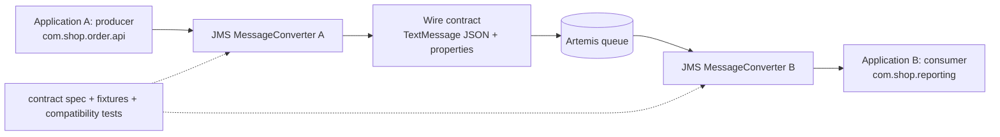

# Contract Testing Between Independent Producers and Consumers (Spring JMS)

> **Topic:** Spring Framework – JMS · **Group:** Data Conversion.  
> Goal: prove that a **producer** and a **consumer** developed, compiled, deployed, and versioned independently still interpret a JMS message correctly. The focus is not "both apps compile" but the **actual on-wire contract**: JMS Message kind, JSON body, headers/properties, schema, field meanings, routing, version compatibility, and error behavior. Hands-on example uses **Java 21, Spring Boot 3.3.5, Spring JMS, and ActiveMQ Artemis**.

## 1. Why Testing Inside a Single Application Is Not Enough

Suppose service A sends `OrderCreated`, and service B updates a read model. When both share one Java class inside a monorepo, a unit test can pass because both sides changed the class together or share the same Jackson configuration. In real deployments, however, **B may still be running an older version** and only receives A's **serialized JMS message**.

Several bugs remain hidden under coupled tests:

- A changes `amountMinor: long` to `amount: String`, while B still expects an integer in minor units.
- A switches the JMS body from JSON `TextMessage` to `ObjectMessage` or `BytesMessage`; B only supports JSON text.
- A omits the `_type` JMS property or switches the type ID to a Java class name; B does not have that class.
- A sets `schemaVersion="1"` as a String, whereas B's selector requires numeric `schemaVersion = 1`.
- A adds a required field; old B lacks that value and fails to parse, or worse: substitutes a wrong default.
- A and B point to different brokers with the same queue name but different destinations; converter unit tests cannot catch this.
- B runs slowly or disconnects, and a message redelivers after side effects succeeded; a valid data contract alone is not enough for correct business outcomes.

**Contract definition:** a set of rules observable on the wire, agreed upon by both producer and consumer, independent of each application's Java packages/classes.



## 2. Distinguishing Three Contract Layers

| Layer | What Must Be Agreed Upon | If Wrong |
| --- | --- | --- |
| **Destination/protocol** | Queue vs. topic, destination name, broker, send/consume permissions, ACK/redelivery | Message is never delivered, or goes to the wrong place. |
| **JMS envelope** | `TextMessage`/`BytesMessage`, headers, properties, type ID, selector, correlation | Broker filters out messages or converter cannot understand payload. |
| **Payload/schema** | JSON fields, types, required/optional, units, enums, version, semantic meaning | Consumer fails to parse or miscalculates even when parsing succeeds. |

A complete contract also specifies behavior **when incompatible**, upgrade strategies, retries, DLQs, and end-to-end verification. Still, testing the **wire contract** does not by itself prove exactly-once delivery or correct business side effects.

### Do Not Treat a Java Class as the Contract

Two services **do not have to** import the same `OrderCreated.java`. Instead:

- A has class `com.shop.order.api.PublisherApplication.OrderCreated`.
- B has class `com.shop.reporting.ReceiverApplication.OrderCreatedV1`.
- Over JMS, they satisfy the **same JSON schema + logical type ID `order-created-v1`**.
- A and B can build independently; if B upgrades later than A, a compatibility matrix is still required.

This removes direct coupling to Java packages/record types. A **contract artifact** (schema, sample messages, property specification) can be shared, yet sharing compile-time Java DTOs should not be mandatory when the goal is verifying independent compatibility.

## 3. Standard Contract Example for `OrderCreated` v1

Suppose we select a queue:

```text
destination: orders.events.v1
domain: QUEUE
payloadType: jakarta.jms.TextMessage
contentType: application/json; charset UTF-8 (contract convention)
typeId: order-created-v1
schemaVersion: 1
delivery: asynchronous; at-least-once-compatible consumer
```

**JMS properties contract**:

| Name | Wire Type | Value/Meaning | Required |
| --- | --- | --- | --- |
| `_type` | `String` | `order-created-v1` so `MappingJackson2MessageConverter` picks the receiving class | Yes |
| `eventType` | `String` | `OrderCreated`, used for classification/selectors | Yes |
| `schemaVersion` | **`int`** | `1`, used for schema selection and broker filtering | Yes |
| `contentType` | `String` | `application/json`, set by application; **not a standard JMS header** | Recommended |
| `producerApp` | `String` | E.g. `order-api` for observability, not an auth key | No |

JMS header `JMSCorrelationID` can carry `eventId` to aid tracing. `JMSMessageID` is a provider-managed header and does not replace business `eventId`.

**v1 JSON body**, using **fixed illustrative data** for the contract fixture:

```json
{
  "eventId": "evt-test-001",
  "orderId": "ORD-42",
  "amountMinor": 125000,
  "currency": "VND"
}
```

Field meanings and constraints:

- `eventId: String` non-empty, stable for the **same event**, used for deduplication.
- `orderId: String` non-empty, business order identifier.
- `amountMinor: integer/long` non-negative, money in **minor units** (here whole VND); never use `double` for money calculations.
- `currency: String` standard three-letter uppercase code, e.g. `VND`.
- JMS envelope properties **do not reside inside the JSON body**, and message selectors cannot read the body directly.

### 3.1. JSON Schema Managed as a Contract

File `contracts/order-created-v1.schema.json`:

```json
{
  "$schema": "https://json-schema.org/draft/2020-12/schema",
  "$id": "https://contracts.example.invalid/events/order-created-v1",
  "title": "OrderCreatedV1",
  "type": "object",
  "required": ["eventId", "orderId", "amountMinor", "currency"],
  "properties": {
    "eventId": { "type": "string", "minLength": 1 },
    "orderId": { "type": "string", "minLength": 1 },
    "amountMinor": { "type": "integer", "minimum": 0 },
    "currency": { "type": "string", "pattern": "^[A-Z]{3}$" }
  },
  "additionalProperties": true
}
```

`$id` is an **illustrative identifier** for the schema, not a live accessible endpoint. Replace it with your real schema/registry URI in production.

`additionalProperties=true` lets newer versions **add fields** while still remaining acceptable under the v1 contract. That alone is **not enough** to guarantee old Java consumers ignore unknown fields: check deserializer configuration. If you want a strict schema for a flow forbidding extra fields, choose `false`, though version upgrades will differ.

**JSON Schema validates only the body.** It **does not** verify JMS message kind, `_type`, `schemaVersion`, `JMSCorrelationID`, destination, or ACLs. Thus **two test layers** are required: payload schema and JMS envelope/runtime.

### 3.2. Why Can a Consumer Still Fail on Valid JSON?

Spring 6.1's `MappingJackson2MessageConverter` uses Jackson to marshal/unmarshal. It can default to sending `BytesMessage`; when the wire contract requires `TextMessage`, the producer must call `setTargetType(MessageType.TEXT)`. `setTypeIdPropertyName("_type")` tells the receiver to read the type ID from a **JMS string property**, and `setTypeIdMappings` maps the logical ID to B's own class.

If A configures `"order-created-v1" -> A.OrderCreated.class` and B configures `"order-created-v1" -> B.OrderCreatedV1.class`, with matching JSON and properties, **identical FQCNs are not needed**. Conversely, if A lets the converter write raw Java class names into `_type`, an independent consumer may lack that class; that is unwanted coupling.

**Security warning:** `MappingJackson2MessageConverter`'s type ID mapping is not an absolute allowlist for untrusted messages; some paths can fall back to class names. On multi-tenant brokers, restrict producer permissions, validate type IDs and accepted message types, and never allow arbitrary class deserialization.

## 4. Verification Strategy: Layered, from Fast to Real

A contract test suite should have independent layers:

1. **Versioned spec/schema:** documents destination, JMS envelope, JSON body, semantic invariants, sample data, and error policies.
2. **Producer contract test:** inside A's codebase, invoke the real converter to build a JMS Message, asserting body and type ID; verify postprocessor sets expected headers/properties.
3. **Consumer contract test:** inside B's codebase, feed **versioned fixtures** as JMS Messages into the real converter and verify DTO/validation; never import A's classes.
4. **Compatibility matrix:** run fixtures across deployed and upcoming A/B versions: forward/backward compatibility, optional fields, breaking changes.
5. **Two-app integration test with real broker/Testcontainers:** A and B are **two separate processes/build artifacts**, running over a real queue; verify routing, message type, type ID, consumer, ACK/retries.
6. **Negative & failure tests:** missing fields, changed types, selector mismatches, unknown type IDs, malformed JSON, duplicate event IDs, broker outage, redelivery, and DLQ.

**Never assert only** that a mocked `JmsTemplate.convertAndSend` was called. That assertion tests neither serialization, JMS properties, the broker, nor consumer decoding.

## 5. Two Independent Applications: Project Setup

Example layout:

```text
workspace/
├── publisher/                       # can be a separate repo/deployment
│   ├── settings.gradle
│   ├── build.gradle
│   └── src/main/
│       ├── java/com/shop/order/api/PublisherApplication.java
│       └── resources/application.yml
├── receiver/                        # can be a separate repo/deployment
│   ├── settings.gradle
│   ├── build.gradle
│   └── src/main/
│       ├── java/com/shop/reporting/ReceiverApplication.java
│       └── resources/application.yml
└── contracts/
    ├── order-created-v1.schema.json
    └── fixtures/order-created-v1.json
```

The two projects **do not import Java sources/DTOs from each other**. They agree solely on the **versioned wire contract** and test broker environment.

External dependencies: JDK 21; compatible Gradle wrapper in each project; a separate Artemis broker running at `tcp://localhost:61616`, with an account authorized to send/consume queue `orders.events.v1`. If the broker does not auto-create queues, pre-provision it; creating a Java `Queue` handle does not guarantee physical queue creation.

### 5.1. Publisher: Gradle Config

`publisher/settings.gradle`:

```groovy
rootProject.name = 'orders-publisher'
```

`publisher/build.gradle`:

```groovy
plugins {
    id 'java'
    id 'org.springframework.boot' version '3.3.5'
    id 'io.spring.dependency-management' version '1.1.6'
}
group = 'com.shop'
version = '1.0.0'

java {
    toolchain { languageVersion = JavaLanguageVersion.of(21) }
}
repositories { mavenCentral() }

dependencies {
    implementation 'org.springframework.boot:spring-boot-starter-artemis'
    implementation 'org.springframework.boot:spring-boot-starter-web'
    implementation 'org.springframework.boot:spring-boot-starter-json'
    testImplementation 'org.springframework.boot:spring-boot-starter-test'
}
tasks.named('test') { useJUnitPlatform() }
```

`publisher/src/main/resources/application.yml`:

```yaml
spring:
  artemis:
    mode: native
    broker-url: ${JMS_BROKER_URL:tcp://localhost:61616}
    user: ${JMS_USER:artemis}
    password: ${JMS_PASSWORD:artemis}
  jms:
    pub-sub-domain: false
server:
  port: 8080
```

The `artemis/artemis` defaults are for a local broker; production must use a secret manager/ACLs/TLS. JMS queue mode is selected via `pub-sub-domain=false`.

### 5.2. Receiver: Separate Gradle and Config

`receiver/settings.gradle`:

```groovy
rootProject.name = 'reporting-receiver'
```

`receiver/build.gradle`:

```groovy
plugins {
    id 'java'
    id 'org.springframework.boot' version '3.3.5'
    id 'io.spring.dependency-management' version '1.1.6'
}
group = 'com.shop'
version = '1.0.0'

java {
    toolchain { languageVersion = JavaLanguageVersion.of(21) }
}
repositories { mavenCentral() }

dependencies {
    implementation 'org.springframework.boot:spring-boot-starter-artemis'
    implementation 'org.springframework.boot:spring-boot-starter-json'
    testImplementation 'org.springframework.boot:spring-boot-starter-test'
}
tasks.named('test') { useJUnitPlatform() }
```

`receiver/src/main/resources/application.yml`:

```yaml
spring:
  application:
    name: reporting-receiver
  main:
    web-application-type: none
  artemis:
    mode: native
    broker-url: ${JMS_BROKER_URL:tcp://localhost:61616}
    user: ${JMS_USER:artemis}
    password: ${JMS_PASSWORD:artemis}
  jms:
    pub-sub-domain: false
```

The receiver has no HTTP server. Both apps share the **same broker URL/queue** yet have **separate Gradle builds and classpaths**, sufficient to test application-level independence.

## 6. Producer: Creating Contract-Compliant JSON `TextMessage` and JMS Envelope

File `publisher/src/main/java/com/shop/order/api/PublisherApplication.java`:

```java
package com.shop.order.api;

import java.util.Map;
import java.util.UUID;

import com.fasterxml.jackson.databind.ObjectMapper;
import org.springframework.boot.SpringApplication;
import org.springframework.boot.autoconfigure.SpringBootApplication;
import org.springframework.context.annotation.Bean;
import org.springframework.http.ResponseEntity;
import org.springframework.jms.core.JmsTemplate;
import org.springframework.jms.support.converter.MappingJackson2MessageConverter;
import org.springframework.jms.support.converter.MessageConverter;
import org.springframework.jms.support.converter.MessageType;
import org.springframework.web.bind.annotation.PathVariable;
import org.springframework.web.bind.annotation.PostMapping;
import org.springframework.web.bind.annotation.RestController;

@SpringBootApplication
public class PublisherApplication {

    public static void main(String[] args) {
        SpringApplication.run(PublisherApplication.class, args);
    }

    public record OrderCreated(
            String eventId,
            String orderId,
            long amountMinor,
            String currency) {
    }

    @Bean
    MessageConverter jmsMessageConverter(ObjectMapper objectMapper) {
        MappingJackson2MessageConverter converter =
                new MappingJackson2MessageConverter(objectMapper);
        converter.setTargetType(MessageType.TEXT);
        converter.setTypeIdPropertyName("_type");
        converter.setTypeIdMappings(Map.of(
                "order-created-v1", OrderCreated.class));
        return converter;
    }
}

@RestController
class OrderPublishApi {
    private final JmsTemplate template;

    OrderPublishApi(JmsTemplate template) {
        this.template = template;
    }

    @PostMapping("/demo/order/{orderId}")
    ResponseEntity<String> publish(@PathVariable String orderId) {
        String eventId = "evt-" + UUID.randomUUID();
        var event = new PublisherApplication.OrderCreated(
                eventId, orderId, 125_000L, "VND");

        template.convertAndSend("orders.events.v1", event, message -> {
            message.setStringProperty("eventType", "OrderCreated");
            message.setIntProperty("schemaVersion", 1);
            message.setStringProperty("contentType", "application/json");
            message.setStringProperty("producerApp", "order-api");
            message.setJMSCorrelationID(eventId);
            return message;
        });

        return ResponseEntity.accepted()
                .body("ENQUEUED " + eventId);
    }
}
```

**Key points to understand:**

- `MessageConverter` is a bean registered by A; Spring Boot auto-configures `JmsTemplate` when not overridden and applies this converter bean. No need to build a Java `TextMessage` manually in the business method.
- `setTargetType(MessageType.TEXT)` forces the JMS body to be JSON text.
- A maps `order-created-v1` to **A's own Java class**.
- `MessagePostProcessor` runs **after** conversion and **before** send, attaching properties and headers per contract.
- `JMSCorrelationID` is a JMS header; the remaining properties are metadata for filtering/observability.
- `eventId` is freshly generated for **every request** in the demo; when retrying the **same event** in production, preserve the original ID.
- HTTP 202 is returned only if sending does not throw in this flow; it **does not** prove the consumer finished or the receiving database committed.

**Note:** the example hardcodes `amountMinor=125000` for clarity; real data must come from validated domain logic and request validation.

## 7. Consumer: Separate Class Decoding the Same Type ID

File `receiver/src/main/java/com/shop/reporting/ReceiverApplication.java`:

```java
package com.shop.reporting;

import java.util.Map;

import com.fasterxml.jackson.databind.DeserializationFeature;
import com.fasterxml.jackson.databind.ObjectMapper;
import org.springframework.boot.SpringApplication;
import org.springframework.boot.autoconfigure.SpringBootApplication;
import org.springframework.context.annotation.Bean;
import org.springframework.jms.annotation.EnableJms;
import org.springframework.jms.annotation.JmsListener;
import org.springframework.jms.support.converter.MappingJackson2MessageConverter;
import org.springframework.jms.support.converter.MessageConverter;
import org.springframework.jms.support.converter.MessageType;
import org.springframework.stereotype.Component;

@SpringBootApplication
@EnableJms
public class ReceiverApplication {

    public static void main(String[] args) {
        SpringApplication.run(ReceiverApplication.class, args);
    }

    // Independent of PublisherApplication.OrderCreated!
    public record OrderCreatedV1(
            String eventId,
            String orderId,
            long amountMinor,
            String currency) {
        public OrderCreatedV1 {
            if (eventId == null || eventId.isBlank()
                    || orderId == null || orderId.isBlank()
                    || amountMinor < 0
                    || currency == null
                    || !currency.matches("[A-Z]{3}")) {
                throw new IllegalArgumentException(
                        "Invalid OrderCreatedV1 contract");
            }
        }
    }

    @Bean
    MessageConverter jmsMessageConverter(ObjectMapper objectMapper) {
        ObjectMapper contractMapper = objectMapper.copy()
                .configure(
                        DeserializationFeature.FAIL_ON_UNKNOWN_PROPERTIES,
                        false)
                .configure(
                        DeserializationFeature.FAIL_ON_MISSING_CREATOR_PROPERTIES,
                        true)
                .configure(
                        DeserializationFeature.FAIL_ON_NULL_CREATOR_PROPERTIES,
                        true);

        MappingJackson2MessageConverter converter =
                new MappingJackson2MessageConverter(contractMapper);
        converter.setTargetType(MessageType.TEXT);
        converter.setTypeIdPropertyName("_type");
        converter.setTypeIdMappings(Map.of(
                "order-created-v1", OrderCreatedV1.class));
        return converter;
    }
}

@Component
class ReportingProjection {
    @JmsListener(
        destination = "orders.events.v1",
        selector = "_type = 'order-created-v1' AND "
                 + "eventType = 'OrderCreated' AND schemaVersion = 1")
    public void onOrder(ReceiverApplication.OrderCreatedV1 event) {
        System.out.printf(
                "PROJECTED order=%s amount=%d currency=%s%n",
                event.orderId(), event.amountMinor(), event.currency());
    }
}
```

**Why are the two applications genuinely independent?** A serializes class `com.shop.order.api.PublisherApplication.OrderCreated`; B deserializes into a **different class** `com.shop.reporting.ReceiverApplication.OrderCreatedV1`. B does not import A, does not depend on `publisher.jar`, and has no knowledge of A's package name. Both agree on the type ID and JSON schema.

**On Jackson strictness:**

- `FAIL_ON_UNKNOWN_PROPERTIES=false` lets B ignore **new fields** that A may add later; it must never be treated as permission to change existing field types or meanings.
- `FAIL_ON_MISSING_CREATOR_PROPERTIES=true` and `FAIL_ON_NULL_CREATOR_PROPERTIES=true` prevent inputs missing or nulling required record fields from slipping through silently.
- The record constructor rejects blank values, negative amounts, and malformed currencies. Unrecoverable errors should route to poison-message/DLQ handling rather than infinite retries.
- B's Jackson config is a **contract strategy**: production may use a JSON Schema validator and separate domain validation for stricter checks, especially around numeric/type coercion.

**Selectors** read only JMS properties. If A fails to send `schemaVersion` as **`int`**, B may never select the message; a valid JSON payload will not save it. The `_type` selector also prevents out-of-contract type IDs from reaching this converter, yet **ACLs and source validation** are still necessary when a broker receives messages from multiple systems. Unmatched messages can sit idle in the queue; monitor backlogs and retire versions that no longer have consumers.

### Note on Transactions

Spring Boot normally configures a default listener factory with appropriate transaction mechanics; if replacing the factory manually, explicitly configure `sessionTransacted`, error handler, concurrency, and recovery. Two separate apps do not share a DB transaction, JMS session transaction, or classloader. Redeliveries require **idempotency** keyed by `eventId`, independent of the converter.

## 8. Quick Two-Process Test via Artemis

Before running, the admin/broker must have queue `orders.events.v1` with queue/ANYCAST routing and send/receive permissions. If auto-create is enabled, the broker **may** create it automatically; that is a broker setting, not a guarantee from Spring creating a destination object.

In terminal 1:

```bash
cd receiver
./gradlew bootRun
```

In terminal 2:

```bash
cd publisher
./gradlew bootRun
```

On Windows (PowerShell or cmd), run `gradlew.bat bootRun` in each project. If no Gradle wrapper exists yet, use a compatible installed Gradle with `gradle bootRun` or generate the wrapper first.

Terminal 3 sends:

```bash
curl -i -X POST http://localhost:8080/demo/order/ORD-42
```

Example response when JMS send succeeds:

```text
HTTP/1.1 202
...
ENQUEUED evt-<UUID generated at runtime>
```

The `evt-<UUID ...>` line here is a **format template**, not byte-for-byte stdout since the UUID is random. When the consumer receives and decodes successfully, it prints:

```text
PROJECTED order=ORD-42 amount=125000 currency=VND
```

The timing of the consumer log relative to the HTTP 202 response is non-deterministic. If the broker is down, permissions are missing, the converter is misconfigured, or the destination does not exist, a successful result **cannot** be expected.

**Verify via broker management:** check queue name/routing, active consumers, pending/delivering counts, redelivery, and DLQ. You can pause B temporarily in a **test environment** to inspect raw messages; never pause production consumers just for an exercise. The sender returning HTTP 202 does not replace proof that the receiver ACKed.

## 9. Producer Contract Test Without Starting the Consumer

The producer must prove that **its actual current converter** builds the right body and type ID. You can use Mockito to mock `Session`/`TextMessage` (no broker required) to verify serialization.

File `publisher/src/test/java/com/shop/order/api/PublisherContractTest.java`:

```java
package com.shop.order.api;

import com.fasterxml.jackson.databind.JsonNode;
import com.fasterxml.jackson.databind.ObjectMapper;
import jakarta.jms.Session;
import jakarta.jms.TextMessage;
import org.junit.jupiter.api.Test;
import org.mockito.ArgumentCaptor;
import org.springframework.jms.support.converter.MappingJackson2MessageConverter;
import org.springframework.jms.support.converter.MessageType;

import java.util.Map;

import static org.junit.jupiter.api.Assertions.*;
import static org.mockito.ArgumentMatchers.anyString;
import static org.mockito.Mockito.*;

class PublisherContractTest {

    @Test
    void writesStableJsonAndTypeId() throws Exception {
        ObjectMapper mapper = new ObjectMapper();
        MappingJackson2MessageConverter converter =
                new MappingJackson2MessageConverter(mapper);
        converter.setTargetType(MessageType.TEXT);
        converter.setTypeIdPropertyName("_type");
        converter.setTypeIdMappings(Map.of(
                "order-created-v1",
                PublisherApplication.OrderCreated.class));

        Session session = mock(Session.class);
        TextMessage text = mock(TextMessage.class);
        when(session.createTextMessage(anyString())).thenReturn(text);

        var event = new PublisherApplication.OrderCreated(
                "evt-test-001", "ORD-42", 125_000L, "VND");

        converter.toMessage(event, session);

        ArgumentCaptor<String> body =
                ArgumentCaptor.forClass(String.class);
        verify(session).createTextMessage(body.capture());
        verify(text).setStringProperty("_type", "order-created-v1");

        JsonNode json = mapper.readTree(body.getValue());
        assertEquals("evt-test-001", json.path("eventId").asText());
        assertEquals("ORD-42", json.path("orderId").asText());
        assertTrue(json.path("amountMinor").isIntegralNumber());
        assertEquals(125_000L, json.path("amountMinor").asLong());
        assertEquals("VND", json.path("currency").asText());
        assertEquals(4, json.size()); // Exactly the 4 fields of v1.
    }
}
```

**What does this test verify?** The converter builds a `TextMessage` via `Session.createTextMessage` with JSON containing the expected fields/types, and sets `_type` to the logical ID. It deliberately **does not** assert JSON key order: key order inside a JSON object is not part of the contract.

**What is not yet verified?** JMS properties added in the controller's `MessagePostProcessor`, the real destination, broker security, and delivery. To test the postprocessor, you can use Mockito to capture the callback in the publisher layer; however, an integration test against a real provider is still required.

In particular, `assertEquals(4,json.size())` is sensible for **producer v1** to prevent accidentally emitting extra fields. When A intentionally adds an optional field in v2, update the test/contract accordingly rather than keeping old assertions mechanically.

## 10. Consumer Contract Test Without Importing Producer DTOs

The receiving side must test **on-wire fixtures**, never instantiating a `PublisherApplication.OrderCreated` and sharing one converter inside the same process.

Create `receiver/src/test/java/com/shop/reporting/ReceiverContractTest.java`:

```java
package com.shop.reporting;

import java.util.Map;

import com.fasterxml.jackson.databind.DeserializationFeature;
import com.fasterxml.jackson.databind.ObjectMapper;
import jakarta.jms.TextMessage;
import org.junit.jupiter.api.Test;
import org.springframework.jms.support.converter.MappingJackson2MessageConverter;
import org.springframework.jms.support.converter.MessageConversionException;
import org.springframework.jms.support.converter.MessageType;

import static org.junit.jupiter.api.Assertions.*;
import static org.mockito.Mockito.*;

class ReceiverContractTest {

    private MappingJackson2MessageConverter converter() {
        ObjectMapper mapper = new ObjectMapper()
                .configure(
                        DeserializationFeature.FAIL_ON_UNKNOWN_PROPERTIES,
                        false)
                .configure(
                        DeserializationFeature.FAIL_ON_MISSING_CREATOR_PROPERTIES,
                        true)
                .configure(
                        DeserializationFeature.FAIL_ON_NULL_CREATOR_PROPERTIES,
                        true);
        var converter = new MappingJackson2MessageConverter(mapper);
        converter.setTargetType(MessageType.TEXT);
        converter.setTypeIdPropertyName("_type");
        converter.setTypeIdMappings(Map.of(
                "order-created-v1",
                ReceiverApplication.OrderCreatedV1.class));
        return converter;
    }

    @Test
    void acceptsProducerV1FixtureIndependently() throws Exception {
        TextMessage message = mock(TextMessage.class);
        when(message.getStringProperty("_type"))
                .thenReturn("order-created-v1");
        when(message.getText()).thenReturn("""
                {"eventId":"evt-test-001","orderId":"ORD-42",
                 "amountMinor":125000,"currency":"VND"}
                """);

        Object actual = converter().fromMessage(message);

        assertEquals(
                new ReceiverApplication.OrderCreatedV1(
                        "evt-test-001", "ORD-42", 125_000L, "VND"),
                actual);
    }

    @Test
    void toleratesNewOptionalField() throws Exception {
        TextMessage message = mock(TextMessage.class);
        when(message.getStringProperty("_type"))
                .thenReturn("order-created-v1");
        when(message.getText()).thenReturn("""
                {"eventId":"evt-test-002","orderId":"ORD-42",
                 "amountMinor":125000,"currency":"VND",
                 "sourceChannel":"mobile"}
                """);

        var event = (ReceiverApplication.OrderCreatedV1)
                converter().fromMessage(message);
        assertEquals("ORD-42", event.orderId());
    }

    @Test
    void rejectsMissingRequiredField() throws Exception {
        TextMessage message = mock(TextMessage.class);
        when(message.getStringProperty("_type"))
                .thenReturn("order-created-v1");
        when(message.getText()).thenReturn("""
                {"eventId":"evt-test-003",
                 "amountMinor":125000,"currency":"VND"}
                """);

        assertThrows(
                MessageConversionException.class,
                () -> converter().fromMessage(message));
    }
}
```

All three tests use **B's DTO class**, with zero knowledge of A's Java class. They verify a positive fixture, compatibility with a new optional field, and a negative fixture missing a required field. These are unit tests using a mocked `TextMessage`; they run without Artemis.

`MappingJackson2MessageConverter` can wrap Jackson/deserialization errors inside `MessageConversionException`. When client code uses another converter or errors pass through a listener container, the surface exception may be wrapped further; inspect the root cause during triage.

Run tests **independently**:

```bash
# Inside publisher directory
./gradlew test

# Inside receiver directory
./gradlew test
```

Do not claim the commands above were executed in this article; they are steps for learners to run themselves. Unit tests do not prove the broker actually dispatches or that message selectors match.

## 11. JMS Envelope Contracts Must Be Tested Separately

A valid JSON body **can still fail completely** if properties do not match.

Example selector on B:

```sql
_type = 'order-created-v1'
AND eventType = 'OrderCreated'
AND schemaVersion = 1
```

This is **JMS selector syntax**, not a SQL query sent to a database.

Cases to test:

| A Sends | Does B Receive? | Reason |
| --- | --- | --- |
| `_type="order-created-v1"`; `eventType="OrderCreated"`; `schemaVersion` int 1 | Eligible for broker selection | Properties satisfy all three expressions. |
| A puts `schemaVersion: 1` **only inside the JSON body** | Fails property condition | Selectors do not inspect JSON bodies. |
| A calls `setStringProperty("schemaVersion","1")` | Not a safe substitute for int 1 | Selectors enforce typed comparisons; no implicit getter-style parsing. |
| A omits `_type` with identical body | Misses selector; converter lacks type ID | Metadata is part of the contract. |
| A sends `TextMessage` while B expects `ObjectMessage` | Wire contract mismatch | JMS message kind must match. |
| A sends schema v2, B selects only v1 | v1 B misses v2 messages | Needs matching consumer, routing, and backlog monitoring. |

**JMS headers** such as `JMSCorrelationID` differ from properties. `JMSMessageID` is provider-managed and should not serve as business `eventId`. If sending `contentType`, it is an **application-set property**; JMS does not automatically treat it as an HTTP content-type header.

**Procedure to test envelopes against a test broker:**

1. Run the producer with the consumer paused, or use an isolated test queue.
2. Send one message with a fixed `eventId` for testing.
3. Use the Artemis console/management API or a raw probe consumer to inspect the raw `Message`.
4. Assert `message instanceof TextMessage` and that `getText()` parses as the expected JSON body.
5. Assert `getStringProperty("_type")`, `getStringProperty("eventType")`, `getIntProperty("schemaVersion")`, and `getJMSCorrelationID()`.
6. Decode into B's DTO, validate business invariants, and confirm ACK/commit per policy.
7. Test negative fixtures while avoiding injecting malformed messages into production queues.

## 12. Compatibility Matrix: Can A and B Upgrade Out of Sync?

Never equate **schema version** with **build version**. For example, `order-created-v1` is the on-wire contract version; `publisher 2.4.0` and `receiver 1.9.0` can still share the v1 contract.

| Producer | Consumer | Expected Outcome | Notes |
| --- | --- | --- | --- |
| P1 emits v1 | C1 reads v1 | **PASS** | Baseline. |
| P2 still emits v1 yet adds **optional** `sourceChannel` | C1 reads v1 | **PASS if** B ignores unknown fields and preserves old field meanings | Must be tested with actual Jackson config. |
| P1 emits v1 | C2 adds support for optional field | **PASS if** C2 allows the new field to be absent | Never make a new field required while old producers still run. |
| P2 changes `amountMinor` to `amount: String` while keeping v1 type ID | C1 reads v1 | **FAIL or worse: silent semantic mismatch** | This is a breaking change. |
| P2 emits v2 contract, changing `_type` and `schemaVersion` | C1 selects only v1 | **Does not receive v2** | Needs C2/adapter/valid queue routing. |
| P1 emits v1, C2 selects only v2 | C2 does not process v1 | **BLOCKED** | Never deploy a v2-only consumer before the v1 backlog drains. |

### A Safe Upgrade Strategy

**For compatible changes:** upgrade consumers to read both v1 and the new optional data before producers start emitting the new field; keep type ID/schema semantics unchanged if still compatible. If bumping the `schemaVersion` property, ensure B's selector still matches the appropriate versions.

**For breaking changes:** publish contract `order-created-v2` and plan for A/B coexistence:

1. Register schema v2, migration plan, and fixtures.
2. Deploy B2 capable of reading v1/v2 or split routing, depending on architecture.
3. Enable A2 to emit v2 once receiving paths are ready.
4. Monitor v1 backlog, DLQ, v1 consumers, and rollback paths.
5. Disable v1 support only once old messages are drained and no v1 producers remain.

**Caution with queues:** multiple consumers on one queue **compete** for messages rather than each group receiving its own copy. Unmatched selectors can leave messages stranded. If multiple systems need to read the same event independently, design topics/subscriptions or fan-out queues; never assume "putting multiple consumers on a queue gives each one a copy".

## 13. Mandatory Negative Tests to Avoid False Confidence

| Test Category | Intentionally Invalid Input | Correct Expectation |
| --- | --- | --- |
| **Missing required** | Omit `orderId` | Consumer rejects in schema/constructor; writes no projection. |
| **Wrong type** | `amountMinor = "125000"` as JSON String | Contract/schema validator rejects; never rely solely on default Jackson coercion. |
| **Semantically invalid** | `amountMinor = -5` | Rejected by domain validation. |
| **Unknown event type** | `_type = "not-approved-v1"` | Never enters consumer outside contract; record metric and route/DLQ appropriately. |
| **Wrong property type** | `schemaVersion` String `"1"` | Numeric selector fails to match; backlog detected. |
| **Unsupported version** | `schemaVersion=2` while B supports only 1 | Does not misprocess wrong version; uses dual-read/migration plan. |
| **Malformed JSON** | Unclosed JSON brace, invalid UTF-8 | Conversion failure; bounded retries and DLQ/quarantine. |
| **Duplicate event** | Two messages with same `eventId` | Business side effect executes once via idempotency. |
| **Transport outage** | Broker down/ACL denied | Producer receives error/timeout, controlled retry; never returns false success. |
| **Redelivery** | Crash after DB write before JMS ACK | Consumer receives again safely; creates no duplicate records. |

**Jackson coercion caveat:** under some configurations Jackson coerces numeric strings into numbers, or assigns primitive defaults when fields are absent. Never treat "using a Java record" as equivalent to a JSON Schema validator. For sensitive data, validate raw `JsonNode`/JSON Schema **before** mapping, or configure strict coercion and explicit validators.

### Poison Messages and DLQs

A message violating a schema rarely **fixes itself** on retry. If the listener uses a transacted JMS session, a conversion/processing exception can roll back and redeliver. Configure broker redelivery caps, move poison messages to a **DLQ/quarantine**, and record correlation ID, event ID, type ID, `schemaVersion`, and sanitized cause. Never log full JSON containing personal data or secrets.

## 14. Data Compatibility Differs from Operational Guarantees

A system whose **contract tests PASS** can still lose or duplicate business effects:

- **Producer commits DB then crashes before JMS send:** business change exists yet event was never emitted. Use a **transactional outbox** when event publication must be guaranteed after commit.
- **Broker receives, consumer finishes DB work then crashes before ACK:** message may redeliver. Consumer must be idempotent keyed by `eventId` + unique constraint/processed-events table.
- **Producer retries after send timeout of unknown outcome:** may emit duplicates. Keep a stable `eventId` for the **same event** rather than generating a fresh UUID on every uncontrolled retry.
- **Message TTL/retention/DLQ:** valid JSON does not stop messages from expiring, failing permissions, being rejected on full queues, or moving to DLQ.
- **Multiple services:** queue consumers compete; when event broadcast is needed, design dedicated subscriptions/fan-out and test parallel routing.

**Separate dashboards:** contract failures (schema/type ID), broker failures (connections, auth, address/queue), dispatch (backlog, consumer count), delivery (redelivery/DLQ), and business idempotency/latency. Lumping everything into one "JMS error" metric hinders triage.

## 15. CI/CD Contract Integration Checklist

### Producer Side

- [ ] Create/adopt v1 contract with owner, schema, fixtures, and semantic units.
- [ ] Unit test the **producer's own** Java converter with mocked `Session`: verify `TextMessage`, JSON fields/types, and type ID.
- [ ] Test `MessagePostProcessor` or run integration tests to verify JMS headers/properties, especially `int` type for `schemaVersion`.
- [ ] Test adding optional fields, changing serializer configs, and upgrading Jackson/Spring Boot versions.
- [ ] Verify code never accidentally emits Java class FQCNs as type IDs.
- [ ] Never emit new payloads without knowing active consumer versions can process them.

### Consumer Side

- [ ] Parse wire fixtures using the **consumer's** classes, without importing producer DTOs.
- [ ] Test required/optional fields, negative fixtures, type IDs/versions, and domain validation.
- [ ] Verify unknown fields follow the chosen compatibility strategy.
- [ ] Verify selectors match property names **and data types**, not just JSON.
- [ ] Maintain DLQ/quarantine policies for unparseable messages and idempotency for duplicate events.

### Integration and Release Gates

- [ ] Run both independent binaries against a test broker or matching Artemis Testcontainer.
- [ ] Verify real destinations, queue/topic mode, permissions, JMS message kinds, properties, and ACKs.
- [ ] Run the P1/P2 × C1/C2 compatibility matrix using versioned fixtures.
- [ ] Test rollbacks, redeliveries, DLQs, broker outages, and shutdown/restart timing.
- [ ] Gate breaking-change releases until new receivers and migration/rollback plans are in place.
- [ ] Monitor backlogs, consumer counts, and selector-unmatched messages after deployment.

**Definition of PASS:** not merely "no exceptions", but producer emitting the exact wire contract, independent consumer decoding cleanly, business invariants preserved, messages traversing the intended destination, and incompatible errors handled safely.

## 16. Self-Check Questions and Exercises

1. Why can sharing one Java DTO JAR between producer and consumer hide compatibility bugs during staggered deployments?
2. Define the three contract layers: destination/protocol, JMS envelope, and payload schema; give one failure example per layer.
3. How does type ID `order-created-v1` differ from Java name `com.shop.order.api.PublisherApplication.OrderCreated`? Why can B use a different class and still decode properly?
4. What settings does `MappingJackson2MessageConverter` require to send JSON `TextMessage` and decode by type ID?
5. Identify the required JMS properties in the example. Why cannot a selector inspect `amountMinor` inside the JSON body?
6. A sends `setStringProperty("schemaVersion","1")`, while B selects `schemaVersion = 1`. Which side must be fixed and what should be inspected on the broker?
7. Are JSON Schema v1 and a single passing body-parse test enough? What envelope checks are still missing?
8. A adds optional `sourceChannel`. What configuration does old B need? Why must compatibility still be tested?
9. A removes `amountMinor` or changes it to `amount: String` without changing the type ID. Is this compatible or breaking? Propose a migration.
10. Why do consumer tests require **on-wire contract fixtures** rather than instantiating the producer's DTO class?
11. Write a negative test for a String JSON amount and explain why Jackson coercion can produce a "false green" test.
12. If P2 emits v2 while B1 only consumes v1, how can messages accumulate on a queue? When should destinations be split?
13. If the consumer writes to its database and crashes before JMS ACK, can contract tests prevent duplicate side effects? What mechanism must be added?
14. Design a release gate with two independent build jobs and one test-broker integration job, listing the PASS evidence for each job.

**Remember:** **The integration contract is not a Java class, but the rules enforced on the JMS wire**. Independent producers and consumers must test **both body and JMS envelope**, use versioned type IDs/schemas, run positive/negative fixtures, compatibility matrices, and broker integration tests. Contract tests prove **messages are understood accurately**; reliable operations still require outbox, idempotency, transactions, retries, DLQs, and observability.

### References

- [Spring Framework – JMS Sending a Message](https://docs.spring.io/spring-framework/reference/integration/jms/sending.html) — `JmsTemplate`, converters, and postprocessors.
- [Spring Framework 6.1 – MappingJackson2MessageConverter](https://docs.spring.io/spring-framework/docs/6.1.0/javadoc-api/org/springframework/jms/support/converter/MappingJackson2MessageConverter.html) — `MessageType.TEXT`, type ID mapping, JSON TEXT/BYTES.
- [Spring – Getting Started: Messaging with JMS](https://spring.io/guides/gs/messaging-jms/) — Boot JMS auto-config, `@JmsListener`, converter beans, and providers.
- [Spring Framework – Annotated JMS Listener Endpoints](https://docs.spring.io/spring-framework/reference/integration/jms/annotated.html) — listener factories and payload conversion.
- [Jakarta Messaging 3.1 Specification](https://jakarta.ee/specifications/messaging/3.1/jakarta-messaging-spec-3.1.html) — JMS message types, properties/selectors, ACK/delivery.
- [JSON Schema 2020-12 Specification](https://json-schema.org/draft/2020-12) — required, types, additionalProperties, and schema validation.
- [Apache ActiveMQ Artemis Documentation](https://artemis.apache.org/components/artemis/documentation/latest/) — queues/addresses, routing, redelivery, DLQs, and broker management.
