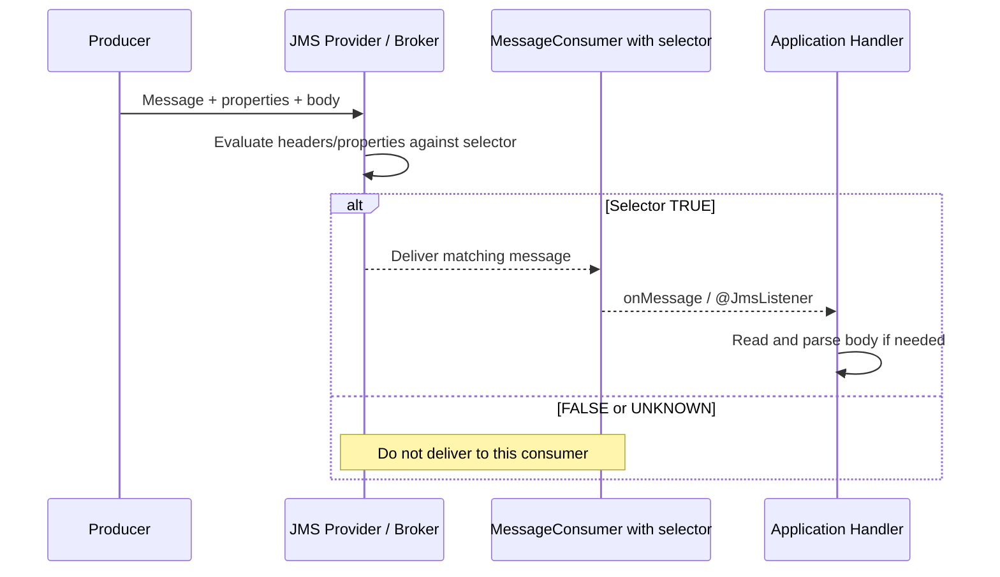
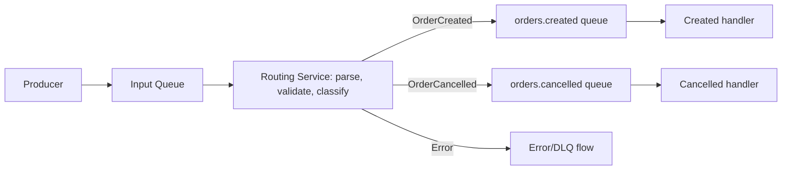

# Why standard selectors do not read body content in Jakarta JMS and Spring Framework

## 1. The core answer

**A standard JMS message selector cannot read or query body content.** According to **Jakarta Messaging Specification 3.1, section 3.8.1**, selectors choose messages using **header fields allowed by the specification** and **message properties**. The body can contain text, JSON, XML, bytes, a map, or a Java object, but **it does not participate in standard selector expressions**.

For example, a producer sends the body:

```json
{"eventType":"OrderCreated","region":"APAC","schemaVersion":2}
```

If that is only a string in a `TextMessage`, a consumer using:

```sql
eventType = 'OrderCreated' AND region = 'APAC' AND schemaVersion >= 2
```

**does not match automatically**. The selector needs the names `eventType`, `region`, and `schemaVersion` to be **JMS message properties**, for instance assigned by the producer using `setStringProperty` and `setIntProperty`. It **has no capability to open JSON and look up keys with the same names**.

The right way to send for broker-side filtering needs:

```java
jmsTemplate.send("orders.events", session -> {
    TextMessage message = session.createTextMessage(
        "{\"eventType\":\"OrderCreated\",\"region\":\"APAC\","
      + "\"schemaVersion\":2}");

    message.setStringProperty("eventType", "OrderCreated");
    message.setStringProperty("region", "APAC");
    message.setIntProperty("schemaVersion", 2);
    return message;
});
```

This is a **Spring JMS code snippet**, assuming `jmsTemplate` is available, `jakarta.jms.TextMessage` is imported, and the broker is configured. Adding properties does not modify the body. It provides **metadata for routing/filtering**, while JSON remains the business payload for the handler to read after receiving.

> **Distinguish two statements:** "A broker can read the body using a proprietary API or utility" **does not mean** "a *standard* JMS selector can query the body." Some JMS providers have extensions such as XPath for XML, but they are **not portable** and are not required semantics of Jakarta Messaging.

## 2. JMS Message structure explains this limitation

A JMS Message consists of three regions with different purposes:

```text
JMS Message
├── Header (JMS-defined fields)
│   ├── JMSMessageID       : assigned by provider on send
│   ├── JMSPriority        : assigned by producer/provider on send
│   ├── JMSCorrelationID   : can be assigned by client
│   ├── JMSType            : can be assigned by client
│   └── Other headers
│
├── Properties (typed key-value metadata)
│   ├── eventType     : "OrderCreated" (String)
│   ├── region        : "APAC"         (String)
│   ├── schemaVersion : 2              (int)
│   └── ...
│
└── Body (application payload)
    ├── TextMessage   → String, e.g., JSON/XML/text
    ├── BytesMessage  → bytes
    ├── MapMessage    → set of fields in the BODY
    ├── StreamMessage → elements in sequence
    └── ObjectMessage → Java-serialized object
```

Standard JMS selectors inspect the **header/properties** section, which already has a consistent metadata form, for the provider to evaluate conditions. The **body** serves business content and is decoded by the consumer according to application conventions.

### 2.1. Referenceable standard headers are a subset

Jakarta Messaging 3.1 **restricts the JMS header names usable as selector identifiers** to six fields:

- `JMSDeliveryMode`
- `JMSPriority`
- `JMSMessageID`
- `JMSTimestamp`
- `JMSCorrelationID`
- `JMSType`

Valid standard examples:

```sql
JMSType = 'OrderCreated'
JMSPriority >= 5
JMSCorrelationID = 'corr-501'
JMSDeliveryMode = 'PERSISTENT'
```

Note: in a selector, `JMSDeliveryMode` is compared against the **string** `'PERSISTENT'` or `'NON_PERSISTENT'`, not directly against the integer constant `DeliveryMode.PERSISTENT` in Java.

**Not all JMS headers are portable in a selector.** `JMSDestination`, `JMSExpiration`, `JMSReplyTo`, and `JMSRedelivered` are JMS concepts, but **they are not in this set of six header identifiers** of the specification. A provider may have proprietary extensions, but you should not write tutorials or multi-broker applications assuming those extensions are standard.

### 2.2. JMS properties are where business conditions belong for selectors

Producers can set properties using methods such as:

```java
message.setStringProperty("eventType", "OrderCreated");
message.setStringProperty("region", "APAC");
message.setIntProperty("schemaVersion", 2);
message.setBooleanProperty("highValue", true);
```

Standard JMS property value types include `boolean`, `byte`, `short`, `int`, `long`, `float`, `double`, and `String`. They are scalar metadata, not nested JSON objects. Property names must satisfy selector identifier rules, for example `eventType`, `schemaVersion`, `region`. Avoid non-portable names such as `payload.status` or `order-type` as selector identifiers.

Producers should set properties **before sending**. On the consumer side, received message properties are read-only unless an API is called to change write mode; modifying properties on a received copy **does not cause the broker to re-evaluate the selector for the delivery that already occurred**.

### 2.3. Data in MapMessage is also the body

Here is an easily confused case:

```java
MapMessage msg = session.createMapMessage();
msg.setString("eventType", "OrderCreated");
msg.setString("region", "APAC");
```

The two fields set with `MapMessage.setString` reside in the **body of the MapMessage**. The standard selector `eventType = 'OrderCreated'` **does not read those entries**.

If filtering is needed, separate properties must still be set:

```java
msg.setStringProperty("eventType", "OrderCreated");
msg.setStringProperty("region", "APAC");
```

The names match, but they are **two different APIs and two different data regions**. Similarly, an `ObjectMessage` having a `getEventType()` field or a `BytesMessage` containing JSON does not make the selector see that field automatically.

## 3. Actual mechanism: selectors run before the application opens the body

A JMS consumer can register a selector when creating the consumer:

```java
MessageConsumer consumer = session.createConsumer(
    queue,
    "eventType = 'OrderCreated' AND region = 'APAC'");
```

Here `queue` and `session` are real JMS objects already created from the broker; this is an **illustrative API snippet**, not a standalone program.

Conceptual flow:



**Key takeaway:** a selector is a condition for **delivering a message to a consumer**. It is not a Java callback executed after `@JmsListener` has already read JSON. With a Queue, a message that does not match one consumer's selector can still be picked up by another consumer or retained in the Queue per policy; with a Topic, a subscription with a selector only receives matching messages within that subscription's scope.

### 3.1. Why doesn't the specification parse the body?

There are three important design reasons:

1. **JMS supports many different body forms.** There is no single field path or common expression language to query a `TextMessage` containing XML, a `TextMessage` containing JSON, a `BytesMessage` containing binary data, a `MapMessage`, and an `ObjectMessage` simultaneously. The JMS specification does not force providers to know application schemas.
2. **Headers and properties have a consistent metadata format.** The provider can compare names and scalar values without understanding business content, format/encoding, or performing Java deserialization/JSON parsing.
3. **Early filtering benefits delivery cost.** The broker/provider can skip delivering messages a consumer does not care about; having to parse every large, compressed, or sensitive-data body to choose a consumer would make routing heavier and less portable.

These are **architectural rationales** aligned with the goals of Jakarta Messaging; the actual binding requirement remains that **selectors must not reference body values** (section 3.8.1).

### 3.2. Do not misunderstand what "does not read" means

- **Cannot be read via standard selector** ≠ the consumer cannot read the body. After the message is delivered, the consumer can call `TextMessage.getText()`, `BytesMessage.readBytes(...)`, or use a `MessageConverter`.
- **Cannot be read via standard selector** ≠ the broker never touches the body. The broker can store, transmit, compress, encrypt, or use proprietary features that read the body.
- **Cannot be read via standard selector** ≠ content-based filtering is impossible. You can **compute metadata before sending** or **filter in the application after receiving**; each approach has different trade-offs.
- **Provider has XPath/JSON filtering** ≠ that code will run on every JMS broker. You must explicitly document provider dependencies, protocols, and performance/security limits.

## 4. Selector format: SQL-like syntax, but not SQL over JSON

A standard selector is an expression string based on a **conditional subset of SQL-92**, not a database SQL query, JSONPath, or XPath.

```sql
eventType = 'OrderCreated'
region IN ('APAC', 'EU')
schemaVersion >= 2
highValue = TRUE
JMSPriority >= 5
eventType LIKE 'Order%'
region IS NOT NULL
eventType = 'OrderCreated' AND schemaVersion >= 2
```

Valid operators within the standard scope include comparisons `=`, `<>`, `<`, `<=`, `>`, `>=`, logical `AND`/`OR`/`NOT`, `BETWEEN`, `LIKE`, `IN`, `IS NULL`, and parentheses. Do not assume the syntax supports functions like `JSON_VALUE`, `JSON_EXTRACT`, `CAST`, or dot-notation object property access.

### 4.1. "body LIKE '%PAID%'" looks syntactically valid, yet misses the intent

```sql
body LIKE '%PAID%'
```

This can be a **syntactically valid selector expression**, but `body` will be interpreted as **a property name** (since it is a valid identifier), not the JMS body. If the producer did not attach a `body` property, the value of `body` is `NULL` in the selector; the expression becomes `UNKNOWN` and the message **does not match**.

If a producer happens to set:

```java
message.setStringProperty("body", "PAID");
```

then the selector above can match thanks to the **property named `body`**, even if `TextMessage.getText()` is `"CANCELLED"`. Thus a single matching test does not prove that the selector read the payload.

### 4.2. "payload.status = 'PAID'" is not a standard JSON path

```sql
payload.status = 'PAID'
```

In portable selector syntax, the dot **is not an operator for accessing a field inside an object**; normal property names need to satisfy Java identifier rules. If a provider has proprietary quoting or field-access extensions, they must be used per provider documentation, not called standard JMS selectors.

### 4.3. "JSON_VALUE(body, '$.status')" is SQL/JSON, not a JMS selector

```sql
JSON_VALUE(body, '$.status') = 'PAID'
```

This is **not a function defined by Jakarta Messaging 3.1** for selectors. A standard broker is under no obligation to parse JSON or provide `JSON_VALUE`.

### 4.4. Do not confuse LIKE with searching strings inside TextMessage

`LIKE` is a pattern match on a **String property or compatible header**. For example:

```java
message.setStringProperty("eventType", "OrderCreated");
```

then:

```sql
eventType LIKE 'Order%'
```

matches because `eventType` **is a JMS property**. If only the body contains `"OrderCreated"`, this selector cannot know about it.

## 5. Data types and NULL cause selectors to unexpectedly fail to match

### 5.1. Number 2 is different from string "2"

Producer A:

```java
message.setIntProperty("schemaVersion", 2);
```

Producer B:

```java
message.setStringProperty("schemaVersion", "2");
```

With the selector:

```sql
schemaVersion >= 2
```

A matches under integer comparison. **B is not converted from String to numeric under standard selector rules**, so B cannot be assumed to match just because the text `"2"` looks like the number 2. Some brokers have type conversion extensions, but that is not portable.

**Do not use the fact that `getIntProperty()` can convert certain types to infer that selectors convert automatically in the same way**: JMS property getter conversion rules are not automatically applied when evaluating selectors.

### 5.2. Missing properties and three-valued logic

If a message has no `region`:

```sql
region = 'APAC'
```

does not return TRUE. A missing property is treated as `NULL`; normal comparison expressions usually evaluate to **UNKNOWN**. A selector delivers a message only when **the entire expression evaluates to TRUE**. Neither FALSE nor UNKNOWN matches.

Check explicitly for missing properties using:

```sql
region IS NULL
region IS NOT NULL
```

Be careful with `NOT (region = 'APAC')`: if `region` is missing, `NOT UNKNOWN` is still UNKNOWN, **not TRUE**. If the intent is to accept messages without a region as well, write the condition explicitly and test it, for example:

```sql
region IS NULL OR region <> 'APAC'
```

### 5.3. Names and values do not follow the same case-sensitivity rules

Keywords `AND`, `OR`, and `LIKE` are case-insensitive in syntax. However, **identifiers** and string values are a different matter:

- `eventType` is not implicitly `EventType`; treat property names as **case-sensitive**.
- `'APAC'` does not implicitly equal `'apac'`; do not expect case-insensitive comparison unless the contract specifies it.
- Misspelling or mistyping `region` can cause selectors to fail to match with no receive logs in the handler.

### 5.4. Avoid putting complex structured data into properties

JMS properties support scalar types, not arbitrary JSON objects. Do not try to put an entire `OrderDetails` object into `setObjectProperty` and then filter on `order.total`. Depending on the provider, disallowed types may be rejected. Put only small, stable metadata such as `eventType`, `schemaVersion`, or a routing category; let the body hold detailed data.

## 6. With Spring JMS, where is the selector configured?

### 6.1. @JmsListener(selector = "...")

Spring Framework's `@JmsListener` supports the **`selector`** attribute:

```java
import org.springframework.jms.annotation.JmsListener;
import org.springframework.stereotype.Component;

@Component
class OrderCreatedListener {

    @JmsListener(
        destination = "orders.events",
        selector = "eventType = 'OrderCreated' "
                 + "AND region = 'APAC' "
                 + "AND schemaVersion >= 2"
    )
    public void handle(String body) {
        System.out.println("Received selected event");
    }
}
```

This is a **code snippet for a Spring project**; you still need to configure `ConnectionFactory`, the listener container, the right Queue/Topic, and the broker. The annotation only registers the delivery condition. `body` in the handler is the **payload already received after the selector chose the message**, not a variable the selector can inspect before delivery.

With Spring Boot 3.x, the JMS client uses `jakarta.jms.*`. With Spring Framework 6.x, `@JmsListener.selector` is a Spring JMS API and **does not add body-querying capability to Jakarta JMS selectors**.

### 6.2. Classic JMS API

A consumer with a selector can be created directly from the JMS API:

```java
import jakarta.jms.MessageConsumer;
import jakarta.jms.Queue;
import jakarta.jms.Session;

// session and queue are already initialized from the provider.
MessageConsumer consumer = session.createConsumer(
        queue,
        "eventType = 'OrderCreated' AND region = 'APAC'");
```

`Session.createConsumer(destination, messageSelector)` registers a consumer interested only in messages satisfying the selector. There is no `jsonPath` parameter or `TextMessage.getText()` callback here.

### 6.3. Listener container directly

Without annotations, a Spring JMS listener container can also accept a selector:

```java
import org.springframework.jms.listener.DefaultMessageListenerContainer;

// container already has connectionFactory, destination, and listener.
container.setMessageSelector(
        "eventType = 'OrderCreated' AND region = 'APAC'");
```

This is bean configuration **before the container starts**. Do not change the selector continuously on a running consumer expecting the broker to re-read every message; changing a selector typically involves consumer lifecycle/recreation, especially with durable subscriptions.

### 6.4. @Header, MessageConverter, and MessagePostProcessor do not turn the body into selector data

Spring can convert a `TextMessage` to `String`, `byte[]`, or a DTO when invoking the handler. That step happens **after the message has already been selected and delivered**.

`MessagePostProcessor` on the sending side can **set JMS properties before sending**, which actually serves selectors. For example:

```java
jmsTemplate.convertAndSend(
        "orders.events",
        "{\"eventType\":\"OrderCreated\",\"orderId\":\"501\"}",
        message -> {
            message.setStringProperty("eventType", "OrderCreated");
            message.setStringProperty("region", "APAC");
            message.setIntProperty("schemaVersion", 2);
            return message;
        });
```

If `SimpleMessageConverter` is in effect, the `String` above is converted into a `TextMessage`. `MessagePostProcessor` attaches properties to the converted message **before the send call**, so listener selectors can use them.

## 7. Runnable example: Spring Boot + Artemis proving body does not decide selector

Demo goal: send **three `TextMessage` instances to the same Queue** and have only **one** message received by the listener with a selector.

- **Message A:** body appears to contain all of `eventType`, `region`, `schemaVersion`, but has **no JMS properties**; **does not match**.
- **Message B:** arbitrary body, has properties `OrderCreated / EU / 2`; since region differs from APAC, **does not match**.
- **Message C:** body is only `"opaque"` (contains no JSON or event fields), has properties `OrderCreated / APAC / 2`; **matches**.

This lab demonstrates the **difference between body content and message metadata**, not a benchmark or advice to put every field into properties.

### 7.1. Environment requirements

- JDK **17+**, Maven 3.x, Docker.
- Apache ActiveMQ Artemis running outside the application.
- Spring Boot **3.3.5** (a specific version for the demo project), Spring Framework/Spring JMS using the `jakarta.jms` namespace.
- Local port `61616` is free; the broker allows creating the demo Queue or the Queue is already declared.

Start a broker solely for this experiment:

```bash
docker run --detach --rm --name artemis-selector-body-demo \
  -e ARTEMIS_USER=artemis \
  -e ARTEMIS_PASSWORD=artemis \
  -p 127.0.0.1:61616:61616 \
  -p 127.0.0.1:8161:8161 \
  apache/artemis:latest-alpine
```

Wait for the broker to report ready:

```bash
docker logs artemis-selector-body-demo
```

The Artemis image may have a console at `http://localhost:8161`. The demo credentials `artemis/artemis` are only for local testing; production must apply secrets, TLS, network access control, and proper destination permissions.

### 7.2. Project structure

```text
jms-selector-body-demo/
├── pom.xml
└── src/main/
    ├── java/demo/selector/SelectorBodyDemoApplication.java
    └── resources/application.properties
```

### 7.3. pom.xml

```xml
<project xmlns="http://maven.apache.org/POM/4.0.0"
         xmlns:xsi="http://www.w3.org/2001/XMLSchema-instance"
         xsi:schemaLocation="http://maven.apache.org/POM/4.0.0 https://maven.apache.org/xsd/maven-4.0.0.xsd">
    <modelVersion>4.0.0</modelVersion>

    <parent>
        <groupId>org.springframework.boot</groupId>
        <artifactId>spring-boot-starter-parent</artifactId>
        <version>3.3.5</version>
        <relativePath/>
    </parent>

    <groupId>demo</groupId>
    <artifactId>jms-selector-body-demo</artifactId>
    <version>1.0.0</version>

    <properties>
        <java.version>17</java.version>
    </properties>

    <dependencies>
        <dependency>
            <groupId>org.springframework.boot</groupId>
            <artifactId>spring-boot-starter-artemis</artifactId>
        </dependency>
    </dependencies>

    <build>
        <plugins>
            <plugin>
                <groupId>org.springframework.boot</groupId>
                <artifactId>spring-boot-maven-plugin</artifactId>
            </plugin>
        </plugins>
    </build>
</project>
```

`spring-boot-starter-artemis` provides the JMS client and Spring JMS integration auto-configuration. Because the broker runs **outside the JVM** via Docker, `artemis-jakarta-server` is not needed on the app classpath.

### 7.4. application.properties

```properties
spring.artemis.mode=native
spring.artemis.broker-url=tcp://localhost:61616
spring.artemis.user=artemis
spring.artemis.password=artemis
spring.jms.pub-sub-domain=false
```

Use a Queue (`pub-sub-domain=false`) so the two non-matching messages **remain in the broker queue** (per policy) instead of disappearing as can happen with a Topic subscription that does not select them. If the app runs in another Docker container, `localhost` must be changed to a DNS/port that can reach the broker.

### 7.5. Complete Java code

Create the file `src/main/java/demo/selector/SelectorBodyDemoApplication.java`:

```java
package demo.selector;

import java.util.concurrent.CountDownLatch;
import java.util.concurrent.TimeUnit;

import jakarta.jms.JMSException;
import jakarta.jms.TextMessage;

import org.springframework.boot.ApplicationRunner;
import org.springframework.boot.SpringApplication;
import org.springframework.boot.autoconfigure.SpringBootApplication;
import org.springframework.context.annotation.Bean;
import org.springframework.jms.annotation.EnableJms;
import org.springframework.jms.annotation.JmsListener;
import org.springframework.jms.core.JmsTemplate;
import org.springframework.stereotype.Component;

@SpringBootApplication
@EnableJms
public class SelectorBodyDemoApplication {

    private static final String QUEUE = "demo.selector.body.not.used";

    public static void main(String[] args) {
        SpringApplication.run(SelectorBodyDemoApplication.class, args);
    }

    @Bean
    ApplicationRunner publishExamples(
            JmsTemplate jmsTemplate, MatchingMessageListener listener) {

        return args -> {
            // A: Body has the 'right' data but NO JMS properties.
            jmsTemplate.send(QUEUE, session -> session.createTextMessage(
                    "{\"eventType\":\"OrderCreated\","
                  + "\"region\":\"APAC\",\"schemaVersion\":2}"));

            // B: Has properties, but region = EU so the selector excludes it.
            jmsTemplate.send(QUEUE, session -> {
                TextMessage message = session.createTextMessage(
                        "body says APAC but property is EU");
                message.setStringProperty("eventType", "OrderCreated");
                message.setStringProperty("region", "EU");
                message.setIntProperty("schemaVersion", 2);
                return message;
            });

            // C: Body has NO fields; properties match the selector.
            jmsTemplate.send(QUEUE, session -> {
                TextMessage message = session.createTextMessage("opaque");
                message.setStringProperty("eventType", "OrderCreated");
                message.setStringProperty("region", "APAC");
                message.setIntProperty("schemaVersion", 2);
                return message;
            });

            if (!listener.await(10, TimeUnit.SECONDS)) {
                throw new IllegalStateException(
                        "Timed out waiting for selected message");
            }

            System.out.println("DEMO: completed");
        };
    }
}

@Component
class MatchingMessageListener {

    private final CountDownLatch received = new CountDownLatch(1);

    @JmsListener(
        destination = "demo.selector.body.not.used",
        selector = "eventType = 'OrderCreated' AND "
                 + "region = 'APAC' AND schemaVersion >= 2"
    )
    public void handle(TextMessage message) throws JMSException {
        String body = message.getText();
        String eventType = message.getStringProperty("eventType");
        String region = message.getStringProperty("region");
        int version = message.getIntProperty("schemaVersion");

        System.out.println("MATCHED_BODY: " + body);
        System.out.println(
                "MATCHED_PROPERTIES: " + eventType + "/" + region + "/" + version);
        received.countDown();
    }

    boolean await(long timeout, TimeUnit unit)
            throws InterruptedException {
        return received.await(timeout, unit);
    }
}
```

**This is a single valid Java file**: only `SelectorBodyDemoApplication` is a `public` class, while the listener class is a package-private `@Component` in the same package. Java 17 compiles it once Maven downloads all dependencies and the broker is validly configured.

**Key points to understand:**

1. `ApplicationRunner` sends three messages after Spring context initialization. The listener container is configured via `@EnableJms` and `@JmsListener`.
2. Message A has no properties; the names inside the JSON body **are not visible to the selector**.
3. Message B has the `region` property, but its value `EU` does not satisfy `'APAC'`.
4. Message C has the body `"opaque"`, but its three properties meet the condition so it is delivered.
5. The listener reads the body **after it has been delivered**; `getStringProperty` and `getIntProperty` retrieve metadata.
6. `CountDownLatch` only keeps the demo/output order; it plays no role in selecting messages or confirming transactions.
7. If the Queue has leftover messages from a previous run or another consumer shares the Queue, the output may differ; use a fresh demo broker, a clean Queue, and a single application instance for the experiment.

### 7.6. Running and stdout

From the directory containing `pom.xml`, after the broker is ready:

```bash
mvn spring-boot:run
```

In a fresh demo Queue environment with a single listener and no pre-existing matching messages, the **three lines printed by the program itself** are:

```text
MATCHED_BODY: opaque
MATCHED_PROPERTIES: OrderCreated/APAC/2
DEMO: completed
```

Maven/Spring/Artemis startup logs are not included in those three lines. Notably, there is **no** `MATCHED_BODY` corresponding to message A's JSON body or message B's body mentioning APAC. This directly proves that the selector **does not read the body**.

The two non-matching messages may remain in the Queue and can be read later by a consumer **without a selector**. They are not "automatically deleted because they were filtered out" in a Queue. Do not run an unfiltered receiver test program at the same time, because it could consume the excluded messages and distort the observed results.

Stop the application with `Ctrl+C`. Stop the demo broker after observing:

```bash
docker stop artemis-selector-body-demo
```

The image with `--rm` does not preserve the container after stopping, so this demo is not meant for evaluating persistence across restarts.

## 8. Condition verification table: body differs from property

Suppose the selector is:

```sql
eventType = 'OrderCreated' AND region = 'APAC' AND schemaVersion >= 2
```

| Message | Body | Properties | Selector result |
| --- | --- | --- | --- |
| A | JSON containing `OrderCreated/APAC/2` | No corresponding properties | **Does not match** (comparison with NULL → UNKNOWN) |
| B | Text saying `"APAC"` | `eventType=OrderCreated`, `region=EU`, `schemaVersion=2` | **Does not match** due to region |
| C | `"opaque"` | `eventType=OrderCreated`, `region=APAC`, `schemaVersion=2` | **Matches** |
| D | JSON `{"eventType":"Other"}` | `eventType=OrderCreated`, `region=APAC`, `schemaVersion=2` | **Matches**, because the selector inspects properties rather than checking body consistency |
| E | `"anything"` | `eventType=OrderCreated`, `region=APAC`, `schemaVersion="2"` (String) | **Cannot assume a match** for numeric comparison; per standard rules String `"2"` is not auto-converted to number 2 |
| F | `"anything"` | `eventType=OrderCreated`, `region=APAC`, `schemaVersion=1` | **Does not match** due to version |

Row D illustrates the **risk of metadata being inconsistent with the payload**. A selector can choose a message based on property `eventType=OrderCreated` while the body says `Other`; therefore **the producer is responsible for setting metadata from the same validated business data**, and the consumer must still validate schema/content before performing side effects.

## 9. If conditions based on the JSON body are truly needed, what should you do?

There are three common approaches, depending on business goals.

### 9.1. Approach A — Promote **small routing keys** to message properties

**Best suited** when filtering conditions are stable, easy to compute, and metadata is non-sensitive.

```java
record OrderEvent(
        String eventId,
        String eventType,
        String region,
        int schemaVersion,
        String orderId) {
}
```

The producer constructs a validated DTO, serializes the JSON body, and sets properties from **that very DTO**:

```java
OrderEvent event = new OrderEvent(
        "E501", "OrderCreated", "APAC", 2, "501");

String json = objectMapper.writeValueAsString(event);

jmsTemplate.send("orders.events", session -> {
    TextMessage message = session.createTextMessage(json);
    message.setStringProperty("eventType", event.eventType());
    message.setStringProperty("region", event.region());
    message.setIntProperty("schemaVersion", event.schemaVersion());
    return message;
});
```

This is an **application code snippet**, not a standalone file. It requires `OrderEvent`, an `objectMapper` bean, `jmsTemplate`, and Jackson. Attaching properties directly from the same source data prevents situations where the body reflects a newer event version while metadata comes from stale state.

**Pros:** the broker/provider can filter early, reducing unnecessary message delivery. **Trade-off:** adds metadata that may duplicate a few fields, requiring schema/contract management and security for properties.

Do not put the **entire JSON body** into a String property to "work around" the limit: it incurs broker overhead, defeats the purpose of minimal metadata, and increases the risk of leaking payloads via consoles/selectors/logs.

### 9.2. Approach B — Receive the message and filter in the application

If conditions are complex, depend on multiple fields, regex, nested JSON, business calculations, or changing data:

```java
@JmsListener(destination = "orders.events")
public void handle(String json) throws Exception {
    OrderEvent event = objectMapper.readValue(json, OrderEvent.class);

    if (!shouldProcess(event)) {
        // Intentionally ignore per contract, with appropriate transaction/ack.
        return;
    }

    orderService.process(event);
}
```

This is an **illustrative code snippet** requiring valid `OrderEvent`, `objectMapper`, `orderService`, and `shouldProcess(...)`. The application receives the message first, then parses the body and decides whether to process it.

**Pros:** arbitrary conditions can be applied using schema and business code. **Trade-off:** messages are still delivered over the broker/network, consuming CPU/deserialization, and **returning early may acknowledge the message** depending on the container/session mode. This must be **intentional skipping**. If a message is "not for this consumer" yet must be handled by another consumer, you cannot arbitrarily use a competing Queue and receive-and-drop messages; consider Topic/Queue routing structure from the start.

### 9.3. Approach C — Dedicated router or classification service

When body content is needed to decide the flow and multiple consumers **should not receive and discard on their own**:



The routing service receives a message, parses and validates the body, then publishes to the appropriate destination. **Transactions or outbox/idempotency**, retries, and poison-pill handling must be designed so routing does not lose messages. This is **application-level content-based routing**, not a standard selector.

**When should it be used?** When rules must inspect nested payloads, multiple consumers need business separation, or distinct retention/priority policies apply per message type.

## 10. Selectors and Queue/Topic: differences when a message is not selected

### 10.1. Queue with multiple consumers

With a Queue, the broker delivers a message to **one eligible consumer** per delivery; different consumers can have different selectors:

```text
Queue: orders.tasks
  ├── Consumer A: eventType = 'Created'
  ├── Consumer B: eventType = 'Cancelled'
  └── Consumer C: no selector
```

A message with property `eventType='Created'` may be received by A or C when competing on the Queue; **it is not strictly prioritized to A just because A has a more specific selector**. A message not matching A's selector can still wait or be received by B/C depending on their selectors.

Therefore, **do not attach an unfiltered consumer to a Queue expecting it to receive only "the leftovers after other selectors"** in a fixed priority order unless the broker has such a routing mechanism. If deterministic routing is needed, use separate Queues, broker-level routing/queue filters, or a classification service with a contract.

### 10.2. Topic and subscriptions

With a Topic, **each subscription** has its own selector condition. A message matching two independent subscriptions can be logically replicated to both; a message matching no subscription **is not delivered to those subscriptions**.

- An offline non-durable subscription does not retain messages merely because a selector is configured in code.
- A durable subscription retains messages **matching the selector/subscription contract** while temporarily offline per broker policy; it does not retain excluded messages.
- A shared subscription can have multiple consumers sharing messages within that subscription; not every consumer gets its own copy.

Changing a durable subscription's selector may require recreating/updating the subscription per provider rules and affects the backlog. Hence the selector is **part of the consumer subscription contract**, requiring versioning and testing when changed.

### 10.3. A selector does not turn a Queue into a Topic

Configuring `@JmsListener(selector="...")` does not change `pubSubDomain`. Queue vs. Topic is determined via `Destination`/resolver/listener container factory. If a publisher sends to a Topic while Spring configures the listener as a Queue with the same name, the bug is not solved by editing the selector.

## 11. Several performance aspects to understand correctly

### 11.1. Selectors reduce message delivery, but not every broker optimizes identically

On some providers, selector evaluation happens at the broker and avoids sending non-matching messages over the network. However, exact cost depends on indexing, address routing, consumer count, property count, expression complexity, and provider implementation.

An overly complex selector can increase evaluation cost. Do not put hundreds of `LIKE '%...'` conditions to replace a clear schema/routing design. Measure **throughput, selector evaluation cost, queue depth, and delivery latency** on the real broker.

### 11.2. Copying metadata has a cost

Each JMS property incurs serialization overhead, storage cost, and potential exposure in logs. Put into properties **only keys genuinely useful for routing, consumer selection, or necessary observability**. Avoid copying large bodies, emails, tokens, or phone numbers into metadata.

### 11.3. Protect the consumer when parsing payloads

A consumer selected by a selector must still **validate body, size, schema version, checksum/signature if present, business information, and permissions**. A selector is only a message selection mechanism, not a replacement for safe parsing or authorization.

If the body is large/compressed, the broker/provider may have already decoded or allocated memory before the application receives it; set maximum sizes at the producer, broker ingress, and consumer as appropriate.

### 11.4. Security posture of selectors

**A selector is not a security boundary.** It does not hide data from clients permitted to browse/consume the Queue, broker admins, DLQ, or system logging. Tenant isolation must rely on **authorization, separate destinations/tenants, encryption, auditing, and data minimization**.

If the `tenantId` property contains an ID linkable to a customer, classify it accordingly; do not use raw emails/Authorization tokens for routing. The body may contain sensitive data, making it all the more important to keep broker selectors independent from parsing secrets.

## 12. Provider exceptions: non-portable XPath and body filters

The JMS spec states that standard selectors must not reference the body; **that does not forbid vendors from providing other filtering utilities**.

For example:

- Some ActiveMQ providers offer **XPath filters** for XML bodies.
- Apache ActiveMQ Artemis *Filter Expressions* documentation describes an **XPath extension** and the difference between **core filter expressions** and JMS selectors. Extensions may work only on specific protocols/providers, are slower due to XML parsing, and have limitations—for example, not applying to large messages in the Artemis documentation.
- Such capabilities **do not appear in the standard Jakarta Messaging SQL-92 selector grammar**. Do not assume Spring `@JmsListener(selector=...)` will execute arbitrary JSONPath/XPath expressions on every broker.

If forced to use a provider extension, document the exact version/protocol, test in staging, evaluate parsing cost, sensitive data exposure, upgrade/migration impact, and fallback options.

**Portable recommendation:** For selection conditions representable as scalars, put routing keys into properties. For conditions requiring complex payload inspection, use a service/router with a clear schema and data protection.

## 13. Typical mistakes

| Symptom / assumption | Root cause | Resolution |
| --- | --- | --- |
| JSON body has `status='PAID'` but selector `status='PAID'` does not receive | No JMS property `status` exists | Set `setStringProperty("status", "PAID")` before sending. |
| `body LIKE '%PAID%'` does not work | `body` is treated as a property named `body`, not the body | Use metadata or filter in the handler after receiving. |
| `payload.order.region` fails to parse | JMS selectors have no JSONPath/dot navigation | Use a `region` property or a router. |
| `schemaVersion >= 2` skips message with `"2"` | Property is String, not int | `setIntProperty("schemaVersion", 2)`; clarify type contract. |
| All messages dropped even though metadata looks right | Case mismatch in property name/value or NULL value | Compare property names, types, NULL semantics, and test in practice. |
| Created MapMessage with `eventType` field, but selector misses it | `MapMessage.setString` creates a **body map**, not a JMS property | Also attach `setStringProperty`. |
| Producer set JMSDestination header expecting selector to filter by it | `JMSDestination` is not a portable selector header | Separate destinations or use allowed metadata. |
| Changed selector and backlog behaved unexpectedly | Selector is tied to consumer/subscription lifecycle, does not migrate messages | Design a plan to update/recreate subscriptions and test. |
| Two Queue consumers have selectors, saw message received by the other consumer | Queue picks one eligible consumer, does not "broadcast to every matching selector" | Use Topic/subscriptions or routing if fan-out is needed. |
| Topic listener misses old messages on startup | Non-durable subscription was not active when messages were published | Configure durable properly if offline retention is needed. |
| `@JmsListener(selector=...)` is present but handler sees nothing | Selector not TRUE, wrong Queue/Topic, broker, credentials, or listener not started | Check metadata, broker, subscriber, and exception logs. |
| Found XPATH syntax working on one broker but failing on another | Provider-specific extension | Document the vendor; use standard selectors or a portable router. |
| Receiving and returning on mismatched body loses tasks | Queue handler consumed/acked the message instead of rerouting | Choose the right topology/routing; use transactions and error flows. |
| Using selectors to isolate user data by tenant | Selectors do not replace authorization | Use RBAC, tenant isolation, and message content validation. |

## 14. Knowledge self-check

**Question 1.** A `TextMessage` body has `{"status":"PAID"}`. Does the selector `status = 'PAID'` match if the message has no `status` property?

**Answer:** No. Selectors do not read JSON in the body; a missing property is treated as NULL, and the comparison is not TRUE.

**Question 2.** Can a `status` property be attached for filtering even if the body does not contain that key?

**Answer:** Yes. Selectors rely on the sent **properties** and do not require the body to have a matching field name. However, producer/consumer should validate the contract to avoid inconsistent data.

**Question 3.** Is `MapMessage.setString("status", "PAID")` enough for `status='PAID'` to match?

**Answer:** No. `MapMessage.setString` writes to the body map. `Message.setStringProperty` must be used.

**Question 4.** Why do standard selectors not support `JSON_VALUE(body, '$.status')`?

**Answer:** The Jakarta Messaging selector grammar does not define SQL/JSON functions; bodies have no single standardized structure or query language.

**Question 5.** Is `schemaVersion = 2` equivalent to a String property `"2"`?

**Answer:** They must not be considered equivalent under standard selectors; strings are not automatically converted to numbers as some getters might do.

**Question 6.** Can `JMSPriority` be used as a standard selector header? What about `JMSExpiration`?

**Answer:** `JMSPriority` yes; `JMSExpiration` is not among the six portable header identifiers. Provider extensions are a separate matter.

**Question 7.** On a Queue with two consumers having different selectors, is a message not matching consumer A immediately deleted?

**Answer:** Not simply because A did not select it. It can be received by consumer B if it matches, or remain in the Queue per policy.

**Question 8.** Does adding `@JmsListener(selector="status='PAID'")` cause Spring to parse the JSON body for filtering?

**Answer:** No. Spring registers the JMS selector for the consumer/container; body conversion takes place **after receiving**.

**Question 9.** Is it necessary to copy the entire JSON payload into a JMS property for a selector to work?

**Answer:** No. Only put **minimal routing keys**, free of sensitive data, and keep the body as the business payload.

**Question 10.** When filtering on complex nested JSON structures is required, what are the portable options?

**Answer:** Precompute scalar keys on the producer for selector filtering, or have the application/router parse and decide after receiving, with appropriate transactions and error handling.

**Question 11.** In a selector, is `JMSDeliveryMode` compared with `2` or `'PERSISTENT'`?

**Answer:** Use `'PERSISTENT'` or `'NON_PERSISTENT'` per JMS selector semantics.

**Question 12.** Can selectors be considered a security mechanism to prevent other customers from accessing messages?

**Answer:** No. Selectors only filter message delivery to consumers and do not replace authorization, broker permissions, tenant partitioning, or encryption.

## 15. Production deployment checklist

1. **Identify the required filter conditions**: `eventType`, `region`, `schemaVersion`, safely classified `tenantKey`.
2. **Define the metadata schema**: property names, exact JMS types, valid values, numeric units, versioning, missing values.
3. **Serialize the body independently**: JSON/XML/bytes hold the content to process; do not rely on selectors parsing the body.
4. **Set properties before sending** from the same validated source data to prevent drift between body and metadata.
5. **Use standard syntax** if broker portability is desired: SQL-92 subset, scalar properties, the six allowed selector headers.
6. **Check NULL/UNKNOWN** and type mismatches; write tests for missing properties, String vs. numeric, and wrong casing.
7. **Configure `@JmsListener(selector=...)` properly** and align Queue/Topic mode, destination name, and ConnectionFactory.
8. **Test with a real broker**: matching body without properties must be excluded; opaque body with valid properties must be selected.
9. **Monitor unmatched backlog** on Queues; design consumers/routing/DLQ if nothing will consume them.
10. **For Topics**, inspect subscriptions, durable/shared modes, and the impact of changing selectors.
11. **Do not let a router receive and discard messages that should be processed**: choose appropriate topology and transactions.
12. **Prevent data leaks**: keep metadata free of unnecessary secrets/PII; avoid logging bodies, and secure the broker console/DLQ.
13. **Bound body size** before sending and before deserializing when possible; selectors do not replace data validation.
14. **Benchmark selector performance** on the real provider; do not assume SQL-like syntax is always optimally indexed.
15. **Clearly mark extensions** such as Artemis-specific XPath to avoid unintended broker lock-in.

## Conclusion

**Standard JMS selectors filter values located in allowed headers and JMS properties; they do not read, parse, or search body content.** This distinction gives the JMS protocol a portable filtering mechanism across message types and brokers, but requires the producer to **set appropriate routing metadata**.

In Spring JMS, `@JmsListener(selector = "...")` merely registers a filter condition with the JMS provider. If the goal is filtering by JSON, attach **small, clearly typed keys** via `setStringProperty`/`setIntProperty`, or process the payload in the application/router **after receiving**. Do not confuse body with properties, do not use selectors in place of security controls, and do not assume one broker's extensions are universal JMS rules.

## Official references

- [Jakarta Messaging 3.1 Specification – 3.3 Message structure; 3.5 Properties; 3.8 Message selection](https://jakarta.ee/specifications/messaging/3.1/jakarta-messaging-spec-3.1.html)
- [Jakarta Messaging Tutorial – Message Selectors](https://jakartaee.github.io/jakartaee-documentation/jakartaee-tutorial/current/messaging/jms-concepts/jms-concepts.html)
- [Spring Framework 6.2 Javadoc – @JmsListener.selector](https://docs.spring.io/spring-framework/docs/6.2.16/javadoc-api/org/springframework/jms/annotation/JmsListener.html)
- [Spring Framework Reference – Annotation-driven JMS Listener Endpoints](https://docs.spring.io/spring-framework/reference/integration/jms/annotated.html)
- [Spring Integration Reference – JMS Message Selectors](https://docs.spring.io/spring-integration/reference/jms.html)
- [Apache ActiveMQ Artemis – Filter Expressions and non-portable XPath extension](https://artemis.apache.org/components/artemis/documentation/latest/filter-expressions.html)
- [Apache ActiveMQ Artemis – Docker](https://artemis.apache.org/components/artemis/documentation/latest/docker.html)
