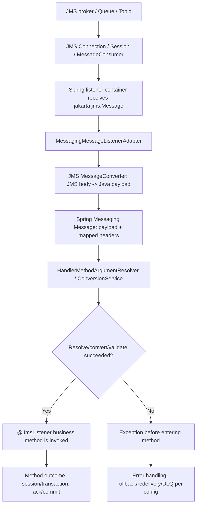

# Converting Data Before Invoking a Listener in Spring JMS

## 1. Goal and Central Question

When a JMS broker delivers a `TextMessage` containing JSON to Spring, you can write a listener that receives a Java DTO without manually opening the message, reading the string, and calling Jackson in every handler:

```java
@JmsListener(destination = "orders.created")
public void onOrderCreated(OrderCreatedEvent event) {
    orderService.process(event);
}
```

But **who turned the JMS Message into `OrderCreatedEvent` before `onOrderCreated` was called?** Which headers did the message carry at that point? What happens if the body violates the schema, lacks a type identifier, or a validator rejects the data?

This lesson clarifies the **inbound conversion and listener parameter-mapping pipeline**, from `jakarta.jms.Message` to Java method invocation, along with key configuration points in Spring Framework / Spring Boot.

After this lesson, you will:

1. Distinguish **message reception**, **message conversion**, **listener parameter resolution**, **validation**, and **business processing**.
2. Know when `@JmsListener` receives `String`, raw `TextMessage`, `org.springframework.messaging.Message<T>`, or a DTO.
3. Understand the different roles of `org.springframework.jms.support.converter.MessageConverter` and `org.springframework.messaging.converter.MessageConverter`.
4. Configure `MappingJackson2MessageConverter` to convert JSON `TextMessage` payloads into DTOs, attaching and reading type IDs safely.
5. Build a Spring Boot 3.x / Java 17+ / Artemis project that sends `OrderCreatedEvent` and receives the exact DTO in the listener.
6. Know how to classify conversion failures, validation failures, retries, transactions, DLQs, and protect sensitive data.

> **Summary:** The listener container receives the **JMS Message** from the provider; Spring's adapter/converter prepares **payload and headers**; the argument resolution layer converts them into **method parameter types**; only when all conditions pass does Spring **invoke the business listener**. This does not mean every message must be deserialized into a DTO: the method signature and configured converter determine which steps occur.

## 2. Difference Between a JMS Message and a Method Payload

JMS has `jakarta.jms.Message` types such as:

- `TextMessage` carrying a `String`.
- `BytesMessage` carrying a byte sequence.
- `MapMessage` carrying name–value pairs in the MapMessage **body**.
- `ObjectMessage` carrying an object serialized per the JMS API; exercise extreme caution with Java object deserialization from untrusted sources.
- `StreamMessage` carrying ordered primitive values.

A JMS Message also has **headers** (`JMSMessageID`, `JMSCorrelationID`, `JMSType`...) and producer-set **properties**. Body and metadata are not the same region.

Example raw message:

```text
JMS TextMessage
  Body: {"eventId":"E162","orderId":"501","amountCents":2300}
  Property _type: "order.created.v1"
  Property eventType: "OrderCreated"
  Property schemaVersion: 1
  Header JMSMessageID: (provider-assigned)
```

With Spring:

```java
@JmsListener(destination = "orders.created")
void handle(OrderCreatedEvent event) { ... }
```

the method expects a **Java object**, not a `TextMessage`. An adapter and converter must know how to read the body and target class. When the method only needs the raw message:

```java
@JmsListener(destination = "orders.created")
void handle(jakarta.jms.TextMessage message) throws JMSException {
    String json = message.getText();
}
```

Spring can pass the **raw JMS argument** without forcing a JSON converter for that parameter. That is simply a different signature, not an error.

### Four easily confused components

| Component | Input / output | Actual responsibility |
| --- | --- | --- |
| `MessageListenerContainer` | Communicates with broker / JMS provider | Creates and maintains consumers, receives messages, manages transactions/ack, concurrency, lifecycle, and recovery. |
| Spring listener adapter | JMS Message → convenient message form for handler | Uses the appropriate converter and invokes the annotated-method handler mechanism. |
| `MessageConverter` | JMS Message ↔ Java payload | Reads `TextMessage`/`BytesMessage`/etc. and constructs Java types per configuration. |
| `DefaultMessageHandlerMethodFactory` | Spring Messaging Message → method arguments | Resolves `@Payload`, `@Header`, `@Headers`, `Session`; performs type conversion/validation when configured. |
| `@JmsListener` method | DTO / String / headers ... | Executes business logic after infrastructure conversion and argument resolution succeed. |

**Message conversion is not message acknowledgement.** Successful conversion only means input data was constructed for the handler. Committing/acking the message depends on Session configuration, transaction manager, listener container, and processing outcome.

## 3. Pipeline from Broker to Listener Method

The diagram below depicts the **conceptual** pipeline of a `@JmsListener` endpoint:



Specific classes and some branches vary by version, converter, signature, and provider. Do not read the diagram as a guarantee that every message is always converted **twice**: if the payload already matches the target type, the argument resolver's type-conversion step may require no significant work.

### 3.1. The listener container receives the message first

`DefaultMessageListenerContainer` is the standard container for JMS listeners. It creates JMS consumers, receives messages from the broker, and invokes the adapter registered by the annotated listener infrastructure.

With `@JmsListener`, Spring creates the endpoint after scanning beans, using the matching `JmsListenerContainerFactory` to build the container. `@EnableJms` enables the infrastructure; Spring Boot can auto-configure it when JMS is present. If the method omits `containerFactory`, the default name is usually `jmsListenerContainerFactory`.

The container does not need to know the business class `OrderCreatedEvent` to receive a `TextMessage`. **It receives a JMS Message**, while DTO construction happens in the adapter/converter/argument resolution layers.

### 3.2. The adapter prepares a Spring Messaging Message

The `@JmsListener` infrastructure uses an adapter such as `MessagingMessageListenerAdapter`. On the standard conversion path, the adapter builds an `org.springframework.messaging.Message<?>` from the JMS message: the Java payload is supplied by the JMS `MessageConverter`, and headers are mapped from JMS headers/properties.

This is an **internal Spring Messaging Message object**, not two messages sent by the broker. Its purpose is to place payload and headers into a unified API for method resolvers.

### 3.3. Method argument resolution

The `DefaultMessageHandlerMethodFactory` layer builds parameter resolvers; for example:

```java
@JmsListener(destination = "orders.created")
public void handle(
        @Payload OrderCreatedEvent event,
        @Header("eventType") String type,
        @Header("schemaVersion") int version) {
    // event: converted Java payload
    // type/version: message properties mapped to headers
}
```

`@Payload` designates the parameter receiving the **payload**. `@Header` extracts metadata with the matching name. If a header type needs conversion (e.g., to an integer), a conversion service can be used when available.

If a required header is missing or the payload cannot be converted to the requested type, invocation can fail **before the method executes**.

### 3.4. Once the method is called, the main conversion step has passed

If a DTO is successfully injected, the method does not need to call `objectMapper.readValue(...)` just to obtain that same object again. However, **business validation** must still be performed: the JSON converter only constructs the object; it does not verify that the order exists, permissions allow processing, the ID has not been processed already, or the amount is valid.

## 4. Two Interfaces Named MessageConverter at Different Layers

This is an important trap in Spring.

### 4.1. Spring JMS MessageConverter

Full name:

```text
org.springframework.jms.support.converter.MessageConverter
```

Key contract:

```java
jakarta.jms.Message toMessage(
        Object object, jakarta.jms.Session session)
        throws jakarta.jms.JMSException;

Object fromMessage(jakarta.jms.Message message)
        throws jakarta.jms.JMSException;
```

This is an **API signature snippet for learning**, not a source file you need to create yourself. The **`fromMessage`** direction relates directly to this lesson: converting a raw JMS Message into a Java object. The `toMessage` direction is used when sending via `JmsTemplate.convertAndSend(...)` or converting replies.

Spring provides `SimpleMessageConverter` by default for basic types and `MappingJackson2MessageConverter` for JSON conversion with Jackson.

### 4.2. Spring Messaging MessageConverter

Full name:

```text
org.springframework.messaging.converter.MessageConverter
```

This interface works with `org.springframework.messaging.Message<?>` and does not take `jakarta.jms.Session`. It is used for message payload handling at the Spring Messaging/handler argument layer; `GenericMessageConverter` can use `ConversionService` to convert payloads to parameter types if needed.

**Do not import the wrong interface when declaring the bean.** For JSON/JMS in this lesson's `@JmsListener` example, the bean must be:

```java
import org.springframework.jms.support.converter.MessageConverter;
import org.springframework.jms.support.converter.MappingJackson2MessageConverter;
```

That is the **JMS converter** Spring Boot can wire into `JmsTemplate` and the auto-configured listener container factory. Creating a standalone `org.springframework.messaging.converter.MessageConverter` bean **is not equivalent** and does not ensure a JMS `TextMessage` is deserialized by Jackson before the handler.

### 4.3. Role of ConversionService and Validator

`DefaultMessageHandlerMethodFactory` can customize `ConversionService`, Spring Messaging converters, custom argument resolvers, and `Validator`. Those customizations process **method parameters** and validation; they do not automatically replace `MappingJackson2MessageConverter` used to read raw JSON from the broker.

`@Valid` and `@Validated` can be used per the Spring Messaging contract, **but verify a validator is actually wired into the method factory**. Merely putting annotations on a DTO without validation infrastructure does not guarantee messages will be rejected before the method in every configuration.

## 5. SimpleMessageConverter: What Does It Support by Default?

`SimpleMessageConverter` is the baseline choice in Spring JMS:

| JMS Message | Typical Java payload | Notes |
| --- | --- | --- |
| `TextMessage` | `String` | Does not automatically parse JSON into arbitrary records/DTOs. |
| `BytesMessage` | `byte[]` | Consumer must know encoding/schema to parse further. |
| `MapMessage` | `Map` | Fields live in the body map; does not automatically become a business object. |
| `ObjectMessage` | Object deserialized by the JMS provider | Must enforce class allowlists, trust policies, and guard against Java deserialization risks. |
| Unsupported/other types | Converter-dependent | May throw `MessageConversionException` or lack the expected representation. |

Suppose a producer sends:

```java
jmsTemplate.convertAndSend(
        "orders.created",
        "{\"eventId\":\"E162\",\"orderId\":\"501\"}");
```

With `SimpleMessageConverter`, the inbound `TextMessage` is normally converted into a **`String` containing JSON**. A method taking `String` works fine:

```java
@JmsListener(destination = "orders.created")
public void consume(String json) {
    // json is a String; not a DTO yet
}
```

However, this method **does not automatically** receive `OrderCreatedEvent` merely because the JSON string has fields matching the record's names:

```java
@JmsListener(destination = "orders.created")
public void consume(OrderCreatedEvent event) { /* ... */ }
```

For that to work, configure a **JSON JMS converter** or matching conversion mechanism; never assume Spring calls Jackson by default on every `String` payload.

### Different direct parameter types

```java
// A: Payload String extracted by SimpleMessageConverter from TextMessage.
@JmsListener(destination = "a.queue")
public void handleString(String body) { }

// B: Raw JMS message, using TextMessage/JMSException APIs.
@JmsListener(destination = "b.queue")
public void handleRaw(jakarta.jms.TextMessage message) throws JMSException { }

// C: Spring Messaging Message, containing payload and mapped headers.
@JmsListener(destination = "c.queue")
public void handleWrapped(
        org.springframework.messaging.Message<String> message) { }

// D: DTO - requires converter/schema support.
@JmsListener(destination = "d.queue")
public void handleDto(OrderCreatedEvent event) { }
```

The methods above are **illustrative signature fragments** to be placed inside a Spring bean with proper destinations and converters. They are not four listeners sharing one Queue, nor do they claim every provider sending `TextMessage` can auto-convert to every type.

## 6. MappingJackson2MessageConverter: JSON to DTO Before the Listener

`org.springframework.jms.support.converter.MappingJackson2MessageConverter` uses Jackson to map Java objects ↔ JSON inside JMS `BytesMessage` or `TextMessage`. Two easily missed settings:

1. **`setTargetType(MessageType.TEXT)`:** when converting a Java object to JMS on the outbound side, use `TextMessage` instead of `BytesMessage` (this converter's default is typically BYTES).
2. **`setTypeIdPropertyName("_type")`:** specifies **the JMS property holding the type identifier** so the converter knows which Java class to instantiate when processing an inbound message.

Configuration should include a **type ID allowlist mapping** to avoid writing verbose Java class names into messages and to prevent unintended producers from choosing arbitrary classes:

```java
import java.util.HashMap;
import java.util.Map;

import org.springframework.context.annotation.Bean;
import org.springframework.jms.support.converter.MappingJackson2MessageConverter;
import org.springframework.jms.support.converter.MessageConverter;
import org.springframework.jms.support.converter.MessageType;

@Bean
MessageConverter orderJmsConverter() {
    MappingJackson2MessageConverter converter =
            new MappingJackson2MessageConverter();
    converter.setTargetType(MessageType.TEXT);
    converter.setTypeIdPropertyName("_type");

    Map<String, Class<?>> typeIds = new HashMap<>();
    typeIds.put("order.created.v1", OrderCreatedEvent.class);
    converter.setTypeIdMappings(typeIds);
    return converter;
}
```

This is a **configuration snippet inside a `@Configuration` class** where the project defines `OrderCreatedEvent`. It is not a standalone Java program.

### 6.1. Type ID tells the inbound side which Java class to pick

When the producer sends `OrderCreatedEvent` via this same converter, a JSON body is generated and the property `_type="order.created.v1"` is attached per mapping. On receipt, the converter looks up `_type` and selects the mapped class for Jackson to deserialize.

```text
Producer Java object: OrderCreatedEvent
       |
       | Jackson serialization
       v
TextMessage BODY: {"eventId":"E162","orderId":"501","amountCents":2300}
JMS property: _type = "order.created.v1"
       |
       | fromMessage() + typeIdMappings
       v
Consumer Java object: OrderCreatedEvent("E162", "501", 2300)
       |
       v
@JmsListener(OrderCreatedEvent event)
```

**A type ID is metadata, not executable Java code.** Never use raw class names from untrusted producers to deserialize arbitrary types; version your mappings and restrict allowed classes. Even a JSON converter needs input size limits, schema validation, and control over polymorphic typing/serializers.

### 6.2. When `_type` is missing

Suppose another producer sends raw JSON via `session.createTextMessage(json)` yet **does not** set the JMS property `_type`:

```java
jmsTemplate.send("orders.created", session ->
        session.createTextMessage(
                "{\"eventId\":\"E162\",\"orderId\":\"501\","
              + "\"amountCents\":2300}"));
```

If the listener uses `MappingJackson2MessageConverter` configured with a type ID property as above, the inbound converter **cannot infer the class from the body** under this contract and typically throws `MessageConversionException` before calling `@JmsListener(OrderCreatedEvent)`.

This is a **metadata/contract mismatch between sender and receiver**, not evidence that the JSON body lacks fields. Solution: ensure both producer and consumer use a consistent converter/contract or set the valid type identifier when sending raw messages.

### 6.3. When `_type` is present but the body is invalid

A message with `_type="order.created.v1"` yet body `"{broken json"` cannot be parsed by Jackson into a DTO. The converter fails **before the handler begins**. Do not place `try/catch` only inside `onOrderCreated` expecting to catch deserialization errors: the method was never called.

### 6.4. Valid JSON can still be invalid for business logic

Valid JSON with `amountCents=-1` can still deserialize into a record with a negative number if the record does not validate itself. That is why **successful conversion differs from successful validation**. Enforce invariants in constructors/records, use properly wired Jakarta Bean Validation, or validate business rules in the handler depending on your goals and error-handling policy.

## 7. Spring Boot: How Is the Converter Wired to Template and Listener?

In Spring Boot 3.x, when matching JMS infrastructure is present:

- Boot can auto-create a `ConnectionFactory` connecting to Artemis, a `JmsTemplate` for sending, and a default `JmsListenerContainerFactory` for `@JmsListener`.
- **A bean of type `org.springframework.jms.support.converter.MessageConverter`** is picked up by Boot's auto-configured template and default listener factory.
- With a manually created custom `DefaultJmsListenerContainerFactory`, you must **set the converter on that factory itself**, or invoke `DefaultJmsListenerContainerFactoryConfigurer.configure(...)` to inherit Boot's defaults and override intentionally.
- If `@JmsListener(containerFactory="specialFactory")` points to another custom factory, do not assume it uses the default factory's converter.
- If you manually declare `@Bean JmsTemplate`, check whether that bean called `setMessageConverter(...)`; configuring a converter on the listener does not automatically change a custom producer.

Official Spring documentation provides an example of a `MappingJackson2MessageConverter` bean and a factory using `DefaultJmsListenerContainerFactoryConfigurer` to copy auto-configured defaults.

### 7.1. Correct custom factory example

```java
import jakarta.jms.ConnectionFactory;
import org.springframework.boot.autoconfigure.jms.DefaultJmsListenerContainerFactoryConfigurer;
import org.springframework.context.annotation.Bean;
import org.springframework.jms.config.DefaultJmsListenerContainerFactory;
import org.springframework.jms.support.converter.MessageConverter;

@Bean("typedListenerFactory")
DefaultJmsListenerContainerFactory typedListenerFactory(
        ConnectionFactory connectionFactory,
        DefaultJmsListenerContainerFactoryConfigurer configurer,
        MessageConverter jmsConverter) {

    DefaultJmsListenerContainerFactory factory =
            new DefaultJmsListenerContainerFactory();
    configurer.configure(factory, connectionFactory);
    factory.setMessageConverter(jmsConverter);
    return factory;
}
```

This is a **Spring Boot 3.x configuration snippet**, not a standalone Java file. When using it, note that Boot recommends unwrapping `CachingConnectionFactory` if the listener container needs its own connection for recovery; actual versions/libraries may use `ConnectionFactoryUnwrapper.unwrapCaching(connectionFactory)`. This example merely highlights **attaching the converter and using a specific factory**.

Using it:

```java
@JmsListener(
        destination = "orders.created",
        containerFactory = "typedListenerFactory")
public void onOrderCreated(OrderCreatedEvent event) {
    // JSON body has been converted to DTO
}
```

In the runnable example right below, **no custom factory is needed**: define a JMS `MessageConverter` bean and let Boot attach it to the default auto-configured factory.

## 8. Runnable Project: Java 17, Spring Boot 3.3.5, and ActiveMQ Artemis

Goal: send a Java record `OrderCreatedEvent` using `JmsTemplate.convertAndSend`; the Jackson converter produces a JSON `TextMessage` and `_type`; Spring receives and converts it back into the **record** before invoking `@JmsListener`. The listener also receives two JMS properties via `@Header`.

### 8.1. Prerequisites

- JDK 17+, Maven 3.6.3+, Docker.
- Local port `61616` available.
- Artemis demo broker running outside the JVM.
- Clean environment or empty Queue `demo.orders.typed.162` and a single app instance so stdout is not mixed with old backlog.

Start the broker:

```bash
docker run --detach --rm --name artemis-conversion-demo \
  -e ARTEMIS_USER=artemis \
  -e ARTEMIS_PASSWORD=artemis \
  -p 127.0.0.1:61616:61616 \
  -p 127.0.0.1:8161:8161 \
  apache/artemis:latest-alpine
```

Wait for readiness with:

```bash
docker logs artemis-conversion-demo
```

The Docker container is a **separate broker** from the app. Demo credentials are strictly for local testing; production requires proper secrets, broker permissions, and TLS/network policies. If Queue auto-creation is disabled, pre-create the destination.

### 8.2. Project structure

```text
jms-inbound-conversion-demo/
├── pom.xml
└── src/main/
    ├── java/demo/inbound/
    │   ├── InboundConversionApplication.java
    │   ├── OrderCreatedEvent.java
    │   └── OrderListener.java
    └── resources/application.properties
```

### 8.3. pom.xml

```xml
<project xmlns="http://maven.apache.org/POM/4.0.0"
         xmlns:xsi="http://www.w3.org/2001/XMLSchema-instance"
         xsi:schemaLocation="http://maven.apache.org/POM/4.0.0 https://maven.apache.org/xsd/maven-4.0.0.xsd">
    <modelVersion>4.0.0</modelVersion>
    <parent>
        <groupId>org.springframework.boot</groupId>
        <artifactId>spring-boot-starter-parent</artifactId>
        <version>3.3.5</version>
        <relativePath/>
    </parent>

    <groupId>demo</groupId>
    <artifactId>jms-inbound-conversion-demo</artifactId>
    <version>1.0.0</version>

    <properties>
        <java.version>17</java.version>
    </properties>

    <dependencies>
        <dependency>
            <groupId>org.springframework.boot</groupId>
            <artifactId>spring-boot-starter-artemis</artifactId>
        </dependency>
        <dependency>
            <groupId>org.springframework.boot</groupId>
            <artifactId>spring-boot-starter-json</artifactId>
        </dependency>
    </dependencies>
    <build>
        <plugins>
            <plugin>
                <groupId>org.springframework.boot</groupId>
                <artifactId>spring-boot-maven-plugin</artifactId>
            </plugin>
        </plugins>
    </build>
</project>
```

`spring-boot-starter-artemis` provides the JMS client and Spring JMS. `spring-boot-starter-json` provides Jackson needed for the JSON converter. Do not add `artemis-jakarta-server` because Artemis runs in a separate container.

### 8.4. application.properties

```properties
spring.artemis.mode=native
spring.artemis.broker-url=tcp://localhost:61616
spring.artemis.user=artemis
spring.artemis.password=artemis

# Queue, not Topic
spring.jms.pub-sub-domain=false
```

Note: if the **application itself** runs in another Docker container, `localhost` inside the app does not point to the Artemis container; use a reachable DNS hostname/port for the broker.

### 8.5. OrderCreatedEvent.java

```java
package demo.inbound;

public record OrderCreatedEvent(
        String eventId,
        String orderId,
        int amountCents) {
}
```

This is a simple Java 17 record for Jackson to deserialize. In a real project, define schema versioning, validation, allowed fields, and version-evolution handling.

### 8.6. InboundConversionApplication.java

```java
package demo.inbound;

import java.util.HashMap;
import java.util.Map;
import java.util.concurrent.TimeUnit;

import org.springframework.boot.ApplicationRunner;
import org.springframework.boot.SpringApplication;
import org.springframework.boot.autoconfigure.SpringBootApplication;
import org.springframework.context.annotation.Bean;
import org.springframework.jms.annotation.EnableJms;
import org.springframework.jms.core.JmsTemplate;
import org.springframework.jms.support.converter.MappingJackson2MessageConverter;
import org.springframework.jms.support.converter.MessageConverter;
import org.springframework.jms.support.converter.MessageType;

@SpringBootApplication
@EnableJms
public class InboundConversionApplication {

    public static void main(String[] args) {
        SpringApplication.run(InboundConversionApplication.class, args);
    }

    @Bean
    MessageConverter jacksonJmsMessageConverter() {
        MappingJackson2MessageConverter converter =
                new MappingJackson2MessageConverter();
        converter.setTargetType(MessageType.TEXT);
        converter.setTypeIdPropertyName("_type");

        Map<String, Class<?>> types = new HashMap<>();
        types.put("order.created.v1", OrderCreatedEvent.class);
        converter.setTypeIdMappings(types);
        return converter;
    }

    @Bean
    ApplicationRunner demoPublisher(
            JmsTemplate jmsTemplate, OrderListener listener) {
        return args -> {
            OrderCreatedEvent event =
                    new OrderCreatedEvent("E162", "501", 2300);

            jmsTemplate.convertAndSend(
                    "demo.orders.typed.162", event, message -> {
                        message.setStringProperty(
                                "eventType", "OrderCreated");
                        message.setIntProperty("schemaVersion", 1);
                        return message;
                    });

            if (!listener.await(10, TimeUnit.SECONDS)) {
                throw new IllegalStateException(
                        "Timed out waiting for converted JMS event");
            }
            System.out.println("DEMO: completed");
        };
    }
}
```

During `convertAndSend`:

1. `JmsTemplate` receives the `OrderCreatedEvent` object.
2. The `MappingJackson2MessageConverter` bean creates JSON into a `TextMessage` because of `MessageType.TEXT`.
3. The converter sets property `_type="order.created.v1"` per type mapping.
4. The `MessagePostProcessor` in this overload additionally sets `eventType` and `schemaVersion` for the consumer/observation.
5. `JmsTemplate` sends the message to the Queue on Artemis.

If you replace `convertAndSend` with `send(..., session -> session.createTextMessage(json))` without manually setting `_type`, the inbound converter will lack the metadata needed to map the Java class.

### 8.7. OrderListener.java

```java
package demo.inbound;

import java.util.concurrent.CountDownLatch;
import java.util.concurrent.TimeUnit;

import org.springframework.jms.annotation.JmsListener;
import org.springframework.messaging.handler.annotation.Header;
import org.springframework.messaging.handler.annotation.Payload;
import org.springframework.stereotype.Component;

@Component
public class OrderListener {

    private final CountDownLatch received = new CountDownLatch(1);

    @JmsListener(destination = "demo.orders.typed.162")
    public void handle(
            @Payload OrderCreatedEvent event,
            @Header("eventType") String eventType,
            @Header("schemaVersion") int schemaVersion) {

        System.out.println(
                "EVENT: " + event.eventId()
                + "/" + event.orderId()
                + "/" + event.amountCents());
        System.out.println(
                "METADATA: " + eventType + "/v" + schemaVersion);
        received.countDown();
    }

    public boolean await(long timeout, TimeUnit unit)
            throws InterruptedException {
        return received.await(timeout, unit);
    }
}
```

`OrderListener` imports neither `jakarta.jms.TextMessage` nor `ObjectMapper`. Before `handle` runs, Spring has already converted the raw JMS `TextMessage` into `OrderCreatedEvent` and extracted metadata into parameters.

`@Payload` is `org.springframework.messaging.handler.annotation.Payload`, not a JMS annotation. `@Header` also belongs to Spring Messaging, reflecting how Spring unifies argument resolution across transports.

### 8.8. Run command and expected stdout

From the `jms-inbound-conversion-demo` directory, once Artemis is ready:

```bash
mvn spring-boot:run
```

With a clean Queue, reachable broker, and compatible libraries, the three lines **printed by the demo itself** are:

```text
EVENT: E162/501/2300
METADATA: OrderCreated/v1
DEMO: completed
```

Spring Boot, Maven, and Artemis may log additional output. `CountDownLatch` ensures the `DEMO` line appears after the two lines printed by the listener. If conversion fails, the handler does not run and the demo may time out; never pretend success output in failure scenarios.

**Why does this verify conversion before the listener?** The method has type `OrderCreatedEvent`, and the `eventId/orderId/amountCents` fields are already Java values when the handler receives them. It is not a JSON string parsed by the listener itself. In addition, both `@Header` parameters were resolved from JMS message properties.

Stop the application with `Ctrl+C`. Stop the demo broker:

```bash
docker stop artemis-conversion-demo
```

Running the container with `--rm` and no mounted volume is not meant to test persistence across container deletion.

## 9. Alternative: Receiving a Raw Message and Parsing Manually

If the sender does not support the `_type` contract, or you need to dynamically determine the schema from an external source, you can receive the raw `TextMessage` and parse it yourself:

```java
import com.fasterxml.jackson.databind.ObjectMapper;
import jakarta.jms.JMSException;
import jakarta.jms.TextMessage;
import org.springframework.jms.annotation.JmsListener;

public class RawOrderHandler {
    private final ObjectMapper mapper;

    public RawOrderHandler(ObjectMapper mapper) {
        this.mapper = mapper;
    }

    @JmsListener(destination = "orders.raw")
    public void handle(TextMessage message) throws Exception {
        String text = message.getText();
        OrderCreatedEvent event =
                mapper.readValue(text, OrderCreatedEvent.class);
        // validate, process event...
    }
}
```

This is an **illustrative code snippet**; to work in practice, the class must be a Spring bean (`@Component` or `@Bean`), and you need Queue `orders.raw`, an `ObjectMapper`, and error handling. With the raw method, **conversion in application code** happens **after the method is called**, unlike the pre-method converter in section 8.

**Trade-offs:**

- Pros: custom schema/validation control, reading native headers, explicitly choosing classes by source/version.
- Cons: duplicated parsing logic across listeners, easy to miss error handling, tighter coupling to the JMS API, harder to standardize metadata.
- If you want most handlers to deal only with DTOs, move mapping logic into a thoroughly tested `MessageConverter`.

## 10. Converting Headers, Type IDs, and Method Arguments

### 10.1. @Header and @Headers

Example:

```java
@JmsListener(destination = "orders.created")
public void handle(
        @Payload OrderCreatedEvent event,
        @Header("eventType") String eventType,
        @Header("schemaVersion") Integer schemaVersion,
        @Headers java.util.Map<String, Object> headers) {
    // ...
}
```

`@Headers` retrieves the map of mapped headers. Standard JMS properties/headers have standard names represented by Spring's `JmsHeaders`. If a project needs exact inspection of `JMSMessageID` or correlation, use `JmsHeaders` constants or the raw JMS Message rather than guessing string keys.

Never place tokens, PII, or sensitive payloads in metadata merely for convenient `@Header` injection: properties are often visible in broker consoles, logs, and DLQs.

### 10.2. Wrong header type

If a producer sets:

```java
message.setStringProperty("schemaVersion", "one");
```

yet the listener expects `int schemaVersion`, argument conversion can fail **before the method**. Even if `"1"` is set as a String, some conversion services may coerce it to int, yet that should not be treated as a portable JMS property schema across all paths. The clearest contract is:

```java
message.setIntProperty("schemaVersion", 1);
```

### 10.3. Type ID mapping for multiple versions

You can use stable IDs:

```java
Map<String, Class<?>> typeIds = new HashMap<>();
typeIds.put("order.created.v1", OrderCreatedEventV1.class);
typeIds.put("order.created.v2", OrderCreatedEventV2.class);
converter.setTypeIdMappings(typeIds);
```

This is a configuration snippet requiring V1/V2 classes and a converter. The consumer must know how to handle both versions or map them to a shared internal model. **Renaming a Java class** should not prevent older messages in the broker/DLQ from replaying; decoupling IDs from class names reduces coupling.

### 10.4. Type ID does not mean authorization

Even when the `_type` JMS property maps to an allowlisted class, an untrusted producer can still send a valid type ID with a malicious or oversized body. A converter does not replace RBAC, max body-size policies, schema validation, payload sanitization, and idempotency.

## 11. Bean Validation After Conversion, Before Business Logic

A DTO that is valid JSON is not necessarily valid data:

```json
{"eventId":"","orderId":"","amountCents":-10}
```

Jackson can instantiate the corresponding object; `@Valid` can be used to apply Bean Validation when the method handler infrastructure has a `Validator`.

Separate DTO example:

```java
import jakarta.validation.constraints.Min;
import jakarta.validation.constraints.NotBlank;

public record ValidatedOrderEvent(
        @NotBlank String eventId,
        @NotBlank String orderId,
        @Min(0) int amountCents) {
}
```

In a real project, you need a dependency like `spring-boot-starter-validation` and must pass `Validator` into `DefaultMessageHandlerMethodFactory`. Configuration example (add as a `@Configuration` class in a project that already has `@EnableJms`):

```java
import org.springframework.context.annotation.Configuration;
import org.springframework.jms.annotation.JmsListenerConfigurer;
import org.springframework.jms.config.JmsListenerEndpointRegistrar;
import org.springframework.messaging.handler.annotation.support.DefaultMessageHandlerMethodFactory;
import org.springframework.validation.Validator;

@Configuration
public class ListenerValidationConfig implements JmsListenerConfigurer {
    private final Validator validator;

    public ListenerValidationConfig(Validator validator) {
        this.validator = validator;
    }

    @Override
    public void configureJmsListeners(
            JmsListenerEndpointRegistrar registrar) {
        DefaultMessageHandlerMethodFactory factory =
                new DefaultMessageHandlerMethodFactory();
        factory.setValidator(validator);
        registrar.setMessageHandlerMethodFactory(factory);
    }
}
```

Then:

```java
@JmsListener(destination = "validated.orders")
public void handle(@Valid @Payload ValidatedOrderEvent event) {
    // Validator must be configured properly before entering the method.
}
```

**Note:** the validation example is an **additional configuration pattern**; do not paste it into section 8's demo while omitting dependencies/imports/schemas. Here `@Valid` is `jakarta.validation.Valid`; without a validator, enforcement as expected is not guaranteed. Both conversion exceptions and validation exceptions can occur **before** business invocation.

## 12. When Conversion Fails, What Happens to the Message?

A failure can arise at different points:

```text
JMS message delivered
   |
   +-- Wrong JMS Message type? -- conversion fail
   |
   +-- Malformed JSON? -- converter/Jackson fail
   |
   +-- Missing/invalid _type? -- type resolution fail
   |
   +-- Required header missing/wrong type? -- argument resolution fail
   |
   +-- Bean Validation failed? -- validation fail
   |
   +-- All valid
         |
         +--> @JmsListener method runs
                 |
                 +--> business succeeds or fails
```

**Any failure before the last branch can prevent the business method from ever being called.** Putting `try/catch` inside the listener cannot catch an exception thrown before the listener is invoked. You need error handling at the listener container/adapter, broker retry/DLQ, and proper observability.

### 12.1. Redelivery is not decided by the converter

If the container uses a **transacted JMS Session**, a failure in the listener pipeline usually rolls back the transaction so the message can be redelivered per provider policy. If the container uses a non-transacted acknowledgement mode, the outcome may differ and the message may even be considered acknowledged along some error paths. Therefore, never assert rigidly that "bad JSON is always retried" or "converter errors always lose messages" without checking container configuration.

Spring Boot typically configures listener factories as transacted by default when appropriate; a **custom factory** you create yourself may have different defaults. Inspect actual runtime settings: `sessionTransacted`, transaction manager, ack mode, error handler, max deliveries, and DLQ.

### 12.2. Poison messages and retry loops

Messages with **permanent** errors such as corrupt JSON, unsupported type IDs, or schema validation violations rarely become valid simply by retrying the exact same data. If the broker continuously redelivers, the consumer can flood logs, increase pending counts, and waste resources.

Classify errors:

| Error group | Examples | Typical handling |
| --- | --- | --- |
| **Permanent conversion failure** | Corrupt JSON, nonexistent class ID, persistent type mismatch | Bounded retries, route to DLQ/quarantine, alert, and fix/replay workflow. |
| **Schema/business validation failure** | Blank ID, unsupported version, negative amount | Reject per contract, DLQ or controlled audit; never retry indefinitely. |
| **Transient infrastructure** | Temporary DB error, broker reconnect, downstream timeout | Bounded retry/backoff, idempotent consumer. |
| **Security failure** | Message from unauthorized producer, anomalous type ID | Audit/deny, isolate payload, do not log sensitive content. |

A conversion failure can occur before the method prints its first line; thus **absence of business logs does not prove the broker failed to deliver**.

### 12.3. ErrorHandler on the listener container

`DefaultMessageListenerContainer` can be configured with an `ErrorHandler` to record errors after listener/pipeline failures. Guiding example (Spring configuration fragment):

```java
factory.setErrorHandler(error ->
        logger.warn("JMS listener failed; inspect error category"));
```

`factory` must be an actual container factory bean and `logger` must be declared; the snippet above is not a standalone file. Never print raw JMS bodies, secrets, full payloads, or untrusted type IDs in logs. **An `ErrorHandler` is only part of observability; it does not itself define transactional rollback, DLQ routing, or retry counts.**

### 12.4. Avoiding message loss alongside DB transactions

Once the handler begins writing to a database, JMS completion or rollback must be coordinated with the DB transaction if business rules require it. A local JMS transaction **does not automatically** make database and JMS commits atomic. Consider a transactional outbox/inbox or an appropriate coordinator. Pre-handler conversion failures must also be recorded so messages are never silently swallowed or falsely acked.

## 13. Boundary with MessageListenerAdapter and Manual Listeners

Spring JMS offers several receiving styles:

| Receiving style | Typical conversion mechanism | When to choose |
| --- | --- | --- |
| `@JmsListener` with DTO | `MessagingMessageListenerAdapter` and JMS converter + argument resolver | Preferred for Java-style handlers, metadata, and validation. |
| `@JmsListener` with `String` | Simple converter extracts text body, if matching type | Simple text logic, minimal converter setup. |
| `@JmsListener` with raw `Message` | Raw JMS argument supported | Need native JMS APIs or custom parsing. |
| `MessageListenerAdapter` POJO delegate | Delegate method + `MessageConverter` (default `SimpleMessageConverter`) | Legacy/non-annotated adapter-style integration. |
| `jakarta.jms.MessageListener.onMessage(Message)` | Listener receives raw JMS Message directly | Full manual control over parsing/adapting, fewer method-binding conveniences. |
| `SessionAwareMessageListener` | Raw message + JMS Session | When JMS Session is needed for replies or advanced logic. |

With `MessageListenerAdapter` for a POJO delegate, `setMessageConverter(null)` can disable automatic content extraction to pass the raw JMS Message to the delegate per the adapter's contract. However, that **does not mean** calling `setMessageConverter(null)` on every factory/adapter is the standard way to enable DTO binding; check the exact class in use.

**Do not confuse** `MessageListenerAdapter` with `MessagingMessageListenerAdapter` used by annotated endpoints; the names are similar, yet their pipelines and method resolution differ.

## 14. Accurately Testing "Before Calling the Listener"

### 14.1. Happy-path integration test

Using a real broker, send a DTO via the official converter and verify:

1. The `TextMessage` on the broker contains JSON matching the schema.
2. The `_type` property holds the expected mapping value.
3. `@JmsListener(OrderCreatedEvent, @Header...)` receives the DTO and headers with exact types.
4. The handler is invoked the expected number of times without unintended redelivery.
5. The message completes per the transaction/ack contract.

Do not only test that `JmsTemplate.convertAndSend` returns without throwing; it **does not wait for the consumer to finish processing**.

### 14.2. Unit testing the JMS converter

You do not need to boot the entire Spring app just to test converter logic. Mock `Session` and `TextMessage`/`BytesMessage` with Mockito, or use compatible provider test objects, then test:

```java
converter.toMessage(
        new OrderCreatedEvent("E162", "501", 2300),
        session);

Object restored = converter.fromMessage(textMessage);
```

This is a **test snippet** requiring `converter`, `session`, and `textMessage` from mocks or real messages; it cannot run standalone. Test type IDs/properties and malformed JSON. Unit tests only verify the converter, not broker routing or listener factory wiring.

### 14.3. Testing when `_type` is missing

Send a raw `TextMessage` without a type identifier to a Queue whose listener uses the Jackson converter. Expect a **conversion error at the pre-handler layer**, checking container logs/metrics rather than expecting the handler to catch the exception.

Tests should use a dedicated Queue, account for message retries, and apply bounded DLQ policies; never let failing messages loop endlessly and pollute other tests.

### 14.4. Testing mismatched DTO shapes

Use `_type="order.created.v1"` yet send JSON with missing fields, wrong types, or out-of-range numbers. **Do not claim missing fields always throw an exception by default**: Jackson supplies defaults/nulls for some fields and record constructors may still instantiate the object. Verify the serialization contract, Bean Validation, and specific invariants.

### 14.5. Testing header mapping

Producer sets:

```java
message.setStringProperty("eventType", "OrderCreated");
message.setIntProperty("schemaVersion", 1);
```

Consumer injects:

```java
@Header("eventType") String eventType,
@Header("schemaVersion") int schemaVersion
```

Test missing properties, case sensitivity in names, wrong value types, and custom header mappers. Do not confuse **JMS message selectors** (filtering messages before delivery) with **method `@Header` argument resolvers** (reading metadata of an already-delivered message).

### 14.6. Testing validators

With a `Validator` bean actually wired into `DefaultMessageHandlerMethodFactory`, construct a DTO violating `@NotBlank`/`@Min`. Verify the handler does not run on validation failure and the message follows the intended transaction/retry policy. If removing validator config still lets the test "pass", do not assume the annotation protected your data.

## 15. Common Pitfalls and How to Diagnose Them

| Symptom | Common cause | Fix |
| --- | --- | --- |
| `@JmsListener(OrderEvent)` never called even with messages on Queue | JSON converter/type mapping unconfigured, listener uses another factory, or conversion error | Check listener factory, converter bean, `_type`, and pre-method logs. |
| `@JmsListener(String)` receives JSON text instead of DTO | `SimpleMessageConverter` returns `String` | Use DTO + JMS Jackson converter or parse explicitly after receiving. |
| `Could not find type id property [_type]` | Raw sender omitted the property required by converter | Set `_type` per contract or use another mapping mechanism. |
| `Cannot construct instance` | DTO constructor/schema/Jackson settings mismatch | Check public record/POJO, field types, and Jackson version. |
| Converter still produces `BytesMessage` despite expecting `TextMessage` | `MappingJackson2MessageConverter` defaults to BYTES target | Call `setTargetType(MessageType.TEXT)`. |
| `MessageConverter` bean exists yet default listener ignores it | Imported Spring Messaging converter by mistake or custom factory skips Boot config | Verify converter FQCN and actual factory setup. |
| Producer sends DTO yet receiver sees Java class name in `_type` | Type ID mappings not configured | Use stable IDs via `setTypeIdMappings` on both sides. |
| `@Header("schemaVersion") int` fails to resolve | Missing header, wrong type, wrong mapping | Use `setIntProperty` properly; test argument resolver and header mapper. |
| `@Valid` does not block invalid DTOs | Missing validator or not wired into method factory | Add validation dependency and configure factory; test invalid cases. |
| No handler logs yet broker shows redelivery | Failure in converter/argument resolver before method | Inspect listener container exceptions, safe message IDs, and DLQ. |
| Sent once yet listener logs appear multiple times | Transaction rollback/redelivery or another listener | Check ack/commit, retries, concurrency, and idempotency. |
| Container has `@JmsListener` yet receives nothing | Wrong Queue/Topic, listener factory, broker URL, or permissions | Check `ConnectionFactory`, `pubSubDomain`, destination, container status. |
| Spring Boot properties have no effect on bean | Custom `JmsTemplate`/factory created manually | Attach converter explicitly and inspect injected beans. |
| Custom JSON converter logs PII on errors | Exception or debug log contains payload | Log error category/size and safe IDs; limit body exposure in traces/DLQs. |
| Using `ObjectMessage` to receive DTOs for convenience | Java native deserialization unsuitable for untrusted data | Prefer JSON/Avro/Protobuf with allowlists and limits. |
| Using Spring Boot 3 with `javax.jms.Message` | Jakarta namespace changed | Import `jakarta.jms.*` properly with a compatible provider. |

### Ordered debugging workflow

**Step 1:** Are broker connection and destination correct? Check `spring.artemis.mode`, broker URL, credentials, Queue/Topic, and consumer count.

**Step 2:** Is the listener registered by Spring? Check `@EnableJms`/auto-config, `@JmsListener`, `containerFactory` name, lifecycle/registry, and logs.

**Step 3:** Is the raw JMS message a `TextMessage` or `BytesMessage`? Is the actual body JSON or plain String, and are type ID and properties present? Do not log sensitive full bodies.

**Step 4:** Which converter is attached to the **actual listener factory**? Are `MappingJackson2MessageConverter`, `targetType`, `typeIdPropertyName`, and mappings configured properly?

**Step 5:** Does the handler signature request `@Payload`, `@Header`, `@Headers`, `Session`, or raw JMS Message? Do the types match?

**Step 6:** Are bean validation and method factory config present? Is invalid data blocked before the method?

**Step 7:** Are the error handler, `sessionTransacted`, retries, DLQ, safe message IDs, and conversion failure metrics working?

**Step 8:** Separate tests for "pre-method conversion failure" and "business method throws error" to set appropriate retry policies for each category.

## 16. Security and Performance Optimization of Inbound Conversion

- **Control input size:** `getText()`/deserialization can allocate huge bodies before application checks run. Enforce limits at ingress/broker/producer and schema levels, not only via `String.length()` inside the handler.
- **Type allowlist:** use stable mappings like `order.created.v1`; never let untrusted producers arbitrarily dictate which Java class gets deserialized.
- **Keep secrets out of JMS headers/properties:** type IDs, event types, and correlation IDs can appear in broker consoles, logs, and DLQs.
- **Do not log raw malformed JSON:** Jackson exceptions sometimes embed snippets of input data. Use error categories and safe metadata for diagnostics.
- **Do not treat a converter as validation:** converters only instantiate Java objects; validate schemas and business rules separately.
- **Watch memory/CPU:** repeated JSON parsing, oversized DTOs, and complex header mappings can reduce throughput. Measure queue depth, conversion latency, GC, and DLQ rates.
- **Do not abuse `ObjectMessage`:** Java deserialization from untrusted messages carries risks; enforce class allowlists/trust policies if unavoidable.
- **Idempotency:** pre-method conversion does not guarantee a message is processed only once; redelivery and retries can still happen.

## 17. Self-Check Questions

**Question 1.** Spring receives a JSON `TextMessage` and `@JmsListener` declares `OrderCreatedEvent`. What turns the JSON into the DTO?

**Answer:** The JMS `MessageConverter` configured on the listener adapter/container factory (e.g., `MappingJackson2MessageConverter`), followed by the handler method factory resolving parameters. It is not automatically the method calling Jackson itself.

**Question 2.** Does the default `SimpleMessageConverter` automatically turn any JSON `String` into a Java record?

**Answer:** No. It mainly maps basic JMS types such as `TextMessage → String`. JSON DTOs require an appropriate converter and schema.

**Question 3.** Why configure `setTypeIdPropertyName("_type")` when receiving DTOs with `MappingJackson2MessageConverter`?

**Answer:** It tells the converter which JMS property holds the type identifier used to determine the target Java class during deserialization.

**Question 4.** Without `setTargetType(MessageType.TEXT)`, does the producer's Jackson converter normally create a `TextMessage` or `BytesMessage`?

**Answer:** By default, the converter typically creates a **`BytesMessage`**; to send JSON inside a `TextMessage`, set target type to TEXT.

**Question 5.** A message has a valid `_type` yet corrupt JSON. Does `@JmsListener` run and then throw an exception?

**Answer:** Normally no; the failure occurs inside the converter **before the method is called**. Monitor container error handling.

**Question 6.** Does `@Header("schemaVersion")` read its value from the JSON body or from a JMS property?

**Answer:** It reads the header/property mapped by the JMS-to-Spring header mapper, without opening the JSON body.

**Question 7.** Is putting `@Valid` on a DTO enough to guarantee data validation before the method?

**Answer:** Only when Bean Validation dependencies and `Validator`/method handler infrastructure are properly configured and verified in tests.

**Question 8.** Why can't handler code catch certain deserialization errors?

**Answer:** Because the handler **has not been called yet**; conversion/argument resolution failed in the preceding infrastructure.

**Question 9.** Can you receive `jakarta.jms.Message` directly in an annotated listener?

**Answer:** Yes. Raw JMS Message/Session are supported Spring JMS argument types; you can parse manually, though manual conversion then happens inside the handler.

**Question 10.** Should permanent JSON errors be retried infinitely or routed to a DLQ after a bounded policy?

**Answer:** Never retry infinitely. Design max deliveries, DLQ/quarantine, alerts, and safe fix/replay procedures.

**Question 11.** The producer sends type ID `order.created.v2` while the consumer only maps v1; is this a broker connectivity error?

**Answer:** No. This is a schema/type mapping error, typically occurring after the JMS message is delivered and before listener business code runs.

**Question 12.** Does successful conversion guarantee the order was processed and the DB committed?

**Answer:** No. Conversion, validation, business processing, and JMS acknowledgement/transactions are distinct stages.

## 18. Conclusion

**Converting data before invoking a listener** means Spring's infrastructure prepares **Java payloads and arguments** from a **raw JMS Message** *before* calling the `@JmsListener`-annotated method. For simple payloads, `SimpleMessageConverter` suffices to extract `String`/`byte[]`. For JSON DTOs, configure `MappingJackson2MessageConverter` and appropriate **type ID mappings**; Spring Boot can automatically apply that converter bean to `JmsTemplate` and the default listener factory. The method handler layer then resolves `@Payload`, `@Header`, and validation if configured.

Three principles to remember:

1. **Converter fails → the method may never have run.** Error handling must sit at the container/pipeline level, not solely inside the method.
2. **A converter does not replace validators or transactions.** A constructed DTO does not mean the data is valid or message processing is complete.
3. **Sender and listener must agree on the type/schema/property contract.** Test both the happy path and malformed JSON, missing type IDs, header mismatches, redelivery, and DLQs.

## Official References

- [Spring Framework – Annotation-driven Listener Endpoints: supported parameters, DefaultMessageHandlerMethodFactory](https://docs.spring.io/spring-framework/reference/integration/jms/annotated.html)
- [Spring Framework – Receiving a Message: MessageListenerAdapter and raw JMS support](https://docs.spring.io/spring-framework/reference/integration/jms/receiving.html)
- [Spring Framework – JMS sending/conversion](https://docs.spring.io/spring-framework/reference/integration/jms/sending.html)
- [Spring Boot 3.4 – JMS: MessageConverter and listener container factory auto-configuration](https://docs.spring.io/spring-boot/3.4/reference/messaging/jms.html)
- [Spring Guide – Messaging with JMS: JSON converter before @JmsListener](https://spring.io/guides/gs/messaging-jms/)
- [Spring Framework 6.2 API – MappingJackson2MessageConverter (setTargetType, setTypeIdPropertyName, setTypeIdMappings)](https://docs.spring.io/spring-framework/docs/6.2.15/javadoc-api/org/springframework/jms/support/converter/MappingJackson2MessageConverter.html)
- [Spring Framework 6.2 API – SimpleMessageConverter](https://docs.spring.io/spring-framework/docs/6.2.15/javadoc-api/org/springframework/jms/support/converter/SimpleMessageConverter.html)
- [Spring Framework 6.2 API – DefaultMessageHandlerMethodFactory](https://docs.spring.io/spring-framework/docs/6.2.15/javadoc-api/org/springframework/messaging/handler/annotation/support/DefaultMessageHandlerMethodFactory.html)
- [Jakarta Messaging 3.1 – JMS Message interfaces](https://jakarta.ee/specifications/messaging/3.1/apidocs/jakarta.messaging/jakarta/jms/message)
- [Apache ActiveMQ Artemis – Docker](https://artemis.apache.org/components/artemis/documentation/latest/docker.html)
