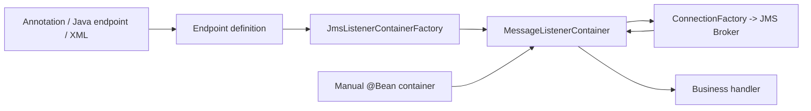
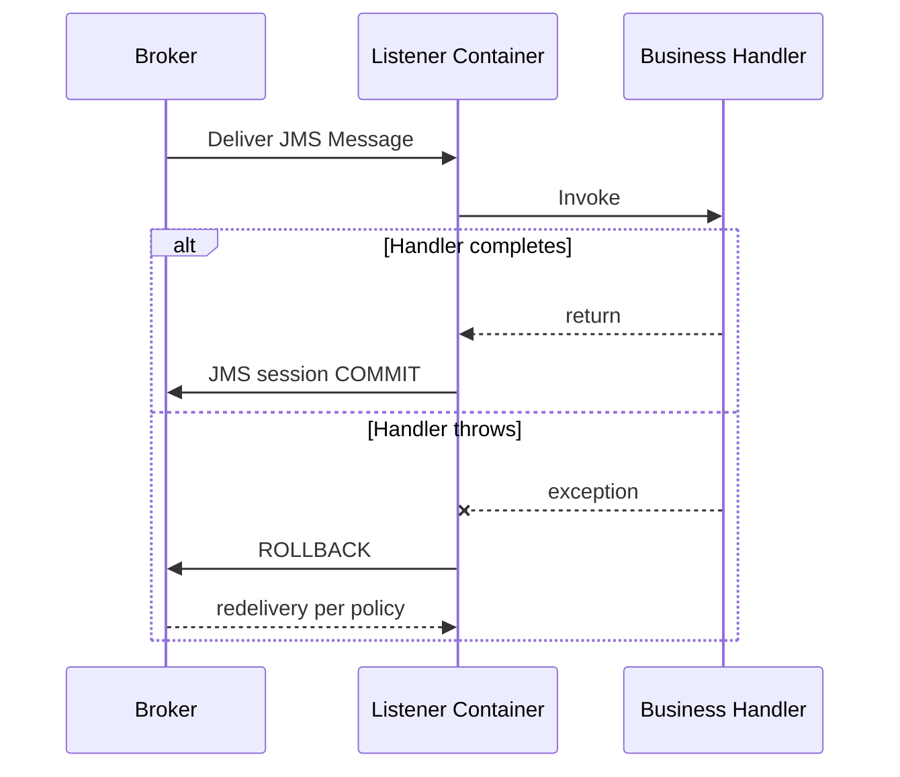

# Comparing Ways to Declare Listeners in Spring JMS

> **Topic:** Spring Framework – JMS · **Group:** Listeners and containers.  
> **Goal:** Understand that **how a message-receiving endpoint is registered** and **the container that actually runs the listener** are two distinct things. Compare `@JmsListener`, `jakarta.jms.MessageListener`, `SessionAwareMessageListener`, `MessageListenerAdapter`, programmatic Java endpoint registration, XML namespace, and Spring containers; choose the right approach based on message type, control level, transactions, recovery, dynamic configuration, and maintainability. Uses Jakarta JMS, Spring Framework 6.1, Spring Boot 3.3.5, and Java 21.

## 1. Three Layers Behind a Listener

When hearing "declare a listener", there are usually three independent decisions:

1. **Business handler:** which method or object processes the data? Does it receive `String`/DTO or raw `jakarta.jms.Message`?
2. **Endpoint registration:** does Spring learn **destination, selector, ID, subscription, and handler** via annotation, Java config, XML, or dynamic registration?
3. **Runtime container:** which component creates `Connection`, `Session`, and `MessageConsumer`, receives messages, coordinates threads, handles transactions, recovers connections, and closes resources?



With `@JmsListener` or `JmsListenerConfigurer`, Spring uses `JmsListenerContainerFactory` to create the endpoint's container; `JmsListenerEndpointRegistry` manages the lifecycle of those containers. With a directly declared `@Bean DefaultMessageListenerContainer`, **the container itself is the bean** and does not automatically become an endpoint in that registry.

**Do not equate:**

- `@JmsListener` is **not** a consumer running on the thread that reads the annotation.
- `MessageListener` does **not run automatically** merely because a `@Component` implements the interface; it must be wired into a container or provider consumer.
- `MessageListenerAdapter` **does not create connections**; it forwards JMS callbacks to a delegate method.
- `DefaultJmsListenerContainerFactory` is **not** `DefaultMessageListenerContainer`: the former creates the latter per configuration.
- `JmsTemplate.receive(...)` is a **synchronous receive** on the calling thread, not a way to register an asynchronous listener.

## 2. Quick Comparison Table: Which API to Choose?

| Declaration style | Handler receives | Who creates the container? | When to use | Watch out for |
| --- | --- | --- | --- | --- |
| **`@JmsListener`** | Method receiving `String`, DTO, raw `Message`, `Session`, `@Header`... | Infrastructure via `JmsListenerContainerFactory` | **Default choice** in Spring Boot; minimal boilerplate, easy to read and test | Converters, factory names, actual selector/transaction settings |
| **`MessageListener` + container bean** | `onMessage(jakarta.jms.Message)` | You manually register `DefaultMessageListenerContainer`/`SimpleMessageListenerContainer` | Need to read native headers/bodies or integrate JMS libraries | Must handle checked `JMSException`; more infrastructure code |
| **`SessionAwareMessageListener` + container bean** | `onMessage(Message, Session)` | You manually register a container supporting the Spring interface | Need the same `Session` to create replies/messages | Spring-specific interface; not supported by every JCA listener container |
| **`MessageListenerAdapter` + container bean** | POJO method such as `receiveText(String)` | Manually registered container or XML configuration | Migrating legacy systems, wanting an unannotated POJO handler | Default method `handleMessage`, adapter's converter, and reply semantics |
| **`JmsListenerConfigurer` + `SimpleJmsListenerEndpoint`** | `MessageListener` attached to the endpoint in code | `JmsListenerEndpointRegistry` using a factory | Endpoint list generated from configuration at startup | Needs unique IDs; raw callback, factory must exist |
| **Runtime registration via registry API** | `JmsListenerEndpoint` | `JmsListenerEndpointRegistry.registerListenerContainer(...)` | Creating endpoints while the app is running under explicit governance | Managing IDs/lifecycles, provisioning permissions, and config sources |
| **XML `<jms:listener-container>`** | Delegate bean and method or raw listener | Spring JMS XML namespace creates container/adapter | Maintaining existing XML-based Spring applications | Verbose XML configuration, harder IDE discovery than annotations |

No syntax automatically makes messages "safer". **ACK/commit, concurrency, retries, DLQ, converters, and connection recovery** depend primarily on container type, broker, and settings, not annotation names.

### Quick selection rules

- Most new Spring Boot apps: **`@JmsListener` + default factory or custom-named factory**.
- Need raw `Message` and `Session`: try **`@JmsListener(Message, Session)` first**; drop to lower interfaces only when truly needed.
- Want to attach a JMS-API callback directly: **`MessageListener` + `DefaultMessageListenerContainer`**.
- Already have POJO delegates or XML namespaces: **`MessageListenerAdapter`** or `<jms:listener>`, avoiding unnecessary large refactors.
- Destination definitions come from startup config: **`JmsListenerConfigurer`**.
- Must provision endpoints after startup: **registry API** with operational controls.

## 3. Style 1 — `@JmsListener`: Standard Declaration in Spring Boot

Simplest example:

```java
@Component
class OrderListener {

    @JmsListener(destination = "orders.incoming")
    public void receive(String content) {
        System.out.println("ANNOTATED " + content);
    }
}
```

This is a **class fragment** to place in an application with Spring component scanning and JMS infrastructure; import `org.springframework.stereotype.Component` and `org.springframework.jms.annotation.JmsListener`.

Spring discovers the annotated method, creates an endpoint, and builds a listener container via the factory. `OrderListener` is typically a **singleton bean**; multiple container consumer threads may invoke that method concurrently, so mutable state must be thread-safe.

### 3.1. Enabling listener infrastructure

In plain Spring Framework:

```java
@Configuration
@EnableJms
class JmsConfiguration {
    // Appropriate ConnectionFactory/factory beans will be registered.
}
```

Import `org.springframework.context.annotation.Configuration` and `org.springframework.jms.annotation.EnableJms`. In Spring Boot with a JMS starter, auto-configuration usually enables annotation infrastructure for you; explicitly adding `@EnableJms` remains helpful for learning or migrating to plain Spring config.

If `@JmsListener` **does not specify a factory**, Spring JMS normally looks up a bean named:

```text
jmsListenerContainerFactory
```

Spring Boot typically auto-configures this factory unless the application registers a suitable one. You cannot just place annotations in a project missing a JMS provider/`ConnectionFactory` and expect a receiver to connect on its own.

### 3.2. Flexible method signatures

Spring Framework can inject into the method:

- `String` payload or Java DTO via converter.
- Raw `jakarta.jms.Message`/`TextMessage` to read headers/properties.
- `jakarta.jms.Session` for native JMS operations needing the same session.
- `org.springframework.messaging.Message<T>`, `@Header`, `@Headers` for abstracted metadata.
- `@Payload` or `@Valid` when compatible conversion/validation is configured.

```java
@JmsListener(destination = "orders.incoming")
public void consume(
        String body,
        @Header("eventType") String eventType,
        jakarta.jms.Session session) {
    System.out.println(eventType + ": " + body);
}
```

This is a **fragment** requiring `org.springframework.messaging.handler.annotation.Header`; the `eventType` property must actually exist on the message. Do not expect a JSON `eventType` field inside the body to automatically become a JMS property. The method can throw exceptions when payload/metadata are invalid.

### 3.3. ID, selector, and custom factory

```java
@JmsListener(
    id = "priorityOrderConsumer",
    destination = "orders.incoming",
    selector = "priorityClass = 'HIGH'",
    containerFactory = "priorityListenerFactory")
public void receiveHighPriority(String body) {
    // Process high-priority items.
}
```

- `id` identifies the container for lookup in `JmsListenerEndpointRegistry`.
- `destination` must be resolved/provisioned properly on the broker; a string name does not create physical queues by itself.
- `selector` is evaluated by the broker/provider on **JMS headers/properties**, not the JSON body.
- `containerFactory` points to a `JmsListenerContainerFactory` bean **by name**; a wrong name causes startup errors.
- If multiple `@JmsListener` annotations are placed on one method (repeatable annotation), each declaration is a separate endpoint; do not assume broadcast semantics if those endpoints read the same queue.

### 3.4. Sending replies with `@SendTo` when needed

```java
@JmsListener(destination = "quote.requests")
@SendTo("quote.replies")
public String quote(String request) {
    return "ACK:" + request;
}
```

This is a **fragment**; `@SendTo` imports `org.springframework.messaging.handler.annotation.SendTo`. Spring turns the return value into a JMS reply via its reply-handling mechanism; the destination may be influenced by `JMSReplyTo` on the request or a default reply destination. Do not return values from a listener assuming a reply is sent unless adapter/reply configuration supports it.

For one-way event flows, keep methods returning `void`, using tracing/correlation and a separate event/status when business confirmation is needed.

## 4. `JmsListenerContainerFactory`: Shared Configuration for Annotations

Direct Spring Framework configuration:

```java
@Configuration
@EnableJms
class ListenerFactoryConfig {

    @Bean("jmsListenerContainerFactory")
    DefaultJmsListenerContainerFactory defaultFactory(
            ConnectionFactory connectionFactory) {

        DefaultJmsListenerContainerFactory factory =
                new DefaultJmsListenerContainerFactory();

        factory.setConnectionFactory(connectionFactory);
        factory.setPubSubDomain(false);       // queue
        factory.setSessionTransacted(true);  // local JMS transaction
        factory.setConcurrency("1-3");      // bounded scaling
        return factory;
    }
}
```

This fragment requires importing `jakarta.jms.ConnectionFactory`, `org.springframework.jms.config.DefaultJmsListenerContainerFactory`, and the annotations. This is an **alternative configuration**; do not paste it directly into section 12's demo project which uses Boot's default factory.

**Meaning:**

- The factory uses **`ConnectionFactory`** so containers can create consumer resources.
- `setSessionTransacted(true)` commits the JMS session when the callback finishes cleanly; exceptions typically trigger rollback/redelivery per broker policy.
- `setConcurrency("1-3")` does not guarantee 3 consumers always exist, preserve processing order, or triple throughput.
- With topic subscriptions, do not raise concurrent consumers arbitrarily like a queue; fan-out/shared/durable semantics must be designed explicitly.
- This factory builds containers as Spring discovers endpoints; it is not itself a message-receiving listener.

### Boot auto-configuration and multiple factories

Spring Boot 3.3.x supplies a default factory via auto-configuration when conditions match. To add a second factory, use `DefaultJmsListenerContainerFactoryConfigurer` to carry Boot's settings into the new factory:

```java
@Bean("batchListenerFactory")
DefaultJmsListenerContainerFactory batchFactory(
        ConnectionFactory connectionFactory,
        DefaultJmsListenerContainerFactoryConfigurer configurer) {

    ConnectionFactory listenerConnectionFactory = connectionFactory;

    if (connectionFactory instanceof CachingConnectionFactory cache
            && cache.getTargetConnectionFactory() != null) {
        listenerConnectionFactory = cache.getTargetConnectionFactory();
    }

    DefaultJmsListenerContainerFactory factory =
            new DefaultJmsListenerContainerFactory();
    configurer.configure(factory, listenerConnectionFactory);
    factory.setConcurrency("2-4");
    return factory;
}
```

Required imports include `org.springframework.boot.autoconfigure.jms.DefaultJmsListenerContainerFactoryConfigurer`, `org.springframework.jms.connection.CachingConnectionFactory`, and `jakarta.jms.ConnectionFactory`; place the fragment in `@Configuration`.

**Version note:** `org.springframework.boot.jms.ConnectionFactoryUnwrapper` was introduced in Spring Boot **3.4**. Do not import that class in a Boot **3.3.5** project; if unwrapping a wrapper in 3.3, check the instance and call `getTargetConnectionFactory()` as above. For listener containers, prefer the **native ConnectionFactory** for lifecycle/recovery; using a caching `ConnectionFactory` directly on listeners can hinder stop/restart/dynamic scaling. Keep transaction/converter policies consistent.

## 5. Style 2 — Directly Implementing `jakarta.jms.MessageListener`

Standard JMS defines the interface:

```java
public interface MessageListener {
    void onMessage(jakarta.jms.Message message);
}
```

This is an **illustrative signature**, not source code replacing package `jakarta.jms`. In Java, you can implement:

```java
package com.example.jms;

import jakarta.jms.JMSException;
import jakarta.jms.Message;
import jakarta.jms.MessageListener;
import jakarta.jms.TextMessage;

public final class RawMessageHandler implements MessageListener {

    @Override
    public void onMessage(Message message) {
        if (!(message instanceof TextMessage text)) {
            throw new IllegalArgumentException(
                    "Expected TextMessage");
        }

        try {
            String body = text.getText();
            System.out.println("RAW " + body);
        } catch (JMSException ex) {
            throw new IllegalStateException(
                    "Cannot read JMS message", ex);
        }
    }
}
```

`RawMessageHandler.java` is a compilable class when the Jakarta JMS API is present. It **does not receive messages on its own**: it needs a provider JMS consumer or a Spring listener container.

Register a `DefaultMessageListenerContainer` so the container manages callbacks:

```java
@Bean("rawListenerContainer")
DefaultMessageListenerContainer rawListenerContainer(
        ConnectionFactory connectionFactory,
        RawMessageHandler handler) {

    DefaultMessageListenerContainer container =
            new DefaultMessageListenerContainer();

    container.setConnectionFactory(connectionFactory);
    container.setDestinationName("demo.raw");
    container.setMessageListener(handler);
    container.setSessionTransacted(true);
    container.setConcurrentConsumers(1);
    return container;
}
```

This is a **`@Bean` fragment** requiring `RawMessageHandler` registered as a Spring bean, importing `DefaultMessageListenerContainer`, and placed inside a `@Configuration` class; do not add it to section 12's demo because it would create a fourth queue/consumer not fed by the demo publisher.

**Pros:** clean integration with native Java/JMS callbacks and full access to `Message`, headers, and typed properties. **Trade-off:** you configure the container yourself, converters do not automatically turn messages into DTOs, and `onMessage` does not declare checked `JMSException`, requiring exception handling/wrapping.

## 6. Style 3 — `SessionAwareMessageListener` When the Same JMS Session Is Needed

Spring provides:

```java
public interface SessionAwareMessageListener<M extends Message> {
    void onMessage(M message, Session session) throws JMSException;
}
```

This is a descriptive signature; `SessionAwareMessageListener` is in `org.springframework.jms.listener`, and `Message`/`Session`/`JMSException` are in `jakarta.jms`.

Fragment example:

```java
SessionAwareMessageListener<TextMessage> replyHandler =
        (incoming, session) -> {
            String request = incoming.getText();
            TextMessage reply =
                    session.createTextMessage("ACK:" + request);
            // If a reply is needed, route it per JMSReplyTo
            // through a producer attached to the same Session and manage resources.
        };
```

**Differs from `MessageListener`:** the callback also receives the container-managed `Session`, allowing message/reply creation within the same JMS transaction context. In the fragment above, `reply` is only **created, not sent yet**; do not describe it as a complete request/reply implementation.

**Differs from `@JmsListener`:** annotated methods can also inject `jakarta.jms.Session` under annotated infrastructure. Therefore you do not necessarily have to pick `SessionAwareMessageListener` solely to access the session.

**Limitations:** `SessionAwareMessageListener` is a Spring-specific API, supported by `DefaultMessageListenerContainer`/`SimpleMessageListenerContainer` yet potentially unsupported in some JCA-based listener containers. Never pass `Session` to another thread or retain it beyond the callback.

## 7. Style 4 — `MessageListenerAdapter`: Invoking a POJO Method

A plain service might only have:

```java
@Component
class LegacyOrderDelegate {

    public void receiveText(String content) {
        System.out.println("ADAPTER " + content);
    }
}
```

Instead of modifying the class to implement `MessageListener` or adding `@JmsListener`, you can create an adapter:

```java
@Bean
MessageListenerAdapter legacyAdapter(LegacyOrderDelegate delegate) {
    MessageListenerAdapter adapter =
            new MessageListenerAdapter(delegate);
    adapter.setDefaultListenerMethod("receiveText");
    return adapter;
}
```

When attached as a container's `messageListener`, it uses a converter (default `SimpleMessageConverter`) to convert `TextMessage` to `String` and invokes `receiveText(String)` on the delegate.

**Common pitfall:** the default listener method name of `MessageListenerAdapter` is **`handleMessage`**, not `onMessage`. If the POJO declares `receiveText`, you must call `setDefaultListenerMethod("receiveText")`. If the method returns a non-null value, the adapter can construct a **JMS reply** per reply destination/`JMSReplyTo` rules; the `void` method in the example produces no reply.

### MessageListenerAdapter and @JmsListener both accept POJOs yet differ

| Aspect | `@JmsListener` | `MessageListenerAdapter` |
| --- | --- | --- |
| Declared on method | Yes, explicit destination, selector/factory | Not required; adapter/container configured externally |
| Conversion | Annotated infrastructure and factory-bound message converter | Adapter has its own converter |
| Method signature | Supports payload, raw JMS, Spring Messaging `Message`, `@Header`, `Session` | Usually one payload argument per converter; adapter customization supported |
| Reply | Return value with `@SendTo`, `JmsResponse`... | Return value with default reply destination/`JMSReplyTo` |
| Runtime config | Factory+registry | Container bean/namespace |
| Best suited for | New, clean code | Legacy POJOs, XML migrations, delegate reuse |

Do not confuse producer annotations with adapters: `JmsTemplate.convertAndSend` and `@JmsListener` are two separate sides; converters must be configured compatibly for both send and receive regardless of listener style.

## 8. Style 5 — `JmsListenerConfigurer`: Declaring Endpoints in Code

When the listener list depends on deployment config or must be generated by domain, `JmsListenerConfigurer` lets you register in Java **without `@JmsListener` on methods**.

Example:

```java
@Configuration
@EnableJms
class ProgrammaticListenerConfig implements JmsListenerConfigurer {

    @Override
    public void configureJmsListeners(
            JmsListenerEndpointRegistrar registrar) {

        SimpleJmsListenerEndpoint endpoint =
                new SimpleJmsListenerEndpoint();
        endpoint.setId("programmedEvents");
        endpoint.setDestination("events.programmed");
        endpoint.setMessageListener(message -> {
            // Accepts raw jakarta.jms.Message.
            System.out.println("A JMS message arrived");
        });

        registrar.registerEndpoint(endpoint);
    }
}
```

Imports: `org.springframework.jms.annotation.JmsListenerConfigurer`, `org.springframework.jms.config.JmsListenerEndpointRegistrar`, `org.springframework.jms.config.SimpleJmsListenerEndpoint`, `org.springframework.jms.annotation.EnableJms`, and `org.springframework.context.annotation.Configuration`. This is a **configuration fragment** needing a default `JmsListenerContainerFactory` (or passing an explicit factory to `registerEndpoint`) plus a `ConnectionFactory`.

**Mechanism:** the registrar builds an endpoint model (ID, destination, listener), and `JmsListenerEndpointRegistry` uses the factory to create the container and manage its lifecycle. This is **startup registration**, not an automatic config-file watcher that creates/deletes consumers whenever a file changes.

### When to use programmatic registration?

- The endpoint list is derived from configuration **known at startup**.
- Many endpoints must be registered without duplicating dozens of static annotations.
- A platform library creates consumers with shared naming/selector conventions.
- You need a native `MessageListener` callback while still wanting a registry-managed container.

If destinations come from users or untrusted sources, **never** take arbitrary strings and auto-create listeners: enforce allowlists, provisioning permissions, consumer caps, quotas, and endpoint ID controls. Spawning thousands of endpoints exhausts threads/sessions and impacts the broker.

## 9. Registering or Managing Endpoints at Runtime: `JmsListenerEndpointRegistry`

Spring uses `org.springframework.jms.config.JmsListenerEndpointRegistry` to manage containers created through annotation/endpoint infrastructure.

Example retrieving a container by ID:

```java
// Fragment: JmsListenerEndpointRegistry registry is injected.
var container =
        registry.getListenerContainer("priorityOrderConsumer");

if (container != null) {
    container.stop();
    // After appropriate changes/deployment, container.start() can be called.
}
```

Calling `stop()` stops the consumer from receiving; it **does not delete the queue**. If the broker already holds messages, backlog can grow while the container is stopped. Never write code that arbitrarily stops all production listeners just to test.

If you genuinely must register **after the application is already running**, the registry exposes:

```java
// Runtime management fragment; requires existing registry and factory.
SimpleJmsListenerEndpoint endpoint =
        new SimpleJmsListenerEndpoint();
endpoint.setId("dynamicAlertListener");
endpoint.setDestination("alerts.dynamic");
endpoint.setMessageListener(message -> {
    System.out.println("DYNAMIC");
});

registry.registerListenerContainer(
        endpoint, listenerFactory, true);
```

Here `listenerFactory` is an appropriate `JmsListenerContainerFactory<?>`; `true` requests immediate startup if lifecycle state permits. This is **not** an automatic CRUD mechanism: Spring rejects duplicate IDs and the registry API has lifecycle constraints. If endpoints must be removed/updated at runtime, explicitly design stop, shutdown, resource release, reconfiguration, and re-registration within supported APIs rather than editing source annotations at runtime.

**Important:** registry-created containers **are not direct beans** in `ApplicationContext`. Do not try to inject them by `DefaultMessageListenerContainer` type or assume every `@JmsListener` has a bean matching its endpoint ID. Conversely, manually declared `@Bean` containers are managed via Spring lifecycle/`ApplicationContext` and do not automatically appear in the registry's ID list.

## 10. Style 6 — XML Namespace: Fitting Legacy Spring Configurations

Spring JMS supports the `jms` namespace; complete XML configuration skeleton (requires a valid `connectionFactory` bean defined elsewhere):

```xml
<?xml version="1.0" encoding="UTF-8"?>
<beans xmlns="http://www.springframework.org/schema/beans"
       xmlns:xsi="http://www.w3.org/2001/XMLSchema-instance"
       xmlns:jms="http://www.springframework.org/schema/jms"
       xsi:schemaLocation="
         http://www.springframework.org/schema/beans
         https://www.springframework.org/schema/beans/spring-beans.xsd
         http://www.springframework.org/schema/jms
         https://www.springframework.org/schema/jms/spring-jms.xsd">

    <bean id="legacyHandler"
          class="com.example.legacy.LegacyHandler"/>

    <jms:listener-container
            connection-factory="connectionFactory"
            acknowledge="transacted">
        <jms:listener
                destination="orders.incoming"
                ref="legacyHandler"
                method="receiveText"/>
    </jms:listener-container>
</beans>
```

Prerequisites: `com.example.legacy.LegacyHandler` must have a matching `receiveText` method, the `connectionFactory` bean must exist, and the provider/broker/queue must be ready. This is a **standalone XML configuration example**; do not paste it verbatim into section 12's demo project or point it to a nonexistent class expecting it to run.

- `<jms:listener-container>` configures the shared container settings.
- `<jms:listener>` defines the delegate/method endpoint, conceptually matching a manual container + `MessageListenerAdapter`.
- `acknowledge="transacted"` enables local JMS transactions per container config.
- `selector`, `concurrency`, destination resolvers, and transaction managers can be configured via XML namespace attributes.
- `<jms:annotation-driven/>` only enables **annotation-driven listener endpoints**; it does not create business handlers itself.

In new Spring Boot projects, Java configuration with `@JmsListener` is usually easier to read and refactor. XML is helpful when maintaining or migrating an existing XML-configured system; using XML confers no special transactional advantage.

## 11. Major Difference: `DefaultMessageListenerContainer` vs `SimpleMessageListenerContainer`

Both are Spring listener containers, yet their receiving mechanisms differ:

| Criterion | `DefaultMessageListenerContainer` (DMLC) | `SimpleMessageListenerContainer` (SMLC) |
| --- | --- | --- |
| Mechanism | Uses a JMS `MessageConsumer.receive()` loop inside Spring tasks/threads | Uses JMS `MessageConsumer.setMessageListener()`, provider pushes callbacks |
| Consumer count | Supports `concurrentConsumers`/`maxConcurrentConsumers`, dynamic scaling per policy | Usually fixed number of sessions/consumers at startup |
| Resource recovery | Flexible recovery/restart, recreates consumers/sessions on disconnect | Simpler, limited flexibility, provider-dependent |
| Transactions | Native JMS session transactions plus optional external transaction managers | Native JMS transactions; does not participate in external transaction managers like DMLC |
| Complexity | More configuration options, optimized for operations | Lightweight, close to native JMS callbacks |
| Common practice | **Preferred for most Spring JMS production workloads** | Chosen for specific provider/runtime reasons |

**Do not misunderstand:** using `@JmsListener` does not mean Spring uses `SimpleMessageListenerContainer` merely because "listener" appears in the name. `DefaultJmsListenerContainerFactory` typically creates **`DefaultMessageListenerContainer`**. To use another container, choose the matching factory; switching handler interfaces does not swap containers.

DMLC handles resource caching and recovery within the container lifecycle. Spring docs warn that wrapping externally with `CachingConnectionFactory` can make stop/restart or dynamic scaling less accurate; prefer a native factory for listeners or explicitly scope caching. Meanwhile, producer-side `JmsTemplate` can use caching to reduce resource creation overhead.

## 12. Runnable Demo: Three Declaration Styles in One Application

The example defines three **separate queues** for a fair comparison:

- `demo.style.annotated` → listener method with `@JmsListener`.
- `demo.style.adapter` → POJO delegate via `MessageListenerAdapter` with a **manually declared DMLC bean**.
- `demo.style.programmatic` → `SimpleJmsListenerEndpoint` registered via `JmsListenerConfigurer` and the registry.

An `ApplicationRunner` sends the same kind of String message to all three queues via `JmsTemplate.convertAndSend`. Each queue has only one consumer in the example to avoid competing consumers making logs hard to read. All connect to an **external Artemis broker** at `tcp://localhost:61616`; queues must exist or broker auto-create must be enabled with proper principal permissions.

### 12.1. Gradle project

`settings.gradle`:

```groovy
rootProject.name = 'spring-jms-listener-styles'
```

`build.gradle`:

```groovy
plugins {
    id 'java'
    id 'org.springframework.boot' version '3.3.5'
    id 'io.spring.dependency-management' version '1.1.6'
}

group = 'com.example'
version = '0.0.1-SNAPSHOT'

java {
    toolchain { languageVersion = JavaLanguageVersion.of(21) }
}

repositories { mavenCentral() }

dependencies {
    implementation 'org.springframework.boot:spring-boot-starter'
    implementation 'org.springframework.boot:spring-boot-starter-artemis'
}
```

`src/main/resources/application.yml`:

```yaml
spring:
  artemis:
    mode: native
    broker-url: ${JMS_BROKER_URL:tcp://localhost:61616}
    user: ${JMS_USER:artemis}
    password: ${JMS_PASSWORD:artemis}
  jms:
    pub-sub-domain: false
```

Default credentials are suitable only for a local broker. Java 21, Gradle wrapper, and Artemis are external prerequisites; `bootRun` does not start a persistent broker automatically in `native` mode.

### 12.2. Complete single Java file

Create `src/main/java/com/example/receiving/ListenerStylesApplication.java`:

```java
package com.example.receiving;

import jakarta.jms.ConnectionFactory;
import jakarta.jms.JMSException;
import jakarta.jms.TextMessage;

import org.springframework.boot.ApplicationRunner;
import org.springframework.boot.SpringApplication;
import org.springframework.boot.autoconfigure.SpringBootApplication;
import org.springframework.context.annotation.Bean;
import org.springframework.jms.annotation.EnableJms;
import org.springframework.jms.annotation.JmsListener;
import org.springframework.jms.annotation.JmsListenerConfigurer;
import org.springframework.jms.config.JmsListenerEndpointRegistrar;
import org.springframework.jms.config.SimpleJmsListenerEndpoint;
import org.springframework.jms.connection.CachingConnectionFactory;
import org.springframework.jms.core.JmsTemplate;
import org.springframework.jms.listener.DefaultMessageListenerContainer;
import org.springframework.jms.listener.adapter.MessageListenerAdapter;
import org.springframework.stereotype.Component;

@SpringBootApplication
@EnableJms
public class ListenerStylesApplication implements JmsListenerConfigurer {

    public static void main(String[] args) {
        SpringApplication.run(ListenerStylesApplication.class, args);
    }

    // Style 3: Endpoint registered in Java, managed by registry.
    @Override
    public void configureJmsListeners(
            JmsListenerEndpointRegistrar registrar) {

        SimpleJmsListenerEndpoint endpoint =
                new SimpleJmsListenerEndpoint();

        endpoint.setId("programmaticReceiver");
        endpoint.setDestination("demo.style.programmatic");
        endpoint.setMessageListener(message -> {
            if (!(message instanceof TextMessage text)) {
                throw new IllegalArgumentException(
                        "Expected TextMessage");
            }

            try {
                System.out.println("PROGRAMMATIC " + text.getText());
            } catch (JMSException ex) {
                throw new IllegalStateException(
                        "Cannot read JMS body", ex);
            }
        });

        registrar.registerEndpoint(endpoint);
    }

    // Style 2: Adapter converts TextMessage -> String -> POJO method.
    @Bean
    MessageListenerAdapter legacyAdapter(AdapterReceiver delegate) {
        MessageListenerAdapter adapter =
                new MessageListenerAdapter(delegate);
        adapter.setDefaultListenerMethod("receiveText");
        return adapter;
    }

    // Container bean: manually declares lifecycle, destination, and transaction.
    @Bean("adapterListenerContainer")
    DefaultMessageListenerContainer adapterListenerContainer(
            ConnectionFactory connectionFactory,
            MessageListenerAdapter legacyAdapter) {

        ConnectionFactory listenerConnectionFactory = connectionFactory;
        if (connectionFactory instanceof CachingConnectionFactory cache
                && cache.getTargetConnectionFactory() != null) {
            listenerConnectionFactory =
                    cache.getTargetConnectionFactory();
        }

        DefaultMessageListenerContainer container =
                new DefaultMessageListenerContainer();
        container.setConnectionFactory(listenerConnectionFactory);
        container.setDestinationName("demo.style.adapter");
        container.setMessageListener(legacyAdapter);
        container.setSessionTransacted(true);
        container.setConcurrentConsumers(1);
        return container;
    }

    // Runs after Spring Boot has initialized the context.
    @Bean
    ApplicationRunner demoPublisher(JmsTemplate template) {
        return args -> {
            template.convertAndSend("demo.style.annotated", "ONE");
            template.convertAndSend("demo.style.adapter", "TWO");
            template.convertAndSend("demo.style.programmatic", "THREE");
        };
    }
}

// Style 1: Spring discovers the annotation and uses Boot's default factory.
@Component
class AnnotatedReceiver {

    @JmsListener(
            id = "annotatedReceiver",
            destination = "demo.style.annotated")
    public void receive(String content) {
        System.out.println("ANNOTATED " + content);
    }
}

// POJO does not implement MessageListener and has no @JmsListener.
@Component
class AdapterReceiver {

    public void receiveText(String content) {
        System.out.println("ADAPTER " + content);
    }
}
```

**Key wiring explanation:**

1. `@SpringBootApplication` scans package `com.example.receiving` and subpackages.
2. `@EnableJms` activates annotations and the endpoint registrar in Spring Framework 6.1.
3. For `AnnotatedReceiver`, the container is created by the default `jmsListenerContainerFactory` (Boot auto-config) and managed by the registry. Spring decodes `TextMessage` into `String` via the appropriate converter.
4. For `AdapterReceiver`, `receiveText` has **no** annotation. `MessageListenerAdapter` converts raw JMS `TextMessage` to `String` and invokes the exact method configured via `setDefaultListenerMethod`.
5. The `adapterListenerContainer` bean is a **real container**; it manages its own lifecycle because it is registered as a Spring `@Bean`. It is not created by the endpoint registry.
6. The adapter container receives `ConnectionFactory` from Boot and unwraps `CachingConnectionFactory` if a target exists so DMLC uses the native factory. This is compatible with Boot 3.3.5 without using the unwrap helper introduced in Boot 3.4.
7. `configureJmsListeners` registers endpoint ID `programmaticReceiver`. It is created via the factory and **exists in the registry**; its callback receives raw `jakarta.jms.Message`, so it must read `TextMessage` and wrap errors manually.
8. `ApplicationRunner` sends **one** `String` to each queue. Receivers may run on different threads and print logs in non-deterministic order.
9. All three use queue mode (`pub-sub-domain=false`). They do not automatically create durable queues on every broker; the Artemis broker must have the matching addresses/queues per policy.

**No custom `DefaultJmsListenerContainerFactory` is needed in the demo**, because Boot already auto-configures the default for annotated and programmatic endpoints. The `adapterListenerContainer` bean is not a factory, so it does not suppress Boot's default factory merely by coexisting in the application context.

### 12.3. Running and verifying

From the project directory with Gradle wrapper:

```bash
# Linux/macOS
./gradlew bootRun

# Windows
gradlew.bat bootRun
```

Against a clean test broker, the three expected **business** lines appear (order not guaranteed):

```text
ANNOTATED ONE
ADAPTER TWO
PROGRAMMATIC THREE
```

These are only **application log lines**, not full stdout (Spring Boot prints startup logs). If the broker had leftover messages from earlier runs or the app ran multiple times, lines may repeat. If the broker is down, queues are unprovisioned without auto-create, or credentials are wrong, do not expect these three lines.

Verify via the Artemis console/management:

- All three queues actually exist with ANYCAST routing and valid receive permissions.
- Each queue has an active consumer once the application starts.
- Pending messages drop when handlers receive and commit/ACK successfully.
- If handlers fail, observe redelivery/DLQ per configuration instead of assuming all three declaration styles share identical retry semantics.

### 12.4. Inspecting the registry vs container bean

The snippet below is an **observation fragment**, e.g. placed in an `ApplicationRunner` with injected `ApplicationContext` and `JmsListenerEndpointRegistry` after startup:

```java
Set<String> ids = registry.getListenerContainerIds();

System.out.println(ids.contains("annotatedReceiver"));  // true
System.out.println(ids.contains("programmaticReceiver")); // true

boolean hasManualContainer =
        context.containsBean("adapterListenerContainer");
System.out.println(hasManualContainer);                    // true
```

Imports: `java.util.Set`, `org.springframework.context.ApplicationContext`, `org.springframework.jms.config.JmsListenerEndpointRegistry`. The `true` comments indicate expected results **when the demo config builds cleanly**; they are not lines automatically printed by section 12.2's `ListenerStylesApplication.java`.

Calling `registry.getListenerContainer("adapterListenerContainer")` typically returns `null`: a manual DMLC bean is not a registry-created container for an annotated/programmatic endpoint. That is an ownership/lifecycle distinction worth remembering.

## 13. Transactions, ACK, Exceptions, and Redelivery: Same Handler, Different Config

The declaration style does not dictate delivery policy. A `@JmsListener` method can use factory A with local JMS transactions, while a `MessageListenerAdapter` uses container B with `AUTO_ACKNOWLEDGE`. **They can behave completely differently when a handler throws an exception.**

### 13.1. When using local JMS transactions



With `setSessionTransacted(true)`, the container commits on successful processing and rolls back on unswallowed errors. The broker decides retry limits, delays, redelivery, and DLQs. Never assume exactly-once business processing.

### 13.2. When transactions are disabled

`AUTO_ACKNOWLEDGE` does not have the same ACK timing across all container types. For instance, DMLC in certain modes may acknowledge **before** running the listener per Spring docs; when the handler fails, the broker may **not** redeliver. Therefore explicitly set a transaction manager/`sessionTransacted` intentionally for critical workloads instead of trusting defaults unless verified.

If using `SessionAwareMessageListener` and sending replies on the same `Session`, keep reply transaction design consistent; never manually close the container-managed `Session` inside the callback.

### 13.3. Business reliability does not come from annotations

- Consumer commits DB successfully then process dies before JMS commit: message may be redelivered → **idempotent consumer** keyed by event ID.
- Producer commits DB then dies before sending: event may never be published → **transactional outbox** or equivalent mechanism.
- Malformed JSON/misconfigured converter: infinite retries will never fix it → bounded redelivery, DLQ/quarantine, and alerts.
- A local JMS transaction is not automatically atomic with a DB transaction. Multi-resource atomicity requires an appropriate architecture/transaction manager, while still accounting for cost, availability, and retries.

## 14. Concurrency, Queue/Topic, and Processing Order

Whether declared via annotation, XML, or Java, listeners still require designing for:

- **Queue:** each message is typically handled by **one** competing consumer. Raising concurrency can raise throughput, yet loses completion order matching send order.
- **Topic:** messages can fan out to multiple subscriptions. Properly configure `pubSubDomain=true`, durable/shared subscriptions, client IDs, and subscription names per provider.
- **Selector:** filters only on JMS headers/properties, not JSON bodies; if a property is absent, three-valued logic may prevent matching.
- **Concurrency on topics:** do not arbitrarily set `3-10` because it can spawn consumers/subscriptions with different semantics receiving duplicate copies.
- **Backpressure:** higher concurrency increases threads, sessions, broker credits, and DB/API load; monitor backlog, in-flight counts, failures/redeliveries, and completion latency.
- **Idempotency:** concurrency and redelivery can cause duplicate or out-of-order processing; use business keys and sequence/version checks where needed.

`@JmsListener(concurrency="2-4")` (when supported by the factory) overrides concurrency for an endpoint, yet **does not** turn a queue into a topic or initialize a producer.

## 15. Comparison by Operational Needs

| Criterion | Annotation | Manual DMLC | Adapter | Programmatic endpoint | XML |
| --- | --- | --- | --- | --- | --- |
| Minimal code for new services | **Very good** | Medium | Medium | Medium | Low |
| Handler receives DTO | Easy via converter | Must convert/adapt manually | Can convert | Needs custom adapter/converter if endpoint is raw | Via delegate+converter |
| Raw Message | Supported | Very direct | Possible, though adapters usually pass payloads | Directly supported | Supported |
| Many startup-configured endpoints | One annotation/endpoint | Many beans | Many adapters | **Flexible** | Possible in XML |
| Runtime-created endpoints | Not with annotations alone | Can manage bean/lifecycle separately | Container-dependent | **Registry API** | Not a natural fit |
| Managed via registry ID | **Yes** | Not automatic | No if using manual container | **Yes** | Namespace/infra dependent, inconsistent |
| Thread/transaction control | Via factory | **Explicit on bean** | Via container | Via factory | Via XML attributes |
| Fit for new code | **Preferred** | When special requirements apply | During migrations | Platform/dynamic config | Legacy XML systems |

**Usually the most maintainable architecture:** plain business method + small `@JmsListener` adapter; explicit converter/validation, factories holding only receiving policies, and domain services unaware of JMS. With layered code, business unit tests need no broker, while dedicated integration tests verify endpoints and the broker.

## 16. Testing Listener Declaration Approaches

### 16.1. Unit testing business logic

If a listener simply delegates to a service, unit test that service with valid/invalid inputs without a broker. This tests business behavior, **not** annotations, selectors, transactions, or destinations.

For raw `MessageListener`, you can mock `TextMessage` with Mockito and call `onMessage` directly. Verify parsing/error wrapping; mocks cannot prove broker receipt or ACK success.

### 16.2. Testing ApplicationContext/wiring

- Is the annotated method scanned by Spring? Are `@EnableJms`/auto-config active?
- Is the default factory named `jmsListenerContainerFactory` if endpoints omit it?
- Are endpoint IDs unique? Does `JmsListenerEndpointRegistry.getListenerContainerIds()` contain the annotated/programmatic endpoints?
- Is the manual `adapterListenerContainer` bean created by Spring? Is `messageListener` actually the intended adapter?
- Are converters from `TextMessage` to `String` or DTO consistent across each listener style?
- Are there duplicate `ConnectionFactory` beans causing `NoUniqueBeanDefinitionException` on ambiguous autowiring?

Merely starting `ApplicationContext` without a running broker **does not** guarantee JMS connections are ready; containers may keep retrying. Use a test broker for runtime verification.

### 16.3. Integration testing with a real broker / Testcontainers

1. Provision three separate test queues.
2. Start the application against Artemis; verify consumers appear on the broker.
3. Send a distinct message to each queue; wait with a bounded timeout rather than unbounded sleeps.
4. Verify the matching handler receives the expected body with no destination mix-ups.
5. Stop a handler/container, send a test message, inspect backlog, and verify restarting resumes consumption.
6. Trigger one exception then retry; inspect `sessionTransacted`, redelivery counts, and DLQ.
7. Send an invalid payload/wrong type; verify adapter/raw/annotated styles handle errors per a consistent policy.
8. Measure concurrency with multiple messages and watch ordering.
9. Verify shutdown releases sessions/consumers with no lingering thread leaks.

Never restart or delete production queues to "test listeners". Keep dedicated brokers and credentials for integration tests, and clean up test destinations afterward per operational procedures.

## 17. Common Pitfalls When Switching Between Declaration Styles

| Symptom | Possible cause | Fix |
| --- | --- | --- |
| `@JmsListener` never runs | Missing JMS infra, component not scanned, wrong factory/broker | Check `@EnableJms`/Boot starter, factory bean, queue, logs |
| Error: missing `jmsListenerContainerFactory` | Endpoint omitted `containerFactory` and no default factory exists | Register the expected bean name or specify factory explicitly |
| `MessageListener` bean exists yet receives nothing | Only implemented interface without attaching to consumer/container | Create a container or programmatic endpoint |
| `MessageListenerAdapter` fails to call delegate | Wrong method name, non-public method, mismatched payload type | Check `setDefaultListenerMethod`, converter, and signature |
| Delegate return value sends unintended replies | Adapter reply handling triggered by `JMSReplyTo`/default reply destination | Use `void` for one-way events and design replies explicitly |
| Container scales consumers unexpectedly | Fixed SMLC used or different factory/limits | Choose DMLC and measure scaling; tune core/max |
| Callback does not receive DTO | Missing converter or receiving factory differs from sending template | Configure converters on both sides |
| Multiple messages on same queue yet two listeners don't both see them | Queue uses competing distribution, not broadcast | Use topics/subscriptions or fan-out queues |
| Annotated endpoint exists yet no DMLC bean can be injected by type | Registry-managed containers are not ApplicationContext beans | Use `JmsListenerEndpointRegistry` by ID |
| Runtime registration fails on duplicate ID | `JmsListenerEndpointRegistry` disallows duplicate IDs | Enforce controlled naming conventions / ID registry |
| Works locally yet receives nothing in prod | Different broker URL, queue auto-create/ACL, missing selector properties | Verify broker config, destinations, and credentials |
| Messages lost when handler throws | Non-transacted ACK mode or exception swallowed | Check container ACK/transactions, DLQ/redelivery |
| Messages reprocessed after crash | Rollback or uncommitted ACK | Idempotency and retry-safe side effects |
| Lifecycle bugs when DMLC uses cached consumers | Wrapping listener container with `CachingConnectionFactory` | Use native factory and let the container manage resources |
| Code using `javax.jms.*` fails to compile on Boot 3.x | Java EE/Jakarta API mismatch | Use `jakarta.jms.*` with compatible libraries |
| `ConnectionFactoryUnwrapper` import fails on Boot 3.3 | Helper was added in Boot 3.4 | Use 3.3-compatible unwrapping or check `CachingConnectionFactory` |
| Field in JSON body ignored by selector | Selectors inspect JMS properties, not bodies | Set typed JMS properties on the producer |

## 18. Selection and Self-Assessment Exercises

1. Explain the difference between **handler**, **endpoint**, **listener container**, and **container factory**. Which component actually opens the JMS consumer?
2. Why is putting `@Component` on a class implementing `MessageListener` not enough to receive messages?
3. You have a new service receiving only an `OrderCreated` DTO. Should you start with `@JmsListener` or manual DMLC? Why?
4. When does `SessionAwareMessageListener` make more sense than standard `MessageListener`? Can `@JmsListener` receive `Session`?
5. What method name does `MessageListenerAdapter` look for by default? If a delegate uses `receiveText`, which property must you set?
6. Compare a container created via `@Bean DefaultMessageListenerContainer` with one managed by `JmsListenerEndpointRegistry`.
7. Write a `SimpleJmsListenerEndpoint` with a unique ID, destination, and callback, registered via `JmsListenerConfigurer`.
8. When wanting to create endpoints after startup, why is `configureJmsListeners` not an automatic hot-reload mechanism? Which API supports runtime registration?
9. Which JMS APIs do `SimpleMessageListenerContainer` and `DefaultMessageListenerContainer` use to receive messages, and how do they differ on dynamic scaling?
10. Why does using `@JmsListener` or XML not automatically guarantee exactly-once processing or redelivery when a handler throws?
11. Two consumers listen on the same queue—do both receive a copy of every message? If fan-out is needed, how must the architecture change?
12. Using `JmsListenerEndpointRegistry` to stop/start an endpoint, describe what happens to the backlog and JMS resources.
13. If you increase concurrency from 1 to 5, what must you check regarding ordering/idempotency and broker resources?
14. A Boot 3.3 app has a cached `ConnectionFactory`; why should you consider a native provider factory for DMLC?
15. Design three integration tests proving that annotation, adapter, and programmatic endpoints each receive exactly one message on three separate queues.

**Conclusion:** In Spring JMS, **how a handler is declared is not the same as how the container is managed**. `@JmsListener` is the natural choice for new applications; `MessageListener`, `SessionAwareMessageListener`, `MessageListenerAdapter`, programmatic Java endpoints, and XML address specific needs for control, migration, or runtime configuration. Every style requires explicitly configuring **`ConnectionFactory`, destination, converter, container lifecycle, transactions, concurrency, recovery, and broker policies** so the system receives messages safely.

### Official Documentation

- [Spring Framework – Annotation-driven Listener Endpoints](https://docs.spring.io/spring-framework/reference/integration/jms/annotated.html) — `@JmsListener`, `@EnableJms`, method signatures, `JmsListenerConfigurer`, `SimpleJmsListenerEndpoint`, replies.
- [Spring Framework – Receiving JMS Messages](https://docs.spring.io/spring-framework/reference/integration/jms/receiving.html) — asynchronous listeners and synchronous `receive`.
- [Spring Framework – JMS Namespace Support](https://docs.spring.io/spring-framework/reference/integration/jms/namespace.html) — `<jms:listener-container>`, `<jms:listener>`, and XML attributes.
- [Spring Framework 6.1 – DefaultMessageListenerContainer](https://docs.spring.io/spring-framework/docs/6.1.11/javadoc-api/org/springframework/jms/listener/DefaultMessageListenerContainer.html) — receive-loop, concurrency, transactions/recovery, caching caveats.
- [Spring Framework 6.1 – SimpleMessageListenerContainer](https://docs.spring.io/spring-framework/docs/6.1.11/javadoc-api/org/springframework/jms/listener/SimpleMessageListenerContainer.html) — provider callbacks and fixed consumer count.
- [Spring Framework 6.1 – MessageListenerAdapter](https://docs.spring.io/spring-framework/docs/6.1.11/javadoc-api/org/springframework/jms/listener/adapter/MessageListenerAdapter.html) — delegate methods, default `handleMessage`, converter/reply.
- [Spring Framework 6.1 – JmsListenerEndpointRegistry](https://docs.spring.io/spring-framework/docs/6.1.3/javadoc-api/org/springframework/jms/config/JmsListenerEndpointRegistry.html) — container IDs, lifecycle, and runtime registration.
- [Spring Boot – JMS Integration](https://docs.spring.io/spring-boot/3.4/reference/messaging/jms.html) — Boot auto-configuration and listener factories; note lab code pins Boot 3.3.5.
- [Jakarta Messaging 3.1 Specification](https://jakarta.ee/specifications/messaging/3.1/jakarta-messaging-spec-3.1.html) — `MessageListener`, queue/topic, delivery, and acknowledgement.
