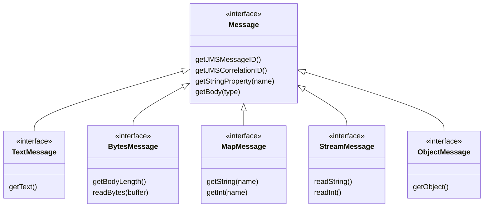
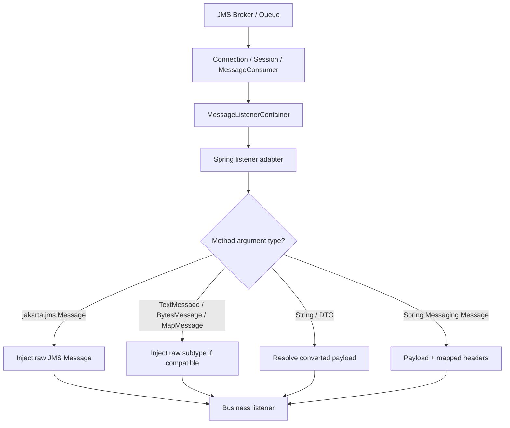

# Receiving jakarta.jms.Message or a Specific Message Type in Spring JMS

## 1. Objectives and Problem

A Spring JMS listener method can receive content converted into a Java `String`/DTO, **or receive the raw JMS Message object** along with headers/properties provided by the provider.

Example:

```java
@JmsListener(destination = "orders.text")
public void receiveText(jakarta.jms.TextMessage raw)
        throws jakarta.jms.JMSException {
    String text = raw.getText();
    // Process text after verifying the contract.
}
```

Contrast with:

```java
@JmsListener(destination = "orders.payload")
public void receivePayload(String body) {
    // Spring has converted the JMS payload into an appropriate String.
}
```

According to Spring Framework, a `@JmsListener` method parameter can be **`jakarta.jms.Message` or any of its subtypes, provided the incoming message is of a compatible type**. This is a feature of an **annotated listener endpoint**; it does not mean every subtype is automatically converted into every other subtype.

After this lesson, you should be able to:

1. Understand the structure of `jakarta.jms.Message` and the five standard message body types.
2. Know how to choose a generic `Message` or `TextMessage`, `BytesMessage`, `MapMessage`, `StreamMessage`, or `ObjectMessage`.
3. Read the body, JMS headers, and custom properties using the right API; avoid confusing a map body with properties.
4. Distinguish a raw `jakarta.jms.Message` from `org.springframework.messaging.Message<T>` and a Java `String`/DTO payload.
5. Identify type mismatch errors, converter errors occurring before the method, JMS resources, and deserialization risks.
6. Practice with a Java 17+ / Spring Boot 3 / Apache ActiveMQ Artemis project reading four message types across four separate Queues.
7. Understand transactions/acknowledgment, redelivery, DLQ, security, and testing in a realistic environment.

**Key takeaway:** *The method signature defines the data you want to receive from Spring; the JMS Message type produced by the producer and delivered by the broker must match that contract.*

## 2. Structure and Hierarchy of a JMS Message

Every `jakarta.jms.Message` has three logical parts:

- **Headers:** `JMSMessageID`, `JMSTimestamp`, `JMSCorrelationID`, `JMSType`, `JMSPriority`, `JMSRedelivered`, `JMSReplyTo`, etc.
- **Properties:** typed named metadata, such as `eventType`, `schemaVersion`, `tenantCategory`, added via `setStringProperty`/`setIntProperty`, etc.
- **Body:** the actual content, whose format depends on the subtype.



| JMS Subtype | Body contains | Reading API | Notes |
| --- | --- | --- | --- |
| `TextMessage` | `String`, which may be JSON/XML/text | `getText()` | Body can be null; JSON is text, not yet a Java DTO. |
| `BytesMessage` | Self-undescribed byte sequence | `getBodyLength()`, `readBytes()`, `getBody(byte[].class)` | Must know encoding/schema; check size before allocating. |
| `MapMessage` | Primitive/String name–value pairs **in the body** | `getString("name")`, `getInt("count")` | Not JMS custom properties. |
| `StreamMessage` | Sequential list of values | `readString()`, `readInt()` | Must read in exact order; stateful cursor. |
| `ObjectMessage` | Java `Serializable` object | `getObject()` | Carries Java deserialization risks from untrusted sources. |
| Base `Message` | May have no specialized body | Headers/properties | Can be created via `Session.createMessage()`. |

**JSON is not a sixth JMS Message subtype.** JSON typically resides inside a `TextMessage` or `BytesMessage`; converting it into a DTO is the responsibility of a parser/converter per the application contract.

Example diagram of a message:

```text
jakarta.jms.TextMessage
├── JMS Header: JMSMessageID = (assigned by provider)
├── JMS Header: JMSCorrelationID = corr-501
├── JMS Property: eventType = "OrderCreated"
├── JMS Property: schemaVersion = 2 (int)
└── BODY: {"orderId":"501","status":"CREATED"}
```

A String body containing `"schemaVersion":2` **does not automatically create** a JMS property named `schemaVersion`. If you want a selector or handler to read a property, the producer must attach that metadata before sending.

### 2.1. Java Namespace Appropriate for Spring Boot 3

Use:

```java
import jakarta.jms.Message;
import jakarta.jms.TextMessage;
import jakarta.jms.BytesMessage;
import jakarta.jms.MapMessage;
import jakarta.jms.JMSException;
```

Spring Framework 6.x / Spring Boot 3.x uses the Jakarta Messaging namespace `jakarta.jms.*`. Older guides using `javax.jms.*` belong to the previous generation; do not mix the two APIs and incompatible provider libraries expecting Spring to convert automatically.

## 3. Receiving a Raw jakarta.jms.Message in @JmsListener

Example handling multiple subtypes in one Queue:

```java
import jakarta.jms.Message;
import jakarta.jms.TextMessage;
import jakarta.jms.BytesMessage;
import jakarta.jms.MapMessage;
import jakarta.jms.JMSException;
import org.springframework.jms.annotation.JmsListener;

// Method snippet placed inside a Spring @Component.
@JmsListener(destination = "incoming.mixed")
public void onAnyMessage(Message raw) throws JMSException {
    if (raw instanceof TextMessage text) {
        String body = text.getText();
        // Validate schema and process text.
    } else if (raw instanceof BytesMessage bytes) {
        long size = bytes.getBodyLength();
        // Check size, then decode in the right format.
    } else if (raw instanceof MapMessage map) {
        String kind = map.getString("kind");
        // kind resides in the map body.
    } else {
        throw new IllegalArgumentException("Unsupported JMS message type");
    }
}
```

`instanceof TextMessage text` is valid pattern matching in **Java 17**; no blind casting is needed. This is an **illustrative snippet**, without a class/bean/broker, so it is not a standalone runnable file.

**Advantages of the `Message` parameter:**

- Suitable when one destination carries multiple message types by contract or needs legacy compatibility.
- Allows reading JMS metadata and checking the subtype at runtime.
- Can classify type-mismatch errors with business error codes instead of letting `ClassCastException` occur.

**Disadvantages:**

- The handler must manually extract the body, validate size/encoding/schema, and depends on Jakarta JMS.
- When type branching logic grows large, consider separating destinations or using dedicated adapters/deserializers.
- Transactions, retries, and idempotency must still not be neglected just because you have a raw `Message`.

### 3.1. Receiving a Specific Subtype

```java
@JmsListener(destination = "incoming.text")
public void onText(TextMessage text) throws JMSException {
    System.out.println(text.getText());
}
```

If the producer sends a `TextMessage`, the contract is satisfied. If the producer sends a `BytesMessage` to that destination, Spring **is not obligated to convert a byte message into a TextMessage** just because both inherit from `Message`. Argument binding may fail **before the method is invoked**.

Do not declare `@JmsListener(TextMessage)` for a Queue mixing TextMessage/ObjectMessage/BytesMessage unless topology and routing guarantee only text is delivered to that listener.

### 3.2. Blind Casting Is a Common Mistake

**Avoid:**

```java
@JmsListener(destination = "incoming.any")
public void receive(Message m) throws JMSException {
    TextMessage text = (TextMessage) m;
    System.out.println(text.getText());
}
```

If the message is actually a `BytesMessage`, the cast throws `ClassCastException`. Check first instead:

```java
if (!(m instanceof TextMessage text)) {
    throw new IllegalArgumentException("Expected a text JMS message");
}
String body = text.getText();
```

There is no need to log the entire raw object or body in the error message to identify the subtype. You can log an error code and a controlled message ID classification.

## 4. Role of MessageListenerContainer and the Spring Adapter

`@JmsListener` **does not directly connect to the broker or manually call `MessageConsumer.receive()`**. Spring creates a listener endpoint and attaches it to a **`MessageListenerContainer`**, typically `DefaultMessageListenerContainer`, to manage:

1. `ConnectionFactory` and JMS `Connection`/`Session`/`MessageConsumer`.
2. Receiving threads, dispatching, and listener concurrency.
3. Startup/shutdown lifecycle and recovery on connection errors.
4. Transaction/acknowledgment and closing/reusing resources.
5. Forwarding the raw JMS Message to the adapter and handling errors.



For annotated endpoints, `MessagingMessageListenerAdapter` can build an intermediate `org.springframework.messaging.Message<?>` and map headers. **The original raw Message and Session are provided as additional arguments** so the handler can receive them when needed.

**Important nuance:** Requesting a raw `jakarta.jms.Message` in the method **does not promise** that all conversion/mapping steps in Spring are bypassed. When you attach a faulty custom converter to the listener factory, creating the Spring Messaging message may fail before the method runs even with a raw signature. Verify the pipeline in your actual Spring configuration.

If you genuinely want to work directly with a pure JMS callback, you can implement `jakarta.jms.MessageListener` and attach it to the container. However, you then take full responsibility for parsing the body/metadata and handling the corresponding concerns.

## 5. Reading TextMessage and JMS Metadata

### 5.1. Body

```java
@JmsListener(destination = "orders.text")
public void handleText(TextMessage message) throws JMSException {
    String text = message.getText();
    if (text == null || text.isBlank()) {
        throw new IllegalArgumentException("Empty body");
    }
    // Parse/validate per schema, then run business logic.
}
```

`TextMessage.getText()` can return `null` if no body was set. If the text is JSON, `getText()` still returns a **String**; to get a DTO, you need Jackson/a custom converter or controlled manual parsing.

### 5.2. Headers

```java
String jmsId = message.getJMSMessageID();
String correlation = message.getJMSCorrelationID();
String type = message.getJMSType();
int priority = message.getJMSPriority();
boolean redelivered = message.getJMSRedelivered();
```

- `JMSMessageID` is assigned by the provider during sending unless disabled; an ID may be absent depending on configuration.
- `JMSCorrelationID` can be set by the producer and **may be null**.
- `JMSType` is usually set by application contract and can also be null.
- `JMSRedelivered` is an indicator from the JMS provider, **not** definitive proof that business processing already occurred twice.
- `JMSPriority` is QoS metadata and does not guarantee strict priority callback ordering on every Queue.

### 5.3. Custom Properties

Producer:

```java
jmsTemplate.send("orders.text", session -> {
    TextMessage text = session.createTextMessage("OrderCreated:501");
    text.setJMSCorrelationID("corr-501");
    text.setStringProperty("eventType", "OrderCreated");
    text.setIntProperty("schemaVersion", 1);
    return text;
});
```

Consumer:

```java
@JmsListener(destination = "orders.text")
public void onOrder(TextMessage text) throws JMSException {
    String body = text.getText();
    String eventType = text.getStringProperty("eventType");
    int schemaVersion = text.getIntProperty("schemaVersion");
    String correlation = text.getJMSCorrelationID();
    // ...
}
```

This is a **Spring code snippet requiring `jmsTemplate`, a listener bean, and a broker**, not a standalone Java file.

The `eventType` field is a **JMS property**, not a key automatically extracted from the text body. Use `propertyExists("eventType")` if the contract allows the property to be absent; getters may return null or throw an exception depending on the type/call.

### 5.4. Received Messages Are Typically Read-Only

Per Jakarta Messaging, when a message is delivered, **the body and properties are in a read-only state**. Calling `text.setText("changed")` on a newly received body can throw `MessageNotWriteableException`.

`clearBody()` allows rewriting the body after clearing the old content, but **it is not a way to acknowledge a message or update business state**. Avoid mutating received messages: read and build a separate DTO, and update the database under appropriate transaction/idempotency conditions.

## 6. Receiving BytesMessage Safely

`BytesMessage` contains bytes **whose format is not self-describing**. It could be UTF-8 text, Protobuf, Avro, gzip, an image, or other binary data.

```java
@JmsListener(destination = "data.bytes")
public void onBinary(BytesMessage m) throws JMSException {
    long length = m.getBodyLength();
    if (length < 0 || length > 1_024) {
        throw new IllegalArgumentException("Binary body too large");
    }
    byte[] body = m.getBody(byte[].class);
    // Only decode UTF-8 when the contract guarantees the body is UTF-8:
    String text = new String(body, java.nio.charset.StandardCharsets.UTF_8);
}
```

`getBody(byte[].class)` is standard JMS 2.0+ / Jakarta Messaging 3.1 API, allowing retrieval of the full `byte[]` when the type is compatible. With large payloads, it can allocate a lot of RAM; design ingress limits, broker quotas, and streaming/large-message APIs appropriately. Checking `getBodyLength()` beforehand is useful, though it does not guarantee the provider did not already allocate significant memory upon delivery.

### 6.1. Cursor with readBytes

```java
long length = m.getBodyLength();
byte[] buffer = new byte[128];
int n = m.readBytes(buffer);
```

`readBytes` reads bytes and **advances the cursor**. Further reads continue from the remaining position; at the end of the body, it may return `-1` per the contract. To read again from the beginning, `BytesMessage.reset()` resets to read mode and resets the cursor position, though multiple threads should not operate on the same message concurrently.

When the body is small, `getBody(byte[].class)` keeps code simple; when streaming is required, check size, read counts, EOF, and format.

### 6.2. Encoding and Decoding Errors

`new String(bytes, StandardCharsets.UTF_8)` uses UTF-8 explicitly, but the constructor-based decoder may silently replace invalid byte sequences with a replacement character. When the contract forbids malformed byte sequences, use `CharsetDecoder` with `CodingErrorAction.REPORT` and handle exceptions. Do not assume a binary message is always text just because the console prints a few readable characters.

## 7. Receiving MapMessage: Body Map Is Not a JMS Property

Producer:

```java
jmsTemplate.send("inventory.map", session -> {
    MapMessage message = session.createMapMessage();
    message.setString("sku", "SKU-501");
    message.setInt("quantity", 3);
    message.setStringProperty("eventType", "StockReserved");
    return message;
});
```

Consumer:

```java
@JmsListener(destination = "inventory.map")
public void onMap(MapMessage m) throws JMSException {
    String sku = m.getString("sku");
    int quantity = m.getInt("quantity");
    String eventType = m.getStringProperty("eventType");
    // sku/quantity are in the MapMessage body, eventType is in JMS properties.
}
```

| Call | Data location |
| --- | --- |
| `setString("sku", "SKU-501")` | MapMessage body. |
| `getString("sku")` | Reads map body. |
| `setStringProperty("sku", "SKU-501")` | JMS property. |
| `getStringProperty("sku")` | Reads JMS property. |

Even if the map body has an `eventType` key, a JMS selector `eventType = 'StockReserved'` **does not read the body**; selectors require the corresponding property. `MapMessage.getMapNames()` can list body keys, but production code should not automatically log all entries as they may contain sensitive data.

## 8. StreamMessage, ObjectMessage, and Header-Only Raw Message

### 8.1. StreamMessage

A `StreamMessage` body consists of sequential elements. Reading code must know the exact schema and order:

```java
@JmsListener(destination = "legacy.stream")
public void onStream(StreamMessage stream) throws JMSException {
    String type = stream.readString();
    int version = stream.readInt();
    // Must read in the exact order the producer wrote.
}
```

Reading the wrong type can cause `MessageFormatException`; reading past the end of the stream can cause `MessageEOFException`. It is neither a Map nor JSON accessible by field name.

### 8.2. ObjectMessage and Deserialization Risk

```java
@JmsListener(destination = "legacy.object")
public void onObject(ObjectMessage m) throws JMSException {
    Object value = m.getObject();
    // Process only if the class/schema is strictly controlled.
}
```

`ObjectMessage.getObject()` involves native Java deserialization, which carries security risks for untrusted data. Use it only with managed trusted classes/serial filters/provider allowlists; new applications should generally use TextMessage JSON or BytesMessage with an explicit schema.

**A DTO method argument does not necessarily mean an ObjectMessage.** A Jackson converter can convert a JSON TextMessage into a DTO. You should not stuff arbitrary Java objects into JMS ObjectMessage just to avoid defining a schema.

### 8.3. Message Without a Specialized Body

`Session.createMessage()` creates a basic JMS Message that can carry headers/properties without a TextMessage/BytesMessage body. A handler receiving `Message` can still process such metadata-only notifications; attempting to cast it to `TextMessage` would fail.

## 9. Distinguishing Three Common Parameter Types

**1. Raw JMS Message:**

```java
@JmsListener(destination = "raw.queue")
public void onRaw(jakarta.jms.Message raw) throws JMSException {
    String id = raw.getJMSMessageID();
}
```

**2. Spring Messaging abstraction:**

```java
@JmsListener(destination = "spring.queue")
public void onSpring(
        org.springframework.messaging.Message<String> message) {
    String body = message.getPayload();
    Object value = message.getHeaders().get("eventType");
}
```

**3. Direct converted payload:**

```java
@JmsListener(destination = "payload.queue")
public void onPayload(String body) {
    // Spring extracts the String content from a matching JMS TextMessage.
}
```

Differences:

| Type | Received object | Has native JMS getters? | Converter dependency |
| --- | --- | --- | --- |
| `jakarta.jms.Message` | Original JMS object | Yes, such as `getJMSMessageID` | Method accesses raw argument, though infrastructure adapter may still map/convert. |
| `jakarta.jms.TextMessage` | JMS raw subtype | Yes, including `getText` | Requires compatible actual subtype. |
| `org.springframework.messaging.Message<String>` | Spring payload+headers wrapper | No direct JMS getters | Payload/headers have been converted/mapped by Spring. |
| `String` | Java payload | No | Converter must provide a suitable String. |
| DTO | Business Java payload | No | Requires appropriate converter/type mapping. |

**Import note:** `jakarta.jms.Message` and `org.springframework.messaging.Message` share the same simple name `Message`. Within the same file, avoid ambiguous imports by using the fully qualified name for at least one of them.

### 9.1. @Header, @Headers, and Session

A method can receive both a raw message and mapped metadata:

```java
@JmsListener(destination = "events.raw")
public void onEvent(
        TextMessage raw,
        @Header("eventType") String eventType) throws JMSException {
    String body = raw.getText();
}
```

`@Header` is `org.springframework.messaging.handler.annotation.Header`. If a required property/header is missing or cannot be converted to the parameter's Java type, **argument resolution may fail before the method**. If you want flexible handling for optional metadata, read native `raw.propertyExists("eventType")`.

Spring also supports `jakarta.jms.Session` as a parameter when the native JMS API is needed to reply to a message. Do not store `Session` in a static field or use it from another thread after the callback finishes.

## 10. Runnable Demo: Receiving Four JMS Message Types on Artemis

The demo uses **four separate Queues** so listeners of different types do not compete for the same message. The producer sends TextMessages to the generic and text Queues, a BytesMessage to the bytes Queue, and a MapMessage to the map Queue. The four listeners record results into thread-safe memory and the application runner prints after all callbacks succeed, so **stdout order printed by the demo does not depend on thread scheduling**.

### 10.1. Requirements

- Java 17+ and Maven 3.x.
- Docker, with port `61616` free.
- Spring Boot 3.3.5, Jakarta-compatible Artemis JMS client.
- A fresh demo broker or four Queues without stale messages; run only one application instance.

Start local Apache ActiveMQ Artemis:

```bash
docker run --detach --rm --name artemis-raw-180 \
  -e ARTEMIS_USER=artemis \
  -e ARTEMIS_PASSWORD=artemis \
  -p 127.0.0.1:61616:61616 \
  -p 127.0.0.1:8161:8161 \
  apache/artemis:latest-alpine
```

Wait for the broker to be ready:

```bash
docker logs artemis-raw-180
```

The username and password here are for learning purposes only. Production environments require a secret manager, TLS/authorization, network isolation, broker persistence, and monitoring. The demo Artemis typically allows auto-creating Queues; on brokers with auto-create disabled, destinations must be created beforehand.

### 10.2. Project Structure

```text
raw-jms-listener-demo/
├── pom.xml
└── src/main/
    ├── java/demo/raw/RawJmsListenerDemo.java
    └── resources/application.properties
```

### 10.3. pom.xml

```xml
<project xmlns="http://maven.apache.org/POM/4.0.0"
         xmlns:xsi="http://www.w3.org/2001/XMLSchema-instance"
         xsi:schemaLocation="http://maven.apache.org/POM/4.0.0 https://maven.apache.org/xsd/maven-4.0.0.xsd">
    <modelVersion>4.0.0</modelVersion>
    <parent>
        <groupId>org.springframework.boot</groupId>
        <artifactId>spring-boot-starter-parent</artifactId>
        <version>3.3.5</version>
        <relativePath/>
    </parent>
    <groupId>demo</groupId>
    <artifactId>raw-jms-listener-demo</artifactId>
    <version>1.0.0</version>
    <properties>
        <java.version>17</java.version>
    </properties>
    <dependencies>
        <dependency>
            <groupId>org.springframework.boot</groupId>
            <artifactId>spring-boot-starter-artemis</artifactId>
        </dependency>
    </dependencies>
    <build>
        <plugins>
            <plugin>
                <groupId>org.springframework.boot</groupId>
                <artifactId>spring-boot-maven-plugin</artifactId>
            </plugin>
        </plugins>
    </build>
</project>
```

The Spring Boot starter includes client/JMS infrastructure; **do not add the server artifact `artemis-jakarta-server`** because the broker runs outside the JVM via Docker.

### 10.4. application.properties

```properties
spring.artemis.mode=native
spring.artemis.broker-url=tcp://localhost:61616
spring.artemis.user=artemis
spring.artemis.password=artemis
spring.jms.pub-sub-domain=false
```

If the app runs inside another container, `localhost` in the application container refers to itself, not the broker. Use the reachable hostname/DNS of the Artemis service.

### 10.5. Complete Java Code

Save `src/main/java/demo/raw/RawJmsListenerDemo.java`:

```java
package demo.raw;

import java.nio.charset.StandardCharsets;
import java.util.List;
import java.util.Map;
import java.util.concurrent.ConcurrentHashMap;
import java.util.concurrent.CountDownLatch;
import java.util.concurrent.TimeUnit;

import jakarta.jms.BytesMessage;
import jakarta.jms.JMSException;
import jakarta.jms.MapMessage;
import jakarta.jms.Message;
import jakarta.jms.TextMessage;

import org.springframework.boot.ApplicationRunner;
import org.springframework.boot.SpringApplication;
import org.springframework.boot.autoconfigure.SpringBootApplication;
import org.springframework.context.annotation.Bean;
import org.springframework.jms.annotation.EnableJms;
import org.springframework.jms.annotation.JmsListener;
import org.springframework.jms.core.JmsTemplate;
import org.springframework.stereotype.Component;

@SpringBootApplication
@EnableJms
public class RawJmsListenerDemo {

    public static void main(String[] args) {
        SpringApplication.run(RawJmsListenerDemo.class, args);
    }

    @Bean
    ApplicationRunner sendDemo(JmsTemplate template, RawInbox inbox) {
        return args -> {
            template.send("demo.raw.generic.180", session -> {
                TextMessage msg = session.createTextMessage("HELLO_RAW");
                msg.setStringProperty("kind", "generic");
                return msg;
            });

            template.send("demo.raw.text.180",
                    session -> session.createTextMessage("HELLO_TEXT"));

            template.send("demo.raw.bytes.180", session -> {
                BytesMessage msg = session.createBytesMessage();
                msg.writeBytes(
                        "HELLO_BYTES".getBytes(StandardCharsets.UTF_8));
                return msg;
            });

            template.send("demo.raw.map.180", session -> {
                MapMessage msg = session.createMapMessage();
                msg.setString("name", "HELLO_MAP");
                msg.setInt("count", 3);
                return msg;
            });

            if (!inbox.await(10, TimeUnit.SECONDS)) {
                throw new IllegalStateException(
                        "Timed out waiting for 4 JMS messages");
            }

            for (String key : List.of("generic", "text", "bytes", "map")) {
                System.out.println(inbox.result(key));
            }
            System.out.println("DEMO: completed");
        };
    }
}

@Component
class RawInbox {

    private final CountDownLatch latch = new CountDownLatch(4);
    private final Map<String, String> results = new ConcurrentHashMap<>();

    @JmsListener(destination = "demo.raw.generic.180")
    public void onGeneric(Message raw) throws JMSException {
        if (!(raw instanceof TextMessage text)) {
            throw new IllegalArgumentException("Expected TextMessage");
        }
        results.put("generic",
                "GENERIC: " + text.getText()
                + " | kind=" + raw.getStringProperty("kind"));
        latch.countDown();
    }

    @JmsListener(destination = "demo.raw.text.180")
    public void onText(TextMessage raw) throws JMSException {
        results.put("text", "TEXT: " + raw.getText());
        latch.countDown();
    }

    @JmsListener(destination = "demo.raw.bytes.180")
    public void onBytes(BytesMessage raw) throws JMSException {
        if (raw.getBodyLength() > 1_024) {
            throw new IllegalArgumentException("Body too large");
        }
        byte[] bytes = raw.getBody(byte[].class);
        String decoded = new String(bytes, StandardCharsets.UTF_8);
        results.put("bytes", "BYTES: " + decoded);
        latch.countDown();
    }

    @JmsListener(destination = "demo.raw.map.180")
    public void onMap(MapMessage raw) throws JMSException {
        results.put("map", "MAP: " + raw.getString("name")
                + " | count=" + raw.getInt("count"));
        latch.countDown();
    }

    boolean await(long timeout, TimeUnit unit)
            throws InterruptedException {
        return latch.await(timeout, unit);
    }

    String result(String key) {
        String value = results.get(key);
        if (value == null) {
            throw new IllegalStateException("Missing: " + key);
        }
        return value;
    }
}
```

**Explanation of runnability:**

- One public class `RawJmsListenerDemo` matches the file name; `RawInbox` is a package-private Spring `@Component` in the same package.
- `JmsTemplate.send` accepts a `MessageCreator` lambda, creating a JMS message **with the exact Session and subtype**.
- `@EnableJms` enables annotated listener support; the default factory is configured by Boot when the starter is present.
- Four methods separately receive raw `Message`, `TextMessage`, `BytesMessage`, and `MapMessage`.
- `getBody(byte[].class)` uses standard Jakarta Messaging. The demo itself created the byte body from UTF-8, so UTF-8 decoding is valid.
- `getString("name")` reads the **map body**; `getStringProperty("kind")` reads a **JMS property**.
- `CountDownLatch` waits for all four listeners to report completion; `ConcurrentHashMap` holds data safely across threads. `ApplicationRunner` prints in a fixed list order.
- If a message has the wrong type, the callback may fail before `latch.countDown`, and the runner will report a timeout instead of printing fake results.

### 10.6. Running and Output

Wait for Artemis to be ready, then run from the directory containing `pom.xml`:

```bash
mvn spring-boot:run
```

With four clean Queues, one application instance, and a broker allowing send/receive, the five lines **printed by the demo code** in order are:

```text
GENERIC: HELLO_RAW | kind=generic
TEXT: HELLO_TEXT
BYTES: HELLO_BYTES
MAP: HELLO_MAP | count=3
DEMO: completed
```

Maven/Spring/Artemis logs may appear interleaved or before/after, but the five lines above are printed **after all four callbacks finish** and in the fixed order defined in code. When running multiple times against the same broker, Queues with stale messages or competing instances can alter results; use a fresh broker for the example.

After testing, stop the application with `Ctrl+C` and stop the broker:

```bash
docker stop artemis-raw-180
```

With `--rm` and no mounted volume, the demo container is not an environment for verifying persistence across container restarts/removals.

## 11. Receiving Raw Message and Session Together

Spring can inject `jakarta.jms.Session` into a listener when you need to create a reply using the native JMS API:

```java
@JmsListener(destination = "requests.queue")
public void onRequest(Message request, Session session)
        throws JMSException {
    Destination replyTo = request.getJMSReplyTo();
    if (replyTo == null) {
        return;
    }

    TextMessage response = session.createTextMessage("ACCEPTED");
    response.setJMSCorrelationID(request.getJMSMessageID());

    try (MessageProducer producer = session.createProducer(replyTo)) {
        producer.send(response);
    }
}
```

**Code snippet**, requiring imports for `jakarta.jms.Session`, `Destination`, `MessageProducer`, and bean/container setup. Note that `JMSReplyTo` can be null; the correlation contract must be agreed upon, and `JMSMessageID` is not always available if message IDs have been disabled. For simple replies, Spring `@SendTo`/return values are also an option; native `Session` is for cases needing fine-grained control.

Do not cache `Session`, `MessageProducer`, or a raw `BytesMessage` to another thread after the callback without a clear lifecycle/acknowledgment management design. A JMS Session follows single-threaded context rules; the Spring container manages resources and transactions.

## 12. Wrong Message Subtype, Exceptions, and Redelivery

### 12.1. Wrong Subtype Can Fail Before the Method

```java
@JmsListener(destination = "mixed.queue")
public void onTextOnly(TextMessage text) throws JMSException {
    // The handler is only invoked if argument binding is valid.
}
```

If a `BytesMessage` is delivered, Spring infrastructure may fail to resolve the method argument. A `try/catch` **inside onTextOnly** cannot handle errors occurring **before the method is invoked**. Inspect logs/error metrics on the listener container, not only logs at the start of the method.

**A subtype signature is not a JMS selector on the broker.** It does not guarantee the broker will filter out `BytesMessage` before delivery. The message type contract must be controlled by the producer/destination or routing.

### 12.2. JMSException from Getters

`getText()`, `getBodyLength()`, `getBody(...)`, `getString("key")`, and property getters can throw `JMSException`. A handler can declare `throws JMSException`; what happens when it escapes depends on the listener container and transactions.

| State | Behavior to understand |
| --- | --- |
| JMS transacted session | An exception normally triggers rollback; the broker may redeliver per policy. |
| Non-transacted ack | Ack/redelivery behavior depends on mode and container. Do not assume a message is always retried. |
| Permanently malformed schema message | Infinite retries rarely help; configure max-deliveries, DLQ/quarantine. |
| Transient broker/network error | May require reconnect, backoff, idempotent retry. |
| Business method commits DB then crashes before JMS commit | Message may be redelivered; requires idempotent consumer/inbox/outbox. |

Spring `DefaultJmsListenerContainerFactory` can configure `sessionTransacted` and `ErrorHandler`; `ErrorHandler` helps observe errors but does not replace broker redelivery/DLQ policies.

### 12.3. Read-Only Body and Cursor

A received JMS body/properties are usually read-only. Do not call `TextMessage.setText(...)` directly on a received message and treat it as saving state. `BytesMessage.readBytes(...)` or `StreamMessage.read...` advances the cursor and must be read according to a consistent contract. Do not retain a raw Message to read after the container has released resources.

## 13. Security and Operations

- **Do not log raw Messages or entire bodies.** Avoid `logger.info("{}", raw)`, dumping bytes, JSON containing tokens/emails, or sensitive headers.
- **Do not use ObjectMessage with untrusted sources** without a class allowlist, serial filters, and dependency review. Consider TextMessage JSON or schema-based BytesMessage.
- **Limit body size at producer, broker, and consumer.** Checking `getBodyLength` before `getBody(byte[].class)` reduces array allocation in the application, but does not replace broker ingress limits.
- **When bodies are compressed**, cap the decompressed size to prevent decompression bombs; decode with the right charset.
- **JMS properties can also be sensitive.** Broker consoles, DLQs, traces, and backups may store headers/properties too; do not send tokens via `JMSCorrelationID` or custom keys.
- **A JMS selector is not a security boundary.** Tenant isolation requires broker authorization, destination permissions, TLS, and auditing.
- **Do not confuse message ID with an idempotency business key.** Use a stable event ID; redelivery and retries can cause duplicate processing.
- **Monitor conversion/type mismatch errors** in the container, queue depth, redelivery, DLQ, body size, latency, and consumer count.

### Diagnostic Checklist When a Listener Does Not Receive Messages

1. Check broker URL/credentials, Queue/Topic, `pubSubDomain`, and connection status.
2. Identify the **actual** JMS subtype created by the producer: Text, Bytes, Map, Stream, or Object.
3. Compare with the `@JmsListener` method signature; raw `TextMessage` is only valid for incoming TextMessages.
4. Check which listener factory is active and which custom `MessageConverter`/argument resolver might fail before the method.
5. Check whether headers/properties exist, have the right types/names, and match selector policies.
6. Check how the body is read: `getText`, `getBody(byte[].class)`, `getString/getInt`, read cursor, charset.
7. Check exceptions, transactions, acknowledgment, and redelivery/DLQ.
8. Check concurrency, other instances consuming from the same Queue, and old test backlogs.
9. Record safe metrics/error codes rather than logging the entire message.

## 14. Testing Raw Listeners

### Unit Tests

You can mock JMS interfaces with Mockito:

```java
TextMessage stub = org.mockito.Mockito.mock(TextMessage.class);
org.mockito.Mockito.when(stub.getText()).thenReturn("HELLO_TEXT");
listener.onText(stub);
```

This is a **test snippet**: it requires Mockito, a real `listener` bean/object, and a matching `onText` method. Direct method tests only verify reading/validating the payload; they **do not prove** annotations, binding, broker, or transactions work.

### Integration Tests

- Start a clean test broker; register listeners.
- Send each subtype to its corresponding destination; verify the method is invoked with the right type.
- Send a wrong subtype to a separate test Queue to measure binding/pre-method errors and DLQ behavior.
- Send a null body, invalid JSON, oversized bytes, or a MapMessage missing keys to test validation.
- Send messages with `JMSCorrelationID`/properties and assert header/property readers.
- Test rollback/redelivery and idempotency under real transaction modes.
- Verify multiple concurrent listeners do not use unsafe mutable state; the demo uses `ConcurrentHashMap`.
- Do not immediately assume an error when a callback prints no log; conversion may have failed before the callback.

## 15. Common Errors Table

| Error/Misconception | Why it happens | Resolution |
| --- | --- | --- |
| `javax.jms.Message` incompatible with Boot 3 | JMS namespace moved to Jakarta | Use `jakarta.jms.*` and a compatible provider. |
| `ClassCastException` from Message to TextMessage | Incoming subtype differs | Use `instanceof` or separate destinations. |
| `@JmsListener(TextMessage)` is not invoked | Raw type binding or converter/adapter fails | Check message type, factory, and pre-method logs. |
| `String` does not have `getJMSMessageID` | String is only the Java payload | Inject raw Message or mapped header. |
| `org.springframework.messaging.Message` lacks JMS methods | Two different Message interfaces | Use fully qualified types and corresponding APIs. |
| `MapMessage.getStringProperty("sku")` returns null | `sku` is in the map body | Use `getString("sku")`. |
| `BytesMessage` decodes to garbled characters | Format is not UTF-8 or byte stream is wrong | Read with proper schema/encoding; use strict decoder when needed. |
| `BytesMessage` reads incomplete data | Cursor advanced due to `readBytes` | Track state, reset properly, or use `getBody`. |
| `ObjectMessage.getObject()` throws security error | Deserialization lacks allowlist/trust | Use serial filters/trusted packages or another schema format. |
| `setText` on received message fails | Received body is read-only | Create a new message or only read data. |
| `JMSException` causes repeated redeliveries | Session rollback/redelivery policy | Check transactions, max attempts, DLQ, idempotency. |
| `byte[]` listener causes heap pressure | Unbounded reading of large bodies | Ingress limits, size budget, streaming. |
| Replying with Session after callback fails | Session lifecycle is managed by container | Only use Session within the appropriate invocation. |
| Topic/Queue share same name but nothing received | Producer and listener use wrong destination type | Align `pubSubDomain`, broker, and subscriptions. |

## 16. Self-Check Questions

**Question 1.** Does Spring `@JmsListener` allow directly receiving `jakarta.jms.Message`?

**Answer:** Yes. Raw `Message` and compatible subtypes are supported in annotated endpoints.

**Question 2.** Will a listener with a `TextMessage` parameter receive a `BytesMessage` sent by the broker?

**Answer:** Do not assume so. A type mismatch can cause a binding error before the method; the raw subtype must match the incoming message type.

**Question 3.** When should you use generic `Message` instead of `TextMessage`?

**Answer:** When a destination can receive multiple JMS Message types or the handler needs to inspect the subtype before reading the body; use `instanceof`.

**Question 4.** Does `MapMessage.getInt("count")` read a JMS property `count` or the body?

**Answer:** The MapMessage body. Properties must be read using `getIntProperty("count")`.

**Question 5.** Is `jakarta.jms.Message` the same as `org.springframework.messaging.Message<String>`?

**Answer:** No. One is the native JMS object; the other is a Spring wrapper containing a Java payload and mapped headers.

**Question 6.** Can you call `getText()` on a variable of type `Message`?

**Answer:** Not directly, because `getText()` is a `TextMessage` method. You must safely check subtype/cast or use `Message.getBody(String.class)` when the body type is compatible.

**Question 7.** Why should you be cautious with `ObjectMessage.getObject()`?

**Answer:** Because Java deserialization can be risky with untrusted sources; allowlists/filters or a different format are needed.

**Question 8.** Does receiving a raw Message guarantee Spring skips all converters?

**Answer:** No. The annotated listener infrastructure may still perform mapping/conversion. A raw argument simply gives the method access to the original object.

**Question 9.** Does `BytesMessage.getBodyLength()` alone prevent all oversized payload attacks?

**Answer:** No. It helps check before allocating in the handler, but the provider/broker may have already consumed resources; ingress/broker controls are required.

**Question 10.** Does a `JMSException` in a listener always cause a message to retry infinitely?

**Answer:** No. Retries and acknowledgment depend on transaction/ack mode and broker redelivery/DLQ policies.

**Question 11.** Why does the demo use four Queues?

**Answer:** So each raw subtype is delivered to its matching listener without competing consumers making results nondeterministic. A subtype signature is not a broker routing rule.

**Question 12.** When you only need a JSON DTO, is receiving a raw TextMessage always better than receiving a DTO?

**Answer:** No. A DTO with a good converter/schema reduces coupling and boilerplate; raw TextMessage is useful when you need JMS-specific metadata, format control, or legacy integration.

## Conclusion

**Receiving `jakarta.jms.Message` or a specific subtype is an official capability of Spring `@JmsListener`.** `Message` lets you read raw headers/properties and check the body type; `TextMessage`, `BytesMessage`, and `MapMessage` provide convenient reading APIs when the incoming type is guaranteed. Avoid blind casts, do not confuse a `MapMessage` body with JMS properties, and do not mix `jakarta.jms.Message` with `org.springframework.messaging.Message<T>`.

The right choice depends on the contract: receive raw when you need the native JMS API; receive a String/DTO payload when you only need business data. In all cases, verify types/schemas, adapter/conversion errors, transactions/redelivery, size/security, and test against a real broker before deploying.

## Official References

- [Spring Framework – Annotation-driven Listener Endpoints: raw JMS Message, subclasses, Session](https://docs.spring.io/spring-framework/reference/integration/jms/annotated.html)
- [Spring Framework – Receiving a Message and listener containers](https://docs.spring.io/spring-framework/reference/6.2/integration/jms/receiving.html)
- [Spring Framework – Using Spring JMS](https://docs.spring.io/spring-framework/reference/6.2/integration/jms/using.html)
- [Spring Framework 6.2 – MessagingMessageListenerAdapter Javadoc](https://docs.spring.io/spring-framework/docs/6.2.14/javadoc-api/org/springframework/jms/listener/adapter/MessagingMessageListenerAdapter.html)
- [Spring Boot 3.4 – JMS and ActiveMQ Artemis](https://docs.spring.io/spring-boot/3.4/reference/messaging/jms.html)
- [Jakarta Messaging 3.1 – Specification: message structure, body types, received read-only](https://jakarta.ee/specifications/messaging/3.1/jakarta-messaging-spec-3.1.html)
- [Jakarta Messaging 3.1 – Message API](https://jakarta.ee/specifications/messaging/3.1/apidocs/jakarta.messaging/jakarta/jms/message)
- [Jakarta Messaging 3.1 – BytesMessage API](https://jakarta.ee/specifications/messaging/3.1/apidocs/jakarta.messaging/jakarta/jms/bytesmessage)
- [Jakarta Messaging 3.1 – MapMessage API](https://jakarta.ee/specifications/messaging/3.1/apidocs/jakarta.messaging/jakarta/jms/mapmessage)
- [Apache ActiveMQ Artemis – Docker](https://artemis.apache.org/components/artemis/documentation/latest/docker.html)
