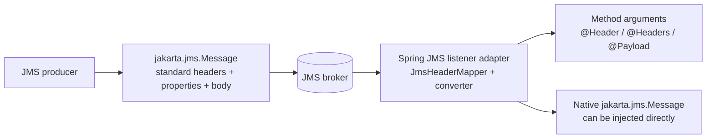

# Reading Headers with @Header and @Headers in Spring JMS

> **Module:** Spring Framework – JMS · **Knowledge Group:** Listener Data.  
> **Goal:** Use `@Header` to extract **a single metadata value** and `@Headers` to extract **the full header map mapped by Spring** in a `@JmsListener` method. Understand **standard JMS headers**, **JMS message properties**, **Spring Messaging headers**, `JmsHeaders` constants, missing values, data types, a send–receive example on ActiveMQ Artemis, and testing strategies. Examples use **Java 21, Spring Boot 3.3.5, Spring Framework 6.1, and Jakarta Messaging**.

## 1. When a Listener Needs More Than the Payload

Suppose a producer sends the body:

```text
order:ORD-42
```

The receiver also needs to know:

- `eventType`: is the message really an `OrderCreated` event?
- `tenantId`: which customer/tenant owns the data?
- `attempt`: the producer's attempt count, **if the producer actually set this property**.
- `JMSCorrelationID`: identifier for correlating logs/traces or request/reply.
- `JMSMessageID`: ID assigned by the JMS provider to the message for investigation.
- `JMSRedelivered`: whether the message has the redelivery flag set.

Without reading metadata, the listener only sees the body string and would have to embed operational details into the payload; this makes selectors, tracing, and compatibility policies hard to control.

Spring provides two annotations **on method parameters**:

```java
@JmsListener(destination = "orders.incoming")
public void handle(
        String payload,
        @Header("eventType") String eventType,
        @Headers Map<String, Object> headers) {
    // ...
}
```

This is a **fragment** to place inside a Spring-managed component with JMS configured. Imports:

```java
import java.util.Map;
import org.springframework.jms.annotation.JmsListener;
import org.springframework.messaging.handler.annotation.Header;
import org.springframework.messaging.handler.annotation.Headers;
```

The `@Header` and `@Headers` annotations belong to **`org.springframework.messaging.handler.annotation`** (Spring Messaging), not Jakarta JMS, Spring MVC `@RequestHeader`, or `@RequestParam`. They work via `@JmsListener`'s **argument resolution infrastructure**.

## 2. Distinguishing Three "Header" Concepts

Within the same JMS flow there are three sources of metadata:

| Layer | Example | Who creates/sets it? | How to read in listener |
| --- | --- | --- | --- |
| **Standard JMS header** | `JMSCorrelationID`, `JMSMessageID`, `JMSPriority`, `JMSType`, `JMSRedelivered` | Application or JMS provider, depending on field | `@Header(JmsHeaders.CORRELATION_ID)`, `@Headers`, or raw `jakarta.jms.Message` getter |
| **JMS message property** | `eventType`, `tenantId`, `attempt` | Producer sets via `setStringProperty`, `setIntProperty`, etc. | `@Header("eventType")`, `@Headers`, or raw `getObjectProperty` |
| **Spring Messaging header** | `id`, `timestamp`, mapped `jms_*` names | Spring Messaging/message mapper | `@Headers Map`, `org.springframework.messaging.Message<?>` |



**Important:** JSON inside a `TextMessage` body **does not automatically become headers**. If the body contains `{"eventType":"OrderCreated"}` but the producer **did not** call `message.setStringProperty("eventType",...)`, then `@Header("eventType")` cannot read it from JMS properties.

A `MapMessage` is a **JMS body** type, not the header map that `@Headers` receives. Both appear as `Map` in Java, yet their meanings are completely different.

### 2.1. Standard Headers Differ from Message Properties

Standard JMS headers have their own API:

```java
// Fragment: jakarta.jms.Message jmsMessage is available.
jmsMessage.setJMSCorrelationID("corr-ORD-42");
jmsMessage.setJMSType("OrderCreated");
```

Message properties have a different API:

```java
jmsMessage.setStringProperty("eventType", "OrderCreated");
jmsMessage.setStringProperty("tenantId", "store-a");
jmsMessage.setIntProperty("attempt", 1);
```

`JMSCorrelationID` is a standard JMS header; `eventType` is a user-defined JMS property. Do not create a property named `"JMSCorrelationID"` expecting it to be treated as the standard header. Both ways of storing metadata can coexist, but they do not share the same semantics.

## 3. `@Header`: Extracting One Metadata Value by Name

Syntax:

```java
@Header("eventType") String eventType
```

or equivalently:

```java
@Header(name = "eventType") String eventType
```

Spring looks up the value named `eventType` in the **mapped Spring Messaging headers** from the JMS message, then uses the conversion service if needed to fit the Java parameter.

### 3.1. Required by Default

`@Header` has `required=true` by default. Example:

```java
@JmsListener(destination = "orders.incoming")
public void handle(
        String body,
        @Header("eventType") String eventType) {
    System.out.println(eventType + ": " + body);
}
```

If `eventType` is missing from headers, argument resolution **may throw a missing-header error** before the method body executes. For listeners with a JMS local transaction, the exception may cause rollback/redelivery per container and broker policies. Therefore, mandatory business headers must be guaranteed by producer contracts and tested.

### 3.2. Optional Headers with `required=false`

```java
@Header(name = "tenantId", required = false) String tenantId
```

If the header is missing, a reference parameter can receive `null`. Example using the `Integer` wrapper for an optional numeric value:

```java
@Header(name = "attempt", required = false) Integer attempt
```

**Do not use primitive `int` for metadata that may be absent**, because `null` cannot be represented by a primitive. With a primitive and a missing header, Spring may fail when binding/converting; that is not a business value of 0.

### 3.3. Default Value Has Its Own Meaning

```java
@Header(name = "region", defaultValue = "GLOBAL") String region
```

If the header is absent or treated as having no value by resolver logic, Spring uses the fallback `GLOBAL`. Per the `@Header` API, specifying `defaultValue` implicitly sets `required=false`.

**Choosing between `required=false` and `defaultValue` is a business decision:**

- `required=false`: preserves the distinction between **missing metadata** and a valid value.
- `defaultValue="GLOBAL"`: proactively interprets "missing region" as `GLOBAL`. Only do this when the contract and migration allow it.
- `required=true`: a missing property is normally treated as an input error.

A header with an empty String `""` or number `0` **is not equivalent** to an absent header; do not conflate the two cases when handling them.

### 3.4. Parameter Type Must Be Compatible

If the producer calls:

```java
message.setIntProperty("attempt", 3);
```

then `@Header("attempt") Integer attempt` is the natural type. If the producer sets:

```java
message.setStringProperty("attempt", "3");
```

the Spring conversion service **may** convert the String into a number for the method argument, but you should not rely on that as the wire contract: JMS selectors compare types using their own rules, and a String value is not an `int` property. Agree on **property name + type + semantic unit** across producer and consumer.

## 4. `@Headers`: Reading the Combined Header Map

Syntax:

```java
@Headers Map<String, Object> headers
```

`@Headers` only applies to parameters **assignable to `java.util.Map`**. Do not use `@Headers List<String>` or `@Headers String` expecting an automatic list.

The map contents typically include:

- Standard JMS headers mapped to `JmsHeaders.*` names (e.g., `jms_correlationId`).
- JMS properties allowed by the mapper and copied into the header map (e.g., `eventType`, `tenantId`, `attempt`).
- Spring Messaging headers created/maintained by the framework (such as `id` and `timestamp`).

**Do not claim `@Headers` is a byte-for-byte complete copy of the JMS message.** Mapping depends on the `JmsHeaderMapper`/adapter and version; some fields may be absent, or value types may be `Destination`, `Integer`, `Long`, `Boolean` rather than `String`. The header map **does not contain the JMS body**.

Reading example:

```java
@JmsListener(destination = "orders.incoming")
public void onMessage(
        String body,
        @Headers Map<String, Object> allHeaders) {

    Object eventType = allHeaders.get("eventType");
    Object correlation = allHeaders.get(JmsHeaders.CORRELATION_ID);
    boolean hasTenant = allHeaders.containsKey("tenantId");

    System.out.println("eventType=" + eventType);
    System.out.println("correlation=" + correlation);
    System.out.println("hasTenant=" + hasTenant);
}
```

This fragment needs imports for `JmsHeaders`, `Map`, and the annotations. Use `containsKey` when you want to distinguish whether a **header appears in the map**; `get` returning null could mean a missing key or a null value. In Spring Messaging, headers normally do not hold null values as valid entries; nevertheless, application code should treat the map as read-only metadata and validate inputs.

**Do not mutate `allHeaders.put(...)`** to "send back" information to the broker: the map provided by the framework may be immutable, and even if mutable, it is not guaranteed to modify the raw JMS message. To emit outbound metadata, configure a producer/header mapper or construct a new outgoing message.

### Comparing Options

| Requirement | `@Header` | `@Headers` |
| --- | --- | --- |
| Read required `eventType` | Great fit: `@Header("eventType")` | Can use `get` but must validate manually |
| Read optional `tenantId` | `required=false` or `defaultValue` | `containsKey` + `get` |
| Read many unknown headers | Easily cluttered with many parameters | **Well suited** for inspection/triage |
| Depend on specific header names | Explicit and checkable in method signature | Dynamic key lookup |
| Limit data exposure in logs | Injects only what is needed | Must actively filter when logging since map may contain PII |
| Fully replace raw JMS API | No | **No**: map does not replace `jakarta.jms.Message` |

In regular business code, prefer **a few clear `@Header` parameters**; use `@Headers` when you need filtered diagnostic logging, generic metadata policy checks, or multi-property dispatching.

## 5. `JmsHeaders`: Standard Mapped Header Names

Spring Framework defines `org.springframework.jms.support.JmsHeaders`. This is a **set of name constants for Spring Messaging headers**, not an interface of `jakarta.jms.Message`.

| Constant | Header name in Spring Messaging | JMS source |
| --- | --- | --- |
| `JmsHeaders.CORRELATION_ID` | `jms_correlationId` | `getJMSCorrelationID()` |
| `JmsHeaders.MESSAGE_ID` | `jms_messageId` | `getJMSMessageID()` |
| `JmsHeaders.TYPE` | `jms_type` | `getJMSType()` |
| `JmsHeaders.DESTINATION` | `jms_destination` | `getJMSDestination()` |
| `JmsHeaders.REPLY_TO` | `jms_replyTo` | `getJMSReplyTo()` |
| `JmsHeaders.PRIORITY` | `jms_priority` | `getJMSPriority()` |
| `JmsHeaders.REDELIVERED` | `jms_redelivered` | `getJMSRedelivered()` |
| `JmsHeaders.TIMESTAMP` | `jms_timestamp` | `getJMSTimestamp()` |
| `JmsHeaders.DELIVERY_MODE` | `jms_deliveryMode` | `getJMSDeliveryMode()` |
| `JmsHeaders.EXPIRATION` | `jms_expiration` | `getJMSExpiration()` |

The text values of the constants above match Spring 6.1; **in Java code, use the constants instead of copying string literals** to avoid typos and reduce coupling to internal details.

Example reading correlation ID:

```java
@JmsListener(destination = "orders.incoming")
public void handle(
        String body,
        @Header(JmsHeaders.CORRELATION_ID) String correlationId) {
    System.out.println("corr=" + correlationId);
}
```

The native name **`JMSCorrelationID`** is not the Spring header name `jms_correlationId`; therefore, using `@Header("JMSCorrelationID")` and concluding the correlation ID is missing is a common mistake.

### `MessageHeaders.ID` Differs from `JmsHeaders.MESSAGE_ID`

Spring Messaging has `MessageHeaders.ID` (named `id`, usually a UUID managed by the Spring message abstraction), whereas the JMS provider assigns `JMSMessageID` and Spring maps it to `JmsHeaders.MESSAGE_ID` (`jms_messageId`).

**The two IDs serve two different layers.** To look up a message on the broker, use `JMSMessageID`; to prevent duplicate business processing, use a **stable business `eventId`** in the payload/property. Do not use Spring's `id` to query the broker or assume `JMSMessageID` stays identical across re-publishes.

Similarly, `MessageHeaders.TIMESTAMP` may be the Spring message's timestamp, not necessarily `JMSTimestamp`. If you need the JMS timestamp, use `JmsHeaders.TIMESTAMP` or `raw.getJMSTimestamp()`.

### Not Every JMS Header Is Actively Set by the Producer

Headers such as `JMSMessageID`, `JMSTimestamp`, `JMSDestination`, `JMSPriority`, and `JMSExpiration` are often determined by the JMS provider/send operation at different times. `SimpleJmsHeaderMapper` primarily puts these fields **into the map upon receiving**, without necessarily allowing you to force them in reverse from a Spring Message when sending.

For example, `JMSPriority` is governed by producer QoS at `send` time, rather than simply setting a `"jms_priority"` property and guaranteeing the broker prioritizes as desired.

## 6. Mapping Flow: From Raw JMS Message to Method Arguments

Spring Framework provides `SimpleJmsHeaderMapper`, which implements `JmsHeaderMapper`. It translates standard JMS headers to `JmsHeaders` names and copies valid user-defined JMS properties to Spring Messaging headers. `MessagingMessageConverter` combines a payload converter with a header mapper to populate a Spring Messaging `Message<?>`.

```text
JMS TextMessage:
  getText()                      -> String payload
  getJMSCorrelationID()          -> "corr-ORD-42"
  getJMSType()                   -> "OrderCreated"
  getObjectProperty("eventType") -> "OrderCreated"
  getObjectProperty("attempt")   -> Integer(1)

Spring Messaging Message<String>:
  payload = "order:ORD-42"
  headers:
    jms_correlationId = "corr-ORD-42"
    jms_type          = "OrderCreated"
    eventType         = "OrderCreated"
    attempt           = 1
    ... framework/provider metadata

@JmsListener method:
  @Payload String body                  = "order:ORD-42"
  @Header("eventType") String type       = "OrderCreated"
  @Header(JmsHeaders.CORRELATION_ID) cid = "corr-ORD-42"
  @Headers Map<String,Object> map       = mapped headers
```

This is an **expected diagram**, not a verbatim dump from Artemis or a promise that all headers are always present. If you customize `JmsHeaderMapper` or the message handler method factory, mapping names/directions and conversions may differ; inspect at runtime using `@Headers` and raw `Message`.

### Data That the Broker Does Not Automatically Map If Missing

- The JMS provider does not automatically know a business property `eventType` if the producer did not set it.
- `MessageConverter` mainly converts the body; technical metadata such as `_type` may be added by the converter during JSON conversion, but does not replace business JMS properties.
- `MessagePostProcessor` (an overload of `JmsTemplate.convertAndSend`) runs **after body conversion, before sending**, making it suitable for attaching producer headers/properties.

## 7. Three Ways to Read the Same Metadata in a Listener

### 7.1. Using @Header and @Headers (Primary Approach)

```java
@JmsListener(destination = "orders.incoming")
public void onEvent(
        @Payload String payload,
        @Header("eventType") String type,
        @Header(JmsHeaders.CORRELATION_ID) String correlation,
        @Headers Map<String, Object> headers) {
    // Read explicit fields + combined map.
}
```

Use when you need a few specific parameters while still wanting inspection capability.

### 7.2. Using Spring Messaging Message<T>

```java
@JmsListener(destination = "orders.incoming")
public void onEvent(org.springframework.messaging.Message<String> message) {
    String payload = message.getPayload();
    Object type = message.getHeaders().get("eventType");
    Object correlation =
            message.getHeaders().get(JmsHeaders.CORRELATION_ID);
}
```

This is an **alternative approach** for a listener on the same destination; do not register two identical consumers simultaneously on one queue just to read metadata. With `org.springframework.messaging.Message<T>`, headers and payload travel in one object, and you can use `JmsMessageHeaderAccessor.wrap(message)` to retrieve some JMS headers via typed getters.

Fragment showing the accessor:

```java
JmsMessageHeaderAccessor accessor =
        JmsMessageHeaderAccessor.wrap(message);
String correlation = accessor.getCorrelationId();
String messageId = accessor.getMessageId();
Boolean redelivered = accessor.getRedelivered();
```

The accessor class belongs to `org.springframework.jms.support.JmsMessageHeaderAccessor`. Getters may return `null` when a header is absent or unmapped. It is not a tool for directly creating or acknowledging JMS messages.

### 7.3. Injecting Raw JMS Message

```java
@JmsListener(destination = "orders.incoming")
public void onEvent(jakarta.jms.Message raw) throws JMSException {
    String correlation = raw.getJMSCorrelationID();
    String messageId = raw.getJMSMessageID();
    String type = raw.getJMSType();

    boolean exists = raw.propertyExists("tenantId");
    Object tenant = raw.getObjectProperty("tenantId");
}
```

Fragment requires `import jakarta.jms.JMSException`. Use the raw JMS API when you need to check provider-specific properties, `JMSXDeliveryCount` if supported by the broker, destination type, bytes body, or a header omitted by the mapper. **Do not retain the raw `Message` beyond the callback duration and do not manually close a container-managed `Session`.**

These three reading styles **are not three independent message streams**. In many situations, one listener method can combine `@Header`, `@Headers`, and raw `Message` to cross-check metadata.

## 8. Runnable Example: Java 21 + Spring Boot 3.3.5 + Artemis

We build a single project consisting of:

- A `JmsTemplate` producer sending two `TextMessage` instances with the same `eventType`.
- The first message includes `tenantId` and `attempt`.
- The second message **intentionally omits** the two optional properties.
- The listener receives `@Payload`, two required `@Header` parameters, two `@Header(required=false)` parameters, and `@Headers Map`; it also cross-checks `JMSCorrelationID` using raw `Message`.

**Prerequisites to run:** JDK 21, compatible Gradle wrapper, and an ActiveMQ Artemis broker **running separately** at `tcp://localhost:61616`. The broker needs queue `demo.headers.orders` (ANYCAST) and send/consume ACLs; if auto-create is enabled it can be created automatically, though the app does not guarantee every broker auto-provisions queues. The example uses `artemis/artemis` for local testing only.

### 8.1. Gradle

`settings.gradle`:

```groovy
rootProject.name = 'jms-header-arguments-demo'
```

`build.gradle`:

```groovy
plugins {
    id 'java'
    id 'org.springframework.boot' version '3.3.5'
    id 'io.spring.dependency-management' version '1.1.6'
}

group = 'com.example'
version = '0.0.1-SNAPSHOT'

java {
    toolchain {
        languageVersion = JavaLanguageVersion.of(21)
    }
}

repositories { mavenCentral() }

dependencies {
    implementation 'org.springframework.boot:spring-boot-starter'
    implementation 'org.springframework.boot:spring-boot-starter-artemis'
    testImplementation 'org.springframework.boot:spring-boot-starter-test'
}

tasks.named('test') { useJUnitPlatform() }
```

`src/main/resources/application.yml`:

```yaml
spring:
  artemis:
    mode: native
    broker-url: ${JMS_BROKER_URL:tcp://localhost:61616}
    user: ${JMS_USER:artemis}
    password: ${JMS_PASSWORD:artemis}
  jms:
    pub-sub-domain: false

logging:
  level:
    org.springframework.jms: INFO
```

`pub-sub-domain=false` selects queues. Spring Boot auto-configures `ConnectionFactory`, `JmsTemplate`, and the listener container factory when the JMS starter is present, a valid provider exists, and the application does not override them. `@EnableJms` is declared explicitly in this learning app.

### 8.2. Complete Java Source

Create `src/main/java/com/example/jms/JmsHeaderDemoApplication.java`:

```java
package com.example.jms;

import java.util.Map;
import java.util.Objects;

import jakarta.jms.JMSException;

import org.springframework.boot.ApplicationRunner;
import org.springframework.boot.SpringApplication;
import org.springframework.boot.autoconfigure.SpringBootApplication;
import org.springframework.context.annotation.Bean;
import org.springframework.jms.annotation.EnableJms;
import org.springframework.jms.annotation.JmsListener;
import org.springframework.jms.core.JmsTemplate;
import org.springframework.jms.support.JmsHeaders;
import org.springframework.messaging.handler.annotation.Header;
import org.springframework.messaging.handler.annotation.Headers;
import org.springframework.messaging.handler.annotation.Payload;
import org.springframework.stereotype.Component;

@SpringBootApplication
@EnableJms
public class JmsHeaderDemoApplication {

    public static void main(String[] args) {
        SpringApplication.run(JmsHeaderDemoApplication.class, args);
    }

    @Bean
    ApplicationRunner publishTwoOrders(JmsTemplate template) {
        return args -> {
            send(template, "order:ORD-42",
                    "corr-ORD-42", "store-a", 1);
            send(template, "order:ORD-43",
                    "corr-ORD-43", null, null);
        };
    }

    private static void send(
            JmsTemplate template,
            String payload,
            String correlation,
            String tenantId,
            Integer attempt) {

        template.convertAndSend(
                "demo.headers.orders",
                payload,
                message -> {
                    // User-defined JMS properties:
                    message.setStringProperty(
                            "eventType", "OrderCreated");

                    if (tenantId != null) {
                        message.setStringProperty(
                                "tenantId", tenantId);
                    }
                    if (attempt != null) {
                        message.setIntProperty(
                                "attempt", attempt);
                    }

                    // Standard JMS headers:
                    message.setJMSCorrelationID(correlation);
                    message.setJMSType("OrderCreated");
                    return message;
                });
    }
}

@Component
class OrderHeaderListener {

    @JmsListener(
            destination = "demo.headers.orders",
            selector = "eventType = 'OrderCreated'")
    public void onOrder(
            @Payload String payload,
            @Header("eventType") String eventType,
            @Header(JmsHeaders.CORRELATION_ID) String correlation,
            @Header(JmsHeaders.TYPE) String jmsType,
            @Header(name = "tenantId", required = false)
                    String tenantId,
            @Header(name = "attempt", required = false)
                    Integer attempt,
            @Headers Map<String, Object> allHeaders,
            jakarta.jms.Message raw) throws JMSException {

        // Cross-check the same header via Spring mapping and JMS API.
        if (!Objects.equals(
                correlation, raw.getJMSCorrelationID())) {
            throw new IllegalStateException(
                    "JMS correlation ID mapping mismatch");
        }

        String tenantText =
                tenantId == null ? "<missing>" : tenantId;
        String attemptText =
                attempt == null ? "<missing>" : attempt.toString();

        System.out.printf(
                "ORDER payload=%s event=%s corr=%s type=%s"
                + " tenant=%s attempt=%s%n",
                payload, eventType, correlation,
                jmsType, tenantText, attemptText);

        System.out.printf(
                "MAP event=%s corr=%s hasTenant=%s%n",
                allHeaders.get("eventType"),
                allHeaders.get(JmsHeaders.CORRELATION_ID),
                allHeaders.containsKey("tenantId"));
    }
}
```

### 8.3. Code Explanation

1. `@SpringBootApplication` scans `OrderHeaderListener` in package `com.example.jms`; `@EnableJms` enables annotated listeners.
2. `ApplicationRunner` sends two String payloads via `JmsTemplate.convertAndSend`; by default `SimpleMessageConverter` converts Strings into JMS `TextMessage` instances.
3. `MessagePostProcessor` (the third-parameter lambda) attaches `eventType` via `setStringProperty`, `attempt` via `setIntProperty`, and standard JMS headers via `setJMSCorrelationID`/`setJMSType`.
4. For ORD-43, the conditional branches **do not call setters** for `tenantId` and `attempt`; both properties are genuinely **absent**, not the String `"null"`, `false`, or `0`.
5. The listener only receives messages with JMS property `eventType = 'OrderCreated'`. The selector does not read the body.
6. `@Payload String payload` extracts message content. `@Header("eventType")` extracts the required property; `@Header(JmsHeaders.CORRELATION_ID)` and `@Header(JmsHeaders.TYPE)` extract mapped JMS headers.
7. The two `required=false` parameters receive `null` if optional properties are absent; `Integer` is used instead of primitive `int` so missing values can be represented.
8. `@Headers Map<String,Object>` holds mapped headers; here it reads `eventType`, correlation, and checks `containsKey("tenantId")`.
9. `jakarta.jms.Message raw` allows direct comparison against `getJMSCorrelationID()`. Do not use the raw message from another thread.
10. If correlation ID mapping is wrong or missing, the code throws an exception; transaction/ACK and redelivery are decided by the listener factory and broker.

**Accuracy note:** `@Headers` may also contain `jms_messageId`, `jms_priority`, `jms_redelivered`, `id`, `timestamp`, etc.; the demo prints only three known values to avoid depending on provider IDs/timing.

### 8.4. Running and Expected Output

Assuming the broker is running, the queue is valid, credentials are correct, and the project has the Gradle wrapper:

```bash
# Linux/macOS
./gradlew bootRun

# Windows
gradlew.bat bootRun
```

Two messages are sent after application startup. On a clean test broker, the **four expected business lines** (two pairs of lines; the order of pairs is not a contract) are:

```text
ORDER payload=order:ORD-42 event=OrderCreated corr=corr-ORD-42 type=OrderCreated tenant=store-a attempt=1
MAP event=OrderCreated corr=corr-ORD-42 hasTenant=true
ORDER payload=order:ORD-43 event=OrderCreated corr=corr-ORD-43 type=OrderCreated tenant=<missing> attempt=<missing>
MAP event=OrderCreated corr=corr-ORD-43 hasTenant=false
```

This is **not the full stdout**; Spring Boot also logs startup messages, message IDs/timestamps, and provider logs. Consumer threads may vary delivery/processing order. If the queue still holds old messages, if you ran the demo previously, or if the broker is down, the observed lines may differ.

### 8.5. Why Didn't the Example Use a JSON DTO?

The lesson's goal is **reading headers**, so the body is intentionally a String to avoid depending on a Jackson serializer, type ID mapping, and JSON schema. When switching to a DTO, `@Header`/`@Headers` can still be used in the exact same way, but a JMS converter must be registered on both the producer and listener factory so the DTO is decoded properly.

Do not confuse `@Headers Map` with a JSON DTO map. Metadata and payload have separate **lifecycles, type rules, and validation**.

## 9. When Optional Headers Must Be Checked

Some metadata might not yet be sent by an older producer (migrating schema), or may be assigned by the JMS provider after sending. There are three sensible approaches:

| Goal | Implementation | Meaning |
| --- | --- | --- |
| Missing is a contract error | `@Header("eventType") String` | Default `required=true`; listener will not run business method if binding fails |
| Missing must be observed separately | `@Header(name="tenantId", required=false) String` | Java value can be `null` |
| Missing has an explicit default | `@Header(name="region", defaultValue="GLOBAL") String` | Supplies default per business rule |
| Unknown set of headers ahead of time | `@Headers Map<String,Object>` | Iterate/map with validation/allowlist |
| Must confirm property exists at JMS API level | `raw.propertyExists("tenantId")` | Distinguishes property missing at broker from payload or binding |

**Easily misunderstood case:** `@Headers Map` is the set of headers **after mapping**, whereas `raw.propertyExists("tenantId")` inspects the raw JMS property directly. If a custom mapper actively filters out `tenantId`, the map may omit it even though the JMS message carries the property. Therefore, when debugging, compare both layers rather than concluding the producer failed to set metadata.

### Missing Property Test Matrix

| Raw JMS message | `@Header(required=true)` | `@Header(required=false)` | `@Headers Map` |
| --- | --- | --- | --- |
| Has `tenantId="store-a"` | `store-a` | `store-a` | Usually has key `tenantId` |
| Missing `tenantId` | Parameter binding error if required | `null` | No `tenantId` key in normal mapping |
| Has `tenantId=""` | Empty string | Empty string | Key exists, value is empty String |
| Has `attempt=0` of type int | `Integer(0)` when parameter compatible | `Integer(0)` | Key exists, value 0 |
| Missing `attempt` | Error if required | `null` for `Integer` | Key absent |
| Has String `attempt="3"` | May convert to Integer | May convert; do not treat as proper wire type | Map keeps metadata per converter/mapper |

If you must keep "missing" distinct from "0", always use wrappers or explicit `containsKey`/`propertyExists`.

## 10. Differences Between @Header and a JMS Selector

Both mechanisms involve metadata, but they execute at **two different times**:

```text
Broker / JMS provider evaluates SELECTOR
   -> only delivers message to consumer if selector matches
   -> Spring header mapper builds Spring Messaging headers
   -> Spring @Header / @Headers resolve method arguments
   -> business method runs
```

Example:

```java
@JmsListener(
    destination = "orders.incoming",
    selector = "eventType = 'OrderCreated'")
public void receive(
        @Payload String body,
        @Header("eventType") String eventType) {
    // Runs only after the message satisfies the selector.
}
```

If the producer **forgets to set the JMS property** `eventType`, the selector usually evaluates to `UNKNOWN` due to the missing property → the message **does not match**. In that case, the listener method **is not invoked**, so **no `@Header(required=true)` exception occurs either**. To catch metadata errors, you need producer contract tests, broker monitoring, and/or an appropriate validation/quarantine flow. Do not rely solely on exceptions in a listener that already has a selector.

### Names and Types Also Matter

- Property `eventType` differs from `EventType`.
- `attempt` of type `int` differs from String `"1"` for a numeric selector `attempt > 0`.
- `@Header` can use the Spring conversion service during Java binding, but a JMS selector **does not automatically** convert Strings to numbers.
- A missing property, a property with an empty String, and a property with Boolean false are three distinct cases.
- `@Headers` map does not make a selector see inside a JSON body: the producer must set properties for the broker to evaluate.

## 11. JMS Headers and Spring Messaging Headers That Easily Collide in Name

### 11.1. `JMSCorrelationID`

JMS API:

```java
message.setJMSCorrelationID("corr-ORD-42");
```

Spring listener:

```java
@Header(JmsHeaders.CORRELATION_ID) String correlationId
```

`JmsHeaders.CORRELATION_ID` has value `"jms_correlationId"`. This is the key to use in Spring Messaging headers. Another key named `"correlationId"` in a Spring Integration system **is not necessarily** identical to `JMSCorrelationID`. To correlate request–reply messages, establish a clear contract and pass the appropriate ID via the JMS header.

### 11.2. `JMSMessageID`

`JMSMessageID` is typically generated by the JMS provider when sending. In Spring:

```java
@Header(name = JmsHeaders.MESSAGE_ID, required = false)
String jmsMessageId
```

`JmsHeaders.MESSAGE_ID` is not `MessageHeaders.ID`. When the provider generates `JMSMessageID` is a send/provider detail; do not set `JMSMessageID` on a Java object and promise the broker will preserve it.

### 11.3. `JMSPriority`

When reading, you can use:

```java
@Header(name = JmsHeaders.PRIORITY, required = false)
Integer priority
```

However, to **send** with a specific priority, configure QoS on `JmsTemplate`/the producer:

```java
// Fragment for a dedicated JmsTemplate with a ConnectionFactory.
template.setExplicitQosEnabled(true);
template.setPriority(8);
```

Do not simply create a custom property `priority=8` and assume the JMS provider dispatches the message with `JMSPriority=8`.

### 11.4. `JMSRedelivered`

The Spring header `JmsHeaders.REDELIVERED` typically maps the `JMSRedelivered` flag. It has a Boolean value when mapped by the provider. This flag is an **indicator that the message may have been redelivered**, not a complete transaction log; to see delivery counts, check `JMSXDeliveryCount` if provided and supported by the provider. **Do not use this flag in place of an idempotency key**, because producer duplicates can still occur outside JMS redelivery.

### 11.5. `JMSReplyTo`

`JMSReplyTo` is a `jakarta.jms.Destination`, not always a String queue name. If you use:

```java
@Header(name = JmsHeaders.REPLY_TO, required = false)
jakarta.jms.Destination replyTo
```

you must check for null, broker behavior, and policies before sending a reply. For request–reply, `JMSCorrelationID` and `JMSReplyTo` play different roles: one matches responses, while the other specifies where to send the response.

## 12. Testing Header Mapping and Listeners

You can test at multiple layers, because a test invoking the business method directly **does not prove** Spring resolved annotations properly.

### 12.1. Unit Tests for Logic Using Metadata

Extract business header validation into a pure function:

```java
package com.example.jms;

public final class OrderHeaderPolicy {

    private OrderHeaderPolicy() {
    }

    public static String normalizedTenant(String tenantId) {
        if (tenantId == null || tenantId.isBlank()) {
            return "<missing>";
        }
        return tenantId.trim();
    }

    public static boolean shouldRetry(Integer attempt) {
        return attempt != null && attempt > 0 && attempt < 3;
    }
}
```

This is a **standalone Java class** in the project; `normalizedTenant` is only for **display/diagnostics**, not for approving messages missing `tenantId` to write multi-tenant data. In multi-tenant workflows, a missing tenant ID should usually be a strict contract error.

Java 21 + JUnit 5 unit test:

```java
package com.example.jms;

import org.junit.jupiter.api.Test;

import static org.junit.jupiter.api.Assertions.*;

class OrderHeaderPolicyTest {

    @Test
    void distinguishesMissingFromPresent() {
        assertEquals("<missing>",
                OrderHeaderPolicy.normalizedTenant(null));
        assertEquals("store-a",
                OrderHeaderPolicy.normalizedTenant(" store-a "));
        assertFalse(OrderHeaderPolicy.shouldRetry(null));
        assertFalse(OrderHeaderPolicy.shouldRetry(0));
        assertTrue(OrderHeaderPolicy.shouldRetry(1));
        assertFalse(OrderHeaderPolicy.shouldRetry(3));
    }
}
```

Save the files respectively:
- `src/main/java/com/example/jms/OrderHeaderPolicy.java`
- `src/test/java/com/example/jms/OrderHeaderPolicyTest.java`

Run with JDK and Gradle wrapper available:

```bash
./gradlew test
```

This test verifies the **business function**, not `@Header`, the JMS header mapper, the broker, or the listener container. The `OrderHeaderPolicy`/test files **are optional additions** to the demo project and do not alter the send/receive program in section 8.

### 12.2. Integration Tests with a JMS Broker

On a test Artemis instance:

1. Provision queue `demo.headers.orders` or enable auto-create in an isolated namespace.
2. Start the application; if running repeatedly, properly clean test data or use distinct queue names to avoid stale backlogs.
3. Send a message with all properties; verify `@Header("eventType")`, `@Header(JmsHeaders.CORRELATION_ID)`, and `@Headers` hold values per contract.
4. Send a message missing `tenantId`/`attempt`; verify both `required=false` parameters receive null and `@Headers` does not contain those keys.
5. Send a message with `tenantId=""`; verify it differs from missing and appears in the map.
6. Send a message with `attempt=0` as an int; verify it is not treated as missing.
7. Send a message with a wrong `eventType`; verify the selector does not deliver it to the listener, and inspect the message on the broker.
8. Send a message missing `eventType` on a test queue; the selector does not match, do not expect a `@Header` exception; handle backlog/expiry per broker policy.
9. Trigger an exception in the handler with a JMS transaction; observe redelivery and DLQ.
10. Compare `@Header(JmsHeaders.CORRELATION_ID)` with raw `getJMSCorrelationID()`; if using a custom mapper, check for filtered/renamed fields.
11. Verify shutdown and resource cleanup; do not retain the raw JMS Message after the callback.

### 12.3. Why Not Snapshot All Header Keys?

The `@Headers` map may include `jms_messageId`, `jms_timestamp`, `id`, `timestamp`, and provider-added properties. These values can vary by broker, timestamp, retry attempt, and mapper configuration. Tests should assert **contract-relevant keys** and **data types**, rather than snapshotting the entire map as fixed text. Do not depend on `Map` iteration order.

## 13. Error Handling and Transactions Related to @Header

Errors occur across multiple layers:

| Layer | Example | Consequence |
| --- | --- | --- |
| **Broker selector** | Missing `eventType` so selector does not match | Listener is not invoked; message may remain in queue |
| **Header mapping** | Custom mapper drops property or renames it | `@Header` cannot find the value |
| **Argument binding** | Required header absent or value cannot convert to Java type | Handler does not receive arguments; Spring throws exception |
| **Business validation** | `tenantId=""` even though key exists | Risk of processing the wrong tenant if unvalidated |
| **Listener processing** | DB timeout after valid headers | Exception in handler; transaction/retry depends on container |

In a transacted listener, an unhandled exception typically causes JMS session rollback and broker redelivery per policy. If a message **permanently** lacks a required header, infinite retries will not fix it; you need a **redelivery limit**, DLQ/quarantine, and alerts. Avoid catching the exception and returning normally, which could cause the container to ACK/commit a failed message depending on configuration.

**When receiving messages from multiple applications:** a header from a producer is not by itself proof of identity. `tenantId` in a JMS property must be verified against authorization context and schema policies; do not trust that simply because a sender wrote `tenantId=store-a`, the receiver is authorized to write store-a data.

### Correlation ID and Idempotency

- `JMSCorrelationID` is typically tied to request/reply or a logical trace; it may be reused across multiple messages in a workflow.
- `JMSMessageID` is a transport ID; retries/re-publishes can generate a new ID.
- A business `eventId` is a better deduplication key if kept stable for the same event.
- `JMSRedelivered` and `JMSXDeliveryCount` are useful for monitoring, but do not prevent producer-side duplicates.

Use the outbox pattern to reduce the risk of a DB commit without sending the message, and an idempotent consumer to prevent duplicate side effects under uncertain delivery. `@Header` only reads metadata; it does not provide exactly-once semantics on its own.

## 14. Common Mistakes

| Mistake | Symptom | Fix |
| --- | --- | --- |
| Importing `@Header` from another framework | Method fails to bind JMS header | Use `org.springframework.messaging.handler.annotation.Header` |
| Using `@Headers String` | Spring rejects parameter type | Use `@Headers Map<String,Object>` |
| Reading `@Header("JMSCorrelationID")` | Missing header even when raw `getJMSCorrelationID()` has a value | Use `@Header(JmsHeaders.CORRELATION_ID)` |
| Taking `MessageHeaders.ID` as `JMSMessageID` | Cannot find message by ID on broker | Use `JmsHeaders.MESSAGE_ID` |
| Forgetting to set `eventType` property, only having field in JSON body | Selector does not match, `@Header` not called | Call `message.setStringProperty("eventType", ...)` |
| Required header omitted by legacy producer | Listener argument resolution fails | Fix producer/contract or use `required=false` + validation/migration |
| Using `int` for a potentially missing header | Binding error or null cannot be represented | Use `Integer` or an intentional default |
| Ignoring typed properties | String `"3"` differs from int `3` on the wire | Use `setIntProperty` and type-checking tests |
| Logging `@Headers` via full `toString()` | Leaks PII, tokens, IDs, huge logs | Allowlist keys, mask sensitive data |
| Calling `headers.put` to edit JMS message | Map is immutable or does not affect broker | Construct outgoing message/post-processor properly |
| Treating `@Headers` as raw `MapMessage` body | Logic processes wrong schema | Separate JMS body from Spring mapped headers |
| Expecting `jms_priority` property to control QoS automatically | Broker does not alter delivery priority | Configure `JmsTemplate` QoS/producer API |
| Two consumers on one queue expecting each gets a copy | Queue distributes competitively | Use Topic/subscriptions/fan-out if broadcast is needed |
| Treating `JMSRedelivered=false` as guaranteed non-duplicate | Producer may send duplicate messages | Use Event ID and idempotency |
| Message with header error redelivered infinitely | Permanent errors not distinguished from transient ones | DLQ/quarantine + alerts and retry limits |
| Using `javax.jms` on Spring Boot 3.x | Compile errors/Jakarta mismatch | Use `jakarta.jms` |
| Snapshotting the full map as a contract | Fails when provider adds message ID/timestamp | Assert subset of contract headers |

## 15. Practical Project Checklist

- **Producer contract:** JMS property names, wire types (`String`, `int`, `boolean`, etc.), required/optional, correlation policy.
- **Listener method:** use `@Header` for key fields; `required=false` or `defaultValue` per business rules; `@Headers Map` only when full inspection is needed.
- **Standard JMS headers:** use `JmsHeaders.*` constants; do not guess raw field names.
- **Validation:** check missing, null, blank, wrong type, valid enum/tenant; do not confuse conversion with authorization.
- **Observability:** log allowlisted metadata + eventId/correlation, mask PII/secrets, never dump the entire map.
- **Testing:** unit-test business logic separately, integration-test argument resolution, broker header mapping, and selector cases.
- **Reliability:** transactions, redelivery, DLQ, outbox, idempotency; do not treat `@Header` binding success as processing completion.
- **Version compatibility:** when adding new headers, check older consumers and choose optional/required intentionally.
- **Operations:** monitor queue depth, consumer count, filter mismatches, retries/DLQ; do not mutate existing messages by arbitrarily changing annotations.

## 16. Self-Check Questions

1. Which package do `@Header` and `@Headers` in `@JmsListener` belong to? How do they differ from Spring MVC `@RequestHeader`?
2. Compare the standard JMS header `JMSCorrelationID` with the JMS property `eventType`. How does a producer set each?
3. Which key in Spring Messaging headers does `@Header(JmsHeaders.CORRELATION_ID)` read? Why can `@Header("JMSCorrelationID")` fail?
4. Does `@Headers Map<String,Object>` contain the JSON body? Can it completely replace raw `jakarta.jms.Message`?
5. What does `@Header(required=true)` do when a required property is absent? If the listener has a selector filtering the message out first, does that exception occur?
6. How does using `required=false` differ from `defaultValue` regarding the meaning of missing data?
7. Why is an `Integer` parameter better than `int` for `attempt` when it may be absent?
8. Why is `MessageHeaders.ID` not the same as `JmsHeaders.MESSAGE_ID`? Which ID should be used for business deduplication?
9. List at least three provider-managed standard JMS headers and how to read them safely.
10. Write a listener receiving `@Payload String`, `@Header("eventType")`, `@Header(JmsHeaders.CORRELATION_ID)`, and `@Headers Map`.
11. When `@Headers` map lacks a property yet raw `propertyExists` returns true, which layer should you inspect?
12. Modify the producer example to send `tenantId` only when non-null, then predict the results of `required=false` and `containsKey`.
13. Why are `setStringProperty("attempt","3")` and `setIntProperty("attempt",3)` not equivalent when using numeric selectors?
14. Why can logging the entire `@Headers` map pose a security risk even if the payload contains no sensitive information?
15. If a message missing `eventType` is constantly redelivered when the listener uses a required header, what retry/DLQ solution is appropriate?
16. How many test types are needed to prove `@Header` binding, `@Headers` mapping, selectors, and the real broker work properly?

**Remember:** **`@Header` reads one metadata entry by key, `@Headers` reads the Spring-mapped metadata map**. Always distinguish **standard JMS headers**, **JMS properties**, and **Spring Messaging headers**; use `JmsHeaders.*` for standard JMS fields, typed properties for custom metadata, and handle missing values explicitly. Alongside accurate mapping, systems also need validation, broker/selector testing, security, and processing reliability.

### Official References

- [Spring Framework – Annotation-driven Listener Endpoints](https://docs.spring.io/spring-framework/reference/integration/jms/annotated.html) — `@JmsListener` signatures, `@Header`, `@Headers`, raw JMS Message, and Spring Messaging Message.
- [Spring Framework 6.1 – Header annotation](https://docs.spring.io/spring-framework/docs/6.1.x/javadoc-api/org/springframework/messaging/handler/annotation/Header.html) — `name`, `required`, `defaultValue`.
- [Spring Framework 6.1 – Headers annotation](https://docs.spring.io/spring-framework/docs/6.1.x/javadoc-api/org/springframework/messaging/handler/annotation/Headers.html) — Map-based argument.
- [Spring Framework 6.1 – JmsHeaders](https://docs.spring.io/spring-framework/docs/6.1.x/javadoc-api/org/springframework/jms/support/JmsHeaders.html) — `jms_*` constants.
- [Spring Framework 6.1 – SimpleJmsHeaderMapper](https://docs.spring.io/spring-framework/docs/6.1.x/javadoc-api/org/springframework/jms/support/SimpleJmsHeaderMapper.html) — header mapping between JMS Message and Spring Messaging.
- [Spring Framework 6.1 – JmsMessageHeaderAccessor](https://docs.spring.io/spring-framework/docs/6.1.x/javadoc-api/org/springframework/jms/support/JmsMessageHeaderAccessor.html) — typed getters for standard JMS headers.
- [Spring Framework – Sending a Message](https://docs.spring.io/spring-framework/reference/integration/jms/sending.html) — `JmsTemplate.convertAndSend` and `MessagePostProcessor`.
- [Jakarta Messaging 3.1 Specification](https://jakarta.ee/specifications/messaging/3.1/jakarta-messaging-spec-3.1.html) — standard JMS headers, properties, selectors, and message types.
- [Spring Boot 3.3 Reference – Messaging](https://docs.spring.io/spring-boot/docs/3.3.0-M1/reference/pdf/spring-boot-reference.pdf) — JMS configuration, `JmsTemplate`, and annotated listener factory.
