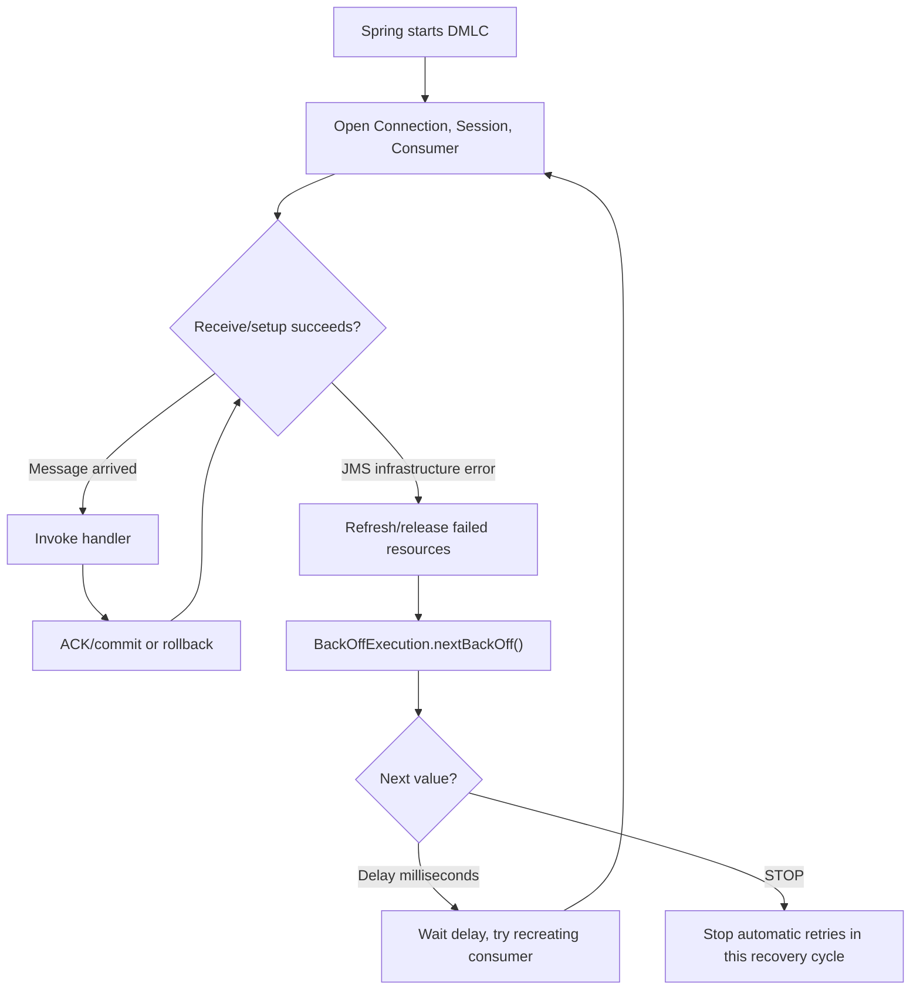

# Connection Recovery Using recoveryInterval or BackOff in Spring JMS

> **Group:** Default container · **Module:** Spring Framework – JMS.  
> This lesson focuses on `DefaultMessageListenerContainer` (DMLC)'s connection, session, and consumer recovery mechanism; comparing `setRecoveryInterval(long)` with `setBackOff(BackOff)`; configuring for `@JmsListener` and Spring Boot 3.3.5; and verifying when an ActiveMQ Artemis broker stops and comes back up. Examples use **Java 21**, Spring Framework 6.1, Jakarta JMS, and Gradle.

## 1. Problem: Listeners Must Not Be Left Dead After a Broker Outage

An application receiving orders over JMS:

```java
@Component
class OrderConsumer {
    @JmsListener(destination = "orders.recovery.demo")
    public void receive(String id) {
        System.out.println("RECEIVED " + id);
    }
}
```

This is a **fragment**, requiring a Spring Boot/Spring Framework application with JMS infrastructure, a broker, and a queue. Normally the listener receives messages; however, the broker may restart, the network may drop, connections may expire, failover to a new node may happen, or the Spring application may deploy **before the broker is ready**.

If broken connections/sessions/consumers are not recovered, the queue can build up a backlog while the application stays running. `DefaultMessageListenerContainer` is designed to **establish/refresh JMS resources** and attempt recovery after eligible failures. It has a wait policy between attempts.

Two APIs to know:

```java
// Fragment: DefaultMessageListenerContainer container already exists.
container.setRecoveryInterval(5_000L);

// Or another option, do not use simultaneously:
container.setBackOff(backOff);
```

**First takeaway:** `recoveryInterval` and `BackOff` control **the schedule of listener infrastructure recovery attempts**, not directly business message retries, database transactions, or producer `JmsTemplate`.

## 2. How Does DefaultMessageListenerContainer Work?

DMLC belongs to `org.springframework.jms.listener.DefaultMessageListenerContainer`. It uses tasks/threads to receive JMS messages via a `MessageConsumer.receive()` loop and then invokes `MessageListener` or `@JmsListener` methods via an adapter. Do not confuse it with `SimpleMessageListenerContainer`, which uses provider callbacks via `setMessageListener()`.



This is a **conceptual diagram**, not an exact description of every syscall or callback sequence across all providers. DMLC can detect failures during initial listener setup or while receiving messages after running for a while.

DMLC helps handle **recoverable connection/setup/receive errors**, but does not automatically:

- Fix invalid username/password, ACLs, TLS certificates, or broker URLs.
- Provision a deleted physical queue on every JMS broker.
- Recreate expired, non-persistent, or broker-purged messages.
- Guarantee exactly-once business side effects.
- Apply the same retry policy to producer `JmsTemplate.convertAndSend`.

### 2.1. Container vs. Factory

| Component | Role |
| --- | --- |
| `DefaultMessageListenerContainer` | **Actual** container holding lifecycle and performing recovery. |
| `DefaultJmsListenerContainerFactory` | Creates/configures DMLCs for `@JmsListener` endpoints. |
| `JmsListenerEndpointRegistry` | Manages containers spawned via annotation/endpoint infrastructure. |
| `ConnectionFactory` | Provider entry point for creating connections; may itself have failover/reconnect policies. |
| `JmsTemplate` | Synchronous JMS send or receive called by producer code; does not use DMLC `BackOff`. |

When using `@JmsListener`, normally configure the **factory**, rather than looking for a `@Bean DefaultMessageListenerContainer` that annotations supposedly share. If creating a DMLC directly as its own bean, configure directly on the container.

## 3. recoveryInterval — Fixed Wait Between Attempts?

Spring Framework 6.1 sets the default `DefaultMessageListenerContainer.DEFAULT_RECOVERY_INTERVAL = 5000` **milliseconds** — i.e., 5 seconds. The default corresponds to DMLC's fixed backoff policy.

Explicit example:

```java
container.setRecoveryInterval(3_000L);  // 3 seconds
```

| `recoveryInterval` Value | Wait Interval |
| --- | --- |
| `1_000L` | 1 second |
| `3_000L` | 3 seconds |
| `5_000L` | 5 seconds (default) |
| `15_000L` | 15 seconds |
| `60_000L` | 60 seconds |

**Classic bug:** `setRecoveryInterval(5)` is **5 milliseconds**, not 5 seconds. An overly short interval can cause a reconnect storm, auth/broker overload, and log flooding.

This interval is **not** a TCP connect timeout or a recovery SLA. Each attempt may take time for DNS lookup, TLS handshake, socket connect, or provider failover; thus you cannot guarantee a successful connection every exact 3 seconds.

### 3.1. When to Use a Fixed Interval?

- Dev/test with a nearby broker and few service instances.
- Short typical outages needing steady, predictable retry cadence.
- The broker can tolerate connection opening rates proportional to total replicas.
- Want to avoid complex configuration.

With hundreds of replicas, synchronized fixed retries can cause a **thundering herd** when the broker restarts. Evaluate consumer count, retries, and capacity instead of defaulting to "retry as fast as possible".

## 4. BackOff — A Flexible Recovery Policy Model

`org.springframework.util.backoff.BackOff` is a Spring Core interface providing a `BackOffExecution` for each retry cycle:

```java
// Conceptual signature, do not redefine this interface:
BackOffExecution execution = backOff.start();
long delayMs = execution.nextBackOff();
```

`delayMs` can be a wait duration in **ms**, or `BackOffExecution.STOP`. Upon encountering `STOP`, DMLC **stops trying to auto-recover in that recovery execution**, per container contract.

```java
if (delayMs == BackOffExecution.STOP) {
    // Recovery schedule exhausted in this execution.
} else {
    // Spring container waits delayMs then retries.
}
```

This is an **API-illustrating fragment**; do not write `while(true)` and `Thread.sleep` inside a listener business method to implement recovery. DMLC coordinates threads, waits, and cleanup itself to integrate with shutdown.

### 4.1. Built-In Policies

- `FixedBackOff`: fixed wait; can be unlimited or attempt-limited.
- `ExponentialBackOff`: multiplies interval by a multiplier up to `maxInterval`, optionally bounded by attempts/elapsed time.
- Custom `BackOff`: if jitter, time windows, or custom policies are needed; test with multiple concurrent containers.

**BackOff is not Spring Retry.** DMLC `BackOff` throttles **receiving infrastructure**; it does not automatically retry business handlers, DB transactions, REST calls, or a failed `JmsTemplate.send`.

## 5. FixedBackOff — Explicit Configuration and Limits

Configure a fixed policy with unlimited attempts:

```java
import org.springframework.util.backoff.FixedBackOff;

container.setBackOff(
        new FixedBackOff(
                3_000L,
                FixedBackOff.UNLIMITED_ATTEMPTS));
```

Its practical meaning is close to `setRecoveryInterval(3_000L)`: 3-second delay and keep retrying while the container runs. `UNLIMITED_ATTEMPTS` only means the policy does not stop on its own; **it does not mean the service will inevitably reconnect successfully**.

To set a limit:

```java
FixedBackOff limited = new FixedBackOff(2_000L, 3L);
container.setBackOff(limited);
```

This policy returns three 2-second waits and then `STOP`:

```text
nextBackOff() = 2000
nextBackOff() = 2000
nextBackOff() = 2000
nextBackOff() = STOP
```

`maxAttempts` here controls **how many backoff intervals the execution supplies**; it is not a promise about total TCP connection attempts seen in logs, because the provider may also retry internally.

### When Are Limits Dangerous?

Suppose the broker undergoes 30 minutes of maintenance, yet the container halts recovery after three 2-second intervals. The broker coming back up later **does not prove** DMLC still has retries scheduled. The HTTP application may be alive while the listener leaves backlog unprocessed. If choosing finite attempts, you must have a clear **alert + restart/reinitialize runbook**.

For critical consumers that must survive long downtimes, a non-STOP policy or a sufficiently large limit with monitoring is usually safer than a short cap.

## 6. ExponentialBackOff — Growing Retry Intervals During Prolonged Outages

Spring Framework 6.1 includes `org.springframework.util.backoff.ExponentialBackOff`.

```java
import org.springframework.util.backoff.ExponentialBackOff;

ExponentialBackOff policy =
        new ExponentialBackOff(1_000L, 2.0);
policy.setMaxInterval(8_000L);

container.setBackOff(policy);
```

With an initial interval of 1 second, multiplier 2, and max interval 8 seconds:

| `nextBackOff()` Call | Wait Interval |
| --- | --- |
| 1 | 1,000 ms |
| 2 | 2,000 ms |
| 3 | 4,000 ms |
| 4 | 8,000 ms |
| 5 | 8,000 ms |
| Subsequent (unlimited) | Stays capped at 8,000 ms |

This typically reduces reconnect frequency when a broker stays down for a long time. However, a brief outage may recover more slowly than a fixed 1-second interval if the policy has already escalated to an 8-second delay.

### 6.1. Attempt and Elapsed Time Limits

Spring Framework 6.1 supports:

```java
ExponentialBackOff limited =
        new ExponentialBackOff(1_000L, 2.0);
limited.setMaxInterval(8_000L);
limited.setMaxAttempts(5);
limited.setMaxElapsedTime(30_000L);

container.setBackOff(limited);
```

Once either limit is reached, `nextBackOff()` may return `STOP`. `maxElapsedTime` is a bound on the **`BackOff` policy execution**, not a watchdog measuring exact wall-clock time the provider spends per connect attempt.

**Do not use low finite `maxAttempts` or `maxElapsedTime`** if the goal is surviving long maintenance outages without a restart procedure.

### 6.2. Is There Random Jitter by Default?

Spring Framework 6.1's `ExponentialBackOff` generates a sequence from multiplier/max interval and **must not be assumed to include random jitter by default**. With hundreds of synchronized pods, exponential backoff can still produce concentrated reconnect waves. If attempts need spreading, design a custom policy with jitter or use appropriate provider/orchestrator mechanisms; test under load to avoid causing a broker storm.

### 6.3. Quick Comparison Table

| Requirement | Fixed recovery interval | Exponential BackOff |
| --- | --- | --- |
| Easy to configure and observe | Very good | Moderate |
| Predictable retry cadence | Very good | Grows by multiplier |
| Short outage, few replicas | Suitable | Suitable |
| Long outage, many replicas | Can burn many attempts | Usually slows attempt rate |
| Cap delay | Fixed by nature | `setMaxInterval` |
| Stop after N tries | Finite `FixedBackOff` | `setMaxAttempts` |
| Random jitter | Needs custom/provider support | Needs custom/provider support |
| Never stop recovery | Unlimited attempts | Do not set early stopping limits |

There is no universal "best interval" for every broker. Choose the policy based on connection limits, SLOs, replica counts, outage durations, and failure modes.

## 7. An Easy Mistake: Setter Order and Precedence

On **`DefaultMessageListenerContainer` directly**:

- `setRecoveryInterval(ms)` replaces the current `BackOff` with a fixed interval.
- `setBackOff(policy)` sets a new policy.
- Therefore the setter called **last** can overwrite the intent of the earlier setter.

```java
container.setBackOff(new ExponentialBackOff(1_000L, 2.0));
container.setRecoveryInterval(5_000L);
// On direct DMLC: last setting wins, fixed 5000 ms.
```

On **`DefaultJmsListenerContainerFactory`**:

- The factory stores both `recoveryInterval` and `BackOff` settings.
- When creating the container, if `BackOff` is set, **`BackOff` takes precedence**, ignoring `recoveryInterval` and potentially logging a notice.

This difference between **direct container setters** and **factory container construction** easily misleads experiments across multiple config layers.

**Most maintainable rule:** specify **one** policy per factory/container, clearly documenting mode, units, and owner.

## 8. Connection Retries vs. Message Retries

A JMS system has at least four mechanisms commonly lumped together as "retry":

| Mechanism | Who Is Responsible | Purpose |
| --- | --- | --- |
| **JMS provider failover** | Artemis client/provider | Re-locating broker/node after transport errors |
| **DMLC recovery** | `DefaultMessageListenerContainer` | Recovering connection/session/consumer when setup/receive fails |
| **Message redelivery** | JMS transaction + broker policy | Redelivering a message when handler fails/rolls back or ACK is incomplete |
| **Producer retry** | `JmsTemplate` caller/outbox | Resending when send fails or send outcome is uncertain |
| **Downstream retry** | Business service/HTTP client | Retrying API/database dependencies |

DMLC's `setBackOff` **does not** retry a failed `JmsTemplate.convertAndSend`. Nor is it the broker's redelivery policy.

Handler example:

```java
@JmsListener(destination = "orders.recovery.demo")
public void receive(String eventId) {
    paymentService.charge(eventId);  // May fail with a business error.
}
```

This is a fragment requiring `paymentService`. If the method throws, the JMS session can roll back/redeliver **per transaction and broker policy**, not because `recoveryInterval` waits a period. If the broker disconnects after `charge` succeeds yet before ACK/commit, the message can arrive again: you need an **idempotent consumer** using `eventId`/unique constraints. If the DB commits yet the producer dies before JMS send, use a **transactional outbox** to reduce the risk of lost events.

## 9. Direct Configuration on DefaultMessageListenerContainer

If not using annotations and creating a container bean directly:

```java
@Configuration
class DirectContainerConfig {

    @Bean
    DefaultMessageListenerContainer incomingContainer(
            ConnectionFactory connectionFactory) {
        DefaultMessageListenerContainer container =
                new DefaultMessageListenerContainer();

        container.setConnectionFactory(connectionFactory);
        container.setDestinationName("orders.recovery.demo");
        container.setMessageListener(message -> {
            System.out.println("Incoming native JMS message");
        });
        container.setSessionTransacted(true);
        container.setConcurrentConsumers(1);

        // Choose ONE of these two configurations:
        container.setRecoveryInterval(5_000L);
        return container;
    }
}
```

Fragment requires imports `jakarta.jms.ConnectionFactory`, `org.springframework.context.annotation.Bean`, `org.springframework.context.annotation.Configuration`, and `org.springframework.jms.listener.DefaultMessageListenerContainer`. The class is managed by Spring `ApplicationContext`; the listener callback receives a raw `jakarta.jms.Message` rather than auto-parsing a DTO.

To swap the policy without using both, **replace** `container.setRecoveryInterval(...)` with:

```java
ExponentialBackOff policy =
        new ExponentialBackOff(1_000L, 2.0);
policy.setMaxInterval(8_000L);
container.setBackOff(policy);
```

If another `@JmsListener` uses the default factory, it **does not automatically use** this `incomingContainer` bean. Configure the factory actually referenced by the annotated endpoint.

## 10. Spring Boot 3.3.5 Demo: Switching Between Fixed and Exponential

A Spring Boot project demonstrating four behaviors:

1. Bean `jmsListenerContainerFactory` creates a DMLC for `@JmsListener` and applies exactly one recovery policy.
2. `@JmsListener` receives `String` from queue `orders.recovery.demo`.
3. HTTP `POST` sends a message **on demand for testing**, not automatically at startup. This matters so the app can run even while the broker is down.
4. HTTP `GET` returns several lifecycle and recovery indicators of the listener, **without promising the broker is truly healthy**.

### 10.1. Lab Prerequisites

- Java **21**, compatible Gradle wrapper.
- Spring Boot **3.3.5** (Spring Framework **6.1**), `jakarta.jms` imports.
- A **dedicated** ActiveMQ Artemis broker running at `tcp://localhost:61616`; local `artemis/artemis` credentials in the example.
- Queue `orders.recovery.demo` provisioned by an admin or broker auto-create enabled properly; a destination String alone does not guarantee the physical queue exists on every broker.
- **Do not stop a production** or shared broker for this exercise.

### 10.2. Gradle

`settings.gradle`:

```groovy
rootProject.name = 'spring-jms-recovery-demo'
```

`build.gradle`:

```groovy
plugins {
    id 'java'
    id 'org.springframework.boot' version '3.3.5'
    id 'io.spring.dependency-management' version '1.1.6'
}

group = 'com.example'
version = '0.0.1-SNAPSHOT'

java {
    toolchain {
        languageVersion = JavaLanguageVersion.of(21)
    }
}

repositories {
    mavenCentral()
}

dependencies {
    implementation 'org.springframework.boot:spring-boot-starter-web'
    implementation 'org.springframework.boot:spring-boot-starter-artemis'
    testImplementation 'org.springframework.boot:spring-boot-starter-test'
}

tasks.named('test') { useJUnitPlatform() }
```

`src/main/resources/application.yml`:

```yaml
spring:
  artemis:
    mode: native
    broker-url: ${JMS_BROKER_URL:tcp://localhost:61616}
    user: ${JMS_USER:artemis}
    password: ${JMS_PASSWORD:artemis}
  jms:
    pub-sub-domain: false

demo:
  recovery:
    mode: fixed

server:
  port: 8080
```

`demo.recovery.mode` is a **demo-defined property**, not a built-in Spring Boot property. Switch from `fixed` to `exponential` to test the other policy. `spring.jms.pub-sub-domain=false` selects queue mode; production needs secrets, TLS, ACLs, monitoring, and storage policies.

### 10.3. Complete Java Source

Create `src/main/java/com/example/recovery/RecoveryDemoApplication.java`:

```java
package com.example.recovery;

import java.util.Map;

import jakarta.jms.ConnectionFactory;

import org.springframework.beans.factory.annotation.Value;
import org.springframework.boot.SpringApplication;
import org.springframework.boot.autoconfigure.SpringBootApplication;
import org.springframework.boot.autoconfigure.jms.DefaultJmsListenerContainerFactoryConfigurer;
import org.springframework.context.annotation.Bean;
import org.springframework.http.ResponseEntity;
import org.springframework.jms.annotation.EnableJms;
import org.springframework.jms.annotation.JmsListener;
import org.springframework.jms.config.DefaultJmsListenerContainerFactory;
import org.springframework.jms.config.JmsListenerEndpointRegistry;
import org.springframework.jms.connection.CachingConnectionFactory;
import org.springframework.jms.core.JmsTemplate;
import org.springframework.jms.listener.DefaultMessageListenerContainer;
import org.springframework.jms.listener.MessageListenerContainer;
import org.springframework.stereotype.Component;
import org.springframework.util.backoff.ExponentialBackOff;
import org.springframework.web.bind.annotation.GetMapping;
import org.springframework.web.bind.annotation.PathVariable;
import org.springframework.web.bind.annotation.PostMapping;
import org.springframework.web.bind.annotation.RestController;

@SpringBootApplication
@EnableJms
public class RecoveryDemoApplication {

    public static void main(String[] args) {
        SpringApplication.run(RecoveryDemoApplication.class, args);
    }

    @Bean(name = "jmsListenerContainerFactory")
    DefaultJmsListenerContainerFactory listenerFactory(
            ConnectionFactory connectionFactory,
            DefaultJmsListenerContainerFactoryConfigurer configurer,
            @Value("${demo.recovery.mode:fixed}") String mode) {

        // Boot 3.3: unwrap CachingConnectionFactory if present.
        ConnectionFactory listenerConnectionFactory =
                connectionFactory;
        if (connectionFactory instanceof CachingConnectionFactory cache
                && cache.getTargetConnectionFactory() != null) {
            listenerConnectionFactory =
                    cache.getTargetConnectionFactory();
        }

        DefaultJmsListenerContainerFactory factory =
                new DefaultJmsListenerContainerFactory();

        // Preserve Boot settings for transactions and provider:
        configurer.configure(factory, listenerConnectionFactory);
        factory.setConcurrency("1-1");

        if ("fixed".equalsIgnoreCase(mode)) {
            factory.setRecoveryInterval(3_000L);
        } else if ("exponential".equalsIgnoreCase(mode)) {
            ExponentialBackOff policy =
                    new ExponentialBackOff(1_000L, 2.0);
            policy.setMaxInterval(8_000L);
            factory.setBackOff(policy);
        } else {
            throw new IllegalArgumentException(
                    "Unsupported mode: " + mode);
        }
        return factory;
    }
}

@Component
class OrdersListener {

    @JmsListener(
            id = "ordersRecoveryListener",
            destination = "orders.recovery.demo")
    public void receive(String id) {
        System.out.println("RECEIVED " + id);
    }
}

@RestController
class RecoveryController {

    private final JmsTemplate template;
    private final JmsListenerEndpointRegistry registry;

    RecoveryController(
            JmsTemplate template,
            JmsListenerEndpointRegistry registry) {
        this.template = template;
        this.registry = registry;
    }

    @PostMapping("/demo/messages/{id}")
    ResponseEntity<String> publish(@PathVariable String id) {
        template.convertAndSend("orders.recovery.demo", id);
        return ResponseEntity.accepted().body("SENT " + id);
    }

    @GetMapping("/demo/listener")
    Map<String, Object> status() {
        MessageListenerContainer container =
                registry.getListenerContainer("ordersRecoveryListener");

        if (container instanceof DefaultMessageListenerContainer dmlc) {
            return Map.of(
                    "registered", true,
                    "running", dmlc.isRunning(),
                    "recovering", dmlc.isRecovering(),
                    "activeConsumers", dmlc.getActiveConsumerCount());
        }
        return Map.of("registered", false);
    }
}
```

### 10.4. Why Configure This Way?

- `@SpringBootApplication` scans `OrdersListener`/`RecoveryController`; `@EnableJms` enables annotation-driven listeners.
- The bean named **`jmsListenerContainerFactory`** is used by `@JmsListener` infrastructure by default. If a listener specifies `containerFactory="someOtherFactory"`, this bean's policy **does not apply** to that listener.
- `DefaultJmsListenerContainerFactoryConfigurer` in Boot 3.3's `org.springframework.boot.autoconfigure.jms` reuses Boot settings; manual factory beans should not omit transaction mode, converters, or resource settings.
- `CachingConnectionFactory` may wrap the native provider factory on the producer side. DMLC prefers receiving the native factory to manage recovery/caching itself; the `instanceof` check avoids invalid casts when the provider factory is not a wrapper.
- **Do not import `ConnectionFactoryUnwrapper`** in Boot 3.3.5; that helper exists in newer Boot versions.
- The fixed branch only calls `setRecoveryInterval`; the exponential branch only calls `setBackOff`, avoiding conflicts.
- `@JmsListener(id="ordersRecoveryListener")` creates a DMLC managed by the registry; this ID is used to look up the container. Do not assume a Spring bean named `ordersRecoveryListener` exists for the DMLC.
- `POST /demo/messages/{id}` is a **synchronous producer**. When the broker is down, the send call may throw an error or block per client/provider timeout; it does not use DMLC's `BackOff`.
- `GET /demo/listener` returns a snapshot. `isRunning()` is lifecycle state, `isRecovering()` is transient state, and `activeConsumers` does not guarantee broker consumers are healthily connected.

### 10.5. Transactions and ACK

Boot usually configures the default listener factory transactionally when no override exists: using a suitable `JtaTransactionManager` if available, or enabling `sessionTransacted` otherwise. The lesson uses `configurer.configure(...)` to retain that policy instead of claiming all applications share one transaction mode.

If you build a factory completely manually and want local JMS transactions, call `factory.setSessionTransacted(true)`. This commits on listener success and rolls back/redelivers on unswallowed exceptions per broker policy. **Transaction mode is separate from recovery interval**.

## 11. Fault Test: Broker Down Then Up

### 11.1. Preparing on the Test Broker

Use a separate Artemis instance. Confirm queue `orders.recovery.demo` exists or auto-create is enabled with proper ACLs. Do not delete the broker's data/journal directory to simulate an outage: that can wipe messages and queues permanently, turning it into something beyond a normal reconnect test.

Start the app:

```bash
# Linux/macOS:
./gradlew bootRun

# Windows:
gradlew.bat bootRun
```

While the broker is running, send:

```bash
curl -i -X POST http://localhost:8080/demo/messages/before
```

If sending succeeds, the HTTP response may have body:

```text
SENT before
```

and the listener prints:

```text
RECEIVED before
```

These are **two independent pieces of evidence**; because the listener is asynchronous, order and timing are not fixed, and startup logs vary per machine.

### 11.2. Stop Only the Test Broker Instance

Stop the test Artemis using the instance's operational mechanism (e.g., Ctrl+C when running in foreground). Never stop a shared or production broker.

While the broker is down, inspect:

```bash
curl -s http://localhost:8080/demo/listener
```

You may see a snapshot like:

```json
{
  "registered": true,
  "running": true,
  "recovering": true,
  "activeConsumers": 1
}
```

**This is only an example of an observable state**, not a guaranteed output. `isRecovering()` can flip rapidly; the active consumer counter reflects container tasks, not necessarily healthy broker connections; `isRunning()=true` does not prove producer/consumer recovery has succeeded.

Check DMLC logs for setup/receive errors, recovery attempts, and causal exceptions. Actual delay equals provider connection attempt time + DMLC interval.

### 11.3. Restart the Test Broker

Restart the broker instance with the same configuration and old queue. Verify in the Artemis console that the consumer reconnects, then send:

```bash
curl -i -X POST http://localhost:8080/demo/messages/after
```

If send and consume succeed, observe:

```text
SENT after
RECEIVED after
```

The two lines belong to **different HTTP response and application logs**, not one fixed stdout. If a message was persisted by the broker while the consumer was offline, it may be delivered after reconnect; this depends on broker persistence, TTL, ACLs, subscriptions, and routing. Do not claim all messages survive every restart.

### 11.4. Comparing the Two Runs

- Set `demo.recovery.mode=fixed` and test: fixed 3000 ms interval.
- Set `demo.recovery.mode=exponential` and test again: delays 1000, 2000, 4000, 8000... ms, capped at 8000 ms per policy.
- Measure log timestamps/metrics. Connect attempt duration can vary due to socket timeouts and provider failover, so do not compare wall-clock timestamps against ms-exact policy unit tests.
- For broker outages longer than 30 seconds, ensure the policy does not return `STOP` before the broker comes back (unless you are **intentionally** testing finite attempts).

## 12. Testing BackOff Policy Without a Broker

Use `spring-boot-starter-test` (already in Gradle) to test sequences independently of Artemis.

File `src/test/java/com/example/recovery/RecoveryPolicyTest.java`:

```java
package com.example.recovery;

import org.junit.jupiter.api.Test;
import org.springframework.util.backoff.BackOffExecution;
import org.springframework.util.backoff.ExponentialBackOff;
import org.springframework.util.backoff.FixedBackOff;

import static org.junit.jupiter.api.Assertions.assertEquals;

class RecoveryPolicyTest {

    @Test
    void fixedDelaysThenStops() {
        BackOffExecution execution =
                new FixedBackOff(2_000L, 3L).start();

        assertEquals(2_000L, execution.nextBackOff());
        assertEquals(2_000L, execution.nextBackOff());
        assertEquals(2_000L, execution.nextBackOff());
        assertEquals(BackOffExecution.STOP, execution.nextBackOff());
    }

    @Test
    void exponentialDoublesAndCaps() {
        ExponentialBackOff backOff =
                new ExponentialBackOff(1_000L, 2.0);
        backOff.setMaxInterval(8_000L);
        backOff.setMaxAttempts(5);

        BackOffExecution execution = backOff.start();
        assertEquals(1_000L, execution.nextBackOff());
        assertEquals(2_000L, execution.nextBackOff());
        assertEquals(4_000L, execution.nextBackOff());
        assertEquals(8_000L, execution.nextBackOff());
        assertEquals(8_000L, execution.nextBackOff());
        assertEquals(BackOffExecution.STOP, execution.nextBackOff());
    }
}
```

Run:

```bash
./gradlew test
```

The assertions describe the output **of `BackOffExecution`** in Spring 6.1. This is **not an integration test**; it does not test the broker, container wiring, transactions, or real recovery. When testing the whole app, use an isolated broker and bounded timeouts.

## 13. Observability: How Much Is a Successful Reconnect?

DMLC exposes:

```java
// Fragment: DefaultMessageListenerContainer dmlc already exists.
boolean running = dmlc.isRunning();
boolean recovering = dmlc.isRecovering();
int active = dmlc.getActiveConsumerCount();
```

- `isRunning()`: lifecycle running state; can be true even when the broker is down.
- `isRecovering()`: container is attempting recovery; value can flip between polls.
- `getActiveConsumerCount()`: active task/consumer invokers inside the container; not proof of network reachability.

Do not use any of those three values **alone** to declare the processing system healthy. Combine:

| Source | What to Observe |
| --- | --- |
| **Spring logs/metrics** | Recovery start/end, exception causes, retry counts, consumer setup failures |
| **Artemis broker console/management** | Connection count, actual queue consumer count, pending/delivering messages |
| **Delivery metrics** | Completed messages, processing lag, redeliveries, DLQ, expiries |
| **Service health** | Dependency readiness, time unable to receive, separate HTTP/DB status |
| **End-to-end probe** | Test message in a dedicated destination, processed within a bounded timeout |

**Liveness vs. readiness:** during temporary broker maintenance, killing/restarting all consumer pods repeatedly can worsen a reconnect storm. Liveness should check whether the process is still capable of operating; readiness or worker availability reflects ability to serve work per SLO. How this applies depends on whether the service is consumer-only or also handles HTTP traffic.

Never log passwords, tokens, or PII payloads, and avoid logging every failed attempt so verbosely that it floods logs.

## 14. Caching, Connection Timeout, and Receive Timeout

Commonly confused timeouts:

| Setting | Meaning |
| --- | --- |
| DMLC `recoveryInterval` / `BackOff` | **Wait between recovery attempts** |
| DMLC `receiveTimeout` | How long one `receive()` call waits for a message in the polling loop |
| Provider socket/connect timeout | Connect/handshake time limit controlled by JMS client/network |
| Provider failover/reconnect policy | Artemis client's internal retries on transport errors |
| Broker redelivery delay | Delay before redelivering a rolled-back **message** |
| Producer `JmsTemplate` timeouts | Wait/exception time when sending fails to reach the broker |

`setReceiveTimeout` is **not** `setRecoveryInterval`. If the provider takes 20 seconds per attempt, a 3-second interval does not mean a new working connection appears after 3 seconds.

### CachingConnectionFactory and Native ConnectionFactory

DMLC has its own JMS resource management and recovery policies; wrapping consumers/sessions externally in an uncontrolled cache can complicate restart/recovery. Spring Boot typically uses caching for `JmsTemplate` and prefers the native provider factory for listeners.

In Boot 3.3.5, you can unwrap `CachingConnectionFactory` directly via `getTargetConnectionFactory()` as shown in the example. Do not import `org.springframework.boot.jms.ConnectionFactoryUnwrapper` from newer versions into Boot 3.3.

## 15. Special Case: When BackOff Returns STOP

`BackOffExecution.STOP` means "**no more scheduled recovery attempts**" for that execution, not that the broker is healthy or a message was ACKed.

If you pick `FixedBackOff(2000,3)` or an exponential policy with low `maxAttempts`:

- After a few attempts, DMLC may **stop trying** even while the broker is still down.
- The broker coming back up will not automatically reactivate an execution that already hit `STOP`.
- The HTTP app may remain alive while queue backlog grows with no active consumers.
- You need a clear runbook for alerting, restarting/reinitializing the container, or redeploying within supported lifecycle bounds.

If the requirement is automatic recovery across long maintenance windows, choose an unlimited or sufficiently wide policy **and** monitor health. Retrying infinitely with a bad URL/credentials will still fail infinitely; alert on non-self-healing errors.

## 16. Common Configuration Mistakes

| Symptom | Possible Cause | Remediation |
| --- | --- | --- |
| DMLC retries every 5s even when unconfigured | Default 5000 ms | Keep if appropriate or set policy intentionally |
| Retrying way too fast | Used `setRecoveryInterval(5)` thinking 5 seconds | Use `5_000L` |
| Set exponential yet see fixed | Overwritten by another setter or listener uses another factory | Choose one policy; verify bean name/factory reference |
| BackOff stops before broker recovers | `STOP` from `maxAttempts`/`maxElapsedTime` | Raise limits or add alerts/runbook |
| Broker is up yet not receiving | ACLs, queue missing, wrong broker URL, provider/consumer not recovered | Check broker-side queue/consumers and logs |
| `isRunning()=true` while broker is down | Lifecycle is not connection health | Use broker management and end-to-end probes |
| Producer still fails to send | BackOff only governs the listener | Implement separate producer retry/outbox |
| Reconnected yet messages duplicated | ACK/commit failed, broker redelivery | Idempotent consumer, event IDs, and transactions |
| Messages lost after restart | TTL/non-persistent storage/purge | Check broker persistence/expiry policies |
| JSON listener error gets retried | Malformed payload, schema mismatch, not a connection error | DLQ/quarantine and validation |
| Service replicas cause reconnect storm | Interval too short, synchronized, no jitter | Longer BackOff and evaluate custom jitter |
| App starts before broker and fails | Producer/health bootstrap requires broker synchronously | Defer producer checks, isolate hard dependencies |
| DMLC uses caching producer factory | Cache lifecycle makes recovery unpredictable | Use native provider factory for listeners when appropriate |
| Importing `javax.jms` with Boot 3 | Incompatible with Jakarta API | Use `jakarta.jms` |

## 17. Pre-Deployment Operations Checklist

- Confirm destination, queue/topic mode, broker instance, and consumer ACLs.
- Define outage SLOs and replica/consumer counts; check broker connection rate limits.
- Choose **one** recovery policy on the right factory/container; document units in milliseconds.
- If using finite `BackOff`, design alerts on `STOP` and manual/automated recovery procedures.
- Tune provider failover/socket timeouts **independently** from DMLC recovery interval.
- Do not confuse container recovery with broker redelivery or business retries.
- Set local JMS transactions/JTA per requirement; keep consumers idempotent when ACKs can fail.
- Keep queue persistence/retention/TTL/DLQ configured so backlog is not lost before reconnect.
- Monitor `isRecovering`, broker consumer counts, backlog, and outage duration.
- Fault-test against a test broker: startup before broker, broker restart, network break, wrong ACLs, invalid destination.
- Verify Spring Boot configurer binds the factory to the right `@JmsListener`; avoid conflicting overrides across layers.
- Use a test queue for probes; never delete data queues or stop shared brokers for testing.

## 18. Self-Check Questions

1. What does DMLC do when `MessageConsumer.receive()` fails due to a broken connection?
2. What is Spring Framework 6.1's `DEFAULT_RECOVERY_INTERVAL` in milliseconds?
3. Is `setRecoveryInterval(5)` 5ms or 5s? What happens if mistaken?
4. What values can `BackOffExecution.nextBackOff()` return, and what does `STOP` mean?
5. Compare `setRecoveryInterval(3000)` with `setBackOff(new FixedBackOff(3000, UNLIMITED_ATTEMPTS))`.
6. Why can setter order on a direct DMLC produce a different policy than factory config order?
7. With `ExponentialBackOff(1000,2.0)` capped at 8000, list the first five delays.
8. If `maxAttempts=5` yet an outage lasts 30 minutes, what should be observed and done?
9. Does Spring 6.1's `ExponentialBackOff` include random jitter by default? Why does that matter with multiple replicas?
10. Distinguish producer retry, provider failover, DMLC recovery, and broker redelivery.
11. Does `isRunning()=true` prove the broker is reachable? What additional data do you need?
12. If a database side effect succeeds yet JMS commit fails due to connection loss, what happens when the broker recovers?
13. Why does the demo app not send a JMS message automatically inside `ApplicationRunner` when testing startup-before-broker?
14. When `@JmsListener` specifies a different container factory, does the default factory's policy still apply?
15. Propose a time-bounded fault test verifying that after a broker restart the consumer receives the `after` message.
16. If a queue is deleted while the broker is down, does `BackOff` automatically reprovision the queue across all providers?
17. Why cannot `receiveTimeout` replace `recoveryInterval`?
18. When a container that stopped recovering needs restarting/remediating, what runbook/monitoring prevents silent worker stalls?

**Summary:** `DefaultMessageListenerContainer` can recover JMS resources after setup/receive failures. `recoveryInterval` is a fixed delay in **milliseconds**, defaulting to **5000 ms**; `BackOff` provides customizable retry schedules via `FixedBackOff`, `ExponentialBackOff`, and `BackOffExecution.STOP`. Configure on the **actual DMLC or the factory creating it**, avoid conflicting policies, and test real broker outages. Successful reconnection **does not replace** transactions, redelivery/DLQ, producer outbox, and idempotent processing.

### Technical References

- [Spring Framework 6.1 – DefaultMessageListenerContainer](https://docs.spring.io/spring-framework/docs/6.1.11/javadoc-api/org/springframework/jms/listener/DefaultMessageListenerContainer.html) — `DEFAULT_RECOVERY_INTERVAL`, `setRecoveryInterval`, `setBackOff`, recovery state.
- [Spring Framework – Using Spring JMS](https://docs.spring.io/spring-framework/reference/integration/jms/using.html) — listener containers, connection recovery, default fixed BackOff.
- [Spring Framework – DefaultJmsListenerContainerFactory](https://docs.spring.io/spring-framework/docs/6.1.11/javadoc-api/org/springframework/jms/config/DefaultJmsListenerContainerFactory.html) — factory setters for `recoveryInterval`/`BackOff`.
- [Spring Framework 6.1 – FixedBackOff](https://docs.spring.io/spring-framework/docs/6.1.11/javadoc-api/org/springframework/util/backoff/FixedBackOff.html) — fixed interval, `UNLIMITED_ATTEMPTS`.
- [Spring Framework 6.1 – ExponentialBackOff](https://docs.spring.io/spring-framework/docs/6.1.21/javadoc-api/org/springframework/util/backoff/ExponentialBackOff.html) — multiplier, max interval, max attempts, and elapsed time.
- [Spring Framework – Annotation-driven Listener Endpoints](https://docs.spring.io/spring-framework/reference/integration/jms/annotated.html) — `@JmsListener` and container factory.
- [Spring Boot 3.3 JMS Reference](https://docs.spring.io/spring-boot/3.3/reference/messaging/jms.html) — Boot default listener factories and connection setup.
- [ActiveMQ Artemis – Documentation](https://artemis.apache.org/components/artemis/documentation/latest/) — provider failover/reconnect and broker queue/DLQ behavior.
