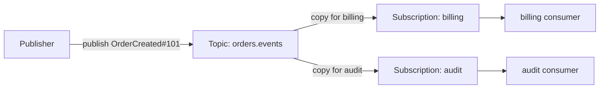

# Each Subscription Receives One Copy of a Topic Message in Spring JMS

## 1. The Rule to Grasp

With Jakarta Messaging's (JMS) **publish/subscribe (pub/sub)** model, a publisher sends a message to a `Topic`. The broker places **one logical copy of the message into each eligible subscription** on that Topic. Each subscription processes and acknowledges its copy independently of other subscriptions.

Therefore, the statement "each subscription receives one copy of a Topic message" must be understood accurately as: **for each message published to a Topic, every active subscription that matches the filter condition receives one copy of that message**. This is a distribution principle across subscriptions, not a promise that each process/consumer will execute strictly once in every situation.

Example: Topic `orders.events` receives event `OrderCreated#101`, and currently has two independent subscriptions `billing` and `audit`. The broker can distribute it as follows:



Both consumers receive the same **event content**, but through **two copies with independent delivery and acknowledgment lifecycles**. `billing` processing slowly, rolling back, or not yet acknowledging does not prevent `audit` from acknowledging its own copy. There is no need to create two Topics or send twice from the publisher.

## 2. Distinguishing Topic, Subscription, and Consumer

| Component | Role | Easy Confusion |
| --- | --- | --- |
| **Topic** | Address where publishers broadcast messages for distribution to subscriptions. | A Topic by itself does not equate to a dedicated queue per consumer. |
| **Subscription** | Registration relationship with a Topic managed by the broker; the unit receiving **one copy** of each matching message. | "Per subscription" differs from "per consumer". |
| **Consumer** | Object/process pulling and processing messages from a subscription. | A **shared** subscription can have multiple consumers splitting work. |
| **Publisher** | Sends one message to a Topic. | The publisher does not send separately to each subscription. |

**Flow for a message `M1`:**

1. Subscriptions `S_A` and `S_B` already exist and are eligible to receive `M1`.
2. The publisher sends `M1` to Topic `T` once.
3. The broker assigns copy `M1/A` to `S_A` and `M1/B` to `S_B`.
4. `S_A`'s consumer processes `M1/A`; `S_B`'s consumer processes `M1/B`. Completion order between the two subscriptions is not synchronized.
5. The broker tracks the respective delivery/acknowledgment state; a failure on `S_A` can lead to redelivery on `S_A` without forcing `S_B` to receive it again.

The term "copy" refers to **JMS distribution semantics**; the broker does not necessarily duplicate payload bytes according to this exact physical diagram.

### Timeline and Subscription Creation Time

Suppose two independent **non-durable** subscriptions are created and their consumers are active:

| Time | Event | `billing` | `audit` |
| --- | --- | --- | --- |
| 10:00 | Both subscriptions are active | Ready | Ready |
| 10:01 | Publish `M1` | Receives copy `M1` | Receives copy `M1` |
| 10:02 | Publish `M2` | Receives copy `M2` | Receives copy `M2` |
| 10:03 | `audit` consumer closes; its non-durable subscription is lost | Still active | Does not exist |
| 10:04 | Publish `M3` | Receives copy `M3` | Does not receive `M3` |
| 10:05 | `audit` consumer creates a new subscription | Unchanged | Only receives matching messages from when the new subscription takes effect |

If `audit` is a **previously registered durable subscription**, it can retain `M3` while offline to receive when the consumer reconnects, provided the message is still valid and has not been discarded under delivery policies. Turning a subscription durable at 10:05 **does not retroactively recover** `M3` sent at 10:04 for a subscription that did not exist at that time.

## 3. What Conditions Apply to "One Copy per Subscription"?

- **The subscription must be active at the right time.** Non-durable lives only while consumers exist (for shared non-durable: while at least one consumer remains). Durable persists across disconnections after it has been created.
- **Message selectors can filter messages.** If a subscription only selects `eventType = 'PAID'`, a message with property `eventType = 'CREATED'` will not be added to that subscription. Not every subscription always receives every message.
- **Expiration and provider rules still apply.** Messages can expire due to TTL, be discarded due to configuration, or face operational limits that the application must account for. Durable does not mean infinite retention.
- **Acknowledgment/transaction is separate per copy.** Subscription A acknowledging does not mean B has acknowledged. Rollback, connection failure, or consumer restart can cause a copy to be **redelivered**; design idempotent processing when business side effects exist.
- **The number of copies across subscriptions is not the number of handler invocations.** A subscription can receive the same message again due to redelivery; this is why you should avoid interpreting the rule as "exactly once" at the processing level.
- **Order across subscriptions and across multiple consumers is not a global log order.** JMS has specific ordering rules for valid delivery streams, but does not guarantee two services finish processing at the same time.

In short, for a valid message `M`, if a Topic has three eligible subscriptions `S1`, `S2`, `S3`, there are three **logical per-subscription copies**; how many times each copy is processed before succeeding still depends on acknowledgment, retries, and transactions.

## 4. Unshared, Shared, Non-Durable, and Durable

JMS allows combining two independent dimensions: **shared/unshared** determines how many consumers can read the same subscription; **durable/non-durable** determines whether the subscription survives when consumers are offline.

| Subscription Type | Consumers on Same Subscription | When All Consumers Disconnect | How Is a Matching Message Delivered? |
| --- | --- | --- | --- |
| **Unshared non-durable** | One consumer | Subscription is deleted | One copy for the subscription; that consumer receives it. |
| **Shared non-durable** | Multiple consumers | Deleted when the last consumer closes | One copy for the group; **one** consumer in the group receives it. |
| **Unshared durable** | At most one active consumer | Subscription remains | One copy; held for the consumer if needed and not expired. |
| **Shared durable** | Multiple consumers | Subscription remains | One copy for the group; **one** consumer in the group receives it, can be held while offline. |

### Confusing Shared Cases

Suppose Topic `payments.events` has two subscriptions:

- `accounting`: **unshared**, consumer `A`.
- `analytics`: **shared**, two consumers `B1` and `B2`.

When `PaymentConfirmed#52` is published, subscription `accounting` receives one copy and `analytics` also receives one copy. Consumer `A` processes `accounting`'s copy; **only one of `B1` or `B2`** processes `analytics`'s copy. The broker decides distribution within the group; do not assume fixed round-robin.

```text
Topic payments.events -- M1
    +--> subscription accounting --> consumer A        : M1
    |
    +--> subscription analytics  --> consumer B1 OR B2 : M1
                                 (shared)
```

If you create two **different subscriptions** for `B1` and `B2`, both can receive `M1`. If both **join the same shared subscription**, the total initial deliveries to the group for that copy is once prior to any redelivery scenarios. **The boundary of fan-out is the subscription; the boundary of load sharing is consumers within a shared subscription.**

### Identity of Durable/Shared Subscriptions

The subscription name is part of its identity. For unshared durable, identity is bound to `clientId` and `subscriptionName`; only one consumer can be active for that identity. Shared subscriptions use the subscription name and client identifier if assigned (shared durable allows an optional client identifier per the specification). Two different subscription names represent two independent receive streams. Do not dynamically change the name on deploy if the goal is to continue the backlog of the same durable subscription.

## 5. Comparing Queue and Topic

| Aspect | Queue (point-to-point) | Topic (publish/subscribe) |
| --- | --- | --- |
| Send target | Queue | Topic |
| Message receiving unit | One Queue; one of the eligible consumers receives the message | Each eligible subscription receives one logical copy |
| Two consumers on same destination | Usually split messages in the Queue | If **two independent subscriptions**: both receive; if same **shared subscription**: split work |
| Suitable for | Multiple workers executing one task | Multiple independent business flows reacting to one event |
| No consumers | Queue usually can retain messages per broker policy | Non-durable subscription does not retain when nonexistent; durable subscription can retain |

For example, when an order completes and needs to update billing **and** audit: publish one event on a Topic and create a separate subscription for each business function. If only one of five workers is needed to execute a PDF export job, a Queue or shared subscription is more suitable. Do not expect two listeners reading a Queue to both run for the same message.

## 6. Simulating the Fan-Out Rule in Java 17 Without a Broker

The following example **models** two independent subscriptions to show each receiving the same event. This is runnable plain Java, **not** a JMS broker, and does not simulate ack, retry, durability, or concurrency.

Save as `TopicFanoutDemo.java`:

```java
import java.util.ArrayList;
import java.util.LinkedHashMap;
import java.util.List;
import java.util.Map;

public class TopicFanoutDemo {
    public static void main(String[] args) {
        Map<String, List<String>> inboxBySubscription = new LinkedHashMap<>();
        inboxBySubscription.put("billing", new ArrayList<>());
        inboxBySubscription.put("audit", new ArrayList<>());

        for (String event : List.of("OrderCreated#101", "OrderPaid#101")) {
            for (List<String> inbox : inboxBySubscription.values()) {
                inbox.add(event); // One logical copy per subscription.
            }
        }

        inboxBySubscription.forEach((name, messages) ->
                System.out.println(name + ": " + messages));
    }
}
```

Compile and run with JDK 17 or newer:

```bash
javac TopicFanoutDemo.java
java TopicFanoutDemo
```

Stdout result (in `LinkedHashMap` insertion order):

```text
billing: [OrderCreated#101, OrderPaid#101]
audit: [OrderCreated#101, OrderPaid#101]
```

Calling `inbox.add(event)` for each subscription is the part simulating fan-out. In a real system, the **broker** creates and manages subscriptions; the publisher sends only once. The Java example above helps verify the counting rule, but does not replace integration testing with a JMS provider.

## 7. Applying with Spring Framework JMS

### 7.1. Configuring Topic for Sender and Receiver

Assume a Spring Boot 3.x application using Java 17+, with a `ConnectionFactory` from a Jakarta JMS provider (for example, ActiveMQ Artemis) connected to a broker, having `spring-boot-starter-artemis` or equivalent configuration. The broker must support destination `orders.events`, and you should verify listeners are active before publishing test messages.

The illustrative classes below belong to the same package of the Spring application (or component-scanned packages). This is an **integration snippet inside a Spring application with a broker**, not a standalone program runnable solely with `javac`. You can place these non-`public` classes in the same `TopicMessagingConfig.java` file to test in a configured project.

```java
import jakarta.jms.ConnectionFactory;
import org.springframework.beans.factory.annotation.Qualifier;
import org.springframework.context.annotation.Bean;
import org.springframework.context.annotation.Configuration;
import org.springframework.jms.annotation.EnableJms;
import org.springframework.jms.annotation.JmsListener;
import org.springframework.jms.config.DefaultJmsListenerContainerFactory;
import org.springframework.jms.core.JmsTemplate;
import org.springframework.stereotype.Component;
import org.springframework.stereotype.Service;

@Configuration
@EnableJms
class TopicMessagingConfig {
    @Bean
    DefaultJmsListenerContainerFactory topicListenerFactory(
            ConnectionFactory connectionFactory) {
        var factory = new DefaultJmsListenerContainerFactory();
        factory.setConnectionFactory(connectionFactory);
        factory.setPubSubDomain(true); // Destination is treated as a Topic.
        factory.setSessionTransacted(true);
        factory.setConcurrency("1");  // Each listener is a separate subscription.
        return factory;
    }

    @Bean("topicJmsTemplate")
    JmsTemplate topicJmsTemplate(ConnectionFactory connectionFactory) {
        var template = new JmsTemplate(connectionFactory);
        template.setPubSubDomain(true); // Send to Topic, not Queue.
        return template;
    }
}

@Component
class BillingTopicListener {
    @JmsListener(
        destination = "orders.events",
        containerFactory = "topicListenerFactory"
    )
    public void handle(String event) {
        System.out.println("BILLING: " + event);
    }
}

@Component
class AuditTopicListener {
    @JmsListener(
        destination = "orders.events",
        containerFactory = "topicListenerFactory"
    )
    public void handle(String event) {
        System.out.println("AUDIT: " + event);
    }
}

@Service
class OrderEventPublisher {
    private final JmsTemplate topicTemplate;

    OrderEventPublisher(@Qualifier("topicJmsTemplate") JmsTemplate topicTemplate) {
        this.topicTemplate = topicTemplate;
    }

    public void publish(String event) {
        topicTemplate.convertAndSend("orders.events", event);
    }
}
```

When `OrderEventPublisher.publish("OrderCreated#101")` is called **after both listeners are ready**, each `@JmsListener` endpoint above will have its own **unshared non-durable subscription** and will typically print a corresponding line:

```text
BILLING: OrderCreated#101
AUDIT: OrderCreated#101
```

The two lines may appear **in reverse order** or interleaved with other logs due to asynchronous processing. This is the **expected result under healthy conditions**, not deterministic stdout with fixed order or an exactly-once guarantee. If sent too early, a non-durable listener that has not yet created its subscription may miss the event.

**Role of each configuration setting:**

- `factory.setPubSubDomain(true)` makes the listener treat the destination as a **Topic**; if left at the Queue default, the two listeners might compete to receive instead of both getting a copy.
- `template.setPubSubDomain(true)` makes the publisher send to the right destination type. Sender and receiver must agree on Topic.
- Two distinct `@JmsListener` methods create two listener containers and, in this non-durable unshared configuration, two independent subscriptions. `containerFactory` only selects how the container is configured; it does not merge two listeners into the same subscription.
- `setSessionTransacted(true)` provides a JMS transaction boundary: if the handler succeeds, it commits; unhandled errors can roll back and lead to redelivery, depending on the provider and retry policy. Idempotent handling is required for business logic with side effects.

### 7.2. When You Want Multiple Consumers to Share **One** Subscription

Create a factory dedicated to shared subscriptions, then use the **same subscription name** for the worker group that needs to share load:

```java
@Bean
DefaultJmsListenerContainerFactory sharedTopicFactory(
        ConnectionFactory connectionFactory) {
    var factory = new DefaultJmsListenerContainerFactory();
    factory.setConnectionFactory(connectionFactory);
    factory.setPubSubDomain(true);
    factory.setSubscriptionShared(true);
    factory.setSessionTransacted(true);
    factory.setConcurrency("2");
    return factory;
}

// Inside a Spring-managed @Component:
@JmsListener(
    destination = "orders.events",
    containerFactory = "sharedTopicFactory",
    subscription = "analytics-workers"
)
public void onAnalyticsEvent(String event) {
    processAnalytics(event);
}
```

**The snippet above consists of configuration fragments and a method to add to existing Spring classes**, not a standalone Java file; `processAnalytics` represents an application-defined business method. The two consumers created by the container belong to the same shared subscription `analytics-workers`. An event entering this subscription will be received by **one** consumer in the group (excluding redeliveries). Raising consumer count increases processing capacity, **without increasing the number of per-subscription copies**.

If the goal is for both the `billing` and `audit` services to receive the event, give them **two separate subscriptions**. Do not accidentally put both into the same shared subscription and expect both to be invoked.

### 7.3. When You Need to Continue Receiving Events Published While a Consumer Is Offline

Example of a pre-established **unshared durable subscription**:

```java
@Bean
DefaultJmsListenerContainerFactory durableTopicFactory(
        ConnectionFactory connectionFactory) {
    var factory = new DefaultJmsListenerContainerFactory();
    factory.setConnectionFactory(connectionFactory);
    factory.setPubSubDomain(true);
    factory.setSubscriptionDurable(true);
    factory.setClientId("billing-service-instance-1");
    factory.setSessionTransacted(true);
    factory.setConcurrency("1");
    return factory;
}

// Inside a Spring-managed @Component:
@JmsListener(
    destination = "orders.events",
    containerFactory = "durableTopicFactory",
    subscription = "billing-events"
)
public void onBillingEvent(String event) {
    processBilling(event);
}
```

These two snippets are also **Spring integration fragments**, assuming `processBilling` exists. After successful registration, the broker manages the durable subscription by its identity. When the consumer closes and later reconnects with the **same identity**, matching messages published during downtime can continue to be delivered if not expired. The connection's `clientId` needs to be stable for unshared durable, but must be **unique among active connections**: hardcoding the same `clientId` across multiple concurrently running instances can cause errors. If multiple instances need to process one backlog, consider a **shared durable subscription** with provider-supported identity management.

## 8. Verifying Behavior Properly on a Real Broker

To distinguish "per-subscription fan-out" from "work sharing in a shared group", you can run an experiment in the following order:

1. Start the broker and **two independent Topic listeners** (`billing`, `audit`), waiting for both containers to actually connect and create subscriptions.
2. Publish exactly **one** event `OrderCreated#101`. Under error-free and unfiltered conditions, observe one receive in `billing` and one in `audit`; compare by event ID, **not by log order**.
3. Close the non-durable `audit` consumer, then publish `OrderPaid#101`. `billing` still receives it, while `audit` cannot read that event again merely by restarting.
4. Create durable subscription `audit-durable` **before** testing, verify it exists, disconnect the consumer, publish `OrderShipped#101`, then reconnect with the same identity; check the pending copy per broker/TTL configuration.
5. Create **shared subscription** `analytics-workers` with two consumers. Publish three events with different IDs; verify each ID is processed by **one member of the group** on the happy path, without expecting each worker to necessarily receive an equal count.
6. Intentionally induce an error before commit on one listener with a transacted session; observe redelivery on that subscription. Verify the other subscription still manages its own copy independently.

In real environments, use broker metrics by **destination, subscription name, consumer count, pending/unacknowledged messages, and redelivery count** for verification. Specific details and metric names depend on the JMS provider.

## 9. Common Misunderstandings

1. **"Two consumers on the same Topic means both definitely receive."** Only true when they belong to **two separate** eligible subscriptions; two consumers on the **same shared subscription** split the copy.
2. **"A Topic holds one message, so only one recipient gets it like a Queue."** Topics fan out per subscription; Queues normally deliver one message to one consumer among competing consumers.
3. **"Creating a listener after sending still receives history."** Newly created non-durable subscriptions do not receive old messages. Durable only retains backlog **from after the subscription was created**, within delivery policy limits.
4. **"Receiving one copy means it was processed exactly once."** Rollback/redelivery can occur; use event IDs, idempotency, proper transactions, and retry monitoring.
5. **"Having `@JmsListener` guarantees Topic is being used."** You must check `pubSubDomain` on both receiver and sender, `DestinationResolver`, and how the broker maps destinations.
6. **"Increasing concurrency makes every consumer receive a copy."** In a shared subscription, raising concurrency increases worker count; a message does not turn into N copies for N workers.
7. **"Two durable listeners share a name for easier management."** Shared identity can cause conflicts (unshared) or intentional load sharing (shared); assign identities based on **business functions that need independent delivery**.

## 10. Self-Check

**Question 1.** A Topic has three independent subscriptions `S1`, `S2`, and `S3`, all active, with no selectors. The publisher sends `M1` once. How many logical copies does each subscription have?  
**Answer:** One copy of `M1` per subscription; three logical per-subscription copies in total.

**Question 2.** `S1` is a shared subscription with four consumers. Do all four receive `M1`?  
**Answer:** No. One consumer in the group receives `S1`'s copy of `M1` on initial delivery. Redelivery may occur if processing/acknowledgment fails.

**Question 3.** A non-durable subscription's consumer is closed while the publisher sends `M2`. Will restarting the consumer later read `M2`?  
**Answer:** No, under non-durable semantics the subscription was deleted; a durable subscription created **before** `M2` was published is required, and TTL/provider policies still apply.

**Question 4.** `S1` acknowledged `M3`, while `S2` rolled back `M3`. Does `S1` roll back too?  
**Answer:** No. The two subscriptions have independent delivery/acknowledgment states; `S2` may have its copy redelivered.

**Remember:** *One publish → one logical copy for each eligible subscription. Multiple consumers in a shared subscription → split that copy. Durable → preserves the subscription across offline periods, without automatically making processing exactly once.*

## Official References

- [Jakarta Messaging Specification 3.1 – Topic semantics and subscriptions](https://jakarta.ee/specifications/messaging/3.1/jakarta-messaging-spec-3.1.html)
- [Jakarta EE Tutorial – Consuming Messages from Topics](https://jakartaee.github.io/jakartaee-documentation/jakartaee-tutorial/current/messaging/jms-concepts/jms-concepts.html)
- [Spring Framework Reference – Annotation-driven JMS listeners](https://docs.spring.io/spring-framework/reference/integration/jms/annotated.html)
- [Spring Framework Reference – Receiving a JMS message](https://docs.spring.io/spring-framework/reference/integration/jms/receiving.html)
