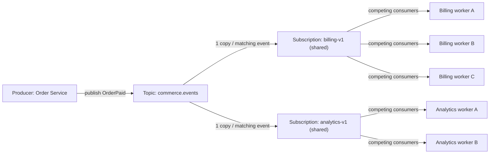

# Shared Subscriptions and Load Sharing Within a Receiving Group (JMS Topic)

> **Context:** Spring Framework – JMS, parent topic **Queues and Topics**. Focus is on how **multiple consumers share one topic subscription to split work**, while **multiple different subscription groups still receive independent copies of events**. Examples follow Jakarta Messaging 3.1 / JMS 2.0+, Spring Boot 3.3, and Java 21.

## 1. The Problem: A Topic Broadcasts Events to Multiple Services, Yet Each Service Also Needs Multiple Workers

An e-commerce system publishes `OrderPaid` events to topic `commerce.events`. The **Billing** service needs to generate invoices, and the **Analytics** service needs to record metrics. Each service must process **every event relevant to it**, yet as traffic grows, we want 3 Billing workers and 2 Analytics workers running concurrently.

Two different requirements must be combined:

1. **Per-group fan-out:** each message is added to **Billing's subscription** and **Analytics's subscription** (if the subscription exists and its filter accepts the message).
2. **Competing consumers within a group:** on Billing's subscription, **each delivery of a message** selects **one** of the 3 Billing workers; similarly, Analytics selects one of its 2 workers. An individual worker does not receive all messages of the group.

If you merely create multiple independent consumers on a topic in the standard way (unshared subscriptions), **each consumer gets its own subscription** and can receive a copy of the same event. Thus all 3 Billing workers could end up generating invoices for the same order, contrary to load-sharing intent.

A **shared subscription** solves the problem: multiple consumers attach to **one named subscription**, and the broker distributes messages in that subscription across those consumers.

## 2. Model: One Topic, Multiple Subscriptions, Multiple Consumers per Subscription



For event `e-101`, if both subscriptions exist and do not filter it out, you can observe:

- Group `billing-v1`: **one** of A/B/C receives `e-101` in that successful delivery.
- Group `analytics-v1`: **one** of A/B receives `e-101` in that successful delivery.
- In total, **two groups receive two logical copies**, because each group has a distinct business responsibility.

Illustrative distribution of 6 events, **merely one possible scenario**:

| Message | `billing-v1` | `analytics-v1` |
| --- | --- | --- |
| `e-101` | Billing B | Analytics A |
| `e-102` | Billing A | Analytics B |
| `e-103` | Billing C | Analytics A |
| `e-104` | Billing C | Analytics B |
| `e-105` | Billing A | Analytics B |
| `e-106` | Billing B | Analytics A |

Jakarta Messaging **does not mandate a load-balancing algorithm** among consumers of the same shared subscription. You must not assume round-robin, strictly even splits, exact completion order, or pinning a specific ID to a specific worker. The broker may use prefetch, priority, readiness, flow control, or its own policies. When rollback/redelivery happens, a message may be delivered **again** to another worker; "one consumer per delivery" does not mean the business logic executes strictly once.

## 3. Three Concepts That Must Be Separated

| Concept | Meaning | Example |
| --- | --- | --- |
| **Topic** | Publish/subscribe destination where producers publish events. | `commerce.events` |
| **Subscription** | Logical entity at the JMS provider tracking topic messages for **one receiving group**; can be durable or non-durable. | `billing-v1` |
| **Consumer** | `MessageConsumer`/`JMSConsumer` object or listener receiving messages from a subscription; a shared subscription can have multiple consumers. | 3 Billing instances |

**One topic has multiple subscriptions**, and **one shared subscription has multiple consumers**. These are two separate layers: sharing messages *between groups* and sharing load *within a group*.

Direct comparison with queues:

| Design | Where Can a Message Go? | Use Case |
| --- | --- | --- |
| **Queue + multiple consumers** | One consumer in the competing group receives each delivery. | One work stream that only one group needs to execute. |
| **Topic + multiple unshared subscriptions** | Each separate subscription receives a copy; each subscription has at most one active consumer at a time. | Multiple independent parties all need to see the event. |
| **Topic + shared subscription** | Each subscription receives its own copy; multiple consumers **on the same subscription** split load for those copies. | Multiple business groups all need the event, and each group needs to scale out. |

Choose a queue if the problem is simply multiple workers processing one work stream. Choose a topic + shared subscription if the same event must reach **multiple independent groups**, while each group wants to distribute work across multiple consumers.

## 4. Shared and Durable Are Two Independent Configuration Axes

`Shared` answers: **Are multiple consumers allowed to attach to the same subscription simultaneously?** `Durable` answers: **Is the subscription maintained when no active consumers remain?**

| Topic Subscription Type | Concurrent Consumers | When Last Consumer Leaves | Consumer Creation API |
| --- | --- | --- | --- |
| Unshared non-durable | One | Subscription disappears; no messages accumulated while absent. | `createConsumer(topic)` |
| **Shared non-durable** | Multiple | Subscription is deleted, undelivered messages of this subscription are removed; messages published while the group is completely offline do not wait for the group to return. | `createSharedConsumer(topic, name)` |
| Unshared durable | One | Subscription remains and stores eligible messages until processed/expired; requires client ID. | `createDurableConsumer(topic, name)` |
| **Shared durable** | Multiple | Subscription remains; matching messages accumulate per broker storage capability and policy. | `createSharedDurableConsumer(topic, name)` |

Examples:

- **Real-time metrics update group**, where dropping some events when all consumers are offline is acceptable: shared **non-durable**.
- **Invoice generation group** needing to resume after maintenance: shared **durable**, paired with persistent delivery, broker storage, retry/DLQ, and idempotency.

Precise notes:

- A durable subscription must be **created before** a message is published in order to track that message; creating a subscription today does not read back history never retained by the broker for that subscription.
- "Durable" does not mean messages exist forever or are guaranteed across all failures: it also depends on `PERSISTENT` delivery mode, TTL/expiration, transactions, quotas, journal/storage/HA, and broker policies.
- Shared non-durable can still receive pending messages **while at least one active consumer remains**, but when the last consumer closes, the subscription and pending messages are not saved for next time.

## 5. What Makes Consumers Truly Belong to **the Same** Group?

A shared subscription is identified by **subscription name**, plus **JMS client identifier if set**. To share the same backlog, consumers must access the **same JMS provider/broker namespace**, same subscription type (shared durable or shared non-durable), same name, same client ID if used, and compatible topic/selector configuration.

- **Same topic, different subscription names:** two **different groups**; each group receives its own copy.
- **Same topic, same subscription name, same client ID (or both unset):** consumers share that subscription if supported by the provider and related attributes match.
- **Same name but different client ID:** not automatically the same subscription.
- **Same name but different topic or selector:** cannot be treated as the same group. While the subscription is active, Jakarta Messaging requires an error when a new consumer attempts to join the same identity with a different topic/selector.
- **Changing the selector/topic of a shared durable subscription while no consumers exist:** the specification permits behavior equivalent to deleting the old subscription and creating a new one. Therefore **do not silently change the configuration of a subscription with an important backlog**; version the subscription name and plan a transition.
- **Leaving `clientId` unset is valid with shared durable** (unlike unshared durable). With multiple replicas, it is common to leave client ID unset and keep **one shared subscription name**; avoid assigning the same static client ID to multiple concurrently active connections, because client IDs must be unique at any given time.

JMS `noLocal` used for some unshared subscriptions **is not supported for shared subscriptions**. A `Message selector` is a **subscription-level** filter, not a way for individual workers in the same group to pick different message types.

### Filters and Two Independent Groups

If a topic publishes messages with property `eventType`, two shared subscriptions with selectors can be created:

- `billing-v1`: `eventType = 'OrderPaid'`.
- `analytics-v1`: `eventType IN ('OrderPaid', 'OrderCancelled')`.

When `OrderPaid` is published, both groups receive a copy for their subscription; when `OrderCancelled` is published, only the Analytics group receives it. **Every consumer in the same shared subscription must follow the same selector**. In the demo code below, no selector is set so all events can be easily observed.

## 6. Corresponding Jakarta Messaging API

In the simplified `jakarta.jms` API, there are two core methods (added in JMS 2.0):

```java
// These are illustrative calls inside a method that has ConnectionFactory cf.
// Each process/worker creates its own JMSContext, consumer, and lifecycle.
try (jakarta.jms.JMSContext context = cf.createContext()) {
    jakarta.jms.Topic topic = context.createTopic("commerce.events");

    // Multiple consumers with the same name join the shared non-durable subscription:
    jakarta.jms.JMSConsumer temporary =
            context.createSharedConsumer(topic, "billing-live-v1");

    // Multiple consumers with the same name join the shared durable subscription:
    jakarta.jms.JMSConsumer durable =
            context.createSharedDurableConsumer(topic, "billing-v1");

    // API-only example. Do not use two consumers with the same role
    // in this single process to infer a load-balancing algorithm.
}
```

This snippet is **not a standalone runnable Java class** (requires `ConnectionFactory cf` and a JMS provider). With the classic API, the corresponding methods on `Session` are `createSharedConsumer(...)` and `createSharedDurableConsumer(...)`, returning `MessageConsumer`.

When beginners use Spring, there is no need to call these methods manually: `DefaultMessageListenerContainer` behind `@JmsListener` creates and manages the corresponding consumers. For shared subscriptions, the container must be configured to choose **topic**, **shared**, subscription name, and optionally **durable**.

## 7. Runnable Example with Spring Boot: Two Groups Sharing Load on the Same Topic

The example uses **Java 21, Spring Boot 3.3.5, and ActiveMQ Artemis supporting JMS 2.0+**. One application hosts both Billing and Analytics for easy observation; in real deployments, they can be separate services/replicas connecting to the same broker.

### 7.1. Dependencies and Broker

`build.gradle` in a new Gradle project:

```groovy
plugins {
    id 'java'
    id 'org.springframework.boot' version '3.3.5'
    id 'io.spring.dependency-management' version '1.1.6'
}

group = 'com.example'
version = '0.0.1-SNAPSHOT'

java {
    toolchain { languageVersion = JavaLanguageVersion.of(21) }
}

repositories { mavenCentral() }

dependencies {
    implementation 'org.springframework.boot:spring-boot-starter-web'
    implementation 'org.springframework.boot:spring-boot-starter-artemis'
}
```

`src/main/resources/application.yml`:

```yaml
spring:
  artemis:
    mode: native
    broker-url: tcp://localhost:61616
server:
  port: 8080
```

Requires a **running Artemis broker** on `localhost:61616`, allowing creation of or pre-configured with **multicast topic** `commerce.events` and two durable subscriptions. If the broker requires authentication, provide `SPRING_ARTEMIS_USER` and `SPRING_ARTEMIS_PASSWORD` via environment (or secret manager); do not hardcode passwords in source code.

### 7.2. Complete Source Code

Create `src/main/java/com/example/sharedjms/SharedSubscriptionApplication.java`:

```java
package com.example.sharedjms;

import jakarta.jms.ConnectionFactory;
import org.springframework.beans.factory.annotation.Qualifier;
import org.springframework.boot.SpringApplication;
import org.springframework.boot.autoconfigure.SpringBootApplication;
import org.springframework.context.annotation.Bean;
import org.springframework.context.annotation.Configuration;
import org.springframework.http.ResponseEntity;
import org.springframework.jms.annotation.JmsListener;
import org.springframework.jms.config.DefaultJmsListenerContainerFactory;
import org.springframework.jms.connection.CachingConnectionFactory;
import org.springframework.jms.core.JmsTemplate;
import org.springframework.stereotype.Component;
import org.springframework.web.bind.annotation.PathVariable;
import org.springframework.web.bind.annotation.PostMapping;
import org.springframework.web.bind.annotation.RestController;

@SpringBootApplication
public class SharedSubscriptionApplication {
    public static void main(String[] args) {
        SpringApplication.run(SharedSubscriptionApplication.class, args);
    }
}

@Configuration(proxyBeanMethods = false)
class TopicConfig {
    @Bean("topicJmsTemplate")
    JmsTemplate topicJmsTemplate(ConnectionFactory connectionFactory) {
        JmsTemplate template = new JmsTemplate(connectionFactory);
        template.setPubSubDomain(true); // publish to TOPIC
        return template;
    }

    @Bean("sharedDurableTopicFactory")
    DefaultJmsListenerContainerFactory sharedDurableTopicFactory(
            ConnectionFactory connectionFactory) {
        // Listener containers should use the native factory to manage
        // connections, consumer lifecycle, and recovery themselves.
        ConnectionFactory nativeFactory =
                connectionFactory instanceof CachingConnectionFactory cached
                        ? cached.getTargetConnectionFactory()
                        : connectionFactory;

        DefaultJmsListenerContainerFactory factory =
                new DefaultJmsListenerContainerFactory();
        factory.setConnectionFactory(nativeFactory);
        factory.setPubSubDomain(true);       // TOPIC, not queue
        factory.setSubscriptionShared(true); // multiple consumers / subscription
        factory.setSubscriptionDurable(true); // retain subscription while offline
        factory.setSessionTransacted(true);  // commit when listener succeeds
        return factory;
    }
}

@RestController
class EventPublisher {
    private final JmsTemplate topicJmsTemplate;

    EventPublisher(@Qualifier("topicJmsTemplate") JmsTemplate topicJmsTemplate) {
        this.topicJmsTemplate = topicJmsTemplate;
    }

    @PostMapping("/events/{eventId}")
    ResponseEntity<String> publish(@PathVariable String eventId) {
        topicJmsTemplate.convertAndSend("commerce.events", eventId);
        return ResponseEntity.accepted().body("PUBLISHED " + eventId);
    }
}

@Component
class BillingConsumers {
    @JmsListener(
            destination = "commerce.events",
            subscription = "billing-v1",
            containerFactory = "sharedDurableTopicFactory",
            concurrency = "3-3")
    void bill(String eventId) {
        System.out.printf(
                "BILLING   %s via %s%n",
                eventId, Thread.currentThread().getName());
    }
}

@Component
class AnalyticsConsumers {
    @JmsListener(
            destination = "commerce.events",
            subscription = "analytics-v1",
            containerFactory = "sharedDurableTopicFactory",
            concurrency = "2-2")
    void analyze(String eventId) {
        System.out.printf(
                "ANALYTICS %s via %s%n",
                eventId, Thread.currentThread().getName());
    }
}
```

**Explanation of meaningful settings:**

1. `topicJmsTemplate.setPubSubDomain(true)`: Spring sends to a **topic**. By default `JmsTemplate` normally chooses queue if unchanged.
2. `setPubSubDomain(true)` on the listener factory: consumers also subscribe to a **topic**.
3. `setSubscriptionShared(true)`: consumers of the same subscription name can run concurrently without each consumer creating an independent copy.
4. `setSubscriptionDurable(true)`: uses **shared durable**; the subscription persists when all consumers have left.
5. `@JmsListener(subscription = "...")`: sets the **group name**. `billing-v1` and `analytics-v1` are two **different** subscriptions.
6. `concurrency = "3-3"` and `"2-2"`: sets 3 and 2 concurrent consumers respectively in *each application instance*; this is a consumer count limit, **not a guarantee of even message distribution**.
7. `setSessionTransacted(true)`: when the listener succeeds, the JMS transaction can commit; an error before commit leads to rollback/redelivery per provider configuration. It **does not automatically synchronize atomically** with an external database outside JMS.
8. The receiving side is placed on a `native ConnectionFactory` if Boot wrapped the factory with `CachingConnectionFactory`, so the listener manages connections and recovery itself. The sending side can still use the wrapper to benefit from caching.

### 7.3. Running and Observing

From the project directory, once the broker is ready:

```bash
# Linux/macOS
./gradlew bootRun

# Windows PowerShell/CMD: use gradlew.bat bootRun
```

From another terminal, send a few messages:

```bash
curl -i -X POST http://localhost:8080/events/e-101
curl -i -X POST http://localhost:8080/events/e-102
curl -i -X POST http://localhost:8080/events/e-103
```

An example HTTP response has status `202 Accepted` and body:

```text
PUBLISHED e-101
```

An **illustrative** log excerpt could be:

```text
BILLING   e-101 via DefaultMessageListenerContainer-1
ANALYTICS e-101 via DefaultMessageListenerContainer-2
ANALYTICS e-102 via DefaultMessageListenerContainer-4
BILLING   e-102 via DefaultMessageListenerContainer-3
BILLING   e-103 via DefaultMessageListenerContainer-5
ANALYTICS e-103 via DefaultMessageListenerContainer-4
```

Thread names, order, and specific consumers vary at runtime; **there is no fixed stdout** for this asynchronous example. What to verify after all processing succeeds with no retries: **each event ID appears once in the BILLING log and once in the ANALYTICS log**, regardless of which worker executed it. If you see only one worker repeatedly receiving messages, you cannot yet conclude the shared subscription is misconfigured; increase traffic, add controlled processing time, and inspect the active consumer count at the broker.

**When running multiple replicas:** launch the same code in different instances while avoiding duplicate HTTP ports; each replica keeps the same `subscription` and same topic/configuration, without setting a distinct client ID that alters subscription identity. For example, 2 replicas with `concurrency="3-3"` create up to 6 Billing consumers participating in `billing-v1`. Increasing consumers only helps while the broker and downstream still have processing capacity.

**Testing durable when all consumers are offline:** the single app above contains both producer and listeners, so stopping the app also stops the producer. To test properly, run the producer in **another process** (or use a broker tool), create `billing-v1` while the listener runs, then stop **all Billing consumers**, publish new events with the separate producer, and bring Billing back up. With shared durable, the broker should retain and deliver the eligible waiting events; also verify TTL, persistent delivery, and broker state.

## 8. Why Adding Consumers Helps Share Load but Does Not Guarantee Infinite Speed

Suppose a steady publish rate is 150 messages/second; one Billing worker processes 20 messages/second under test conditions:

- One worker has a theoretical capacity of ~20 msg/s; backlog grows when publishing 150 msg/s.
- Five workers have a theoretical capacity of ~100 msg/s if tasks are independent and downstream has headroom; backlog **still** grows.
- Eight workers have a theoretical capacity of ~160 msg/s, yet real throughput may be lower due to DB, auxiliary APIs, locks, transactions, prefetch, network, and broker overhead.

This is a **capacity problem**, not a guaranteed formula. Measure actual processing time and consumption rate; monitor `pending messages`, `in-flight/unacknowledged`, oldest message age, publish/ACK rate, redeliveries, DLQ, completion latency, and active consumer count **per subscription**.

### Ordering Issue

With multiple consumers, message `e-101` may finish processing **after** `e-102` even though it was sent first. Do not rely on global completion order of a shared subscription. If the business requires sequential processing **for the same orderId**, design for sequentiality: partitioning/consumer groups by key, message grouping if supported by the broker, or version/sequence checks in the database. Do not assume `JMSXGroupID` or a message-grouping feature behaves identically across all JMS providers without verifying.

### Fairness Issue

A shared subscription **does not promise** a worker receives 1/N of messages. Fast workers may receive more; slow workers may hold unacknowledged messages; prefetch can skew distribution. Observe performance at the group level rather than demanding strictly equal division.

## 9. Failures, Retries, and Delivery Semantics

**"Each message is delivered to one consumer in the subscription per delivery"** is an accurate description; the statement "the message is processed strictly once" is usually **false** when failures occur.

Typical scenario:

1. The broker delivers `e-101` of `billing-v1` to Billing worker A.
2. A successfully creates the invoice in the database, but dies **before JMS commit/ACK**.
3. The broker has not recorded completion of the reception, so it may **redeliver** `e-101` to worker B.
4. If B creates another invoice, the business action is duplicated even though the producer published only once.

How to handle:

- Create a stable **idempotency key** (for example, `eventId`), and store processed state with a unique constraint/transaction alongside the appropriate business operation. If the message is received again, return the existing result.
- Use a **transacted session** or timely ACK; with Spring, check `DefaultJmsListenerContainerFactory` and broker policies. Do not confuse `AUTO_ACKNOWLEDGE` with guaranteeing side effects have committed in the DB.
- Configure bounded retries, backoff, DLQ, and error monitoring. Continuously failing messages must not consume the group's entire capacity.
- If the producer both writes to a database and publishes to JMS, consider a **transactional outbox** to avoid the DB committing while the event is never sent.
- If one group fails or pauses, **other subscription groups can continue** with their independent backlog and resources; however, the shared broker remains a shared resource point that can affect everyone.

For a shared durable subscription, **a message successfully ACKed for that subscription** does not mean it has been ACKed on another subscription. Billing finishing processing does not erase Analytics's obligation, and vice versa.

## 10. Common Pitfalls When Configuring Spring/JMS

| Mistake | Consequence | Fix |
| --- | --- | --- |
| Creating 3 `@JmsListener`s on the same topic without enabling `subscriptionShared` | May create 3 separate subscriptions, causing each message to run 3 times. | Share the subscription name, enable shared on the container, and verify on the broker that **one subscription** has multiple consumers. |
| Using default queue-oriented `JmsTemplate` to send to a topic name | Destination name may be resolved as a queue or fail routing. | Set `pubSubDomain=true` on producer and receiving container; verify multicast topic on broker. |
| Billing and Analytics using the **same** subscription name | The two services compete with each other; an event may reach only Billing **or** Analytics. | Assign **distinct subscription names by business responsibility**. |
| Each pod assigning itself a different client ID or subscription name | Each pod becomes an independent group, multiplying copies instead of sharing load. | Standardize logical subscription identity; handle client ID rules per provider. |
| Multiple pods trying to use the same static client ID on multiple connections | JMS provider may reject because the client ID is already in use. | For shared durable, consider leaving client ID unset; check provider rules. |
| Using shared non-durable for tasks that must not be lost when the group is offline | Messages can be lost from the subscription when the last consumer closes. | Use shared durable with persistence and proper operations. |
| Changing selector/topic under a durable subscription holding backlog | May error or recreate the subscription, risking loss of old backlog. | Version the subscription and execute a controlled transition. |
| Assuming every worker receives evenly or finishes in order | Wrong statistics, broken order-dependent business logic. | Design idempotency, key-based grouping/ordering, and measure in practice. |
| Monitoring only topic-level message counts | Misses Billing backing up while Analytics is healthy. | Monitor per subscription: backlog, consumer count, redeliveries, DLQ. |
| Using shared subscriptions and concluding business outcome is already exactly-once | Retries after crashes can still create duplicate side effects. | Combine JMS transactions, unique constraints/idempotency, and retry mechanisms. |

## 11. How to Verify Shared Subscriptions on the Broker

**Minimum functional test:**

1. Create `billing-v1` (shared durable, 3 consumers) and `analytics-v1` (shared durable, 2 consumers) on the same topic.
2. Publish 10 unique event IDs `e-1` to `e-10` after subscriptions are active.
3. Once all processing succeeds, aggregate logs by **subscription** and confirm all 10 event IDs in Billing and all 10 event IDs in Analytics. Invocation counts can be higher during redelivery, so in tests count idempotent business results.
4. In the broker console, confirm **2 subscriptions**, Billing has 3 active consumers, and Analytics has 2 (when running a single instance).
5. Shut down one Billing consumer; publish more. Remaining Billing consumers can still receive, and Analytics's group identity is unaffected.
6. Shut down **all** Billing consumers while keeping the producer and broker running; publish new events. Bring Billing back up and confirm the shared durable backlog is consumed.
7. Repeat the test with **shared non-durable** on a different name; when the last consumer closes, messages published while the group does not exist will not be retained for later delivery.

**Results that must not be misinterpreted:** each worker taking exactly 1/3 of load, log order matching publish order, or each handler being called only once over the system lifetime. Those are not part of the shared subscription contract.

## 12. Self-Check Questions

1. A topic has `billing-v1` with 4 consumers and `analytics-v1` with 2 consumers. For one valid event, how many **per-subscription copies** exist, and how many consumers of **each subscription** receive it per delivery?
2. If Billing and Analytics accidentally use the same shared subscription name, what happens? Why is this a design flaw?
3. Distinguish **shared non-durable** and **shared durable** when the last consumer closes and the producer keeps publishing.
4. Same subscription name, but each pod has its own client ID: why might they not share load together?
5. Why can increasing consumer count improve throughput while still breaking processing order?
6. A wrote to the DB and crashed before ACK. B receives the message again; what key do you use to guarantee two invoices are not created?
7. Are different selectors between two consumers on the same shared subscription valid? If you want each message type to go to a different group, how should subscriptions be organized?

**Summary:** Topics solve **distributing events to multiple groups**; shared subscriptions solve **sharing load across multiple consumers of the same group**. Durable is an independent decision about retaining the subscription/backlog while offline. Proper configuration includes a stable group name, right topic, shared/durable/selector settings, ACK/transactions, idempotency, and per-subscription backlog monitoring.

### Technical References

- [Jakarta Messaging 3.1 Specification – `8.3 Creating a consumer on a topic`](https://jakarta.ee/specifications/messaging/3.1/jakarta-messaging-spec-3.1.html): unshared/shared, non-durable/durable, subscription identity, selector, and redelivery.
- [Jakarta EE Tutorial – Creating Shared Subscriptions](https://jakarta.ee/learn/docs/jakartaee-tutorial/current/messaging/jms-concepts/jms-concepts.html): comparing topic, queue, and shared subscriptions.
- [Jakarta Messaging 3.1 JMSContext API](https://jakarta.ee/specifications/messaging/3.1/apidocs/jakarta.messaging/jakarta/jms/jmscontext): `createSharedConsumer` and `createSharedDurableConsumer`.
- [Spring Framework 6.1 – AbstractMessageListenerContainer API](https://docs.spring.io/spring-framework/docs/6.1.9/javadoc-api/org/springframework/jms/listener/AbstractMessageListenerContainer.html): `setSubscriptionShared`, `setSubscriptionDurable`, and `setSubscriptionName`.
- [Spring Framework – @JmsListener](https://www.springframework.io/spring/docs/6.1.11/javadoc-api/org/springframework/jms/annotation/JmsListener.html): `subscription`, `containerFactory`, `concurrency`.
- [Spring Boot – JMS support](https://docs.spring.io/spring-boot/3.4/reference/messaging/jms.html): Artemis, `JmsTemplate`, listener containers, and transactions.
- [ActiveMQ Artemis – Virtual Topics / JMS 2.0 shared subscriptions](https://artemis.apache.org/components/artemis/migration-documentation/VirtualTopics.html): shared subscription support with Artemis.
