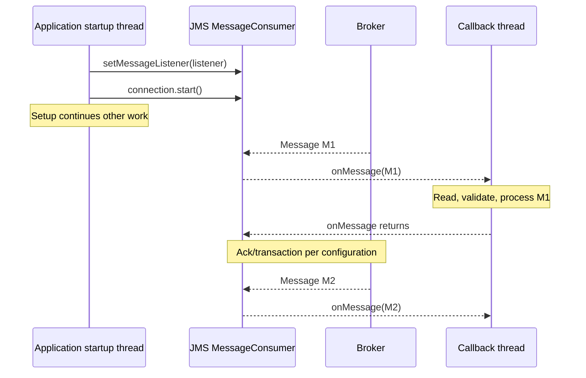

# MessageListener and Asynchronous Receive Callbacks in Jakarta JMS and Spring Framework

## 1. What Problem Does MessageListener Solve?

In JMS, an application has two fundamental ways to receive messages from a `Queue` or `Topic`:

- **Synchronous receive:** code explicitly calls `consumer.receive()`; the calling thread blocks until a message arrives, the timeout expires, or the consumer closes. If the application wants to keep receiving messages, it must write the loop itself.
- **Asynchronous delivery:** code registers a `MessageListener`; when a message is available, the JMS provider proactively invokes `onMessage(Message message)` on a message-handling thread. The thread that registered the listener is free to continue other work.

`MessageListener` is the **standard callback interface of Jakarta Messaging**, in package `jakarta.jms`:

```java
public interface MessageListener {
    void onMessage(Message message);
}
```

The snippet above shows the API signature, not an interface to declare yourself in your project. You **import `jakarta.jms.MessageListener`**. Because it has a single abstract method, you can use an implementing class or a lambda.

Key point: **"asynchronous" describes how messages are *received and notified***; it does not mean every handler runs in parallel, does not mean the broker guarantees business processing success, and does not mean the publisher sent asynchronously. Those are three distinct concerns.

### Business Example

An order management application places a listener on Queue `orders.command`. When message `order-101` arrives, the broker/provider (or the listener container in Spring) triggers the callback. The callback reads the message, executes business logic, and finishes. While no messages are present, the application thread that configured the listener **does not have to block in a `receive()` loop**.



The diagram illustrates the callback contract of plain JMS. In Spring, a `DefaultMessageListenerContainer` may use background threads to call `receive` and then invoke your handler; from the perspective of **business application code**, consumption is still asynchronous.

## 2. Contract of MessageListener and Related APIs

| API | Responsibility | Remember |
| --- | --- | --- |
| `ConnectionFactory` | Creates JMS connections. | Depends on the provider, such as ActiveMQ Artemis, IBM MQ, etc. |
| `Connection` | Represents a connection to the provider. | In the classic API, `start()` must be called to begin message delivery. |
| `Session` | Context for sending/receiving and acknowledgment/transactions; **one thread of control at a time**. | Do not share a Session that has a listener with the main thread for concurrent send/receive calls. |
| `Destination` (`Queue`/`Topic`) | Message address. | Callbacks apply to both Queues and Topics. |
| `MessageConsumer` | Consumer created from a Session and Destination. | `setMessageListener(listener)` registers the asynchronous receive callback. |
| `MessageListener` | Code that handles delivered messages. | `onMessage(Message)` returns `void` and **does not declare `throws JMSException`**. |
| `Message` / `TextMessage` | Raw message containing payload, headers, and properties. | Match the body type appropriately; reading can throw `JMSException`. |

A simple implementation:

```java
import jakarta.jms.JMSException;
import jakarta.jms.Message;
import jakarta.jms.MessageListener;
import jakarta.jms.TextMessage;

public final class OrderTextListener implements MessageListener {
    @Override
    public void onMessage(Message message) {
        try {
            if (!(message instanceof TextMessage textMessage)) {
                throw new IllegalArgumentException("Expected TextMessage");
            }

            String orderId = textMessage.getText();
            System.out.println("Processing " + orderId);
        } catch (JMSException ex) {
            throw new IllegalStateException("Cannot read JMS message", ex);
        }
    }
}
```

The class above **compiles when the project has the Jakarta JMS API dependency**, yet it does not receive messages on its own unless registered with a `MessageConsumer` or a Spring listener container. Calling `onMessage` directly is just a normal Java method call—it creates neither asynchronous delivery nor broker verification.

### How Do Synchronous and Asynchronous Receive Differ?

| Criterion | `MessageConsumer.receive(...)` | `setMessageListener(...)` |
| --- | --- | --- |
| Who initiates receiving? | Code calls `receive`. | Provider triggers callback when a message is deliverable. |
| Calling thread | Blocks inside `receive()` or waits up to timeout. | Returns after registration; handler code runs when the callback is invoked. |
| Continuous stream of messages | Usually requires a `receive` loop. | Provider keeps calling `onMessage` for each message. |
| Flow control ownership | Application manages the loop and wait timeouts. | Provider or framework manages the delivery loop and lifecycle. |
| Acknowledgment/transactions | Depends on Session mode. | **Still depends on Session mode**; async does not alter reliability semantics. |
| Can they be mixed on the **same Session**? | Should not; the spec treats synchronous receive in a Session with an active listener as misuse. | Use separate Sessions if both styles are needed. |

Be careful to distinguish **`CompletionListener`**: `MessageListener.onMessage` is a **receive** callback; `CompletionListener.onCompletion/onException` is a callback reporting the result of an **asynchronous send**. Both contain "listener", but they operate in opposite data directions with different contracts.

## 3. Registration Steps and Callback Lifecycle in the Classic JMS API

Recommended sequence when writing a JMS client manually:

1. Obtain a `ConnectionFactory` provided by the provider or deployment environment; create a `Connection`.
2. Create a `Session` with the desired acknowledgment or transaction mode.
3. Create the `Queue`/`Topic` and `MessageConsumer` on that Session.
4. Create a `MessageListener` and call `consumer.setMessageListener(listener)`.
5. **After preparation is complete**, call `connection.start()`; only then does the provider begin delivering messages via the callback.
6. Keep the connection/consumer alive so the listener has a chance to receive. When done, close resources; do not let the `try` block exit immediately after `start()`.
7. Allow handlers to finish and then close the connection/Session/consumer under controlled lifecycle management.

Registering the listener **before** `connection.start()` avoids messages arriving before handler initialization finishes. `connection.stop()` pauses delivery of new messages; `start()` resumes it. `close()` releases resources, not a "pause". Do not call `Session.close()` from inside the callback running on that same Session: the spec allows non-portable shutdown behavior here, which can easily deadlock or error.

Pattern usage (only a **configuration fragment**, assuming `factory` and `queue` already exist):

```java
try (var connection = factory.createConnection()) {
    var session = connection.createSession(false, jakarta.jms.Session.AUTO_ACKNOWLEDGE);
    var consumer = session.createConsumer(queue);

    consumer.setMessageListener(message -> {
        // Business logic to process the message in the callback.
    });

    connection.start();
    // Keep the application alive, waiting for a shutdown event or test signal.
}
```

Calling `start()` does not wait for a message to be processed. Calling `setMessageListener` also does not spawn a brand-new Thread per message. The JMS provider manages its own executors/threads, yet must obey the Session contract.

## 4. Working Example: Java 17 + ActiveMQ Artemis + MessageListener

This example uses the **classic JMS API** to show `setMessageListener`, `onMessage`, and the main thread waiting for the *demo result* with a `CountDownLatch`. There is a single Queue, one consumer, and **two Sessions**: a receive Session dedicated to the callback, and a send Session for the main thread. Separating Sessions is intentional so JMS threading restrictions are not violated.

### 4.1. Start the Broker

Requirements: JDK 17+, Maven 3.x, and Docker; TCP port `61616` available. Official Artemis documentation provides the `apache/artemis:latest-alpine` image with default demo credentials `artemis / artemis`.

```bash
docker run --detach --rm --name artemis-callback-demo -p 61616:61616 -p 8161:8161 apache/artemis:latest-alpine
```

Wait until the broker reports ready via `docker logs artemis-callback-demo`. The default image allows auto-creating Queues/Addresses; if your operational environment disables `auto-create-queues` or enforces custom access rules, create the Queue and grant permissions on the broker beforehand.

### 4.2. File pom.xml

Create a Maven project with structure:

```text
jms-callback-demo/
├── pom.xml
└── src/main/java/demo/JmsCallbackDemo.java
```

Contents of `pom.xml`:

```xml
<project xmlns="http://maven.apache.org/POM/4.0.0"
         xmlns:xsi="http://www.w3.org/2001/XMLSchema-instance"
         xsi:schemaLocation="http://maven.apache.org/POM/4.0.0 https://maven.apache.org/xsd/maven-4.0.0.xsd">
    <modelVersion>4.0.0</modelVersion>
    <groupId>demo</groupId>
    <artifactId>jms-callback-demo</artifactId>
    <version>1.0.0</version>

    <properties>
        <maven.compiler.release>17</maven.compiler.release>
        <project.build.sourceEncoding>UTF-8</project.build.sourceEncoding>
    </properties>

    <dependencies>
        <dependency>
            <groupId>org.apache.activemq</groupId>
            <artifactId>artemis-jakarta-client</artifactId>
            <version>2.57.0</version>
        </dependency>
    </dependencies>

    <build>
        <plugins>
            <plugin>
                <groupId>org.apache.maven.plugins</groupId>
                <artifactId>maven-compiler-plugin</artifactId>
                <version>3.13.0</version>
            </plugin>
            <plugin>
                <groupId>org.codehaus.mojo</groupId>
                <artifactId>exec-maven-plugin</artifactId>
                <version>3.5.1</version>
            </plugin>
        </plugins>
    </build>
</project>
```

`artemis-jakarta-client` provides a Jakarta JMS-compatible client (`jakarta.jms.*`) along with its required Maven dependencies. Do not mistakenly use the legacy artifact targeting the `javax.jms` namespace.

### 4.3. File JmsCallbackDemo.java

```java
package demo;

import jakarta.jms.Connection;
import jakarta.jms.MessageConsumer;
import jakarta.jms.MessageProducer;
import jakarta.jms.Queue;
import jakarta.jms.Session;
import jakarta.jms.TextMessage;
import org.apache.activemq.artemis.jms.client.ActiveMQConnectionFactory;

import java.util.UUID;
import java.util.concurrent.CountDownLatch;
import java.util.concurrent.TimeUnit;

public final class JmsCallbackDemo {
    public static void main(String[] args) throws Exception {
        var factory = new ActiveMQConnectionFactory("tcp://localhost:61616");
        CountDownLatch received = new CountDownLatch(2);

        try (Connection connection =
                     factory.createConnection("artemis", "artemis")) {

            // Independent callback Session and producer Session.
            Session receiveSession =
                    connection.createSession(false, Session.AUTO_ACKNOWLEDGE);
            Session sendSession =
                    connection.createSession(false, Session.AUTO_ACKNOWLEDGE);

            // Unique queue name to avoid leftover messages from previous runs.
            Queue queue = receiveSession.createQueue(
                    "demo.callback." + UUID.randomUUID());

            MessageConsumer consumer = receiveSession.createConsumer(queue);
            consumer.setMessageListener(message -> {
                try {
                    if (!(message instanceof TextMessage text)) {
                        throw new IllegalArgumentException("Expected TextMessage");
                    }

                    System.out.println("onMessage: " + text.getText());
                    received.countDown();
                } catch (jakarta.jms.JMSException ex) {
                    throw new IllegalStateException(
                            "Cannot decode TextMessage", ex);
                }
            });

            // Start delivering messages only after the listener is ready.
            connection.start();

            try (MessageProducer producer = sendSession.createProducer(queue)) {
                producer.send(sendSession.createTextMessage("first"));
                producer.send(sendSession.createTextMessage("second"));
            }

            // Main thread only waits for demo completion, not a JMS receive() loop.
            boolean complete = received.await(10, TimeUnit.SECONDS);
            if (!complete) {
                throw new IllegalStateException("Timed out waiting for callbacks");
            }
            System.out.println("completed: 2");
        }
    }
}
```

### 4.4. Run and Compare

From the `jms-callback-demo` directory:

```bash
mvn -q compile exec:java -Dexec.mainClass=demo.JmsCallbackDemo
```

When the broker is ready, the connection is valid, and no delivery errors occur, **the lines printed by the program** are:

```text
onMessage: first
onMessage: second
completed: 2
```

This is the expected order for **two messages sent sequentially from the same producer to a single consumer/Session**; excluding logs generated by Maven/client/broker. The line `completed: 2` only proves the callback reached `countDown()` twice; **it is not proof of committed business processing in all modes**, as the demo uses `AUTO_ACKNOWLEDGE` and only prints text.

**Why is calling `receive()` unnecessary?** The consumer registered a callback; the provider handles delivery. **Why is `await()` there?** So the demo process does not close the connection before both callbacks run. In Spring Boot or long-running services, the listener container and application lifecycle keep the listener alive; do not add a latch manually.

You can stop the broker after testing:

```bash
docker stop artemis-callback-demo
```

The container uses `--rm`, so the demo container is automatically removed on stop. This setup is for local learning and testing, not a production broker deployment guide.

## 5. Which Thread Actually Runs the Callback?

The JMS specification states clearly: **a `Session` has only one thread of control at a time**. A `Session` serializes callbacks across all consumers/listeners belonging to that Session:

- If `onMessage(M1)` is running on Session `S1`, `onMessage(M2)` on **that same Session `S1`** must wait until the previous invocation returns.
- Two consumers created on the **same Session** do not execute callbacks concurrently.
- To increase parallel processing, use **multiple Sessions** and appropriate consumers; each Session remains sequential within its own scope. Different messages may be handled on different threads, and completion order is no longer globally guaranteed.
- Do not use the same Session from the main thread to `send`, `receive`, or alter configuration once that Session is driven by a callback, except for lifecycle-management exceptions permitted by the spec.
- The same Spring listener instance can be invoked from multiple Sessions/container threads concurrently if concurrency is configured above one. Shared mutable fields, non-thread-safe collections, and manual caches must be synchronized or designed statelessly.

A slow callback blocks the next message **in the same Session**, even when the provider has many messages queued. For example, if `onMessage` takes 5 seconds, one Session completes at most roughly 12 messages/minute even with zero other latency. To raise throughput, consider consumer/Session count, processing duration, broker capacity, transactions, and ordering implications.

### Do Not Arbitrarily Offload Work to Another Thread and Return Immediately

If `onMessage` merely schedules `CompletableFuture.runAsync(...)` or submits a task to a thread pool and **returns immediately**, the container may acknowledge/commit receipt before the task actually finishes. If the task fails afterward, the broker may consider the message already successfully processed. This pattern easily causes **lost business work** and breaks transaction boundaries.

When internal async execution is required, design a durable hand-off with explicit ack/commit timing, or let the listener container manage concurrency directly. Never "add async" by detaching worker threads from the message acknowledgment contract.

## 6. When `onMessage` Fails: Ack, Recover, Rollback, and Redelivery

**`onMessage` returning does not always mean "permanent success".** The outcome depends on Session mode, container, broker, and transaction settings.

| Mode | Acknowledgment Condition | Error-Handling Behavior to Understand |
| --- | --- | --- |
| `AUTO_ACKNOWLEDGE` | Provider automatically acknowledges per the mode's contract after successful callback delivery. | For a **plain JMS listener**, an unchecked exception in the callback triggers redelivery per the spec; for a **Spring container**, receiving/ack mechanics and exception handling may differ, so never rely on defaults alone for business guarantees. |
| `CLIENT_ACKNOWLEDGE` | Application calls `message.acknowledge()`. | Acknowledgment applies to **consumed messages in the same Session**, not strictly just the current message; `session.recover()` can request redelivery of unacknowledged messages. |
| `DUPS_OK_ACKNOWLEDGE` | Provider may acknowledge lazily/in batches. | Messages may be redelivered on failure; use only when the business logic tolerates duplicates. |
| `SESSION_TRANSACTED` | `session.commit()` acknowledges, while `session.rollback()` makes uncommitted messages eligible for redelivery. | In **plain JMS**, you manage commit/rollback yourself; an unchecked exception in `onMessage` **does not automatically roll back the Session** by the JMS spec alone. In a **Spring listener container** with `sessionTransacted=true`, the container manages commit/rollback around the handler. |

**Common pitfall with RuntimeException:** `MessageListener.onMessage` does not have `throws JMSException`, so checked exceptions when reading a message must be caught. Allowing an unchecked exception to escape is considered a client programming error in JMS; do not treat "throwing an exception" as a complete retry strategy. The spec distinguishes behavior across `AUTO_ACKNOWLEDGE`, `CLIENT_ACKNOWLEDGE`, and transacted Sessions. With Spring, the container can catch exceptions, log, and roll back, provided **the proper transaction mode is enabled** and you know which implementation is active.

**Redelivery ≠ a new business event.** The broker may redeliver the same message on rollback, recovery, or connection loss. Use `JMSMessageID`, business identifiers (`orderId`, `eventId`), `JMSRedelivered`, and `JMSXDeliveryCount` (when supported/populated by the provider) for diagnostics; never equate the number of `onMessage` invocations with the number of successful business transactions.

Reading diagnostic info with the JMS API (snippet placed inside a `try` block that handles `JMSException`):

```java
String messageId = message.getJMSMessageID();
boolean redelivered = message.getJMSRedelivered();
int deliveryCount = message.propertyExists("JMSXDeliveryCount")
        ? message.getIntProperty("JMSXDeliveryCount")
        : -1;
System.out.println(messageId + " / " + redelivered + " / " + deliveryCount);
```

When side effects occur—such as creating invoices, updating a DB, or calling external services—design **idempotency** keyed by business ID, bounded retry rules, and poison-message handling (such as a broker-configured dead-letter queue). Never assume JMS achieves **exactly-once business processing** merely from `AUTO_ACKNOWLEDGE` or `sessionTransacted=true`.

### Different Errors Require Different Handling

1. **Malformed message:** check schema/version and payload type. Depending on business rules, route unprocessable messages to a managed error path; do not retry in an infinite loop.
2. **Transient error:** e.g., DB disconnect or HTTP timeout. Allow rollback/redelivery in a transacted container with retry limits, backoff, and observability.
3. **Non-recoverable error:** e.g., data violating business rules. Always rolling back without a dead-letter policy can create a redelivery loop.
4. **Callback returns early:** downstream async task fails after the message was already acked. Fix the processing/commit boundary rather than just adding a `catch`.
5. **DB write succeeds then JMS commit fails:** the message may be redelivered. Local JMS transactions do not cover the DB; handle duplicates and consider outbox/inbox or coordinated transactions if truly required.

## 7. Using MessageListener with Spring Framework JMS

In Spring applications, you normally do not manage connections/threads manually. The **message listener container** acquires JMS resources, registers or executes message intake, triggers callbacks, and manages lifecycle and transactions. There are three primary styles:

| Style | Handler Implementation | When to Use |
| --- | --- | --- |
| `jakarta.jms.MessageListener` | Class implementing `onMessage(Message)`. | Need raw message/headers/protocol access and direct alignment with the JMS core API. |
| `org.springframework.jms.listener.SessionAwareMessageListener` | `onMessage(Message, Session)`. | Need the Session while handling/sending a reply from the handler; accepting Spring API coupling. |
| `@JmsListener` | Spring bean method receiving a converted payload or raw `Message`. | Clean, common choice for business handlers; Spring creates the endpoint/container and converts messages. |

### 7.1. Wiring a Raw MessageListener into DefaultMessageListenerContainer

Assume a Spring Framework 6.x / Spring Boot 3.x project with a configured Jakarta JMS `ConnectionFactory` and Spring JMS dependency, e.g., via `spring-boot-starter-artemis` connected to a broker. The two classes below are **Java files within a Spring project**, not standalone programs run with plain `javac`.

`OrderMessageListener.java`:

```java
package demo.spring;

import jakarta.jms.JMSException;
import jakarta.jms.Message;
import jakarta.jms.MessageListener;
import jakarta.jms.TextMessage;
import org.springframework.stereotype.Component;

@Component
public final class OrderMessageListener implements MessageListener {
    @Override
    public void onMessage(Message message) {
        try {
            if (!(message instanceof TextMessage text)) {
                throw new IllegalArgumentException("Expected TextMessage");
            }

            String orderId = text.getText();
            // Replace with an idempotent business service in a real application.
            System.out.println("received order: " + orderId);
        } catch (JMSException ex) {
            throw new IllegalStateException("Cannot read order message", ex);
        }
    }
}
```

`OrderJmsConfig.java`:

```java
package demo.spring;

import jakarta.jms.ConnectionFactory;
import org.springframework.context.annotation.Bean;
import org.springframework.context.annotation.Configuration;
import org.springframework.jms.listener.DefaultMessageListenerContainer;

@Configuration
public class OrderJmsConfig {
    @Bean
    DefaultMessageListenerContainer ordersContainer(
            ConnectionFactory connectionFactory,
            OrderMessageListener listener) {

        var container = new DefaultMessageListenerContainer();
        container.setConnectionFactory(connectionFactory);
        container.setDestinationName("orders.command"); // Queue
        container.setMessageListener(listener);
        container.setSessionTransacted(true);
        container.setConcurrentConsumers(1);
        return container;
    }
}
```

Spring manages `DefaultMessageListenerContainer` as a lifecycle bean. The container receives from Queue `orders.command` and invokes `listener.onMessage(...)` when a message arrives. When the callback throws an exception, the **transacted container** can roll back receipt so the broker redelivers per policy; if the callback completes normally, the container commits the JMS transaction.

Merely placing a `MessageListener` under Spring component scan **is not enough** to start consuming the Queue: a container/endpoint must register it. Calling `container.setMessageListener(listener)` also does not necessarily mean Spring calls `MessageConsumer.setMessageListener(listener)` underneath.

### 7.2. How Do SimpleMessageListenerContainer and DefaultMessageListenerContainer Differ?

- **`SimpleMessageListenerContainer`:** creates a relatively fixed set of Sessions and consumers and registers the listener using **`MessageConsumer.setMessageListener(...)`**, letting the JMS provider push callbacks. Closer to raw `MessageListener`.
- **`DefaultMessageListenerContainer`:** more commonly used; maintains background tasks/invokers using **synchronous receive on Spring-managed threads** and then invokes your handler. It supports connection recovery, dynamic concurrency scaling, and more flexible transaction integration.

Thus **business code still receives via callback**, but internal mechanics differ. When debugging, check which container type is used to understand thread stacks, ack timing, and exception handling. Never assume `DefaultMessageListenerContainer` always uses the provider's `setMessageListener` directly.

**Transaction note:** `setSessionTransacted(true)` protects the JMS Session transaction. If the callback both writes to a DB and receives a message, the DB transaction is by default a separate boundary; achieving "DB and JMS commit or roll back together" requires appropriate transaction synchronization/coordination. In practice, idempotent consumers and persisted processing state are commonly used to tolerate redelivery.

### 7.3. Common Equivalent with @JmsListener

`@JmsListener` removes the need to write a class implementing `MessageListener`. Spring creates the listener endpoint/container for the annotated method. The following classes are used **instead of** `OrderMessageListener` and `OrderJmsConfig` from Section 7.1—avoid configuring both, which would accidentally create two competing consumers on the same Queue.

`AnnotatedJmsConfig.java`:

```java
package demo.spring;

import jakarta.jms.ConnectionFactory;
import org.springframework.context.annotation.Bean;
import org.springframework.context.annotation.Configuration;
import org.springframework.jms.annotation.EnableJms;
import org.springframework.jms.config.DefaultJmsListenerContainerFactory;

@Configuration
@EnableJms
public class AnnotatedJmsConfig {
    @Bean
    DefaultJmsListenerContainerFactory jmsListenerContainerFactory(
            ConnectionFactory connectionFactory) {
        var factory = new DefaultJmsListenerContainerFactory();
        factory.setConnectionFactory(connectionFactory);
        factory.setSessionTransacted(true);
        factory.setConcurrency("1");
        return factory;
    }
}
```

`AnnotatedOrderListener.java`:

```java
package demo.spring;

import org.springframework.jms.annotation.JmsListener;
import org.springframework.stereotype.Component;

@Component
public final class AnnotatedOrderListener {
    @JmsListener(destination = "orders.command")
    public void handle(String orderId) {
        System.out.println("received order: " + orderId);
    }
}
```

`String` in the handler is the payload converted by Spring from the JMS `TextMessage` (using an appropriate converter). You can declare `jakarta.jms.Message` as a parameter when raw headers/properties are needed. Spring also supports `@Header` or `@Payload` for parameter binding. In Spring Boot with JMS auto-configuration enabled, much of this may already be configured; the example declares it explicitly to show the components and transaction mode.

A sender in the same application can use `JmsTemplate` as shown below (assuming Spring injected the template bean):

```java
jmsTemplate.convertAndSend("orders.command", "order-101");
```

Do not confuse `JmsTemplate.receive(...)` with `@JmsListener`: `JmsTemplate.receive` performs a **synchronous receive** on the caller thread; `@JmsListener` dispatches handlers via a container.

### 7.4. When Is SessionAwareMessageListener Needed?

This is a **Spring API**, not a standard JMS interface:

```java
import jakarta.jms.JMSException;
import jakarta.jms.Message;
import jakarta.jms.Session;
import org.springframework.jms.listener.SessionAwareMessageListener;

public final class ReplyingListener
        implements SessionAwareMessageListener<Message> {

    @Override
    public void onMessage(Message message, Session session)
            throws JMSException {
        if (message.getJMSReplyTo() != null) {
            try (var producer = session.createProducer(message.getJMSReplyTo())) {
                producer.send(session.createTextMessage("ACK"));
            }
        }
    }
}
```

This is a **handler class to wire into a Spring listener container**, not a standalone application. It uses the container-provided Session to send a reply to `JMSReplyTo`. If the container uses a local JMS transaction and operates on the same Session, sending the reply can participate in the same JMS transaction. In real systems, clarify the response contract, correlation ID, security, and error handling. Never retain a reference to the Session to pass to another thread after the callback finishes.

## 8. Concurrency, Ordering, Timeouts, and Operations

### What Changes When Increasing Concurrency?

For example, setting `factory.setConcurrency("3-5")` on `DefaultJmsListenerContainerFactory` or `concurrentConsumers=3` on a container allows Spring to maintain multiple consumers/Sessions receiving from the Queue concurrently. Each Session still serializes its own callbacks; **three Sessions can process three messages in parallel**, and completion order need not match publish order.

If business logic strictly requires preserving order per `orderId`, do not simply raise concurrency arbitrarily. Consider JMS Message Groups (when supported by the provider), key-based partitioning, or serializing events with the same key. Queue-level ordering does not automatically translate into commit ordering across multiple workers.

### Stuck or Overly Slow Callbacks

- Set explicit timeouts on DB/HTTP calls made by the handler. A hung callback holds its Session, causing pending messages to pile up.
- Monitor active consumers, pending message count, unacknowledged/in-flight counts, delivery count, redeliveries, connection errors, and processing latency.
- Never share a `Session` across multiple handler threads; in Spring, let the container manage resources.
- During graceful shutdown, stop accepting new messages, give in-flight work a chance to complete, and then close resources per lifecycle. Never close the connection right after calling `start`.
- If the broker disconnects, Spring `DefaultMessageListenerContainer` has recovery logic; this **does not eliminate the need for idempotency**, because deliveries right before a disconnect may have uncertain commit status.

### Queue and Topic Do Not Change the Callback Contract

- With a **Queue**, multiple consumers usually share work: each message is delivered to one consumer on initial delivery.
- With a **Topic**, each eligible subscription gets a logical copy; a consumer's listener callback in that subscription receives its subscription's copy.
- Callbacks are triggered the same way at the API level, yet distribution model, subscription identity, durable/shared mode, and selectors must be configured properly for the destination. Never assume "adding another listener means every listener receives the same message" if the destination is actually a Queue.

## 9. Safe Callback Handling Checklist

1. **Register before starting delivery:** finish creating consumers/listeners before `connection.start()` in the classic API, or let Spring manage lifecycle.
2. **Validate message type and contract:** `TextMessage`, headers, schema version, event ID; handle malformed payloads cleanly.
3. **Choose transactions explicitly:** use Spring `sessionTransacted=true` for Queue handlers needing rollback/redelivery; understand DB and external side-effect boundaries outside JMS.
4. **Design idempotency:** use stable business identifiers; prevent duplicate effects upon redelivery.
5. **Respect one Session / one control thread:** each concurrent consumer requires its own Session; mutable code in singleton listeners must be thread-safe.
6. **Avoid early callback returns:** never offload critical work to another thread and let the JMS transaction complete early.
7. **Have a poison-message path:** bounded retries, backoff, dead-letter queue or failed-event store, alerting, and replay capability.
8. **Test disconnect scenarios:** broker restarts, service shutdowns, timeouts, and rollbacks are all realistic cases to verify.
9. **Separate transport from business logic:** handlers decode/validate and delegate to services; log with event ID, never log payloads containing sensitive data.
10. **Know which container you use:** `SimpleMessageListenerContainer` and `DefaultMessageListenerContainer` differ in intake/dispatch mechanics; never rely on generic assumptions about acks or threads.

## 10. Typical Mistakes and How to Fix Them

| Symptom | Common Cause | How to Check/Fix |
| --- | --- | --- |
| Messages exist yet `onMessage` does not run | Forgot `connection.start`, listener not registered, wrong Destination, selector filtering them out, not connected to broker. | Check consumer count, connection status, destination, and container logs. |
| Runs once and immediately exits | `try` block closes connection right after `start`. | Keep lifecycle alive; use a latch in demos, or let the Spring container live with the application. |
| Two callbacks do not run in parallel | Two consumers on the same Session, or container configured with only one consumer. | Sessions are sequential; use multiple Sessions and appropriate concurrency. |
| Message processed yet DB has duplicate records | Redelivery after error/rollback or uncertain commit outcome. | Implement an idempotent handler keyed by business ID and monitor retries. |
| Handler fails yet message is lost | Acked too early, `AUTO_ACKNOWLEDGE` mismatched with Spring container, or detached task failed after callback. | Configure JMS transactions, inspect container settings, and do not detach async work from the ack point. |
| Message redelivered endlessly | Non-recoverable business error always rolling back. | Add retry limits, a dead-letter policy, and poison-message handling. |
| Occasional data corruption when raising concurrency | Singleton handler holds non-thread-safe mutable state. | Keep handlers stateless or use proper synchronization / safe storage. |
| `@JmsListener` exists yet never runs | Annotation infrastructure not enabled, missing ConnectionFactory/factory, or class outside component scan. | Check `@EnableJms`/Spring Boot auto-config, listener registry, and bean registration. |
| Expecting `onMessage` while calling `receive()` manually | Mixing synchronous receive and callback on one Session. | Pick one consumption mode per Session; create separate Sessions when needed. |

## 11. Knowledge Self-Check

**Question 1.** After `consumer.setMessageListener(listener)` but before `connection.start()`, can a classic JMS callback already receive messages?  
**Answer:** No. On a classic `Connection`, `start()` enables message delivery. Creation and registration can be completed while stopped.

**Question 2.** Two `MessageConsumer` instances register two listeners on the same `Session`. Can their `onMessage` callbacks run concurrently?  
**Answer:** No. The same `Session` serializes callbacks; true concurrency requires multiple Sessions and consumers.

**Question 3.** Why should you not run `CompletableFuture.runAsync(process)` inside `onMessage` and immediately `return`?  
**Answer:** Because the callback may finish and commit/ack JMS while the business task has not completed yet, losing the ability to roll back if the downstream task fails.

**Question 4.** Does `@JmsListener` require the class to implement `MessageListener`?  
**Answer:** No. Spring creates an endpoint and uses a listener container to invoke the annotated method.

**Question 5.** In a raw transacted Session, does throwing `RuntimeException` from `onMessage` automatically equal calling `session.rollback()`?  
**Answer:** No. The Jakarta Messaging spec does not define unchecked exceptions in a listener as automatically rolling back a transacted Session. In a Spring container configured with `sessionTransacted=true`, the container can roll back when the handler fails.

**Question 6.** Why can two messages from the same Queue finish processing out of order when increasing Spring concurrency from one to four?  
**Answer:** Because multiple Sessions/consumers can process in parallel with varying execution durations; completion order is not synchronized across threads.

### Key Takeaways

**`MessageListener` = registering a JMS receive callback via `onMessage(Message)`.** Events are delivered on provider/container-managed threads while **a single Session still processes sequentially**. With Spring, `@JmsListener` simplifies handler definitions while the listener container manages intake, concurrency, and transactions. Reliability must still be designed through ack/rollback, idempotency, and redelivery handling; the word "asynchronous" alone does not guarantee it.

## Official References

- [Jakarta Messaging 3.1 Specification – Receiving messages asynchronously, Sessions, and threading](https://jakarta.ee/specifications/messaging/3.1/jakarta-messaging-spec-3.1.html)
- [Jakarta Messaging 3.1 API – MessageListener](https://jakarta.ee/specifications/messaging/3.1/apidocs/jakarta.messaging/jakarta/jms/messagelistener)
- [Jakarta Messaging 3.1 API – MessageConsumer](https://jakarta.ee/specifications/messaging/3.1/apidocs/jakarta.messaging/jakarta/jms/messageconsumer)
- [Spring Framework – Receiving a Message](https://docs.spring.io/spring-framework/reference/integration/jms/receiving.html)
- [Spring Framework – Using Spring JMS / Message Listener Containers](https://docs.spring.io/spring-framework/reference/integration/jms/using.html)
- [Spring Framework – Annotation-driven Listener Endpoints](https://docs.spring.io/spring-framework/reference/integration/jms/annotated.html)
- [Apache ActiveMQ Artemis – Docker](https://artemis.apache.org/components/artemis/documentation/latest/docker.html)
- [Apache ActiveMQ Artemis – Client Classpath and Jakarta client dependency](https://artemis.apache.org/components/artemis/documentation/latest/client-classpath)
