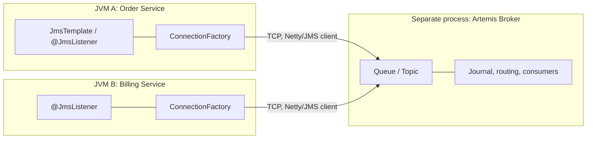
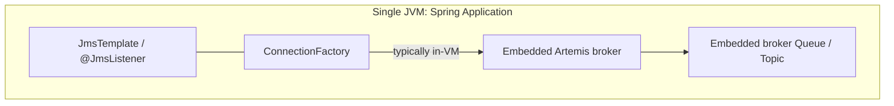

# External Broker vs. Embedded Broker in Spring JMS

## 1. The Question to Understand When Setting Up JMS Connections

A Spring application using JMS typically has two parts with **distinct roles**:

- **JMS client inside the application:** `JmsTemplate`, `@JmsListener`, `ConnectionFactory`, and `Connection`/`Session`/`MessageProducer`/`MessageConsumer` objects. They send or receive messages through the Jakarta Messaging interface.
- **Message broker:** the process/server that manages destinations (Queues, Topics), routes messages, stores messages according to configuration, dispatches to consumers, handles acknowledgements, redelivery, and other operational concerns. Example: Apache ActiveMQ Artemis.

The question **"How do an external broker and an embedded broker differ?"** is about **the deployment location and lifecycle of the broker itself**, not two types of messages or two `@JmsListener` modes.

An **external / standalone broker** is a broker running as **a separate process or service** from the Spring application. It may run in a Docker container, virtual machine, bare-metal server, Kubernetes pod, or managed service. Spring connects over an appropriate address and protocol. A broker can run on the same physical machine as the application and still be an **external broker** if it is a separate OS process.

An **embedded broker** is a broker **instantiated inside the same JVM process as the application** using the provider's server library. The broker's lifecycle is usually tied to the lifecycle of the application that started it. With ActiveMQ Artemis, you can embed the server as a Java object or let Spring Boot auto-configure it when the corresponding dependency is present.

> **Remember:** `ConnectionFactory` is **client-side** and is not the broker. Having `spring-boot-starter-artemis` or `JmsTemplate` does not mean an Artemis server exists inside the JVM. JMS is an API standard; how a broker starts, connection URIs, and persistence are provider features.

### Two Deployment Diagrams

**A. External broker:**



Applications A and B connect to the **same broker** and therefore see the same destinations owned by that broker (provided names, permissions, routing, and subscriptions are configured properly).

**B. Embedded broker inside one application:**



The application **owns both client and broker** inside the JVM. If you run two independent application instances and each embeds its own broker, by default those are **two separate brokers**, not one shared queue.

**Do not equate "embedded" with "RAM-only":** an embedded broker can still have persistence, a journal, selectors, transactions, routing, and even a TCP acceptor when configured. Conversely, an external broker can be configured for transient storage. **Deployment location** and **storage policy** are two separate decisions.

## 2. Comparison Table of Core Aspects

| Aspect | External broker | Embedded broker |
| --- | --- | --- |
| **Execution location** | Separate process/container/service from the Spring app | Same JVM as the application |
| **Who starts the broker?** | Docker, service manager, Kubernetes, operator, or operations team | Embedded code or Spring Boot during app startup |
| **Lifecycle** | Continues running when the application stops | Typically stops when the hosting JVM exits |
| **Client connectivity** | Typically via TCP to broker hostname/port | Typically via in-VM transport; can also open TCP if configured |
| **Sharing across multiple services** | Easily provides a shared messaging hub for many apps | Each embedded instance holds its own destinations unless inter-broker links are explicitly configured |
| **Scaling the application** | Multiple instances connect to one shared broker infrastructure | Replicating the app usually replicates the broker as well |
| **Surviving restarts** | Possible when persistence and durable storage are enabled | Possible if persistence is enabled and the data directory is preserved; not guaranteed automatically |
| **Impact when app crashes** | Independent broker stays up and holds pending messages | Broker in that JVM stops too; recovery depends on storage setup |
| **Impact when broker fails** | Apps need reconnect/recovery; apps sharing the broker may be impacted | Tied directly to the health and resources of the app process |
| **CPU/RAM/threads** | Broker uses an independently managed resource budget | Competes with business logic for heap, threads, and CPU inside the JVM |
| **Latency** | Includes network and transport serialization overhead | In-VM may avoid a network hop, though total processing time is not guaranteed to be lower |
| **Security** | Needs auth, TLS, destination ACLs, and proper network policies | Can be simple for local exercises; if exposed over the network, still needs full security |
| **Observability** | Dedicated console, metrics, logs, alerts, and backups | Logs/metrics and lifecycle tied to the app; may need extra setup to inspect the broker |
| **Typical use cases** | Cross-service communication, staging/production, multiple replicas | Demos, learning, small integration tests, well-scoped internal messaging tasks |

This table does not claim external brokers are **always** HA or embedded brokers **always** lose data. HA, durability, retries, disk, and quorum are features that **must be configured and tested**—they do not appear automatically from packaging.

### Spring Boot's "native" Mode Name Is Easily Misunderstood

For **ActiveMQ Artemis** in Spring Boot, `spring.artemis.mode=native` means Spring creates a `ConnectionFactory` to **connect to a separate broker** using the Netty transport. It **does not** mean calling native/JNI code, does not mean Artemis is a C library, and does not mean the broker is embedded.

`spring.artemis.mode=embedded` instructs Spring Boot to start an Artemis server **inside the current JVM**, provided the server dependency is present. Setting the mode **explicitly** avoids accidentally switching deployment models when classpath dependencies change.

## 3. Tracing a Message Through Both Models

Suppose service `Orders` publishes message `OrderPlaced#501` and service `Billing` wants to process it.

### 3.1. External Broker

1. The Artemis broker starts independently and exposes destination `orders.queue`.
2. `Orders` and `Billing` receive `ConnectionFactory` beans pointing to the **same broker address** (e.g., `tcp://artemis:61616` in Docker Compose).
3. `Orders` calls `JmsTemplate.convertAndSend("orders.queue", ...)`.
4. The JMS client sends the message over the connection to the broker; the broker stores, routes, and delivers per Queue configuration.
5. `Billing` has a consumer on that **same Queue** and can receive it.
6. If `Orders` shuts down after sending succeeds, the broker can still retain the pending message for `Billing`, depending on transactions, persistence, TTL, and broker state.

Key point: **A Queue's identity is tied to the actual broker/destination**, not just the string `"orders.queue"` written in code.

### 3.2. Two Applications Each Embedding a Broker

If you run two separate Spring processes:

- Process `Orders` starts embedded broker **E1**, with Queue `orders.queue`.
- Process `Billing` starts embedded broker **E2**, also with Queue `orders.queue`.
- `Orders` sends the message into `E1/orders.queue`; `Billing` listens on `E2/orders.queue`.

Because **E1 and E2 are two distinct brokers**, a message sent to E1 **never automatically appears** on E2.

```text
Orders JVM                       Billing JVM
  producer                        listener
     |                                |
  Embedded E1                     Embedded E2
  orders.queue                    orders.queue
       M501                       (no M501)

Same queue name ≠ same broker ≠ same message set.
```

To communicate across processes, the simplest approach is to **point both clients to the same external broker**. Provider-specific broker-to-broker/cluster/bridge topologies can be built, but such behavior is **not enabled automatically** when you add an embedded dependency.

### 3.3. When Running Multiple Instances of the Same Service

In an environment with three replicas of `order-worker`:

- **External broker + one shared Queue:** three JMS consumers share work from the Queue according to the broker's dispatch policy. Each message on initial delivery normally goes to one consumer; failures may trigger redelivery.
- **Three independent embedded brokers:** each worker has its own Queue. A worker only sees messages entering its own broker and cannot see backlogs in the other two. An HTTP load balancer in front of the app **does not merge those Queues** into one.

For a **Topic**, a shared broker distributes to subscriptions on that broker. Two independent embedded brokers can have Topics with the same name without any connection between them. Thus, you must track **both broker identity and subscription identity**.

## 4. Configuring Spring Boot with an External Artemis Broker

This example uses **Spring Boot 3.3.x / Java 17+ / ActiveMQ Artemis** with the `jakarta.jms.*` namespace. This is a real Spring JMS application, not an in-memory Java collection simulating a queue.

### 4.1. Starting an External Broker with Docker

On a machine with Docker installed, run an Artemis container **separate from Spring's JVM**:

```bash
docker run --detach --rm --name artemis-external-demo -p 127.0.0.1:61616:61616 -p 127.0.0.1:8161:8161 apache/artemis:latest-alpine
```

This command uses the official Apache Artemis Docker image. `61616` is the messaging transport port; `8161` is the web management port. Binding `127.0.0.1` restricts access to localhost for the lab. Wait for the broker to be ready with:

```bash
docker logs artemis-external-demo
```

The demo image uses default username `artemis` and password `artemis`. **Only use default credentials in local test environments**; change them and configure network/TLS/authorization properly for real deployments.

You can open the console at `http://localhost:8161` to inspect the broker. The broker starts and stops independently of the Java process:

```bash
docker stop artemis-external-demo
```

Note: `--rm` deletes the container on stop; without a mounted volume, **do not expect data to survive container removal**, even if some messages were written to the container's internal filesystem. Preserving data across restarts requires persistence configuration and durable volumes/storage.

### 4.2. Application Maven Dependency

`spring-boot-starter-artemis` provides the client library and Spring JMS integration. When **only connecting to an external broker**, the application does not need `artemis-jakarta-server`.

```xml
<dependency>
    <groupId>org.springframework.boot</groupId>
    <artifactId>spring-boot-starter-artemis</artifactId>
</dependency>
```

Spring Boot can auto-create `ConnectionFactory` and `JmsTemplate` when the classpath and properties match. To reiterate: this is **client integration**; it does not start a Docker container or Artemis service for you.

### 4.3. `application.properties` for an External Broker

```properties
spring.artemis.mode=native
spring.artemis.broker-url=tcp://localhost:61616
spring.artemis.user=artemis
spring.artemis.password=artemis
```

When the app runs **on the same Docker host**, `localhost` can reach the published port. When the app runs **inside another container**, `localhost` is **the app container**, not the broker container. In Docker Compose, you can use the service name like `tcp://artemis:61616` on the shared network; in Kubernetes, use the broker Service DNS.

In real environments, store credentials in a secret manager/environment and apply proper security settings and certificates. Never hardcode production passwords in committed files.

Verification points to check: application logs show the client connected, the broker console shows consumers on the destination, and a send/receive test succeeds. "Application context started" alone does not prove connectivity or message consumption.

## 5. Configuring an Embedded Broker with Spring Boot

### 5.1. Required Additional Dependency

With Spring Boot 3.x and ActiveMQ Artemis, the **broker server library** must be on the classpath alongside the client starter:

```xml
<dependency>
    <groupId>org.apache.activemq</groupId>
    <artifactId>artemis-jakarta-server</artifactId>
    <scope>runtime</scope>
</dependency>
```

The version is chosen by Spring Boot dependency management when using Boot's BOM/parent. In Gradle with the Boot BOM, the equivalent is adding runtime dependency `org.apache.activemq:artemis-jakarta-server`.

`artemis-jakarta-server` is the **server-side** library needed to embed the broker. If you only include `spring-boot-starter-artemis` while setting `spring.artemis.mode=embedded`, the embedded configuration is incomplete and startup can fail. A real embedded broker is still a **full messaging server inside the JVM**, not a `HashMap` or mock of `JmsTemplate`.

### 5.2. `application.properties` for Embedded Mode

```properties
spring.artemis.mode=embedded
spring.artemis.embedded.persistent=false
spring.artemis.embedded.queues=demo.orders
```

Explanation:

- `mode=embedded` instructs Spring Boot to start an embedded broker. If the server library is missing, fix the dependency rather than wrongly switching to `native` to hide the error.
- `persistent=false` is an **intentional choice for demos**: the broker does not durably persist its message journal. Do not use this when backlogs must survive restarts.
- `embedded.queues=demo.orders` prepares the Queue used in the example. For topics, the corresponding property is `spring.artemis.embedded.topics`.
- In embedded mode, you **do not need** to run an external Artemis container for this demo. Boot typically configures an in-VM connection to the embedded broker.
- Connecting from another process to an embedded broker **does not work automatically**; exposing a TCP/remote acceptor requires explicit server configuration and evaluation of lifecycle and security limits.

**Do not use `spring.artemis.broker-url=tcp://localhost:61616` as proof of an embedded broker.** A TCP URI is only a transport address; knowing where the broker runs requires identifying which process creates and manages the server.

### 5.3. Classpath Impact and Auto-Detection

Spring Boot can **automatically infer embedded mode** if it detects Artemis server classes on the classpath, unless mode is configured explicitly. Thus, simply adding a server dependency for tests or runtime could cause an application to run an internal broker unintentionally.

Maintainable rule:

- A **dev-embedded** profile sets `spring.artemis.mode=embedded` and includes the server dependency.
- **dev-external**, **staging**, or **prod** profiles set `spring.artemis.mode=native` with the proper broker URL/credentials.
- When one artifact carries both client and server dependencies to demonstrate both modes, **always set mode explicitly** per profile.
- Verify connections and consumers on **the exact intended broker**, avoiding the trap where "send/receive works" only because it went through an internal Queue.

## 6. End-to-End Practice: Same Application, Switching Brokers via Profiles

Goal of this exercise: **publisher and listener code stay untouched when swapping an external broker for an embedded broker**. Only where `ConnectionFactory` connects changes via configuration.

Requirements: **JDK 17+, Maven 3.9+**. When running the `native` profile, Docker and a running broker are also needed. So both modes share one project, the embedded server dependency is on the runtime classpath and each profile sets its mode explicitly.

### 6.1. Directory Structure

```text
broker-location-demo/
├── pom.xml
└── src/
    └── main/
        ├── java/demo/jms/BrokerLocationDemoApplication.java
        └── resources/
            ├── application-native.properties
            └── application-embedded.properties
```

### 6.2. `pom.xml`

```xml
<project xmlns="http://maven.apache.org/POM/4.0.0"
         xmlns:xsi="http://www.w3.org/2001/XMLSchema-instance"
         xsi:schemaLocation="http://maven.apache.org/POM/4.0.0 https://maven.apache.org/xsd/maven-4.0.0.xsd">
    <modelVersion>4.0.0</modelVersion>

    <parent>
        <groupId>org.springframework.boot</groupId>
        <artifactId>spring-boot-starter-parent</artifactId>
        <version>3.3.0</version>
        <relativePath/>
    </parent>

    <groupId>demo</groupId>
    <artifactId>broker-location-demo</artifactId>
    <version>1.0.0</version>
    <properties>
        <java.version>17</java.version>
    </properties>

    <dependencies>
        <dependency>
            <groupId>org.springframework.boot</groupId>
            <artifactId>spring-boot-starter-artemis</artifactId>
        </dependency>

        <!-- Present so the embedded profile starts the Artemis server. -->
        <dependency>
            <groupId>org.apache.activemq</groupId>
            <artifactId>artemis-jakarta-server</artifactId>
            <scope>runtime</scope>
        </dependency>
    </dependencies>

    <build>
        <plugins>
            <plugin>
                <groupId>org.springframework.boot</groupId>
                <artifactId>spring-boot-maven-plugin</artifactId>
            </plugin>
        </plugins>
    </build>
</project>
```

This example lets you **try both modes with the same Java code**. For production apps using only an external broker, consider removing the embedded server dependency from the runtime classpath to avoid accidental startup and reduce unnecessary library surface.

### 6.3. Full Java Source

Save `src/main/java/demo/jms/BrokerLocationDemoApplication.java`:

```java
package demo.jms;

import java.util.concurrent.CountDownLatch;
import java.util.concurrent.TimeUnit;

import org.springframework.boot.ApplicationRunner;
import org.springframework.boot.SpringApplication;
import org.springframework.boot.autoconfigure.SpringBootApplication;
import org.springframework.context.annotation.Bean;
import org.springframework.jms.annotation.EnableJms;
import org.springframework.jms.annotation.JmsListener;
import org.springframework.jms.core.JmsTemplate;
import org.springframework.stereotype.Component;

@SpringBootApplication
@EnableJms
public class BrokerLocationDemoApplication {
    public static void main(String[] args) {
        SpringApplication.run(BrokerLocationDemoApplication.class, args);
    }

    @Bean
    ApplicationRunner sendDemo(JmsTemplate jmsTemplate, DemoInboxListener listener) {
        return args -> {
            jmsTemplate.convertAndSend("demo.orders", "ORDER-501");
            if (!listener.awaitMessage(10, TimeUnit.SECONDS)) {
                throw new IllegalStateException("Timed out waiting for JMS message");
            }
            System.out.println("DEMO: completed");
        };
    }
}

@Component
class DemoInboxListener {
    private final CountDownLatch received = new CountDownLatch(1);

    @JmsListener(destination = "demo.orders")
    public void onMessage(String payload) {
        System.out.println("LISTENER: " + payload);
        received.countDown();
    }

    boolean awaitMessage(long timeout, TimeUnit unit)
            throws InterruptedException {
        return received.await(timeout, unit);
    }
}
```

**Explanation of the example's contract:**

1. `JmsTemplate.convertAndSend` creates and sends a JMS `TextMessage` from the string.
2. `@JmsListener` declares a consumer on Queue `demo.orders`; Spring's listener container manages delivery.
3. `CountDownLatch` only lets the **demo** wait for the callback instead of exiting too early; it is neither a broker mechanism nor transaction confirmation.
4. `@EnableJms` explicitly enables listener endpoint support. Spring Boot can also enable this infrastructure automatically via auto-configuration.
5. Only a single instance runs in the demo. If you run two instances of the same code against an external Queue, each has its own producer and consumer; do not expect each instance to always receive the exact message it sent, as competing consumers share the Queue.

**Important:** This code uses Spring JMS's default **Queue** mode. The lesson compares broker locations, not changing Queue to Topic. For Topics, `pubSubDomain` must be updated on both producer and listener container; how the broker is deployed remains an independent decision.

### 6.4. Two Configuration Files

`src/main/resources/application-native.properties`:

```properties
spring.artemis.mode=native
spring.artemis.broker-url=tcp://localhost:61616
spring.artemis.user=artemis
spring.artemis.password=artemis
```

`src/main/resources/application-embedded.properties`:

```properties
spring.artemis.mode=embedded
spring.artemis.embedded.persistent=false
spring.artemis.embedded.queues=demo.orders
```

The `native` profile name comes from `application-native.properties`, not as a metaphor for native code. Both runs execute **the exact same** `BrokerLocationDemoApplication.java`.

### 6.5. Running with the External Broker

Start the Artemis container using the command in section 4.1 and wait until the broker is ready. From the directory containing `pom.xml`:

```bash
mvn spring-boot:run -Dspring-boot.run.profiles=native
```

The application must connect to `tcp://localhost:61616`. Logs may interleave Spring/Artemis lines; **the two lines printed by our demo code** in order are:

```text
LISTENER: ORDER-501
DEMO: completed
```

The ordering of these two lines is enforced by `CountDownLatch`: the callback prints `LISTENER` before calling `countDown`; the runner prints `DEMO` only after `awaitMessage` returns true. This is the expected output when the broker is ready and send/receive succeeds; otherwise, the app reports a timeout or connection error.

After observing, press `Ctrl+C` to stop the app, then you can stop the broker separately. The broker **does not shut down automatically with the app**.

### 6.6. Running with the Embedded Broker

Ensure `artemis-jakarta-server` is on the runtime classpath. You may stop the external container to prove the example does not need it. Run:

```bash
mvn spring-boot:run -Dspring-boot.run.profiles=embedded
```

Spring Boot starts an Artemis broker inside the application JVM and creates the configured demo Queue. The Java code prints the same two lines:

```text
LISTENER: ORDER-501
DEMO: completed
```

When you press `Ctrl+C`, the Spring application context terminates and the embedded broker follows that lifecycle. With `persistent=false`, do not use this exercise as evidence of retaining backlogs across restarts.

**Extra verification point:** In embedded mode, `localhost:61616` does not necessarily have a listening broker; Spring can use an in-VM transport instead of TCP. `docker ps` showing no external container is still valid. The surest check is reading the configured mode, classpath, startup process/logs, and send/receive results.

### 6.7. When Deploying the Same Demo as Two Processes

If you want to verify the difference between two brokers with identically named Queues, avoid having each process both send and receive (that **does not prove** they share messages). Design the test so **process A only sends** and **process B only receives**:

- Native: A and B point to the same external Artemis; messages sent by A can be received by B (unless another consumer grabs them first).
- Embedded: A and B create separate brokers; messages in E1 never appear in E2. Without bridge/cluster configuration, matching Queue names do not create an inter-broker link.

This lesson puts both producer and consumer in one process to keep running simple; verifying cross-process message sharing requires the A/B test described above.

## 7. Persistence, Durability, and Recovery

Separate four concepts:

1. **Broker location:** external out-of-process broker or embedded inside the JVM.
2. **Message delivery mode:** `PERSISTENT` or `NON_PERSISTENT` (per Jakarta Messaging), along with transactions and acknowledgements.
3. **Broker storage:** writing journals to durable disk, persistence settings, data directory location, and file permissions.
4. **High availability / recovery:** continuing when a node dies, backup/replication/failover, networking, and client reconnect settings.

### Common Failure Matrix

| Incident | External broker | Embedded broker |
| --- | --- | --- |
| Sending Spring service crashes | Independent broker can still retain received/committed messages per policy | Broker living in that process may stop with the app |
| Spring consumer stops while broker stays up | Backlog can remain on the broker for Queues; Topics require durable subscriptions | If the broker lives in **that consumer process**, the broker stops too |
| Broker restarts | Recovery relies on persistent journal/storage, delivery mode, and policy | Similar regarding storage, but restart typically accompanies an app restart |
| Process/container deleted with data directory | Data can be lost if volumes are not retained | Data can be lost if the embedded broker's directory is not retained |
| Two replicas processing in parallel | Can act as competing consumers on one shared Queue | Often each replica is a separate Queue if each embeds a broker |
| Wanting failover when a broker dies | Requires cluster/HA, client reconnect, and valid storage setup | Embedding in individual apps does not create HA |

`spring.artemis.embedded.persistent=true` can enable storage on embedded Artemis; you must define the data directory location and preserve storage across restarts. **It does not turn an embedded broker into an HA cluster.** `spring.artemis.embedded.persistent=false` should only be used when suited for testing and message loss is acceptable.

An external broker is not automatically "durable" either: if a container runs with `--rm` and no volume, loses its filesystem on removal, or has persistence disabled, messages can be lost. To ensure business reliability, test **broker restarts, process crashes, network partitions, redelivery, and replay** under real configuration.

### Transactions/Ack Do Not Depend on Broker Placement

Regardless of where the broker lives, JMS still has acknowledgement modes, transactions, and redelivery scenarios. If a handler writes to a DB successfully but the connection drops before JMS commits, the broker can redeliver the message. Thus, designing **idempotent consumers**, business message identifiers, and poison-message handling remains essential in both models.

"Embedded means messages cannot be lost" and "external means automatic exactly-once" are both false conclusions.

## 8. Performance and Resources: Faster Does Not Mean Better

An embedded broker can reduce network latency when producer and consumer share a JVM and use an in-VM transport. However, the broker still has to route, queue, persist, schedule threads, serialize/copy, and manage acks and transactions. If the app is CPU-heavy or short on heap, **the embedded broker and business logic compete for the same resources**.

An external broker adds a network hop, but in return can be given dedicated memory, CPU, disk IOPS, TLS termination, monitoring, and operations; multiple services can share it without embedding a server in each application.

You cannot pick a model based solely on "embedded is faster" or "external is slower." Benchmark with:

- **End-to-end latency** from publish to business completion, including persistence and ack.
- **Throughput** as producers/consumers, payload size, and concurrency scale.
- **Pending/inflight/redelivery counts** on the broker.
- **JVM heap, GC, CPU, and thread counts** for both app and broker.
- **Storage latency, disk throughput, and fsync**, especially for persistent messages.
- Broker/app restart scenarios and recovery times.

Benchmarking a non-persistent in-memory embedded broker against an external broker running synced journals and TLS is **not** a fair comparison of durability or features. Align reliability targets before measuring performance.

## 9. Security and Operations

### External Broker

- Has endpoints, ports, and network policies/firewalls. Authenticate clients, authorize per Queue/Topic, enable TLS where needed, and rotate secrets.
- Monitor health, queue depth, consumer counts, unacknowledged messages, redeliveries, dead-letter queues, broker disk usage, and connection failures.
- Manage backups, persistence, HA/failover, version upgrades, and capacity **independently** of application release schedules.
- Do not leave the broker management console or transport ports publicly exposed just because a Docker example worked.

### Embedded Broker

- Shares the JVM process: monitor memory, threads, disk paths, and file permissions of the app.
- Watch out for server dependencies pulled into runtime unintentionally; check the active mode at startup.
- If the broker only serves inside the JVM with no remote acceptor enabled, the network surface may be smaller; **if TCP is opened for other services to connect**, it still needs authentication/TLS/management similar to an external broker.
- With multiple instances, you must know which broker holds which messages, which data is backed up, and how to route/migrate to new instances. Do not assume HTTP service discovery solves JMS broker identity.
- When applications deploy/restart frequently, the embedded broker restarts too. Retaining queue backlogs across restarts must be explicitly designed.

## 10. Choosing a Model by Need

| Need | Typically suitable choice | Reason |
| --- | --- | --- |
| Personal demo, quick trial without installing a broker | **Embedded** | Quick setup, starts with app, tests JMS logic |
| Short integration tests checking JMS APIs | **Embedded**, if close enough to target | Real broker inside test JVM; easy isolation reset, though watch lifecycle |
| Testing network connectivity, auth/TLS, and production-like setup | **External test broker** via Docker/Testcontainers | Tests real network boundaries and out-of-process server behavior |
| Two or more microservices exchanging messages | **External** | Needs shared destinations and an independent broker |
| Multiple consumer replicas sharing one Queue | **External** (standard) | All replicas consume from the shared broker's Queue |
| Production requiring HA, backups, independent admin and monitoring | **External**, properly operated and configured for HA | Decoupled lifecycle, centralized observability and administration |
| Single-JVM app with internal queues still needing JMS semantics | **Embedded** can fit | Only when accepting its lifecycle, storage, and scaling limits |
| App only needing in-RAM collections/`BlockingQueue` | No JMS broker needed if JMS isn't required | Different tool; do not call a standard Java Queue an embedded JMS broker |

**Selection rule:** Whenever multiple independent processes/services need the same event stream, prefer a broker managed as separate infrastructure. When simply testing JMS in one JVM with no cross-process sharing, embedded is simpler. Special cases using embedded in production are possible, but you take full responsibility for storage, topology, HA, and lifecycle.

## 11. Migrating an Application from Embedded to External

An advantage of the JMS abstraction is that business code can stay intact if it does not rely on provider-specific APIs.

1. **Keep stable** destination names, Queue/Topic semantics, payload schemas, headers, selectors, transactions, and ack modes.
2. **Prepare the standalone broker**: queue/address routing, credentials, permissions, persistence, DLQ, retention/TTL, and monitoring.
3. **Set mode explicitly:** replace `spring.artemis.mode=embedded` with `spring.artemis.mode=native`.
4. **Point to the endpoint:** `spring.artemis.broker-url` targets the actual broker; never misuse `localhost` inside containers.
5. **Adjust runtime dependencies:** external production does not need Artemis server inside the app JVM; embedded tests can keep it in test profile/scope.
6. **Verify in reality:** producer and consumer in **two separate processes** see the same destination; test a message, transaction, restart, and redelivery.
7. **Plan backlog migration:** messages left in the old embedded broker **do not move automatically** to the external broker when you change `broker-url`. If old data matters, plan draining/migration tailored to the broker, persistence state, and business rules.
8. **Roll out sequentially:** ensure two brokers are not serving the same business flow simultaneously without a safe bridge/dual-write strategy.

If an app embedded a broker solely for tests, switching modes is usually just a few properties. If the embedded broker held real data, it is a **state migration problem**, not merely changing a URL.

## 12. Diagnosing Common Errors

### Error 1: "Connection refused" on `localhost:61616`

**Situation:** `spring.artemis.mode=native` is configured, yet no external broker is running at that address.

**How to check:** inspect containers/services, port mappings, broker logs, DNS/network, firewall, and client credentials. If the app runs in a container, replace `localhost` with an address reachable from the container network. Do not switch to embedded merely to make the connection error "disappear" if your architecture needs a shared broker.

### Error 2: Two services both send/receive successfully yet never communicate with each other

**Common cause:** both apps are auto-starting **separate embedded brokers**, and each sends to and reads from its local Queue. The JMS layer looks healthy because each process talks to itself.

**How to check:** verify actual mode, server dependencies, JVM processes, embedded startup logs, ConnectionFactory URL/transport, and the shared broker console. Test with A sending only and B receiving only. Never infer "same Queue name" means "same broker."

### Error 3: Adding a dependency changes app behavior

**Cause:** the server artifact `artemis-jakarta-server` appeared on the classpath, and Spring Boot may auto-detect an embedded broker if mode is not explicitly set.

**Fix:** explicitly set `spring.artemis.mode=native` in profiles needing an external broker; check the dependency tree, active profiles, and client connection destination.

### Error 4: Embedded tests pass, production loses messages on restart

**Possible causes:** tests had persistence disabled or no network failures; production changes storage, transaction, TTL, subscription, or release semantics. Broker placement is only one factor.

**How to check:** delivery mode, broker persistence, disks, volume mounts, journals, ack/commit, DLQ, and end-to-end replay. Test with the same reliability goals as production.

### Error 5: Scaling the app creates multiple isolated queues

**Cause:** each replica starts its own embedded broker. Replica A cannot see Replica B's backlog.

**Fix:** if a single shared Queue is required, move to a shared external broker or design a clearly managed cluster/bridge topology. Do not expect Kubernetes replica counts to merge destinations.

### Error 6: Embedded broker opens a TCP port and hits a port conflict

**Cause:** embedded server config has a fixed TCP acceptor and two instances on the same host try to bind the same port; or the host already runs an external broker on that port.

**Fix:** inspect broker server configuration/acceptors, distinguish in-VM vs. TCP, assign separate ports if needed; do not open a TCP port if only in-JVM connectivity is required.

### Error 7: External broker is running, yet the app receives no messages

**Possible causes:** consumer points to the wrong broker address, Queue/Topic mismatch, wrong permissions, failed client reconnect, listener not started, or message filtered by selector/TTL.

**How to check:** verify the Queue name and routing type on **the exact broker the client connects to**, consumer counts, message counts, connection logs, and listener container status. An external broker being online does not prove all JMS clients point to the right place.

## 13. Self-Check Exercises

**Question 1.** A Spring Boot app and Artemis run in **two different containers** on the same machine. Is this an embedded broker?

**Answer:** No. Two independent processes/containers follow the external broker model, even on the same host.

**Question 2.** Two Spring instances both configure `spring.artemis.mode=embedded` and the same name `payments.queue`. Will instance B automatically read messages sent to instance A?

**Answer:** No, unless an inter-broker linking mechanism is configured separately. These are two distinct brokers with two identically named Queues.

**Question 3.** Does having `JmsTemplate` and `ConnectionFactory` in the Spring context mean an embedded broker is running?

**Answer:** No. Those are client abstractions. You must check mode, server dependencies, and broker processes.

**Question 4.** Why should the `native` profile still set `mode=native` even when the project includes the embedded server dependency for tests?

**Answer:** So Spring Boot does not infer embedded mode from the classpath and mistakenly connect to a local embedded broker.

**Question 5.** Does an embedded broker with `persistent=true` guarantee HA and exactly-once business processing?

**Answer:** No. Persistence is only one aspect of durability; proper storage retention, backup/failover, transactions, and idempotent consumers are still required.

**Question 6.** Why must `application-native.properties` use the real broker address instead of copying `localhost` into another service's container?

**Answer:** `localhost` inside each container resolves to that container itself. The app container must connect via a DNS/host/port reachable to the broker.

**Question 7.** If you only change `spring.artemis.mode=embedded` to `native`, do messages remaining in the old broker automatically move to the new broker?

**Answer:** No. They are two separate brokers with independent state; keeping the backlog requires an explicit migration/drain process.

**Question 8.** Is a message traveling from producer to listener in the same JVM with an embedded broker guaranteed to have lower end-to-end latency than an external broker?

**Answer:** Not guaranteed. In-VM can avoid a network hop, yet total latency depends on persistence, GC, CPU, thread scheduling, business processing, and how it is measured.

### Key Takeaway to Remember

An **external broker** has its own process and lifecycle; multiple Spring services can share its destinations if they connect to the same broker. An **embedded broker** runs inside the app's JVM, convenient for demos/tests or scoped internal use cases, yet each embedding process normally has **its own broker and queues**. **`ConnectionFactory` determines where the app connects; broker location alone does not determine durability, HA, ack, or exactly-once.**

## Official References

- [Spring Boot 3.4 – JMS, Artemis embedded and native mode](https://docs.spring.io/spring-boot/3.4/reference/messaging/jms.html)
- [Spring Boot – JMS application properties, embedded persistence, queues, and topics](https://docs.spring.io/spring-boot/3.4/appendix/application-properties/index.html)
- [Spring – Messaging with JMS: broker and listener setup](https://spring.io/guides/gs/messaging-jms/)
- [Apache ActiveMQ Artemis – Embedding Apache Artemis](https://artemis.apache.org/components/artemis/documentation/latest/embedding-artemis.html)
- [Apache ActiveMQ Artemis – Docker image, ports, and volumes](https://artemis.apache.org/components/artemis/documentation/latest/docker.html)
- [Spring Framework – Annotation-driven JMS listener endpoints](https://docs.spring.io/spring-framework/reference/integration/jms/annotated.html)
