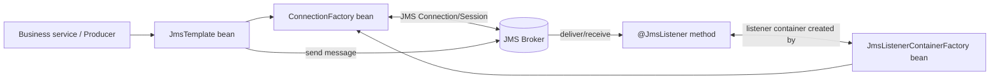
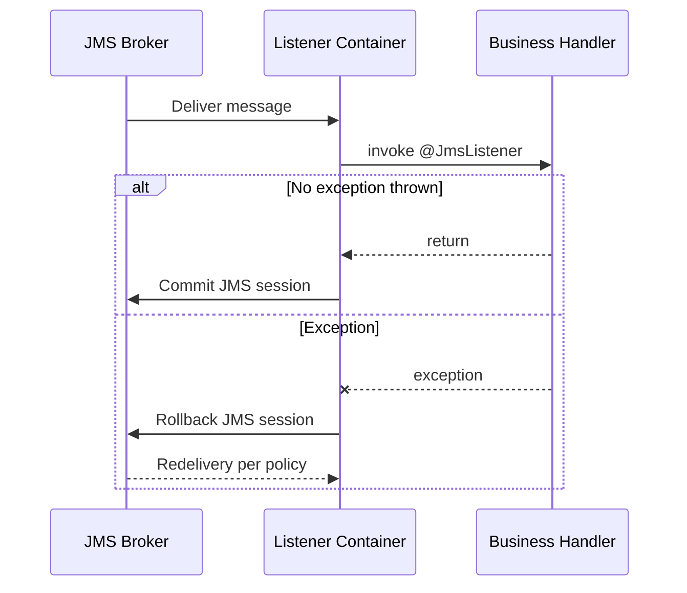

# Registering ConnectionFactory, JmsTemplate, and Listener Factory in Spring JMS

> **Context:** Spring Framework – JMS, **Connection Setup** group. This lesson progresses from the roles of the three components to how they are registered as Spring Beans, choosing between Spring Boot auto-configuration and explicit configuration, and verifying a complete JMS send/receive flow. Examples use **Java 21, Spring Boot 3.3.5, Jakarta Messaging, and Apache ActiveMQ Artemis**.

## 1. The Connection Picture: Three Components, Three Responsibilities

When an application uses JMS, producers should not repeat boilerplate to open connections/sessions/producers for every business feature, and consumers should not manually manage threads and receive loops. Spring JMS divides responsibilities:

| Component | Role | Used by |
| --- | --- | --- |
| `jakarta.jms.ConnectionFactory` | **Source for creating connections** to the JMS provider/broker, holding provider connection, auth, and transport settings. | `JmsTemplate` and listener containers. |
| `org.springframework.jms.core.JmsTemplate` | **API for sending, active receiving, and converting messages**; manages resource lifecycles per Spring JMS call. | Producers/services sending messages, and occasionally synchronous receivers. |
| `org.springframework.jms.config.DefaultJmsListenerContainerFactory` | **Blueprint for creating listener containers** when Spring processes `@JmsListener`; configures connection, destination mode, concurrency, transactions, converter, and error handling. | `@JmsListener` registration infrastructure. |



Read the diagram in deployment flow order: containers receive settings from the listener factory; the container itself uses `ConnectionFactory` to create, maintain, and recover connections/sessions/consumers and invoke the listener method when messages arrive. `DefaultJmsListenerContainerFactory` is **not** an active consumer receiving messages; it is a factory that builds a `DefaultMessageListenerContainer` per endpoint.

Commonly confused objects:

- **`ConnectionFactory` vs. `Connection`:** The factory bean is reused; actual connections may be opened when sending/receiving begins. A bean existing does not prove the broker is connected.
- **`JmsTemplate` vs. `MessageProducer`:** The template executes send/convert operations and borrows or creates JMS resources from `ConnectionFactory`. It is not the broker and does not store queues.
- **`JmsListenerContainerFactory` vs. `@JmsListener`:** The annotation marks the endpoint; the factory bean determines how the endpoint runs.
- **`Queue` vs. `Topic`:** Not just changing the destination name string. `pubSubDomain=false` selects a queue (point-to-point); `true` selects a topic (publish/subscribe) with different semantics.

## 2. Who Registers the Beans: Spring Boot or Our Code?

### 2.1. Spring Boot Often Auto-Configures All Three

When `spring-boot-starter-artemis` is present, broker settings are valid, and no conflicting custom beans exist, Spring Boot typically:

1. Creates a `ConnectionFactory` to connect to Artemis from `spring.artemis.*`, often wrapping it in `CachingConnectionFactory` on the application side.
2. Creates a `JmsTemplate` if no matching bean exists yet; defaults to queue mode.
3. Enables `@JmsListener` infrastructure and creates the default listener container factory named `jmsListenerContainerFactory` if no application-registered factory exists.
4. Wires common options such as `MessageConverter`, `DestinationResolver`, and supported listener properties via auto-configuration.

In a typical Spring Boot application, simply injecting `JmsTemplate` and adding `@JmsListener` is enough to send and receive. **Manually declaring `@Bean`s is not required** if the defaults meet your needs.

**The two approaches below are mutually exclusive alternatives**:

- **Approach A – Boot auto-config:** minimal code, recommended when using one broker with standard settings.
- **Approach B – explicit registration of all three beans:** to understand the mechanism and take full control when changing providers or separating destinations, transactions, or listener concurrency.

Do not copy both approaches wholesale into one application expecting them to merge seamlessly; manually registered `@Bean`s can cause Boot's auto-configuration to **back off**.

### 2.2. Dependencies for Both Approaches

For a standalone Gradle project with Java 21, create `settings.gradle`:

```groovy
rootProject.name = 'spring-jms-wiring-demo'
```

`build.gradle`:

```groovy
plugins {
    id 'java'
    id 'org.springframework.boot' version '3.3.5'
    id 'io.spring.dependency-management' version '1.1.6'
}

group = 'com.example'
version = '0.0.1-SNAPSHOT'

java {
    toolchain {
        languageVersion = JavaLanguageVersion.of(21)
    }
}

repositories {
    mavenCentral()
}

dependencies {
    implementation 'org.springframework.boot:spring-boot-starter-artemis'
    implementation 'org.springframework.boot:spring-boot-starter-web'
}
```

- `spring-boot-starter-artemis` brings in the Jakarta Messaging API, Artemis client, and Spring JMS integration compatible with Spring Boot 3.3.x. Do not mix legacy `javax.jms.*` APIs into `jakarta.jms.*` examples.
- `spring-boot-starter-web` only serves the HTTP API in the demo; it can be omitted if the producer has no HTTP controller.
- The Artemis broker is a **separately running service** at the configured URL; the client dependency **does not automatically create a persistent broker** in `mode: native` examples.

## 3. Approach A: Auto-Registration and Injecting Existing Beans

`src/main/resources/application.yml` (Boot config, no manual Java config needed):

```yaml
spring:
  artemis:
    mode: native
    broker-url: ${JMS_BROKER_URL:tcp://localhost:61616}
    user: ${JMS_USER:artemis}
    password: ${JMS_PASSWORD:artemis}
  jms:
    pub-sub-domain: false
    cache:
      session-cache-size: 5
```

This example targets local environments; replace default credentials with real secrets in deployed environments. `spring.artemis.mode=native` requires connecting to an external broker; `broker-url` is the broker address, not a queue name.

With Boot auto-config, the application can use:

```java
package com.example.jms;

import org.springframework.jms.annotation.JmsListener;
import org.springframework.jms.core.JmsTemplate;
import org.springframework.stereotype.Service;

@Service
class AutoConfiguredService {
    private final JmsTemplate jmsTemplate;

    AutoConfiguredService(JmsTemplate jmsTemplate) {
        this.jmsTemplate = jmsTemplate;
    }

    void send(String orderId) {
        jmsTemplate.convertAndSend("orders.pending", orderId);
    }

    @JmsListener(destination = "orders.pending")
    public void receive(String orderId) {
        System.out.println("Received " + orderId);
    }
}
```

`AutoConfiguredService` is **a component** that must be component-scanned by a `@SpringBootApplication` in package `com.example.jms` (or a parent package); it is not a standalone program with `main`. This illustrates **Boot auto-registration**: `JmsTemplate` is injected and `@JmsListener` uses the default factory. Spring Boot enables the annotation infrastructure automatically, so manual `@EnableJms` is generally unnecessary in Approach A.

**Note:** `CachingConnectionFactory` helps reuse sessions/producers on the sending side, but it does not turn the whole system into a connection pool. `session-cache-size` should be tuned according to traffic and resources. For listeners, the container must actively manage its own connection lifecycle and recovery.

## 4. Approach B: Explicitly Registering All Three Beans with `@Configuration`

Here we explicitly create:

1. `connectionFactory`: a **native Artemis ConnectionFactory** configured from environment properties.
2. `jmsTemplate`: uses that factory to send messages to a queue.
3. `jmsListenerContainerFactory`: uses that factory to build listener containers with JMS session transactions and concurrency.

This is a **standalone, runnable configuration** using the Gradle dependencies from section 2.2. Explicit configuration makes bean wiring visible; it does not provide Boot's caching/pooling optimizations by default. Production refinements are discussed separately.

### 4.1. Properties for the Explicit Version

Replace Approach A's `application.yml` with:

```yaml
app:
  jms:
    broker-url: ${JMS_BROKER_URL:tcp://localhost:61616}
    user: ${JMS_USER:artemis}
    password: ${JMS_PASSWORD:artemis}

server:
  port: 8080
```

`app.jms.*` is an **application-defined namespace** read via `@Value`; these are not Boot's auto-config `spring.artemis.*` keys. We keep the Artemis starter for JMS classes and Spring integration; the application's bean provides the concrete connection factory.

### 4.2. Complete Java Source

Create `src/main/java/com/example/jms/JmsWiringApplication.java`. The path must match `package com.example.jms`; in Java, only one top-level `public class` shares the file name, while the remaining classes are package-private.

```java
package com.example.jms;

import jakarta.jms.ConnectionFactory;

import org.apache.activemq.artemis.jms.client.ActiveMQConnectionFactory;
import org.springframework.beans.factory.annotation.Value;
import org.springframework.boot.SpringApplication;
import org.springframework.boot.autoconfigure.SpringBootApplication;
import org.springframework.context.annotation.Bean;
import org.springframework.context.annotation.Configuration;
import org.springframework.http.ResponseEntity;
import org.springframework.jms.annotation.EnableJms;
import org.springframework.jms.annotation.JmsListener;
import org.springframework.jms.config.DefaultJmsListenerContainerFactory;
import org.springframework.jms.core.JmsTemplate;
import org.springframework.stereotype.Component;
import org.springframework.web.bind.annotation.PathVariable;
import org.springframework.web.bind.annotation.PostMapping;
import org.springframework.web.bind.annotation.RestController;

@SpringBootApplication
public class JmsWiringApplication {
    public static void main(String[] args) {
        SpringApplication.run(JmsWiringApplication.class, args);
    }
}

@Configuration(proxyBeanMethods = false)
@EnableJms
class JmsConfiguration {

    @Bean(destroyMethod = "close")
    ActiveMQConnectionFactory connectionFactory(
            @Value("${app.jms.broker-url}") String brokerUrl,
            @Value("${app.jms.user}") String user,
            @Value("${app.jms.password}") String password) {
        return new ActiveMQConnectionFactory(
                brokerUrl, user, password);
    }

    @Bean("jmsTemplate")
    JmsTemplate jmsTemplate(ConnectionFactory connectionFactory) {
        JmsTemplate template = new JmsTemplate(connectionFactory);
        template.setPubSubDomain(false); // "orders.pending" is a queue
        return template;
    }

    @Bean("jmsListenerContainerFactory")
    DefaultJmsListenerContainerFactory jmsListenerContainerFactory(
            ConnectionFactory connectionFactory) {
        DefaultJmsListenerContainerFactory factory =
                new DefaultJmsListenerContainerFactory();

        factory.setConnectionFactory(connectionFactory);
        factory.setPubSubDomain(false);       // consumer uses a queue
        factory.setSessionTransacted(true);  // commit after handler succeeds
        factory.setConcurrency("1-3");      // 1..3 consumers per instance
        return factory;
    }
}

@RestController
class MessageApi {
    private final JmsTemplate jmsTemplate;

    MessageApi(JmsTemplate jmsTemplate) {
        this.jmsTemplate = jmsTemplate;
    }

    @PostMapping("/messages/{id}")
    ResponseEntity<String> send(@PathVariable String id) {
        jmsTemplate.convertAndSend("orders.pending", id);
        return ResponseEntity.accepted().body("QUEUED " + id);
    }
}

@Component
class OrderMessageListener {
    @JmsListener(destination = "orders.pending")
    public void handle(String id) {
        System.out.println("HANDLED " + id);
    }
}
```

**Actual registration mechanism:**

- `@Configuration` marks a bean-registering class. Spring invokes each `@Bean` method via dependency injection and manages the default singleton bean lifecycle.
- `connectionFactory(...)` accepts configuration values and constructs the **provider-specific Artemis** `ActiveMQConnectionFactory`, which implements `jakarta.jms.ConnectionFactory`. Having this single bean makes `ConnectionFactory` an unambiguous injection candidate.
- `@Bean(destroyMethod="close")` instructs Spring to call `close()` on the Artemis factory when the context closes; never call `connectionFactory.close()` from a sending service.
- `jmsTemplate(ConnectionFactory connectionFactory)` receives the bean above from Spring and returns a `JmsTemplate`. Naming it `jmsTemplate` cleanly replaces the standard name generated by Boot auto-config.
- `jmsListenerContainerFactory(ConnectionFactory connectionFactory)` receives **the same provider factory**, yet creates a listener **factory** distinct from the template. Spring JMS looks up the bean named `jmsListenerContainerFactory` whenever `@JmsListener` omits `containerFactory`.
- `@EnableJms` enables `@JmsListener` infrastructure explicitly; the code can easily move to a plain Spring Framework app without Boot auto-config.
- `@JmsListener` creates an endpoint at startup; the container uses the factory to receive messages. `handle` takes a `String` payload, so the default `SimpleMessageConverter` suffices.
- `setSessionTransacted(true)` enables a local JMS transaction on the listener: handler returns normally → container commits; handler throws an exception → rollback and potential redelivery per broker policy.
- `setConcurrency("1-3")` lets the container scale consumers within a single app instance depending on load/implementation. This is **not** a cap on queued messages, nor does it guarantee even distribution or strict completion order.

Spring Boot typically backs off when it detects application-registered beans. **Do not declare an extra `ConnectionFactory` or listener factory with the same role without clearly establishing which bean gets injected/invoked.**

### 4.3. Running and Verifying the Path

You need Java 21, a compatible Gradle wrapper, and an Artemis broker running at `tcp://localhost:61616`. The broker must have queue `orders.pending` or an appropriate queue auto-create policy. If the broker requires different credentials, pass `JMS_USER/JMS_PASSWORD`.

```bash
# Linux/macOS, inside the project directory containing gradlew
./gradlew bootRun

# Windows, inside the project directory containing gradlew.bat
gradlew.bat bootRun
```

In a second terminal:

```bash
curl -i -X POST http://localhost:8080/messages/ORD-101
```

Example response when **sending succeeds**:

```http
HTTP/1.1 202
Content-Type: text/plain;charset=UTF-8

QUEUED ORD-101
```

And when the listener receives/completes:

```text
HANDLED ORD-101
```

Because processing is asynchronous, there is no guarantee whether `HANDLED` prints before or immediately after the HTTP response. If the broker is unreachable, the controller should not return `202` on a failed send; by default, errors may surface as HTTP 500 without custom exception handling. Returning `202` only confirms **the send operation succeeded as configured**, not that downstream business processing finished.

**Mandatory observation points:** sending succeeds, the broker holds the properly named queue, Spring starts the listener container, and the listener processes the payload. Simply seeing three beans in `ApplicationContext` is **not enough** to confirm the broker is receiving and delivering messages.

## 5. Why Three Beans Are Needed: Lifecycle and Resources

When a producer calls `convertAndSend`, Spring's `JmsTemplate` executes a logical sequence:

```text
JmsTemplate.convertAndSend()
    -> obtain Connection from ConnectionFactory
    -> obtain Session
    -> convert payload into JMS Message
    -> obtain MessageProducer for Destination
    -> send message via provider
    -> close/return resources appropriately or reuse cached/transactional resources
```

For a listener:

```text
@JmsListener discovered
    -> select JmsListenerContainerFactory bean
    -> create DefaultMessageListenerContainer
    -> create/manage Connection, Session, MessageConsumer
    -> start/poll to receive messages and invoke listener method
    -> commit/ACK or roll back depending on transaction & handler outcome
    -> recover connection after failures per policy
```

A configured `JmsTemplate` can be shared across producer threads; there is no need to instantiate a new template per request. At the same time, do not mutate `defaultDestination`, `pubSubDomain`, or `MessageConverter` on a singleton template shared across threads. If two producer groups need different settings, declare **two separate template beans** with distinct names.

A listener container has a `start/stop` lifecycle tied to the application lifecycle. Having `@JmsListener` run on multiple threads means the listener-owning bean is usually still a **singleton**; any mutable state touched in the method must be thread-safe, and business logic must be idempotent when messages are redelivered.

## 6. Configuring by Need: Queue, Topic, Concurrency, Converter

### 6.1. Queue and Topic Settings Must Match on Both Sides

| Mode | `JmsTemplate` | Listener factory | Message behavior |
| --- | --- | --- | --- |
| **Queue** | `setPubSubDomain(false)` | `setPubSubDomain(false)` | Multiple consumers compete for work. |
| **Topic** | `setPubSubDomain(true)` | `setPubSubDomain(true)` | Each matching subscription receives a copy. |

With Boot auto-config, you can start with `spring.jms.pub-sub-domain`. With manual `@Bean`s, set it directly **on both the sending side and the listener side** as shown in the demo.

Illustrative example of **a second listener factory** for topics; this is a fragment placed inside a `@Configuration` class that already has `ConnectionFactory`, **not a standalone application**:

```java
@Bean("topicListenerFactory")
DefaultJmsListenerContainerFactory topicListenerFactory(
        ConnectionFactory connectionFactory) {
    DefaultJmsListenerContainerFactory factory =
            new DefaultJmsListenerContainerFactory();
    factory.setConnectionFactory(connectionFactory);
    factory.setPubSubDomain(true);
    factory.setSubscriptionShared(true);
    factory.setSubscriptionDurable(true);
    factory.setSessionTransacted(true);
    factory.setConcurrency("1-2");
    return factory;
}
```

And the listener:

```java
@JmsListener(
        destination = "commerce.events",
        subscription = "billing-v1",
        containerFactory = "topicListenerFactory")
public void onEvent(String event) {
    System.out.println("BILLING EVENT " + event);
}
```

`subscription="billing-v1"` identifies the subscription, distinct from `destination` (the topic). For shared durable subscriptions, the subscription name, client ID (if used), selector, broker policies, and how replicas share the identity must align. **Do not copy a topic factory to process a queue** without understanding the semantics.

### 6.2. Multiple Factories or Multiple Brokers: Clear Bean Names/Qualifiers Needed

If an application connects to two brokers, Spring may find two `ConnectionFactory` beans and throw `NoUniqueBeanDefinitionException` when code injects by type alone:

```java
// Illustrative fragment, assuming two ConnectionFactory beans exist:
@Bean("paymentsJmsTemplate")
JmsTemplate paymentsJmsTemplate(
        @Qualifier("paymentsConnectionFactory") ConnectionFactory factory) {
    return new JmsTemplate(factory);
}

@Bean("auditListenerFactory")
DefaultJmsListenerContainerFactory auditListenerFactory(
        @Qualifier("auditConnectionFactory") ConnectionFactory factory) {
    DefaultJmsListenerContainerFactory result =
            new DefaultJmsListenerContainerFactory();
    result.setConnectionFactory(factory);
    result.setSessionTransacted(true);
    return result;
}
```

The fragment needs `org.springframework.beans.factory.annotation.Qualifier` along with the other imports; `paymentsConnectionFactory` and `auditConnectionFactory` must be registered separately. On the listener method, specify `@JmsListener(containerFactory="auditListenerFactory", destination="audit.events")` to avoid targeting the wrong broker.

Designating one bean `@Primary` as default can reduce qualifier annotations, but it **does not replace** naming the exact factory on each `@JmsListener`.

### 6.3. MessageConverter Must Agree on Sender and Listener

`JmsTemplate.convertAndSend(String)` in the demo uses the default `SimpleMessageConverter` to produce a `TextMessage`. When sending JSON/record objects:

- The producer needs a converter that serializes the POJO into a stable format, such as a JSON `TextMessage`.
- The listener container must use a compatible converter to deserialize the message into the method parameter.
- Having a `MessageConverter` bean under **Boot auto-config** normally lets Boot wire it automatically into `JmsTemplate` and the default factory.
- If you declare `JmsTemplate` and `DefaultJmsListenerContainerFactory` manually, **you must set the converter consistently on those beans**; do not assume Boot will configure beans you instantiate yourself.

Best practices: standardize serialization format, `contentType`/type headers if needed, schema versioning, producer/consumer version compatibility, and handling unparseable messages without infinite retries.

### 6.4. Concurrency and Resources

`setConcurrency("1-3")` does not mean having 3 workers automatically triples message speed. Actual throughput depends on broker dispatch, sessions, prefetch/consumer windows, downstream systems, transactions, CPU, and instance count. Measure active consumer counts, backlog, message age, receive latency, retries, and downstream DB/API performance.

Do not scale concurrency blindly: each consumer consumes threads, sessions, broker credits, and connections; the same `requestId` can also be redelivered to another worker on failure.

## 7. CachingConnectionFactory: Separate Settings for Producers vs. Listeners

Creating raw JMS `Connection`/`Session` objects repeatedly is expensive. Spring provides:

- **`SingleConnectionFactory`:** reuses a single connection across calls; does not cache all sessions/producers.
- **`CachingConnectionFactory`:** extends the above, caching `Session`, `MessageProducer`, and optionally `MessageConsumer`. Cache sizes must fit the workload and resource-closing rules.
- **Provider pooling:** some clients/brokers and `pooled-jms` offer true pooling, configured and tuned separately.

**Shared-wrapper pitfall:** `DefaultMessageListenerContainer` already manages JMS resources and recovery on its own. Passing a `CachingConnectionFactory` with cached consumers into it can interfere with stop/restart/recovery and dynamic scaling; for listeners, prefer a **native ConnectionFactory** so the container owns its lifecycle.

Pattern for high-throughput setups (illustrative fragment—**do not drop verbatim into the demo** without adjusting injection qualifiers):

```java
// Create a separate wrapper for the producer:
CachingConnectionFactory producerCache =
        new CachingConnectionFactory(nativeArtemisFactory);
producerCache.setSessionCacheSize(8);

// Use the wrapper for the sender:
JmsTemplate sender = new JmsTemplate(producerCache);

// Listener still uses nativeArtemisFactory:
DefaultJmsListenerContainerFactory listenerFactory =
        new DefaultJmsListenerContainerFactory();
listenerFactory.setConnectionFactory(nativeArtemisFactory);
listenerFactory.setSessionTransacted(true);
```

This fragment assumes `nativeArtemisFactory` already exists and imports `org.springframework.jms.connection.CachingConnectionFactory`. If registering both factories as beans, distinguish them with `@Qualifier` so Spring injection by `ConnectionFactory` is unambiguous.

In Spring Boot 3.3, if Boot's auto-configured `ConnectionFactory` is a `CachingConnectionFactory`, you can call `getTargetConnectionFactory()` to unwrap the native factory **when the wrapper actually has a target**; otherwise keep it as-is. Spring Boot **3.4 introduced** the `org.springframework.boot.jms.ConnectionFactoryUnwrapper` utility, so **do not import that class in a Boot 3.3.x project**.

## 8. Using Boot's Configurer When Adding Another Listener Factory

If you keep **Boot's auto-configured ConnectionFactory** and want an extra listener factory, `DefaultJmsListenerContainerFactoryConfigurer` inherits Boot's defaults so you do not have to copy every setting manually.

Example fragment for **Spring Boot 3.3.x** (placed inside a `@Configuration` class, assuming no conflicting custom default listener factory):

```java
@Bean("priorityListenerFactory")
DefaultJmsListenerContainerFactory priorityListenerFactory(
        ConnectionFactory connectionFactory,
        DefaultJmsListenerContainerFactoryConfigurer configurer) {

    ConnectionFactory listenerConnectionFactory = connectionFactory;
    if (connectionFactory instanceof CachingConnectionFactory cached
            && cached.getTargetConnectionFactory() != null) {
        listenerConnectionFactory = cached.getTargetConnectionFactory();
    }

    DefaultJmsListenerContainerFactory factory =
            new DefaultJmsListenerContainerFactory();
    configurer.configure(factory, listenerConnectionFactory);
    factory.setConcurrency("2-4");
    return factory;
}
```

Required imports:

```java
import jakarta.jms.ConnectionFactory;
import org.springframework.boot.autoconfigure.jms.DefaultJmsListenerContainerFactoryConfigurer;
import org.springframework.jms.config.DefaultJmsListenerContainerFactory;
import org.springframework.jms.connection.CachingConnectionFactory;
```

The listener uses `@JmsListener(destination="priority.jobs", containerFactory="priorityListenerFactory")`. **If the application only defines `priorityListenerFactory` without a `jmsListenerContainerFactory`**, listeners that omit `containerFactory` may fail because the infrastructure expects the default factory bean by name. To replace the default, name the bean `jmsListenerContainerFactory`; to add an extra factory, specify `containerFactory` on the endpoint.

Crucially, call `configurer.configure(...)` **before** applying your overrides. Boot applies supported defaults/configuration (converter, listener options, transaction policy), and then `setConcurrency` overrides just the property you want to change.

## 9. Transactions, Acknowledgements, and Error Handling

Registering three beans properly does not guarantee transactions or exactly-once delivery. You must define **when a message is considered successfully processed**.

### 9.1. Local JMS Transactions

In Approach B, `factory.setSessionTransacted(true)` is an explicit choice:



- With Spring Boot auto-config, the default listener factory typically uses transacted sessions or integrates a matching transaction manager.
- With a manually created listener factory, `DefaultJmsListenerContainerFactory` **does not inherit all Boot settings automatically**; choose `sessionTransacted`/transaction manager intentionally.
- `AUTO_ACKNOWLEDGE` differs from a transacted session and can carry different error-handling semantics; never switch modes to "fix" an exception without understanding redelivery.
- Do not catch and swallow an exception if business processing failed and needs a retry: returning normally can let the container commit/ACK. Classify permanent errors (bad payload) vs. transient errors (DB/network), and configure bounded redelivery policies and a DLQ.
- A local JMS transaction is **not automatically atomic** with a database transaction. When business logic both writes to a DB and publishes JMS messages, consider a **transactional outbox**; when a consumer writes to a DB, use an **idempotency key/unique constraint** to tolerate redeliveries.

### 9.2. Do You Need `JmsTransactionManager`?

`JmsTransactionManager` manages JMS transactions for **one ConnectionFactory** and binds a JMS Session to the Spring transaction thread. It fits when a service needs transactional sends/receives under a Spring-managed local JMS transaction. `JtaTransactionManager` with XA-capable providers/resources is a separate, more complex mechanism. **Do not add `JmsTransactionManager` simply because `@JmsListener` is present**, and do not expect `@Transactional` backed by a `DataSource` to automatically form a distributed JMS + DB transaction.

### 9.3. Timing of Returning HTTP 202

`JmsTemplate.convertAndSend(...)` runs on the controller thread in the example. It **can block or throw an exception** if the broker rejects the message, the connection fails, a quota is full, or it times out. When send succeeds, `202 Accepted` only means **accepted for processing**, not that a worker has finished processing it. If callers need completion status, design a job ID/status API or a separate callback/result event.

## 10. Lifecycle, Startup, and Multi-Environment Configuration

**Startup:** Spring builds the `ApplicationContext`, loads properties, creates beans, discovers endpoints, and starts listener containers. Some connections may open lazily; some containers retry when the broker is unavailable depending on settings. To confirm the system works, check both **startup logs and end-to-end send/receive**.

**Shutdown:** Spring infrastructure stops listener containers and closes resources before the context finishes shutting down. Never create/store a `Connection` in a singleton and forget to close it; distinguish Spring-managed resources from resources opened manually by business code outside Spring.

**Environments:**

- URLs must point to the actual broker/port/`tcp://...` transport; Docker/Kubernetes containers cannot assume `localhost` is a broker running on the host.
- Username, password, TLS, and destination send/receive permissions must match; never hardcode secrets in source or logs.
- Queue/topic names, auto-create rules, durability, redelivery/DLQ, and session quotas are broker policies, not merely Spring properties.
- When multiple replicas run listeners on one queue, they compete for messages. Do not keep business state solely in one replica's memory; use idempotency and monitor in-flight messages.
- Keep message converters, serialization, and schemas consistent between producers and consumers; coordinate schema changes with deployments.

## 11. Testing Connectivity and Resilience

Tests are far more valuable when they go beyond asserting beans are non-null:

1. **Wiring:** application starts, injecting the expected `ConnectionFactory`, `JmsTemplate`, and named listener factory. No `NoUniqueBeanDefinitionException`, wrong `containerFactory`, or missing converter types.
2. **Send/receive:** call the API, verify the broker has the expected queue address, and confirm the handler receives the payload; `202` and `HANDLED` match the same ID.
3. **Broker down:** stop or block the broker while sending; the API must surface a proper error/timeout rather than reporting false success. Restart the broker to verify recovery.
4. **Listener failure:** have the handler throw a controlled exception; verify rollback/redelivery/DLQ. Avoid creating infinite-retry tests in shared environments.
5. **Concurrency:** send multiple messages and observe active consumer counts and backlogs; never assume log send order equals completion order.
6. **Two brokers or two factories:** verify each `@JmsListener(containerFactory="...")` uses the intended `connectionFactory` and destination.

### Common Mistakes

| Symptom | Possible cause | Check / fix |
| --- | --- | --- |
| `NoSuchBeanDefinitionException` for `ConnectionFactory` | Missing starter or no provider/JNDI bean. | Check dependencies and auto-config/`@Bean`. |
| `NoUniqueBeanDefinitionException` | Multiple `ConnectionFactory` or `JmsTemplate` beans injected ambiguously. | Use `@Qualifier`/`@Primary` intentionally. |
| Listener reports default factory missing | Created a differently named factory without specifying `containerFactory`. | Name it `jmsListenerContainerFactory` or specify the factory on the annotation. |
| Send succeeds, consumer receives nothing | Queue/topic mismatch, wrong destination, missing permissions, or broker has no consumers. | Align `pubSubDomain`, addresses, and inspect broker console. |
| Listener receives wrong type | Mismatched converters on sender/receiver, payload violates schema. | Align converter, payload type, and schema version. |
| Container receives duplicates | Listener errored or crashed before commit/ACK, triggering broker redelivery. | Check transactions, retries, DLQ, and idempotency. |
| Connection count grows abnormally | Creating new factory/template per request, unclosed sessions/cache. | Reuse beans; tune cache/pooling and ensure resources close. |
| Listener fails to recover cleanly after stop/restart | Mixing external consumer caching with the listener container's internal caching. | Use a native connection factory for listeners and check lifecycle. |
| Build fails importing `ConnectionFactoryUnwrapper` | Using Spring Boot 3.4 code in a 3.3 project. | Pick the API matching your version or unwrap `CachingConnectionFactory` explicitly. |
| Auth failure after deployment | Confusing `spring.artemis.*` with `app.jms.*` properties or missing injected secret. | Check which configuration approach is active and verify env vars. |

## 12. Self-Check Questions and Exercises

1. Why is `ConnectionFactory` a long-lived bean while `Connection/Session` have a different lifecycle? What changes if every HTTP request executes `new ActiveMQConnectionFactory`?
2. Under Boot auto-config, when do you need to write `@Bean JmsTemplate` yourself? If you declare a bean named `jmsTemplate`, what can happen to auto-configuration?
3. Why doesn't `@JmsListener` take a `JmsTemplate` directly? Which factory creates the container running the listener?
4. Compare `@Bean("jmsListenerContainerFactory")` with `@Bean("priorityListenerFactory")` and how the annotation selects each.
5. You have two `ConnectionFactory` beans for payments and audit. How do you use `@Qualifier` to avoid sending to the wrong broker?
6. Both sides use `orders.pending`, but the producer is configured for a topic and the listener for a queue. Where will you inspect?
7. A handler writes to the DB successfully and then fails before JMS commits. Why is idempotency still required even with a transacted listener factory?
8. Why is `CachingConnectionFactory` helpful for producers yet requires caution when passed to a listener container?
9. How do you prove both that bean registration succeeded **and** that real send/receive works against an external broker?
10. When upgrading from Spring Boot 3.3 to 3.4+, what ConnectionFactory unwrapping utility was added? Why doesn't a 3.3 example use it?

**Takeaway:** The send path is **producer → JmsTemplate → ConnectionFactory → broker**; the receive path is **@JmsListener → listener container created by JmsListenerContainerFactory → ConnectionFactory → broker**. Spring Boot can register default beans; when defining beans manually, control bean names, dependency injection, queue/topic mode, converters, transactions, concurrency, and resource lifecycles. Proper bean wiring is a prerequisite; end-to-end send/receive and recovery tests prove the system operates correctly.

### References

- [Spring Framework – Annotation-driven Listener Endpoints](https://docs.spring.io/spring-framework/reference/integration/jms/annotated.html) — `@EnableJms`, `@JmsListener`, default factory name, and custom factories.
- [Spring Framework – Using Spring JMS](https://docs.spring.io/spring-framework/reference/integration/jms/using.html) — `JmsTemplate`, `ConnectionFactory`, caching, listener containers, and transactions.
- [Spring Boot – JMS reference](https://docs.spring.io/spring-boot/3.4/reference/messaging/jms.html) — Boot auto-config, Artemis, `JmsTemplate`, and `DefaultJmsListenerContainerFactoryConfigurer`; note this lesson's main example uses Boot 3.3.5.
- [Spring – Getting Started: Messaging with JMS](https://spring.io/guides/gs/messaging-jms/) — runnable Spring Boot example sending/receiving via a broker.
- [Spring Boot 3.5 – ConnectionFactoryUnwrapper API](https://docs.spring.io/spring-boot/3.5/api/java/org/springframework/boot/jms/ConnectionFactoryUnwrapper.html) — notes the utility arrived in Spring Boot 3.4 and is absent in Boot 3.3.
