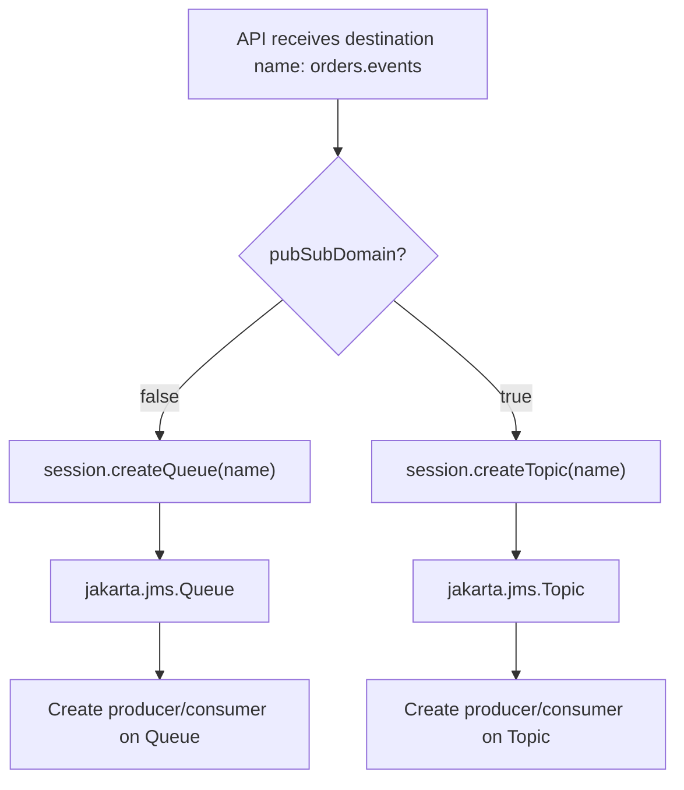

# pubSubDomain When Resolving Queue or Topic in Spring JMS

## 1. Why can the same destination name be either a Queue or a Topic?

In Jakarta Messaging (JMS), `Queue` and `Topic` are both `Destination`s, yet their delivery semantics differ:

- **Queue (point-to-point):** messages are sent to a single queue; if multiple consumers compete on the same Queue, typically **one consumer receives each initial delivery**. Suitable for tasks requiring one worker to process each item.
- **Topic (publish/subscribe):** the publisher broadcasts a message; **each eligible subscription** receives a logical copy. If a shared subscription has multiple consumers, those consumers split work within that subscription.

Spring allows calling APIs with a **string name** instead of having to construct `jakarta.jms.Queue` or `jakarta.jms.Topic` objects manually:

```java
jmsTemplate.convertAndSend("orders.events", "OrderCreated#501");
```

Key question: does the string `"orders.events"` represent a **Queue** or a **Topic**?

**`pubSubDomain` is the flag indicating which destination type to resolve when Spring takes a *destination name* and turns it into a JMS object.** For `JmsTemplate` and standard listener containers:

| Value | JMS domain | With `DynamicDestinationResolver`, `"orders.events"` is resolved via |
| --- | --- | --- |
| `false` — **default** | Point-to-point | `Session.createQueue("orders.events")` |
| `true` | Publish/subscribe | `Session.createTopic("orders.events")` |

Therefore, **the same name string can lead to two destinations of different *types***, depending on configuration and provider/broker capabilities. An identical name does not guarantee two consumers are reading from the same physical target.

> **Remember:** `pubSubDomain=true` is not a command to "convert all Queues in the broker into Topics." It is a **client-side Spring JMS** instruction for name resolution and consumer setup. The broker still needs the corresponding address and routing type; actual destination creation depends on the JMS provider.

## 2. Role of DestinationResolver

In Spring JMS, `DestinationResolver` is the interface that converts a **destination name string** into a `jakarta.jms.Destination`:

```java
Destination resolveDestinationName(
        Session session,
        String destinationName,
        boolean pubSubDomain) throws JMSException;
```

This is a **signature extracted from the Spring interface**, not code you define yourself. When the method receives `pubSubDomain=true`, the resolver knows the caller wants a Topic; with `false`, the caller wants a Queue.

### 2.1. DynamicDestinationResolver: the default choice

`DynamicDestinationResolver` is the default resolver for `JmsTemplate` and is commonly used by Spring JMS containers when not replaced:



Example showing how to invoke the resolver (this is an **integration snippet**; `session` must be a valid Jakarta JMS Session supplied by `ConnectionFactory`):

```java
import jakarta.jms.Destination;
import jakarta.jms.Queue;
import jakarta.jms.Session;
import jakarta.jms.Topic;
import org.springframework.jms.support.destination.DynamicDestinationResolver;

var resolver = new DynamicDestinationResolver();

Destination queue = resolver.resolveDestinationName(
        session, "orders.events", false);
Destination topic = resolver.resolveDestinationName(
        session, "orders.events", true);

System.out.println(queue instanceof Queue);  // true, per contract
System.out.println(topic instanceof Topic);  // true, per contract
```

The signature and two calls reflect Spring's mechanism for choosing the **JMS destination type**. This is not a standalone program: it lacks a real `session` and the Spring/JMS classpath. Whether calling `createQueue`/`createTopic` creates a physical destination on the broker is governed by the provider and auto-create settings.

### 2.2. Why must JNDI and Destination objects be distinguished?

Besides the dynamic resolver, Spring also supports `JndiDestinationResolver` or custom resolvers. If a name is already mapped in JNDI to a `Topic` object, lookup returns that exact object; **`pubSubDomain` does not force it into a Queue**. If JNDI is configured to fall back to the dynamic resolver, this flag can still be used along the fallback path.

Similarly, if an API receives a **specifically typed `Destination` object**, there is no String-name step to decide between Queue and Topic:

```java
// Snippet: session is created from a real ConnectionFactory.
Queue actualQueue = session.createQueue("orders.events");

JmsTemplate template = new JmsTemplate(connectionFactory);
template.setPubSubDomain(true);

// Overload accepting Destination directly: actualQueue remains a Queue.
template.convertAndSend(actualQueue, "hello");
```

What matters is the **actual type of `actualQueue`**. The `true` flag does not change a `Queue` object into a `Topic`. In this example, `connectionFactory` and `session` are variables provided by the application, so it is not a standalone compilable file.

**Design warning:** Do not give both a Queue and a Topic the same name just to observe resolution, especially on brokers with a shared address/routing model. For clear, verifiable demos, use two distinct names such as `demo.jobs.queue` and `demo.events.topic`.

## 3. Where does pubSubDomain appear in Spring components?

### 3.1. Sending side with JmsTemplate

`JmsTemplate` is the client-side JMS class for synchronous sending and receiving. When calling overloads that take a String name, it uses `DestinationResolver`:

```java
import jakarta.jms.ConnectionFactory;
import org.springframework.jms.core.JmsTemplate;

JmsTemplate queueTemplate = new JmsTemplate(connectionFactory);
queueTemplate.setPubSubDomain(false); // Default: Queue.
queueTemplate.convertAndSend("billing.commands", "CreateInvoice#501");

JmsTemplate topicTemplate = new JmsTemplate(connectionFactory);
topicTemplate.setPubSubDomain(true);  // Topic.
topicTemplate.convertAndSend("orders.events", "OrderCreated#501");
```

This is a **code snippet requiring `connectionFactory` and a broker**, and cannot be run standalone with `javac`. Two templates can share a single `ConnectionFactory`; you do not need two brokers just to send to both Queues and Topics.

`setPubSubDomain(...)` should be set **when configuring the bean**, before the template is shared across threads. A configured `JmsTemplate` can be safely shared across callers; do not toggle the flag back and forth per concurrent request.

### 3.2. Receiving side with listener container/factory

`@JmsListener` takes `destination` as a String name, yet the annotation **has no `pubSubDomain` attribute**. The destination type is determined by the **listener container factory** that the annotation uses.

Example creating two separate factories:

```java
import jakarta.jms.ConnectionFactory;
import org.springframework.context.annotation.Bean;
import org.springframework.context.annotation.Configuration;
import org.springframework.jms.annotation.EnableJms;
import org.springframework.jms.config.DefaultJmsListenerContainerFactory;

@Configuration
@EnableJms
class JmsDestinationConfig {
    @Bean("queueListenerFactory")
    DefaultJmsListenerContainerFactory queueListenerFactory(
            ConnectionFactory connectionFactory) {
        var f = new DefaultJmsListenerContainerFactory();
        f.setConnectionFactory(connectionFactory);
        f.setPubSubDomain(false);
        f.setSessionTransacted(true);
        return f;
    }

    @Bean("topicListenerFactory")
    DefaultJmsListenerContainerFactory topicListenerFactory(
            ConnectionFactory connectionFactory) {
        var f = new DefaultJmsListenerContainerFactory();
        f.setConnectionFactory(connectionFactory);
        f.setPubSubDomain(true);
        f.setSessionTransacted(true);
        return f;
    }
}
```

Using the matching factory per destination:

```java
import org.springframework.jms.annotation.JmsListener;
import org.springframework.stereotype.Component;

@Component
class DomainAwareListeners {
    @JmsListener(
        destination = "billing.commands",
        containerFactory = "queueListenerFactory")
    public void handleInvoiceCommand(String message) {
        System.out.println("billing: " + message);
    }

    @JmsListener(
        destination = "orders.events",
        containerFactory = "topicListenerFactory")
    public void handleOrderEvent(String message) {
        System.out.println("event: " + message);
    }
}
```

These two snippets are **classes to place inside a Spring project with JMS dependencies, a broker, and a ConnectionFactory**, not standalone Java programs. If put into separate files, place `import` statements above each class in its file. If a project has multiple `JmsListenerContainerFactory` beans, specifying `containerFactory` makes clear which listener uses a Queue and which uses a Topic.

**Transaction note:** `setSessionTransacted(true)` is an example-specific choice to manage JMS commit/rollback; it is **not** a requirement for `pubSubDomain` to work. In production you must understand JMS transactions, redelivery, and idempotent business logic.

### 3.3. Why configuring only the sender is not enough

Suppose the publisher has:

```java
topicTemplate.setPubSubDomain(true);
topicTemplate.convertAndSend("orders.events", "M1");
```

but the listener receives with:

```java
factory.setPubSubDomain(false);

@JmsListener(
    destination = "orders.events",
    containerFactory = "queueListenerFactory")
public void consume(String body) {
    System.out.println(body);
}
```

The publisher uses a **Topic**, while the consumer requests a **Queue** with the same name. The broker may create two separate entities/routings or throw an error depending on the provider and configuration. Never expect the consumer to receive `M1` merely because the string `"orders.events"` is identical.

Basic rule when **using String names**:

| Publisher | Consumer | Conclusion |
| --- | --- | --- |
| `pubSubDomain=false` | `pubSubDomain=false` | Both request Queue; must still point to the same broker/real destination |
| `pubSubDomain=true` | `pubSubDomain=true` | Both request Topic; must also consider active/durable subscriptions |
| `true` | `false` | **Domain mismatch**: Topic producer, Queue consumer |
| `false` | `true` | **Domain mismatch**: Queue producer, Topic consumer |

Even with matching Queue or Topic types, pointing to different brokers, selectors, permissions, expiration, or non-existent subscriptions can still prevent message delivery.

## 4. Quick configuration with Spring Boot

With Spring Boot 3.x and `spring-boot-starter-artemis`, the standard property is:

```properties
# false: Queue (default)
spring.jms.pub-sub-domain=false
```

or:

```properties
# true: Topic
spring.jms.pub-sub-domain=true
```

When Spring Boot auto-configures `JmsTemplate` and the **default JMS listener container factory**, this property is applied to the corresponding components. As a result, the same demo application can switch from Queue to Topic via configuration rather than rewriting handlers.

However:

- **This is the default for auto-configured beans.** If you declare custom `JmsTemplate` or listener factory beans, verify those beans' configuration; Boot properties do not automatically "override" every bean the application creates.
- **Scope is usually application-wide for auto-configured beans.** If an application uses both Queues and Topics simultaneously, define separate named template/factory beans with `@Qualifier`, instead of flipping a global flag during processing.
- **Do not configure `spring.artemis.mode` to select Queue/Topic.** `spring.artemis.mode=native/embedded` describes where the Artemis broker runs, whereas `spring.jms.pub-sub-domain` describes the client's default destination type.
- **Do not confuse with `spring.jms.subscription-durable`.** `pubSubDomain=true` only selects Topic; whether a subscription is durable is a separate decision.

### Decisions at the Spring API level

| Configuration location | Property/API | Scope |
| --- | --- | --- |
| Spring Boot properties | `spring.jms.pub-sub-domain=true` | Default Boot auto-configured template and listener factory |
| A `JmsTemplate` bean | `setPubSubDomain(true)` | Calls on that template involving name resolution |
| `DefaultJmsListenerContainerFactory` | `setPubSubDomain(true)` | Listener containers created from that factory |
| A `DefaultMessageListenerContainer` directly | `setPubSubDomain(true)` | That container |
| `DynamicDestinationResolver` | `pubSubDomain` parameter passed to `resolveDestinationName` | Each name resolution call |
| `JndiDestinationResolver` or custom resolver | Depends on resolver configuration and lookup | No guarantee the flag alters an already looked-up object |
| Directly supplied `Queue`/`Topic` object | Already has a JMS type | No name resolution needed to select type |

## 5. Runnable demo: same Spring Boot app, switching Queue/Topic via profile

Goal: **demonstrate the meaning of `spring.jms.pub-sub-domain`** through two configurations; the Java program and two listeners **remain unchanged**. For a single published message, Queue normally delivers to only one listener; Topic delivers the same message to two independent subscriptions.

### 5.1. Environment

Uses Java 17+, Maven, and Docker. The sample chooses Spring Boot 3.3.x, Jakarta JMS (`jakarta.jms.*`), and an external Apache ActiveMQ Artemis broker.

Start a local test broker:

```bash
docker run --detach --rm --name artemis-pubsub-demo \
  -e ARTEMIS_USER=artemis \
  -e ARTEMIS_PASSWORD=artemis \
  -p 127.0.0.1:61616:61616 \
  -p 127.0.0.1:8161:8161 \
  apache/artemis:latest-alpine
```

Wait for the broker to be ready:

```bash
docker logs artemis-pubsub-demo
```

Port `61616` is for JMS clients, `8161` for the management UI. These are **local demo credentials**; real environments need dedicated accounts, destination permissions, network policies, and TLS as required. If the broker disables Queue/Topic auto-create, prepare the destinations and routing appropriately beforehand.

### 5.2. Create the Maven project

Structure:

```text
pubsub-domain-demo/
├── pom.xml
└── src/main/
    ├── java/demo/jms/
    │   ├── PubSubDomainDemoApplication.java
    │   ├── DemoPublisherController.java
    │   └── DemoConsumers.java
    └── resources/
        ├── application.properties
        ├── application-queue.properties
        └── application-topic.properties
```

Contents of `pom.xml`:

```xml
<project xmlns="http://maven.apache.org/POM/4.0.0"
         xmlns:xsi="http://www.w3.org/2001/XMLSchema-instance"
         xsi:schemaLocation="http://maven.apache.org/POM/4.0.0 https://maven.apache.org/xsd/maven-4.0.0.xsd">
    <modelVersion>4.0.0</modelVersion>

    <parent>
        <groupId>org.springframework.boot</groupId>
        <artifactId>spring-boot-starter-parent</artifactId>
        <version>3.3.5</version>
        <relativePath/>
    </parent>

    <groupId>demo</groupId>
    <artifactId>pubsub-domain-demo</artifactId>
    <version>1.0.0</version>

    <properties>
        <java.version>17</java.version>
    </properties>

    <dependencies>
        <dependency>
            <groupId>org.springframework.boot</groupId>
            <artifactId>spring-boot-starter-artemis</artifactId>
        </dependency>
        <dependency>
            <groupId>org.springframework.boot</groupId>
            <artifactId>spring-boot-starter-web</artifactId>
        </dependency>
    </dependencies>

    <build>
        <plugins>
            <plugin>
                <groupId>org.springframework.boot</groupId>
                <artifactId>spring-boot-maven-plugin</artifactId>
            </plugin>
        </plugins>
    </build>
</project>
```

`spring-boot-starter-artemis` provides the Jakarta JMS client and Spring JMS auto-configuration. `spring-boot-starter-web` only provides an HTTP endpoint so we can publish explicitly **after the listeners are ready**; the web starter is not needed if you replace the endpoint with another producer.

### 5.3. Application code

`src/main/java/demo/jms/PubSubDomainDemoApplication.java`:

```java
package demo.jms;

import org.springframework.boot.SpringApplication;
import org.springframework.boot.autoconfigure.SpringBootApplication;
import org.springframework.jms.annotation.EnableJms;

@SpringBootApplication
@EnableJms
public class PubSubDomainDemoApplication {
    public static void main(String[] args) {
        SpringApplication.run(PubSubDomainDemoApplication.class, args);
    }
}
```

`src/main/java/demo/jms/DemoPublisherController.java`:

```java
package demo.jms;

import org.springframework.beans.factory.annotation.Value;
import org.springframework.jms.core.JmsTemplate;
import org.springframework.web.bind.annotation.PostMapping;
import org.springframework.web.bind.annotation.RequestParam;
import org.springframework.web.bind.annotation.RestController;

@RestController
public class DemoPublisherController {
    private final JmsTemplate jmsTemplate;
    private final String destinationName;

    public DemoPublisherController(
            JmsTemplate jmsTemplate,
            @Value("${demo.destination}") String destinationName) {
        this.jmsTemplate = jmsTemplate;
        this.destinationName = destinationName;
    }

    @PostMapping("/publish")
    public String publish(@RequestParam String value) {
        jmsTemplate.convertAndSend(destinationName, value);
        return "sent: " + value;
    }
}
```

`src/main/java/demo/jms/DemoConsumers.java`:

```java
package demo.jms;

import org.springframework.jms.annotation.JmsListener;
import org.springframework.stereotype.Component;

@Component
public class DemoConsumers {
    @JmsListener(destination = "${demo.destination}")
    public void billing(String payload) {
        System.out.println("billing: " + payload);
    }

    @JmsListener(destination = "${demo.destination}")
    public void audit(String payload) {
        System.out.println("audit: " + payload);
    }
}
```

The two `@JmsListener` annotations create **two listener endpoints/containers**. With Queue, they are two competing consumers. With Topic, by default each listener is a separate non-durable subscription, so when both are active each subscription gets a copy of every message. In this demo, do not assign the same shared subscription name to both.

The controller and both listeners read `destinationName` from one property; the **Queue/Topic type** comes from `pubSubDomain` on the auto-configured beans. You do not need to call `createQueue`/`createTopic` directly in this code.

### 5.4. Two environment configurations

`src/main/resources/application.properties`:

```properties
spring.artemis.mode=native
spring.artemis.broker-url=tcp://localhost:61616
spring.artemis.user=artemis
spring.artemis.password=artemis
```

`src/main/resources/application-queue.properties`:

```properties
spring.jms.pub-sub-domain=false
demo.destination=demo.jobs.queue
```

`src/main/resources/application-topic.properties`:

```properties
spring.jms.pub-sub-domain=true
demo.destination=demo.events.topic
```

Using two separate destination names keeps observations clear and avoids interference from leftover messages from another run or a broker with a shared address/routing model. If the application runs inside a container instead of on the host machine, `localhost` in the properties file must be changed to a broker address reachable from that container.

### 5.5. Running in Queue mode

In the `pubsub-domain-demo` directory:

```bash
mvn spring-boot:run "-Dspring-boot.run.profiles=queue"
```

After Spring starts and the broker confirms **two consumers** are registered on Queue `demo.jobs.queue`, open another terminal and send:

```bash
curl --request POST "http://localhost:8080/publish?value=M1"
```

Expected HTTP body:

```text
sent: M1
```

In the application logs, **only one of the two lines** normally appears for `M1` on initial delivery:

```text
billing: M1
```

**or**

```text
audit: M1
```

Do not assume the broker always picks `billing` first, and do not assume a fixed round-robin algorithm. If acknowledgement/transaction fails, redelivery can cause the message to be delivered again; single delivery here assumes the normal success path.

Stop the application with `Ctrl+C` after the Queue experiment.

### 5.6. Running in Topic mode

Run the same Java code with the other profile:

```bash
mvn spring-boot:run "-Dspring-boot.run.profiles=topic"
```

Wait for both listeners to create subscriptions on Topic `demo.events.topic`; with a non-durable Topic, **sending before subscriptions are active can cause listeners to miss the message**.

Send the same request:

```bash
curl --request POST "http://localhost:8080/publish?value=M1"
```

The HTTP body is still:

```text
sent: M1
```

Application logs are expected to show **both lines**, though **their relative order is not fixed**:

```text
billing: M1
audit: M1
```

Here each listener/Topic subscription gets its own copy of `M1`. If only one line appears, check the broker subscription count, when the listeners registered, selectors, connections, and exceptions before concluding fan-out logic is broken.

Stop the app; the external broker is still running. Stop the broker after testing:

```bash
docker stop artemis-pubsub-demo
```

The `--rm` container will be removed on stop; do not use this demo setup to test persistence across restarts.

### 5.7. What the demo proves and does not prove

**Proven against a real broker when run successfully:**

- `spring.jms.pub-sub-domain` changes the **destination type** resolved from a String by Spring auto-configured beans.
- With two `@JmsListener`s on the same destination name, Queue creates **competing consumers** whereas Topic creates **independent subscriptions**.
- `JmsTemplate.convertAndSend(String, ...)` and the listener factory must agree on Queue/Topic.

**Not yet proven:** durable subscriptions, message selectors, business-level exactly-once, simultaneous DB/JMS transactions, broker fault tolerance, or physical destination creation across all providers. Those require dedicated configuration and tests.

## 6. Applications that use both Queue and Topic

In a real service, having a Queue receive commands like `billing.commands` while a Topic broadcasts events like `orders.events` is a common need. Do not change `pubSubDomain` on **the same shared `JmsTemplate`** per request:

```java
// Do not do this with a shared JmsTemplate being called concurrently:
jmsTemplate.setPubSubDomain(true);
jmsTemplate.convertAndSend("orders.events", "M1");
jmsTemplate.setPubSubDomain(false);
jmsTemplate.convertAndSend("billing.commands", "M2");
```

Two threads can interleave right between toggling the flag and sending, sending a message to the wrong destination type. Create **two separate template beans**, each configured once:

```java
package demo.jms;

import jakarta.jms.ConnectionFactory;
import org.springframework.context.annotation.Bean;
import org.springframework.context.annotation.Configuration;
import org.springframework.jms.core.JmsTemplate;

@Configuration
public class MixedDomainTemplates {
    @Bean("queueJmsTemplate")
    JmsTemplate queueJmsTemplate(ConnectionFactory cf) {
        JmsTemplate template = new JmsTemplate(cf);
        template.setPubSubDomain(false);
        return template;
    }

    @Bean("topicJmsTemplate")
    JmsTemplate topicJmsTemplate(ConnectionFactory cf) {
        JmsTemplate template = new JmsTemplate(cf);
        template.setPubSubDomain(true);
        return template;
    }
}
```

And inject the exact bean needed:

```java
import org.springframework.beans.factory.annotation.Qualifier;
import org.springframework.jms.core.JmsTemplate;

// In @Service constructor:
public OrderPublisher(
        @Qualifier("topicJmsTemplate") JmsTemplate events,
        @Qualifier("queueJmsTemplate") JmsTemplate commands) {
    this.events = events;
    this.commands = commands;
}

// In business method:
events.convertAndSend("orders.events", "OrderCreated#501");
commands.convertAndSend("billing.commands", "CreateInvoice#501");
```

**The injection snippet above is a fragment for an `OrderPublisher` class with two declared fields**, not a standalone compilable class. If using a mixed-domain setup, also create two matching listener factories as in section 3.2 and specify `containerFactory` on each `@JmsListener`. Avoid relying ambiguously on a default auto-configured template when multiple `JmsTemplate` beans exist.

This pattern protects the contract: each template and listener factory has a **fixed JMS domain**, with no race conditions when threads operate concurrently.

## 7. Important exceptions and nuances

### 7.1. pubSubDomain does not automatically make subscribers durable

When setting `pubSubDomain=true`, Spring only treats the name as a **Topic**. A **non-durable** Topic listener can only receive messages while its subscription exists. If the service stops, messages published while it has no subscription are not automatically stored for later delivery.

To use a **durable subscription**, you must also configure `subscriptionDurable=true`, an appropriate subscription name/client identity, and a supporting broker provider. Never describe `pubSubDomain=true` as "messages are always saved for every listener."

### 7.2. pubSubDomain does not enable transactions or message acknowledgement

Whether Queue or Topic, broker/JMS still involves transactions, acknowledgement, retries, TTL, and message selectors. A message-receiving callback **does not** guarantee exactly-once business processing; a rollback can lead to redelivery. Use idempotent consumers, retry policies, and dead-letter handling as needed.

### 7.3. Topic does not mean every consumer must receive every message

**Each eligible subscription** receives one logical copy; that does not mean every consumer receives one. In a **shared subscription** with two consumers, the consumers share the messages of that single subscription. Conversely, two independent subscriptions on a Topic can each receive the same message.

### 7.4. Brokers may map destinations using their own rules

Some providers allow only one destination type per name, while some brokers like Artemis use an address/queue model with anycast/multicast routing. Spring calls `Session.createQueue` or `Session.createTopic` based on the resolver's choice, while the **decision to create physical resources/routing** still belongs to the provider and policy. Do not infer that every broker auto-creates Queues/Topics from a String name alone.

### 7.5. When a pre-administered Destination is already available

If using JNDI or passing a specific `jakarta.jms.Destination` into a method, prioritize verifying the **actual type of the object** and the configured resolver. Changing `pubSubDomain` may have no effect on paths that do not dynamically resolve names.

### 7.6. A Topic name does not determine destination type

Names like `audit.topic`, `topic://audit`, or `jms.topic.audit` by themselves **are not Spring JMS's standard way to select a Topic**. A custom resolver or provider may interpret special prefixes, yet the portable approach is using the `pubSubDomain` flag or an actual `Topic` object.

### 7.7. Changing pubSubDomain between deployments does not "migrate" messages

Changing `false → true` points clients to a Topic; it **does not move existing Queue backlogs** to the Topic. If a production system currently uses a Queue and wants to switch to pub/sub, that is a semantic change that may require migration, versioning, or controlled dual-publish/bridging.

## 8. Diagnostic checklist when a listener receives no messages

A common situation: the sender logs `sent` yet `@JmsListener` prints nothing.

1. **Read the effective configuration**, not just a local file: which profile is active? Is `spring.jms.pub-sub-domain` `true` or `false`? Are there environment overrides?
2. **Identify the sending bean:** Boot auto-configured `JmsTemplate` or a custom bean? Calling the String overload or passing `Queue`/`Topic` directly?
3. **Identify the receiving bean:** which factory does `@JmsListener(containerFactory=...)` point to? Does that factory have the right `setPubSubDomain`?
4. **Identify the resolver:** `DynamicDestinationResolver` or `JndiDestinationResolver`/custom? With JNDI, what object does the name map to? Is fallback enabled?
5. **Cross-check the same broker:** do producer and consumer use ConnectionFactories pointing to the same broker/vhost/namespace/credentials?
6. **Check the destination on the broker:** does it have the right Queue/Topic/routing type? Is the producer sending to the right address? Is any policy blocking auto-create?
7. **Check the consumer/subscription:** has the listener started and connected? For non-durable Topics, messages sent before the subscriber becomes active are not retained for that subscriber.
8. **Check other delivery conditions:** selectors, security, expiration, uncommitted transactions, redelivery/dead-letter, and exception logs.
9. **Check multiple listeners:** if a Queue has two consumers, only one receiving the message is normal behavior; if a Topic has two separate subscriptions, both normally receive it.
10. **Send a test message with a unique ID** and observe both broker and app logs; do not rely on callback ordering across containers.

### Quick identification table

| Symptom | First possibility to check |
| --- | --- |
| Sender uses `true`, listener uses `false` | Topic/Queue mismatch due to differing configurations on both sides |
| Two listeners yet only one prints when sending `M1` | Likely using a Queue; check factory and broker |
| Both Topic listeners print nothing | Check registered consumers, broker, permissions, routing, subscriptions |
| Changed `spring.jms.pub-sub-domain` yet behavior unchanged | May have custom bean or explicit `Destination` bypassing name resolution |
| Topic only receives while app is running | Non-durable subscription, no durable identity configured |
| Added `.topic` to name yet still got a Queue | Name carries no type; default `pubSubDomain=false` |
| Same name on two services yet no delivery | May point to different brokers or different Queue/Topic |
| Restarted app sees old Queue backlog, new Topic sees nothing | Queue backlog is not automatically transferred to Topic |

## 9. Self-check questions

**Question 1.** With a Spring `JmsTemplate` using the dynamic resolver and no extra configuration, does `convertAndSend("audit.events", "M1")` select a Queue or a Topic?

**Answer:** **Queue**, because `pubSubDomain` defaults to `false`. The `.events` suffix in the name does not change the type.

**Question 2.** Does setting `spring.jms.pub-sub-domain=true` in a Spring Boot app with JMS auto-configuration affect both the sending and receiving sides?

**Answer:** Yes, for the `JmsTemplate` and default listener factory beans **auto-configured by Spring Boot** from this property. Custom beans may use different settings and must be checked separately.

**Question 3.** Can `@JmsListener(destination="orders.events")` set `pubSubDomain=true` directly on the annotation?

**Answer:** No. Select a container factory configured for Topic or use the default auto-configured factory with the appropriate property.

**Question 4.** You call `template.setPubSubDomain(true)` and then `convertAndSend(queueObject, "M1")`, where `queueObject` is an already-created `jakarta.jms.Queue`. Does it switch to a Topic?

**Answer:** No. The method accepts `Destination` directly and uses the existing `Queue` object without resolving a string name as a Topic.

**Question 5.** Two listeners share the same Topic name, yet only one listener receives `M1`. Is Spring JMS definitely buggy?

**Answer:** No. Check whether both listeners are active, whether the subscription is shared, plus selectors, transactions, and redelivery. With two active, eligible **independent subscriptions**, each is expected to receive its own copy.

**Question 6.** A service uses both a Queue for commands and a Topic for events. Should it toggle `pubSubDomain` on a shared `JmsTemplate` per request?

**Answer:** No. Create separate templates and listener factories, fixing the type once to avoid race conditions and misconfiguration.

**Question 7.** Does replacing `spring.jms.pub-sub-domain=false` with `true` convert the old Queue into a Topic and migrate the backlog?

**Answer:** No. That only changes the client's domain selection; a migration plan is required if old data must be preserved.

**Question 8.** Does `DynamicDestinationResolver` always auto-create physical Queues/Topics on the broker?

**Answer:** No. It calls `Session.createQueue` or `Session.createTopic`; whether the broker creates physical resources depends on the JMS provider and broker policy.

## 10. Practical conclusions

- **`pubSubDomain=false`:** Spring dynamically resolves names to **Queue**; default of `JmsTemplate` and many listener factories.
- **`pubSubDomain=true`:** Spring dynamically resolves names to **Topic**; for publish/subscribe, configure sender and listener consistently.
- **`spring.jms.pub-sub-domain`:** convenient for Spring Boot apps with a single JMS domain; when using both Queue and Topic, use **separate templates/factories**.
- **Pre-typed Destination objects or JNDI lookups:** check the actual object/resolver; the flag does not force type conversion.
- **This flag does not guarantee** durability, ack, transactions, persistence, redelivery, or backlog migration.

**Most important point:** When an API receives a *String name*, `pubSubDomain` decides whether Spring requests a **Queue or Topic**. When a *JMS Destination object* is already in hand, **that object's type** is what decides; for sending and receiving to match, both must connect to the same destination type on the same broker.

## Official references

- [Spring Framework Reference – Using Spring JMS / Destination Management](https://docs.spring.io/spring-framework/reference/integration/jms/using.html)
- [Spring Framework API – JmsTemplate and pubSubDomain](https://docs.spring.io/spring-framework/docs/6.2.x/javadoc-api/org/springframework/jms/core/JmsTemplate.html)
- [Spring Framework API – DynamicDestinationResolver](https://docs.spring.io/spring-framework/docs/6.2.x/javadoc-api/org/springframework/jms/support/destination/DynamicDestinationResolver.html)
- [Spring Framework Reference – Annotation-driven JMS Listener](https://docs.spring.io/spring-framework/reference/integration/jms/annotated.html)
- [Spring Boot Reference – JMS](https://docs.spring.io/spring-boot/3.4/reference/messaging/jms.html)
- [Spring Boot – Common Application Properties: spring.jms.pub-sub-domain](https://docs.spring.io/spring-boot/3.4/appendix/application-properties/)
- [Spring Guides – Messaging with JMS](https://spring.io/guides/gs/messaging-jms/)
