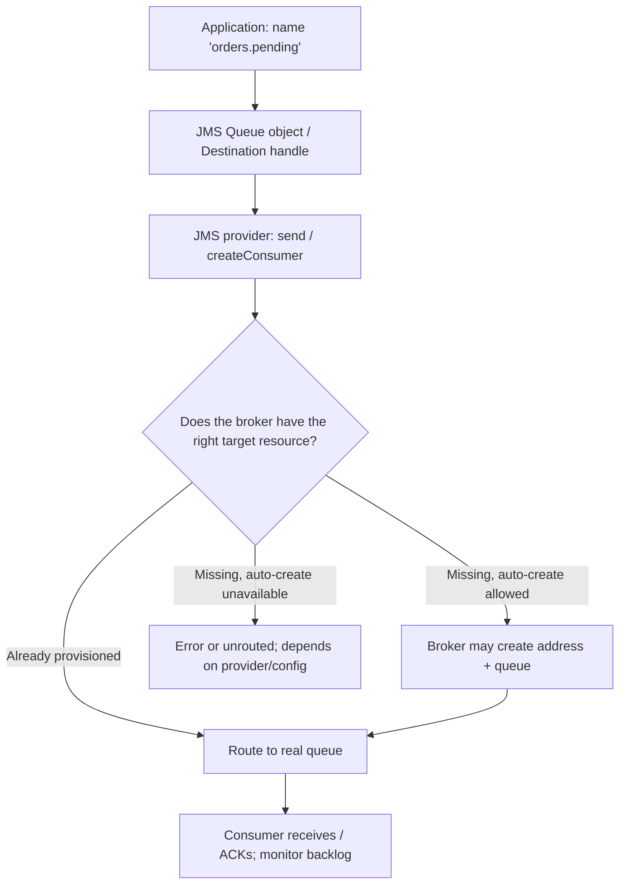

# Do Not Conflate Creating a Queue Object with Creating a Queue on Every Broker (Spring JMS)

> **Topic:** Spring Framework – JMS · **Group:** Destination.  
> **Core message:** Having a `jakarta.jms.Queue` object in Java **does not mean** the broker already has an existing, properly configured physical queue ready to store and route messages. Distinguish **destination identity**, **provisioning resources on the broker**, and **using the destination when sending/receiving**.

## 1. Why is it easy to misunderstand?

Learners often see one of the following snippets and assume "the queue was created":

```java
Queue queue = session.createQueue("orders.pending");
```

or:

```java
jmsTemplate.convertAndSend("orders.pending", "ORD-101");
```

The first snippet calls a method named `createQueue`, while the second merely passes a queue name string to Spring. However, **Jakarta Messaging does not standardize creating long-lived queues on the broker**. `Session.createQueue(String)`/`JMSContext.createQueue(String)` creates an object carrying a provider-specific destination name/identity. When a physical resource is created, by which admin command, whether it can be auto-created, what permissions apply, and how long it persists is **behavior dependent on the JMS provider/broker and configuration**.

Thus two environments running the exact same Java code can produce different outcomes:

- Broker A enables auto-create: sending to a non-existent `orders.pending` may cause the broker to auto-provision the address and queue.
- Broker B disables auto-create: creating the `Queue` object may still succeed, yet sending/receiving to that name is rejected or lacks a matching resource.
- Broker C requires destinations to be administered and bound in JNDI beforehand: the client must look up the pre-defined target object instead of relying on a Java name to make the broker create resources.

**Rule for reading API names:** `createQueue` in *JMS Session* ≠ `create queue` in a *broker administration API*. The two APIs belong to different layers with different responsibilities.

## 2. Three layers to distinguish



| Layer | What exists | Who manages it? | How to verify |
| --- | --- | --- | --- |
| **Logical name** | String `"orders.pending"` in code/config | Application and integration contract | Inspect config/constants |
| **JMS Destination object** | `Queue` object with `getQueueName()` | JMS API/provider inside client process | Log name, inspect instance or callback |
| **Broker-side resource** | Real queue, binding/address, routing, durability, quota, ACL, consumers, backlog | Broker and infrastructure admin | Broker console/CLI/management API |

A Java destination object can exist in memory when the broker has not provisioned the corresponding queue. Conversely, a queue on the broker may have existed for a long time while **no Java application** has ever constructed a `Queue` object to send/receive yet.

### Same name is not the whole contract

The name `orders.pending` alone does not specify: broker host/namespace, queue vs topic, routing type, durability, max consumers, send/receive permissions, DLQ, TTL, transactions, or retention. Two applications using the same string yet pointing to **two different brokers** do not share a queue either.

## 3. What exactly does `Session.createQueue` do per Jakarta Messaging?

Classic JMS/Jakarta Messaging API:

```java
// Fragment: a valid jakarta.jms.Session session is present.
jakarta.jms.Queue queue = session.createQueue("orders.pending");
String name = queue.getQueueName(); // "orders.pending" per provider
```

Simplified API:

```java
// Fragment: a valid jakarta.jms.JMSContext context is present.
jakarta.jms.Queue queue = context.createQueue("orders.pending");
String name = queue.getQueueName();
```

Both are **code fragments**, not standalone Java programs. They obtain objects from the provider; you cannot instantiate `new Queue()` yourself because `Queue` is an interface.

The Jakarta Messaging specification states clearly:

1. The method creates an **object encapsulating a queue name in a provider-specific way**.
2. **It does not guarantee creating a physical queue** in the JMS provider.
3. JMS **does not provide a portable API** to create/delete/administer long-lived queues.
4. A provider may choose to **auto-provision** in certain situations. Therefore, do not infer that calling `createQueue` "can definitely never affect the broker"; exact execution is provider-specific.
5. For applications needing high portability, the spec recommends using **administered destinations** looked up via JNDI rather than depending on how a provider interprets dynamic names.

Both of these conclusions are wrong:

- "Calling `session.createQueue(...)` means **the queue has been created on the broker**." → No such guarantee exists.
- "Using `createQueue(...)` means the broker **never** auto-creates a queue." → Also false: the provider or auto-create settings may have side effects.

### Important exception: `createTemporaryQueue()`

`Session.createTemporaryQueue()`/`JMSContext.createTemporaryQueue()` creates a **temporary destination** per the standard JMS mechanism: it is a provider-managed resource designed with a connection-scoped lifetime, commonly used to receive replies in request/reply.

```java
// Illustrative fragment; context remains open during use.
jakarta.jms.TemporaryQueue replyQueue = context.createTemporaryQueue();
String providerGeneratedName = replyQueue.getQueueName();
```

A temporary queue is **not** how you create a durable business queue like `orders.pending`: its name is typically provider-assigned, its scope/lifecycle differ, consumers may only be created on the connection owning the temporary queue, and the resource vanishes when the connection closes or is deleted. Do not use it for queues that must outlive client shutdown.

## 4. How does Spring JmsTemplate take a destination name?

Familiar example:

```java
jmsTemplate.convertAndSend("orders.pending", "ORD-101");
```

In the overload accepting `String destinationName`, `JmsTemplate` does not send a bare name "abstractly" and conjure infrastructure itself. It must **resolve** the name into a `jakarta.jms.Destination` before handing it to the JMS provider.

Spring JMS has two common mechanisms:

| Resolver | Meaning | Does it auto-provision physically per JMS spec? |
| --- | --- | --- |
| `DynamicDestinationResolver` | Default resolver of `JmsTemplate`; typically calls `Session.createQueue(name)` or `createTopic(name)` per `pubSubDomain`. | **No portable guarantee**; outcome depends on the provider and auto-create mechanism. |
| `JndiDestinationResolver` | Looks up JNDI to retrieve an administered/bound `Destination`; can be configured to fall back to dynamic. | **Lookup**, not a standard JMS broker queue creation command. |

Thus **Spring resolving a name** does not mean **Spring provisioning a queue**. When receiving via `@JmsListener(destination="orders.pending")`, the listener container must likewise resolve the destination and create a consumer. Starting that consumer itself can trigger auto-creation on supporting brokers; that remains a broker policy, **not an annotation guarantee**.

### Queue and Topic are two different destination types

`JmsTemplate` defaults to `pubSubDomain=false` for **queues**. When set to `pubSubDomain=true`, the same name `"orders.pending"` may be interpreted as a **topic** instead of a queue.

```java
// Illustrative fragment inside a @Configuration:
JmsTemplate queueTemplate = new JmsTemplate(connectionFactory);
queueTemplate.setPubSubDomain(false); // Queue

JmsTemplate topicTemplate = new JmsTemplate(connectionFactory);
topicTemplate.setPubSubDomain(true);  // Topic
```

**Do not assume** that matching string names alone mean both sides use the same destination. The broker can distinguish queues/topics by routing type, address, subscription, and mapping policies.

### What if a `Queue` object is declared as a `@Bean`?

Registering a `Queue` bean or injecting a `Destination` is **managing a Java object in the Spring ApplicationContext**. That bean **is not a record inside the broker**. Even if provider APIs are called during bean initialization, provisioning behavior still depends on the provider; to ensure the resource exists, use an administrative workflow or verify on the broker side.

## 5. ActiveMQ Artemis: queues live inside an address/queue/routing model

ActiveMQ Artemis is an illustrative example because the broker has distinct concepts:

- **Address:** target to which producers send.
- **Queue:** resource attached to an address, where messages wait/are stored and from which consumers receive.
- **Routing type:** how a message at an address is routed into queue(s). **ANYCAST** typically represents point-to-point semantics (one of the matching queues); **MULTICAST** serves fan-out to matching subscriptions/queues.

For a typical JMS queue `orders.pending`, the broker may have:

```text
Artemis broker
└── address: orders.pending
    └── routing: ANYCAST
        └── queue: orders.pending
            ├── pending messages
            ├── delivering / unacknowledged messages
            └── active consumers
```

**Do not confuse** an existing *address* with an existing *queue*: an address is only a routing point; without a matching queue, there is nowhere to store the expected backlog. When inspecting the Artemis console/CLI, verify all of **address, queue name, routing type, binding, and consumer count**.

### 5.1. Auto-create can be enabled or disabled per address-setting

Artemis supports options such as:

- `auto-create-addresses`: allows auto-creating an address when a client connects/sends to a matching address.
- `auto-create-queues`: allows auto-creating a matching queue when clients use JMS or supported broker protocols.
- `auto-delete-addresses`, `auto-delete-queues`: controls the lifecycle of **auto-created resources**, along with conditions such as zero consumers and message count.
- `default-address-routing-type`, `default-queue-routing-type`: determines the default routing type on auto-creation if the protocol does not specify one.

Current Artemis documentation notes defaults of `auto-create-addresses=true` and `auto-create-queues=true` for address settings; **exact defaults in a deployed environment can be overridden by broker.xml, deployment scripts, operators, or governance policies**. Always check the live configuration.

Operationally, when a client **sends** to or **creates a consumer** on a non-existent queue, an Artemis broker *may* auto-create if permissions and address settings allow. Remember that creating a Java Queue handle **does not force the broker to create the resource at that moment**.

Never extrapolate Artemis features to IBM MQ, ActiveMQ Classic, managed JMS services, or other brokers/providers: those systems may require separate admin provisioning, different naming/ACLs, or may not support dynamic queues in the same way.

## 6. How to guarantee a physical queue: provision via broker administration

For stable business queues like `orders.pending`, the controllable approach is creating broker configuration **before applications send/receive** (or via deployment tooling/management APIs with explicit permissions).

### 6.1. Artemis `broker.xml`: declaring address and queue

Example **configuration fragment** to place inside the broker's `<core>` section, at the appropriate `<addresses>` location per `etc/broker.xml` structure:

```xml
<addresses>
  <address name="orders.pending">
    <anycast>
      <queue name="orders.pending"/>
    </anycast>
  </address>
</addresses>
```

This is **a fragment of broker.xml**, not a complete standalone XML file, and **does not go in Spring Boot's `application.yml`**. This resource is declared on the Artemis side: address matching queue name, ANYCAST routing, suitable for a simple JMS queue pattern. Whether messages persist still depends on delivery mode, journal/storage, TTL, and other settings; merely creating a queue does not guarantee every message survives indefinitely.

**Caution in production:** if the broker already has an address/queue with the same name, inspect its config and backlog before editing to avoid duplicates or unintended routing-type changes. Check broker reload policies; never delete an existing queue just to follow an example.

### 6.2. Disabling auto-create on a controlled namespace

Example **configuration fragment** inside `<address-settings>` of the broker's `etc/broker.xml`:

```xml
<address-settings>
  <address-setting match="orders.#">
    <auto-create-addresses>false</auto-create-addresses>
    <auto-create-queues>false</auto-create-queues>
  </address-setting>
</address-settings>
```

In Artemis, wildcard/match symbols follow broker grammar; verify the pattern matches the exact destinations to govern before deploying. Configuration may contain other address-settings and the broker selects rules by specificity.

**Key takeaway:** when admins disable auto-create, the application is still allowed to create a **Queue object** in the provider's way, yet to send/consume successfully it must target a **pre-provisioned physical queue** with matching routing type and ACLs. If unprovisioned, the send/receive outcome depends on the broker/client and may fail or have no valid route. Do not build on the assumption "calling send guarantees the broker creates the queue."

### 6.3. Practical provisioning options

Not every development team edits `broker.xml` directly. Depending on operations, you can:

1. Create via the **Artemis web console/CLI** with admin permissions, verifying name/address/routing/durability.
2. Use Artemis **JMX/management API** to create the queue with required settings, then verify its state.
3. Provision via **infrastructure as code/automation** or an operator before deploying workloads.
4. For JNDI-managed systems, create resources per provider docs and bind the `Destination` in JNDI; the application only looks it up.

If using the Artemis CLI, check your exact version:

```bash
# Run from the broker instance's bin directory using an authorized account.
./artemis help queue
./artemis queue stat
```

`queue stat` displays queues on the broker (if connection/auth succeed); this is **better server-side evidence** than logging `queue.getQueueName()`. Exact provisioning commands and flags may vary across versions, so check `./artemis help queue create` rather than assuming a single syntax.

## 7. Runnable example: Java 21 + Spring Boot + Artemis

The goal of this example is to **clearly separate** two actions:

- Endpoint `GET /queue/handle`: Spring/JMS creates a **Queue handle** and returns its name; **does not claim** the broker has provisioned the queue.
- Endpoint `POST /queue/send/{id}`: sends a message; the outcome depends on the physical queue, permissions, and broker auto-create policy.

The application **registers no `@JmsListener` at startup**, avoiding automatic consumer creation that could trigger auto-creation and skew initial verification.

### 7.1. Tools and environment

- JDK **21**, Gradle wrapper, Spring Boot **3.3.5**, Jakarta JMS (`jakarta.jms`).
- An Apache ActiveMQ Artemis broker **running separately** at `tcp://localhost:61616`.
- Local user/password matching the broker; replace with secrets in real deployments.
- If an `orders.pending` queue already exists, use a dedicated test name in both code and broker instead of deleting a queue holding live data.

**settings.gradle**:

```groovy
rootProject.name = 'jms-queue-identity'
```

**build.gradle**:

```groovy
plugins {
    id 'java'
    id 'org.springframework.boot' version '3.3.5'
    id 'io.spring.dependency-management' version '1.1.6'
}

group = 'com.example'
version = '0.0.1-SNAPSHOT'

java {
    toolchain {
        languageVersion = JavaLanguageVersion.of(21)
    }
}

repositories {
    mavenCentral()
}

dependencies {
    implementation 'org.springframework.boot:spring-boot-starter-web'
    implementation 'org.springframework.boot:spring-boot-starter-artemis'
}
```

**src/main/resources/application.yml**:

```yaml
spring:
  artemis:
    mode: native
    broker-url: ${JMS_BROKER_URL:tcp://localhost:61616}
    user: ${JMS_USER:artemis}
    password: ${JMS_PASSWORD:artemis}
  jms:
    pub-sub-domain: false
server:
  port: 8080
```

Default values `artemis/artemis` are solely to illustrate a learning environment; never leave default credentials on a production broker.

### 7.2. Complete Java code

Create **src/main/java/com/example/queues/QueueIdentityApplication.java**:

```java
package com.example.queues;

import jakarta.jms.Queue;
import org.springframework.boot.SpringApplication;
import org.springframework.boot.autoconfigure.SpringBootApplication;
import org.springframework.http.ResponseEntity;
import org.springframework.jms.core.JmsTemplate;
import org.springframework.jms.core.SessionCallback;
import org.springframework.web.bind.annotation.GetMapping;
import org.springframework.web.bind.annotation.PathVariable;
import org.springframework.web.bind.annotation.PostMapping;
import org.springframework.web.bind.annotation.RestController;

@SpringBootApplication
public class QueueIdentityApplication {

    public static void main(String[] args) {
        SpringApplication.run(QueueIdentityApplication.class, args);
    }
}

@RestController
class QueueIdentityController {

    private static final String DESTINATION = "orders.pending";

    private final JmsTemplate jmsTemplate;

    QueueIdentityController(JmsTemplate jmsTemplate) {
        this.jmsTemplate = jmsTemplate;
    }

    @GetMapping("/queue/handle")
    ResponseEntity<String> handle() {
        // Spring provides a real Session via JmsTemplate.
        // createQueue creates/resolves a provider-specific Queue handle,
        // not a portable API for provisioning a physical queue.
        SessionCallback<String> callback = session -> {
            Queue queue = session.createQueue(DESTINATION);
            return queue.getQueueName();
        };
        String name = jmsTemplate.execute(callback);
        return ResponseEntity.ok("HANDLE " + name);
    }

    @PostMapping("/queue/send/{id}")
    ResponseEntity<String> send(@PathVariable String id) {
        jmsTemplate.convertAndSend(DESTINATION, "order:" + id);
        // Success here means sent per JMS mechanics, not that
        // a worker processed it or the queue was verified in the console.
        return ResponseEntity.accepted().body("SENT " + id);
    }
}
```

**Why does this example prove the right point?**

1. Spring Boot registers `ConnectionFactory` and `JmsTemplate` from `spring.artemis.*`/`spring.jms.*`. `pub-sub-domain=false` selects queue mode.
2. `JmsTemplate.execute(SessionCallback)` provides a real `Session`. Inside the callback we call `session.createQueue(DESTINATION)` and read `queue.getQueueName()`.
3. The API only returns the **handle name**; this code **does not query broker state to verify a physical queue**.
4. `convertAndSend(DESTINATION, ...)` has Spring resolve the name and call the JMS producer to send. If Artemis has auto-create enabled and the user has permission, sending may trigger the broker to create the queue. If not, failure/routing behavior must be observed at the broker.
5. No listener/consumer starts automatically as a side effect; learners can observe before and after each call.

**Runnability note:** the files above are complete for a Gradle/Spring Boot project with Gradle wrapper, JDK 21, and a running Artemis instance. They cannot start a broker instance via `bootRun` alone. The code uses stable APIs from Spring Boot 3.3/Jakarta JMS; provisioning outcomes depend on broker configuration rather than fixed Java stdout.

### 7.3. Controlled test run

First check in the **Artemis console/CLI** whether the `orders.pending` address and queue already exist. Run against a test broker or a dedicated namespace.

```bash
# Terminal A: run the application (project has Gradle wrapper)
./gradlew bootRun

# Windows:
gradlew.bat bootRun
```

```bash
# Terminal B: create only the JMS Queue object
curl -i http://localhost:8080/queue/handle

# Send a message to the destination (after checking the broker)
curl -i -X POST http://localhost:8080/queue/send/ORD-101
```

If obtaining the handle succeeds, expected body:

```text
HANDLE orders.pending
```

If sending via the API succeeds, expected body:

```text
SENT ORD-101
```

**Do not over-interpret:** `HANDLE orders.pending` proves the caller obtained an identity object (and the required connection/session worked that far); it **does not** prove the broker has the queue. `SENT ORD-101` shows the JMS send call did not throw an error at that moment; it **does not yet** prove a consumer processed the message, that it persisted across restarts, or that the queue matches expectations. You must observe server-side queues/addresses/message counts and/or actual consumption.

### 7.4. Testing two policies on a test broker

| Broker state before operation | GET `/queue/handle` | POST `/queue/send/...` | What to check in console |
| --- | --- | --- | --- |
| Queue pre-provisioned by admin | May receive handle with that name | May send if permissions/route match | Queue already existed **before** send, message count/metrics change |
| Queue absent, auto-create enabled | May receive handle; possible provider-specific side effect | May trigger address/queue creation and then send | **Exact moment** real address/queue appears, ANYCAST routing, and queue count |
| Queue absent, auto-create disabled | May receive handle; must not be treated as provisioned | May fail or have no matching route per provider/policy | After handle, queue still absent; inspect exceptions/logs and queue stats |
| Queue exists on another broker | Can create handle with the **same name** | Sends to connected broker, not the other broker | Exact server URL/cluster/broker instance |

**Rigorous testing approach:** use a test broker/queue with no critical messages; capture a queue/address snapshot from the console **before** running the app; invoke each endpoint; capture a snapshot **after** each step. Never delete a production queue to fabricate a negative test.

## 8. JNDI lookup is not broker provisioning

JMS recommends that portable applications access **administered objects** via JNDI when the environment provides them. For example, a container/server binds a `jakarta.jms.Queue` to JNDI name `java:comp/env/jms/OrdersQueue`. Application:

```java
// Illustrative fragment when the JNDI environment is already set up by the server.
Context context = new InitialContext();
Queue queue = (Queue) context.lookup("java:comp/env/jms/OrdersQueue");
```

Imports for this fragment: `jakarta.jms.Queue`, `javax.naming.Context`, `javax.naming.InitialContext`. `javax.naming` is the Java SE JNDI API; it is not legacy JMS `javax.jms`.

Meaning:

- **JNDI lookup** returns the destination object/binding supplied by the administrator.
- `lookup` itself **is not a command to provision a physical queue** on the broker.
- A JNDI binding can be misconfigured to point to a deleted queue, a different broker, or a principal lacking permissions; runtime verification is still required.
- You cannot assume JNDI lookup works in local Spring Boot with just a name string; `InitialContextFactory`/environment must be configured per provider.

In Spring there is `JndiDestinationResolver`. Illustrative fragment (not a standalone program):

```java
JndiDestinationResolver resolver = new JndiDestinationResolver();
resolver.setFallbackToDynamicDestination(false);

JmsTemplate template = new JmsTemplate(connectionFactory);
template.setDestinationResolver(resolver);
template.convertAndSend("java:comp/env/jms/OrdersQueue", "ORD-101");
```

With `fallbackToDynamicDestination=false`, the application will not silently fall back to dynamic resolution if the JNDI name does not exist. You must configure the JNDI environment properly and import `org.springframework.jms.support.destination.JndiDestinationResolver`. Use this when the organization requires infrastructure-managed destination names, while still checking broker-side existence/ACLs.

## 9. Distinguishing auto-create, temporary, durable, and message persistence

Four concepts that sound similar yet are completely different:

| Property | Question it answers |
| --- | --- |
| **Auto-create** | When a client references a non-existent queue name, does the broker automatically provision it? |
| **Temporary queue** | Does the destination have a temporary connection-scoped lifecycle? |
| **Durable queue** | Is the queue resource itself saved/restored by the broker per the provider's model? |
| **Persistent delivery** | Under which delivery mode/persistence is a message sent, and can it survive restarts per provider guarantees? |

An auto-created queue on Artemis may be configured as durable; yet that does not mean every message sent to it survives restarts if delivery mode or journal/storage does not support it. Conversely, a manually provisioned queue can have zero consumers while still retaining pending messages per policy.

**Auto-delete** is not arbitrary cleanup either. If the broker is configured to auto-delete queues when no consumers remain and message-count thresholds are met, the queue may vanish after some time. Thus a screenshot showing "the queue existed once" does not prove the resource will exist forever. Monitor lifecycle, retention, and provisioning policies.

## 10. Common errors and symptoms

| Symptom | Possible causes | What to check |
| --- | --- | --- |
| `createQueue("x")` returns object yet producer send fails | Queue unprovisioned, ACL, broker URL, routing/type | Real queue/address on broker, auto-create policy, send permissions |
| Producer returns success yet no consumer processes | Wrong broker, no queue/consumer, different queue routing, backlog, selector | Console/CLI queue stats, queue/topic mode, consumers, DLQ |
| Works locally, fails on staging | Local enables auto-create, staging disables it | Diff `broker.xml`, operator/IaC, destination creation permissions |
| Queue appears at app startup even though code does not provision | `@JmsListener` creates consumer, broker auto-creates | Start with/without listener, inspect broker event logs |
| Two apps both use `"orders.pending"` yet do not share backlog | Pointing to different brokers/namespaces, mismatched address or routing | ConnectionFactory, URL, virtual host/namespace, console |
| `JndiDestinationResolver` cannot find destination | Missing JNDI binding, wrong name, misconfigured environment | JNDI resource map, fallback policy, InitialContext |
| Address exists yet messages never enter queue | Mismatched routing type/filter/binding; queue absent | Address model, ANYCAST/MULTICAST, filters, queue list |
| Queue vanishes after consumer disconnects | Auto-delete/temporary queue or purge configuration | Lifecycle flags and broker-side deletion conditions |
| Consumer created in another environment reports unauthorized | User lacks create/consume/browse permissions | Broker ACLs, principal, security settings |
| Redeploys reveal many strange queues | Dynamic names generated per version, namespace, or typo | Registry/naming convention, broker inventory, restrict auto-create |
| Queue exists yet messages are lost after broker restart | Non-persistent delivery mode, TTL, storage/HA policy, broker crash | Persistence settings, journal, message expiry, logs |

### Identifying errors accurately from logs

JMS providers have varying exception types/codes. No single error code can serve as a universal standard across all brokers. In Spring, provider `JMSException`s are usually translated into Spring's runtime `JmsException` hierarchy; preserve the cause chain (broker error code, destination, principal, routing) when investigating, and never log credentials.

When hitting a "destination not found" error, do not rush to "fix" it by adding `session.createQueue(...)`: the code very likely already holds a **Queue handle** and the real problem is **broker resources/ACLs**.

## 11. Production design: who is responsible for provisioning?

To reduce deployment surprises, assign clear roles:

| Role | Responsibility |
| --- | --- |
| **Application** | Define logical destination names, send/receive with right types, validate payloads, error handling/retry/idempotency, health readiness |
| **Broker/IaC/operator** | Create resources, ACLs, quotas, durability, routing, DLQ, HA/retention, auto-create/delete policies |
| **Deployment pipeline** | Create/verify resources before opening traffic; validate destination contracts per environment |
| **Observability** | Measure address/queue counts, pending/delivering counts, consumer counts, routing failures, DLQ, auth errors |
| **Data-owning team** | Manage schemas, versions, renaming/migration procedures without losing backlogs |

### When is auto-create appropriate?

**Reasonable** for dev/test and well-designed dynamic destination use cases where quotas, naming, lifecycle, and cleanup are controlled. **Requires careful consideration** in production with critical business queues: a typo in a destination name can create an unintended queue; autoscaling and redeploys can spawn junk resources; misconfigured security routing can cause hard-to-spot failures.

**Common safe choice:** critical queues are pre-created via broker config/IaC and applications only use them; dev environments may enable auto-create for quick experimentation without assuming that behavior carries over at deployment.

### A meaningful readiness check

Being able to create `JmsTemplate` in `ApplicationContext` is not enough. Health/readiness checks should match operational requirements: broker authentication, ability to send/consume per required permissions, queue presence, and properly provisioned policies. If read-only access is available, verify via management API/console; if using probe messages, isolate a dedicated test queue and avoid impacting live business workflows.

A successful `JmsTemplate.convertAndSend` call is **not** proof that a consumer ACKed. To verify end-to-end, use an independent test worker receiving the message, correlation/event IDs, timeout checks, and queue metric verification after processing.

## 12. Standard practical workflow to avoid "creating the wrong queue"

1. **Identify clearly:** which broker instance/cluster does `orders.pending` belong to? Queue or topic? Which JMS client URL, protocol, and principal?
2. **Verify pre-deploy:** broker admin or IaC creates the real queue, verifying address and ANYCAST routing, proper durability/ACL/DLQ.
3. **Decide auto-create:** enable/disable explicitly per environment and namespace, never relying on vague defaults. When static resources are needed, prefer explicit provisioning.
4. **Run app with `/queue/handle`:** record the Queue handle name, **do not conclude the broker already has the queue**.
5. **Observe broker:** inspect queue list/bindings before and after creating the handle. If resources change, identify the exact provider-side side effect.
6. **Send a test message:** run `/queue/send/ORD-101` in a safe environment; distinguish send success from processing success.
7. **Test receiving and ACK:** use an independent test consumer/CLI and check message counts, redelivery, or DLQ; never run test consumers against production queues just to experiment.
8. **Test alternative policies:** test an environment with auto-create disabled; verify the app does not treat `Queue` objects as a provisioning mechanism.
9. **Protect operations:** separate create/browse/send/consume permissions; watch for strange queues, quotas, auto-delete, disk, and backlogs.
10. **Document as a contract:** queue owner, destination name, routing, policies, provisioning method, and rollback/migration procedure.

## 13. Self-check questions

1. Why can `Session.createQueue("orders.pending")` return a valid `Queue` object while the broker still has no physical queue? Which tools would you use to verify?
2. Why might the same Java source cause a queue to appear automatically locally yet fail on send in production? List at least three differences to inspect.
3. In Artemis, distinguish **address**, **queue**, and **ANYCAST**. Why does having an address alone not guarantee backlog storage?
4. Which resolver does `JmsTemplate.convertAndSend("orders.pending", ...)` use by default? When should JNDI be used?
5. What is the difference between `createQueue` and `createTemporaryQueue` regarding lifecycle and real resources?
6. How can a `@JmsListener` running automatically at startup skew an experiment testing auto-create?
7. Why does creating `@Bean Queue` in Spring not mean infrastructure has provisioned the queue? What additional evidence is needed?
8. A broker allows auto-create yet also auto-delete. When can a queue disappear? Why can auto-create not be equated with durability?
9. Sending returns HTTP 202 yet the consumer receives nothing. Which broker metrics help distinguish missing resources, wrong routing, backlogs, and listener failures?
10. Design a deployment pipeline for an application with critical queues that **does not depend** on broker auto-create settings.

**Conclusion:** `Queue` in Java is a **destination identifier**; a queue on the broker is an **operational resource**. Jakarta Messaging standardizes communicating with destinations, not provisioning long-lived queues. Auto-create behavior is a provider/broker choice and can differ across environments. To build resilient Spring JMS applications, verify **both the destination object in the app and the actual queue on the broker**, with clear provisioning ownership.

### Technical references

- [Jakarta Messaging 3.1 – Specification, Queue management](https://jakarta.ee/specifications/messaging/3.1/jakarta-messaging-spec-3.1.html) — `Queue` object, `Session.createQueue`, API limits, and temporary destinations.
- [Jakarta EE Platform 11 – `Session.createQueue` API](https://jakarta.ee/specifications/platform/11/apidocs/jakarta/jms/session) — distinguishing creating a Queue handle from a physical queue.
- [Spring Framework – Using Spring JMS / Destination Management](https://docs.spring.io/spring-framework/reference/integration/jms/using.html) — `DynamicDestinationResolver`, `JndiDestinationResolver`, and JMS-provider-dependent behavior.
- [ActiveMQ Artemis – Address Model](https://artemis.apache.org/components/artemis/documentation/latest/address-model.html) — address/queue/ANYCAST/MULTICAST, `broker.xml` examples.
- [ActiveMQ Artemis – Address Settings](https://artemis.apache.org/components/artemis/documentation/latest/address-settings.html) — auto-create/delete policies, authorization, and lifecycle.
- [ActiveMQ Artemis – Command Line Interface](https://artemis.apache.org/components/artemis/documentation/latest/using-cli.html) — queue statistics, CLI management, and broker-side verification.
