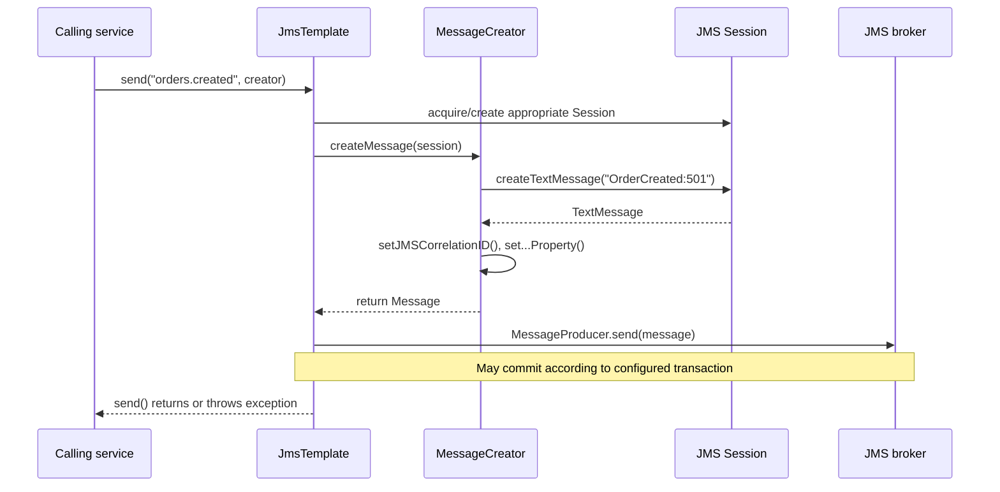

# Sending a TextMessage with MessageCreator in Spring JMS

## 1. Lesson Objectives

After this lesson, you will be able to:

1. Correctly explain the roles of **`JmsTemplate`**, **`MessageCreator`**, **`Session`**, and **`TextMessage`** in sending a message.
2. Use `jmsTemplate.send("queue.name", messageCreator)` to create a **`TextMessage` directly inside the Session provided by Spring**, instead of manually creating a connection/session/producer.
3. Set the payload, `JMSCorrelationID`, `JMSType`, and **message properties** at the right time.
4. Distinguish `send(..., MessageCreator)` from `convertAndSend(...)`, `MessagePostProcessor`, `MessageListener`, and the concept of asynchronous sending.
5. Practice with Java 17+, Spring Boot, and Apache ActiveMQ Artemis, verifying both body and metadata upon receipt.
6. Understand the boundaries of acknowledgement, transactions, QoS, retries, idempotency, and testing.

**Sample problem:** the Orders system needs to send a text notification `"OrderCreated:501"` to the `orders.created` queue. Beyond the main content, the sender needs to attach the correlation ID `corr-501`, the event type `OrderCreated`, and the data version `1` so the consumer can process it properly.

In Spring JMS, the explicit way is:

```java
jmsTemplate.send("orders.created", session -> {
    TextMessage message = session.createTextMessage("OrderCreated:501");
    message.setJMSCorrelationID("corr-501");
    message.setStringProperty("eventType", "OrderCreated");
    message.setIntProperty("schemaVersion", 1);
    return message;
});
```

This is a **snippet used inside an application that already has `JmsTemplate` and a broker configured**, not a standalone Java program. The hands-on section below provides the complete project, run commands, and expected output.

## 2. Overview of Sending with MessageCreator

In Jakarta Messaging (JMS), a message is typically created using a `Session`, such as `session.createTextMessage("...")`, and then sent to a `Destination` via a `MessageProducer`.

If application code does this manually, it must manage `ConnectionFactory`, `Connection`, `Session`, `MessageProducer`, and resource closing/transactions. Spring wraps these repetitive operations in `org.springframework.jms.core.JmsTemplate`.

**`MessageCreator` is a sender-side callback** responsible for **creating the exact `jakarta.jms.Message` object on the Session currently used for that send operation**. Spring invokes the callback before executing `MessageProducer.send(...)`.

Spring JMS interface signature:

```java
package org.springframework.jms.core;

// Illustrative API signature; the project must import the real interface from spring-jms.
@FunctionalInterface
public interface MessageCreator {
    jakarta.jms.Message createMessage(jakarta.jms.Session session)
            throws jakarta.jms.JMSException;
}
```

Because it is a functional interface, you can use a lambda (`session -> ...`) or an anonymous class. `createMessage` returns a `Message`, and is not restricted to returning only `TextMessage`: it can create `BytesMessage`, `MapMessage`, or `ObjectMessage` as needed. **This lesson focuses specifically on `TextMessage`.**

### 2.1. Typical Execution Flow



**Important ordering:**

- `MessageCreator` runs **during the `JmsTemplate.send` call**, while the Session is valid.
- The `Session` is **provided by Spring**; it is not a Session you construct with `new` or grab arbitrarily from another thread.
- `createTextMessage` **only constructs the message**; it is not yet the send operation to the broker.
- `return message` hands the message back to `JmsTemplate` to send. **Do not call `producer.send` inside the callback**, as doing so can easily send the message twice.
- `JmsTemplate` manages resources and translates provider `JMSException`s into Spring `JmsException` (unchecked) on the API call path.
- `send` returning does not mean a consumer has finished its business processing; send success, acknowledgement/commit, and consumer processing are distinct milestones.

### 2.2. API Names Not to Confuse

| Component | Exact role |
| --- | --- |
| `org.springframework.jms.core.MessageCreator` | Creates a message on the **sender side** using the provided Session. |
| `jakarta.jms.TextMessage` | JMS message type with a String text payload. |
| `jakarta.jms.Session.createTextMessage(...)` | Creates a `TextMessage` within a JMS Session. |
| `org.springframework.jms.core.JmsTemplate.send(...)` | Coordinates message creation/sending and resource management. |
| `org.springframework.jms.core.JmsTemplate.convertAndSend(...)` | Uses a `MessageConverter` to create a message from a Java object and sends it. |
| `org.springframework.jms.core.MessagePostProcessor` | Modifies the **message after conversion, before sending** in `convertAndSend` overloads. |
| `jakarta.jms.MessageListener.onMessage(...)` | Callback for **receiving** messages, not used for creating outgoing messages. |
| `jakarta.jms.CompletionListener` | Callback reporting the result of an **asynchronous send via the corresponding JMS API**, not `MessageCreator`. |

`MessageCreator` sounds like a "listener", but in essence it is a **callback to build content before sending**. It does not turn `JmsTemplate.send` into an asynchronous send.

## 3. What Does a TextMessage Contain?

`jakarta.jms.TextMessage` is a `Message` whose body is a `String`. Main operations:

```java
TextMessage text = session.createTextMessage("Hello JMS");
// Or: TextMessage text = session.createTextMessage();
//     text.setText("Hello JMS");
String content = text.getText();
```

`createTextMessage`, `setText`, and `getText` all belong to the Jakarta JMS API; provider-related operations may throw `JMSException`.

A message also has **headers** and **properties**:

| Location | Example | Meaning |
| --- | --- | --- |
| Body | `"OrderCreated:501"` | Primary payload. Can be plain text or a controlled serialized JSON/XML string. |
| Application-set header | `JMSCorrelationID="corr-501"` | Links request/response, tracing, or an activity chain. |
| Application-set header | `JMSType="OrderCreated"` | Message type label per business contract. |
| Application-set header | `JMSReplyTo` | Destination where the sender expects a reply, if using request/reply. |
| Property | `eventType="OrderCreated"` | Key-value metadata, usable by consumers or selectors. |
| Property | `schemaVersion=1` | Schema version so consumers read the payload properly. |
| Provider-set header on send | `JMSMessageID`, `JMSTimestamp`, `JMSDestination` | Assigned by the provider per JMS send semantics; do not fabricate before sending. |
| Producer QoS | delivery mode, priority, time-to-live | Typically selected via producer/template send settings; not treated as custom properties. |

**Body and properties are separate:** calling `message.setStringProperty("eventType", ...)` **does not insert text** into `TextMessage.getText()`. On the consumer side, you must read the body via `getText()` and read properties separately via `getStringProperty()` or the matching typed getter.

**Property types matter:** `setIntProperty("schemaVersion", 1)` creates a numeric property; if the consumer expects an `int`, use `getIntProperty`. Property names must be valid per JMS rules; prefer short, clear names and avoid arbitrarily using `JMSX`/`JMS_` prefixes reserved for standard/provider properties.

### 3.1. Creating and Adding Metadata

```java
MessageCreator creator = session -> {
    TextMessage text = session.createTextMessage("OrderCreated:501");
    text.setJMSCorrelationID("corr-501");
    text.setJMSType("OrderCreated");
    text.setStringProperty("eventType", "OrderCreated");
    text.setIntProperty("schemaVersion", 1);
    text.setBooleanProperty("retryable", false);
    return text;
};

jmsTemplate.send("orders.created", creator);
```

The snippet above requires importing `org.springframework.jms.core.MessageCreator`, `jakarta.jms.TextMessage`, and an injected `jmsTemplate`. `setJMSCorrelationID` accepts an application-defined string; **do not spoof the provider's `JMSMessageID`**. With request/reply, `JMSCorrelationID` commonly links requests and responses, though the exact contract must be agreed upon by both sides.

### 3.2. Do Not Mistakenly Set Provider-Managed Headers

Headers such as `JMSMessageID`, `JMSTimestamp`, `JMSDestination`, `JMSDeliveryMode`, `JMSExpiration`, and `JMSPriority` belong to the group determined by the provider at send time. Do not attempt to configure QoS by calling `setJMSExpiration(...)` or `setJMSPriority(...)` inside `MessageCreator` and assuming the broker must honor those values.

Example **not to rely on**:

```java
jmsTemplate.send("orders.created", session -> {
    TextMessage text = session.createTextMessage("OrderCreated:501");
    text.setJMSExpiration(System.currentTimeMillis() + 10_000);
    return text;
});
```

Proper TTL is configured via `MessageProducer.send(..., deliveryMode, priority, timeToLive)` or the corresponding QoS options on `JmsTemplate`; the provider will establish the appropriate `JMSExpiration`.

## 4. JmsTemplate send Overloads

Three overloads to remember:

```java
// 1. Destination identified by String name:
jmsTemplate.send("orders.created", session ->
        session.createTextMessage("OrderCreated:501"));

// 2. Already have an actual Destination object:
jmsTemplate.send(queue, session ->
        session.createTextMessage("OrderCreated:501"));

// 3. Use the default destination configured on JmsTemplate:
jmsTemplate.send(session ->
        session.createTextMessage("OrderCreated:501"));
```

Here `queue` is a variable of type `jakarta.jms.Destination`/`Queue` supplied by the JMS provider, and the third overload only works when the template already has a default destination/destination name configured. Otherwise, Spring throws an error because a default destination is missing.

### 4.1. Is a String Name Resolved to a Queue or a Topic?

`JmsTemplate` has `pubSubDomain`. When using the default dynamic resolver and given a String name:

- `pubSubDomain=false`: the name is resolved as a **Queue** (default).
- `pubSubDomain=true`: the name is resolved as a **Topic**.

`MessageCreator` does not decide Queue vs. Topic if the caller chose the target via `jmsTemplate.send(String, ...)`. With `send(Destination, ...)`, the actual type of `Destination` is what matters. You must configure the listener side consistently; if a producer sends to a Topic while a consumer listens on a Queue with the same name, the two sides may never meet.

In Spring Boot you can typically use:

```properties
spring.jms.pub-sub-domain=false
```

This lesson uses a Queue; with a Topic you also have to consider whether a subscription exists, durable/shared settings, and when the publisher emits messages.

### 4.2. Equivalent Anonymous Class and Lambda Examples

**Anonymous class** (explicit interface signature):

```java
jmsTemplate.send("orders.created", new MessageCreator() {
    @Override
    public Message createMessage(Session session) throws JMSException {
        return session.createTextMessage("OrderCreated:501");
    }
});
```

**Lambda** (Java 8+, idiomatic for Java 17+):

```java
jmsTemplate.send("orders.created",
        session -> session.createTextMessage("OrderCreated:501"));
```

Both versions fulfill the same contract. When adding multiple headers/properties, a block lambda ending with `return` is clearer. A lambda can capture **final or effectively final** local variables; avoid directly reading mutable state that could be altered by another thread before sending.

## 5. Runnable Demo: Spring Boot 3 + Java 17 + Artemis

The hands-on demo uses **a real Queue**, sending a `TextMessage` via `MessageCreator` and a `@JmsListener` reading back the full body/metadata. It does not mock the broker with a Java collection.

### 5.1. Prerequisites

- JDK 17 or newer; verify with `java -version`.
- Maven 3.6.3 or newer; verify with `mvn -version`.
- Docker to run Apache ActiveMQ Artemis, unless you already have another compatible Artemis broker.
- Local port `61616` not already in use by another process.

Docker command using the official Artemis image:

```bash
docker run --detach --rm --name artemis-messagecreator-demo \
  -e ARTEMIS_USER=artemis \
  -e ARTEMIS_PASSWORD=artemis \
  -p 127.0.0.1:61616:61616 \
  -p 127.0.0.1:8161:8161 \
  apache/artemis:latest-alpine
```

Watch the broker until it is ready:

```bash
docker logs artemis-messagecreator-demo
```

`61616` is the TCP transport for JMS clients; `8161` is the management console. The simple credential configuration is only for **a local learning environment**. For production deployments, use secrets, authorization, network isolation, and TLS as required. If the broker disables destination auto-creation, create the Queue before running.

### 5.2. Project Structure

```text
jms-messagecreator-demo/
├── pom.xml
└── src/main/
    ├── java/demo/jms/MessageCreatorDemoApplication.java
    └── resources/application.properties
```

### 5.3. pom.xml

Using Spring Boot **3.3.5**, Spring JMS is provided by the Artemis starter, and the API belongs to the `jakarta.jms` namespace:

```xml
<project xmlns="http://maven.apache.org/POM/4.0.0"
         xmlns:xsi="http://www.w3.org/2001/XMLSchema-instance"
         xsi:schemaLocation="http://maven.apache.org/POM/4.0.0 https://maven.apache.org/xsd/maven-4.0.0.xsd">
    <modelVersion>4.0.0</modelVersion>

    <parent>
        <groupId>org.springframework.boot</groupId>
        <artifactId>spring-boot-starter-parent</artifactId>
        <version>3.3.5</version>
        <relativePath/>
    </parent>

    <groupId>demo</groupId>
    <artifactId>jms-messagecreator-demo</artifactId>
    <version>1.0.0</version>

    <properties>
        <java.version>17</java.version>
    </properties>

    <dependencies>
        <dependency>
            <groupId>org.springframework.boot</groupId>
            <artifactId>spring-boot-starter-artemis</artifactId>
        </dependency>
    </dependencies>

    <build>
        <plugins>
            <plugin>
                <groupId>org.springframework.boot</groupId>
                <artifactId>spring-boot-maven-plugin</artifactId>
            </plugin>
        </plugins>
    </build>
</project>
```

Do not add `artemis-jakarta-server`: the application acts as a **JMS client** connecting to a separately running broker. `spring-boot-starter-artemis` supplies the dependencies needed for Spring Boot to auto-configure `ConnectionFactory`, `JmsTemplate`, and the listener container.

### 5.4. application.properties

Create `src/main/resources/application.properties`:

```properties
spring.artemis.mode=native
spring.artemis.broker-url=tcp://localhost:61616
spring.artemis.user=artemis
spring.artemis.password=artemis

# Send and receive on a Queue, not a Topic
spring.jms.pub-sub-domain=false
```

If running the application **inside another container**, `localhost` inside the application container is **not** the broker host. In that case, configure the actual DNS/hostname and port of the broker reachable from the container network.

### 5.5. Complete Java Code: MessageCreator + @JmsListener

File `src/main/java/demo/jms/MessageCreatorDemoApplication.java`:

```java
package demo.jms;

import java.util.concurrent.CountDownLatch;
import java.util.concurrent.TimeUnit;

import jakarta.jms.JMSException;
import jakarta.jms.Message;
import jakarta.jms.TextMessage;

import org.springframework.boot.ApplicationRunner;
import org.springframework.boot.SpringApplication;
import org.springframework.boot.autoconfigure.SpringBootApplication;
import org.springframework.context.annotation.Bean;
import org.springframework.jms.annotation.EnableJms;
import org.springframework.jms.annotation.JmsListener;
import org.springframework.jms.core.JmsTemplate;
import org.springframework.stereotype.Component;

@SpringBootApplication
@EnableJms
public class MessageCreatorDemoApplication {

    public static void main(String[] args) {
        SpringApplication.run(MessageCreatorDemoApplication.class, args);
    }

    @Bean
    ApplicationRunner sendOne(JmsTemplate jmsTemplate, DemoReceiver receiver) {
        return args -> {
            jmsTemplate.send("demo.messagecreator.queue", session -> {
                TextMessage message =
                        session.createTextMessage("OrderCreated:501");
                message.setJMSCorrelationID("corr-501");
                message.setJMSType("OrderCreated");
                message.setStringProperty("eventType", "OrderCreated");
                message.setIntProperty("schemaVersion", 1);
                return message;
            });

            // Wait for the demo to receive the message to print verifiable ordered output.
            if (!receiver.await(10, TimeUnit.SECONDS)) {
                throw new IllegalStateException(
                        "Timed out waiting for JMS consumer");
            }
            System.out.println("SENDER: completed");
        };
    }
}

@Component
class DemoReceiver {
    private final CountDownLatch received = new CountDownLatch(1);

    @JmsListener(destination = "demo.messagecreator.queue")
    public void onMessage(Message raw) throws JMSException {
        if (!(raw instanceof TextMessage textMessage)) {
            throw new IllegalArgumentException("Expected TextMessage");
        }

        System.out.println("BODY: " + textMessage.getText());
        System.out.println(
                "TYPE: " + textMessage.getJMSType());
        System.out.println(
                "CORRELATION: " + textMessage.getJMSCorrelationID());
        System.out.println(
                "EVENT: " + textMessage.getStringProperty("eventType"));
        System.out.println(
                "SCHEMA: " + textMessage.getIntProperty("schemaVersion"));
        received.countDown();
    }

    boolean await(long timeout, TimeUnit unit)
            throws InterruptedException {
        return received.await(timeout, unit);
    }
}
```

**Part-by-part explanation:**

1. Spring Boot initializes `ConnectionFactory` and `JmsTemplate` from properties; `@EnableJms` enables Spring to create the listener endpoint for `@JmsListener`.
2. `ApplicationRunner` executes after the application starts and makes exactly **one `jmsTemplate.send(...)` call**.
3. The lambda receives the `session` provided by the template, creates a **`TextMessage` with a body**, and attaches headers/properties while the message is still writable.
4. `return message` lets the template perform the send to Queue `demo.messagecreator.queue` on the Artemis broker.
5. `@JmsListener` receives the **raw `jakarta.jms.Message`**; Spring JMS supports this parameter type. `instanceof TextMessage` verifies the type before reading the text.
6. `CountDownLatch` only controls **when the example finishes**: waiting for the callback to finish printing before the runner prints the final line. It is not a mechanism to confirm durable broker persistence, nor does it replace a JMS transaction.
7. The code uses **one public class and one package-private component** in the same file, which is valid Java syntax. There is no `new Session()`, `new TextMessage()`, or manual closing of a Spring-managed connection.

### 5.6. Running and Verifying Output

Wait for Docker Artemis to be ready. From the directory containing `pom.xml`:

```bash
mvn spring-boot:run
```

Provided the broker is reachable, the Queue can be created/exists, and no leftover messages are sitting in the same queue before the demo sends, **the lines printed by the example code itself** in order are:

```text
BODY: OrderCreated:501
TYPE: OrderCreated
CORRELATION: corr-501
EVENT: OrderCreated
SCHEMA: 1
SENDER: completed
```

Spring, Maven, and Artemis may log additional lines, so focus on the six prefixed lines above. The values come from the `JMSCorrelationID`/properties of the newly sent message itself, not from randomness or the current time.

**Why does `SENDER: completed` appear last?** The receiver executes its five print statements first and then calls `received.countDown()`; `ApplicationRunner` prints only after `await(...)` receives the signal. If the broker is not ready, delivery is blocked, or the listener fails, the program may throw an exception/timeout instead of printing these six lines.

The Spring Boot application stays running to keep the listener active. Press `Ctrl+C` to stop it; afterward you can stop the broker:

```bash
docker stop artemis-messagecreator-demo
```

Because the Docker demo uses `--rm` without a mounted volume, do not use this environment to conclude that data persists after the broker/container is removed.

**Re-running multiple times on the same broker:** A fixed-name Queue may hold old messages if a previous run failed. For learning exercises, create a fresh broker/container, purge the demo Queue properly, or use a dedicated Queue name per run. If you see multiple receive logs, do not automatically conclude that `MessageCreator` sent duplicates before checking backlog and redelivery.

## 6. Why Is MessageCreator Better Than Creating TextMessage Manually?

### 6.1. Plain JMS Client Approach

Idea of the classic JMS API without Spring (code snippet, where `connectionFactory` is supplied by the provider):

```java
try (var connection = connectionFactory.createConnection()) {
    var session = connection.createSession(
            false, jakarta.jms.Session.AUTO_ACKNOWLEDGE);
    var queue = session.createQueue("orders.created");

    try (var producer = session.createProducer(queue)) {
        var message = session.createTextMessage("OrderCreated:501");
        message.setStringProperty("eventType", "OrderCreated");
        producer.send(message);
    }
}
```

This is an **illustrative snippet**, not a standalone program: it requires a real `connectionFactory`, broker access, and a JMS provider on the classpath. In classic JMS, manually managing connection/session/producer means handling lifecycle and transactions properly. For **sending**, `connection.start()` is not needed; `start()` controls delivery of messages to consumers. When receiving messages, pay attention to the corresponding start/lifecycle rules.

### 6.2. Spring Approach

```java
jmsTemplate.send("orders.created", session -> {
    TextMessage message = session.createTextMessage("OrderCreated:501");
    message.setStringProperty("eventType", "OrderCreated");
    return message;
});
```

Spring handles most boilerplate for creating/releasing JMS resources, integrates the Session into transactions when configured, and standardizes exception handling. The callback still retains access to the **native JMS API** to create the exact message type and attach metadata.

This is the right balance: **no manual resource management in application services**, while retaining full control over message format design.

### 6.3. Do Not Retain Session or Message Across Improper Lifecycles

The `Session` passed by the template to the callback is valid only within the scope of that send call. Do not leak it into a field, cache it, or let another thread call `createTextMessage` on it after `send` returns.

A mistake that can happen:

```java
// ONLY TO ILLUSTRATE AN ANTIPATTERN:
private Session cachedSession;

// Inside MessageCreator:
cachedSession = session; // Do not do this!
return session.createTextMessage("M1");
```

`Session` is not thread-safe for arbitrary concurrent use and is typically managed/closed/returned to a pool per request. If you need to send multiple messages from different requests, **reuse the configured `JmsTemplate`**, never a Session captured from a callback.

## 7. Comparing send(MessageCreator) and convertAndSend

### 7.1. When You Only Have a String Payload

With Spring's default `SimpleMessageConverter`, a String is converted into a `TextMessage`:

```java
jmsTemplate.convertAndSend("orders.created", "OrderCreated:501");
```

This is a concise choice suited for sending a String without extra customization. If you only want to add headers/properties to a String, you can pass a `MessagePostProcessor`:

```java
jmsTemplate.convertAndSend(
        "orders.created",
        "OrderCreated:501",
        message -> {
            message.setJMSCorrelationID("corr-501");
            message.setStringProperty("eventType", "OrderCreated");
            return message;
        });
```

Here, **the message has already been created by the converter** before `MessagePostProcessor` is invoked.

### 7.2. When You Need Explicit Type and Body Control

```java
jmsTemplate.send("orders.created", session -> {
    TextMessage message = session.createTextMessage("OrderCreated:501");
    message.setJMSCorrelationID("corr-501");
    message.setStringProperty("eventType", "OrderCreated");
    return message;
});
```

In `MessageCreator`, you decide **what message type to create** before handing it to the template. You do not depend on how a converter maps a String or a DTO to a JMS type.

| Criterion | `send(..., MessageCreator)` | `convertAndSend(...)` |
| --- | --- | --- |
| Input | Callback receiving `Session` | Java object, e.g., String/DTO |
| Message type | You create `TextMessage` or another type | Decided by `MessageConverter` |
| Metadata | Set directly in `MessageCreator` | Can be attached via `MessagePostProcessor` |
| Code readability | Shows the complete rules for building the JMS Message | Concise for simple conversion use cases |
| Need to mind `JMSException` when creating? | Callback signature has `throws JMSException`; Spring handles exception translation | Converter/post-processor can also raise exceptions per contract |
| Common risks | Boilerplate; mixing creation and sending; retaining Session improperly | Unclear which converter is active; unmanaged DTO/JSON schema |
| Best fit | Want explicit control over `TextMessage` + headers/properties | Simple payloads or standardized converter setup |

**There is no "always best" option.** In a large codebase, what matters is having a stable contract for payloads/schemas/headers, not using as many callbacks as possible.

### 7.3. MessageCreator Does Not Replace a Converter for Complex JSON

If sending JSON text, you can serialize an object with Jackson first, then create a `TextMessage` from that JSON string:

```java
String json = objectMapper.writeValueAsString(orderEvent);

jmsTemplate.send("orders.created", session -> {
    TextMessage message = session.createTextMessage(json);
    message.setStringProperty("contentType", "application/json");
    message.setIntProperty("schemaVersion", 2);
    return message;
});
```

This is an **application code snippet** requiring an `objectMapper` bean, an `orderEvent` variable, a JSON dependency, and serialization exception handling. Do not assume Spring JMS automatically uses Jackson for every `convertAndSend`; the converter must be explicitly configured. More importantly, producer and consumer must agree on version/schema, not merely the `contentType` property name.

## 8. Headers, Properties, and Contract Design

### 8.1. JMSCorrelationID and Request/Reply

`JMSCorrelationID` is an application-settable header for linking messages. In a workflow:

```text
Sender                       Receiver
 request: order-501  ---->    handle order
 correlation=corr-501        |
                             +----> reply:
                                    correlation=corr-501
```

If both sides agree to use a correlation ID, the consumer can log and echo that ID back on the response. Do not casually reuse **the same correlation string across concurrent requests** when response matching requires uniqueness; in practice, generate UUIDs or collision-free business identifiers.

Do not confuse:

- `JMSMessageID`: generated by the provider per message send rules.
- `JMSCorrelationID`: typically set by the application to link messages.
- `eventId` in a custom property: business ID for idempotency; **not required to equal** either JMS header above.

### 8.2. JMSType and the eventType Property

`JMSType` is an optional header representing a message type identifier according to the system contract. `eventType` is a **custom property** defined by the application itself. Both hold `"OrderCreated"` in the demo, yet they reside in two different places:

```java
message.setJMSType("OrderCreated");
message.setStringProperty("eventType", "OrderCreated");
```

You do not have to set both if your system standardizes on a single convention; this lesson intentionally sets both to demonstrate manipulating them through `MessageCreator`.

### 8.3. Message Selectors and Metadata

A consumer can use a message selector to filter on JMS properties or certain standardized headers, for example a selector expression:

```text
eventType = 'OrderCreated' AND schemaVersion = 1
```

This is a **selector expression**, not a database SQL query. When a selector is applied on a listener container/`@JmsListener(selector=...)`, the consumer receives only matching messages. Consider the impact on routing, subscriptions, and broker resources. A text body cannot automatically be queried as SQL fields like `eventType` by a standard selector; to filter with a selector, you must set appropriate properties/headers.

### 8.4. Avoid Writing Sensitive Data into Headers/Properties

Payloads may be protected according to transport/storage design; headers and properties frequently show up in logging, message browsers, and the broker console. Avoid placing tokens, passwords, or private data in `JMSCorrelationID`, selector properties, or full-message logs.

## 9. QoS: Delivery Mode, Priority, and Time-to-Live

`MessageCreator` creates the body + application metadata; it is **not the primary tool for controlling QoS**. JMS provides producer-side parameters:

- **Delivery mode:** `DeliveryMode.PERSISTENT` or `NON_PERSISTENT`.
- **Priority:** integers 0–9 (default is typically 4), acting as a priority hint per broker/provider.
- **Time-to-live (TTL):** message lifetime in milliseconds; `0` usually means no TTL expiration.

On `JmsTemplate`, QoS can be configured once:

```java
import jakarta.jms.ConnectionFactory;
import org.springframework.context.annotation.Bean;
import org.springframework.context.annotation.Configuration;
import org.springframework.jms.core.JmsTemplate;

@Configuration
class JmsQoSConfig {
    @Bean
    JmsTemplate reliableSender(ConnectionFactory cf) {
        JmsTemplate template = new JmsTemplate(cf);
        template.setPubSubDomain(false);
        template.setExplicitQosEnabled(true);
        template.setDeliveryPersistent(true);
        template.setPriority(6);
        template.setTimeToLive(60_000L);
        return template;
    }
}
```

**This is an alternative illustrative configuration—do not insert it directly into the auto-configured `JmsTemplate` demo in Section 5** if you want to keep that demo minimal.

An easy detail to miss: **`setExplicitQosEnabled(true)`** tells the template to apply the configured mode/priority/TTL values instead of letting the producer/provider use defaults. Calling `setTimeToLive(60_000)` alone while omitting this flag may not yield the expected behavior.

**Persistent ≠ exactly-once business:** durability also depends on transactions, broker journal/storage configuration, acknowledgement, and how the consumer handles messages. TTL can cause a message to expire before a consumer can receive it; priority does not guarantee strict business processing order.

If different message types require different QoS settings, use separately configured senders/templates or an advanced producer callback (`ProducerCallback`) with a clear contract. Do not mutate `setTimeToLive`/`setPriority` on a shared singleton `JmsTemplate` used concurrently by multiple threads.

## 10. Transactions, Send Outcomes, and Failure Cases

### 10.1. Send Completion Does Not Equal Consumer Completion

From the publisher's perspective:

```text
Create TextMessage -> send to provider -> provider/transaction receives result
                                             |
                                          consumer receives
                                             |
                                          business processing
                                             |
                                          ack/commit
```

`JmsTemplate.send(...)` operates synchronously with respect to the provider send call as configured. It **does not wait for the consumer to finish processing**. The broker may store the message and return success before any consumer exists. If business confirmation is required, you need another mechanism such as a reply message, a callback from the target service, or application-managed state.

Nor is `MessageCreator` an async send mechanism: the callback is invoked to **create** the message on the caller's send path.

### 10.2. When MessageCreator Throws an Exception

`createMessage(session)` can throw `JMSException` if creating the message or setting properties fails. `JmsTemplate` catches and translates applicable Jakarta JMS errors into unchecked Spring JMS exceptions, sparing the service layer from repetitive `try/catch JMSException` blocks.

```java
try {
    jmsTemplate.send("orders.created",
            session -> session.createTextMessage("OrderCreated:501"));
} catch (org.springframework.jms.JmsException ex) {
    // Log context safely; apply the application's retry/alert policy.
    throw ex;
}
```

Do not "swallow errors" just because the business API does not declare `throws`. When a send fails due to a dropped connection or an ambiguous transaction outcome, a retry may create **two logical duplicates** if the previous attempt actually reached the broker. Use a business `eventId` and an idempotent consumer to control duplicate sends/deliveries.

### 10.3. Sending Within a Transaction

When Spring has a JMS transaction properly configured, `JmsTemplate` can use a Session participating in the active transaction. The message becomes visible to consumers according to the broker/Session commit and rollback rules.

If a service both writes to a database and sends a JMS message, **a local JMS transaction does not automatically cover the database transaction**. Do not assume an arbitrary `@Transactional` annotation provides an atomic commit across DB and JMS. Architectures commonly use transactional outbox/inbox patterns or coordinated transactions when supported and genuinely needed.

### 10.4. Retries and MessageCreator

- Broker redelivery to a consumer (`redelivery`) **does not mean the publisher's `MessageCreator` is re-executed**.
- An application-level retry of a `send(...)` call **can re-run the callback**, creating a new message on another Session/send attempt.
- If an event ID is generated randomly **inside the callback on every retry**, two sends may carry two different IDs for the same business action. Generate a stable event ID in the business layer and pass it into the callback.
- Do not perform side effects such as writing to a database, making HTTP calls, or debiting balances **inside `MessageCreator`**: the callback should focus solely on creating the message, avoiding actions that cannot roll back atomically with the send.

## 11. Designing Reusable MessageCreators in Services

When the same message contract is sent from multiple methods, you can extract a factory method returning a `MessageCreator`:

```java
import org.springframework.jms.core.MessageCreator;
import jakarta.jms.TextMessage;

public final class OrderMessages {
    private OrderMessages() {
    }

    public static MessageCreator orderCreated(
            String orderId,
            String correlationId) {
        if (orderId == null || orderId.isBlank()) {
            throw new IllegalArgumentException("orderId is required");
        }
        if (correlationId == null || correlationId.isBlank()) {
            throw new IllegalArgumentException(
                    "correlationId is required");
        }

        final String body = "OrderCreated:" + orderId;
        return session -> {
            TextMessage text = session.createTextMessage(body);
            text.setJMSType("OrderCreated");
            text.setJMSCorrelationID(correlationId);
            text.setStringProperty("eventType", "OrderCreated");
            text.setIntProperty("schemaVersion", 1);
            return text;
        };
    }
}
```

Place this class in an `OrderMessages.java` file inside a Spring project with JMS dependencies; this code is a **self-contained compilable helper** once placed in an appropriate package with the classpath set up. Usage:

```java
jmsTemplate.send(
        "orders.created",
        OrderMessages.orderCreated("501", "corr-501"));
```

Benefits: validation happens before creating the JMS Message; event fields are captured cleanly in the closure so the callback is easy to test; each `send` call still creates a fresh `TextMessage` using the corresponding Session.

**Do not cache a `TextMessage` and send it across multiple Sessions**, and do not reuse a Session outside the callback scope. When reusing a helper, reuse the **message creation logic**, not a **stateful JMS message object**.

## 12. Testing and Diagnostics

### 12.1. What Needs to Be Verified?

When writing integration tests against a real broker, do not merely assert "no exception was thrown":

1. Was there exactly **one intended send call** or an application-level retry?
2. Is the destination the right Queue/Topic on the right broker?
3. Did the consumer receive a `TextMessage`, and does `getText()` match the payload?
4. Do `getJMSCorrelationID()` and `getStringProperty("eventType")` hold the expected values?
5. Is the numeric property `schemaVersion` read properly via `getIntProperty`?
6. Do transaction/QoS/TTL settings match the contract?
7. When the broker is offline, is the exception logged and handled rather than ignored?
8. Upon redelivery, how does the consumer deduplicate using the business key?

### 12.2. Testing the Callback Without a Broker

Because `MessageCreator` is a callback depending on `Session` and `TextMessage`, you can **unit test** the message-building logic in isolation by mocking `jakarta.jms.Session` and `TextMessage` with Mockito/JUnit using the project's test dependencies. For example, verify that `session.createTextMessage("OrderCreated:501")` is called, `setStringProperty("eventType", "OrderCreated")` is invoked, and the expected mock message is returned.

This only verifies **message construction logic**—it does not verify broker delivery, JMS transaction commit, or cross-client conversion compatibility. Integration tests still require a real running broker or Testcontainers/an embedded broker sufficiently close to production.

### 12.3. Common Errors

| Symptom | Common cause | Resolution |
| --- | --- | --- |
| `Cannot resolve symbol MessageCreator` | Wrong package imported or missing `spring-jms` | Use `org.springframework.jms.core.MessageCreator` from the Spring JMS dependency. |
| `TextMessage` cannot be instantiated with `new TextMessage(...)` | `TextMessage` is a JMS interface | Call `session.createTextMessage(...)`. |
| `javax.jms`/`jakarta.jms` errors | Mixing legacy APIs with Spring Boot 3/Spring 6 | Standardize on `jakarta.jms.*` and compatible clients. |
| Calling `setText(...)` does not deliver to consumer | Message created without calling `jmsTemplate.send` or sent to wrong broker/Queue | Verify producer send, Queue/Topic type, and connection. |
| Consumer receives String but lacks metadata | Handler accepts only payload without reading raw headers/properties | Use raw `Message` or proper `@Header` mappings. |
| Sent successfully but consumer sees nothing | Listener not running, wrong destination/selector, uncommitted transaction, broker disconnected | Check logs, destination, consumer count, and acknowledgement/transaction. |
| Using a Queue but wanting all listeners to receive | Queues normally distribute work across consumers | Use a Topic/subscription for fan-out semantics, configured consistently on sender/receiver. |
| Expecting `JMSMessageID` to take a custom value set in callback | This header is assigned by the provider on send | Use `JMSCorrelationID` or a custom `eventId` property for business IDs. |
| TTL unchanged despite calling `setTimeToLive` | `setExplicitQosEnabled(true)` not enabled | Enable explicit QoS or configure the corresponding producer settings. |
| Reading numeric property as String fails parsing | Property type violates the contract | Use typed getters and a clear schema. |
| Sent once but received twice | Redelivery/rollback or leftover message from a prior test | Check `JMSRedelivered`, broker backlog, JMS transaction, and idempotency. |
| Code inside `MessageCreator` writes to DB/HTTP multiple times | Send-layer retries may re-run the callback | Keep the callback focused on creating the message and isolate side effects. |
| `MessageCreator` uses Session after `send` | Retaining a Session reference past its lifecycle | Never cache the Session; let Spring manage resources. |

### 12.4. Why Distinguish Creation Failures from Send Failures?

Attempting to build a message with an invalid property can fail **before the provider ever receives the message**. Conversely, the connection may drop **after the broker accepted the message but before the client received confirmation**, leaving the application uncertain of the outcome. These two scenarios require different retry strategies. Set a stable business ID, log with correlation IDs, monitor backlog/DLQ, and write tests for both cases.

## 13. Self-Check Questions

**Question 1.** Does `MessageCreator` belong to `jakarta.jms` or Spring Framework?

**Answer:** Spring JMS: `org.springframework.jms.core.MessageCreator`. `Session` and `TextMessage` belong to `jakarta.jms`.

**Question 2.** Why does the callback receive a `Session`?

**Answer:** To create the `Message` using **the exact Session Spring is using for that send operation**, keeping resource/transaction context consistent without requiring the application to manage the Session itself.

**Question 3.** Has `session.createTextMessage("M1")` already sent M1 to the broker?

**Answer:** No. It only creates the `TextMessage` object. `JmsTemplate` performs the send after the callback returns the message.

**Question 4.** If you want to send a TextMessage and set `JMSCorrelationID`, are you required to use `MessageCreator`?

**Answer:** Not required. You can use `convertAndSend` with a `MessagePostProcessor` if the converter produces an appropriate TextMessage. `MessageCreator` is advantageous when you want to specify the message type explicitly and control how the message is built from the Session.

**Question 5.** Is `MessageCreator` similar to `MessageListener`?

**Answer:** No. `MessageCreator` runs on the **sender side to construct the message**, whereas `MessageListener.onMessage` is a callback for **receiving** messages from a consumer/provider.

**Question 6.** Should you call `message.setJMSMessageID("my-id")` to store an order ID?

**Answer:** No. `JMSMessageID` is assigned by the provider upon sending. A business ID should be placed in the body or a custom `eventId` property, or use `JMSCorrelationID` when the contract fits.

**Question 7.** Once `jmsTemplate.send(...)` returns, has the consumer finished processing the message?

**Answer:** Not necessarily. Send only covers the sender/corresponding transaction side; consumer processing and ack/commit are an independent stage.

**Question 8.** Why is enabling `setTimeToLive(60_000L)` sometimes not enough?

**Answer:** With `JmsTemplate`, `setExplicitQosEnabled(true)` is required so that the template applies its configured QoS settings instead of producer/provider defaults.

**Question 9.** Why should you not store `Session` in a field from inside `MessageCreator`?

**Answer:** The Session is managed by the template/transaction with a bounded lifecycle and specific threading rules; using it after the callback can cause resource errors or violate control flow.

**Question 10.** A send times out and the application retries it. How do you prevent executing the business action twice at the consumer?

**Answer:** Generate a stable business event ID before sending, apply idempotent processing and an appropriate retry/redelivery policy; never rely on an assumption that every send appears exactly once.

## 14. Production Project Checklist

- Identify **Queue vs. Topic**, broker address, and client namespace/version.
- Standardize the body (plain text or JSON string), provider charset/encoding, schema version, and maximum payload size.
- Create `TextMessage` via `Session.createTextMessage(...)` inside `MessageCreator`; **return the message** rather than sending manually a second time.
- Set `JMSCorrelationID`, `JMSType`, and custom properties per contract; let the provider set send headers.
- Configure QoS/TTL/priority explicitly on the template/producer; do not mutate a shared template while multiple threads send concurrently.
- Configure transactions, retries, DLQs, and idempotent consumers for network drops or duplicate sends/deliveries.
- Keep the callback short and purely focused on message construction; avoid non-rollbackable side effects inside it.
- Log correlation/event IDs adequately for traceability; do not log secrets or sensitive payloads.
- Run integration tests against a real broker with matching producer and listener configurations; unit testing the callback is only one part.
- Do not confuse `MessageCreator` with async JMS sends or `MessageListener`.

### Conclusion

**`jmsTemplate.send(destinationName, session -> session.createTextMessage(...))`** is the explicit, controllable Spring JMS approach for sending a `TextMessage`. `MessageCreator` is invoked by Spring with a valid `Session` to **build the body, headers, and properties**, while `JmsTemplate` handles sending and resource management. For simple `String` sends, `convertAndSend` is shorter; when explicit message control is needed, `MessageCreator` is the natural choice. Success on the sender side does not replace designing transactions, retries, and idempotency at the business layer.

## Official References

- [Spring Framework – Sending a Message with JmsTemplate and MessageCreator](https://docs.spring.io/spring-framework/reference/integration/jms/sending.html)
- [Spring Framework – Using JmsTemplate, lifecycle, QoS, Session/Producer callbacks](https://docs.spring.io/spring-framework/reference/integration/jms/using.html)
- [Spring Framework – Annotation-driven JMS listener endpoints](https://docs.spring.io/spring-framework/reference/integration/jms/annotated.html)
- [Jakarta Messaging 3.1 – Message API headers and properties](https://jakarta.ee/specifications/messaging/3.1/apidocs/jakarta.messaging/jakarta/jms/message)
- [Jakarta Messaging 3.1 – TextMessage API](https://jakarta.ee/specifications/messaging/3.1/apidocs/jakarta.messaging/jakarta/jms/textmessage)
- [Jakarta Messaging 3.1 – Specification, headers and send behavior](https://jakarta.ee/specifications/messaging/3.1/jakarta-messaging-spec-3.1.html)
- [Spring Boot 3.4 – JMS / Apache ActiveMQ Artemis support](https://docs.spring.io/spring-boot/3.4/reference/messaging/jms.html)
- [Spring Guide – Messaging with JMS](https://spring.io/guides/gs/messaging-jms/)
- [Apache ActiveMQ Artemis – Docker](https://artemis.apache.org/components/artemis/documentation/latest/docker.html)
