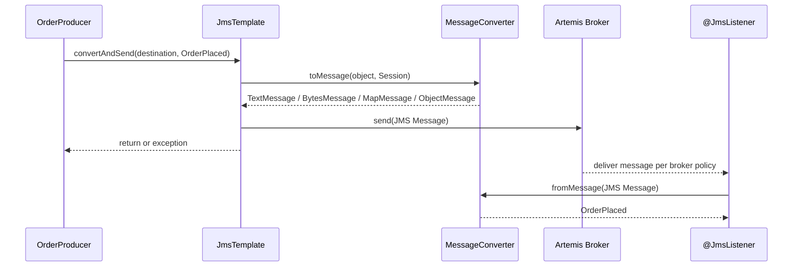

# Sending Business Objects with convertAndSend in Spring JMS

> **Topic:** Spring Framework – JMS · **Group:** Message Sending. This lesson walks through sending a **Java business object/DTO** via `JmsTemplate.convertAndSend`, from choosing a `MessageConverter` to wire format, JMS properties, receiving listeners, error handling, and operations. Examples use **Java 21, Spring Boot 3.3.5, Jakarta Messaging, and ActiveMQ Artemis**.

## 1. From Business Object to JMS Message

An application has an order event:

```java
public record OrderPlaced(
        String eventId,
        String orderId,
        long totalMinor,
        String currency) {
}
```

The record above is a **type declaration**, not a standalone application. The producer wants to send the object without manually creating a `TextMessage`, opening a `Session`, or serializing JSON by hand:

```java
jmsTemplate.convertAndSend("orders.created", event);
```

`convertAndSend` is an API of `org.springframework.jms.core.JmsTemplate`. It **does not send a raw Java reference** and **does not encode arbitrary objects to JSON by default**. When called, Spring must convert the Java value into a `jakarta.jms.Message` via the template's `MessageConverter`, and only then send it through the JMS provider.



**Three distinct layers of responsibility:** the business model (`OrderPlaced`) defines the content; `MessageConverter` defines the **wire format**; `JmsTemplate` manages resources and executes the send. The broker handles routing/durability per its own policy, and the listener executes business logic upon receipt.

A `convertAndSend` call returning **does not mean the consumer has finished processing**. It can also block or throw an exception if conversion, connection, authentication, or sending encounters an issue.

## 2. How Does `convertAndSend` Differ from `send`?

| API | Input | Who creates the JMS message? | When to use |
| --- | --- | --- | --- |
| `send("orders.created", MessageCreator)` | Callback receiving `Session` | Application explicitly calls `session.createTextMessage(...)`/`createMapMessage(...)` | Want direct control over JMS message type and fields. |
| **`convertAndSend("orders.created", event)`** | Java object/DTO | Configured `MessageConverter` | Send models without writing JMS boilerplate. |
| `convertAndSend("orders.created", event, postProcessor)` | DTO and callback | Converter creates message, then callback edits it before send | Add metadata, type/version, correlation. |
| `convertAndSend(event)` | DTO | Converter | Only when the template has a **default destination**. |
| `receiveAndConvert("orders.created")` | Destination name | Converter decodes received message | Active polling receive, not the default async listener model. |

An API illustration snippet (requires `JmsTemplate jmsTemplate` and `OrderPlaced event` already initialized):

```java
// Send to a named destination:
jmsTemplate.convertAndSend("orders.created", event);

// Only use the single-argument overload if a default destination is configured:
// jmsTemplate.convertAndSend(event);

// When wanting to attach metadata to the JMS Message:
jmsTemplate.convertAndSend("orders.created", event, message -> {
    message.setStringProperty("eventType", "OrderPlaced");
    message.setIntProperty("schemaVersion", 1);
    return message;
});
```

This snippet is **not a standalone runnable program**. Distinguish `JmsTemplate` from `JmsMessagingTemplate`: both have convert/send APIs, yet their abstraction layers and `MessageConverter` types differ. This lesson uses the **JMS-specific** `org.springframework.jms.support.converter.MessageConverter`.

### Order of Operations

```text
Java domain object
  -> JmsTemplate.convertAndSend()
  -> MessageConverter.toMessage(object, Session)
  -> MessagePostProcessor (if provided)
  -> resolve Destination (queue/topic, name)
  -> JMS MessageProducer.send()
  -> JMS provider / broker
  -> return or throw JmsException
```

`MessagePostProcessor` receives a **JMS Message already built by the converter** and returns the message to be sent; it is not where the broker converts domain objects again.

## 3. The Default `SimpleMessageConverter` and Important Limitations

If an application does not configure another converter, Spring JMS typically uses `SimpleMessageConverter`. It understands a basic set of Java types:

| Input object | JMS message typically created | Notes |
| --- | --- | --- |
| `String` | `TextMessage` | Raw text; if JSON is desired, the application itself must build the string first. |
| `byte[]` | `BytesMessage` | Byte payload. |
| `Map` with JMS-supported values | `MapMessage` | Flat map body, **not JSON**. |
| Java object implementing `Serializable` | `ObjectMessage` | Relies on native Java serialization; compatibility and security risks. |
| POJO or Java record **not** implementing `Serializable` | No suitable default mapping | Typically throws `MessageConversionException`. |

For example, a `Map<String,Object>` with String/long values:

```java
Map<String, Object> payload = new LinkedHashMap<>();
payload.put("orderId", "ORD-42");
payload.put("totalMinor", 125_000L);
payload.put("currency", "VND");

jmsTemplate.convertAndSend("orders.created", payload);
```

This is a **fragment**; it requires importing `java.util.Map`, `java.util.LinkedHashMap`, and having `jmsTemplate`. With the default converter, the outgoing payload is typically a `MapMessage`, not automatically generated JSON text.

### Why Is `Serializable` Not a Good Default for Domain Events?

`ObjectMessage` couples consumers to Java classes, classloaders, class versions, and Java serialization rules; it makes cross-language integration hard and carries risks when deserializing untrusted data. Sending a JPA entity directly can also trigger lazy loading, circular references, leaking private fields, or non-serializable class errors.

A safer approach for business events: **separate protocol DTOs**, use a stable wire format (commonly JSON), declare schema/version explicitly, and restrict the types allowed for deserialization.

## 4. Converting POJOs/Records to JSON with MappingJackson2MessageConverter

Spring Framework 6.1 provides `org.springframework.jms.support.converter.MappingJackson2MessageConverter` using Jackson 2 to serialize Java objects to JSON and deserialize them back.

Core configuration options:

- `setTargetType(MessageType.TEXT)`: creates a `TextMessage` holding JSON. **This converter's default is `BytesMessage`**, so you must set this if you want to inspect JSON text.
- `setTypeIdPropertyName("_type")`: a **JMS property** storing the type ID, needed for the receiving converter to identify the Java class during deserialization.
- `setTypeIdMappings(Map.of("order-placed-v1", OrderPlaced.class))`: maps a logical ID to a class. The wire contract keeps the type ID stable even if the Java class is renamed.
- Use a consistently configured `ObjectMapper` to control enums, timestamps, nullability, unknown fields, and encoding.

When sending `OrderPlaced`, the expected structure is:

```text
JMS TextMessage
├── Standard JMS headers
│   └── JMSCorrelationID: "order:ORD-42"
├── JMS properties
│   ├── _type: "order-placed-v1"      (String; for Jackson converter)
│   ├── eventType: "OrderPlaced"      (String; for message selector)
│   └── schemaVersion: 1             (int; for contract)
└── Body: JSON string
    {"eventId":"evt-...","orderId":"ORD-42",
     "totalMinor":125000,"currency":"VND"}
```

**Distinguish them:** `_type` supports the converter, `eventType` supports routing/filtering, and `schemaVersion` expresses the contract version. All three are **JMS message properties**, not automatically extracted from the JSON body by a message selector.

Do not use raw Java class names as long-lived public event type IDs. Do not allow external payloads to pick arbitrary classes to deserialize: enforce an allowed type ID mapping, broker ACLs, schema checks, and invalid-message handling.

## 5. Runnable Example: Java 21, Spring Boot 3.3.5, ActiveMQ Artemis

The example uses **a single project** containing an HTTP producer and a receiving listener to study the flow: `OrderPlaced record` → `JmsTemplate.convertAndSend` → JSON `TextMessage` → `@JmsListener(OrderPlaced)`.

Environment requirements: Java 21, a compatible Gradle wrapper, an Artemis broker running at `tcp://localhost:61616`, and queue `orders.created` provisioned or the broker configured for appropriate auto-creation. Credentials `artemis/artemis` are for local environments only.

### 5.1. Gradle and Application Configuration

`settings.gradle`:

```groovy
rootProject.name = 'jms-domain-event-demo'
```

`build.gradle`:

```groovy
plugins {
    id 'java'
    id 'org.springframework.boot' version '3.3.5'
    id 'io.spring.dependency-management' version '1.1.6'
}

group = 'com.example'
version = '0.0.1-SNAPSHOT'

java {
    toolchain { languageVersion = JavaLanguageVersion.of(21) }
}

repositories { mavenCentral() }

dependencies {
    implementation 'org.springframework.boot:spring-boot-starter-web'
    implementation 'org.springframework.boot:spring-boot-starter-artemis'
}
```

`spring-boot-starter-web` pulls in Jackson `ObjectMapper`; `spring-boot-starter-artemis` supplies the JMS client and Spring JMS integration using Jakarta JMS. Do not mix legacy `javax.jms.*` with `jakarta.jms.*` on Boot 3.x.

`src/main/resources/application.yml`:

```yaml
spring:
  artemis:
    mode: native
    broker-url: ${JMS_BROKER_URL:tcp://localhost:61616}
    user: ${JMS_USER:artemis}
    password: ${JMS_PASSWORD:artemis}
  jms:
    pub-sub-domain: false

server:
  port: 8080
```

`spring.jms.pub-sub-domain=false` selects **queue**, not topic. In production, configure a secret manager, TLS, send/consume permissions, destination provisioning, and appropriate broker persistence policies.

### 5.2. Complete Java Source

Create `src/main/java/com/example/orders/OrderMessagingApplication.java`:

```java
package com.example.orders;

import java.util.Map;
import java.util.UUID;

import com.fasterxml.jackson.databind.ObjectMapper;

import org.springframework.boot.SpringApplication;
import org.springframework.boot.autoconfigure.SpringBootApplication;
import org.springframework.context.annotation.Bean;
import org.springframework.http.ResponseEntity;
import org.springframework.jms.annotation.EnableJms;
import org.springframework.jms.annotation.JmsListener;
import org.springframework.jms.core.JmsTemplate;
import org.springframework.jms.support.converter.MappingJackson2MessageConverter;
import org.springframework.jms.support.converter.MessageType;
import org.springframework.stereotype.Component;
import org.springframework.web.bind.annotation.PathVariable;
import org.springframework.web.bind.annotation.PostMapping;
import org.springframework.web.bind.annotation.RestController;

@SpringBootApplication
@EnableJms
public class OrderMessagingApplication {
    public static void main(String[] args) {
        SpringApplication.run(OrderMessagingApplication.class, args);
    }

    // Domain event DTO. Do not send a JPA entity directly.
    public record OrderPlaced(
            String eventId,
            String orderId,
            long totalMinor,
            String currency) {
    }

    @Bean
    MappingJackson2MessageConverter jmsJsonMessageConverter(
            ObjectMapper objectMapper) {
        MappingJackson2MessageConverter converter =
                new MappingJackson2MessageConverter(objectMapper);
        converter.setTargetType(MessageType.TEXT);
        converter.setTypeIdPropertyName("_type");
        converter.setTypeIdMappings(
                Map.of("order-placed-v1", OrderPlaced.class));
        return converter;
    }
}

@RestController
class OrderPublisher {
    private final JmsTemplate jmsTemplate;

    OrderPublisher(JmsTemplate jmsTemplate) {
        this.jmsTemplate = jmsTemplate;
    }

    @PostMapping("/orders/{orderId}/publish")
    ResponseEntity<String> publish(@PathVariable String orderId) {
        OrderMessagingApplication.OrderPlaced event =
                new OrderMessagingApplication.OrderPlaced(
                        UUID.randomUUID().toString(),
                        orderId,
                        125_000L,
                        "VND");

        jmsTemplate.convertAndSend("orders.created", event, message -> {
            message.setStringProperty("eventType", "OrderPlaced");
            message.setIntProperty("schemaVersion", 1);
            message.setJMSCorrelationID("order:" + orderId);
            return message;
        });

        return ResponseEntity.accepted().body("QUEUED " + orderId);
    }
}

@Component
class OrderPlacedConsumer {
    @JmsListener(
            destination = "orders.created",
            selector = "eventType = 'OrderPlaced' AND schemaVersion = 1")
    public void onEvent(OrderMessagingApplication.OrderPlaced event) {
        System.out.printf(
                "CONSUMED order=%s amount=%d currency=%s%n",
                event.orderId(), event.totalMinor(), event.currency());
    }
}
```

**Why this works mechanically:**

1. `@SpringBootApplication` + `@EnableJms` enables component scanning and the infrastructure to detect `@JmsListener`; Boot auto-configures the provider from the Artemis starter.
2. `@Bean MappingJackson2MessageConverter` is an `org.springframework.jms.support.converter.MessageConverter` bean. When you do not replace `JmsTemplate`/the default listener factory yourself, Boot wires this converter bean into **both the sender and the default listener factory**.
3. `setTargetType(MessageType.TEXT)` produces a JSON `TextMessage`; `setTypeIdPropertyName` and the mappings allow the receiving converter to deserialize back into `OrderPlaced`.
4. `jmsTemplate.convertAndSend(destination, event, callback)` sends an object while delegating conversion to the converter. The callback adds JMS properties and headers **after conversion, before sending**.
5. `selector` inspects only the JMS properties `eventType` and `schemaVersion`, not the JSON body. `schemaVersion` is an `int`, so the selector matches the numeric literal `1` with the right type.
6. The listener receives the `OrderPlaced` record reconstructed by the Jackson converter, without manually calling `ObjectMapper.readValue` inside the business method.
7. `totalMinor` uses an integer of the smallest currency unit rather than `double` for monetary amounts; `eventId` supports idempotency design.
8. The send call runs on the request thread and can block or fail; the HTTP endpoint returns `202 Accepted` only when the send call does not throw an exception in this example.

**This is a learning example:** the amount `125_000L` is hardcoded; real systems retrieve amounts/currencies from confirmed business state. Generating a fresh `UUID` on every request does not provide idempotency if a caller retries the same order; production systems must preserve a stable `eventId` for **a single event**.

### 5.3. Running and Verifying

Ensure the Artemis broker is running and queue `orders.created` has the proper JMS queue/ANYCAST address, permissions, and credentials:

```bash
# Linux/macOS, from the directory with Gradle wrapper:
./gradlew bootRun

# Windows:
gradlew.bat bootRun
```

From another terminal:

```bash
curl -i -X POST http://localhost:8080/orders/ORD-42/publish
```

If the JMS send succeeds, the HTTP response may look like:

```http
HTTP/1.1 202
Content-Type: text/plain;charset=UTF-8

QUEUED ORD-42
```

When the consumer receives and the converter decodes successfully, the listener prints:

```text
CONSUMED order=ORD-42 amount=125000 currency=VND
```

**There is no guaranteed chronological order** between HTTP 202 and asynchronous logs. Startup logs, JMS message IDs, and UUIDs vary across runs. This is not claimed to be the complete stdout.

To inspect the wire format, pause the consumer in a **test environment**, publish a message, and inspect it with the Artemis console/CLI: the `TextMessage` body is JSON, properties include `_type`, `eventType`, and `schemaVersion`, and the header contains `JMSCorrelationID`. After restarting the consumer, check queue backlog/consumer count and handler logs.

## 6. MessagePostProcessor Is Not MessageConverter

`MessageConverter` defines the **body** and usually the technical metadata required for decoding. `MessagePostProcessor` is called **after the body has been converted**, before sending; it lets you set business-oriented JMS headers and properties:

```java
jmsTemplate.convertAndSend("orders.created", event, message -> {
    message.setStringProperty("eventType", "OrderPlaced");
    message.setStringProperty("tenantId", "store-a");
    message.setIntProperty("schemaVersion", 1);
    message.setJMSCorrelationID("order:" + event.orderId());
    return message;
});
```

This is a **fragment** requiring an existing `event` and `jmsTemplate`. Do not call `convertAndSend` recursively from inside a post-processor to avoid unexpected loops.

| Field | Where does it live? | Purpose |
| --- | --- | --- |
| `orderId`, `totalMinor`, `currency` | JSON body of `TextMessage` | Business payload |
| `_type` | JMS string property | Decoder maps type ID to class |
| `eventType` | JMS string property | Selector/classification |
| `schemaVersion` | JMS int property | Contract version selection |
| `JMSCorrelationID` | JMS header | Correlates request/event with trace |

**Property limitations:** JMS properties cannot hold arbitrary objects; supported types are boolean, byte, short, int, long, float, double, and String. Property names must be valid JMS selector identifiers. Selectors **cannot inspect the JSON body**, so if the broker needs to filter by tenant or `eventType`, you must attach an appropriate property. Do not place secrets or large payloads in properties.

### Two Easy Mistakes

- Putting `schemaVersion` in the JSON body and writing a selector `schemaVersion = 1`: selectors cannot see inside the body.
- Calling `setStringProperty("schemaVersion", "1")` while the selector compares against numeric `1`: selectors do not automatically apply `getIntProperty`-style conversion. Send the property with the proper `int` type.

## 7. When Creating Spring JMS Beans Manually

In Spring Boot, you can rely on auto-configuration when you only need one broker and one converter bean. If you **manually define** a `JmsTemplate`, you must attach the converter yourself:

```java
@Bean("jsonJmsTemplate")
JmsTemplate jsonJmsTemplate(
        ConnectionFactory connectionFactory,
        MappingJackson2MessageConverter converter) {
    JmsTemplate template = new JmsTemplate(connectionFactory);
    template.setMessageConverter(converter);
    template.setPubSubDomain(false);
    return template;
}
```

This is a **fragment inside `@Configuration`**, requiring imports for `jakarta.jms.ConnectionFactory`, `org.springframework.jms.core.JmsTemplate`, `@Bean`, and the converter class. Defining a custom bean can cause Boot's default template auto-configuration to back off.

For a manually created listener factory, attach the same conversion policy:

```java
@Bean("jsonJmsListenerFactory")
DefaultJmsListenerContainerFactory jsonJmsListenerFactory(
        ConnectionFactory connectionFactory,
        MappingJackson2MessageConverter converter) {
    DefaultJmsListenerContainerFactory factory =
            new DefaultJmsListenerContainerFactory();
    factory.setConnectionFactory(connectionFactory);
    factory.setPubSubDomain(false);
    factory.setSessionTransacted(true);
    factory.setMessageConverter(converter);
    return factory;
}
```

The listener uses `@JmsListener(destination="orders.created", containerFactory="jsonJmsListenerFactory")`. Import `org.springframework.jms.config.DefaultJmsListenerContainerFactory`. The fragment above does not configure an error handler, destination resolver, or factory unwrapping for every environment; in Boot 3.3 you can use `DefaultJmsListenerContainerFactoryConfigurer` to inherit Boot defaults instead of recreating them all by hand.

Never assume every custom `JmsTemplate` and listener factory will automatically pick up a `MessageConverter` bean. When multiple `ConnectionFactory` beans or converters exist, use bean names/`@Qualifier` to avoid injecting the wrong broker or serializer.

## 8. JSON Event DTOs and Schema Evolution

A domain event is a **long-lived integration contract**, not a snapshot of a JPA entity. In the example, the record contains:

- `eventId`: unique identifier for the **event** for deduplication and tracing.
- `orderId`: business key to locate the order.
- `totalMinor`: integer minor units; never use floating-point numbers for money.
- `currency`: currency code, requiring validation.
- `schemaVersion`: placed outside the body so consumers/selectors can classify before reading.

For schema evolution:

1. Preserve names/types/semantics of existing fields, adding optional fields with defaults where appropriate.
2. Test newer producers against older consumers and vice versa; Jackson may reject unknown fields or missing constructor properties depending on configuration.
3. Version the type ID on breaking changes: `order-placed-v1`, `order-placed-v2`; do not silently reuse the old contract for a changed class.
4. Define how `Instant`, enums, decimals, nulls, and nested objects are represented; never assume a default `ObjectMapper` handles every custom Java type.
5. Deserialize only accepted message types; prefer logical type ID mappings/allowlists and reject arbitrary class names from untrusted sources.
6. Bound payload sizes and limit sensitive data. Logs should print correlation/event IDs rather than dumping full customer/PII payloads.
7. Provide a consumer fallback/DLQ for invalid payloads to prevent infinite redelivery of schema-broken messages.

Illustrative JSON example, not an exact capture of a runtime-generated UUID:

```json
{
  "eventId": "evt-1001",
  "orderId": "ORD-42",
  "totalMinor": 125000,
  "currency": "VND"
}
```

**Note on Java classes:** moving a class from `com.example.orders` to another package should not be a breaking change on the wire. That holds when the wire contract is a field schema + logical type ID rather than raw Java serialization.

## 9. `convertAndSend` Success Is Not Processing Completion

There are at least five independent milestones: the business DB transaction, object conversion, sending to the broker, broker persistence/routing, and consumer processing + ACK. `convertAndSend` interacts directly only with the beginning of this chain.

### Producer Loses an Event After Writing to DB

If the DB commits and the process crashes before the JMS send call, the order exists while the event was never published. Conversely, if the message is sent before DB commit and the DB rolls back, consumers receive "order created" even though no real order exists. **Transactional outbox** keeps domain state writes and outbox event inserts in the same DB transaction; a worker/CDC publishes to JMS with retries and status tracking.

### Consumer Processes Duplicates

The broker can redeliver when a handler throws an exception or the process crashes before ACK/commit. A consumer might have already written an invoice to the DB yet receive the message again. Design idempotency around a stable `eventId`, such as a unique constraint in a processed-events table combined with business updates inside an appropriate DB transaction.

In the demo, `eventId` is generated per HTTP request; if a real system retries the same event, it must keep **the same `eventId`** rather than generating a new ID on each retry. Never promise exactly-once business outcomes solely from using `convertAndSend` or `@JmsListener`.

### Transactions and Error Reporting

- `JmsTemplate` can throw runtime `org.springframework.jms.JmsException` when conversion or sending fails; code must not return a false HTTP 202 upon failure.
- If an active JMS session transaction is open, the send call returning does not mean the message has **committed**.
- When a send times out in an unknown state, retrying may produce duplicate messages. Use idempotency/`eventId` and a bounded retry policy.
- `@JmsListener` receives asynchronously; if callers must know the final outcome, build a status endpoint or a separate reply/result event.
- `DeliveryMode.PERSISTENT`, TTL, quotas, disk, DLQ, and HA are handled across template/provider/broker; the JSON converter does not determine durability.

## 10. Notes on QoS, Timeouts, and Destinations

`JmsTemplate.convertAndSend("orders.created", ...)` resolves the destination to a queue or topic according to `pubSubDomain` and `DestinationResolver`. The same string name with a different queue/topic domain or broker URL targets a completely different destination. Creating a Java `Queue` object does not mean the physical queue is provisioned.

To configure TTL/priority/delivery mode explicitly on a template:

```java
JmsTemplate template = new JmsTemplate(connectionFactory);
template.setExplicitQosEnabled(true);
template.setDeliveryPersistent(true);
template.setPriority(4);
template.setTimeToLive(60_000L);
```

This is a **fragment**, requiring a valid `jakarta.jms.ConnectionFactory connectionFactory`. The TTL here applies to sends through that template and must match your SLA; a consumer offline longer than the TTL may find no message left to process. `setExplicitQosEnabled(true)` instructs the template to send explicit QoS options.

Do not confuse `MessagePostProcessor` with changing overall send policy. Post-processors are meant for JMS message properties/headers; delivery mode, TTL, and priority should be configured through the template/provider/QoS APIs.

## 11. Common Errors

| Error/Symptom | Why it happens | How to fix |
| --- | --- | --- |
| `MessageConversionException` when sending a record | `SimpleMessageConverter` cannot convert a non-Serializable DTO | Register a JSON converter or suitable custom converter. |
| `ObjectMessage` sent instead of JSON | Serializable POJO handled by default converter | Specify `MappingJackson2MessageConverter` and an explicit wire type. |
| Broker receives `BytesMessage` instead of JSON text | Jackson converter defaults to target BYTES | Set `MessageType.TEXT`. |
| Receiver cannot decode `OrderPlaced` | Missing type ID, mappings, or listener converter | Set `_type`/mappings and configure matching converters on both sides. |
| Selector skips the message | `eventType`/`schemaVersion` property missing or placed in body | Set properties via `MessagePostProcessor` and check types. |
| Default destination error | Calling single-argument overload without setting default | Call `convertAndSend("orders.created", event)`. |
| Send succeeds yet no processing happens | Wrong destination, ACL, broker, or listener not running | Check routing, queue metrics, consumer count, and logs. |
| Serialization leaks sensitive fields | Sending JPA entities or overly broad object graphs directly | Extract a minimal event DTO and control `ObjectMapper`. |
| Java compilation error `javax.jms` | Mixing Boot 3/Jakarta JMS with legacy API | Use `jakarta.jms` and consistent dependencies. |
| Message processed multiple times | Redelivery or retry after timeout | Stable `eventId` + consumer idempotency. |
| Old consumer breaks when adding a field | Schema evolution/Jackson incompatibility | Version the contract and run bidirectional compatibility tests. |
| HTTP 202 treated as completed | Confusing send success with downstream side effects | Track processing/ACK status; never promise premature completion. |

## 12. End-to-End Verification Plan

A useful verification suite in a test environment:

1. Start the Artemis broker and verify queue `orders.created`, credentials/ACLs, and address routing.
2. Start Spring Boot and confirm `JmsTemplate` and `jmsJsonMessageConverter` are registered and the listener factory uses a compatible converter.
3. Send `POST /orders/ORD-42/publish`; confirm HTTP 202 on send success.
4. On the test broker, pause the consumer to inspect the message: JMS `TextMessage` has the expected JSON fields, properties `_type="order-placed-v1"`, `eventType="OrderPlaced"`, numeric `schemaVersion`, and header `JMSCorrelationID`.
5. Resume the consumer and confirm `@JmsListener` receives `OrderPlaced` and logs the right orderId/amount/currency. Runtime log order may not match publish order.
6. Test malformed JSON payloads, unsupported type IDs, and non-matching selectors; confirm error/retry/DLQ policies without infinite retries.
7. Stop the broker and invoke publish: verify an appropriate error response; the send must not falsely report success.
8. Simulate consumer crash after side effects but before ACK; verify idempotency works.
9. Test multiple producers/consumers sharing the schema and compatible versions; measure queue backlog, redeliveries, DLQ, and processing latency.

Unit tests that merely verify a service **called** `jmsTemplate.convertAndSend` are insufficient: integration tests are needed to catch serialization bugs, broker misconfigurations, and listener deserialization into the right class.

## 13. Self-Check Questions

1. What steps does `convertAndSend` execute after receiving a Java object? Which component determines the JMS message body?
2. Why does `SimpleMessageConverter` not automatically convert every POJO to JSON?
3. Compare `convertAndSend(Map)`, `convertAndSend(String)`, and `convertAndSend(OrderPlaced)` without vs. with a Jackson converter.
4. Why must `MessageType.TEXT` be set if you want to inspect a JSON `TextMessage`?
5. Distinguish `_type`, `eventType`, `schemaVersion`, `JMSCorrelationID`, and fields inside JSON.
6. Does selector `eventType='OrderPlaced'` read message properties or the body? Where should metadata be attached?
7. Does `MessagePostProcessor` run before or after the converter? Can it replace `MessageConverter`?
8. Why should an event DTO stay decoupled from JPA entities and include an `eventId`?
9. When defining `JmsTemplate` and the listener factory manually, which beans need the converter configured?
10. Does a normal return from a send call mean the consumer has finished and the DB has committed?
11. The domain DB commits, then the process crashes before sending: which pattern should be used?
12. The consumer performs the side effect and crashes before ACK: how do you prevent duplicate processing?
13. How do you verify in practice that the broker is receiving a JSON `TextMessage` rather than an `ObjectMessage`?

**Conclusion:** `JmsTemplate.convertAndSend` makes sending business objects concise, yet it **does not define the wire format by itself**. For cross-service events, use explicit DTOs and a JSON converter with clear type/version mappings, use `MessagePostProcessor` for JMS headers/properties, configure the converter on both sender and receiver, and verify broker state, transactions, and idempotency instead of treating send success as completed processing.

### References

- [Spring Framework 6.1 – JmsTemplate API](https://docs.spring.io/spring-framework/docs/6.1.1/javadoc-api/org/springframework/jms/core/JmsTemplate.html) — `convertAndSend` overloads and `MessagePostProcessor`.
- [Spring Framework – Sending a Message](https://docs.spring.io/spring-framework/reference/integration/jms/sending.html) — `SimpleMessageConverter`, JMS message conversion, and metadata post-processing.
- [Spring Framework 6.1 – MappingJackson2MessageConverter](https://docs.spring.io/spring-framework/docs/6.1.0/javadoc-api/org/springframework/jms/support/converter/MappingJackson2MessageConverter.html) — `setTargetType`, `setTypeIdMappings`, `setTypeIdPropertyName`.
- [Spring Boot 3.3 JMS reference](https://docs.spring.io/spring-boot/docs/3.3.0-M1/reference/pdf/spring-boot-reference.pdf) — auto-configuration of `JmsTemplate` and the default `@JmsListener` factory using the `MessageConverter` bean.
- [Jakarta Messaging 3.1 Specification](https://jakarta.ee/specifications/messaging/3.1/jakarta-messaging-spec-3.1.html) — headers/properties, selectors, delivery, and ACK.
- [ActiveMQ Artemis Documentation](https://artemis.apache.org/components/artemis/documentation/latest/) — broker, queue/address, and operations.
