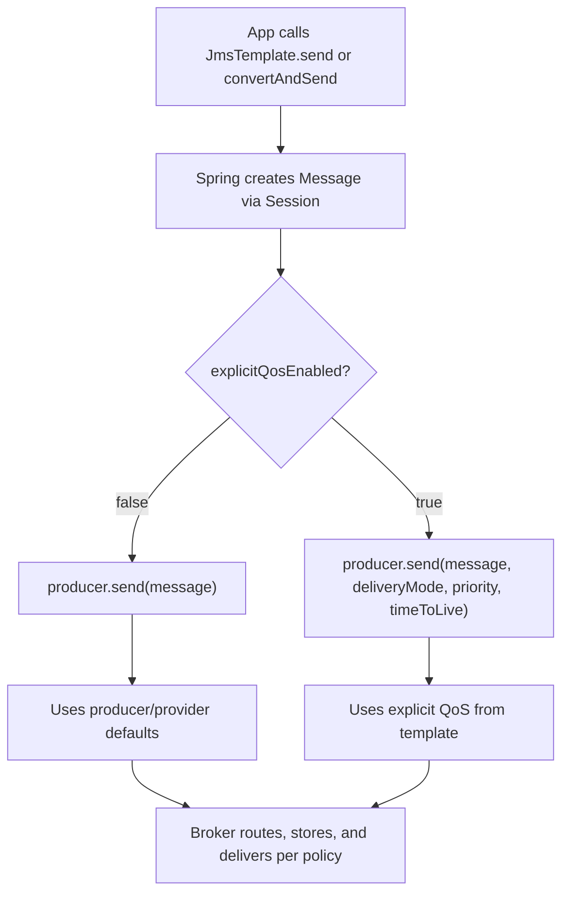

# explicitQosEnabled and QoS Values on JmsTemplate (Spring JMS)

## 1. Goal and Real-World Scenario

When sending a JMS message, an application chooses not only the **payload** and **Queue/Topic**, but also several **Quality of Service (QoS)** attributes for the send: whether to send persistently or non-persistently, what priority level to assign, and how long the message remains valid.

For example, an ordering system sends two kinds of data:

- `payment.command`: a critical business command that should request **PERSISTENT**, an appropriate priority, and a suitably long lifetime.
- `dashboard.refresh`: a UI refresh notification that can tolerate **NON_PERSISTENT**, low priority, and a short TTL to avoid processing stale data.

In Spring Framework, `org.springframework.jms.core.JmsTemplate` provides the setters:

```java
template.setDeliveryMode(DeliveryMode.PERSISTENT);
template.setPriority(7);
template.setTimeToLive(60_000L);
template.setExplicitQosEnabled(true);
```

**Core point of this lesson:** the three values—delivery mode, priority, and time-to-live—**are passed explicitly by `JmsTemplate` to the send call only when `explicitQosEnabled=true`**. If this flag is `false`, even if you called the QoS setters on the template, Spring still sends using the overload that relies on the **JMS `MessageProducer`'s default QoS**. Those defaults may have been configured by the provider/administrator differently from the JMS specification defaults.

> **Short takeaway:** `setPriority(7)` sets *the value in the template's configuration*; `setExplicitQosEnabled(true)` turns on *the mechanism that applies those values at send time*. You need both if your goal is priority 7 via `JmsTemplate`'s explicit QoS mechanism.

This lesson belongs to **message delivery quality**. QoS here **does not mean** the consumer processed the message successfully, the database transaction committed, the broker achieved high availability, or business processing is exactly-once.

## 2. The Three QoS Parameters of a JMS Send

| Parameter | Spring `JmsTemplate` API | Value Range / Unit | JMS Default Without Override | Meaning |
| --- | --- | --- | --- | --- |
| **Delivery mode** | `setDeliveryMode(int)` or `setDeliveryPersistent(boolean)` | `DeliveryMode.PERSISTENT` (2) / `NON_PERSISTENT` (1) | `PERSISTENT` | Requests a level of storage/delivery protection from the provider, depending on mode and storage setup. |
| **Priority** | `setPriority(int)` | Integer from **0 to 9** | **4** | Hints priority level to the provider: 0 lowest, 9 highest. Does not guarantee global processing order. |
| **Time-to-live (TTL)** | `setTimeToLive(long)` | **Milliseconds**; `0` means no TTL-based expiration | **0 ms** | Limits how long the message remains valid for delivery; tied to `JMSExpiration`. |

These parameters follow **`MessageProducer`'s send-time QoS mechanism**; they are not arbitrary custom properties you attach to a body and wait for the broker to interpret.

### 2.1. Delivery Mode: PERSISTENT and NON_PERSISTENT

`jakarta.jms.DeliveryMode` defines:

```java
DeliveryMode.PERSISTENT      // 2
DeliveryMode.NON_PERSISTENT  // 1
```

- **PERSISTENT**: the provider must apply mechanisms to protect the message against failures of the messaging provider itself per the spec; real-world effectiveness also depends on persistence/journal, durable destinations/subscriptions, transactions, and infrastructure.
- **NON_PERSISTENT**: the JMS provider is not required to guarantee the message survives provider failures; typically reduces storage overhead but is suited only for droppable data.

Do not conclude "PERSISTENT = database update is guaranteed" or "NON_PERSISTENT = message vanishes immediately." This is a **messaging-system send/retention policy**, not the final business outcome.

### 2.2. Priority: 0 to 9

Priority levels in JMS are hints to the provider; level 4 is typically the default. The spec treats 0–4 as normal levels and 5–9 as more urgent levels. For example, `priority=7` can help commands needing faster response than non-urgent notifications.

However, **send** order, **receive** order, **callback completion** order, and **business commit** order are four different orders. Brokers may have FIFO, message groups, multiple consumers, prefetch, selectors, and proprietary priority mechanics. JMS **does not require** a system to strictly deliver every priority 9 message ahead of every priority 4 message already queued.

### 2.3. TTL: Message Lifetime

With `timeToLive=60_000L`, the sender requests that the message expire roughly 60 seconds after send time under provider/JMS rules. Upon successful send, the `JMSExpiration` header represents the expiration timestamp in epoch milliseconds when TTL is non-zero; when TTL is 0, the header is typically 0.

For instance, sending at `12:00:00` with a 10-second TTL means the message ceases to be useful around `12:00:10`. If consumers are down until `12:00:30`, the broker may already have discarded/moved the expired message per expiration policy. **Setting TTL does not guarantee consumers receive the message before the deadline.**

`TTL=0` does not mean the message is "kept forever" regardless of all policies: the broker can still enforce its own TTL/expiry policies, quotas, purges, DLQ/expiry addresses, or storage configs. Producer TTL is only one operational factor.

## 3. Which Call Does explicitQosEnabled Actually Change?

JMS `MessageProducer` has two common synchronous send overloads:

```java
// Uses the current QoS defaults on MessageProducer:
producer.send(message);

// Explicitly passes all three parameters for this send:
producer.send(message, deliveryMode, priority, timeToLive);
```

`JmsTemplate` is responsible for creating/acquiring a Session and MessageProducer, invoking `MessageCreator` or converter, and executing the send. The core logic is accurately summarized below (this is **condensed pseudocode**, not the full Spring source file):

```java
if (isExplicitQosEnabled()) {
    producer.send(
        message,
        getDeliveryMode(),
        getPriority(),
        getTimeToLive());
} else {
    producer.send(message);
}
```

In Spring's implementation, there is also separate handling to set `deliveryDelay` when configured. That does not alter how the two QoS overloads above are selected.

### 3.1. When explicitQosEnabled = false (Default for Manually Created JmsTemplate)

```java
JmsTemplate template = new JmsTemplate(connectionFactory);
template.setDeliveryMode(DeliveryMode.NON_PERSISTENT);
template.setPriority(9);
template.setTimeToLive(5_000L);
// template.setExplicitQosEnabled(false); // Default

template.convertAndSend("demo.queue", "M1");
```

Even though the template holds those three configured values, Spring calls `producer.send(message)`. The send uses **producer/provider defaults** rather than necessarily `NON_PERSISTENT`, priority 9, or 5-second TTL. Under JMS spec defaults without admin overrides, these are typically `PERSISTENT`, priority 4, and TTL 0.

**Mistake to avoid:** checking `getPriority() == 9` and assuming the message just sent had `JMSPriority == 9`. The getter reports the template's configuration; you must inspect **the send path and the message created/routed by the provider** for proof.

### 3.2. When explicitQosEnabled = true

```java
JmsTemplate template = new JmsTemplate(connectionFactory);
template.setExplicitQosEnabled(true);
template.setDeliveryMode(DeliveryMode.NON_PERSISTENT);
template.setPriority(9);
template.setTimeToLive(5_000L);

template.convertAndSend("demo.queue", "M1");
```

Now Spring uses the overload `producer.send(message, 1, 9, 5000L)`. The provider receives all three values explicitly per the JMS contract. Assuming valid network/broker settings, the received message is expected to carry the corresponding headers, subject to provider-specific handling/limits.

**Caution:** `setExplicitQosEnabled(true)` turns on **all three values** on the template. It does not mean only the property whose setter you just called is sent. If you only want to change priority to 7 while keeping JMS default delivery mode and TTL, the remaining values on the template must still be understood and explicitly chosen. If an administratively managed `ConnectionFactory` has different default QoS, enabling explicit QoS can unintentionally **override administrator-configured defaults** for parameters you did not actively change.

### 3.3. Execution Flow



This is the distinction between **storing values in configuration** and **applying those values in the send call**. It is not two different message types or two different brokers.

## 4. Setters and Getters You Need to Know

| Method | Effect | Notes |
| --- | --- | --- |
| `setExplicitQosEnabled(boolean)` | Chooses whether to pass explicit QoS on send | Does not by itself change the three parameters to special values. |
| `isExplicitQosEnabled()` | Checks the current flag | Checks only template configuration, not headers of a specific message. |
| `setDeliveryMode(int)` | Sets `DeliveryMode.PERSISTENT` or `NON_PERSISTENT` | Used only on the explicit QoS path. |
| `setDeliveryPersistent(boolean)` | Sets delivery mode via true/false | `true` = PERSISTENT, `false` = NON_PERSISTENT. Does not toggle explicit flag. |
| `getDeliveryMode()` | Reads the delivery mode stored by the template | Does not accurately predict message mode if explicit is off. |
| `setPriority(int)` / `getPriority()` | Sets/reads priority | Range 0–9; standard default is 4. |
| `setTimeToLive(long)` / `getTimeToLive()` | Sets/reads TTL | Unit is **milliseconds**, not seconds. |
| `setQosSettings(QosSettings)` | Loads all three QoS settings from a value object | **Automatically sets `explicitQosEnabled=true`** per Spring's implementation. |
| `setDeliveryDelay(long)` | Sets delay before message becomes eligible for delivery | **Distinct from TTL** and not among the three values gated by explicit QoS. |

Equivalent ways to set delivery mode:

```java
template.setDeliveryMode(DeliveryMode.PERSISTENT);
template.setDeliveryPersistent(true);

// Both set PERSISTENT mode inside the template.
// Neither automatically calls setExplicitQosEnabled(true).
```

### 4.1. QosSettings Bundles All Three Values

Spring JMS provides `org.springframework.jms.support.QosSettings`:

```java
import jakarta.jms.DeliveryMode;
import org.springframework.jms.core.JmsTemplate;
import org.springframework.jms.support.QosSettings;

// template is a JmsTemplate with a ConnectionFactory already set.
template.setQosSettings(
        new QosSettings(DeliveryMode.PERSISTENT, 7, 60_000L));

System.out.println(template.isExplicitQosEnabled());
```

With the corresponding Spring template, the line above outputs:

```text
true
```

This is an **application code snippet**, not a standalone class: it needs `template`, the Spring JMS library, and a provider for actual sending. `setQosSettings(...)` not only populates the three values but also **enables explicit QoS**. This is a key difference compared to calling individual setters.

### 4.2. Default Values of JmsTemplate

On a new standard Spring JMS template:

```text
explicitQosEnabled = false
deliveryMode       = PERSISTENT (2)
priority           = 4
timeToLive         = 0 (ms)
```

These values are the **template's default settings**, yet when `explicitQosEnabled=false`, sends call `producer.send(message)` and may be governed by **defaults administered on the ConnectionFactory/provider**. Do not confuse "template defaults" with "actual outcome on every broker."

### 4.3. When to Use Each Approach

- Project has one common send profile: set the setters plus `explicitQosEnabled=true` in the `JmsTemplate` bean.
- Want to pass the whole QoS triplet as one object: use `setQosSettings(new QosSettings(...))`.
- Spring Boot auto-configured `JmsTemplate`: use the dedicated `spring.jms.template.*` properties.
- Message categories with different QoS: create **multiple separately configured templates** or choose a producer API with explicit per-send contracts; never mutate flags/setters of a singleton while handling concurrent requests.

## 5. Spring Boot: Configuring QoS via application.properties

Spring Boot 3.x supports properties for the **Boot auto-configured** `JmsTemplate`:

```properties
spring.jms.template.delivery-mode=persistent
spring.jms.template.priority=7
spring.jms.template.time-to-live=60s
spring.jms.template.qos-enabled=true
```

Meaning:

- `delivery-mode=persistent`: requests PERSISTENT.
- `priority=7`: requests priority level 7.
- `time-to-live=60s`: uses Spring Boot's duration syntax, equal to 60,000 milliseconds.
- `qos-enabled=true`: enables explicit QoS on the auto-configured template.

Per Spring Boot documentation, **when at least one of delivery mode, priority, or TTL is set**, Boot normally **automatically enables explicit QoS** on the template it configures. Writing `qos-enabled=true` explicitly in examples makes intent clear and prevents confusion with manually constructed `JmsTemplate` beans.

**Very important limitation:** If you define your own `@Bean JmsTemplate`, Spring Boot may not create or customize that bean from these properties. In that case you must call `setExplicitQosEnabled(true)` and QoS setters yourself, or wire an appropriate customizer. Never edit `application.properties` and assume every `JmsTemplate` in the context changed with it.

### 5.1. Example Disabling Explicit QoS

```properties
spring.jms.template.qos-enabled=false
```

Without other overrides, this tells the auto-configured template to use provider defaults on send. In manual code:

```java
template.setExplicitQosEnabled(false);
template.setPriority(7);
template.setTimeToLive(60_000L);
```

Both setters still store values on the template, but they are not passed via the explicit QoS send overload. When intentionally relying on provider defaults (e.g., centrally managed on `ConnectionFactory`), this can be a reasonable choice.

### 5.2. Environment-Specific Configuration

An example using profiles:

```properties
# application-dev.properties
spring.jms.template.delivery-mode=non_persistent
spring.jms.template.priority=4
spring.jms.template.time-to-live=10s
spring.jms.template.qos-enabled=true
```

```properties
# application-prod.properties
spring.jms.template.delivery-mode=persistent
spring.jms.template.priority=7
spring.jms.template.time-to-live=2m
spring.jms.template.qos-enabled=true
```

The values above **are merely examples adjusted to a scenario**, not recommendations to use `NON_PERSISTENT` in every dev environment or `priority=7` for all production messages. Evaluate workflows, message types, SLAs, and broker policies.

### 5.3. Other Properties Not in the Explicit QoS Triplet

```properties
spring.jms.pub-sub-domain=false
spring.jms.template.receive-timeout=5s
spring.jms.template.delivery-delay=1s
```

- `pub-sub-domain` selects Queue/Topic when resolving destination names, **not send reliability**.
- `receive-timeout` bounds how long a **synchronous receive call** waits, without affecting send TTL.
- `delivery-delay` requests deferring when a message becomes eligible for delivery under JMS 2.0+ (provider-dependent), not time-to-live. Spring configures delay on the producer separately from the explicit QoS branch.

Do not set all three properties together merely because they all involve durations.

## 6. Java 17+ Demo with Spring Boot and Apache ActiveMQ Artemis

Demo goal: **send a `TextMessage` through a `JmsTemplate` configured with explicit QoS**, then receive it back to read **`JMSDeliveryMode`, `JMSPriority`, and `JMSExpiration`**. This verifies against a real broker rather than merely printing template getters.

The demo uses:

- Java 17+ and Maven 3.6.3+.
- Spring Boot **3.3.5** with the Jakarta JMS namespace `jakarta.jms.*`.
- A standalone **Apache ActiveMQ Artemis** broker running in Docker.
- A Queue with a randomized name per run to avoid reading stale backlogs.
- A Spring Boot program using `ApplicationRunner` to send and then call `JmsTemplate.receive(...)` **synchronously with a timeout**; `@JmsListener` is unnecessary since the lesson focuses on **send-side QoS**.

### 6.1. Starting the Broker

With Docker installed and local port 61616 free:

```bash
docker run --detach --rm --name artemis-explicit-qos-demo \
  -e ARTEMIS_USER=artemis \
  -e ARTEMIS_PASSWORD=artemis \
  -p 127.0.0.1:61616:61616 \
  -p 127.0.0.1:8161:8161 \
  apache/artemis:latest-alpine
```

Watch broker logs until ready:

```bash
docker logs artemis-explicit-qos-demo
```

This is a local test environment. The Artemis image typically supports Queue auto-creation under default broker policy; if your instance disables auto-create, create the Queue or enable an appropriate policy. The `artemis/artemis` demo credentials **must never be carried into production**.

### 6.2. Project Structure

```text
jms-explicit-qos-demo/
├── pom.xml
└── src/main/
    ├── java/demo/qos/ExplicitQosDemoApplication.java
    └── resources/application.properties
```

### 6.3. pom.xml

```xml
<project xmlns="http://maven.apache.org/POM/4.0.0"
         xmlns:xsi="http://www.w3.org/2001/XMLSchema-instance"
         xsi:schemaLocation="http://maven.apache.org/POM/4.0.0 https://maven.apache.org/xsd/maven-4.0.0.xsd">
    <modelVersion>4.0.0</modelVersion>

    <parent>
        <groupId>org.springframework.boot</groupId>
        <artifactId>spring-boot-starter-parent</artifactId>
        <version>3.3.5</version>
        <relativePath/>
    </parent>

    <groupId>demo</groupId>
    <artifactId>jms-explicit-qos-demo</artifactId>
    <version>1.0.0</version>

    <properties>
        <java.version>17</java.version>
    </properties>

    <dependencies>
        <dependency>
            <groupId>org.springframework.boot</groupId>
            <artifactId>spring-boot-starter-artemis</artifactId>
        </dependency>
    </dependencies>

    <build>
        <plugins>
            <plugin>
                <groupId>org.springframework.boot</groupId>
                <artifactId>spring-boot-maven-plugin</artifactId>
            </plugin>
        </plugins>
    </build>
</project>
```

`spring-boot-starter-artemis` provides the Jakarta JMS-compatible Artemis client and Spring integration. The project **omits** an embedded broker server dependency because we run an external Docker broker.

### 6.4. application.properties

Save at `src/main/resources/application.properties`:

```properties
spring.artemis.mode=native
spring.artemis.broker-url=tcp://localhost:61616
spring.artemis.user=artemis
spring.artemis.password=artemis
```

**Because the example defines its own `@Bean JmsTemplate` in the next step, QoS values are set explicitly in code**, rather than relying on `spring.jms.template.*` auto-configuration. If the Java app runs in **another container**, replace `localhost` with a broker hostname/port reachable from that container.

### 6.5. Complete Java Code

Save at `src/main/java/demo/qos/ExplicitQosDemoApplication.java`:

```java
package demo.qos;

import java.util.UUID;

import jakarta.jms.ConnectionFactory;
import jakarta.jms.DeliveryMode;
import jakarta.jms.Message;
import jakarta.jms.TextMessage;

import org.springframework.boot.ApplicationRunner;
import org.springframework.boot.SpringApplication;
import org.springframework.boot.autoconfigure.SpringBootApplication;
import org.springframework.context.annotation.Bean;
import org.springframework.jms.core.JmsTemplate;

@SpringBootApplication
public class ExplicitQosDemoApplication {

    public static void main(String[] args) {
        SpringApplication.run(ExplicitQosDemoApplication.class, args);
    }

    @Bean
    JmsTemplate qosJmsTemplate(ConnectionFactory connectionFactory) {
        JmsTemplate template = new JmsTemplate(connectionFactory);

        // Configure QoS for sends:
        template.setPubSubDomain(false); // Queue
        template.setExplicitQosEnabled(true);
        template.setDeliveryMode(DeliveryMode.PERSISTENT);
        template.setPriority(7);
        template.setTimeToLive(60_000L);

        // Only limits synchronous RECEIVE wait in the demo:
        template.setReceiveTimeout(5_000L);
        return template;
    }

    @Bean
    ApplicationRunner runDemo(JmsTemplate jmsTemplate) {
        return args -> {
            // Fresh Queue name on every startup: avoids old messages.
            String destination = "demo.explicit.qos." + UUID.randomUUID();

            jmsTemplate.send(destination, session -> {
                TextMessage message =
                        session.createTextMessage("HELLO_QOS");
                message.setStringProperty("demoTag", "qos-116");
                return message;
            });

            Message message = jmsTemplate.receive(destination);
            if (!(message instanceof TextMessage textMessage)) {
                throw new IllegalStateException(
                        "No TextMessage received before timeout");
            }

            boolean persistent =
                    message.getJMSDeliveryMode() == DeliveryMode.PERSISTENT;
            boolean priority7 = message.getJMSPriority() == 7;
            boolean ttlApplied =
                    message.getJMSExpiration() > message.getJMSTimestamp()
                    && message.getJMSTimestamp() > 0;

            if (!persistent || !priority7 || !ttlApplied) {
                throw new IllegalStateException(
                        "Unexpected JMS QoS headers");
            }

            System.out.println("BODY: " + textMessage.getText());
            System.out.println("MODE: PERSISTENT");
            System.out.println("PRIORITY: " + message.getJMSPriority());
            System.out.println("TTL_APPLIED: " + ttlApplied);
            System.out.println(
                    "TAG: " + message.getStringProperty("demoTag"));
            System.out.println("DEMO: completed");
        };
    }
}
```

**Why does this program compile and run when placed in the right files?**

- `ExplicitQosDemoApplication` is a `public` class matching its filename; all `import` statements appear at the top.
- `@SpringBootApplication` lets Spring Boot configure the app; `@Bean JmsTemplate` uses the `ConnectionFactory` created by the Artemis starter from properties.
- `ApplicationRunner` runs after context startup, executes the send, and receives one message via the same broker and Queue.
- `UUID.randomUUID()` changes only the Queue name to avoid prior backlogs; **the random name is not printed**, keeping demo stdout deterministic.
- `JmsTemplate.send` invokes `MessageCreator` inside a compatible Session to build the `TextMessage`.
- `setExplicitQosEnabled(true)` causes Spring to pass `PERSISTENT, 7, 60000` to the explicit send overload.
- `receiveTimeout=5000ms` is the receive wait timeout, not TTL. If the broker/consumer fails, `receive` may return `null` and the demo throws a clear exception.
- `getJMSDeliveryMode`, `getJMSPriority`, `getJMSExpiration`, and `getJMSTimestamp` inspect **the message that traversed the provider**, not template properties.
- The app prints results **after validating assertions**; if the broker ignores QoS or connection fails, it does not pretend to succeed.

Note: the demo assumes an auto-created Queue, JMS producer/consumer on a running Artemis broker, no selector, no delivery delay, and JMS timestamps enabled. Specific broker policies can affect outcomes and must be checked in custom environments.

### 6.6. Run Command and Stdout

From the directory containing `pom.xml`:

```bash
mvn spring-boot:run
```

When the broker runs normally, the lines **printed by the example program itself** are:

```text
BODY: HELLO_QOS
MODE: PERSISTENT
PRIORITY: 7
TTL_APPLIED: true
TAG: qos-116
DEMO: completed
```

Maven, Spring Boot, and Artemis may log many other lines before/after these six lines. Match only the six labeled lines. `JMSExpiration` is computed from real wall-clock send time, so **no absolute timestamp number is printed**, keeping stdout clock-independent.

**What can we conclude?** If the program runs and assertions pass, the provider returned a `TextMessage` carrying the requested delivery mode, priority, and expiration. This confirms QoS **was applied on the demo's send path**. It **does not prove** broker HA, data surviving Docker container deletion, exactly-once consumer processing, or DB + JMS sharing one transaction.

After testing, run:

```bash
docker stop artemis-explicit-qos-demo
```

The container ran with `--rm` so stopping it removes it; do not use this demo to claim persistence across container deletion. The Java application does not need an HTTP port or `@JmsListener` for this QoS exercise.

## 7. Control Experiment: Turning Off Explicit QoS

To prove the **on/off flag** matters more than merely calling setters, try a variant in `qosJmsTemplate(...)`:

```java
template.setExplicitQosEnabled(false);
template.setDeliveryMode(DeliveryMode.NON_PERSISTENT);
template.setPriority(9);
template.setTimeToLive(10_000L);
```

When the template sends, Spring picks `producer.send(message)`. Thus the three values `NON_PERSISTENT/9/10000` **are not explicitly applied from the template**, even though printing getters shows the template holds them.

On an Artemis broker without default overrides, messages typically receive standard JMS defaults: `PERSISTENT`, priority 4, and TTL 0. However, **do not hardcode expected control stdout** because defaults can be configured by the JMS provider, `ConnectionFactory`, or administrator. To run this variant, **remove or adjust the demo's assertions** expecting priority 7 and positive expiration, and print the actual headers:

```java
System.out.println("MODE: " + message.getJMSDeliveryMode());
System.out.println("PRIORITY: " + message.getJMSPriority());
System.out.println("EXPIRATION: " + message.getJMSExpiration());
```

When `explicitQosEnabled=false`, never assume those exact three numbers across all systems. The experiment should compare **actual broker values** with **values stored in the template** so you do not mistake intended settings for applied QoS.

### Scenario Table

| `explicitQosEnabled` Flag | Template Stores mode/priority/TTL | JMS Producer API Called | Expected Outcome |
| --- | --- | --- | --- |
| `false` | `NON_PERSISTENT/9/10000` | `send(message)` | **Producer/provider defaults**; not necessarily 1/9/10000. |
| `true` | `NON_PERSISTENT/9/10000` | `send(message, 1, 9, 10000)` | Explicitly passes 1/9/10000 on send. |
| `true` | `PERSISTENT/7/60000` | `send(message, 2, 7, 60000)` | Explicitly passes 2/7/60000 on send. |
| `false` | Setters untouched | `send(message)` | Relies on JMS/provider defaults. |
| After `setQosSettings(...)` | Per `QosSettings` | Normally explicit overload | `setQosSettings` auto-enables explicit QoS. |

You do not need to change `MessageCreator`, body, `Destination`, or the broker just to verify this mechanism.

## 8. Distinguishing QoS from Similarly Named Concepts

### 8.1. TTL Is Not Receive Timeout

`setTimeToLive(60_000L)` defines **message lifetime after sending**.

`setReceiveTimeout(5_000L)` bounds **how long the thread calling `JmsTemplate.receive` waits**. A message with a 1-hour TTL can still cause `receive()` to return `null` if no message arrives during those 5 seconds. Conversely, a 1-second TTL does not force `receive()` to wait exactly 1 second.

### 8.2. TTL Is Not Delivery Delay

`setDeliveryDelay(10_000L)` asks to **defer the earliest time the provider may deliver the message**. `setTimeToLive(10_000L)` sets **the upper limit on message validity**. The two parameters pull in opposite directions:

- Delay: "do not deliver before a timestamp."
- TTL: "do not deliver once the message has expired."

They interact: a message delayed longer than its TTL/broker policy can expire before ever becoming eligible for delivery. In Spring `JmsTemplate`, delivery delay is passed separately via `MessageProducer.setDeliveryDelay(...)` when configured, outside the three values gated by `explicitQosEnabled`. This is a JMS 2.0+ API requiring broker/provider support.

### 8.3. Priority Is Not Processing Order

A Queue with two concurrent consumers can start message B after A yet **finish B before A** due to differing business execution times. Priority does not guarantee strict reordering of every queue by a fixed algorithm; benchmark on real brokers/consumers and watch out for starvation of low-priority messages.

### 8.4. Persistent Is Not a Durable Topic Subscriber

`DeliveryMode.PERSISTENT` is a **message send mode**. Durable subscription is a **Topic subscription property** enabling the broker to retain matching messages while a subscriber is temporarily offline. Sending persistent messages to a Topic with a non-durable subscriber does not make that subscription durable; without an appropriate subscription, fan-out and offline behavior still follow Topic semantics.

### 8.5. Persistent Is Not Business Exactly-Once

A consumer can receive the same message again after a rollback, reconnect, or commit failure. If the callback already created an invoice and then crashes before acking, the broker can redeliver the message. You need **idempotent consumers**, business keys, proper transactions, and retry/DLQ. `explicitQosEnabled` controls only **producer-side** QoS, not those risks.

### 8.6. Changing a Spring Property Is Not Changing Broker Policy

If the broker enforces a max TTL, expiration policy, or persistence enforcement rules, client-side TTL/mode settings cannot arbitrarily override administrative policies. Choose your specific broker/provider and inspect real policies, logs, and message headers during deployment.

## 9. Organizing Multiple QoS Profiles in One Application

Suppose an application sends two message categories:

- `payments.commands`: critical, durable; priority 7; TTL 2 minutes (per business contract).
- `ui.refresh`: non-urgent, droppable; priority 2; TTL 5 seconds.

**Do not** mutate `setPriority`, `setDeliveryMode`, or `setExplicitQosEnabled` on **a singleton `JmsTemplate` called by multiple threads**. `JmsTemplate` is designed to be thread-safe **once configured**, not to have its configuration mutated before/after individual sends.

### 9.1. Creating Two Beans with Fixed QoS

```java
package demo.qos;

import jakarta.jms.ConnectionFactory;
import jakarta.jms.DeliveryMode;

import org.springframework.context.annotation.Bean;
import org.springframework.context.annotation.Configuration;
import org.springframework.jms.core.JmsTemplate;

@Configuration
public class MultiQosConfig {

    @Bean("paymentJmsTemplate")
    JmsTemplate paymentTemplate(ConnectionFactory connectionFactory) {
        var template = new JmsTemplate(connectionFactory);
        template.setExplicitQosEnabled(true);
        template.setDeliveryMode(DeliveryMode.PERSISTENT);
        template.setPriority(7);
        template.setTimeToLive(120_000L);
        return template;
    }

    @Bean("refreshJmsTemplate")
    JmsTemplate refreshTemplate(ConnectionFactory connectionFactory) {
        var template = new JmsTemplate(connectionFactory);
        template.setExplicitQosEnabled(true);
        template.setDeliveryMode(DeliveryMode.NON_PERSISTENT);
        template.setPriority(2);
        template.setTimeToLive(5_000L);
        return template;
    }
}
```

This is a **configuration class for a Spring project with a `ConnectionFactory`**, not a standalone Java program. When applying it to the Section 6 demo project, use it **instead of the single-template configuration**, or manage bean names/qualifiers explicitly to avoid injection conflicts.

### 9.2. Selecting the Right Bean via @Qualifier

```java
package demo.qos;

import org.springframework.beans.factory.annotation.Qualifier;
import org.springframework.jms.core.JmsTemplate;
import org.springframework.stereotype.Service;

@Service
public class MessageService {
    private final JmsTemplate paymentTemplate;
    private final JmsTemplate refreshTemplate;

    public MessageService(
            @Qualifier("paymentJmsTemplate") JmsTemplate paymentTemplate,
            @Qualifier("refreshJmsTemplate") JmsTemplate refreshTemplate) {
        this.paymentTemplate = paymentTemplate;
        this.refreshTemplate = refreshTemplate;
    }

    public void sendPayment(String paymentId) {
        paymentTemplate.convertAndSend(
                "payments.commands", "PAY:" + paymentId);
    }

    public void sendRefresh(String viewId) {
        refreshTemplate.convertAndSend("ui.refresh", "REFRESH:" + viewId);
    }
}
```

Both templates share the same `ConnectionFactory` and broker yet enforce **different QoS**. This is explicit, thread-safe at configuration level, and easy to observe. If a message needs a request-specific TTL, consider a per-send QoS producer API or isolate the policy inside a publisher layer; never mutate a shared template right before sending due to race conditions.

### 9.3. Mixing Spring Boot Auto-Config and Custom Beans

Once you declare multiple `JmsTemplate` beans yourself, Spring Boot may stop creating the default bean. Steps to follow:

1. Name the beans `@Bean("paymentJmsTemplate")` and `@Bean("refreshJmsTemplate")`.
2. Inject with `@Qualifier` to avoid ambiguous bean errors.
3. Call QoS setters **on the exact injected beans**.
4. Configure Queue/Topic destinations and broker settings consistently.
5. Test both flows and verify received headers.

Do not assume `spring.jms.template.priority` automatically writes onto all custom templates.

## 10. Delivery Quality and Performance Trade-Offs

### 10.1. Enabling Persistent Usually Costs More Resources

Persistent mode may require the broker to write/sync journals or use durable storage engines. Non-persistent mode can increase throughput under certain loads, trading off message protection across broker failures. The exact difference depends on broker, disk I/O, batching, network, transactions, and payload.

There is no rule saying "always enable NON_PERSISTENT to go faster." For payments or unrecoverable data, message loss risk generally outweighs storage cost.

### 10.2. High Priority Is Not "Free Speed"

If every producer uses priority 9, importance tiering disappears. If the broker enforces strong priority scheduling, low-priority messages can starve under sustained load. Establish bounded priority policies aligned with business SLAs, monitor queues, and provision adequate processing capacity.

### 10.3. Overly Short TTL Can Drop Valid Data

A message with a 1-second TTL can expire during backlogs, retries, or consumer maintenance. If a message carries a "payment" command that must execute reliably, an ultra-short TTL is usually unsuitable unless paired with a clear compensating mechanism.

### 10.4. Overly Long TTL Also Carries Risk

Stale notifications can consume queue/disk space or trigger unwanted effects when consumers come back online hours later. For UI state notifications, a fitting TTL prevents wasting work on obsolete data.

### 10.5. What to Measure

- Successful publish count, send exceptions, and retries.
- `JMSDeliveryMode`/`JMSPriority`/`JMSExpiration` from verification messages.
- Queue depth, pending, in-flight, expired messages, and dead-letter counts.
- Publish-to-consume latency and end-to-end processing latency.
- Broker disk IOPS, journal throughput, network, CPU, and heap.
- Post-restart recovery time and behavior when the broker is unreachable.
- Redelivery rates and duplicate handling counts.

These metrics show whether **QoS policies actually meet their goals**, rather than just reading three setter numbers.

## 11. Testing the Actual Mechanism, Not Just Getters

### 11.1. Unit Testing Template Configuration

You can assert bean state after initialization:

```java
if (!template.isExplicitQosEnabled()) {
    throw new IllegalStateException("Explicit QoS must be enabled");
}
if (template.getDeliveryMode() != DeliveryMode.PERSISTENT) {
    throw new IllegalStateException("Wrong delivery mode");
}
if (template.getPriority() != 7) {
    throw new IllegalStateException("Wrong priority");
}
if (template.getTimeToLive() != 60_000L) {
    throw new IllegalStateException("Wrong TTL");
}
```

**This is a configuration-checking snippet** in a context that already has `template` and Spring/Jakarta JMS libraries. It is useful, yet verifies only **`JmsTemplate` state**; it does not verify actual send calls or broker header behavior.

### 11.2. Integration Testing Against a Real JMS Broker

Complete verification procedure:

1. Start a test Artemis instance via Docker/Testcontainers with a known-good policy.
2. Use a template with `explicitQosEnabled=true` and an isolated Queue.
3. Send a `TextMessage` with a unique identifier.
4. Immediately receive the message and assert body, `JMSDeliveryMode`, and `JMSPriority`.
5. Verify `JMSExpiration` is positive when TTL > 0 and reasonably correlated with send time.
6. Test a short-TTL case, intentionally wait past expiry, and observe expiration; mind provider policies/scan delays, and do not rely on a fixed `Thread.sleep` to claim identical timing across all brokers.
7. Test `explicitQosEnabled=false` when producer defaults are known; compare actual headers against getters.
8. Test send errors when the broker disconnects; never treat `send returned` as proof of consumer execution.
9. Separate persistence tests across **broker restarts with durable volumes**; never use `--rm` containers without volumes to claim durability.

### 11.3. Verifying Overload Selection with Mocks

In unit tests focused on API selection, you can use Mockito to mock `MessageProducer`, `Session`, and relevant callbacks. The goal is verifying:

- When `explicitQosEnabled=true`, the producer receives `send(message, mode, priority, ttl)`.
- When `false`, the producer receives `send(message)`.

Mock setup depends on test structure and `JmsTemplate` extension methods; **mocks do not replace broker integration tests**. Never conclude software runs durably just because Mockito confirmed an overload was invoked.

## 12. Common Errors and Fixes

| Symptom | Common Cause | Fix |
| --- | --- | --- |
| `setPriority(9)` called yet broker receives priority 4 | `explicitQosEnabled=false`, producer uses defaults | Enable `setExplicitQosEnabled(true)` or verify provider policy. |
| `setTimeToLive(10000)` yet `JMSExpiration=0` | TTL not passed via explicit overload; or provider has custom behavior/policy | Check flag, call path, headers, and broker. |
| Explicit enabled yet PERSISTENT/NON_PERSISTENT differs from expectation | Wrong mode passed, unconfigured custom template, provider policy | Verify the exact bean, int mode, and real message headers. |
| Editing `spring.jms.template.*` has no effect | App defines custom `@Bean JmsTemplate` or injects a different template | Apply setters on the actual bean; inspect auto-config/`@Qualifier`. |
| TTL lasts longer despite expecting 5 seconds | Confused `5_000L` with `5L` or seconds/milliseconds | Java API takes ms; Boot properties accept `5s`. |
| `receive()` returns null despite long TTL | Short receive timeout, wrong destination, broker disconnected | Distinguish `receiveTimeout` from TTL; check Queue/broker. |
| High-priority message still processed after others | Provider/consumer concurrency/prefetch/in-flight messages | Do not rely on strict priority ordering; check consumers and SLAs. |
| Persistent message lost after container removal | No mounted volume, broker persistence/storage not preserved | Configure durable journal/storage and test restarts properly. |
| Duplicate processing despite sending PERSISTENT | Redelivery after rollback/crash | Idempotent consumers and retry/DLQ; never equate QoS with "exactly once." |
| Changing QoS per request causes mixed behavior | Mutating shared `JmsTemplate` across threads | Use separate templates or per-send QoS APIs. |
| Offline Topic subscriber misses messages despite producer PERSISTENT | Non-durable subscription or retention policy | Configure a proper durable subscription instead of only changing delivery mode. |
| `setDeliveryDelay` does not follow `explicitQosEnabled` | Controlled independently | Separate delay from deliveryMode/priority/TTL; check JMS 2.0+ provider support. |
| Calling `message.setJMSExpiration(...)` in MessageCreator expecting TTL to work | Expiration header is managed by producer/provider at send time | Call `JmsTemplate.setTimeToLive(...)` and enable explicit QoS. |
| Adding `@Transactional` still leaves DB + JMS non-atomic | Missing coordinated transaction manager/coordinator | Design outbox/inbox or coordinated transactions; separate from send QoS. |

## 13. Production Configuration Checklist

1. **Define QoS per message type**: mandatory commands, replayable events, droppable notifications.
2. **Understand admin defaults**: broker/`ConnectionFactory` may define custom default QoS; enable explicit only when intentionally overriding.
3. **Set all three values**: delivery mode, priority, and TTL; avoid changing just one and accidentally sending unwanted template defaults for the other two.
4. **Enable the right flag**: custom `JmsTemplate` calls `setExplicitQosEnabled(true)` or `setQosSettings(...)`; Boot auto-config uses properties.
5. **Freeze bean configuration before shared use**: never mutate priority/TTL concurrently during runtime requests.
6. **Use correct TTL units**: Java milliseconds; Spring Boot `Duration` such as `60s` or `2m`.
7. **Distinguish the three durations**: TTL, delivery delay, receive timeout.
8. **Avoid overusing priority 9**: keep meaningful tiering and prevent starvation.
9. **Verify received headers on a real broker**: `JMSDeliveryMode`, `JMSPriority`, `JMSExpiration`, message ID, and trace ID.
10. **Design transactions/retries/idempotency separately**: QoS does not replace business guarantees.
11. **Monitor expiration and DLQs**: expired messages can signal overly short TTL or excessive consumer backlog.
12. **Test in realistic environments**: broker version, persistence, security, and `ConnectionFactory` policies must match production when evaluating reliability.

## 14. Self-Check Questions

**Q1.** A `JmsTemplate` has priority 9 and TTL 10 seconds, but `explicitQosEnabled=false`. Must it send priority 9 and 10-second TTL to the broker?

**Answer:** **No.** Spring calls `producer.send(message)` using producer/provider defaults; the template's two values are not passed via the explicit overload.

**Q2.** Does `setDeliveryPersistent(false)` automatically set `explicitQosEnabled=true`?

**Answer:** No. It only sets `NON_PERSISTENT` delivery mode in template config. To apply via the explicit path, you must enable the flag.

**Q3.** Does `setQosSettings(new QosSettings(PERSISTENT, 7, 60000))` enable explicit QoS?

**Answer:** **Yes.** `JmsTemplate.setQosSettings` loads the three values and calls `setExplicitQosEnabled(true)`.

**Q4.** With `explicitQosEnabled=true`, if you only call `setPriority(8)` without changing delivery mode/TTL, what is sent?

**Answer:** The explicit overload sends **all three** mode/priority/TTL values stored in the template: typically `PERSISTENT, 8, 0`. This can override administrator-defined defaults for the other two fields.

**Q5.** What is the valid range of JMS priority, and does it guarantee descending processing order?

**Answer:** From **0 to 9**, default 4. It is a priority hint, **not** an absolute business ordering guarantee.

**Q6.** Does `setTimeToLive(5_000L)` equal 5 seconds or 5,000 seconds?

**Answer:** **5 seconds**, because the Java API takes milliseconds.

**Q7.** What does `JMSExpiration` reflect?

**Answer:** The expiration timestamp assigned by the provider from TTL when the message is sent (if there is no TTL, typically 0). Do not set this header directly instead of producer QoS.

**Q8.** Does `setReceiveTimeout(5_000L)` set a 5-second TTL on sent messages?

**Answer:** No. It only limits how long a **synchronous receive call** waits.

**Q9.** Does `spring.jms.template.priority=7` in Spring Boot always affect every custom `@Bean JmsTemplate`?

**Answer:** No. It applies to components auto-configured by Spring Boot under its mechanism; custom beans must be configured directly or via an appropriate customizer.

**Q10.** Does sending `PERSISTENT` and getting a successful return from the broker guarantee the consumer updates the database exactly once?

**Answer:** No. The system still has to manage acks/transactions, redeliveries, idempotency, and ambiguous commit outcomes.

**Q11.** Two message types need different priorities and TTLs; should you mutate setters on one singleton `JmsTemplate` before each send?

**Answer:** Not in multithreaded environments. Use separate beans with fixed QoS or a well-designed per-send API to avoid races.

**Q12.** Is `setDeliveryDelay(5_000L)` among the three values controlled by `explicitQosEnabled`?

**Answer:** No. It is a separate producer setting for **when the message becomes eligible for delivery**, distinct from delivery mode, priority, and TTL.

## Lesson Summary

- `JmsTemplate` has **three send QoS values**: `deliveryMode`, `priority`, and `timeToLive`.
- **`explicitQosEnabled=false`:** calls `producer.send(message)`, using producer/provider QoS defaults, which may be externally administered.
- **`explicitQosEnabled=true`:** calls `producer.send(message, deliveryMode, priority, timeToLive)` with **all three values** stored by the template.
- `setDeliveryMode`, `setDeliveryPersistent`, `setPriority`, and `setTimeToLive` **do not auto-enable the flag**; `setQosSettings(...)` **does enable the flag**.
- Spring Boot supports `spring.jms.template.delivery-mode`, `priority`, `time-to-live`, and `qos-enabled` for the auto-configured template.
- Send QoS shapes broker behavior but **does not replace** transactions, durable subscriptions, consumer idempotency, monitoring, or replay strategies.

**One sentence to remember:** *Setting QoS values on `JmsTemplate` is not enough; for Spring to pass those values at send time, you must enable `explicitQosEnabled` — and once enabled, all three parameters are applied together.*

## Official References

- [Spring Framework Reference – Using Spring JMS and QoS on JmsTemplate](https://docs.spring.io/spring-framework/reference/integration/jms/using.html)
- [Spring Framework 6.2 Javadoc – JmsTemplate](https://docs.spring.io/spring-framework/docs/6.2.14/javadoc-api/org/springframework/jms/core/JmsTemplate.html)
- [Spring Framework 6.2 Javadoc – QosSettings](https://docs.spring.io/spring-framework/docs/6.2.14/javadoc-api/org/springframework/jms/support/QosSettings.html)
- [Spring Boot 3.4 – Common Application Properties for spring.jms.template.*](https://docs.spring.io/spring-boot/3.4/appendix/application-properties/index.html)
- [Jakarta Messaging 3.1 API – MessageProducer and send QoS](https://jakarta.ee/specifications/messaging/3.1/apidocs/jakarta.messaging/jakarta/jms/messageproducer)
- [Jakarta Messaging 3.1 API – Message headers, JMSExpiration, and JMSPriority](https://jakarta.ee/specifications/messaging/3.1/apidocs/jakarta.messaging/jakarta/jms/message)
- [Apache ActiveMQ Artemis – Docker](https://artemis.apache.org/components/artemis/documentation/latest/docker.html)
