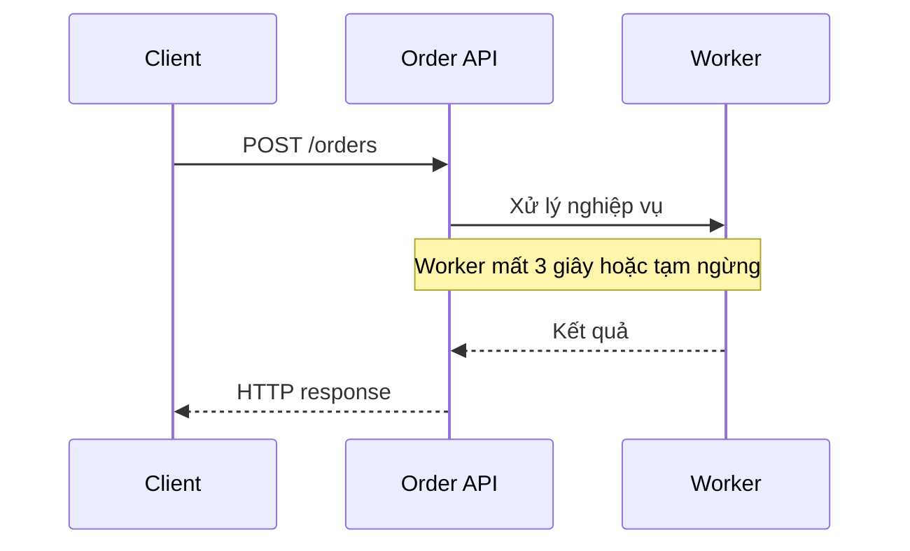
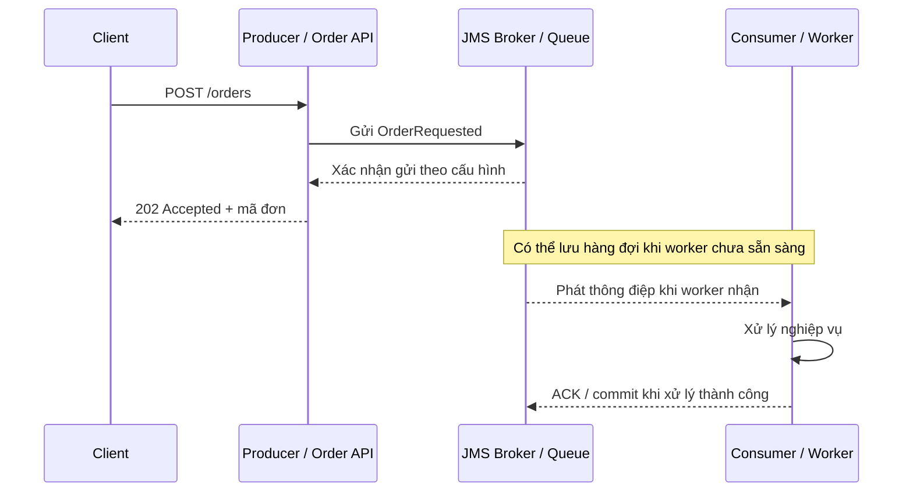

# Tách bên gửi và bên nhận theo thời gian xử lý trong JMS

> **Phạm vi:** Bức tranh JMS (Java Message Service / Jakarta Messaging). Bài này tập trung vào *temporal decoupling*: bên gửi có thể hoàn tất việc giao thông điệp trước khi bên nhận thực sự xử lý nghiệp vụ. JMS là API; việc lưu, định tuyến và giao thông điệp do JMS provider/message broker thực hiện.

## 1. Vì sao cần tách theo thời gian?

Giả sử API nhận yêu cầu tạo đơn hàng. Việc gửi email, lập hóa đơn hoặc đồng bộ kho có thể mất vài giây, có lúc dịch vụ xử lý phải bảo trì. Nếu API gọi trực tiếp và đợi từng tác vụ hoàn tất thì thời gian phản hồi và khả năng nhận yêu cầu bị ràng buộc vào tốc độ, trạng thái của dịch vụ phía sau.

- **Gọi đồng bộ:** bên gửi gọi bên nhận và chờ kết quả nghiệp vụ. Bên nhận chậm, quá tải hoặc tạm ngừng sẽ tác động trực tiếp tới yêu cầu hiện tại.
- **Giao qua JMS queue:** bên gửi chuyển một thông điệp cho broker. Khi broker chấp nhận gửi theo cấu hình đang dùng, bên gửi có thể trả lời cho client; bên nhận lấy và xử lý thông điệp ở thời điểm sau đó.
- **Giá trị chính:** hai bên không nhất thiết phải chạy, rảnh hoặc xử lý với cùng nhịp thời gian. Queue hấp thụ chênh lệch tốc độ trong giới hạn dung lượng và chính sách lưu giữ của broker.

**Tách theo thời gian không có nghĩa là không còn phụ thuộc gì:** producer vẫn cần kết nối và giao thành công với broker (trừ khi ứng dụng có cơ chế lưu cục bộ/outbox riêng). Phản hồi “đã nhận để xử lý” khác hẳn “đã xử lý xong”.

## 2. Dòng thời gian trước và sau khi dùng JMS

### Khi xử lý đồng bộ



Thời gian xử lý của worker nằm ngay trên đường chờ của request. Timeout của lời gọi trực tiếp có thể làm request thất bại ngay cả khi nghiệp vụ phía sau vẫn đang chạy.

### Khi dùng JMS queue



Ví dụ minh họa (không phải cam kết thời gian): 10:00:00 producer giao thông điệp cho broker và trả `202 Accepted`; 10:00:05 worker mới hoạt động; 10:00:08 worker xử lý xong và commit. Người dùng không phải giữ kết nối HTTP chờ đến 10:00:08. Đổi lại, hệ thống phải theo dõi trạng thái bất đồng bộ và thông báo lỗi xử lý sau đó.

## 3. JMS thực hiện sự tách biệt này như thế nào?

1. **Producer:** tạo nội dung thông điệp và gửi tới một `Destination` thông qua `JmsTemplate` của Spring hoặc API `jakarta.jms`.
2. **Broker/provider:** tiếp nhận, định tuyến và có thể lưu thông điệp trong queue. Khả năng sống sót sau khởi động lại phụ thuộc delivery mode, lưu trữ bền vững và chính sách của provider; queue không phải kho lưu vô hạn.
3. **Queue:** giữ công việc đang chờ. Với mô hình point-to-point, một thông điệp được giao tới một consumer trong nhóm các consumer cạnh tranh, thay vì phát tới tất cả.
4. **Consumer:** có thể nhận thông điệp bằng listener bất đồng bộ (`@JmsListener`) hoặc chủ động gọi receive đồng bộ. Worker không cần có mặt đúng thời điểm producer gửi nếu broker duy trì thông điệp đủ lâu.
5. **ACK/transaction:** xác định thời điểm broker được xem việc nhận đã thành công. Nếu phiên nhận có transaction và listener thất bại trước commit, việc nhận có thể rollback và thông điệp được phát lại theo chính sách broker.

Phân biệt ba mốc độc lập: **(A) broker chấp nhận thông điệp**, **(B) consumer nhận thông điệp**, **(C) nghiệp vụ xử lý thành công**. API gửi hoàn tất tại A không chứng minh B hay C đã xảy ra.

### Tính độc lập về thời gian có giới hạn

| Tình huống | Kết quả mong đợi và điều kiện |
| --- | --- |
| Consumer tắt, broker còn hoạt động | Producer có thể tiếp tục gửi; queue giữ thông điệp nếu chính sách lưu, dung lượng và TTL cho phép. |
| Consumer xử lý chậm hơn tốc độ gửi | Queue tích lũy backlog; độ trễ xử lý tăng và broker có thể áp dụng flow control, quota hoặc chính sách tràn. |
| Consumer khởi động lại | Consumer có thể tiếp tục lấy thông điệp chưa hoàn tất hoặc được phát lại theo giao dịch/ACK và chính sách broker. |
| Broker không thể nhận gửi | Producer vẫn có thể lỗi, timeout hoặc bị chặn; JMS không tự đảm bảo gửi thành công khi broker offline. |
| Thông điệp hết hạn hoặc bị loại theo retention | Consumer không còn nhận được thông điệp đó; phải thiết kế TTL, cảnh báo và xử lý thất bại. |

## 4. Hai nhầm lẫn quan trọng

**“JMS là bất đồng bộ” không đồng nghĩa “lệnh gửi luôn không chặn”.** `JmsTemplate.convertAndSend(...)` thông thường thực hiện lời gọi gửi trên thread hiện tại và có thể chờ I/O hoặc broker; điều được tách là *thời gian hoàn thành nghiệp vụ tại consumer*. JMS cũng có API gửi bất đồng bộ, nhưng đó là một cơ chế khác với việc worker xử lý sau.

**Queue không đồng nghĩa Topic.** Queue phù hợp khi mỗi công việc cần một worker trong nhóm xử lý. Topic dùng mô hình publish/subscribe cho nhiều subscriber; subscriber thông thường có thể bỏ lỡ thông điệp khi offline. Muốn nhận lại khi vắng mặt cần cấu hình subscription bền vững hoặc shared durable subscription phù hợp và lưu giữ tại broker. Không thể suy diễn tính lưu khi offline của queue sang mọi topic.

## 5. Ví dụ Spring Boot: API nhận đơn nhanh, worker xử lý sau

Ví dụ này dùng **Java 17+, Spring Boot 3.3.x, Jakarta JMS và ActiveMQ Artemis**. Một ứng dụng duy nhất chứa API và listener để dễ chạy thử; trong hệ thống thực tế chúng có thể là hai ứng dụng triển khai độc lập cùng kết nối một broker. Để chạy thử cần có broker Artemis đang hoạt động tại `localhost:61616` với user/password khớp cấu hình.

**`build.gradle`** (project Gradle mới, ví dụ với Spring Boot 3.3.5):

```groovy
plugins {
    id 'java'
    id 'org.springframework.boot' version '3.3.5'
    id 'io.spring.dependency-management' version '1.1.6'
}

group = 'com.example'
version = '0.0.1-SNAPSHOT'

java {
    toolchain { languageVersion = JavaLanguageVersion.of(17) }
}

repositories { mavenCentral() }

dependencies {
    implementation 'org.springframework.boot:spring-boot-starter-web'
    implementation 'org.springframework.boot:spring-boot-starter-artemis'
}
```

**`src/main/resources/application.yml`:**

```yaml
spring:
  artemis:
    mode: native
    broker-url: tcp://localhost:61616
    user: ${ARTEMIS_USER:artemis}
    password: ${ARTEMIS_PASSWORD:artemis}
  jms:
    pub-sub-domain: false
    listener:
      session:
        transacted: true
```

`pub-sub-domain: false` chọn queue. Ví dụ bật JMS transaction cho listener để minh họa mốc commit sau xử lý; cơ chế thực tế còn phụ thuộc cấu hình broker và transaction manager. Không để thông tin đăng nhập mặc định trong môi trường triển khai.

**`src/main/java/com/example/jms/JmsDecouplingApplication.java`:**

```java
package com.example.jms;

import org.springframework.boot.SpringApplication;
import org.springframework.boot.autoconfigure.SpringBootApplication;
import org.springframework.http.ResponseEntity;
import org.springframework.jms.annotation.JmsListener;
import org.springframework.jms.core.JmsTemplate;
import org.springframework.stereotype.Component;
import org.springframework.web.bind.annotation.PathVariable;
import org.springframework.web.bind.annotation.PostMapping;
import org.springframework.web.bind.annotation.RestController;

@SpringBootApplication
public class JmsDecouplingApplication {
    public static void main(String[] args) {
        SpringApplication.run(JmsDecouplingApplication.class, args);
    }
}

@RestController
class OrderController {
    private final JmsTemplate jmsTemplate;

    OrderController(JmsTemplate jmsTemplate) {
        this.jmsTemplate = jmsTemplate;
    }

    @PostMapping("/orders/{orderId}")
    public ResponseEntity<String> enqueue(@PathVariable String orderId) {
        jmsTemplate.convertAndSend("orders.pending", orderId);
        return ResponseEntity.accepted().body("ENQUEUED " + orderId);
    }
}

@Component
class OrderWorker {
    @JmsListener(destination = "orders.pending")
    public void process(String orderId) throws InterruptedException {
        System.out.println("START " + orderId);
        Thread.sleep(3_000); // Mô phỏng xử lý nghiệp vụ chậm
        System.out.println("DONE " + orderId);
    }
}
```

Giải thích luồng chạy:

- Controller gửi một `String` vào queue `orders.pending`; Spring dùng message converter mặc định để tạo/nhận payload tương ứng.
- Lệnh `convertAndSend` thành công thì API trả **HTTP 202** với chữ `ENQUEUED`. Điều này chỉ biểu thị đã giao cho lớp nhắn tin theo cấu hình, **không phải đơn hàng đã hoàn tất**.
- Listener được container của Spring gọi trên luồng nhận riêng. Việc `Thread.sleep(3_000)` mô phỏng nghiệp vụ chậm; không nên chặn thread vô lý trong code production.
- Với listener transaction được bật, nếu listener ném exception trước commit, lần nhận đó rollback và có thể được giao lại; chính sách redelivery/DLQ là phần cần cấu hình tại broker. Không coi ví dụ này là cam kết giao đúng một lần cho mọi side effect.

**Chạy thử:** khởi động Artemis và tạo/cho phép tự tạo queue `orders.pending` theo cấu hình broker. Trong thư mục project, chạy `./gradlew bootRun` (Linux/macOS) hoặc `gradlew.bat bootRun` (Windows). Sau đó gọi:

```bash
curl -i -X POST http://localhost:8080/orders/A-101
curl -i -X POST http://localhost:8080/orders/A-102
```

Ví dụ phản hồi của lệnh thứ nhất:

```http
HTTP/1.1 202
Content-Type: text/plain;charset=UTF-8

ENQUEUED A-101
```

Log minh họa một trình tự có thể xuất hiện (thứ tự và thời điểm thực tế phụ thuộc số listener, broker và scheduling):

```text
START A-101
DONE A-101
START A-102
DONE A-102
```

Điều cần quan sát: HTTP response có thể xuất hiện **trước** log `DONE`; không phải đợi worker xử lý xong. Để chứng minh consumer có thể offline độc lập, hãy tách controller và listener thành hai tiến trình cùng nối broker, dừng riêng tiến trình listener, gửi thông điệp rồi khởi động lại listener; điều kiện thử nghiệm là broker vẫn nhận và giữ được queue.

## 6. Khi xử lý lỗi: “đã vào queue” chưa phải “thành công”

Trong hệ thống bất đồng bộ, sự cố có thể xảy ra sau khi producer đã trả lời cho người dùng. Cần phân biệt từng loại:

| Vấn đề | Hành vi/cách thiết kế cần có |
| --- | --- |
| Lỗi trước khi broker nhận | API gửi phải báo thất bại phù hợp hoặc áp dụng retry có kiểm soát; không trả thành công giả. |
| Worker ném exception | Transaction/ACK quyết định việc phát lại; giới hạn lần thử, retry delay và dead-letter queue tránh vòng lặp vô tận. |
| Worker đã cập nhật DB nhưng chưa commit ACK | Thông điệp có thể xuất hiện lại, gây trùng side effect. Thiết kế consumer **idempotent** theo `messageId`/mã nghiệp vụ. |
| DB ghi thành công nhưng producer không gửi được JMS | Hai tài nguyên không tự động cùng transaction; cân nhắc **transactional outbox** để lưu ý định gửi trong cùng DB transaction, rồi publisher giao JMS có retry. |
| Producer gửi nhanh hơn worker xử lý | Theo dõi queue depth, tuổi thông điệp cũ nhất, rate gửi/nhận, retry/DLQ; tăng consumer có kiểm soát và xử lý backpressure. |
| Client cần biết kết quả cuối | Cấp mã yêu cầu, lưu trạng thái `PENDING → PROCESSING → DONE/FAILED`, cung cấp API truy vấn hoặc cơ chế callback/event riêng. |

### Độ tin cậy phụ thuộc cấu hình

- **`PERSISTENT`** thường được dùng khi không muốn mất message do broker lỗi; vẫn phải kiểm tra broker lưu bền vững, HA, quota, policy và ACK. Delivery mode không bảo đảm dữ liệu sống mãi trong queue.
- **TTL/expiration:** nếu tác vụ quá hạn còn vô nghĩa (ví dụ thông báo OTP), cấu hình thời gian sống. Nếu tác vụ bắt buộc hoàn tất (ví dụ tạo hóa đơn), việc dùng TTL cần chính sách xử lý rõ ràng.
- **Redelivery:** rollback hoặc mất kết nối có thể khiến message được giao lại. Một thao tác nghiệp vụ phải chịu được trường hợp thực thi hơn một lần dù bên gửi chỉ gửi một lần.
- **Ordering:** nhiều consumer/parallelism và redelivery có thể thay đổi thứ tự *hoàn thành*. Không dựa vào thứ tự toàn cục nếu không có thiết kế partition/group/sequence thích hợp.
- **Broker là thành phần vận hành:** giám sát độ trễ, dung lượng đĩa, kết nối, thông điệp tồn, DLQ và sự cố mạng; temporal decoupling không thay thế giới hạn tài nguyên.

## 7. Thiết kế message để việc xử lý sau vẫn đúng

Thông điệp phải chứa đủ dữ liệu tham chiếu để consumer hiểu yêu cầu khi nó chạy sau vài phút hoặc vài giờ: `eventId`/`requestId` duy nhất, loại sự kiện hay lệnh, ID thực thể, thời điểm tạo, phiên bản schema và dữ liệu nghiệp vụ cần thiết. Không gửi toàn bộ đối tượng Java nội bộ rồi mặc định consumer phiên bản khác sẽ giải mã được.

Ví dụ payload JSON ở mức thiết kế (cần cấu hình `MessageConverter` JSON nếu muốn gửi/nhận đối tượng JSON thay cho `String` trong ví dụ ở trên):

```json
{
  "eventId": "b5a1f074-52c8-4c62-9024-7c5692b1e721",
  "type": "OrderRequested",
  "schemaVersion": 1,
  "orderId": "A-101",
  "createdAt": "2026-10-30T01:00:00Z"
}
```

Consumer nên kiểm tra `schemaVersion`, xác thực dữ liệu và ghi nhận `eventId` đã xử lý bằng cơ chế ràng buộc duy nhất/tương đương với hành động nghiệp vụ. Nếu gửi lại cùng `eventId`, kết quả không được nhân đôi. Vì worker xử lý sau nên việc tra lại dữ liệu đơn hàng hiện tại cần xét tới khả năng dữ liệu đã đổi; chọn rõ dùng snapshot ở thời điểm gửi hay tra cứu trạng thái mới nhất.

## 8. Khi nào dùng và khi nào không nên dùng mô hình này?

**Phù hợp:** gửi email, tạo thumbnail, đồng bộ hệ thống thứ ba, lập báo cáo, xử lý import, cập nhật chỉ mục tìm kiếm hoặc các bước nghiệp vụ có thể hoàn tất sau. Người dùng thường nhận mã công việc và kiểm tra trạng thái.

**Cân nhắc gọi trực tiếp:** tác vụ buộc phải trả ngay kết quả có tính quyết định trước khi tiếp tục (ví dụ kiểm tra tính hợp lệ cần thiết để chấp nhận yêu cầu). Có thể kết hợp: xác thực bắt buộc chạy đồng bộ, còn tác vụ hậu xử lý chạy qua JMS.

**Tránh hiểu sai:** đưa mọi thứ vào queue không tự làm hệ thống nhanh hơn về tổng thời gian. Queue cải thiện cách hệ thống hấp thụ tải và giảm ràng buộc về *thời điểm* thực hiện; throughput và latency hoàn tất vẫn phụ thuộc tài nguyên worker/broker.

## 9. Tự kiểm tra hiểu bài

1. Nếu worker ngừng 10 phút còn broker chạy, producer có thể tiếp tục gửi trong điều kiện nào? Xét retention, TTL, dung lượng queue và broker ACK.
2. Vì sao API trả `202 Accepted` không thể coi là đơn hàng đã xử lý thành công? Ba mốc A/B/C khác nhau ra sao?
3. Nếu worker ghi DB xong rồi chết trước khi commit JMS session, vì sao phải chống trùng? Bạn sẽ chọn khóa idempotency nào?
4. Khi backlog tăng liên tục, tăng số worker có luôn giải quyết được vấn đề không? Cần quan sát giới hạn downstream nào?
5. Với thông báo đến nhiều bên nhận và một bên có thể offline, queue thông thường và topic durable subscription khác nhau thế nào?

**Kết luận:** JMS queue cho phép producer giao công việc vào một điểm trung gian và consumer thực hiện sau, nhờ đó giảm phụ thuộc vào *thời điểm* hoạt động của nhau. Để tính chất này có ý nghĩa trong thực tế, phải quản lý broker, lưu giữ, transaction/ACK, khả năng phát lại, idempotency, backlog và trạng thái kết quả cuối.

### Tài liệu tham khảo

- [Jakarta Messaging 3.1 Specification](https://jakarta.ee/specifications/messaging/3.1/jakarta-messaging-spec-3.1.html) — queue, consumer, persistence, ACK và redelivery.
- [Spring Framework: JMS annotated listener endpoints](https://docs.spring.io/spring-framework/reference/integration/jms/annotated.html) — cơ chế `@JmsListener` và listener container.
- [Spring Framework: Receiving a Message](https://docs.spring.io/spring-framework/reference/integration/jms/receiving.html) — nhận đồng bộ, bất đồng bộ, transaction.
- [Spring Boot: JMS with Artemis](https://docs.spring.io/spring-boot/3.4/reference/messaging/jms.html) — cấu hình Artemis, `JmsTemplate` và listener tự động.