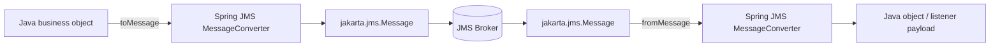

# MessageConverter của Spring JMS: chuyển đổi Java object và JMS Message

> **Module:** Spring Framework – JMS · **Nhóm kiến thức:** Chuyển đổi dữ liệu.  
> Bài học trình bày hợp đồng `MessageConverter`, các converter sẵn có của Spring JMS, cách cấu hình hai chiều cho producer/consumer, ví dụ chạy được với **Java 21 + Spring Boot 3.3.5 + ActiveMQ Artemis**, cách tự viết converter, kiểm thử và các lưu ý về schema, bảo mật, transaction.

## 1. MessageConverter giải quyết vấn đề gì?

Trong domain, một ứng dụng xử lý các đối tượng Java như `OrderCreated`, `PaymentCaptured` hoặc `InventoryAdjusted`. Nhưng JMS provider gửi và nhận các đối tượng `jakarta.jms.Message`, chẳng hạn `TextMessage`, `BytesMessage`, `MapMessage` và `ObjectMessage`.

Nếu dùng JMS API thuần, producer phải tạo message thủ công:

```java
// Fragment: có sẵn jakarta.jms.Session session và String json.
TextMessage message = session.createTextMessage(json);
message.setStringProperty("eventType", "OrderCreated");
// Sau đó còn cần MessageProducer gửi message.
```

Nếu mỗi service tự JSON serialize, tự kiểm tra kiểu, tạo headers và parse khi nhận thì code lặp lại, khó version hóa và dễ không tương thích.

`MessageConverter` là **chiến lược chuyển đổi** giữa:

- **Java object → JMS Message** khi gửi.
- **JMS Message → Java object** khi nhận.



**Không được hiểu nhầm:** converter nằm ở **phía ứng dụng Spring**, không phải một công đoạn broker tự thực thi. Broker thường lưu/chuyển các bytes và metadata của message theo protocol; Spring producer và Spring consumer phải thống nhất **wire contract** nếu muốn đọc đúng.

## 2. Interface cốt lõi và vòng đời chuyển đổi

Interface cần import là:

```java
import org.springframework.jms.support.converter.MessageConverter;
```

Nó có hai phương thức:

```java
// Chữ ký API được rút gọn để tập trung vào cơ chế:
Message toMessage(Object object, Session session)
        throws JMSException, MessageConversionException;

Object fromMessage(Message message)
        throws JMSException, MessageConversionException;
```

Trong chữ ký trên, `Message` và `Session` thuộc **`jakarta.jms`**; `MessageConversionException` thuộc **`org.springframework.jms.support.converter`** và là exception runtime của Spring. Đây là **mô tả chữ ký**, không phải code có thể biên dịch độc lập ngoài interface.

### `toMessage(object, session)`

- Nhận object Java nghiệp vụ.
- Dùng `Session` mà Spring/JMS cung cấp để tạo JMS message tương ứng.
- Serialize/encode payload theo chiến lược: String, JSON, XML, binary, map, v.v.
- Có thể gắn JMS property kỹ thuật như type ID cần cho việc decode.
- Trả lại một `jakarta.jms.Message` để `JmsTemplate` gửi.

### `fromMessage(message)`

- Kiểm tra loại JMS message nhận được.
- Đọc body, type ID hoặc metadata theo giao thức.
- Deserialize/decode về một Java object.
- Ném lỗi chuyển đổi khi message không đúng định dạng, thiếu version hoặc có payload không hợp lệ.

Hai phương thức không nhất thiết luôn cho phép **round-trip 100% đối với mọi object**. Ví dụ Java class chứa thông tin runtime không được lưu trên wire thì không thể phục hồi nguyên trạng. Cần định nghĩa chính xác các trường của message schema.

### Ai gọi hai phương thức đó?

| Nơi dùng | Khi nào gọi | Đầu ra |
| --- | --- | --- |
| `JmsTemplate.convertAndSend(...)` | Trước khi gửi | JMS Message |
| `JmsTemplate.receiveAndConvert(...)` | Sau khi nhận đồng bộ | Java object |
| `MessageListenerAdapter` | Khi adapter chuyển raw JMS Message sang payload cho delegate | Object theo converter |
| `@JmsListener` method | Thông qua listener container/adapter và hệ thống Spring Messaging, dựa vào converter được cấu hình | Đối tượng payload phù hợp chữ ký listener |
| `JmsTemplate.send(MessageCreator)` | **Không tự buộc phải dùng converter**: callback tạo message | JMS Message do ứng dụng xây dựng |

Ví dụ:

```java
// Fragment: đã có bean JmsTemplate template và event hợp lệ.
template.convertAndSend("orders.created", event);

// Đây là chuyển đổi từ JMS Message sang Java object khi nhận chủ động:
Object received = template.receiveAndConvert("orders.created");
```

`receiveAndConvert` có thể block tùy timeout và **tiêu thụ message thật**; không dùng để chỉ “peek” một message đang nằm trên queue. Với listener bất đồng bộ, `@JmsListener` thường phù hợp hơn.

## 3. Phân biệt các loại MessageConverter trong hệ sinh thái Spring

Spring có nhiều abstraction cùng tên. Dễ nhất là kiểm tra **package và kiểu tham số**:

| Loại | Package | Chuyển đổi giữa gì? |
| --- | --- | --- |
| **Spring JMS `MessageConverter`** | `org.springframework.jms.support.converter` | `Object` ↔ `jakarta.jms.Message` |
| **Spring Messaging `MessageConverter`** | `org.springframework.messaging.converter` | Payload/Spring `Message<?>` ↔ payload và message ở tầng messaging |
| **Spring HTTP `HttpMessageConverter`** | `org.springframework.http.converter` | HTTP request/response body ↔ Java object |
| **Jackson `ObjectMapper`** | `com.fasterxml.jackson.databind` | JSON ↔ Java object; có thể là công cụ được JMS converter dùng |
| **`MessagingMessageConverter` trong Spring JMS** | `org.springframework.jms.support.converter` | Bọc payload converter và `JmsHeaderMapper` để xử lý Spring Messaging message/header |

**Không được nhầm:** `ObjectMapper` bean **không tự thay** một `MessageConverter` bean trong JMS; và đăng ký `MappingJackson2HttpMessageConverter` cho REST **không đồng nghĩa** `JmsTemplate` tự gửi JSON. Dùng đúng `org.springframework.jms.support.converter.MappingJackson2MessageConverter`.

Khi `@JmsListener` có tham số là `org.springframework.messaging.Message<OrderCreated>` hoặc `@Header`, Spring còn có bước mapping JMS headers/properties sang Spring Messaging headers. Các bước đó liên quan nhưng **không làm converter JMS trở thành bộ định tuyến hay transaction manager**.

## 4. `SimpleMessageConverter`: mặc định hữu ích, nhưng không phải phép màu

`org.springframework.jms.support.converter.SimpleMessageConverter` là chiến lược mặc định thường được `JmsTemplate` sử dụng khi chưa đặt converter khác. Nó hỗ trợ bốn nhóm chính:

| Java object khi gửi | Message loại nào? | Object khi đọc qua `fromMessage` |
| --- | --- | --- |
| `String` | `TextMessage` | `String` |
| `byte[]` | `BytesMessage` | `byte[]` |
| `Map` các giá trị hợp lệ theo JMS | `MapMessage` | `Map` |
| `Serializable` | `ObjectMessage` | Object đã được Java deserialization |

Ví dụ gửi text:

```java
jmsTemplate.convertAndSend("demo.text", "Xin chào JMS");
```

Ví dụ gửi map với các field phẳng:

```java
Map<String, Object> payload = new LinkedHashMap<>();
payload.put("orderId", "ORD-42");
payload.put("itemCount", 3);
payload.put("totalMinor", 125_000L);

jmsTemplate.convertAndSend("demo.map", payload);
```

Mảnh code map cần import `java.util.Map` và `java.util.LinkedHashMap`. Với `SimpleMessageConverter`, payload `Map` được chuyển thành `MapMessage`; không phải JSON.

### Những gì `SimpleMessageConverter` không làm

- Không tự chuyển **mọi POJO** sang JSON.
- Không biểu diễn tùy ý `List`, `Map` lồng nhau, `BigDecimal` hoặc entity graph bên trong `MapMessage`. JMS `MapMessage` chỉ cho phép các kiểu nguyên thủy, wrapper thích hợp, `String` và `byte[]`.
- Không tự version hóa schema hay bảo đảm một listener khác hệ thống có đúng Java class cần thiết.
- Không tự giải quyết transaction, message delivery, redelivery hay retry.

Một record không triển khai `Serializable` và không phải `Map`/`String`/`byte[]` thường khiến converter mặc định ném `MessageConversionException` khi gọi `convertAndSend`.

### Vì sao không nên phụ thuộc `ObjectMessage` trong tích hợp rộng?

`ObjectMessage` sử dụng Java native serialization. Điều này có thể kéo theo coupling Java class/package/classloader/`serialVersionUID`, vấn đề deserialize dữ liệu không đáng tin cậy và khó tích hợp với consumer viết bằng ngôn ngữ khác. Domain entity còn có lazy proxy, vòng tham chiếu hoặc trường nhạy cảm.

Với sự kiện nghiệp vụ giữa dịch vụ, nên dùng **DTO độc lập**, định dạng wire có schema/version và converter rõ ràng, chẳng hạn JSON `TextMessage` hoặc một binary schema được quản lý.

## 5. `MappingJackson2MessageConverter`: JSON với TextMessage hoặc BytesMessage

Spring Framework 6.1 cung cấp `MappingJackson2MessageConverter` để serialize object thành JSON bằng Jackson 2 và deserialize ngược.

Cấu hình tiêu biểu:

```java
@Bean
MessageConverter jmsMessageConverter(ObjectMapper objectMapper) {
    MappingJackson2MessageConverter converter =
            new MappingJackson2MessageConverter(objectMapper);

    converter.setTargetType(MessageType.TEXT);
    converter.setTypeIdPropertyName("_type");
    converter.setTypeIdMappings(Map.of(
            "order-created-v1", OrderCreated.class));

    return converter;
}
```

Đây là **mảnh method `@Bean`** đặt trong class `@Configuration`, với import các lớp tương ứng và DTO `OrderCreated` tồn tại. Có thể dùng constructor mặc định, nhưng constructor nhận `ObjectMapper` hỗ trợ tận dụng cấu hình Jackson đã dùng trong Spring Boot.

Ba thuộc tính quan trọng:

1. **`setTargetType(MessageType.TEXT)`:** khi convert object → JMS Message, tạo `TextMessage` chứa JSON. **Mặc định của converter này là `MessageType.BYTES`**, không phải TEXT.
2. **`setTypeIdPropertyName("_type")`:** tên JMS **property** chứa ID của class/định dạng để converter nhận dùng khi `fromMessage`. Mặc định tên property không được thiết lập; cần set cho chiều deserialize thông thường.
3. **`setTypeIdMappings(Map.of("order-created-v1", OrderCreated.class))`:** chuyển type ID logic sang class thực tế. Hợp đồng liên dịch vụ không buộc phải phụ thuộc tên Java class.

Nếu type ID mapping không có cho một Java class, converter có thể fallback sang **tên class Java** (tùy triển khai/version) khi đặt type ID. Mapping không phải **security allowlist tuyệt đối**: với input không tin cậy cần kiểm soát allowed event types, quyền gửi/nhận, version, và xác minh các giá trị type ID trước khi deserialize.

### Kết quả trên wire

```text
JMS TextMessage
├── Headers
│   └── JMSCorrelationID = "order:ORD-42"
├── Properties
│   ├── _type = "order-created-v1"    (String)
│   ├── eventType = "OrderCreated"   (String)
│   └── schemaVersion = 1           (int)
└── Text body:
    {"eventId":"evt-123","orderId":"ORD-42",
     "totalMinor":125000,"currency":"VND"}
```

`_type` là property của JMS message, **không nằm trong JSON body**. Property này phục vụ giải mã, còn `eventType` và `schemaVersion` có thể phục vụ selector/monitoring. Có thể chọn tên khác nếu hai bên thống nhất. Đừng cho rằng JSON body field được JMS selector nhìn thấy.

### Khi nào dùng BytesMessage JSON?

`MappingJackson2MessageConverter` cũng hỗ trợ JSON trong `BytesMessage`. Nó phù hợp khi cần bytes và kiểm soát encoding/transfer, nhưng cần đồng bộ converter ở consumer. Nếu dùng `MessageType.BYTES`, có thể quan tâm `setEncoding`/`setEncodingPropertyName` khi interoperability yêu cầu. Không coi TEXT/BYTES là hai loại wire tương đương: listener khác loại hoặc converter khác có thể không giải mã đúng.

## 6. `MarshallingMessageConverter` và `SmartMessageConverter`

Ngoài mặc định và Jackson, Spring JMS còn có:

- **`MarshallingMessageConverter`:** dùng `org.springframework.oxm.Marshaller` và `Unmarshaller` để encode/decode, thường hữu ích khi có schema XML hoặc một OXM contract; có thể target `TextMessage` hoặc `BytesMessage` theo cấu hình `marshalTo`.
- **`MessagingMessageConverter`:** kết hợp payload `MessageConverter` với `JmsHeaderMapper` để hỗ trợ trừu tượng `org.springframework.messaging.Message<?>` cùng headers. Nó không có nghĩa broker hiểu Spring Messaging object trực tiếp.
- **`SmartMessageConverter`:** mở rộng JMS converter với một **conversion hint**, như JSON view/serialization context trong các flow mà framework hỗ trợ. Đừng dùng hint như cơ chế gắn message properties nghiệp vụ; nó không thay thế `MessagePostProcessor`.

Chọn converter theo **hợp đồng wire + nhu cầu consumer** chứ không chỉ theo object phía producer. Khi hệ thống cần schema nhị phân (Avro/Protobuf), có thể tự triển khai `MessageConverter` cho `BytesMessage` và quản lý schema registry/version riêng.

## 7. Ví dụ thực hành hoàn chỉnh: Spring Boot + JMS JSON MessageConverter

Ví dụ cung cấp một project đơn giản: HTTP endpoint phát `OrderCreated`, converter tạo JSON `TextMessage`, Artemis chuyển message qua queue, listener dùng cùng converter nhận record.

**Phiên bản và phụ thuộc ngoài:** Java 21; Spring Boot 3.3.5 (Spring Framework 6.1); Gradle; broker Artemis đang chạy tại `tcp://localhost:61616`. Broker cần có queue `orders.created`/address routing phù hợp hoặc auto-create được cấp quyền. Ứng dụng Spring Boot **không tự đảm bảo tạo queue vật lý trên mọi broker**.

### 7.1. Tạo project

`settings.gradle`:

```groovy
rootProject.name = 'jms-message-converter-demo'
```

`build.gradle`:

```groovy
plugins {
    id 'java'
    id 'org.springframework.boot' version '3.3.5'
    id 'io.spring.dependency-management' version '1.1.6'
}

group = 'com.example'
version = '0.0.1-SNAPSHOT'

java {
    toolchain {
        languageVersion = JavaLanguageVersion.of(21)
    }
}

repositories {
    mavenCentral()
}

dependencies {
    implementation 'org.springframework.boot:spring-boot-starter-artemis'
    implementation 'org.springframework.boot:spring-boot-starter-web'
    testImplementation 'org.springframework.boot:spring-boot-starter-test'
}

tasks.named('test') { useJUnitPlatform() }
```

`spring-boot-starter-artemis` dùng Jakarta Messaging/JMS API; `spring-boot-starter-web` cung cấp Spring MVC và Jackson `ObjectMapper`. Không trộn ví dụ `javax.jms` cũ vào project Boot 3.x.

`src/main/resources/application.yml`:

```yaml
spring:
  artemis:
    mode: native
    broker-url: ${JMS_BROKER_URL:tcp://localhost:61616}
    user: ${JMS_USER:artemis}
    password: ${JMS_PASSWORD:artemis}
  jms:
    pub-sub-domain: false

server:
  port: 8080
```

`pub-sub-domain=false` là semantics queue, không phải topic. User/password ví dụ dành cho broker local; triển khai thật phải dùng secret manager, TLS và ACL theo môi trường.

### 7.2. Java source chạy được

Tạo `src/main/java/com/example/jms/ConverterDemoApplication.java`:

```java
package com.example.jms;

import java.util.Map;
import java.util.UUID;

import com.fasterxml.jackson.databind.ObjectMapper;

import org.springframework.boot.SpringApplication;
import org.springframework.boot.autoconfigure.SpringBootApplication;
import org.springframework.context.annotation.Bean;
import org.springframework.http.ResponseEntity;
import org.springframework.jms.annotation.EnableJms;
import org.springframework.jms.annotation.JmsListener;
import org.springframework.jms.core.JmsTemplate;
import org.springframework.jms.support.converter.MappingJackson2MessageConverter;
import org.springframework.jms.support.converter.MessageConverter;
import org.springframework.jms.support.converter.MessageType;
import org.springframework.stereotype.Component;
import org.springframework.web.bind.annotation.PathVariable;
import org.springframework.web.bind.annotation.PostMapping;
import org.springframework.web.bind.annotation.RestController;

@SpringBootApplication
@EnableJms
public class ConverterDemoApplication {

    public static void main(String[] args) {
        SpringApplication.run(ConverterDemoApplication.class, args);
    }

    // Message contract: DTO riêng, không phải JPA entity.
    public record OrderCreated(
            String eventId,
            String orderId,
            long totalMinor,
            String currency) {
    }

    @Bean
    MessageConverter jmsMessageConverter(ObjectMapper objectMapper) {
        MappingJackson2MessageConverter converter =
                new MappingJackson2MessageConverter(objectMapper);
        converter.setTargetType(MessageType.TEXT);
        converter.setTypeIdPropertyName("_type");
        converter.setTypeIdMappings(
                Map.of("order-created-v1", OrderCreated.class));
        return converter;
    }
}

@RestController
class OrderEventController {

    private final JmsTemplate jmsTemplate;

    OrderEventController(JmsTemplate jmsTemplate) {
        this.jmsTemplate = jmsTemplate;
    }

    @PostMapping("/demo/orders/{orderId}")
    ResponseEntity<String> publish(@PathVariable String orderId) {
        ConverterDemoApplication.OrderCreated event =
                new ConverterDemoApplication.OrderCreated(
                        UUID.randomUUID().toString(),
                        orderId,
                        125_000L,
                        "VND");

        jmsTemplate.convertAndSend("orders.created", event, message -> {
            // Các trường dưới đây nằm ngoài JSON body.
            message.setStringProperty("eventType", "OrderCreated");
            message.setIntProperty("schemaVersion", 1);
            message.setJMSCorrelationID("order:" + orderId);
            return message;
        });

        return ResponseEntity.accepted()
                .body("QUEUED " + orderId);
    }
}

@Component
class OrderCreatedConsumer {

    @JmsListener(
            destination = "orders.created",
            selector = "eventType = 'OrderCreated' AND schemaVersion = 1")
    public void handle(ConverterDemoApplication.OrderCreated event) {
        System.out.printf(
                "RECEIVED order=%s amount=%d currency=%s%n",
                event.orderId(), event.totalMinor(), event.currency());
    }
}
```

**Giải thích theo từng bước:**

1. `@SpringBootApplication` tạo Spring application context; `@EnableJms` bật listener annotation.
2. `@Bean MessageConverter jmsMessageConverter(...)` tạo **một** bean converter JMS. Khi Boot tự cấu hình `JmsTemplate` và default `jmsListenerContainerFactory`, bean converter này được áp dụng cho cả send và listener flow.
3. `MappingJackson2MessageConverter` dùng Jackson `ObjectMapper` do Boot cấp, biến `OrderCreated` thành JSON `TextMessage`, tự ghi JMS property `_type="order-created-v1"` theo type mapping.
4. `MessagePostProcessor` trong `convertAndSend` thêm `eventType`, `schemaVersion` và `JMSCorrelationID`. Trình tự là **convert → postprocess → send**.
5. `@JmsListener` có selector chỉ dùng **JMS properties**, không đọc body. Khi broker giao message, Spring chuyển đổi ngược sang `OrderCreated` trước khi gọi `handle`.
6. `long totalMinor` biểu diễn số tiền theo đơn vị nhỏ nhất để tránh độ lệch nhị phân của `double`; `currency` cho biết đơn vị. Trong hệ thống thật cần validate giá trị từ domain.
7. `UUID` tạo eventId mới **cho mỗi lần gọi HTTP**. Nếu caller retry cùng một sự kiện, thiết kế production phải giữ ID sự kiện ổn định để hỗ trợ idempotency.
8. `JmsTemplate.convertAndSend` có thể ném lỗi; HTTP 202 trong demo được trả **chỉ khi lời gọi send trả về bình thường**. HTTP 202 không có nghĩa listener đã hoàn thành.

### 7.3. Chạy thử và stdout

Đảm bảo Artemis đang chạy và queue `orders.created` có quyền send/consume:

```bash
# Linux/macOS, trong project có Gradle wrapper:
./gradlew bootRun

# Windows:
gradlew.bat bootRun
```

Terminal khác:

```bash
curl -i -X POST http://localhost:8080/demo/orders/ORD-42
```

Khi broker chấp nhận lệnh gửi, response ví dụ:

```http
HTTP/1.1 202
Content-Type: text/plain;charset=UTF-8

QUEUED ORD-42
```

Khi listener nhận và deserialize thành công, có log nghiệp vụ:

```text
RECEIVED order=ORD-42 amount=125000 currency=VND
```

Chỉ nội dung trên là phần có thể dự đoán theo mã demo; **thời điểm log** so với HTTP response, các startup logs, UUID và JMSMessageID là không xác định. Nếu broker chưa chạy, credentials sai hoặc queue chưa được provision/auto-create, không thể kỳ vọng output thành công.

### 7.4. Inspect message trên broker

Nếu tạm dừng listener **trong môi trường test** để không tiêu thụ ngay, dùng broker console/CLI kiểm tra:

- Body là JSON trong `TextMessage`, không phải Java `ObjectMessage`.
- Property `_type` là String `order-created-v1`.
- Property `eventType` là String `OrderCreated`.
- Property `schemaVersion` là **int 1** (không phải String `"1"`).
- Header `JMSCorrelationID` là `order:ORD-42`.
- Destination là queue `orders.created` với routing/ACL phù hợp.

Consumer không phải đóng vai trò “mắt đọc JMSMessage object” mới được: quan sát wire type và broker metadata giúp bắt lỗi conversion khi hai service dùng công nghệ khác nhau.

## 8. Đăng ký converter trong Spring Boot so với @Bean thủ công

### 8.1. Boot auto-config

Trong ứng dụng có Artemis starter và không override hạ tầng, Boot tự tạo `ConnectionFactory`, `JmsTemplate` và listener container factory mặc định. Khi có một bean `org.springframework.jms.support.converter.MessageConverter`, Boot có thể liên kết nó với template và factory auto-configured.

Không cần tự tạo ba bean chỉ để dùng Jackson converter nếu mặc định đáp ứng. Nếu có nhiều `MessageConverter` bean, có thể cần chỉ rõ bean nào là primary hoặc cấu hình template/factory theo tên.

### 8.2. Đăng ký tường minh cho producer

Một method `@Bean` (fragment, cần class `@Configuration` và import thích hợp):

```java
@Bean("ordersJmsTemplate")
JmsTemplate ordersJmsTemplate(
        ConnectionFactory connectionFactory,
        MessageConverter jmsMessageConverter) {

    JmsTemplate template = new JmsTemplate(connectionFactory);
    template.setMessageConverter(jmsMessageConverter);
    template.setPubSubDomain(false);
    return template;
}
```

Imports: `jakarta.jms.ConnectionFactory`, `org.springframework.jms.core.JmsTemplate`, `org.springframework.jms.support.converter.MessageConverter`, `org.springframework.context.annotation.Bean`. Khi tạo custom template, đừng mặc định nó sẽ tự nhận converter bean từ Boot như auto-configured template; hãy gắn tường minh.

### 8.3. Đăng ký tường minh cho consumer

Factory listener cũng cần converter nhất quán:

```java
@Bean("ordersListenerFactory")
DefaultJmsListenerContainerFactory ordersListenerFactory(
        ConnectionFactory connectionFactory,
        MessageConverter jmsMessageConverter) {

    DefaultJmsListenerContainerFactory factory =
            new DefaultJmsListenerContainerFactory();
    factory.setConnectionFactory(connectionFactory);
    factory.setMessageConverter(jmsMessageConverter);
    factory.setPubSubDomain(false);
    factory.setSessionTransacted(true);
    return factory;
}
```

Imports thêm `org.springframework.jms.config.DefaultJmsListenerContainerFactory`. Listener phải ghi `@JmsListener(destination="orders.created", containerFactory="ordersListenerFactory")` để Spring chọn đúng factory. Nếu không chỉ định `containerFactory`, hạ tầng thường tìm bean mặc định `jmsListenerContainerFactory`.

Với Boot 3.3.x, `DefaultJmsListenerContainerFactoryConfigurer` có thể giúp giữ lại default transaction/converter/settings của Boot khi tạo thêm factory. Nếu ConnectionFactory là wrapper cache ở phía producer, listener container cần được kết nối với native provider factory hoặc cơ chế tương thích để quản lý recovery/lifecycle đúng. Đừng lấy mẫu code dành riêng cho Boot 3.4+ và import `ConnectionFactoryUnwrapper` vào 3.3 vì tiện ích đó chưa tồn tại trong phiên bản demo.

### 8.4. Nhiều message types

Nếu một ứng dụng cần JSON cho event và `BytesMessage` cho file/protocol khác, đừng thay converter toàn cục trên singleton `JmsTemplate` giữa hai lần gọi. Tạo nhiều template/factory có tên rõ, mỗi cặp có converter riêng. Hoặc thiết kế custom converter phân nhánh có chủ đích theo **wire message type + version/type ID**, có contract và tests.

## 9. Tự viết một MessageConverter khi cần định dạng đặc thù

Bạn không bắt buộc phải dùng Jackson. Hãy triển khai chính xác interface `org.springframework.jms.support.converter.MessageConverter`, không nhầm với converter HTTP.

Ví dụ **converter hai chiều dành riêng cho một số đếm không âm**; đây là class Java có thể biên dịch khi đặt đúng đường dẫn/package và thêm các dependency Spring JMS. Nó minh họa cơ chế, không nhằm thay JSON event DTO của mục 7:

```java
package com.example.jms.codec;

import jakarta.jms.JMSException;
import jakarta.jms.Message;
import jakarta.jms.Session;
import jakarta.jms.TextMessage;

import org.springframework.jms.support.converter.MessageConversionException;
import org.springframework.jms.support.converter.MessageConverter;

public final class NonNegativeCountConverter implements MessageConverter {

    @Override
    public Message toMessage(Object object, Session session)
            throws JMSException {
        if (!(object instanceof Integer count) || count < 0) {
            throw new MessageConversionException(
                    "Expected a non-negative Integer");
        }

        // Wire schema do ứng dụng định nghĩa: decimal text.
        TextMessage message = session.createTextMessage(count.toString());
        message.setStringProperty("codec", "count-v1");
        return message;
    }

    @Override
    public Object fromMessage(Message message) throws JMSException {
        if (!(message instanceof TextMessage text)) {
            throw new MessageConversionException(
                    "Expected a TextMessage");
        }

        if (!"count-v1".equals(text.getStringProperty("codec"))) {
            throw new MessageConversionException(
                    "Unsupported codec version");
        }

        String value = text.getText();
        try {
            int result = Integer.parseInt(value);
            if (result < 0) {
                throw new MessageConversionException(
                        "Negative count not allowed");
            }
            return result;
        } catch (NumberFormatException ex) {
            throw new MessageConversionException(
                    "Invalid decimal count", ex);
        }
    }
}
```

Giải thích:

- `toMessage` kiểm tra **Java input type**, không chấp nhận mọi object rồi `toString()` tùy tiện.
- `session.createTextMessage` quyết định wire body là text. Converter đặt property `codec` để phân biệt giao thức và version.
- `fromMessage` kiểm tra **JMS message type**, property version, parse và ràng buộc dữ liệu.
- Lỗi format được đổi thành `MessageConversionException`, một runtime exception mà Spring JMS có thể xử lý trong pipeline.
- Mẫu dùng `Integer` để dễ quan sát symmetric mapping: `Integer(12) → TextMessage("12") → Integer(12)`. Với schema phức tạp, dùng codec có escape/length-prefix, JSON hoặc binary format chính thức, không tự ghép chuỗi `a|b|c` dễ sai.

**Quan trọng:** converter custom chỉ dành cho kiểu `Integer` này. Nếu gắn nó làm converter chung của `JmsTemplate` đang gửi `OrderCreated`, lệnh gửi `OrderCreated` sẽ bị từ chối. Mỗi converter cần **phạm vi sử dụng rõ ràng**; không đăng ký một converter đặc thù toàn ứng dụng trừ khi mọi messages đều tuân theo contract đó.

## 10. Kiểm thử conversion không cần broker: đối chiếu cả chiều đi và về

Với `MappingJackson2MessageConverter`, có thể dùng Mockito để mock JMS `Session` và `TextMessage`, không cần tạo kết nối thật. Kiểm tra **payload + type-id** chứ không chỉ kiểm tra một bean tồn tại.

File `src/test/java/com/example/jms/JmsJsonConverterTest.java`:

```java
package com.example.jms;

import java.util.Map;

import com.fasterxml.jackson.databind.ObjectMapper;
import jakarta.jms.Session;
import jakarta.jms.TextMessage;

import org.junit.jupiter.api.Test;
import org.springframework.jms.support.converter.MappingJackson2MessageConverter;
import org.springframework.jms.support.converter.MessageType;
import org.mockito.ArgumentCaptor;

import static org.junit.jupiter.api.Assertions.assertEquals;
import static org.junit.jupiter.api.Assertions.assertTrue;
import static org.mockito.ArgumentMatchers.anyString;
import static org.mockito.Mockito.mock;
import static org.mockito.Mockito.verify;
import static org.mockito.Mockito.when;

class JmsJsonConverterTest {

    @Test
    void convertsDtoToJsonAndBack() throws Exception {
        MappingJackson2MessageConverter converter =
                new MappingJackson2MessageConverter(new ObjectMapper());
        converter.setTargetType(MessageType.TEXT);
        converter.setTypeIdPropertyName("_type");
        converter.setTypeIdMappings(Map.of(
                "order-created-v1",
                ConverterDemoApplication.OrderCreated.class));

        ConverterDemoApplication.OrderCreated event =
                new ConverterDemoApplication.OrderCreated(
                        "evt-1", "ORD-42", 125_000L, "VND");

        Session session = mock(Session.class);
        TextMessage textMessage = mock(TextMessage.class);

        when(session.createTextMessage(anyString()))
                .thenReturn(textMessage);

        converter.toMessage(event, session);

        ArgumentCaptor<String> json =
                ArgumentCaptor.forClass(String.class);
        verify(session).createTextMessage(json.capture());
        verify(textMessage)
                .setStringProperty("_type", "order-created-v1");

        assertTrue(json.getValue()
                .contains("\"orderId\":\"ORD-42\""));

        // Mô phỏng dữ liệu mà consumer nhận trên wire.
        when(textMessage.getText()).thenReturn(json.getValue());
        when(textMessage.getStringProperty("_type"))
                .thenReturn("order-created-v1");

        Object restored = converter.fromMessage(textMessage);
        assertEquals(event, restored);
    }
}
```

Test dùng `spring-boot-starter-test`, JUnit 5 và Mockito trong Gradle file mục 7. Chạy:

```bash
./gradlew test
```

Nếu mọi assertion đạt, Gradle sẽ báo build/test thành công; **không có stdout nghiệp vụ cố định** trong test. Test này xác nhận việc converter tạo JSON và gắn `_type`, rồi decode lại từ mock `TextMessage`.

**Giới hạn unit test:** `Session`/`TextMessage` ở đây là mocks; nó không kiểm tra broker ACL, byte encoding thực trên transport, queue/topic mode, transaction, retries hay listener factory thực sự dùng converter bean. Phải có **integration test với Artemis** để chứng minh toàn bộ đường gửi–nhận.

## 11. Lỗi chuyển đổi khác lỗi transport, lỗi nghiệp vụ

Ba nhóm lỗi cần tách bạch:

| Nhóm | Ví dụ | Cách xử lý |
| --- | --- | --- |
| **Conversion failure trước send** | Java object không hỗ trợ, JSON serialize lỗi, converter không đúng bean | Sửa DTO/schema/config; không retry kết nối vô ích nếu input luôn sai. |
| **Conversion failure sau receive** | Sai `_type`, message là `MapMessage` nhưng converter đòi `TextMessage`, invalid JSON | Ghi nhận message ID/version, phân loại lỗi vĩnh viễn, DLQ/quarantine sau giới hạn thử lại. |
| **JMS transport/broker error** | Broker down, ACL từ chối, destination chưa provision, timeout | Kết nối/authorization/configuration, retry có backoff, tránh gửi trùng sau trạng thái không rõ. |
| **Business processing error** | Đơn không hợp lệ, DB timeout, downstream trả lỗi | Xác định có retry hay không, transaction, idempotency và DLQ. |

Trong Spring, `MessageConversionException` thuộc họ `JmsException` runtime; các checked `jakarta.jms.JMSException` của provider thường được Spring chuyển sang `org.springframework.jms.JmsException` thích hợp khi đi qua template. Không gộp tất cả lỗi dưới nhãn “không kết nối được broker”.

### Conversion lỗi trong listener có thể gây redelivery

Nếu listener factory dùng transacted JMS session, exception chưa được xử lý có thể dẫn tới rollback và broker giao message lại theo redelivery policy. Một payload JSON bị hỏng có thể **không bao giờ** decode được dù retry bao nhiêu lần. Cần giới hạn số lần thử, DLQ/parking lot, cảnh báo và cơ chế xử lý thủ công; không catch lỗi rồi trả bình thường nếu muốn rollback.

Nếu framework bắt lỗi vào error handler, hãy xác định handler có throw tiếp hay không: nuốt lỗi trong một số cấu hình sẽ khiến message được ACK/commit như đã xử lý. Behavior cuối cùng còn tùy container, transaction và broker.

## 12. Thiết kế schema an toàn và tương thích

Converter không thay thế contract giữa hai dịch vụ. Với JSON event:

1. **Tên/type của field:** `totalMinor` là `long` đơn vị nhỏ nhất, `currency` là String ISO currency code, `orderId` là String.
2. **Field bắt buộc/tùy chọn:** phân biệt thiếu field với null và giá trị 0; thêm validation tại ranh giới.
3. **Version:** `schemaVersion` property kiểu `int`, `_type` dùng logical ID ổn định. Đừng đổi kiểu field cũ mà không tạo migration.
4. **Time/decimal:** dùng `Instant` và JSON ISO-8601 với Jackson modules phù hợp, hoặc epoch milliseconds có đơn vị rõ; tiền dùng integer minor units/decimal string theo contract.
5. **Type IDs:** mapping không phải chứng nhận input an toàn; chủ động allowlist permitted event types và thẩm định producer identity, đặc biệt khi broker nhận message từ nhiều nguồn.
6. **Payload security:** không gửi JPA entity graph, password, token hay PII không cần thiết; đặt size limit, TLS, ACL và hạn chế log body.
7. **Producer/consumer compatibility:** test với hai phiên bản trước/sau; Jackson config có thể xử lý unknown fields theo setting khác nhau. Đừng ngầm cho rằng mọi mở rộng schema đều tương thích.
8. **Serialization stability:** không để package refactor/`serialVersionUID` quyết định wire contract; ưu tiên DTO+logical schema.

Một ví dụ JSON contract có tính minh họa:

```json
{
  "eventId": "evt-1001",
  "orderId": "ORD-42",
  "totalMinor": 125000,
  "currency": "VND"
}
```

Trong demo chạy thật, `eventId` dùng UUID ngẫu nhiên nên không trùng mẫu ở trên.

## 13. MessageConverter không bảo đảm giao dịch hay exactly-once

Khi `JmsTemplate.convertAndSend` trả về bình thường, điều đó **không tự xác nhận** listener đã chạy, database phía nhận đã commit hoặc message không thể được gửi trùng. Khi có JMS transaction chưa commit, việc API trả về còn chưa đồng nghĩa send đã commit trên broker.

Các tình huống cần thiết kế:

- DB commit order xong rồi app chết trước publish JMS ⇒ event có thể **mất**. Cân nhắc **transactional outbox**: ghi domain + outbox cùng DB transaction, publish với retry.
- Consumer ghi DB xong nhưng chết trước JMS ACK/commit ⇒ broker redeliver; cần **idempotent consumer** với `eventId` ổn định và unique constraint.
- Producer timeout sau khi broker thực sự nhận ⇒ retry có thể tạo event trùng; không tạo `eventId` mới cho mỗi lần retry cùng sự kiện.
- JSON converter hợp lệ nhưng broker TTL hết hạn, DLQ policy, disk quota, connection downtime vẫn có thể khiến event không đến được consumer mong muốn.

`MessageConverter` chịu trách nhiệm **biểu diễn dữ liệu**; transaction manager, `DeliveryMode`, destination provisioning, retry, health và outbox là trách nhiệm của các tầng khác.

## 14. Chẩn đoán nhanh những lỗi hay gặp

| Triệu chứng | Nguyên nhân có thể | Hướng xử lý |
| --- | --- | --- |
| `convertAndSend(record)` ném `MessageConversionException` | Đang dùng `SimpleMessageConverter`, record không Serializable | Đăng ký JMS JSON converter hoặc codec riêng. |
| Gửi JSON nhưng xuất hiện `BytesMessage` | Jackson converter mặc định target BYTES | Đặt `setTargetType(MessageType.TEXT)` nếu contract cần text. |
| Consumer nhận `String` thay vì domain record | Sender có converter JSON nhưng listener factory dùng `SimpleMessageConverter` | Gắn cùng converter policy cho factory nhận. |
| Không thấy type ID khi đọc | Chưa gọi `setTypeIdPropertyName` hoặc postprocessor đã sửa/xóa property | Cấu hình type ID và kiểm tra message trên broker. |
| `fromMessage` thất bại với type ID lạ | Không có mapping hoặc raw Java class không đọc được | Quản lý ID/version, allowlist và DLQ message không hợp lệ. |
| Selector `schemaVersion = 1` không match | Gửi version chỉ trong JSON body hoặc dùng property `"1"` String | Đặt `setIntProperty("schemaVersion", 1)`. |
| Đã có converter bean nhưng `JmsTemplate` custom vẫn gửi sai kiểu | Bean custom không được set converter | `template.setMessageConverter(...)`. |
| Listener custom factory chưa convert đúng | Tạo container factory mới nhưng quên set converter | `factory.setMessageConverter(...)` hoặc dùng Boot configurer. |
| JSON serialize lỗi ở một entity | Lazy proxy/vòng tham chiếu/Jackson modules | Gửi DTO độc lập, không serialize trực tiếp entity. |
| Thông điệp bị xử lý lại nhiều lần | Failed listener, rollback, ACK trước/sau side effect | Retry policy, DLQ, idempotency key. |
| Consumer xử lý xong nhưng HTTP caller vẫn chưa thấy kết quả | Gửi và xử lý là bất đồng bộ | Status/event callback; HTTP 202 không là business completion. |
| Code import `javax.jms` không compile trên Boot 3 | Dùng API cũ thay vì Jakarta JMS | Chuyển import sang `jakarta.jms` tương thích dependency. |
| Type ID dùng class FQCN gây lỗi khi refactor | Wire contract phụ thuộc Java package/class | Logical ID mapping và migration version có kiểm soát. |
| Test mock pass nhưng production queue không nhận | Test converter không kiểm tra broker/destination/ACL | Integration test Artemis end-to-end và monitoring. |

## 15. Bài tập tự kiểm tra

1. Nêu trách nhiệm riêng của `JmsTemplate`, `MessageConverter`, `ConnectionFactory` và broker. Vì sao converter không quyết định routing?
2. Viết chữ ký hai phương thức của JMS `MessageConverter`; tham số `Session` được dùng để làm gì?
3. Với `SimpleMessageConverter`, giá trị `String`, `byte[]`, `Map` và `Serializable` được biến thành loại JMS message nào?
4. Vì sao một Java record không Serializable có thể lỗi khi gửi bằng converter mặc định?
5. `MappingJackson2MessageConverter` mặc định tạo `TextMessage` hay `BytesMessage`? Cần đặt thuộc tính nào để thay đổi?
6. `setTypeIdPropertyName("_type")` và `setTypeIdMappings(...)` giải quyết vấn đề gì ở phía nhận?
7. Vì sao type ID mapping không nên được xem là security allowlist duy nhất cho payload không tin cậy?
8. Phân biệt `MessagePostProcessor`, `MessageConverter` và `JmsHeaderMapper`. Cái nào đặt business properties để selector lọc?
9. Nếu tự định nghĩa `JmsTemplate` và listener factory, cần gắn converter ở đâu để hai chiều nhất quán?
10. Khi nào nên viết custom `MessageConverter` thay vì Jackson converter? Vì sao custom converter phải kiểm tra cả loại message và version?
11. Vì sao test unit dùng mock `Session` chưa thể khẳng định ứng dụng production gửi/nhận thành công qua broker?
12. Xác định sự khác biệt giữa lỗi serialize trước khi gửi, lỗi JSON parse sau khi nhận, và lỗi transport.
13. Tại sao retry một message invalid JSON vô hạn không giúp ích? Hãy thiết kế DLQ/quarantine cho nó.
14. Vì sao thành công `convertAndSend` không bảo đảm exactly-once? Áp dụng outbox và consumer idempotency khi nào?

**Ghi nhớ:** `MessageConverter` Spring JMS là hợp đồng **Object ↔ jakarta.jms.Message**. `SimpleMessageConverter` xử lý các kiểu cơ bản; `MappingJackson2MessageConverter` đáp ứng JSON DTO với target type/type ID; custom converter phục vụ protocol đặc thù. Cần cấu hình **cả producer lẫn consumer**, kiểm thử conversion hai chiều, kiểm tra wire metadata trên broker và thiết kế schema/transaction/idempotency bên ngoài converter.

### Nguồn tham khảo chính thức

- [Spring Framework 6.1 – JMS MessageConverter API](https://docs.spring.io/spring-framework/docs/6.1.21/javadoc-api/org/springframework/jms/support/converter/MessageConverter.html) — interface `toMessage` và `fromMessage`.
- [Spring Framework 6.1 – SimpleMessageConverter](https://docs.spring.io/spring-framework/docs/6.1.8/javadoc-api/org/springframework/jms/support/converter/SimpleMessageConverter.html) — hỗ trợ String, byte[], Map, Serializable.
- [Spring Framework 6.1 – MappingJackson2MessageConverter](https://docs.spring.io/spring-framework/docs/6.1.11/javadoc-api/org/springframework/jms/support/converter/MappingJackson2MessageConverter.html) — JSON TEXT/BYTES, type ID, Jackson config.
- [Spring Framework – Sending a Message](https://docs.spring.io/spring-framework/reference/integration/jms/sending.html) — `JmsTemplate` và converter/postprocessor.
- [Spring Framework – Annotation-driven Listener Endpoints](https://docs.spring.io/spring-framework/reference/integration/jms/annotated.html) — `@JmsListener`, parameter payload và listener container.
- [Spring Boot – JMS support](https://docs.spring.io/spring-boot/3.4/reference/messaging/jms.html) — auto-config JmsTemplate và converter bean; ví dụ Java/Gradle ở đây cố định Boot 3.3.5.
- [Jakarta Messaging 3.1 Specification](https://jakarta.ee/specifications/messaging/3.1/jakarta-messaging-spec-3.1.html) — JMS message kinds, metadata, selector, delivery và transaction.
