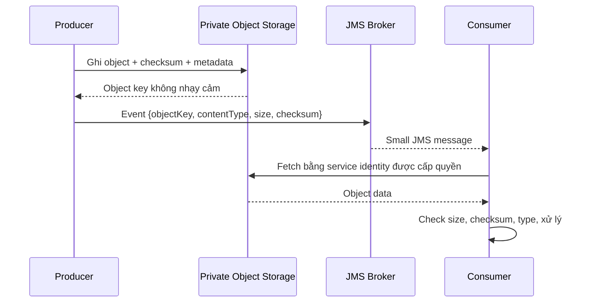

# Giới hạn kích thước body và tránh dữ liệu nhạy cảm khi chuyển đổi JMS Message

## 1. Mục tiêu và bối cảnh

Khi chuyển đối tượng Java thành `TextMessage` hoặc `BytesMessage` trong Spring JMS, ứng dụng không nên gửi nguyên mọi trường dữ liệu chỉ vì serializer làm được. Hai rủi ro phải xử lý **trước khi gửi** là:

1. **Body quá lớn:** serialization, network, broker memory/disk, lưu trữ message, retry, redelivery, dead-letter queue (DLQ) và nhiều subscriber đều phải chịu chi phí. Một payload lớn bất thường có thể làm chậm hoặc làm cạn tài nguyên của cả producer lẫn consumer.
2. **Body chứa dữ liệu nhạy cảm:** mật khẩu, token, thông tin cá nhân, hồ sơ sức khỏe, dữ liệu thanh toán, khóa bí mật hoặc dữ liệu nội bộ có thể xuất hiện không chỉ trong Queue/Topic mà còn trong logs, broker console, DLQ, traces, backups và thông điệp được replay.

**Nguyên tắc của bài:** *Giảm và phân loại dữ liệu trước khi chuyển đổi; giới hạn kích thước theo số byte của biểu diễn được gửi; giới hạn lại ở consumer; không xem broker, log hoặc message converter là nơi tự động bảo vệ dữ liệu nhạy cảm.*

### Tình huống thực tế

Service Đơn hàng muốn phát sự kiện đơn hàng mới. Dữ liệu trong database có thể chứa tên khách hàng, số điện thoại, địa chỉ giao hàng, ghi chú nội bộ và thông tin thanh toán. Service Thanh toán **không cần tất cả dữ liệu đó** để biết có đơn hàng mới.

**Không nên** gửi toàn bộ entity hoặc HTTP request:

```json
{
  "eventId": "E501",
  "orderId": "501",
  "status": "CREATED",
  "customerName": "Người dùng mẫu",
  "phone": "000-000-0000",
  "address": "Địa chỉ mẫu",
  "accessToken": "example-token-do-not-use",
  "cardNumber": "sample-sensitive-field"
}
```

Ví dụ trên chỉ dùng **giá trị giả** để nhận diện các trường không nên đưa vào event. Trong bài thực hành, message an toàn chỉ gồm:

```json
{
  "eventId": "E501",
  "orderId": "501",
  "status": "CREATED"
}
```

Danh sách trường này là **allowlist theo nhu cầu của consumer**, không phải cách thay ký tự để che giấu dữ liệu. `orderId` và `eventId` vẫn có khả năng liên kết về một chủ thể trong hệ thống thực tế, nên chúng **không mặc nhiên là dữ liệu công khai**: phải áp chính sách truy cập, ghi log và thời hạn lưu phù hợp.

## 2. Phân biệt các loại giới hạn kích thước

Trong JMS **không có một giới hạn body tối đa thống nhất cho mọi broker, mọi protocol và mọi cấu hình Spring**. Cần phân biệt:

| Loại giới hạn | Ai quyết định? | Ví dụ | Cần hiểu |
| --- | --- | --- | --- |
| **Business/application budget** | Đội phát triển | Tối đa 1 KiB hoặc 64 KiB của body JSON UTF-8 | Do ứng dụng kiểm tra trước khi gửi; con số là *chính sách riêng*, không phải mặc định JMS. |
| **Serialized size** | Serializer, charset, format | JSON UTF-8, Avro, Protobuf, XML, byte[] | Có thể lớn hơn/nhỏ hơn object và String ban đầu. |
| **JMS provider encoding** | Driver/provider | TextMessage có encoding/overhead riêng; thêm headers/properties | Không nhất thiết bằng số byte JSON UTF-8. |
| **Broker large-message threshold** | JMS broker/client configuration | Artemis `minLargeMessageSize` | Ngưỡng bật cơ chế xử lý **large message**, **không phải** giới hạn từ chối kích thước lớn. |
| **Broker quotas, address policy** | Người vận hành broker | Quota, paging, max address size, full policy | Quản lý tài nguyên/backpressure; không mặc nhiên là giới hạn byte *mỗi message*. |
| **Consumer budget** | Consumer | Từ chối body trên giới hạn đã thống nhất | Phòng trường hợp producer ngoài ý muốn hoặc không tin cậy. |
| **Storage/network limits** | Hạ tầng | Heap, disk, timeout, frame size, băng thông | Có thể gây lỗi dù app-level body vẫn nằm trong budget. |

**Đừng nhầm:** kích thước một chuỗi Java, kích thước file JSON, kích thước trên wire, kích thước trong broker journal và giới hạn mà broker thực sự từ chối. Chúng là những đại lượng khác nhau.

### 2.1. Byte, ký tự và code point không giống nhau

`String.length()` trả về **số UTF-16 code units**, không phải số byte UTF-8:

- Chuỗi ASCII `"A"`: một UTF-16 code unit, một byte UTF-8.
- Chuỗi `"Tiếng Việt"`: 10 UTF-16 code units, **14 byte UTF-8**.
- Emoji `"📦"`: **2 UTF-16 code units**, **4 byte UTF-8**, nhưng chỉ một Unicode code point.

Với chính sách “body JSON không quá 1024 byte UTF-8”, kiểm tra:

```java
import java.nio.charset.StandardCharsets;

int bytes = json.getBytes(StandardCharsets.UTF_8).length;
if (bytes > 1024) {
    throw new IllegalArgumentException("Message body too large");
}
```

Đây là mảnh code cần có biến `json` chứa **chuỗi thực sự chuẩn bị gửi**. Trong hệ thống sử dụng serialization format khác, phải đo **kích thước của kết quả format đó**, không ép mọi kiểu dữ liệu sang UTF-8.

### 2.2. Đếm trước hay sau khi chuyển đổi?

Thứ tự tốt:

```text
Đối tượng nghiệp vụ lớn hoặc nhạy cảm
   ↓ chọn trường được phép / tạo DTO sự kiện nhỏ
DTO tối thiểu, có schema và version
   ↓ serialize (JSON / bytes / format đã chọn)
Payload thực tế chuẩn bị gửi
   ↓ kiểm tra byte budget
JMS MessageConverter / Session.createTextMessage(...)
   ↓ send, broker policy
Broker → Queue/Topic → consumer
   ↓ consumer tự kiểm tra size/type/schema
Deserialize → validate → xử lý nghiệp vụ
```

Không dùng kích thước của DTO Java trong heap để làm chuẩn, vì serializer có thể thêm tên field, escape dấu ngoặc kép, ký tự đặc biệt, encoding và metadata. Nếu dùng `MappingJackson2MessageConverter` với object đầu vào, cần kiểm soát kích thước của output mà converter thực sự tạo; một cách minh bạch là **serialize sang JSON String đã kiểm tra rồi gửi như TextMessage**.

### 2.3. UTF-8 budget không phải broker-wire budget

Một `TextMessage` thường chứa một Java `String`; kích thước payload khi provider truyền/ghi có thể khác byte đếm bằng UTF-8. Tài liệu Apache ActiveMQ Artemis về *large messages* lưu ý **Core message encoding của Artemis có thể dùng 2 byte/ký tự** trong tính toán của client. Vì vậy không lấy ví dụ “100 KiB” trong Artemis làm giới hạn JSON UTF-8 được phép gửi theo chuẩn JMS.

Nếu cần ràng buộc chặt số byte toàn bộ frame/message trên wire, phải đo/kiểm thử theo **provider và protocol thực tế** cùng headers/properties và hệ thống hạ tầng. Budget của ứng dụng nên nhỏ hơn giới hạn hạ tầng, có khoảng dự phòng.

## 3. Xây dựng chính sách kích thước body

Một chính sách đủ rõ phải định nghĩa:

- **Đối tượng áp dụng:** loại event/destination cụ thể; ví dụ `orders.created.v1`.
- **Đơn vị:** số byte UTF-8 của **body đã serialize**; sử dụng `KiB = 1024 byte`, không dùng mơ hồ “1K ký tự”.
- **Giới hạn:** ví dụ `MAX_BODY_BYTES=1024` trong demo, con số này không phải giới hạn chuẩn JMS hay Artemis.
- **Điểm kiểm tra:** producer *trước send*, consumer *trước deserialize*, thêm broker controls riêng theo năng lực provider.
- **Hành vi vượt ngưỡng:** từ chối có kiểm soát, không truncate JSON ngẫu nhiên; không đưa payload lỗi vào log; ghi metric có tên lỗi và kích thước có thể quan sát an toàn.
- **Tương thích phiên bản:** nếu thêm field làm body tăng, kiểm thử contract theo limit và version.
- **Chủ thể sở hữu chính sách:** producer, các consumer, hạ tầng và bộ phận bảo mật cùng đồng thuận.

Ví dụ với event nhỏ: giới hạn 1 KiB có thể hợp lý để minh họa, nhưng không áp đặt 1 KiB cho ảnh, hóa đơn PDF, bản ghi lớn hoặc mọi doanh nghiệp. Với loại dữ liệu lớn, thay chiến lược **payload nhỏ + external object reference**.

### Không cắt chuỗi JSON bằng substring để vừa giới hạn

Sai:

```java
String truncated = json.substring(0, 1024);
jmsTemplate.convertAndSend("orders.created", truncated);
```

Vì `1024` ở đây là UTF-16 code units, không phải UTF-8 bytes; nguy hiểm hơn, chuỗi sau cắt có thể không còn là JSON hợp lệ, bị mất field bắt buộc hoặc chứa một nửa escape sequence/surrogate pair.

Đúng: kiểm tra số byte, **từ chối** message quá lớn, hoặc thay đổi thiết kế schema; nếu cần rút gọn, hãy **loại trường ngay ở DTO** theo contract thay vì cắt byte tùy tiện.

## 4. Bảo vệ dữ liệu nhạy cảm: không chỉ có body

Khi dùng Spring JMS, dữ liệu có thể nằm ở các bề mặt khác nhau:

| Bề mặt | Dữ liệu có thể xuất hiện | Biện pháp cần cân nhắc |
| --- | --- | --- |
| `TextMessage.getText()` / `BytesMessage` body | JSON, tài liệu, token, PII, thông tin thanh toán | Data minimization, schema allowlist, giới hạn byte, mã hóa ở mức ứng dụng nếu cần. |
| JMS properties | `eventType`, `userId`, `tenantId`, `email`, đôi khi bị lạm dụng chứa token | Không đưa secrets/PII không cần thiết; quyền và retention giống message. |
| JMS headers | `JMSCorrelationID`, `JMSReplyTo`, `JMSType` và identifiers | Correlation không phải nơi giấu credential; IDs cũng có thể là dữ liệu có thể liên kết. |
| Application logs | Log `message.toString()`, body JSON, stack trace có payload | Log allowlist, redaction, structured logging, hạn chế access. |
| Broker management console | Message browsing, Queue, subscription, header/property | RBAC; audit truy cập; không xem console là nơi dữ liệu công khai. |
| DLQ, expiry queue và retry store | Bản sao message không xử lý được | Cùng chính sách phân loại, hạn lưu, audit và xóa an toàn. |
| Distributed traces/metrics | Baggage, span tags, exception attributes | Không đưa body/token/PII vào tag có cardinality cao hoặc vendor tracing ngoài ý muốn. |
| Backups, snapshots, replay | Bản sao tồn tại lâu sau khi consumer ack | Storage encryption, retention, cơ chế xóa theo chính sách dữ liệu. |

**Cảnh báo:** chỉ xóa PII khỏi body nhưng vẫn đặt email/token vào `JMSCorrelationID` hoặc `setStringProperty("authorization", token)` **không giải quyết được rò rỉ**. Một số công cụ hiển thị headers/properties dễ dàng hơn cả body.

### 4.1. Phân loại dữ liệu trước khi viết converter

Ví dụ dữ liệu **thường không nên xuất hiện** trong event phổ thông:

- Mật khẩu, API token, OAuth access/refresh token, session cookie, OTP, private key, secret cấu hình.
- Số thẻ thanh toán đầy đủ/CVV, số tài khoản hoặc thông tin tài chính nhạy cảm.
- Hồ sơ sức khỏe, giấy tờ định danh, thông tin chính phủ, địa chỉ hoặc điện thoại nếu consumer không cần.
- Raw HTTP request/response chứa Authorization header, file upload, dữ liệu khách hàng chưa lọc.
- Entity database có nhiều thuộc tính không liên quan nghiệp vụ nhận.

**Cho phép có điều kiện** các mã nghiệp vụ nhỏ như `orderId`, `eventId`, `schemaVersion`, `eventType` khi thực sự cần. ID có thể truy ngược tới khách hàng; quyền truy cập và logs vẫn phải phân loại phù hợp.

### 4.2. DTO allowlist tốt hơn blacklist field

Không nên:

```java
// Minh họa antipattern: dễ lộ thêm trường mới khi entity thay đổi.
jmsTemplate.convertAndSend("orders.created", customerOrderEntity);
```

Nếu sau này entity có thêm `passwordResetToken` hoặc `internalNotes`, serializer tùy chỉnh có thể đưa cả các trường ấy vào message mà không ai chú ý.

Thay vào đó, tạo **event DTO nhỏ với đúng các field cho phép**:

```java
public record SafeOrderEvent(
        String eventId,
        String orderId,
        String status) {
}
```

Ở phía publisher, **map tường minh** từng field từ object nghiệp vụ sang `SafeOrderEvent`; không truyền entity gốc cho converter. Cần thêm field mới phải qua review schema, phân loại dữ liệu và contract test.

### 4.3. Pseudonymization, tokenization và encryption

- **Pseudonymization:** thay tên, email, điện thoại bằng ID đại diện; giảm lộ trực tiếp nhưng ID vẫn có thể liên kết với dữ liệu gốc.
- **Tokenization:** thay giá trị bằng token và giữ ánh xạ tại hệ thống có quyền riêng; tránh token trong event tạo đường truy cập trái phép.
- **Encryption in transit:** TLS giúp bảo vệ dữ liệu trên đường truyền **khi được cấu hình đúng**, nhưng không bảo vệ nội dung đã giải mã trong app, broker logs hay DLQ.
- **Encryption at rest:** mã hóa lưu trữ broker/backup, quản lý khóa và quyền truy cập; không thay việc bỏ các trường không cần thiết.
- **Application-level encryption:** cân nhắc khi broker hoặc một consumer không được phép thấy nội dung; cần key management, version và cơ chế rotation/recovery nghiêm túc.

Mã hóa **không giảm kích thước** và không thay thế giới hạn payload; ciphertext, nonce, tag và encoding (ví dụ Base64) có thể làm body lớn hơn.

## 5. Spring MessageConverter và rủi ro khi chuyển đổi dữ liệu

`org.springframework.jms.support.converter.MessageConverter` chịu trách nhiệm chuyển giữa Java object và `jakarta.jms.Message` khi dùng `JmsTemplate.convertAndSend(...)` hoặc cơ chế chuyển đổi bên nhận.

Bộ chuyển đổi mặc định `SimpleMessageConverter` hỗ trợ các mapping cơ bản:

| Java input | JMS Message thường dùng | Vấn đề cần kiểm soát |
| --- | --- | --- |
| `String` | `TextMessage` | Độ dài UTF-8 đã serialize; không log raw text. |
| `byte[]` | `BytesMessage` | Kích thước byte trực tiếp; định dạng và version cần contract. |
| `Map` phù hợp | `MapMessage` | Số lượng field, kiểu phần tử, PII trong keys/values. |
| DTO JSON với converter riêng | Thường `TextMessage` hoặc `BytesMessage` tùy cấu hình | Chính sách serializer, schema, type mapping, byte budget phải được kiểm chứng. |

Không giả định mọi DTO tự động được convert sang JSON chỉ vì có Jackson trên classpath. Với custom converter như `MappingJackson2MessageConverter`, phải cấu hình message type và type metadata phù hợp. **Dù dùng converter nào, dữ liệu được đưa vào phải có allowlist và giới hạn sau serialize.**

### Vì sao ObjectMessage không phải giải pháp an toàn mặc định?

JMS `ObjectMessage` có thể chứa object được Java-serialize. Java native deserialization trên dữ liệu không tin cậy có rủi ro nghiêm trọng nếu thiếu kiểm soát loại object, bộ lọc deserialization và cập nhật thư viện. Với event liên dịch vụ, ưu tiên **schema và định dạng dữ liệu rõ ràng** (JSON, Avro, Protobuf...), kiểm tra type/size trước khi parse. Đừng biến việc “gửi nguyên Java object” thành lối tắt bỏ qua phân loại dữ liệu.

### Bước nào tiêu tốn bộ nhớ?

`mapper.writeValueAsString(event)` tạo chuỗi JSON ở heap; `json.getBytes(UTF_8)` tạo thêm mảng byte. Với **event nhỏ đã được kiểm soát**, đây là thao tác đơn giản, dễ hiểu. Nhưng với dữ liệu không tin cậy vài trăm MB, việc tạo đầy đủ chuỗi/mảng rồi mới kiểm tra giới hạn là quá muộn về mặt bộ nhớ.

Để xử lý input lớn, cần **giới hạn ngay ở nguồn**, số lượng field, độ dài từng field, request size, số phần tử collection; hoặc serialize bằng **bounded streaming output** có giới hạn khi ghi, và giải pháp external storage. Ví dụ bài thực hành giới hạn cấu trúc DTO và dùng kiểm tra độ dài sơ bộ trước khi tạo thêm byte[].

## 6. Chương trình Java 17 chạy độc lập: đếm byte UTF-8

Để thấy vì sao `String.length()` không đủ, tạo file **`ByteBudgetDemo.java`**:

```java
import java.nio.charset.StandardCharsets;

public final class ByteBudgetDemo {
    private static final int MAX_BODY_BYTES = 12;

    static void requireUnderBudget(String body) {
        int byteCount = body.getBytes(StandardCharsets.UTF_8).length;
        if (byteCount > MAX_BODY_BYTES) {
            throw new IllegalArgumentException(
                    "Body exceeds " + MAX_BODY_BYTES + " UTF-8 bytes");
        }
    }

    public static void main(String[] args) {
        String ascii = "A";
        String vietnamese = "Tiếng Việt";
        String emoji = "📦";

        System.out.println("ASCII chars=" + ascii.length()
                + ", bytes=" + ascii.getBytes(StandardCharsets.UTF_8).length);
        System.out.println("Vietnamese chars=" + vietnamese.length()
                + ", bytes=" + vietnamese.getBytes(StandardCharsets.UTF_8).length);
        System.out.println("Emoji chars=" + emoji.length()
                + ", bytes=" + emoji.getBytes(StandardCharsets.UTF_8).length);

        try {
            requireUnderBudget(vietnamese);
        } catch (IllegalArgumentException expected) {
            System.out.println("REJECTED: above 12 UTF-8 bytes");
        }

        requireUnderBudget("abc");
        System.out.println("ACCEPTED: abc");
    }
}
```

Biên dịch/chạy với JDK 17, lưu file mã nguồn bằng UTF-8:

```bash
javac -encoding UTF-8 ByteBudgetDemo.java
java ByteBudgetDemo
```

**Stdout chính xác** của chương trình (với console hỗ trợ Unicode):

```text
ASCII chars=1, bytes=1
Vietnamese chars=10, bytes=14
Emoji chars=2, bytes=4
REJECTED: above 12 UTF-8 bytes
ACCEPTED: abc
```

`12 byte` là giới hạn **cố ý chọn cho bài tập** nhằm khiến chuỗi tiếng Việt bị từ chối; không phải giới hạn JMS. Kết quả cho thấy `"Tiếng Việt"` có 10 UTF-16 code units nhưng 14 byte UTF-8, còn emoji một code point có 2 UTF-16 code units.

## 7. Xây dựng một event schema an toàn trước khi gửi

Một luồng dữ liệu tốt trong hệ thống Đơn hàng:

```text
Database order entity
  ├─ Order ID         ──────┐
  ├─ Event ID         ──────┼─> SafeOrderEvent(eventId, orderId, status)
  ├─ Status           ──────┘             │
  ├─ Customer name    ─ X (không sao chép) │
  ├─ Delivery address ─ X (không sao chép) │
  ├─ Payment details  ─ X (không sao chép) │
  └─ Access token     ─ X (không sao chép) │
                                         ↓
                             Serialize JSON + check UTF-8 bytes
                                         ↓
                              JmsTemplate.convertAndSend
                                         ↓
                               TextMessage tới Queue
```

DTO phải được xây dựng từ **những field cần thiết**, không dùng “serialize rồi redaction” làm phương pháp duy nhất; redaction theo key có thể bỏ sót field mới, cấu trúc lồng sâu hoặc chuỗi text ngoài JSON.

### 7.1. Đặt giới hạn ở cả cấu trúc và byte

Một event có vài field nhưng `orderId` dài 10 triệu ký tự vẫn là payload rất lớn. Vì vậy nên có kiểm tra trước serialize:

- `eventId`: định dạng và độ dài có giới hạn, ví dụ mã nội bộ ngắn.
- `orderId`: định dạng và độ dài có giới hạn.
- `status`: enum/allowlist, không chấp nhận text tùy ý.
- Collections, nested object, file attachments: không có trong schema tối thiểu.
- JSON cuối cùng: kiểm tra số byte UTF-8.

**Hai tầng kiểm tra** giúp giảm cả rủi ro memory exhaustion khi serialize và rủi ro broker/consumer nhận body không phù hợp.

## 8. Demo tích hợp Spring Boot 3 + Artemis + Jackson

Demo tạo **TextMessage chứa JSON tối thiểu**, kiểm tra kích thước ở producer **trước khi gửi** và ở consumer **trước khi deserialize**. Không gửi tên, email, địa chỉ hoặc token. Phía nhận chỉ in một thông báo trạng thái, không in body.

### 8.1. Yêu cầu

- Java 17+, Maven 3.6.3+, Docker (hoặc broker Artemis ngoài ứng dụng tương thích).
- Cổng localhost `61616` chưa bị chiếm.
- Spring Boot 3.3.5 dùng namespace `jakarta.jms`.
- Dùng Queue `demo.safe.orders`, một publisher và một listener trong cùng ứng dụng demo.

Khởi động broker Artemis cục bộ:

```bash
docker run --detach --rm --name artemis-safe-body-demo \
  -e ARTEMIS_USER=artemis \
  -e ARTEMIS_PASSWORD=artemis \
  -p 127.0.0.1:61616:61616 \
  -p 127.0.0.1:8161:8161 \
  apache/artemis:latest-alpine
docker logs artemis-safe-body-demo
```

Broker demo thường hỗ trợ tạo Queue theo chính sách mặc định; nếu đã tắt auto-create ở môi trường riêng thì cần tạo Queue/routing thích hợp trước. Tài khoản và mật khẩu ở đây **chỉ để demo local**. Production cần secret, network policy, TLS và phân quyền theo destination.

### 8.2. Cấu trúc project

```text
jms-safe-body/
├── pom.xml
└── src/main/
    ├── java/demo/safe/
    │   ├── SafeBodyApplication.java
    │   ├── SafeOrderEvent.java
    │   ├── PayloadBudget.java
    │   ├── SafePublisher.java
    │   └── SafeConsumer.java
    └── resources/application.properties
```

### 8.3. pom.xml

```xml
<project xmlns="http://maven.apache.org/POM/4.0.0"
         xmlns:xsi="http://www.w3.org/2001/XMLSchema-instance"
         xsi:schemaLocation="http://maven.apache.org/POM/4.0.0 https://maven.apache.org/xsd/maven-4.0.0.xsd">
    <modelVersion>4.0.0</modelVersion>

    <parent>
        <groupId>org.springframework.boot</groupId>
        <artifactId>spring-boot-starter-parent</artifactId>
        <version>3.3.5</version>
        <relativePath/>
    </parent>

    <groupId>demo</groupId>
    <artifactId>jms-safe-body</artifactId>
    <version>1.0.0</version>

    <properties>
        <java.version>17</java.version>
    </properties>

    <dependencies>
        <dependency>
            <groupId>org.springframework.boot</groupId>
            <artifactId>spring-boot-starter-artemis</artifactId>
        </dependency>
        <dependency>
            <groupId>com.fasterxml.jackson.core</groupId>
            <artifactId>jackson-databind</artifactId>
        </dependency>
    </dependencies>

    <build>
        <plugins>
            <plugin>
                <groupId>org.springframework.boot</groupId>
                <artifactId>spring-boot-maven-plugin</artifactId>
            </plugin>
        </plugins>
    </build>
</project>
```

`spring-boot-starter-artemis` cung cấp Spring JMS/Artemis client; dependency Jackson được quản lý version qua Spring Boot parent. Đây là **client kết nối broker Docker**, không nhúng broker trong JVM.

### 8.4. application.properties

```properties
spring.artemis.mode=native
spring.artemis.broker-url=tcp://localhost:61616
spring.artemis.user=artemis
spring.artemis.password=artemis
spring.jms.pub-sub-domain=false
```

Nếu ứng dụng chạy trong container, `localhost` trỏ tới chính container ứng dụng; phải thay URL bằng DNS/port kết nối tới container/service broker. Không đưa credentials production vào file cấu hình commit.

### 8.5. SafeOrderEvent.java – allowlist DTO

```java
package demo.safe;

public record SafeOrderEvent(
        String eventId, String orderId, String status) {

    public SafeOrderEvent {
        if (eventId == null || !eventId.matches("E[0-9]{1,12}")) {
            throw new IllegalArgumentException("Invalid eventId");
        }
        if (orderId == null || !orderId.matches("[0-9]{1,12}")) {
            throw new IllegalArgumentException("Invalid orderId");
        }
        if (!"CREATED".equals(status) && !"CANCELLED".equals(status)) {
            throw new IllegalArgumentException("Invalid status");
        }
    }
}
```

Record **chỉ chứa ba field đã được phê duyệt**; validation chặn dữ liệu rất dài hoặc không khớp hợp đồng ngay trước khi serialize. Trong dự án thật, giới hạn và danh sách status theo schema nghiệp vụ, không lấy regex demo làm quy định cho mọi ID.

### 8.6. PayloadBudget.java – kiểm tra byte sau serialize

```java
package demo.safe;

import java.nio.charset.StandardCharsets;

public final class PayloadBudget {
    public static final int MAX_BODY_BYTES = 1_024;

    private PayloadBudget() {
    }

    public static int requireAllowed(String json) {
        if (json == null) {
            throw new IllegalArgumentException("Missing body");
        }

        // Từ chối sớm chuỗi quá dài để tránh cấp phát byte[] lớn
        // trong tình huống đầu vào không được tin cậy.
        if (json.length() > MAX_BODY_BYTES) {
            throw new IllegalArgumentException("Body exceeds byte budget");
        }

        int byteCount = json.getBytes(StandardCharsets.UTF_8).length;
        if (byteCount > MAX_BODY_BYTES) {
            throw new IllegalArgumentException("Body exceeds byte budget");
        }
        return byteCount;
    }
}
```

`json.length()` là **fast rejection** trước khi tạo byte[], không thay thế kiểm tra UTF-8 bytes. Với một chuỗi hợp lệ, số UTF-8 bytes không nhỏ hơn số UTF-16 code units tương ứng; bước kiểm tra cuối vẫn là tiêu chuẩn chính sách.

Đối với input có thể lớn hàng trăm MB, giới hạn **trước khi tạo String** và dùng bounded streaming; demo cố tình dùng DTO có field nhỏ để bước `getBytes` không làm nổ bộ nhớ.

### 8.7. SafePublisher.java – chuyển đổi rồi gửi TextMessage

```java
package demo.safe;

import com.fasterxml.jackson.core.JsonProcessingException;
import com.fasterxml.jackson.databind.ObjectMapper;
import org.springframework.jms.core.JmsTemplate;
import org.springframework.stereotype.Service;

@Service
public class SafePublisher {
    private final JmsTemplate jmsTemplate;
    private final ObjectMapper mapper;

    public SafePublisher(JmsTemplate jmsTemplate, ObjectMapper mapper) {
        this.jmsTemplate = jmsTemplate;
        this.mapper = mapper;
    }

    public void publish(SafeOrderEvent event) throws JsonProcessingException {
        // 1. DTO allowlist -> JSON, không serialize entity gốc.
        String json = mapper.writeValueAsString(event);

        // 2. Chính sách ứng dụng; vượt ngưỡng thì KHÔNG gửi.
        PayloadBudget.requireAllowed(json);

        // 3. SimpleMessageConverter mặc định chuyển String -> TextMessage.
        jmsTemplate.convertAndSend("demo.safe.orders", json, message -> {
            message.setStringProperty("eventType", "OrderChanged");
            message.setIntProperty("schemaVersion", 1);
            return message;
        });
    }
}
```

`MessagePostProcessor` được gọi sau khi message được converter tạo ra, trước khi gửi; chỉ thêm **metadata không nhạy cảm** theo hợp đồng. Không đặt thông tin khách hàng hoặc access token trong message property.

### 8.8. SafeConsumer.java – kiểm tra trước khi parse và log tối thiểu

```java
package demo.safe;

import java.util.concurrent.CountDownLatch;
import java.util.concurrent.TimeUnit;

import com.fasterxml.jackson.core.JsonProcessingException;
import com.fasterxml.jackson.databind.ObjectMapper;
import jakarta.jms.JMSException;
import jakarta.jms.TextMessage;
import org.springframework.jms.annotation.JmsListener;
import org.springframework.stereotype.Component;

@Component
public class SafeConsumer {
    private final ObjectMapper mapper;
    private final CountDownLatch received = new CountDownLatch(1);

    public SafeConsumer(ObjectMapper mapper) {
        this.mapper = mapper;
    }

    @JmsListener(destination = "demo.safe.orders")
    public void handle(TextMessage message)
            throws JMSException, JsonProcessingException {

        // Với TextMessage, đọc String rồi kiểm tra trước khi deserialize.
        String text = message.getText();
        PayloadBudget.requireAllowed(text);

        SafeOrderEvent event =
                mapper.readValue(text, SafeOrderEvent.class);

        // Không log JSON/raw message, email, token hoặc ID thật.
        if (event.eventId().isBlank()) {
            throw new IllegalArgumentException("Missing event ID");
        }
        System.out.println("RECEIVED: valid SafeOrderEvent");
        received.countDown();
    }

    public boolean await(long seconds) throws InterruptedException {
        return received.await(seconds, TimeUnit.SECONDS);
    }
}
```

Consumer **không tin rằng mọi publisher khác sẽ tự tuân thủ giới hạn**. Việc kiểm tra lại giúp bảo vệ parser và hạn chế lỗi schema. Trong hệ thống thực tế, cần cấu hình transaction, retry có giới hạn, DLQ và exception handler an toàn; nếu liên tục ném lỗi do body quá lớn mà không có dead-letter policy có thể tạo vòng lặp redelivery.

Đối với môi trường hostile có dữ liệu rất lớn, `message.getText()` bản thân có thể cấp phát lớn trước khi bạn kiểm tra. Để chặn sớm hơn cần broker-side max-message controls, giao thức/streaming được kiểm soát, quota và size limits tại ingress; riêng consumer check sau `getText()` **không đủ làm biện pháp chống DoS tuyệt đối**.

### 8.9. SafeBodyApplication.java – gửi thử một sự kiện

```java
package demo.safe;

import org.springframework.boot.ApplicationRunner;
import org.springframework.boot.SpringApplication;
import org.springframework.boot.autoconfigure.SpringBootApplication;
import org.springframework.context.annotation.Bean;
import org.springframework.jms.annotation.EnableJms;

@SpringBootApplication
@EnableJms
public class SafeBodyApplication {
    public static void main(String[] args) {
        SpringApplication.run(SafeBodyApplication.class, args);
    }

    @Bean
    ApplicationRunner sendDemo(
            SafePublisher publisher, SafeConsumer consumer) {
        return args -> {
            publisher.publish(
                    new SafeOrderEvent("E501", "501", "CREATED"));

            if (!consumer.await(10)) {
                throw new IllegalStateException(
                        "Timed out waiting for JMS consumer");
            }
            System.out.println("DEMO: completed");
        };
    }
}
```

`@SpringBootApplication` cho phép Spring Boot cấu hình `ConnectionFactory`, `JmsTemplate` và Jackson `ObjectMapper` khi các dependency phù hợp có trên classpath. `@EnableJms` bật khả năng phát hiện `@JmsListener`. Đối tượng `SafeOrderEvent` không có dữ liệu nhạy cảm; ứng dụng in kết quả tối thiểu sau khi consumer đã báo nhận.

### 8.10. Chạy và stdout

Từ thư mục `jms-safe-body`:

```bash
mvn spring-boot:run
```

Khi broker sẵn sàng, Queue cho phép auto-create (hoặc đã được tạo trước) và không có message cũ độc hại trên Queue demo, **hai dòng do chính mã ví dụ in ra** theo thứ tự:

```text
RECEIVED: valid SafeOrderEvent
DEMO: completed
```

Spring, Maven và Artemis có thể in thêm log. `CountDownLatch` bảo đảm dòng `DEMO` xuất hiện **sau** callback nhận đã in `RECEIVED`. Chương trình dùng `JmsTemplate.convertAndSend`, mà `SimpleMessageConverter` mặc định tạo `TextMessage` từ `String`; consumer nhận `TextMessage` và parse với Jackson.

Nếu Queue đã có backlog không đúng schema, consumer có thể ném lỗi; dùng broker demo mới hoặc Queue được chuẩn bị sạch cho kiểm thử. Khi kết thúc, dừng app bằng `Ctrl+C`, và nếu cần dừng broker:

```bash
docker stop artemis-safe-body-demo
```

Container `--rm` không có volume không thích hợp để chứng minh persistence sau xóa container.

### 8.11. Vì sao đây là demo về giới hạn body, không chỉ về gửi nhận?

- **Bước tạo DTO:** chỉ có ba trường được phép.
- **Bước chuyển đổi:** Jackson tạo JSON từ DTO, không tự lấy dữ liệu từ toàn entity.
- **Bước giới hạn:** JSON **được kiểm tra theo số byte UTF-8** trước khi đi vào JMS.
- **Bước gửi:** `convertAndSend` chuyển JSON String thành `TextMessage`; metadata dùng allowlist.
- **Bước nhận:** kiểm tra lại byte budget trước khi deserialize; không log body.
- **Bước lỗi:** body không hợp lệ bị từ chối. Production phải nối từ chối này với chiến lược DLQ, monitoring và phản hồi an toàn.

## 9. Kiểm thử vượt kích thước và dữ liệu nhạy cảm

### 9.1. Thử body vượt 1024 byte

Vì `SafeOrderEvent` giới hạn field, muốn kiểm thử riêng policy mà không làm thay đổi schema, có thể thêm unit test:

```java
String big = "A".repeat(1_025);

try {
    PayloadBudget.requireAllowed(big);
    throw new AssertionError("Should reject");
} catch (IllegalArgumentException expected) {
    System.out.println("REJECTED: oversized body");
}
```

Đoạn này **không là chương trình độc lập**; chạy trong project khi có `PayloadBudget` và được đặt trong một test/main method hợp lệ. Stdout nhánh test thành công:

```text
REJECTED: oversized body
```

Đồng thời kiểm tra trường hợp body có ký tự tiếng Việt/emoji: chuỗi có số UTF-16 code units dưới ngưỡng vẫn có thể vượt ngưỡng byte. Test nên assert **không có lời gửi JMS nào** khi producer reject, bằng mock `JmsTemplate` hoặc test broker nhận queue trống.

### 9.2. Test không rò rỉ trường cấm

Một test serialize DTO có thể kiểm tra rằng JSON không chứa các tên field cấm:

```java
String json = mapper.writeValueAsString(
        new SafeOrderEvent("E501", "501", "CREATED"));

if (json.contains("password")
        || json.contains("accessToken")
        || json.contains("customerName")
        || json.contains("cardNumber")) {
    throw new AssertionError("Unexpected sensitive field");
}
```

Đây chỉ là **smoke test đơn giản**, không thay thế review schema. Một giá trị nhạy cảm vẫn có thể nằm dưới key có tên tưởng như vô hại. Kiểm soát **allowlist DTO + contract review** tốt hơn kiểm tra các từ khóa trong JSON.

### 9.3. Test log không chứa payload

Thử gửi sự kiện giả có các field bất hợp lệ và kiểm tra log capture: log không xuất raw JSON, token hay toàn bộ stack trace do converter tạo có nhúng giá trị nhạy cảm. Nên log **error category, destination alias, schema version, byte size, event correlation đã được phân loại** thay cho message body.

Không lấy exception message mặc định của parser rồi ghi thẳng vào centralized logging mà không kiểm tra, vì có serializer/exception đưa đoạn body vào lỗi.

### 9.4. Test consumer khi gặp publisher không tuân thủ

Tạo một publisher test cố ý đưa vào Queue payload dài hơn 1024 byte. Xác minh consumer từ chối, handler không thực hiện business side effect, thông điệp không bị retry vô hạn, và DLQ/expiry storage có quyền truy cập đúng. Với transaction rollback, broker có thể giao lại message; **nếu không có policy DLQ và max delivery attempts**, test có thể làm bão lỗi.

### 9.5. Kiểm tra giới hạn end-to-end

Lập ma trận test:

| Trường hợp | Producer | Broker | Consumer |
| --- | --- | --- | --- |
| JSON nhỏ hợp lệ | Cho gửi | Nhận/giao | Validate + xử lý |
| JSON đúng 1024 byte | Cho gửi theo policy `<=` | Chịu broker policy | Cho xử lý |
| JSON 1025 byte | **Từ chối trước send** | Không nhận từ producer hợp lệ | Không được gọi qua producer này |
| JSON nhiều Unicode | Đếm UTF-8 bytes thật | Kiểm tra encoding/limits riêng | Check byte và parse |
| Event có field cấm | DTO allowlist loại bỏ, review schema | Không lưu field bị loại | Không thể đọc field không được gửi |
| Publisher khác gửi body quá lớn | Không phải đường kiểm soát của publisher hiện tại | Hạn chế ingress/provider nếu cấu hình | Reject trước deserialize khi có thể |
| Message bị lỗi decode | Không phát raw error secrets | Retry/DLQ theo policy | Log metadata tối thiểu, không raw payload |
| Broker restart / replay | ID event ổn định | Có thể redeliver | Idempotent, không tạo side effect trùng |

Con số `1024` của bảng chỉ là *budget ứng dụng demo*. Khi triển khai thật, thay bằng chính sách đã đo và được phê duyệt cho từng loại event.

## 10. Khi body thật sự lớn: kiến trúc thay thế

Không nên nhét file PDF, hình ảnh, video, báo cáo Excel hay một dump JSON khổng lồ vào `TextMessage` chỉ để “dễ dùng một API JMS”.

### 10.1. Pattern object storage + tham chiếu

Thay vì gửi nguyên file qua broker:



Message nhỏ có thể chứa:

```json
{
  "eventId": "E502",
  "objectKey": "private/orders/E502/document",
  "contentType": "application/pdf",
  "sizeBytes": 20480,
  "sha256": "checksum-do-service-tao"
}
```

Đây là **sơ đồ dữ liệu minh họa**, chuỗi `sha256` không phải checksum thực. Object key không được tự xem là secret hay giấy phép truy cập. Consumer cần authorization riêng để đọc storage; tránh đưa presigned URL dài hạn, access token hoặc credential trực tiếp vào JMS body.

Lợi ích: broker giữ message nhỏ, metadata ổn định, file lớn ở hệ thống storage có lifecycle và access control chuyên dụng. Đổi lại, phải quản lý **consistency**: object đã upload nhưng event không gửi; event đã gửi nhưng object bị xóa; retention, quyền, checksum, retry và idempotency. Nên kiểm tra checksum sau tải và xóa object theo chính sách rõ ràng.

### 10.2. Chunking không phải giải pháp mặc định

Nếu chia body thành nhiều message nhỏ (chunking), cần thêm chunk ID, ordering, checksum, timeout, xử lý mất mảnh, retry, dedup, storage tạm và tránh bộ nhớ tích lũy ở consumer. Vì vậy pattern tham chiếu object thường dễ kiểm soát hơn cho file lớn.

### 10.3. Nén dữ liệu phải cân nhắc cả bảo mật

Nén có thể giảm dữ liệu truyền nhưng không làm giảm kích thước nguyên gốc khi consumer giải nén. Phải giới hạn **cả compressed size lẫn decompressed size** để tránh decompression bomb. Không dựa vào “nén trước khi gửi” làm biện pháp chống DoS. Mã hóa/encoding như Base64 có thể tăng kích thước và không giúp redaction dữ liệu.

## 11. Artemis: large message không phải “max body size”

Apache ActiveMQ Artemis có cơ chế **large messages** để broker không phải giữ toàn bộ payload của mọi message lớn trong memory. Theo tài liệu Artemis:

- Core client có tùy chọn `minLargeMessageSize`; ngưỡng mặc định được mô tả là **100 KiB** ở một số phiên bản.
- Client có thể chia large message thành fragment và server lưu nội dung large message theo đường dẫn `large-messages-directory` khi dùng file journal.
- `compressLargeMessage` có thể thay đổi cách gửi và kích thước truyền.
- Artemis lưu ý encoding text nội bộ có thể dùng **2 byte cho mỗi ký tự**, khiến ngưỡng large-message không trùng với `json.getBytes(UTF_8).length`.

**Đó là ngưỡng tối ưu cơ chế xử lý, không phải quy tắc an ninh “message trên 100 KiB sẽ bị từ chối”.** Nó cũng không đồng nghĩa consumer không bao giờ cấp phát body lớn khi gọi `getText()`.

### 11.1. Các thiết lập broker cần review riêng

- Quota/dung lượng address, paging/full-policy và memory budget.
- Max message size hoặc ingress limits nếu broker/protocol/version có hỗ trợ.
- Disk space và đường dẫn large message; khả năng backup và xóa.
- Max connections/consumers, quyền gửi vào từng Queue/Topic.
- Max delivery attempts, retry delay, expiry address, DLQ retention.
- Body/schema size limit ở **gateway và application**, không chỉ broker.
- Môi trường test phải gần protocol/encoding và version production.

Ví dụ `max-size-bytes` trong address settings của một số broker liên quan **tổng dung lượng địa chỉ** và hành vi paging/backpressure, **không tự động** là bộ chặn cứng `MAX_BODY_BYTES` cho từng thông điệp. Đừng thay kiểm tra body ở producer bằng một tham số broker mà chưa biết semantics.

## 12. Logging, tracing và xử lý lỗi không làm lộ message

### 12.1. Mẫu log nên dùng

Một log có ích cần cho phép vận hành phân loại sự cố mà **không tiết lộ body**:

```text
jms.publish.rejected reason=body_too_large destination=orders.created sizeBucket=1-2KiB
jms.consume.rejected reason=unsupported_schema destination=orders.created schemaVersion=4
jms.consume.failed reason=downstream_unavailable destination=orders.created retryable=true
```

Tránh:

```java
// KHONG NEN:
logger.error("Cannot process payload: " + rawBody);
logger.debug("JMS message: {}", message);
logger.warn("Authentication failed token={}", accessToken);
```

Nếu muốn log `JMSMessageID` hoặc `JMSCorrelationID`, phân loại rủi ro liên kết tới cá nhân/khách hàng, giới hạn độ dài và tránh dữ liệu do client tùy ý đặt. Đừng in exception message không kiểm duyệt khi parser có thể nhúng snippet dữ liệu lỗi.

### 12.2. Log injection và cardinality

Ngay cả chuỗi *trông không nhạy cảm* có thể chứa newline hoặc ký tự điều khiển làm hỏng cấu trúc log. Với giá trị không tin cậy, dùng structured logging và sanitize/encode; **không đưa raw input trực tiếp** vào log. Không dùng toàn bộ email, user ID hoặc document ID làm metric label/tracing tag vì làm tăng cardinality và có nguy cơ rò rỉ qua hệ thống quan sát.

### 12.3. DLQ, retry và replay cũng phải bảo mật

- DLQ có thể chứa **bản sao nguyên bản** của message thất bại; nếu body chứa PII, DLQ chứa PII.
- Message viewer/console có thể cho phép đọc body hoặc properties: phân quyền chặt, audit truy cập.
- Replay DLQ về Queue chính không được bỏ qua schema validation, size check và idempotency.
- TTL của message và retention của DLQ/backup là **hai chính sách khác nhau**; đặt TTL thấp không đủ để xóa mọi bản sao nhạy cảm.
- Cần quy trình xóa dữ liệu theo chính sách áp dụng, kể cả archive, diagnostics và backups trong phạm vi khả thi.

## 13. Lỗi thường gặp và cách khắc phục

| Triệu chứng / hiểu sai | Vì sao sai | Cách khắc phục |
| --- | --- | --- |
| “`json.length() < 1000` nên body chắc dưới 1000 byte” | `length()` là UTF-16 code units | Đo `getBytes(UTF_8).length` trên chuỗi đã serialize. |
| “Artemis mặc định 100 KiB nghĩa là không gửi quá 100 KiB” | `minLargeMessageSize` là ngưỡng xử lý large messages | Đặt app budget và broker ingress controls riêng. |
| Kiểm tra kích thước DTO trước serialize là đủ | Field names, escape, encoding/metadata làm thay đổi size | Check serialized body sau conversion trước send. |
| Dùng `substring` cắt JSON đến độ dài cho phép | Có thể tạo JSON lỗi, mất field quan trọng, sai byte count | Từ chối hoặc thiết kế DTO nhỏ/định dạng khác. |
| Dùng `String.getBytes` với charset mặc định | Dễ khác contract giữa các môi trường | Chỉ định `StandardCharsets.UTF_8` rõ. |
| Gửi nguyên JPA entity cho converter | Field mới có thể đưa PII/secrets vào message | Dùng allowlist event DTO và review schema. |
| “Body không có token thì message an toàn” | Token có thể nằm ở JMS property/header/log | Review **mọi bề mặt message và vận hành**. |
| Base64 hóa payload để “bảo mật” | Base64 chỉ là encoding, không phải encryption | Bỏ field nhạy cảm hoặc dùng encryption đúng khi cần. |
| TLS bảo vệ dữ liệu trong broker/DLQ | TLS chỉ bảo vệ transit đã cấu hình | Encryption at rest, RBAC và retention riêng. |
| Consumer tự deserialize object không giới hạn | Có thể gây quá tải heap/CPU hoặc lộ field | Broker ingress limits, size checks, schema allowlist, bounded parser. |
| Log lỗi bằng raw JSON | Rò PII và secrets vào log/trace | Log error code, kích thước theo bucket, metadata an toàn. |
| Chỉ cần producer chặn body lớn | Producer khác hoặc replay vẫn có thể gửi | Consumer kiểm tra lại và broker enforce khi có thể. |
| Gửi file lớn vào `BytesMessage` vì “JMS có large message” | Vẫn gây tải broker/storage/consumer và tăng khó vận hành | Dùng object storage + reference cho payload lớn. |
| Message lỗi bị retry mãi | Không phân loại permanent/transient errors, không DLQ | Đặt max delivery attempts, DLQ, alert và idempotency. |
| Test không phát hiện PII vì chỉ tìm chữ “password” | PII có thể mang key khác, nested field, text không có nhãn | DTO allowlist, data classification và schema review. |

## 14. Checklist dùng trong dự án thật

**Thiết kế schema**

1. Xác định consumer **cần field nào**, loại toàn bộ dữ liệu còn lại.
2. Dùng version schema và allowlist DTO; có code review cho field mới.
3. Giới hạn độ dài từng string, số phần tử, nested depth và body byte budget.
4. Có quy ước xử lý file/lob lớn bằng object storage hoặc luồng streaming có giới hạn.

**Producer và chuyển đổi**

5. Serialize đúng format/charset đã cam kết.
6. Kiểm tra kích thước **sau serialize, trước send**.
7. Không log payload hay secret khi converter/producer ném lỗi.
8. Không retry vô hạn khi bị từ chối vì quá kích thước: đó thường là lỗi **không phục hồi** cho message hiện tại.
9. Gắn correlation/event ID có phân loại dữ liệu, không dùng raw email/token làm ID.

**Broker và consumer**

10. Thiết lập quota/ingress limit, persistence và large-message storage theo provider.
11. Consumer check type/size/schema trước parse khi có thể; chặn input độc hại từ nguồn ngoài.
12. Retry có giới hạn, DLQ và monitoring; phân loại lỗi thường trú và lỗi tạm thời.
13. Sử dụng idempotent consumer cho redelivery/replay, không suy ra exactly-once chỉ nhờ JMS.
14. Bảo vệ Queue/Topic, management console, DLQ, backups và traces bằng RBAC/audit/retention.
15. Theo dõi message size distribution, số lượt reject, pending/inflight, CPU/heap, độ trễ parse và broker disk.

**Kiểm chứng**

16. Unit test ký tự Unicode, byte boundary, field allowlist và kiểu dữ liệu.
17. Integration test với broker thật khi body vừa, sát giới hạn, vượt ngưỡng và khi producer ngoài ý muốn gửi payload quá lớn.
18. Kiểm tra log và tracing **không chứa PII/secrets** khi xảy ra exception.
19. Thử broker restart, replay DLQ và xóa dữ liệu theo chính sách.
20. Ghi rõ ai sở hữu chính sách byte/schema/privacy và quy trình thay đổi.

## 15. Câu hỏi tự kiểm tra

**Câu 1.** `String.length()` có phải số byte thật được gửi trong JMS TextMessage không?

**Đáp án:** Không. Đây là số UTF-16 code units. Đếm UTF-8 bytes để thực thi budget JSON UTF-8 của ứng dụng; provider có thể encode trên wire/broker theo cách riêng.

**Câu 2.** Tại sao phải kiểm tra body **sau khi serialize**?

**Đáp án:** Serializer có thể thêm tên field, escape ký tự và đổi encoding; kích thước của Java object hoặc chuỗi nguồn không phản ánh chính xác payload đã tạo.

**Câu 3.** Apache Artemis có `minLargeMessageSize`. Có thể dùng nó làm giới hạn bảo mật mỗi message được phép gửi không?

**Đáp án:** Không. Đây là ngưỡng kích hoạt cơ chế quản lý large message, không phải hợp đồng từ chối những message vượt ngưỡng.

**Câu 4.** Body không chứa email nhưng property `customerEmail` chứa email. Message đã an toàn chưa?

**Đáp án:** Chưa. Headers, properties, logs, DLQ và backups cũng là bề mặt chứa dữ liệu cần bảo vệ.

**Câu 5.** `Base64.getEncoder()` có biến thông tin nhạy cảm thành dạng không thể đọc được không?

**Đáp án:** Không. Base64 là mã hóa biểu diễn có thể đảo ngược dễ dàng, không phải bảo vệ mật mã.

**Câu 6.** Vì sao ưu tiên DTO allowlist thay vì serialize toàn bộ JPA entity rồi lọc bỏ vài field?

**Đáp án:** Allowlist chỉ đưa vào các field được phê duyệt; field mới trên entity không tự chảy vào message. Blacklist dễ bỏ sót thuộc tính mới, nested field hoặc dữ liệu nhạy cảm dưới key bất ngờ.

**Câu 7.** Chặn ở producer rồi có cần chặn ở consumer không?

**Đáp án:** Vẫn cần. Consumer có thể nhận từ producer khác, phiên bản cũ, replay hoặc dữ liệu bất thường. Broker-side controls cũng quan trọng khi đọc body đã tiêu tốn nhiều memory.

**Câu 8.** Vì sao `TextMessage.getText()` rồi kiểm tra length chưa đủ chống mọi kiểu DoS do message quá lớn?

**Đáp án:** Provider có thể đã cấp phát và giải mã body rất lớn **trước khi `getText()` trả về**. Cần bổ sung ingress limits, quotas, bounded streaming/parse và broker policy.

**Câu 9.** Có thể lưu 50 MB PDF trong JMS message nếu broker hỗ trợ large message không?

**Đáp án:** Có thể về mặt tính năng tùy provider, nhưng không mặc định là thiết kế tốt. Nên cân nhắc object storage + reference, auth, checksum, retry và retention thay vì buộc broker/consumer gánh file lớn.

**Câu 10.** Khi message chứa PII bị chuyển DLQ, đặt TTL của Queue chính có đủ để chắc chắn xóa PII không?

**Đáp án:** Không. DLQ, log, trace, backups và archive có retention/quyền truy cập riêng; cần chính sách bảo vệ và xóa cho từng bề mặt.

**Câu 11.** Việc mã hóa TLS có bảo vệ nội dung JMS đã ghi vào journal trên broker không?

**Đáp án:** Không trực tiếp. TLS bảo vệ đường truyền được cấu hình; at-rest storage và management access cần cơ chế riêng.

**Câu 12.** Vì sao không ghi toàn bộ parser exception message khi JSON sai?

**Đáp án:** Một số lỗi chứa trích đoạn input hoặc thông tin nhạy cảm. Nên dùng category, schema version và metadata đã được kiểm duyệt.

## 16. Tóm tắt

**Giới hạn kích thước body** và **tránh dữ liệu nhạy cảm** là hai chính sách bổ sung cho nhau:

- **Giảm dữ liệu trước khi convert:** map từ entity sang event DTO có allowlist.
- **Giới hạn dữ liệu sau serialize:** đo byte của format thực sự dùng (trong ví dụ: UTF-8 JSON), không dùng `String.length()` hay con số “100 KiB Artemis” làm giới hạn phổ quát.
- **Bảo vệ từ đầu đến cuối:** producer, broker, consumer, logs, properties, DLQ và backups đều có rủi ro.
- **Đừng dùng message broker làm nơi chứa file lớn:** chọn reference tới object storage có cấp quyền nếu payload vượt budget.
- **Không log dữ liệu thô khi lỗi:** chỉ ghi metadata an toàn, kiểm soát retry, retention và quan sát.

**Một quy tắc dễ nhớ:** *Chỉ gửi những trường consumer cần, chỉ gửi body trong byte budget đã thỏa thuận, và không để dữ liệu nhạy cảm xuất hiện ở body, headers, properties hay bất kỳ nơi nào bị sao chép từ JMS Message.*

## Nguồn tham khảo chính thức

- [Spring Framework – Sending a Message / Using JMS Message Converters](https://docs.spring.io/spring-framework/reference/integration/jms/sending.html)
- [Spring Framework – JMS overview, JmsTemplate và MessageConverter](https://docs.spring.io/spring-framework/reference/integration/jms/using.html)
- [Spring Framework – JMS listener endpoint và Message conversion](https://docs.spring.io/spring-framework/reference/integration/jms/annotated.html)
- [Jakarta Messaging 3.1 API – TextMessage](https://jakarta.ee/specifications/messaging/3.1/apidocs/jakarta.messaging/jakarta/jms/textmessage)
- [Jakarta Messaging 3.1 API – BytesMessage](https://jakarta.ee/specifications/messaging/3.1/apidocs/jakarta.messaging/jakarta/jms/bytesmessage)
- [Apache ActiveMQ Artemis – Large Messages: minLargeMessageSize, disk và streaming](https://artemis.apache.org/components/artemis/documentation/latest/large-messages.html)
- [Apache ActiveMQ Artemis – Docker](https://artemis.apache.org/components/artemis/documentation/latest/docker.html)
- [OWASP – Logging Cheat Sheet: data to exclude, log injection và retention](https://cheatsheetseries.owasp.org/cheatsheets/Logging_Cheat_Sheet.html)
