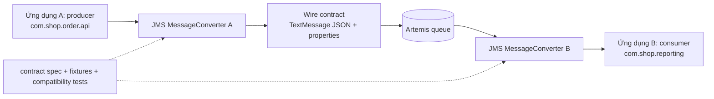

# Kiểm tra hợp đồng giữa bên gửi và bên nhận độc lập (Spring JMS)

> **Chủ đề:** Spring Framework – JMS · **Nhóm:** Chuyển đổi dữ liệu.  
> Mục tiêu: chứng minh một **producer** và một **consumer** được phát triển, biên dịch, triển khai và nâng phiên bản độc lập vẫn hiểu đúng một thông điệp JMS. Trọng tâm không phải “hai ứng dụng đều compile” mà là **hợp đồng thực trên đường truyền**: loại JMS Message, JSON body, headers/properties, schema, ý nghĩa field, routing, tương thích phiên bản và hành vi khi lỗi. Ví dụ thực hành dùng **Java 21, Spring Boot 3.3.5, Spring JMS và ActiveMQ Artemis**.

## 1. Vì sao kiểm thử trong một ứng dụng là chưa đủ?

Giả sử bên A gửi `OrderCreated`, bên B cập nhật read model. Khi cả hai cùng dùng một class Java trong một monorepo, một unit test có thể chạy xanh vì hai phía cùng đổi class hoặc dùng chung cấu hình Jackson. Nhưng lúc deploy thực tế, **B có thể vẫn đang chạy phiên bản cũ** và chỉ nhận được **JMS message đã serialize** của A.

Một số lỗi có thể không lộ khi test chung:

- A đổi `amountMinor: long` thành `amount: String`, B vẫn tưởng nhận số nguyên đơn vị nhỏ nhất.
- A đổi JMS body từ `TextMessage` JSON sang `ObjectMessage` hoặc `BytesMessage`; B chỉ hỗ trợ JSON text.
- A bỏ JMS property `_type` hoặc đổi type ID thành tên class Java; B không biết class đó.
- A đặt `schemaVersion="1"` dạng String, nhưng selector của B yêu cầu `schemaVersion = 1` dạng số.
- A thêm field bắt buộc; B cũ không có giá trị đó và parse lỗi, hoặc nguy hiểm hơn: dùng giá trị mặc định sai.
- A và B trỏ khác broker, cùng tên queue nhưng không cùng destination; unit test converter không thể phát hiện.
- B chạy chậm/đứt kết nối, message redeliver sau khi side effect đã thành công; một hợp đồng dữ liệu đúng vẫn chưa đủ để đạt kết quả nghiệp vụ đúng.

**Định nghĩa hợp đồng:** một tập quy tắc quan sát được trên wire, được cả producer và consumer chấp nhận, độc lập với package/class Java của từng ứng dụng.



## 2. Phân biệt ba lớp hợp đồng

| Lớp | Nội dung cần thống nhất | Nếu sai |
| --- | --- | --- |
| **Destination/protocol** | Queue hay topic, tên destination, broker, quyền send/consume, ACK/redelivery | Không giao được message, hoặc gửi đến sai nơi. |
| **JMS envelope** | `TextMessage`/`BytesMessage`, headers, properties, type ID, selector, correlation | Broker chọn sai message hoặc converter không hiểu payload. |
| **Payload/schema** | JSON field, type, required/optional, đơn vị, enum, version, semantic meaning | Consumer parse lỗi hoặc tính toán sai dù parse thành công. |

Một hợp đồng hoàn chỉnh còn nêu hành vi **khi không tương thích**, chiến lược nâng cấp, retry, DLQ và kiểm chứng end-to-end. Nhưng việc test **wire contract** không tự chứng minh delivery exactly-once hoặc business side effects chính xác.

### Không lấy class Java làm hợp đồng

Hai service **không bắt buộc** import cùng một `OrderCreated.java`. Thay vào đó:

- A có class `com.shop.order.api.PublisherApplication.OrderCreated`.
- B có class `com.shop.reporting.ReceiverApplication.OrderCreatedV1`.
- Trên JMS, chúng thỏa mãn **cùng một JSON schema + type ID logic `order-created-v1`**.
- A và B có thể build riêng; nếu B nâng version muộn hơn A vẫn phải xét compatibility matrix.

Cách này loại bỏ coupling trực tiếp vào Java package/record type. Một **contract artifact** (schema, mẫu message, tài liệu thuộc tính) có thể dùng chung nhưng không nên bắt buộc chia sẻ Java DTO compile-time nếu mục tiêu là kiểm chứng tương thích độc lập.

## 3. Ví dụ hợp đồng chuẩn cho sự kiện OrderCreated v1

Giả sử ta chọn queue:

```text
destination: orders.events.v1
domain: QUEUE
payloadType: jakarta.jms.TextMessage
contentType: application/json; charset UTF-8 (quy ước hợp đồng)
typeId: order-created-v1
schemaVersion: 1
delivery: asynchronous; at-least-once-compatible consumer
```

**Hợp đồng JMS properties**:

| Tên | Loại trên wire | Giá trị/ý nghĩa | Bắt buộc |
| --- | --- | --- | --- |
| `_type` | `String` | `order-created-v1` để `MappingJackson2MessageConverter` chọn class phía nhận | Có |
| `eventType` | `String` | `OrderCreated`, dùng để phân loại/selector | Có |
| `schemaVersion` | **`int`** | `1`, dùng để chọn schema và lọc ở broker | Có |
| `contentType` | `String` | `application/json`, do ứng dụng tự gắn; **không phải JMS header chuẩn** | Khuyến nghị |
| `producerApp` | `String` | Ví dụ `order-api` để quan sát, không phải khóa xác thực | Không |

JMS header `JMSCorrelationID` có thể chứa `eventId` để hỗ trợ theo dõi. `JMSMessageID` là header do provider xử lý và không thay thế business `eventId`.

**Body JSON v1**, dùng dữ liệu **minh họa cố định** cho contract fixture:

```json
{
  "eventId": "evt-test-001",
  "orderId": "ORD-42",
  "amountMinor": 125000,
  "currency": "VND"
}
```

Ý nghĩa field và ràng buộc:

- `eventId: String` không rỗng, ổn định cho cùng **một sự kiện**, dùng chống trùng.
- `orderId: String` không rỗng, là ID đơn hàng nghiệp vụ.
- `amountMinor: integer/long` không âm, tiền tính theo **đơn vị nhỏ nhất** (ví dụ ở đây là VND nguyên đồng); không dùng `double` để tính tiền.
- `currency: String` theo chuẩn ba chữ cái viết hoa, ví dụ `VND`.
- Các property thuộc JMS envelope **không nằm trong JSON body** và message selector không đọc trực tiếp body.

### 3.1. JSON Schema được quản lý như một contract

File `contracts/order-created-v1.schema.json`:

```json
{
  "$schema": "https://json-schema.org/draft/2020-12/schema",
  "$id": "https://contracts.example.invalid/events/order-created-v1",
  "title": "OrderCreatedV1",
  "type": "object",
  "required": ["eventId", "orderId", "amountMinor", "currency"],
  "properties": {
    "eventId": { "type": "string", "minLength": 1 },
    "orderId": { "type": "string", "minLength": 1 },
    "amountMinor": { "type": "integer", "minimum": 0 },
    "currency": { "type": "string", "pattern": "^[A-Z]{3}$" }
  },
  "additionalProperties": true
}
```

`$id` là một **định danh minh họa** cho schema, không phải endpoint truy cập thực tế. Hãy thay bằng URI schema/registry thực tế khi triển khai.

`additionalProperties=true` cho phép phiên bản mới **thêm field** mà contract v1 vẫn có thể chấp nhận. Điều đó **không đủ** để đảm bảo consumer Java cũ bỏ qua unknown fields: phải kiểm tra cấu hình deserializer. Nếu muốn strict schema cho một luồng không được phép có field lạ, chọn `false` nhưng khả năng nâng phiên bản sẽ khác.

**JSON Schema chỉ kiểm tra body.** Nó **không** xác minh JMS message type, `_type`, `schemaVersion`, `JMSCorrelationID`, destination hoặc ACL. Vì vậy cần **hai lớp test**: payload schema và JMS envelope/runtime.

### 3.2. Vì sao cùng JSON mà consumer vẫn có thể lỗi?

`MappingJackson2MessageConverter` của Spring 6.1 dùng Jackson để marshal/unmarshal. Nó mặc định có thể phát `BytesMessage`; khi wire contract yêu cầu `TextMessage` thì producer phải gọi `setTargetType(MessageType.TEXT)`. `setTypeIdPropertyName("_type")` yêu cầu bên nhận đọc type ID từ **JMS string property** và `setTypeIdMappings` ánh xạ ID logic đến class của riêng B.

Nếu A cấu hình mapping `"order-created-v1" -> A.OrderCreated.class`, B cấu hình mapping `"order-created-v1" -> B.OrderCreatedV1.class`, JSON và các properties thống nhất thì **không cần FQCN giống nhau**. Ngược lại, nếu A để converter ghi raw Java class name vào `_type`, consumer độc lập có thể không có class đó; đây là coupling không mong muốn.

**Cảnh báo bảo mật:** type ID mapping của `MappingJackson2MessageConverter` không phải allowlist tuyệt đối với message không đáng tin; một số nhánh có thể fallback sang class name. Với broker nhiều nguồn, giới hạn quyền producer, kiểm tra type ID và các message types được chấp nhận, không cho deserialize class tùy ý.

## 4. Chiến lược kiểm chứng: từng lớp, từ nhanh đến thật

Một bộ contract test nên có các lớp độc lập:

1. **Tài liệu/schema versioned:** mô tả destination, JMS envelope, JSON body, semantic invariants, dữ liệu mẫu, policy lỗi.
2. **Producer contract test:** trên chính code A, gọi converter thực để tạo JMS Message, kiểm tra body và type ID; kiểm tra postprocessor đặt đúng headers/properties.
3. **Consumer contract test:** trên chính code B, dùng **fixture có phiên bản** làm JMS Message nhận vào converter thực và kiểm tra DTO/validation; không import class A.
4. **Compatibility matrix:** chạy fixture từ các phiên bản A/B đang và sắp triển khai: tương thích thuận/ngược, field tùy chọn, breaking changes.
5. **Integration test hai ứng dụng với broker thật/testcontainer:** A và B là **hai process/build artifacts khác nhau**, chạy qua queue thực; xác minh routing, message type, type ID, consumer, ACK/retry.
6. **Negative & failure tests:** thiếu field, đổi kiểu, selector mismatch, unknown type ID, malformed JSON, duplicate event ID, broker down, redelivery và DLQ.

**Không chỉ kiểm tra** rằng mock `JmsTemplate.convertAndSend` được gọi. Assertion đó không kiểm tra việc serialize, trường JMS, broker hay consumer decode.

## 5. Hai ứng dụng độc lập: chuẩn bị project

Cấu trúc ví dụ:

```text
workspace/
├── publisher/                       # có thể là repo/deployment riêng
│   ├── settings.gradle
│   ├── build.gradle
│   └── src/main/
│       ├── java/com/shop/order/api/PublisherApplication.java
│       └── resources/application.yml
├── receiver/                        # có thể là repo/deployment riêng
│   ├── settings.gradle
│   ├── build.gradle
│   └── src/main/
│       ├── java/com/shop/reporting/ReceiverApplication.java
│       └── resources/application.yml
└── contracts/
    ├── order-created-v1.schema.json
    └── fixtures/order-created-v1.json
```

Hai project **không import Java source/DTO từ project còn lại**. Họ chỉ đồng ý về **wire contract** được quản lý/phiên bản hóa và môi trường broker test.

Phụ thuộc ngoài: JDK 21; Gradle wrapper tương thích trong từng project; Artemis broker đang chạy riêng tại `tcp://localhost:61616`, account có quyền send/consume queue `orders.events.v1`. Nếu broker không auto-create queue, phải provision trước; tạo Java `Queue` handle không đảm bảo tạo queue vật lý.

### 5.1. Publisher: cấu hình Gradle

`publisher/settings.gradle`:

```groovy
rootProject.name = 'orders-publisher'
```

`publisher/build.gradle`:

```groovy
plugins {
    id 'java'
    id 'org.springframework.boot' version '3.3.5'
    id 'io.spring.dependency-management' version '1.1.6'
}
group = 'com.shop'
version = '1.0.0'

java {
    toolchain { languageVersion = JavaLanguageVersion.of(21) }
}
repositories { mavenCentral() }

dependencies {
    implementation 'org.springframework.boot:spring-boot-starter-artemis'
    implementation 'org.springframework.boot:spring-boot-starter-web'
    implementation 'org.springframework.boot:spring-boot-starter-json'
    testImplementation 'org.springframework.boot:spring-boot-starter-test'
}
tasks.named('test') { useJUnitPlatform() }
```

`publisher/src/main/resources/application.yml`:

```yaml
spring:
  artemis:
    mode: native
    broker-url: ${JMS_BROKER_URL:tcp://localhost:61616}
    user: ${JMS_USER:artemis}
    password: ${JMS_PASSWORD:artemis}
  jms:
    pub-sub-domain: false
server:
  port: 8080
```

Các giá trị mặc định `artemis/artemis` dành cho broker local; production phải dùng secret manager/ACL/TLS. JMS queue mode được chọn bằng `pub-sub-domain=false`.

### 5.2. Receiver: Gradle và cấu hình riêng

`receiver/settings.gradle`:

```groovy
rootProject.name = 'reporting-receiver'
```

`receiver/build.gradle`:

```groovy
plugins {
    id 'java'
    id 'org.springframework.boot' version '3.3.5'
    id 'io.spring.dependency-management' version '1.1.6'
}
group = 'com.shop'
version = '1.0.0'

java {
    toolchain { languageVersion = JavaLanguageVersion.of(21) }
}
repositories { mavenCentral() }

dependencies {
    implementation 'org.springframework.boot:spring-boot-starter-artemis'
    implementation 'org.springframework.boot:spring-boot-starter-json'
    testImplementation 'org.springframework.boot:spring-boot-starter-test'
}
tasks.named('test') { useJUnitPlatform() }
```

`receiver/src/main/resources/application.yml`:

```yaml
spring:
  application:
    name: reporting-receiver
  main:
    web-application-type: none
  artemis:
    mode: native
    broker-url: ${JMS_BROKER_URL:tcp://localhost:61616}
    user: ${JMS_USER:artemis}
    password: ${JMS_PASSWORD:artemis}
  jms:
    pub-sub-domain: false
```

Receiver không có HTTP server. Hai app dùng **cùng URL broker/queue** nhưng **khác Gradle build và classpath**, đủ để thử tính độc lập ở cấp ứng dụng.

## 6. Producer: tạo TextMessage JSON và JMS envelope đúng contract

File `publisher/src/main/java/com/shop/order/api/PublisherApplication.java`:

```java
package com.shop.order.api;

import java.util.Map;
import java.util.UUID;

import com.fasterxml.jackson.databind.ObjectMapper;
import org.springframework.boot.SpringApplication;
import org.springframework.boot.autoconfigure.SpringBootApplication;
import org.springframework.context.annotation.Bean;
import org.springframework.http.ResponseEntity;
import org.springframework.jms.core.JmsTemplate;
import org.springframework.jms.support.converter.MappingJackson2MessageConverter;
import org.springframework.jms.support.converter.MessageConverter;
import org.springframework.jms.support.converter.MessageType;
import org.springframework.web.bind.annotation.PathVariable;
import org.springframework.web.bind.annotation.PostMapping;
import org.springframework.web.bind.annotation.RestController;

@SpringBootApplication
public class PublisherApplication {

    public static void main(String[] args) {
        SpringApplication.run(PublisherApplication.class, args);
    }

    public record OrderCreated(
            String eventId,
            String orderId,
            long amountMinor,
            String currency) {
    }

    @Bean
    MessageConverter jmsMessageConverter(ObjectMapper objectMapper) {
        MappingJackson2MessageConverter converter =
                new MappingJackson2MessageConverter(objectMapper);
        converter.setTargetType(MessageType.TEXT);
        converter.setTypeIdPropertyName("_type");
        converter.setTypeIdMappings(Map.of(
                "order-created-v1", OrderCreated.class));
        return converter;
    }
}

@RestController
class OrderPublishApi {
    private final JmsTemplate template;

    OrderPublishApi(JmsTemplate template) {
        this.template = template;
    }

    @PostMapping("/demo/order/{orderId}")
    ResponseEntity<String> publish(@PathVariable String orderId) {
        String eventId = "evt-" + UUID.randomUUID();
        var event = new PublisherApplication.OrderCreated(
                eventId, orderId, 125_000L, "VND");

        template.convertAndSend("orders.events.v1", event, message -> {
            message.setStringProperty("eventType", "OrderCreated");
            message.setIntProperty("schemaVersion", 1);
            message.setStringProperty("contentType", "application/json");
            message.setStringProperty("producerApp", "order-api");
            message.setJMSCorrelationID(eventId);
            return message;
        });

        return ResponseEntity.accepted()
                .body("ENQUEUED " + eventId);
    }
}
```

**Điểm cần hiểu:**

- `MessageConverter` là bean do A đăng ký; Spring Boot tự cấu hình `JmsTemplate` khi không bị override, và áp dụng converter bean này. Không cần tạo Java `TextMessage` trong business method.
- `setTargetType(MessageType.TEXT)` buộc JMS body là JSON text.
- A map `order-created-v1` đến **chính class Java của A**.
- `MessagePostProcessor` chạy **sau** bước convert, **trước** send, gắn properties và header theo contract.
- `JMSCorrelationID` là JMS header; các property còn lại là metadata dùng cho filtering/observability.
- `eventId` sinh mới cho **mỗi yêu cầu** trong demo; khi retry cùng **một sự kiện** trong production, cần bảo toàn ID cũ.
- HTTP 202 chỉ được trả nếu send không ném lỗi ở flow này; **không** chứng minh consumer đã hoàn tất hay database bên nhận đã commit.

**Chú ý:** ví dụ cố định `amountMinor=125000` cho dễ học; dữ liệu thực phải lấy từ domain đã xác nhận và validate request.

## 7. Consumer: class riêng nhưng decode cùng type ID

File `receiver/src/main/java/com/shop/reporting/ReceiverApplication.java`:

```java
package com.shop.reporting;

import java.util.Map;

import com.fasterxml.jackson.databind.DeserializationFeature;
import com.fasterxml.jackson.databind.ObjectMapper;
import org.springframework.boot.SpringApplication;
import org.springframework.boot.autoconfigure.SpringBootApplication;
import org.springframework.context.annotation.Bean;
import org.springframework.jms.annotation.EnableJms;
import org.springframework.jms.annotation.JmsListener;
import org.springframework.jms.support.converter.MappingJackson2MessageConverter;
import org.springframework.jms.support.converter.MessageConverter;
import org.springframework.jms.support.converter.MessageType;
import org.springframework.stereotype.Component;

@SpringBootApplication
@EnableJms
public class ReceiverApplication {

    public static void main(String[] args) {
        SpringApplication.run(ReceiverApplication.class, args);
    }

    // Class độc lập với PublisherApplication.OrderCreated!
    public record OrderCreatedV1(
            String eventId,
            String orderId,
            long amountMinor,
            String currency) {
        public OrderCreatedV1 {
            if (eventId == null || eventId.isBlank()
                    || orderId == null || orderId.isBlank()
                    || amountMinor < 0
                    || currency == null
                    || !currency.matches("[A-Z]{3}")) {
                throw new IllegalArgumentException(
                        "Invalid OrderCreatedV1 contract");
            }
        }
    }

    @Bean
    MessageConverter jmsMessageConverter(ObjectMapper objectMapper) {
        ObjectMapper contractMapper = objectMapper.copy()
                .configure(
                        DeserializationFeature.FAIL_ON_UNKNOWN_PROPERTIES,
                        false)
                .configure(
                        DeserializationFeature.FAIL_ON_MISSING_CREATOR_PROPERTIES,
                        true)
                .configure(
                        DeserializationFeature.FAIL_ON_NULL_CREATOR_PROPERTIES,
                        true);

        MappingJackson2MessageConverter converter =
                new MappingJackson2MessageConverter(contractMapper);
        converter.setTargetType(MessageType.TEXT);
        converter.setTypeIdPropertyName("_type");
        converter.setTypeIdMappings(Map.of(
                "order-created-v1", OrderCreatedV1.class));
        return converter;
    }
}

@Component
class ReportingProjection {
    @JmsListener(
        destination = "orders.events.v1",
        selector = "_type = 'order-created-v1' AND "
                 + "eventType = 'OrderCreated' AND schemaVersion = 1")
    public void onOrder(ReceiverApplication.OrderCreatedV1 event) {
        System.out.printf(
                "PROJECTED order=%s amount=%d currency=%s%n",
                event.orderId(), event.amountMinor(), event.currency());
    }
}
```

**Tại sao hai ứng dụng thực sự độc lập?** A serialize class `com.shop.order.api.PublisherApplication.OrderCreated`; B deserialize thành **class khác** `com.shop.reporting.ReceiverApplication.OrderCreatedV1`. B không import A, không phụ thuộc artifact `publisher.jar`, không biết tên package của A. Cả hai đồng thuận với type ID và JSON schema.

**Về Jackson strictness:**

- `FAIL_ON_UNKNOWN_PROPERTIES=false` giúp B bỏ qua **field mới** mà A có thể thêm sau này; không được xem là giấy phép đổi kiểu/ý nghĩa field cũ.
- `FAIL_ON_MISSING_CREATOR_PROPERTIES=true` và `FAIL_ON_NULL_CREATOR_PROPERTIES=true` làm input thiếu/null field record bắt buộc không âm thầm đi qua.
- Record constructor kiểm tra giá trị rỗng, amount âm và currency không đúng dạng. Một lỗi không thể khôi phục nên được đưa vào cơ chế xử lý poison message/DLQ, không retry vô tận.
- Cấu hình Jackson của B là **chiến lược hợp đồng**: production có thể dùng JSON Schema validator và domain validation riêng để kiểm tra chặt chẽ hơn, đặc biệt khi chuyển đổi số/kiểu.

**Selector** chỉ đọc JMS properties. Nếu A không gửi `schemaVersion` đúng **kiểu int**, B có thể không chọn message; payload JSON đúng vẫn vô ích. Selector `_type` còn giúp không đưa type ID ngoài hợp đồng vào converter này, nhưng **ACL và kiểm tra nguồn** vẫn cần khi broker nhận message từ nhiều hệ thống. Message không match selector có thể nằm chờ trong queue; cần quan sát backlog và xử lý version không còn consumer.

### Lưu ý về transaction

Spring Boot thường cấu hình listener factory mặc định có cơ chế transaction phù hợp; nếu thay factory bằng tay phải xác định rõ `sessionTransacted`, error handler, concurrency và recovery. Hai app tách rời không chia sẻ DB transaction, JMS session transaction hay class loader. Trường hợp redelivery cần **idempotency** theo `eventId`, không phụ thuộc converter.

## 8. Kiểm thử nhanh hai process qua Artemis

Trước khi chạy, admin/broker cần có queue `orders.events.v1` với routing queue/ANYCAST và quyền gửi/nhận. Nếu auto-create được bật thì broker **có thể** tự tạo; đây là cấu hình broker, không phải cam kết từ việc Spring tạo destination object.

Trong terminal 1:

```bash
cd receiver
./gradlew bootRun
```

Trong terminal 2:

```bash
cd publisher
./gradlew bootRun
```

Trên Windows (PowerShell hoặc cmd) dùng `gradlew.bat bootRun` ở từng project. Nếu chưa tạo Gradle wrapper, dùng phiên bản Gradle tương thích để chạy `gradle bootRun` hoặc tạo wrapper trước.

Terminal 3 gửi:

```bash
curl -i -X POST http://localhost:8080/demo/order/ORD-42
```

Ví dụ response khi JMS send thành công:

```text
HTTP/1.1 202
...
ENQUEUED evt-<UUID được tạo tại runtime>
```

Dòng `evt-<UUID ...>` ở đây là **khuôn dạng**, không phải stdout từng byte vì UUID ngẫu nhiên. Consumer khi nhận và decode thành công in:

```text
PROJECTED order=ORD-42 amount=125000 currency=VND
```

Thời điểm consumer in log không cố định so với thời điểm HTTP 202. Nếu broker không chạy, thiếu quyền, converter cấu hình sai hoặc destination không tồn tại, **không** thể dự kiến kết quả thành công.

**Xác minh bằng broker management:** kiểm tra queue name/routing, active consumers, pending/delivering, redelivery, DLQ. Có thể tạm dừng B trong **môi trường test** để inspect message thô; không tạm dừng consumer trên production chỉ để làm bài tập. Bên gửi trả HTTP 202 không thay thế bằng chứng bên nhận đã ACK.

## 9. Producer contract test không cần khởi động consumer

Producer phải chứng minh **chính converter hiện tại** tạo body và type ID đúng. Có thể dùng Mockito mock `Session`/`TextMessage` (không cần broker) để kiểm tra phần serialization.

File `publisher/src/test/java/com/shop/order/api/PublisherContractTest.java`:

```java
package com.shop.order.api;

import com.fasterxml.jackson.databind.JsonNode;
import com.fasterxml.jackson.databind.ObjectMapper;
import jakarta.jms.Session;
import jakarta.jms.TextMessage;
import org.junit.jupiter.api.Test;
import org.mockito.ArgumentCaptor;
import org.springframework.jms.support.converter.MappingJackson2MessageConverter;
import org.springframework.jms.support.converter.MessageType;

import java.util.Map;

import static org.junit.jupiter.api.Assertions.*;
import static org.mockito.ArgumentMatchers.anyString;
import static org.mockito.Mockito.*;

class PublisherContractTest {

    @Test
    void writesStableJsonAndTypeId() throws Exception {
        ObjectMapper mapper = new ObjectMapper();
        MappingJackson2MessageConverter converter =
                new MappingJackson2MessageConverter(mapper);
        converter.setTargetType(MessageType.TEXT);
        converter.setTypeIdPropertyName("_type");
        converter.setTypeIdMappings(Map.of(
                "order-created-v1",
                PublisherApplication.OrderCreated.class));

        Session session = mock(Session.class);
        TextMessage text = mock(TextMessage.class);
        when(session.createTextMessage(anyString())).thenReturn(text);

        var event = new PublisherApplication.OrderCreated(
                "evt-test-001", "ORD-42", 125_000L, "VND");

        converter.toMessage(event, session);

        ArgumentCaptor<String> body =
                ArgumentCaptor.forClass(String.class);
        verify(session).createTextMessage(body.capture());
        verify(text).setStringProperty("_type", "order-created-v1");

        JsonNode json = mapper.readTree(body.getValue());
        assertEquals("evt-test-001", json.path("eventId").asText());
        assertEquals("ORD-42", json.path("orderId").asText());
        assertTrue(json.path("amountMinor").isIntegralNumber());
        assertEquals(125_000L, json.path("amountMinor").asLong());
        assertEquals("VND", json.path("currency").asText());
        assertEquals(4, json.size()); // Chính xác 4 field của v1.
    }
}
```

**Test này kiểm tra được gì?** Converter tạo `TextMessage` bằng `Session.createTextMessage` với JSON có đúng field/type, và đặt `_type` đúng logic ID. Nó cố ý **không** assert thứ tự JSON keys: thứ tự trong object JSON không phải hợp đồng.

**Chưa kiểm tra gì?** JMS properties được thêm trong `MessagePostProcessor` của controller, destination thật, broker security và delivery. Muốn kiểm tra postprocessor, có thể dùng Mockito capture callback ở layer publisher; tuy nhiên vẫn cần integration test cho provider thật.

Đặc biệt, test `assertEquals(4,json.size())` hợp lý cho **producer v1** để tránh phát field ngoài ý muốn. Khi A chủ động phát thêm optional field ở v2, cập nhật test/contract tương ứng; không giữ assertion cũ một cách máy móc.

## 10. Consumer contract test không import producer DTO

Bên nhận phải kiểm tra **fixture trên wire**, không tạo một `PublisherApplication.OrderCreated` rồi dùng chung converter trong cùng process.

Tạo file `receiver/src/test/java/com/shop/reporting/ReceiverContractTest.java`:

```java
package com.shop.reporting;

import java.util.Map;

import com.fasterxml.jackson.databind.DeserializationFeature;
import com.fasterxml.jackson.databind.ObjectMapper;
import jakarta.jms.TextMessage;
import org.junit.jupiter.api.Test;
import org.springframework.jms.support.converter.MappingJackson2MessageConverter;
import org.springframework.jms.support.converter.MessageConversionException;
import org.springframework.jms.support.converter.MessageType;

import static org.junit.jupiter.api.Assertions.*;
import static org.mockito.Mockito.*;

class ReceiverContractTest {

    private MappingJackson2MessageConverter converter() {
        ObjectMapper mapper = new ObjectMapper()
                .configure(
                        DeserializationFeature.FAIL_ON_UNKNOWN_PROPERTIES,
                        false)
                .configure(
                        DeserializationFeature.FAIL_ON_MISSING_CREATOR_PROPERTIES,
                        true)
                .configure(
                        DeserializationFeature.FAIL_ON_NULL_CREATOR_PROPERTIES,
                        true);
        var converter = new MappingJackson2MessageConverter(mapper);
        converter.setTargetType(MessageType.TEXT);
        converter.setTypeIdPropertyName("_type");
        converter.setTypeIdMappings(Map.of(
                "order-created-v1",
                ReceiverApplication.OrderCreatedV1.class));
        return converter;
    }

    @Test
    void acceptsProducerV1FixtureIndependently() throws Exception {
        TextMessage message = mock(TextMessage.class);
        when(message.getStringProperty("_type"))
                .thenReturn("order-created-v1");
        when(message.getText()).thenReturn("""
                {"eventId":"evt-test-001","orderId":"ORD-42",
                 "amountMinor":125000,"currency":"VND"}
                """);

        Object actual = converter().fromMessage(message);

        assertEquals(
                new ReceiverApplication.OrderCreatedV1(
                        "evt-test-001", "ORD-42", 125_000L, "VND"),
                actual);
    }

    @Test
    void toleratesNewOptionalField() throws Exception {
        TextMessage message = mock(TextMessage.class);
        when(message.getStringProperty("_type"))
                .thenReturn("order-created-v1");
        when(message.getText()).thenReturn("""
                {"eventId":"evt-test-002","orderId":"ORD-42",
                 "amountMinor":125000,"currency":"VND",
                 "sourceChannel":"mobile"}
                """);

        var event = (ReceiverApplication.OrderCreatedV1)
                converter().fromMessage(message);
        assertEquals("ORD-42", event.orderId());
    }

    @Test
    void rejectsMissingRequiredField() throws Exception {
        TextMessage message = mock(TextMessage.class);
        when(message.getStringProperty("_type"))
                .thenReturn("order-created-v1");
        when(message.getText()).thenReturn("""
                {"eventId":"evt-test-003",
                 "amountMinor":125000,"currency":"VND"}
                """);

        assertThrows(
                MessageConversionException.class,
                () -> converter().fromMessage(message));
    }
}
```

Cả ba tests dùng **class DTO của B**, không biết class Java của A. Chúng kiểm tra positive fixture, compatibility với field mới tùy chọn và negative fixture thiếu field bắt buộc. Đây là ví dụ unit test với mock `TextMessage`; chạy không cần Artemis.

`MappingJackson2MessageConverter` có thể bao lỗi Jackson/deserialization trong `MessageConversionException`. Khi client code dùng converter khác hoặc lỗi đi qua listener container, exception bề mặt có thể được bọc thêm; hãy kiểm tra nguyên nhân gốc khi triage.

Chạy test **độc lập**:

```bash
# Trong thư mục publisher
./gradlew test

# Trong thư mục receiver
./gradlew test
```

Không tuyên bố các lệnh trên đã chạy trong bài viết này; chúng là bước học viên cần tự thực thi. Test unit không chứng minh broker thực sự dispatch hay message selector match.

## 11. Hợp đồng JMS envelope cần test riêng

JSON body đúng **vẫn có thể thất bại hoàn toàn** nếu properties không khớp.

Ví dụ selector ở B:

```sql
_type = 'order-created-v1'
AND eventType = 'OrderCreated'
AND schemaVersion = 1
```

Đây là **cú pháp selector JMS**, không phải câu SQL gửi đến database.

Các trường hợp cần test:

| A gửi | B nhận? | Lý do |
| --- | --- | --- |
| `_type="order-created-v1"`; `eventType="OrderCreated"`; `schemaVersion` int 1 | Có thể được broker chọn | Properties khớp cả ba biểu thức. |
| A chỉ đặt `schemaVersion: 1` **trong JSON body** | Không match điều kiện property | Selector không đọc JSON body. |
| A đặt `setStringProperty("schemaVersion","1")` | Không phải thay thế an toàn cho int 1 | Selector có ngữ nghĩa so sánh kiểu; không mặc định parse như getter. |
| A bỏ `_type` nhưng body giống hệt | Không match selector; converter thiếu type ID | Metadata là một phần hợp đồng. |
| A dùng `TextMessage` nhưng B cố parse `ObjectMessage` | Không đúng wire contract | Loại JMS Message phải thống nhất. |
| A gửi schema v2, B chỉ chọn v1 | B v1 không nhận message v2 | Cần consumer tương ứng, routing và quan sát backlog. |

**JMS headers** như `JMSCorrelationID` là khác với properties. `JMSMessageID` do provider quản lý, không nên dùng làm eventId nghiệp vụ. Nếu gửi thêm `contentType`, đó là **property do ứng dụng đặt**; JMS không tự coi nó là HTTP content type header.

**Một quy trình kiểm tra envelope với broker test:**

1. Chạy producer với consumer tạm dừng, hoặc dùng một queue test cô lập.
2. Gửi một message có `eventId` cố định cho test.
3. Dùng Artemis console/management hoặc consumer probe đọc raw `Message`.
4. Xác minh `message instanceof TextMessage` và `getText()` parse được JSON body.
5. Xác minh `getStringProperty("_type")`, `getStringProperty("eventType")`, `getIntProperty("schemaVersion")`, `getJMSCorrelationID()`.
6. Đọc về class DTO của B, validate business invariants và xác nhận ACK/commit theo policy.
7. Thử negative fixtures nhưng tránh thả malformed message vào queue production.

## 12. Compatibility matrix: có thể nâng A và B lệch thời điểm không?

Đừng đánh đồng **schema version** với **build version**. Ví dụ `order-created-v1` là phiên bản hợp đồng trên wire; `publisher 2.4.0` và `receiver 1.9.0` có thể vẫn cùng hiểu contract v1.

| Producer | Consumer | Kỳ vọng | Ghi chú |
| --- | --- | --- | --- |
| P1 phát v1 | C1 hiểu v1 | **PASS** | Baseline. |
| P2 vẫn phát v1 nhưng thêm field **optional** `sourceChannel` | C1 hiểu v1 | **PASS nếu** B bỏ qua unknown fields và không đổi nghĩa field cũ | Phải test thực với Jackson configuration. |
| P1 phát v1 | C2 hỗ trợ thêm optional field | **PASS nếu** C2 cho phép field mới vắng mặt | Không thêm field mới thành required khi producer cũ còn chạy. |
| P2 đổi `amountMinor` sang `amount: String` nhưng giữ type ID v1 | C1 hiểu v1 | **FAIL hoặc tệ hơn: silent semantic mismatch** | Đây là breaking change. |
| P2 phát contract v2, đổi `_type` và `schemaVersion` | C1 chỉ chọn v1 | **Không nhận v2** | Cần C2/adapter/queue routing hợp lệ. |
| P1 phát v1, C2 chỉ chọn v2 | C2 không xử lý v1 | **BLOCKED** | Không deploy consumer-only-v2 trước khi hết backlog v1. |

### Một chiến lược nâng cấp an toàn

**Với thay đổi tương thích:** cho consumer mới đọc cả v1 và thông tin optional mới trước khi producer bắt đầu phát field đó; giữ type ID/schema semantics không đổi nếu hợp đồng vẫn tương thích. Nếu tăng schemaVersion property, cần bảo đảm selector của B vẫn nhận các phiên bản thích hợp.

**Với thay đổi breaking:** phát hành hợp đồng `order-created-v2` và có kế hoạch cho A/B cùng tồn tại:

1. Đăng ký schema v2, migration plan và fixtures.
2. Deploy B2 có khả năng đọc v1/v2 hoặc tách routing, tùy kiến trúc.
3. Bật A2 phát v2 khi đường nhận sẵn sàng.
4. Theo dõi backlog v1, DLQ, consumers v1 và rollback path.
5. Chỉ tắt hỗ trợ v1 khi hết message cũ và chắc chắn không còn producer v1.

**Cẩn thận với queue:** nhiều consumers trên một queue **cạnh tranh** nhận message, không phải mỗi nhóm tự nhận bản sao. Selectors không match có thể khiến message tồn đọng. Nếu muốn nhiều hệ thống đọc độc lập cùng sự kiện, thiết kế topic/subscriptions hoặc fan-out queues phù hợp; không mặc định “đặt nhiều consumer vào queue là mỗi bên đều nhận một bản”.

## 13. Những test âm bắt buộc để tránh false confidence

| Nhóm test | Input cố tình sai | Kỳ vọng đúng |
| --- | --- | --- |
| **Missing required** | Bỏ `orderId` | Consumer reject tại schema/constructor; không ghi projection. |
| **Wrong type** | `amountMinor = "125000"` dạng String JSON | Contract/schema validator phải reject; đừng chỉ dựa vào Jackson coercion mặc định. |
| **Semantic invalid** | `amountMinor = -5` | Reject theo domain validation. |
| **Unknown event type** | `_type = "not-approved-v1"` | Không đưa vào consumer trái hợp đồng; record metric, route/DLQ phù hợp. |
| **Wrong property type** | `schemaVersion` String `"1"` | Selector đúng kiểu số không match; detect backlog. |
| **Unsupported version** | `schemaVersion=2` và B chỉ hỗ trợ 1 | Không xử lý sai version; dùng kế hoạch dual-read/migration. |
| **Malformed JSON** | JSON thiếu dấu đóng, invalid UTF-8 | Conversion failure; retry hữu hạn và DLQ/quarantine. |
| **Duplicate event** | Hai messages cùng `eventId` | Side effect nghiệp vụ một lần nhờ idempotency. |
| **Transport outage** | Broker down/ACL từ chối | Producer nhận lỗi/timeout, retry được kiểm soát; không trả thành công giả. |
| **Redelivery** | Crash sau ghi DB nhưng trước JMS ACK | Consumer nhận lại an toàn; không tạo dữ liệu trùng. |

**Vấn đề Jackson coercion:** Jackson trong một số cấu hình có thể chuyển chuỗi số thành số, hoặc mặc định primitive khi field thiếu. Đừng cho rằng “đã dùng record Java” tương đương JSON Schema validator. Với dữ liệu nhạy cảm, chạy validation trên raw `JsonNode`/JSON Schema **trước** mapping hoặc cấu hình coercion strict và các validators cần thiết.

### Poison message và DLQ

Một message sai schema thường **không tự sửa** sau khi retry. Nếu listener dùng transacted JMS session, exception khi convert/process có thể rollback và redeliver. Đặt giới hạn số lần redelivery theo broker, chuyển poison message sang **DLQ/quarantine**, lưu correlation, event ID, type ID, schemaVersion và nguyên nhân đã được lọc thông tin nhạy cảm. Tránh log toàn bộ JSON chứa dữ liệu cá nhân/secret.

## 14. Tương thích dữ liệu khác với đảm bảo vận hành

Một hệ thống có **contract test PASS** vẫn có thể làm mất/sai tác động nghiệp vụ:

- **Producer DB commit rồi chết trước JMS send:** business change tồn tại nhưng event chưa phát. Dùng **transactional outbox** nếu cần đảm bảo phát sự kiện sau commit.
- **Broker nhận, consumer xử lý DB xong rồi crash trước ACK:** message có thể redeliver. Consumer phải idempotent theo `eventId` + unique constraint/processed-events table.
- **Producer retry sau send timeout không rõ trạng thái:** có thể phát trùng. Dùng event ID ổn định cho **cùng một sự kiện**, tránh tạo UUID mới cho mỗi retry không kiểm soát.
- **Message TTL/retention/DLQ:** JSON hợp lệ không ngăn message hết hạn, bị chặn quyền, bị reject do queue đầy hoặc chuyển DLQ.
- **Multiple services:** queue cạnh tranh consumer; khi cần event broadcast, dùng subscription/fan-out design riêng, test message routing song song.

**Nên tách dashboard:** contract failures (schema/type ID), broker failures (connection, auth, address/queue), dispatch (backlog, consumer count), delivery (redeliver/DLQ), business idempotency/latency. Trộn tất cả vào một metric “JMS error” sẽ khó triage.

## 15. Checklist đưa hợp đồng vào CI/CD

### Phần producer

- [ ] Tạo/sử dụng contract v1 có chủ sở hữu, schema, fixtures và semantic units.
- [ ] Test converter Java của **chính producer** với `Session` mock: đúng `TextMessage`, JSON field/type và type ID.
- [ ] Test `MessagePostProcessor` hoặc integration test để xác minh JMS headers/properties, nhất là kiểu `int` của `schemaVersion`.
- [ ] Test khi thêm field tùy chọn, thay serializer config, đổi Jackson/Spring Boot version.
- [ ] Đảm bảo code không gửi Java class FQCN vô ý làm type ID.
- [ ] Không phát payload mới khi chưa biết phiên bản consumer đang hoạt động có nhận được hay không.

### Phần consumer

- [ ] Parse fixture trên wire bằng class **của consumer**, không import producer DTO.
- [ ] Test required/optional, negative fixtures, type ID/version, domain validation.
- [ ] Kiểm tra unknown fields được xử lý theo chiến lược đã định.
- [ ] Verify selector match property names **và kiểu dữ liệu**, không chỉ JSON.
- [ ] Có policy DLQ/quarantine cho message không parse được và xử lý idempotent cho event trùng.

### Tích hợp và release gate

- [ ] Chạy cả hai binaries độc lập lên broker test hoặc Testcontainers Artemis phù hợp.
- [ ] Verify destination thật, queue/topic mode, permissions, JMS message type, properties và ACK.
- [ ] Chạy compatibility matrix P1/P2 × C1/C2 với fixtures từng version.
- [ ] Test rollback, redelivery, DLQ, broker outage và thời điểm shutdown/restart.
- [ ] Gate release breaking change khi chưa có receiver mới và migration/rollback plan.
- [ ] Quan sát backlog, consumer count và các messages không match selector sau deploy.

**Định nghĩa PASS:** không chỉ “không exception” mà là producer phát đúng wire contract, consumer độc lập decode đúng, business invariants được giữ, message thực sự đi qua destination đã định và lỗi không tương thích được xử lý có kiểm soát.

## 16. Câu hỏi và bài tập tự kiểm tra

1. Vì sao dùng chung một Java DTO jar giữa producer và consumer có thể che giấu sự cố tương thích khi triển khai lệch phiên bản?
2. Định nghĩa ba lớp hợp đồng: destination/protocol, JMS envelope và payload schema; cho ví dụ một lỗi trong mỗi lớp.
3. Type ID `order-created-v1` khác gì tên Java `com.shop.order.api.PublisherApplication.OrderCreated`? Vì sao class của B có thể khác mà vẫn đọc đúng?
4. `MappingJackson2MessageConverter` cần những thiết lập nào để gửi JSON `TextMessage` và decode theo type ID?
5. Hãy tìm JMS properties bắt buộc trong ví dụ. Tại sao selector không đọc được `amountMinor` trong JSON body?
6. A gửi `setStringProperty("schemaVersion","1")`, B chọn `schemaVersion = 1`. Phải sửa phía nào và kiểm tra gì trên broker?
7. Chỉ có JSON Schema v1 và một test body parse thành công là đủ chưa? Những kiểm chứng envelope nào còn thiếu?
8. A thêm `sourceChannel` tùy chọn. B cũ cần cấu hình gì? Vì sao vẫn phải kiểm thử khả năng tương thích?
9. A bỏ `amountMinor` hoặc đổi sang `amount: String` nhưng không đổi type ID. Đây là thay đổi tương thích hay breaking? Hãy đề xuất migration.
10. Tại sao consumer test cần fixture **từ hợp đồng trên wire**, không khởi tạo DTO class của producer?
11. Hãy xây dựng negative test cho JSON amount dạng String và nêu vì sao Jackson coercion có thể làm test “xanh sai”.
12. Trường hợp P2 phát v2 nhưng B1 chỉ nhận v1, một queue có thể tích message theo cơ chế nào? Khi nào nên tách destination?
13. Nếu consumer ghi database xong rồi crash trước JMS ACK, contract test có thể ngăn side effect nhân đôi không? Cần bổ sung cơ chế gì?
14. Hãy xây dựng release gate có hai job build độc lập và một integration job qua broker test, nêu evidence PASS của từng job.

**Ghi nhớ:** **Hợp đồng tích hợp không phải class Java, mà là các quy tắc được bảo đảm trên JMS wire**. Producer và consumer độc lập phải kiểm tra **cả body lẫn JMS envelope**, dùng type ID/schema có version, chạy positive/negative fixtures, compatibility matrix và integration test trên broker. Contract test chứng minh **hiểu đúng thông điệp**; vận hành tin cậy vẫn cần outbox, idempotency, transaction, retry, DLQ và quan sát hệ thống.

### Tài liệu tham khảo

- [Spring Framework – JMS Sending a Message](https://docs.spring.io/spring-framework/reference/integration/jms/sending.html) — `JmsTemplate`, converter và postprocessor.
- [Spring Framework 6.1 – MappingJackson2MessageConverter](https://docs.spring.io/spring-framework/docs/6.1.0/javadoc-api/org/springframework/jms/support/converter/MappingJackson2MessageConverter.html) — `MessageType.TEXT`, type ID mapping, JSON TEXT/BYTES.
- [Spring – Getting Started: Messaging with JMS](https://spring.io/guides/gs/messaging-jms/) — Boot JMS auto-config, `@JmsListener`, converter bean và provider.
- [Spring Framework – Annotated JMS Listener Endpoints](https://docs.spring.io/spring-framework/reference/integration/jms/annotated.html) — listener factory và payload conversion.
- [Jakarta Messaging 3.1 Specification](https://jakarta.ee/specifications/messaging/3.1/jakarta-messaging-spec-3.1.html) — JMS message types, properties/selectors, ACK/delivery.
- [JSON Schema 2020-12 Specification](https://json-schema.org/draft/2020-12) — required, types, additionalProperties và schema validation.
- [Apache ActiveMQ Artemis Documentation](https://artemis.apache.org/components/artemis/documentation/latest/) — queue/address, routing, redelivery, DLQ và broker management.
