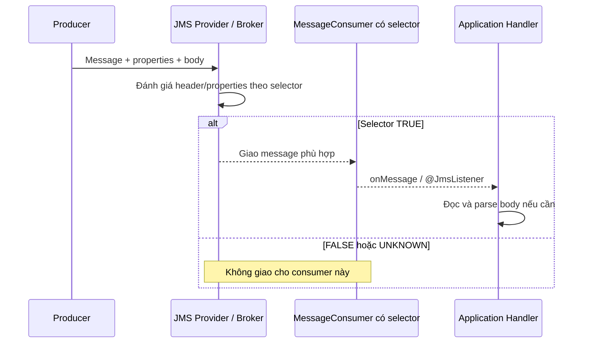
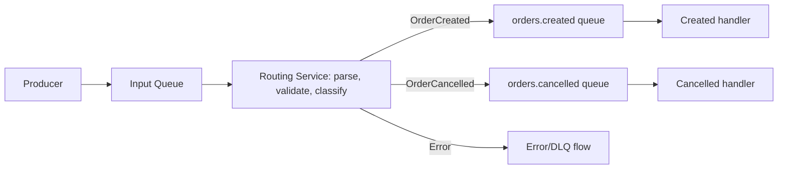

# Vì sao selector chuẩn không đọc nội dung body trong Jakarta JMS và Spring Framework

## 1. Câu trả lời cốt lõi

**JMS message selector chuẩn không thể đọc hoặc truy vấn nội dung body.** Theo **Jakarta Messaging Specification 3.1, mục 3.8.1**, selector chọn thông điệp bằng **các trường header được tiêu chuẩn cho phép** và **message properties**. Body có thể chứa văn bản, JSON, XML, bytes, map hoặc đối tượng Java nhưng **không tham gia biểu thức selector chuẩn**.

Ví dụ, một producer gửi body:

```json
{"eventType":"OrderCreated","region":"APAC","schemaVersion":2}
```

Nếu đó chỉ là chuỗi trong `TextMessage`, consumer sử dụng:

```sql
eventType = 'OrderCreated' AND region = 'APAC' AND schemaVersion >= 2
```

**không tự động khớp**. Selector cần những tên `eventType`, `region` và `schemaVersion` là **JMS message properties**, chẳng hạn được producer gán bằng `setStringProperty` và `setIntProperty`. Nó **không có chức năng mở JSON rồi tìm các khóa cùng tên**.

Cách gửi đúng cho nhu cầu lọc ở broker:

```java
jmsTemplate.send("orders.events", session -> {
    TextMessage message = session.createTextMessage(
        "{\"eventType\":\"OrderCreated\",\"region\":\"APAC\","
      + "\"schemaVersion\":2}");

    message.setStringProperty("eventType", "OrderCreated");
    message.setStringProperty("region", "APAC");
    message.setIntProperty("schemaVersion", 2);
    return message;
});
```

Đây là **mảnh mã Spring JMS**, giả định đã có `jmsTemplate`, import `jakarta.jms.TextMessage` và broker đã cấu hình. Việc thêm properties không sửa body. Nó cung cấp **metadata dành cho định tuyến/lọc**, còn JSON vẫn là dữ liệu nghiệp vụ để handler đọc sau khi nhận.

> **Phân biệt hai mệnh đề:** “Broker có thể đọc body bằng API hoặc tiện ích riêng” **không có nghĩa** “JMS selector *chuẩn* có thể truy vấn body”. Một số JMS provider có mở rộng như XPath cho XML, nhưng **không portable** và không phải ngữ nghĩa bắt buộc của Jakarta Messaging.

## 2. Cấu trúc JMS Message giải thích giới hạn này

Một JMS Message gồm ba vùng có mục đích khác nhau:

```text
JMS Message
├── Header (JMS-defined fields)
│   ├── JMSMessageID       : provider gán khi gửi
│   ├── JMSPriority        : producer/provider gán khi gửi
│   ├── JMSCorrelationID   : client có thể gán
│   ├── JMSType            : client có thể gán
│   └── Các header khác
│
├── Properties (typed key-value metadata)
│   ├── eventType     : "OrderCreated" (String)
│   ├── region        : "APAC"         (String)
│   ├── schemaVersion : 2              (int)
│   └── ...
│
└── Body (application payload)
    ├── TextMessage   → String, ví dụ JSON/XML/text
    ├── BytesMessage  → bytes
    ├── MapMessage    → tập các field trong BODY
    ├── StreamMessage → các phần tử theo thứ tự
    └── ObjectMessage → Java-serialized object
```

JMS selector chuẩn nhìn phần **header/properties** đã có dạng metadata nhất quán để provider xét điều kiện. Phần **body** phục vụ nội dung nghiệp vụ và được consumer giải mã theo quy ước ứng dụng.

### 2.1. Header chuẩn có thể tham chiếu là tập con

Jakarta Messaging 3.1 **giới hạn các tên JMS header có thể dùng làm selector identifier** ở sáu trường:

- `JMSDeliveryMode`
- `JMSPriority`
- `JMSMessageID`
- `JMSTimestamp`
- `JMSCorrelationID`
- `JMSType`

Ví dụ hợp lệ theo chuẩn:

```sql
JMSType = 'OrderCreated'
JMSPriority >= 5
JMSCorrelationID = 'corr-501'
JMSDeliveryMode = 'PERSISTENT'
```

Lưu ý: trong selector, `JMSDeliveryMode` được so với **chuỗi** `'PERSISTENT'` hoặc `'NON_PERSISTENT'`, không phải trực tiếp so với hằng số số nguyên `DeliveryMode.PERSISTENT` trong Java.

**Không phải mọi JMS header đều được dùng portable trong selector.** `JMSDestination`, `JMSExpiration`, `JMSReplyTo` và `JMSRedelivered` là các khái niệm JMS nhưng **không nằm trong tập sáu header identifier này** của đặc tả. Provider có thể có mở rộng riêng, nhưng không nên viết bài học hay ứng dụng đa broker với giả định mở rộng đó là chuẩn.

### 2.2. JMS properties là nơi đặt điều kiện nghiệp vụ cho selector

Producer có thể đặt properties bằng các phương thức như:

```java
message.setStringProperty("eventType", "OrderCreated");
message.setStringProperty("region", "APAC");
message.setIntProperty("schemaVersion", 2);
message.setBooleanProperty("highValue", true);
```

Các loại value JMS property chuẩn gồm `boolean`, `byte`, `short`, `int`, `long`, `float`, `double` và `String`. Chúng là scalar metadata, không phải đối tượng JSON lồng nhau. Tên property phải thỏa điều kiện identifier của selector, ví dụ `eventType`, `schemaVersion`, `region`. Tránh dùng tên không portable như `payload.status` hoặc `order-type` làm selector identifier.

Producer nên đặt property **trước khi gửi**. Ở consumer, received message properties ở trạng thái chỉ đọc trừ khi gọi API thay đổi chế độ ghi; thay properties trên bản nhận **không làm broker đánh giá lại selector cho lần giao đã xảy ra**.

### 2.3. Dữ liệu trong MapMessage cũng là body

Đây là trường hợp dễ nhầm:

```java
MapMessage msg = session.createMapMessage();
msg.setString("eventType", "OrderCreated");
msg.setString("region", "APAC");
```

Hai trường được đặt bằng `MapMessage.setString` nằm trong **body của MapMessage**. Selector chuẩn `eventType = 'OrderCreated'` **không đọc các entry đó**.

Nếu cần lọc, vẫn phải đặt property riêng:

```java
msg.setStringProperty("eventType", "OrderCreated");
msg.setStringProperty("region", "APAC");
```

Tên trùng nhau nhưng **hai API và hai vùng dữ liệu khác nhau**. Tương tự, `ObjectMessage` có field `getEventType()` hoặc `BytesMessage` chứa JSON không khiến selector tự thấy field ấy.

## 3. Cơ chế thực tế: selector chạy trước khi ứng dụng mở body

JMS consumer có thể đăng ký selector khi tạo consumer:

```java
MessageConsumer consumer = session.createConsumer(
    queue,
    "eventType = 'OrderCreated' AND region = 'APAC'");
```

Ở đây `queue` và `session` là đối tượng JMS thực sự đã được tạo từ broker; đây là **mảnh API minh họa**, chưa phải chương trình độc lập.

Luồng khái niệm:



**Điểm mấu chốt:** selector là điều kiện **giao message cho consumer**. Nó không phải callback Java được chạy sau khi `@JmsListener` đã đọc JSON. Với Queue, message không khớp selector của một consumer vẫn có thể được chọn bởi consumer khác hoặc giữ trong Queue theo chính sách; với Topic, subscription có selector chỉ nhận các message phù hợp trong phạm vi subscription ấy.

### 3.1. Tại sao chuẩn không phân tích body?

Có ba nguyên nhân thiết kế quan trọng:

1. **JMS hỗ trợ nhiều dạng body khác nhau.** Không có đường dẫn trường hay kiểu biểu thức chung để truy vấn đồng thời `TextMessage` chứa XML, `TextMessage` chứa JSON, `BytesMessage` chứa nhị phân, `MapMessage` và `ObjectMessage`. Chuẩn JMS không buộc provider biết schema ứng dụng.
2. **Header và properties có dạng metadata nhất quán.** Provider có thể so sánh tên và giá trị scalar mà không cần hiểu nội dung nghiệp vụ, format/encoding hay thực hiện Java deserialization/JSON parsing.
3. **Lọc sớm có lợi cho chi phí giao nhận.** Broker/provider có thể bỏ qua việc giao những message consumer không quan tâm; nếu phải parse toàn bộ body lớn, nén hoặc chứa dữ liệu nhạy cảm để chọn consumer thì việc routing sẽ nặng và ít portable hơn.

Đây là **lý giải kiến trúc** tương thích với mục tiêu của Jakarta Messaging; quy định thực sự mang tính bắt buộc vẫn là **selector không được tham chiếu body values** (mục 3.8.1).

### 3.2. Đừng hiểu sai mức độ “không đọc”

- **Không đọc qua selector chuẩn** ≠ consumer không thể đọc body. Sau khi được giao message, consumer có thể gọi `TextMessage.getText()`, `BytesMessage.readBytes(...)` hoặc dùng `MessageConverter`.
- **Không đọc qua selector chuẩn** ≠ broker không bao giờ xử lý body. Broker có thể lưu, truyền, nén, mã hóa hoặc dùng tính năng riêng có đọc body.
- **Không đọc qua selector chuẩn** ≠ không thể lọc dữ liệu nội dung. Có thể **tính metadata trước khi gửi** hoặc **lọc ở application sau khi nhận**; mỗi cách có trade-off khác nhau.
- **Có XPath/JSON filtering của provider** ≠ đoạn mã sẽ chạy trên mọi broker JMS. Phải ghi rõ dependency provider, protocol và giới hạn hiệu năng/bảo mật.

## 4. Định dạng selector: cú pháp giống SQL, nhưng không phải SQL trên JSON

Selector chuẩn là chuỗi biểu thức dựa trên **tập con điều kiện SQL-92**, không phải truy vấn SQL database, JSONPath hoặc XPath.

```sql
eventType = 'OrderCreated'
region IN ('APAC', 'EU')
schemaVersion >= 2
highValue = TRUE
JMSPriority >= 5
eventType LIKE 'Order%'
region IS NOT NULL
eventType = 'OrderCreated' AND schemaVersion >= 2
```

Các toán tử hợp lệ trong phạm vi chuẩn gồm so sánh `=`, `<>`, `<`, `<=`, `>`, `>=`, logic `AND`/`OR`/`NOT`, `BETWEEN`, `LIKE`, `IN`, `IS NULL` và dấu ngoặc. Không mặc định cú pháp có những hàm như `JSON_VALUE`, `JSON_EXTRACT`, `CAST` hoặc truy cập object property bằng dấu chấm.

### 4.1. “body LIKE '%PAID%'” trông đúng cú pháp, nhưng vẫn sai ý

```sql
body LIKE '%PAID%'
```

Đây có thể là một **biểu thức selector hợp lệ về cú pháp**, nhưng `body` sẽ được hiểu là **một tên property** (nếu identifier hợp lệ) chứ không phải JMS body. Nếu producer không gắn property `body`, giá trị `body` là `NULL` trong selector; biểu thức trở thành `UNKNOWN` và message **không khớp**.

Nếu producer tình cờ đặt:

```java
message.setStringProperty("body", "PAID");
```

thì selector trên có thể khớp nhờ **property tên `body`**, ngay cả khi `TextMessage.getText()` là `"CANCELLED"`. Vì vậy một bài test đơn lẻ khớp không chứng minh selector đã đọc payload.

### 4.2. “payload.status = 'PAID'” không phải đường dẫn JSON chuẩn

```sql
payload.status = 'PAID'
```

Trong cú pháp selector portable, dấu chấm **không phải toán tử truy cập trường bên trong object**; tên property thông thường cần thỏa quy tắc identifier Java. Provider có mở rộng quoting hay field syntax riêng thì phải dùng theo tài liệu provider, không gọi đó là JMS selector chuẩn.

### 4.3. “JSON_VALUE(body, '$.status')” là SQL/JSON, không phải JMS selector

```sql
JSON_VALUE(body, '$.status') = 'PAID'
```

Đây **không phải hàm được Jakarta Messaging 3.1 định nghĩa** cho selector. Broker chuẩn không có nghĩa vụ parse JSON hay cung cấp `JSON_VALUE`.

### 4.4. Đừng nhầm LIKE với tìm chuỗi trong TextMessage

`LIKE` là phép so khớp **String property hoặc header phù hợp**. Ví dụ:

```java
message.setStringProperty("eventType", "OrderCreated");
```

thì:

```sql
eventType LIKE 'Order%'
```

khớp vì `eventType` **là JMS property**. Nếu chỉ có body `"OrderCreated"`, selector này không thể biết nó.

## 5. Kiểu dữ liệu và NULL làm selector bất ngờ không khớp

### 5.1. Số 2 khác chuỗi "2"

Producer A:

```java
message.setIntProperty("schemaVersion", 2);
```

Producer B:

```java
message.setStringProperty("schemaVersion", "2");
```

Với selector:

```sql
schemaVersion >= 2
```

A khớp theo phép so sánh số nguyên. **B không được chuyển từ String sang numeric theo quy tắc selector chuẩn**, nên không thể coi B khớp chỉ vì văn bản `"2"` trông giống số 2. Một số broker có cơ chế type conversion extension, nhưng điều đó không portable.

**Không dùng `getIntProperty()` có thể chuyển đổi một số kiểu để suy ra selector tự chuyển đổi giống vậy**: quy tắc chuyển đổi của JMS property getter không được áp dụng tự động khi đánh giá selector.

### 5.2. Property vắng mặt và logic ba giá trị

Nếu message không có `region`:

```sql
region = 'APAC'
```

không trả về TRUE. Thuộc tính vắng mặt được xem là `NULL`; biểu thức so sánh bình thường thường trở thành **UNKNOWN**. Selector chỉ giao message khi **toàn bộ biểu thức đánh giá TRUE**. FALSE hoặc UNKNOWN đều không khớp.

Kiểm tra sự thiếu property rõ ràng bằng:

```sql
region IS NULL
region IS NOT NULL
```

Cẩn thận với `NOT (region = 'APAC')`: nếu `region` vắng mặt, `NOT UNKNOWN` vẫn là UNKNOWN, **không phải TRUE**. Nếu ý định chấp nhận cả message không có region, phải viết điều kiện rõ ràng và có test, ví dụ:

```sql
region IS NULL OR region <> 'APAC'
```

### 5.3. Tên và giá trị không cùng quy tắc chữ hoa/chữ thường

Từ khóa `AND`, `OR`, `LIKE` không phân biệt hoa/thường theo syntax. Nhưng **identifier** và chuỗi giá trị là vấn đề khác:

- `eventType` không mặc nhiên là `EventType`; nên coi tên property **phân biệt hoa/thường**.
- `'APAC'` không mặc nhiên bằng `'apac'`; không trông đợi so sánh không phân biệt chữ hoa/thường nếu contract không quy định.
- `region` đặt sai tên hay sai kiểu đều có thể khiến selector không khớp mà handler không có log nhận.

### 5.4. Tránh đưa dữ liệu cấu trúc phức tạp vào property

JMS properties hỗ trợ các kiểu scalar, không phải object JSON tùy ý. Đừng cố đặt cả một object `OrderDetails` vào `setObjectProperty` rồi lọc `order.total`. Tùy provider, kiểu không được cho phép có thể bị từ chối. Đặt chỉ metadata nhỏ, ổn định như `eventType`, `schemaVersion` hoặc một routing category; body chứa dữ liệu chi tiết.

## 6. Với Spring JMS, selector được thiết lập ở đâu?

### 6.1. @JmsListener(selector = "...")

`@JmsListener` của Spring Framework hỗ trợ thuộc tính **`selector`**:

```java
import org.springframework.jms.annotation.JmsListener;
import org.springframework.stereotype.Component;

@Component
class OrderCreatedListener {

    @JmsListener(
        destination = "orders.events",
        selector = "eventType = 'OrderCreated' "
                 + "AND region = 'APAC' "
                 + "AND schemaVersion >= 2"
    )
    public void handle(String body) {
        System.out.println("Received selected event");
    }
}
```

Đây là một **mảnh mã dành cho Spring project**; còn phải cấu hình `ConnectionFactory`, listener container, Queue/Topic đúng và broker. Annotation chỉ đăng ký điều kiện giao message. `body` trong handler là **payload đã nhận sau khi selector chọn message**, không phải một biến mà selector có thể nhìn trước khi giao.

Với Spring Boot 3.x, JMS client sử dụng `jakarta.jms.*`. Với Spring Framework 6.x, `@JmsListener.selector` là API của Spring JMS, **không thêm quyền truy vấn body cho Jakarta JMS selector**.

### 6.2. JMS classic API

Có thể tạo consumer có selector ngay từ JMS API:

```java
import jakarta.jms.MessageConsumer;
import jakarta.jms.Queue;
import jakarta.jms.Session;

// session và queue đã được khởi tạo từ provider.
MessageConsumer consumer = session.createConsumer(
        queue,
        "eventType = 'OrderCreated' AND region = 'APAC'");
```

`Session.createConsumer(destination, messageSelector)` đăng ký consumer chỉ quan tâm các message thỏa selector. Không có tham số `jsonPath` hay callback `TextMessage.getText()` ở đây.

### 6.3. Listener container trực tiếp

Nếu không dùng annotation, Spring JMS listener container cũng có thể nhận selector:

```java
import org.springframework.jms.listener.DefaultMessageListenerContainer;

// container đã có connectionFactory, destination và listener.
container.setMessageSelector(
        "eventType = 'OrderCreated' AND region = 'APAC'");
```

Đây là đoạn cấu hình bean **trước khi container khởi động**. Không thay đổi selector liên tục trên một consumer đang chạy rồi kỳ vọng broker đọc lại mọi message; việc thay selector thường kéo theo lifecycle/recreate consumer, đặc biệt với durable subscription.

### 6.4. @Header, MessageConverter và MessagePostProcessor không biến body thành selector data

Spring có thể chuyển `TextMessage` sang `String`, `byte[]` hoặc DTO khi gọi handler. Đây là bước **sau khi message đã được chọn và giao**.

`MessagePostProcessor` ở phía gửi có thể **đặt JMS properties trước khi gửi**, điều này thực sự phục vụ selector. Ví dụ:

```java
jmsTemplate.convertAndSend(
        "orders.events",
        "{\"eventType\":\"OrderCreated\",\"orderId\":\"501\"}",
        message -> {
            message.setStringProperty("eventType", "OrderCreated");
            message.setStringProperty("region", "APAC");
            message.setIntProperty("schemaVersion", 2);
            return message;
        });
```

Nếu `SimpleMessageConverter` đang áp dụng, `String` ở trên được chuyển thành `TextMessage`. `MessagePostProcessor` gắn properties lên message đã chuyển đổi **trước lần gửi**, vì thế listener selector có thể sử dụng chúng.

## 7. Ví dụ chạy được: Spring Boot + Artemis chứng minh body không quyết định selector

Mục tiêu demo: gửi **ba `TextMessage` vào cùng một Queue** và chỉ có **một** message được listener có selector nhận.

- **Message A:** body trông như chứa đủ `eventType`, `region`, `schemaVersion`, nhưng **không có JMS properties**; **không khớp**.
- **Message B:** body bất kỳ, có properties `OrderCreated / EU / 2`; vì region khác APAC nên **không khớp**.
- **Message C:** body chỉ là `"opaque"` (không chứa JSON/trường event nào), có properties `OrderCreated / APAC / 2`; **khớp**.

Bài này minh họa **sự khác nhau giữa nội dung body và metadata của message**, không phải benchmark hay lời khuyên đặt mọi field vào properties.

### 7.1. Điều kiện môi trường

- JDK **17+**, Maven 3.x, Docker.
- Apache ActiveMQ Artemis chạy ngoài ứng dụng.
- Spring Boot **3.3.5** (một phiên bản cụ thể cho project demo), Spring Framework/Spring JMS dùng namespace `jakarta.jms`.
- Port local `61616` chưa bị chiếm; broker cho phép tạo Queue demo hoặc Queue đã được khai báo.

Khởi động một broker chỉ phục vụ bài thử:

```bash
docker run --detach --rm --name artemis-selector-body-demo \
  -e ARTEMIS_USER=artemis \
  -e ARTEMIS_PASSWORD=artemis \
  -p 127.0.0.1:61616:61616 \
  -p 127.0.0.1:8161:8161 \
  apache/artemis:latest-alpine
```

Đợi broker báo sẵn sàng:

```bash
docker logs artemis-selector-body-demo
```

Image Artemis có thể có console ở `http://localhost:8161`. Tài khoản demo `artemis/artemis` chỉ dành cho thử nghiệm cục bộ; production phải áp dụng secret, TLS, network access control và phân quyền đúng destination.

### 7.2. Cấu trúc project

```text
jms-selector-body-demo/
├── pom.xml
└── src/main/
    ├── java/demo/selector/SelectorBodyDemoApplication.java
    └── resources/application.properties
```

### 7.3. pom.xml

```xml
<project xmlns="http://maven.apache.org/POM/4.0.0"
         xmlns:xsi="http://www.w3.org/2001/XMLSchema-instance"
         xsi:schemaLocation="http://maven.apache.org/POM/4.0.0 https://maven.apache.org/xsd/maven-4.0.0.xsd">
    <modelVersion>4.0.0</modelVersion>

    <parent>
        <groupId>org.springframework.boot</groupId>
        <artifactId>spring-boot-starter-parent</artifactId>
        <version>3.3.5</version>
        <relativePath/>
    </parent>

    <groupId>demo</groupId>
    <artifactId>jms-selector-body-demo</artifactId>
    <version>1.0.0</version>

    <properties>
        <java.version>17</java.version>
    </properties>

    <dependencies>
        <dependency>
            <groupId>org.springframework.boot</groupId>
            <artifactId>spring-boot-starter-artemis</artifactId>
        </dependency>
    </dependencies>

    <build>
        <plugins>
            <plugin>
                <groupId>org.springframework.boot</groupId>
                <artifactId>spring-boot-maven-plugin</artifactId>
            </plugin>
        </plugins>
    </build>
</project>
```

`spring-boot-starter-artemis` cung cấp JMS client và auto-configuration tích hợp Spring JMS. Broker chạy **ngoài JVM** qua Docker nên không cần `artemis-jakarta-server` trên classpath app.

### 7.4. application.properties

```properties
spring.artemis.mode=native
spring.artemis.broker-url=tcp://localhost:61616
spring.artemis.user=artemis
spring.artemis.password=artemis
spring.jms.pub-sub-domain=false
```

Dùng Queue (`pub-sub-domain=false`) để hai message không khớp **tiếp tục tồn tại trong hàng đợi của broker** (theo policy) thay vì biến mất như có thể xảy ra với subscription Topic không chọn message. Nếu app chạy trong Docker container khác, `localhost` phải đổi sang DNS/port có thể kết nối tới broker.

### 7.5. Mã Java đầy đủ

Tạo file `src/main/java/demo/selector/SelectorBodyDemoApplication.java`:

```java
package demo.selector;

import java.util.concurrent.CountDownLatch;
import java.util.concurrent.TimeUnit;

import jakarta.jms.JMSException;
import jakarta.jms.TextMessage;

import org.springframework.boot.ApplicationRunner;
import org.springframework.boot.SpringApplication;
import org.springframework.boot.autoconfigure.SpringBootApplication;
import org.springframework.context.annotation.Bean;
import org.springframework.jms.annotation.EnableJms;
import org.springframework.jms.annotation.JmsListener;
import org.springframework.jms.core.JmsTemplate;
import org.springframework.stereotype.Component;

@SpringBootApplication
@EnableJms
public class SelectorBodyDemoApplication {

    private static final String QUEUE = "demo.selector.body.not.used";

    public static void main(String[] args) {
        SpringApplication.run(SelectorBodyDemoApplication.class, args);
    }

    @Bean
    ApplicationRunner publishExamples(
            JmsTemplate jmsTemplate, MatchingMessageListener listener) {

        return args -> {
            // A: Body co 'dung' du lieu nhung KHONG co JMS properties.
            jmsTemplate.send(QUEUE, session -> session.createTextMessage(
                    "{\"eventType\":\"OrderCreated\","
                  + "\"region\":\"APAC\",\"schemaVersion\":2}"));

            // B: Co properties, nhung region = EU nen selector loai.
            jmsTemplate.send(QUEUE, session -> {
                TextMessage message = session.createTextMessage(
                        "body says APAC but property is EU");
                message.setStringProperty("eventType", "OrderCreated");
                message.setStringProperty("region", "EU");
                message.setIntProperty("schemaVersion", 2);
                return message;
            });

            // C: Body KHONG co field nao; properties khop selector.
            jmsTemplate.send(QUEUE, session -> {
                TextMessage message = session.createTextMessage("opaque");
                message.setStringProperty("eventType", "OrderCreated");
                message.setStringProperty("region", "APAC");
                message.setIntProperty("schemaVersion", 2);
                return message;
            });

            if (!listener.await(10, TimeUnit.SECONDS)) {
                throw new IllegalStateException(
                        "Timed out waiting for selected message");
            }

            System.out.println("DEMO: completed");
        };
    }
}

@Component
class MatchingMessageListener {

    private final CountDownLatch received = new CountDownLatch(1);

    @JmsListener(
        destination = "demo.selector.body.not.used",
        selector = "eventType = 'OrderCreated' AND "
                 + "region = 'APAC' AND schemaVersion >= 2"
    )
    public void handle(TextMessage message) throws JMSException {
        String body = message.getText();
        String eventType = message.getStringProperty("eventType");
        String region = message.getStringProperty("region");
        int version = message.getIntProperty("schemaVersion");

        System.out.println("MATCHED_BODY: " + body);
        System.out.println(
                "MATCHED_PROPERTIES: " + eventType + "/" + region + "/" + version);
        received.countDown();
    }

    boolean await(long timeout, TimeUnit unit)
            throws InterruptedException {
        return received.await(timeout, unit);
    }
}
```

Đây là **một file Java hợp lệ**: chỉ `SelectorBodyDemoApplication` là class `public`, còn class listener là package-private `@Component` trong cùng package. Java 17 biên dịch được khi Maven tải đủ dependencies và broker cấu hình hợp lệ.

**Các điểm cần hiểu:**

1. `ApplicationRunner` gửi ba message sau quá trình khởi tạo Spring context. Listener container đã được cấu hình bằng `@EnableJms` và `@JmsListener`.
2. Message A không có properties; các tên trong body JSON **không được selector nhìn thấy**.
3. Message B có property `region` nhưng giá trị `EU` không thỏa `'APAC'`.
4. Message C có body `"opaque"` nhưng ba properties đủ điều kiện nên được giao.
5. Listener đọc body **sau khi đã được giao**; `getStringProperty` và `getIntProperty` lấy metadata.
6. `CountDownLatch` chỉ giữ thứ tự output/demo, không có vai trò chọn message hay xác nhận transaction.
7. Nếu Queue có message tồn từ lần chạy trước hoặc một consumer khác dùng chung Queue, output có thể khác; dùng broker demo mới, Queue sạch và một instance ứng dụng cho thí nghiệm.

### 7.6. Chạy và stdout

Từ thư mục có `pom.xml`, sau khi broker sẵn sàng:

```bash
mvn spring-boot:run
```

Trong môi trường Queue demo mới, có đúng một listener và không có message khác khớp từ trước, **ba dòng chương trình tự in ra** là:

```text
MATCHED_BODY: opaque
MATCHED_PROPERTIES: OrderCreated/APAC/2
DEMO: completed
```

Các log khởi động Maven/Spring/Artemis không nằm trong ba dòng trên. Đặc biệt, **không** có `MATCHED_BODY` tương ứng với body JSON của message A hoặc body ghi chữ APAC của message B. Đây là minh chứng trực tiếp rằng selector **không đọc body**.

Hai message không khớp có thể vẫn nằm trong Queue và có thể được một consumer **không có selector** đọc sau đó. Chúng không “tự bị xóa vì đã lọc” ở Queue. Không nên cho chương trình test bên nhận không có selector chạy cùng lúc, vì khi đó nó có thể tiêu thụ các message loại trừ và làm kết quả quan sát bị nhiễu.

Dừng ứng dụng bằng `Ctrl+C`. Dừng broker demo sau khi quan sát:

```bash
docker stop artemis-selector-body-demo
```

Image với `--rm` không giữ container sau khi dừng, nên bài demo không dùng để đánh giá persistence qua restart.

## 8. Bảng kiểm chứng điều kiện: body khác property

Giả sử selector là:

```sql
eventType = 'OrderCreated' AND region = 'APAC' AND schemaVersion >= 2
```

| Message | Body | Properties | Kết quả selector |
| --- | --- | --- | --- |
| A | JSON chứa đủ `OrderCreated/APAC/2` | Không có property tương ứng | **Không khớp** (so sánh với NULL → UNKNOWN) |
| B | Text ghi `"APAC"` | `eventType=OrderCreated`, `region=EU`, `schemaVersion=2` | **Không khớp** vì region |
| C | `"opaque"` | `eventType=OrderCreated`, `region=APAC`, `schemaVersion=2` | **Khớp** |
| D | JSON `{"eventType":"Other"}` | `eventType=OrderCreated`, `region=APAC`, `schemaVersion=2` | **Khớp**, vì selector nhìn property chứ không so tính nhất quán body |
| E | `"anything"` | `eventType=OrderCreated`, `region=APAC`, `schemaVersion="2"` (String) | **Không thể giả định khớp** numeric comparison; theo quy tắc chuẩn không tự convert String `"2"` thành số 2 |
| F | `"anything"` | `eventType=OrderCreated`, `region=APAC`, `schemaVersion=1` | **Không khớp** vì version |

Hàng D cho thấy **rủi ro metadata không nhất quán với payload**. Selector có thể chọn theo property `eventType=OrderCreated` nhưng body diễn tả `Other`; vì vậy **producer chịu trách nhiệm đặt metadata từ cùng dữ liệu nghiệp vụ đã validate**, và consumer vẫn phải xác nhận schema/nội dung trước khi thực hiện side effect.

## 9. Nếu thật sự cần điều kiện dựa trên JSON body thì làm thế nào?

Có ba hướng phổ biến, tùy mục tiêu nghiệp vụ.

### 9.1. Hướng A — Đưa **khóa định tuyến nhỏ** ra message property

**Phù hợp nhất** khi điều kiện lọc ổn định, dễ tính, và metadata không nhạy cảm.

```java
record OrderEvent(
        String eventId,
        String eventType,
        String region,
        int schemaVersion,
        String orderId) {
}
```

Producer tạo một DTO đã validate, serialize body JSON và đặt property từ **chính DTO đó**:

```java
OrderEvent event = new OrderEvent(
        "E501", "OrderCreated", "APAC", 2, "501");

String json = objectMapper.writeValueAsString(event);

jmsTemplate.send("orders.events", session -> {
    TextMessage message = session.createTextMessage(json);
    message.setStringProperty("eventType", event.eventType());
    message.setStringProperty("region", event.region());
    message.setIntProperty("schemaVersion", event.schemaVersion());
    return message;
});
```

Đây là **mảnh code ứng dụng**, chưa phải file độc lập. Cần `OrderEvent`, bean `objectMapper`, `jmsTemplate` và Jackson. Gắn properties ngay trên cùng dữ liệu nguồn tránh tình trạng body dựa trên phiên bản event mới nhưng metadata lấy từ state cũ.

**Ưu điểm:** broker/provider có thể lọc sớm, giảm giao message không cần thiết. **Đánh đổi:** thêm metadata có thể trùng lặp vài field, cần schema/contract và bảo mật cho properties.

Không đưa **toàn bộ JSON body** vào một String property để “lách” giới hạn: vừa tốn chi phí broker, vừa làm mất ý nghĩa của metadata tối thiểu, tăng nguy cơ rò rỉ payload qua console/selector/logs.

### 9.2. Hướng B — Nhận message rồi lọc ở application

Nếu điều kiện phức tạp, phụ thuộc nội dung nhiều field, regex, nested JSON, tính toán nghiệp vụ hoặc dữ liệu thay đổi:

```java
@JmsListener(destination = "orders.events")
public void handle(String json) throws Exception {
    OrderEvent event = objectMapper.readValue(json, OrderEvent.class);

    if (!shouldProcess(event)) {
        // Bỏ qua có chủ ý theo contract, với transaction/ack phù hợp.
        return;
    }

    orderService.process(event);
}
```

Đây là **mảnh code minh họa** cần `OrderEvent`, `objectMapper`, `orderService` và `shouldProcess(...)` hợp lệ. Ứng dụng nhận được message trước, sau đó mới parse body và quyết định xử lý.

**Ưu điểm:** có thể áp dụng điều kiện tùy ý theo schema và code nghiệp vụ. **Đánh đổi:** message vẫn được giao qua broker/network, tiêu tốn CPU/deserialization, và **việc return sớm có thể acknowledge message** theo container/session mode. Đây phải là hành vi **bỏ qua có chủ ý**. Nếu “không phù hợp với consumer này” nhưng phải được một consumer khác xử lý, không thể tùy tiện dùng Queue cạnh tranh rồi nhận và bỏ mất message; cân nhắc cấu trúc Topic/Queue routing từ đầu.

### 9.3. Hướng C — Router hoặc dịch vụ phân loại riêng

Khi cần nội dung body để quyết định luồng và nhiều consumer **không nên tự nhận rồi bỏ**:



Routing service nhận một message, parse và kiểm chứng body, rồi publish tới destination thích hợp. Cần tính toán **transaction hoặc outbox/idempotency**, retry và xử lý dữ liệu độc hại để không tạo mất message ở bước chuyển tuyến. Đây là thiết kế **application-level content-based routing**, không phải selector chuẩn.

**Khi nào nên dùng?** Khi rule phải xem nested payload, nhiều consumer cần tách theo nghiệp vụ, hoặc có chính sách lưu/độ ưu tiên riêng theo loại thông điệp.

## 10. Selector và Queue/Topic: khác biệt khi message không được chọn

### 10.1. Queue có nhiều consumer

Với Queue, broker giao một message cho **một consumer được phép nhận** ở một lần giao; các consumer khác có thể có selector khác nhau:

```text
Queue: orders.tasks
  ├── Consumer A: eventType = 'Created'
  ├── Consumer B: eventType = 'Cancelled'
  └── Consumer C: no selector
```

Message với property `eventType='Created'` có thể được A hoặc C nhận nếu cùng cạnh tranh trên Queue, **không được ưu tiên tuyệt đối về A chỉ vì A có selector cụ thể hơn**. Message không khớp selector của A vẫn có thể chờ hoặc được B/C nhận tùy selector của họ.

Do đó **đừng gắn consumer không selector trên Queue rồi mong nó chỉ nhận “phần còn dư sau selector khác”** theo thứ tự ưu tiên cố định nếu broker không có cơ chế routing như vậy. Nếu cần phân luồng một cách quyết định, dùng Queue riêng, routing/queue filters theo broker, hoặc service phân loại có contract.

### 10.2. Topic và subscription

Với Topic, **mỗi subscription** có điều kiện selector của riêng nó. Một message phù hợp với hai subscription độc lập có thể được nhân bản logic tới cả hai; message không phù hợp với subscription nào **không được giao cho subscription đó**.

- Non-durable subscription đang offline không tự giữ message chỉ vì selector được cấu hình trong code.
- Durable subscription giữ các message **thỏa selector/subscription contract** khi tạm offline theo chính sách broker; không tự giữ cả message bị loại.
- Shared subscription có thể có nhiều consumer cùng chia message trong subscription; không phải mỗi consumer luôn có một bản sao.

Thay selector của durable subscription có thể cần recreate/cập nhật subscription theo quy tắc provider và ảnh hưởng đến backlog. Vì vậy selector là **một phần của contract đăng ký consumer**, cần versioning và test khi thay đổi.

### 10.3. Selector không thay Queue thành Topic

Cấu hình `@JmsListener(selector="...")` không thay đổi `pubSubDomain`. Queue/Topic được xác định qua `Destination`/resolver/listener container factory. Nếu publisher gửi Topic mà listener được Spring cấu hình là Queue cùng tên, lỗi không được giải quyết bằng cách sửa selector.

## 11. Một số vấn đề hiệu năng cần hiểu đúng

### 11.1. Selector giúp giảm giao message, không bảo đảm mọi broker tối ưu như nhau

Trên một số provider, đánh giá selector diễn ra tại broker và tránh truyền message không phù hợp qua mạng. Nhưng chi phí cụ thể phụ thuộc index, address routing, số consumer, số properties, complexity của expression và implementation của provider.

Một selector quá phức tạp có thể làm chi phí đánh giá tăng. Không đặt hàng trăm điều kiện `LIKE '%...'` để thay thế schema/routing rõ ràng. Đo **throughput, selector evaluation cost, queue depth, delivery latency** trên broker thực tế.

### 11.2. Bản sao metadata có chi phí

Mỗi JMS property tốn phần overhead serialization, storage và khả năng xuất hiện trong logs. Chỉ đưa vào property **những khóa thực sự có ích cho routing, chọn consumer hoặc quan sát cần thiết**. Tránh sao chép body lớn, email, token, số điện thoại vào metadata.

### 11.3. Bảo vệ consumer khi parse payload

Một consumer đã được selector chọn vẫn phải **validate body, size, schema version, checksum/signature nếu có, thông tin nghiệp vụ và quyền**. Selector chỉ là cơ chế chọn message, không thay parser an toàn hoặc authorization.

Nếu body lớn/nén, broker/provider có thể đã giải mã hoặc cấp phát bộ nhớ trước khi application nhận được; đặt kích thước tối đa ở producer, broker ingress và consumer phù hợp.

### 11.4. Tính bảo mật của selector

**Selector không phải security boundary.** Nó không che dữ liệu khỏi các client có quyền browse/consume Queue, broker admin, DLQ hay system logging. Tenant isolation phải dựa trên **authorization, separate destinations/tenants, encryption, audit và data minimization**.

Nếu property `tenantId` chứa ID có thể liên kết tới khách hàng, phải phân loại tương ứng; không dùng raw email/Authorization token để routing. Body có thể chứa dữ liệu nhạy cảm, do đó càng cần giữ broker selector độc lập với parsing bí mật.

## 12. Ngoại lệ provider: XPath và filter body không portable

JMS spec nói selector chuẩn không được tham chiếu body; **điều đó không cấm vendor tạo tiện ích lọc khác**.

Ví dụ:

- Một số ActiveMQ provider có **XPath filter** dành cho body XML.
- Apache ActiveMQ Artemis tài liệu *Filter Expressions* mô tả **XPath extension** và sự khác nhau giữa **core filter expression** với JMS selector. Extension có thể hoạt động chỉ trong những protocol/provider xác định, chậm hơn do phải parse XML và có giới hạn, chẳng hạn không áp dụng cho large messages trong tài liệu Artemis.
- Những khả năng đó **không xuất hiện trong Jakarta Messaging SQL-92 selector grammar chuẩn**. Không được suy ra Spring `@JmsListener(selector=...)` sẽ chạy mọi câu JSONPath/XPath trên mọi broker.

Nếu buộc dùng provider extension, cần ghi rõ version/protocol, thử trong môi trường staging, đánh giá chi phí parse, dữ liệu nhạy cảm, khả năng nâng cấp/migration và lựa chọn fallback.

**Khuyến nghị portable:** Với điều kiện chọn có thể biểu diễn bằng scalar, đưa routing key ra properties. Với điều kiện cần đọc payload phức tạp, dùng service/router có schema và bảo vệ dữ liệu rõ ràng.

## 13. Các lỗi sai điển hình

| Triệu chứng / giả định | Nguyên nhân thật | Hướng xử lý |
| --- | --- | --- |
| Body JSON có `status='PAID'` nhưng selector `status='PAID'` không nhận | Không có JMS property `status` | Đặt `setStringProperty("status", "PAID")` trước gửi. |
| `body LIKE '%PAID%'` không chạy | `body` được hiểu là property tên `body`, không phải body | Dùng metadata hoặc lọc trong handler sau nhận. |
| `payload.order.region` không parse | JMS selector không có JSONPath/dot navigation | Dùng property `region` hoặc router. |
| `schemaVersion >= 2` bỏ qua message có `"2"` | Property đang là String, không phải int | `setIntProperty("schemaVersion", 2)`; contract rõ kiểu. |
| Mọi message bị loại dù metadata trông đúng | Sai chữ hoa/thường tên property/value hoặc giá trị NULL | So khớp property names, types, NULL semantics, test thực tế. |
| Tự tạo MapMessage có field `eventType` nhưng selector không nhận | `MapMessage.setString` tạo **body map**, không phải JMS property | Gắn thêm `setStringProperty`. |
| Producer set header JMSDestination, mong selector lọc theo | `JMSDestination` không là selector header portable | Tách destinations hoặc dùng metadata cho phép. |
| Đổi selector mà backlog không như kỳ vọng | Selector gắn với consumer/subscription lifecycle, không migrate message | Thiết kế kế hoạch thay đổi/khởi tạo subscription và test. |
| Hai consumer Queue có selector, thấy message được consumer khác nhận | Queue chọn một consumer phù hợp, không “phát cho mọi selector khớp” | Dùng Topic/subscription hoặc routing nếu cần fan-out. |
| Listener Topic không nhận message cũ khi khởi động | Non-durable subscription chưa hoạt động lúc message được publish | Cấu hình durable đúng nếu cần nhận khi offline. |
| Có `@JmsListener(selector=...)` nhưng handler không thấy gì | Selector không TRUE, sai Queue/Topic, broker, credentials hoặc listener chưa start | Kiểm tra metadata, broker, subscriber, exception logs. |
| Tìm ra cú pháp XPATH chạy ở một broker nhưng broker khác lỗi | Extension riêng của provider | Ghi rõ vendor; dùng selector chuẩn hoặc router portable. |
| Nhận rồi `return` nếu body không phù hợp làm mất tác vụ | Queue handler đã tiêu thụ/ack message thay vì chuyển tuyến | Chọn topology/routing chính xác; có transaction và error flow. |
| Dùng selector để tách dữ liệu người dùng theo tenant | Selector không thay authorization | RBAC, tenant isolation và kiểm soát message content. |

## 14. Tự kiểm tra kiến thức

**Câu 1.** Body `TextMessage` có `{"status":"PAID"}`. Selector `status = 'PAID'` có khớp nếu message không có property `status` không?

**Đáp án:** Không. Selector không đọc JSON trong body; property vắng mặt được xem là NULL, so sánh không TRUE.

**Câu 2.** Có thể gắn property `status` để filter dù body không chứa key đó không?

**Đáp án:** Có. Selector dựa trên **properties** đã gửi, không yêu cầu body có field cùng tên. Tuy nhiên producer/consumer cần validate contract để tránh dữ liệu không nhất quán.

**Câu 3.** `MapMessage.setString("status", "PAID")` có đủ để `status='PAID'` khớp không?

**Đáp án:** Không. `MapMessage.setString` ghi body map. Phải dùng `Message.setStringProperty`.

**Câu 4.** Vì sao selector chuẩn không hỗ trợ `JSON_VALUE(body, '$.status')`?

**Đáp án:** Jakarta Messaging selector grammar không định nghĩa hàm SQL/JSON; body không có một cấu trúc/query language chung được chuẩn hóa.

**Câu 5.** `schemaVersion = 2` có tương đương với property String `"2"` không?

**Đáp án:** Không được xem tương đương theo selector chuẩn; không tự chuyển chuỗi thành số như một số getter có thể làm.

**Câu 6.** `JMSPriority` có thể dùng làm selector header chuẩn không? `JMSExpiration` thì sao?

**Đáp án:** `JMSPriority` có; `JMSExpiration` không thuộc sáu header identifier portable. Provider extension là chuyện khác.

**Câu 7.** Trên Queue có hai consumer với selector khác nhau. Một message không khớp consumer A có bị xóa ngay không?

**Đáp án:** Không phải chỉ vì A không chọn. Nó có thể được consumer B nhận nếu phù hợp hoặc tiếp tục tồn tại trong Queue theo policy.

**Câu 8.** Thêm `@JmsListener(selector="status='PAID'")` có làm Spring parse JSON body để lọc không?

**Đáp án:** Không. Spring đăng ký JMS selector cho consumer/container; việc chuyển đổi body diễn ra **sau khi nhận**.

**Câu 9.** Có cần copy toàn bộ payload JSON sang một JMS property để selector hoạt động không?

**Đáp án:** Không. Chỉ nên đưa **routing key tối thiểu**, không chứa dữ liệu nhạy cảm, và giữ body làm payload nghiệp vụ.

**Câu 10.** Khi cần lọc theo cấu trúc JSON lồng nhau phức tạp, lựa chọn portable là gì?

**Đáp án:** Tính sẵn key scalar ở producer để selector lọc, hoặc để application/router parse và quyết định sau khi nhận, có transaction và xử lý lỗi hợp lý.

**Câu 11.** `JMSDeliveryMode` trong selector so với `2` hay `'PERSISTENT'`?

**Đáp án:** Dùng `'PERSISTENT'` hoặc `'NON_PERSISTENT'` theo JMS selector semantics.

**Câu 12.** Có thể coi selector là cơ chế bảo mật ngăn khách hàng khác truy cập message không?

**Đáp án:** Không. Selector chỉ lọc giao message cho consumer, không thay thế authorization, quyền broker, phân vùng tenant hoặc encryption.

## 15. Checklist triển khai production

1. **Xác định điều kiện lọc** cần dùng: `eventType`, `region`, `schemaVersion`, `tenantKey` đã phân loại an toàn.
2. **Lập schema metadata**: tên property, kiểu JMS chính xác, giá trị hợp lệ, đơn vị số, versioning, giá trị thiếu.
3. **Serialize body độc lập**: JSON/XML/bytes giữ nội dung cần xử lý; không dựa vào việc selector parse body.
4. **Đặt properties trước khi gửi** từ cùng dữ liệu nguồn đã validate để tránh lệch giữa body và metadata.
5. **Dùng syntax chuẩn** nếu muốn đổi provider được: SQL-92 subset, scalar property, sáu selector headers cho phép.
6. **Kiểm tra NULL/UNKNOWN** và type mismatch; viết test cho property thiếu, String vs numeric, sai casing.
7. **Cấu hình @JmsListener(selector=...) đúng** và đồng bộ Queue/Topic, destination name, ConnectionFactory.
8. **Test thực với broker**: body phù hợp nhưng thiếu property phải bị loại; body opaque nhưng properties hợp lệ phải được chọn.
9. **Giám sát backlog không khớp** trên Queue; thiết kế consumer/routing/DLQ nếu không có ai sẽ nhận chúng.
10. **Với Topic**, kiểm tra subscription, durable/shared và ảnh hưởng khi đổi selector.
11. **Không để router nhận rồi bỏ message đáng ra phải xử lý**: chọn topology và transaction hợp lý.
12. **Chống rò rỉ dữ liệu**: metadata không chứa secrets/PII không cần; log không in body, quản lý broker console/DLQ.
13. **Giới hạn body** trước khi gửi và trước khi deserialize khi có thể; selector không thay data validation.
14. **Đo hiệu năng** selector trên provider thực; không kỳ vọng SQL-like syntax luôn được index tối ưu.
15. **Đánh dấu rõ extension** như XPath riêng của Artemis, tránh khóa ứng dụng vào broker ngoài ý muốn.

## Kết luận

**JMS selector chuẩn lọc các giá trị nằm trong header được cho phép và JMS properties; nó không đọc, parse hoặc tìm kiếm nội dung body.** Sự khác biệt này cho phép giao thức JMS có cách lọc portable giữa nhiều loại message và broker, nhưng đòi hỏi producer **đặt routing metadata phù hợp**.

Trong Spring JMS, `@JmsListener(selector = "...")` chỉ đăng ký điều kiện lọc từ JMS provider. Nếu mục tiêu là lọc theo JSON, hãy gắn **key nhỏ, có kiểu rõ ràng** bằng `setStringProperty`/`setIntProperty`, hoặc xử lý payload trong application/router **sau khi nhận**. Đừng nhầm body với property, đừng dùng selector thay cơ chế bảo mật, và đừng giả định các mở rộng của một broker là quy tắc JMS chung.

## Tài liệu tham khảo chính thức

- [Jakarta Messaging 3.1 Specification – 3.3 Message structure; 3.5 Properties; 3.8 Message selection](https://jakarta.ee/specifications/messaging/3.1/jakarta-messaging-spec-3.1.html)
- [Jakarta Messaging Tutorial – Message Selectors](https://jakartaee.github.io/jakartaee-documentation/jakartaee-tutorial/current/messaging/jms-concepts/jms-concepts.html)
- [Spring Framework 6.2 Javadoc – @JmsListener.selector](https://docs.spring.io/spring-framework/docs/6.2.16/javadoc-api/org/springframework/jms/annotation/JmsListener.html)
- [Spring Framework Reference – Annotation-driven JMS Listener Endpoints](https://docs.spring.io/spring-framework/reference/integration/jms/annotated.html)
- [Spring Integration Reference – JMS Message Selectors](https://docs.spring.io/spring-integration/reference/jms.html)
- [Apache ActiveMQ Artemis – Filter Expressions and non-portable XPath extension](https://artemis.apache.org/components/artemis/documentation/latest/filter-expressions.html)
- [Apache ActiveMQ Artemis – Docker](https://artemis.apache.org/components/artemis/documentation/latest/docker.html)
