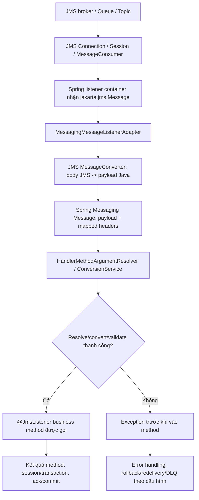

# Chuyển đổi dữ liệu trước khi gọi listener trong Spring JMS

## 1. Mục tiêu và câu hỏi trung tâm

Khi một JMS broker gửi `TextMessage` chứa JSON đến Spring, bạn có thể viết listener nhận một DTO Java mà không cần tự mở message, đọc chuỗi rồi gọi Jackson trong mọi handler:

```java
@JmsListener(destination = "orders.created")
public void onOrderCreated(OrderCreatedEvent event) {
    orderService.process(event);
}
```

Nhưng **ai đã biến JMS Message thành `OrderCreatedEvent` trước lúc `onOrderCreated` được gọi?** Lúc đó message có những header nào? Chuyện gì xảy ra nếu body không đúng schema, thiếu type identifier hoặc validator từ chối dữ liệu?

Bài này làm rõ **pipeline chuyển đổi đầu vào và ánh xạ tham số của listener**, từ `jakarta.jms.Message` đến method Java, cùng điểm cấu hình quan trọng trong Spring Framework / Spring Boot.

Sau bài học, bạn sẽ:

1. Phân biệt **nhận message**, **chuyển đổi message**, **resolve tham số listener**, **validate** và **xử lý nghiệp vụ**.
2. Biết khi nào `@JmsListener` nhận `String`, raw `TextMessage`, `org.springframework.messaging.Message<T>` hoặc DTO.
3. Hiểu vai trò khác nhau của `org.springframework.jms.support.converter.MessageConverter` và `org.springframework.messaging.converter.MessageConverter`.
4. Cấu hình `MappingJackson2MessageConverter` để đổi JSON `TextMessage` thành DTO, gắn và đọc type ID an toàn.
5. Viết được dự án Spring Boot 3.x / Java 17+ / Artemis gửi `OrderCreatedEvent` rồi nhận đúng DTO tại listener.
6. Biết phân loại conversion failure, validation failure, retry, transaction, DLQ và bảo vệ dữ liệu nhạy cảm.

> **Tóm tắt:** Listener container nhận **JMS Message** từ provider; adapter/converter của Spring chuẩn bị **payload và headers**; tầng xử lý argument lấy chúng và chuyển sang **kiểu tham số của method**; chỉ khi đủ điều kiện, Spring mới **gọi business listener**. Không có nghĩa mọi thông điệp đều phải deserialize thành DTO: kiểu method và converter được cấu hình quyết định bước nào cần xảy ra.

## 2. Khác biệt giữa JMS Message và payload của method

JMS có các dạng `jakarta.jms.Message` như:

- `TextMessage` chứa một `String`.
- `BytesMessage` chứa dãy byte.
- `MapMessage` chứa các cặp tên–giá trị trong **body** của MapMessage.
- `ObjectMessage` chứa đối tượng đã serialize theo API JMS; cần đặc biệt thận trọng với deserialize Java object từ nguồn không tin cậy.
- `StreamMessage` chứa các giá trị theo thứ tự.

Một JMS Message còn có **headers** (`JMSMessageID`, `JMSCorrelationID`, `JMSType`...) và **properties** do producer đặt. Body và metadata không phải cùng một vùng.

Ví dụ raw message có thể là:

```text
JMS TextMessage
  Body: {"eventId":"E162","orderId":"501","amountCents":2300}
  Property _type: "order.created.v1"
  Property eventType: "OrderCreated"
  Property schemaVersion: 1
  Header JMSMessageID: (provider gán)
```

Với Spring:

```java
@JmsListener(destination = "orders.created")
void handle(OrderCreatedEvent event) { ... }
```

method mong nhận **đối tượng Java**, không mong nhận `TextMessage`. Một adapter và converter phải hiểu cách đọc body và class đích. Khi method chỉ cần raw message:

```java
@JmsListener(destination = "orders.created")
void handle(jakarta.jms.TextMessage message) throws JMSException {
    String json = message.getText();
}
```

Spring có thể cung cấp **raw JMS argument** mà không buộc bạn sử dụng converter JSON cho tham số đó. Đây là một kiểu chữ ký khác, không phải lỗi.

### Bốn thành phần dễ nhầm

| Thành phần | Đầu vào / đầu ra | Đúng trách nhiệm |
| --- | --- | --- |
| `MessageListenerContainer` | Giao tiếp với broker / JMS provider | Tạo, duy trì consumer, nhận message, transaction/ack, concurrency, lifecycle và recovery. |
| Listener adapter của Spring | JMS Message → dạng message thuận tiện cho handler | Dùng converter thích hợp và gọi cơ chế xử lý annotated method. |
| `MessageConverter` | JMS Message ↔ payload Java | Đọc `TextMessage`/`BytesMessage`/etc. và dựng kiểu Java theo cấu hình. |
| `DefaultMessageHandlerMethodFactory` | Spring Messaging Message → method arguments | Resolve `@Payload`, `@Header`, `@Headers`, `Session`; chuyển đổi kiểu giá trị/validation khi cấu hình. |
| `@JmsListener` method | DTO / String / headers ... | Chạy nghiệp vụ sau khi hạ tầng chuyển đổi và resolve arguments thành công. |

**Message conversion không phải message acknowledgement.** Chuyển đổi thành công mới chỉ có nghĩa tạo được dữ liệu đầu vào cho handler. Việc commit/ack message phụ thuộc cấu hình Session, transaction manager, listener container và kết quả xử lý.

## 3. Pipeline từ broker đến phương thức listener

Hình sau diễn tả pipeline **khái niệm** của endpoint `@JmsListener`:



Các lớp cụ thể và một số đường rẽ thay đổi theo phiên bản, converter, signature và provider. Không diễn giải sơ đồ thành cam kết rằng mỗi message luôn phải chuyển đổi **hai lần**: nếu payload đã đúng type thì bước chuyển đổi kiểu ở argument resolver có thể không cần thao tác đáng kể.

### 3.1. Listener container nhận message trước

`DefaultMessageListenerContainer` là container thông dụng cho JMS listener. Nó tạo JMS consumers, nhận message từ broker, và dùng adapter do annotated listener infrastructure đăng ký.

Với `@JmsListener`, Spring tạo endpoint sau khi quét bean, dùng `JmsListenerContainerFactory` tương ứng để dựng container. `@EnableJms` bật infrastructure; Spring Boot có thể auto-configure khi JMS hiện diện. Nếu method không chỉ định `containerFactory`, tên mặc định thường là `jmsListenerContainerFactory`.

Container không cần biết class nghiệp vụ `OrderCreatedEvent` để nhận `TextMessage`. **Nó nhận JMS Message**, việc tạo DTO diễn ra ở tầng adapter/converter/argument resolution.

### 3.2. Adapter chuẩn bị Spring Messaging Message

Infrastructure của `@JmsListener` sử dụng adapter như `MessagingMessageListenerAdapter`. Với đường chuyển đổi thông dụng, adapter tạo một `org.springframework.messaging.Message<?>` từ JMS message: payload Java do JMS `MessageConverter` cung cấp, headers được map từ JMS headers/properties.

Đây là **một đối tượng Spring Messaging Message nội bộ**, không có nghĩa broker gửi hai thông điệp. Mục đích là đưa payload và headers vào API thống nhất để method resolver sử dụng.

### 3.3. Method argument resolution

Tầng `DefaultMessageHandlerMethodFactory` xây dựng các bộ phân giải tham số; ví dụ:

```java
@JmsListener(destination = "orders.created")
public void handle(
        @Payload OrderCreatedEvent event,
        @Header("eventType") String type,
        @Header("schemaVersion") int version) {
    // event: payload Java da duoc chuyen doi
    // type/version: message properties duoc map thanh header
}
```

`@Payload` chỉ rõ tham số lấy **payload**. `@Header` lấy metadata có tên tương ứng. Nếu kiểu header cần convert (ví dụ số nguyên), có thể dùng conversion service khi phù hợp.

Nếu thiếu header bắt buộc hoặc payload không đổi được thành kiểu yêu cầu, lời gọi có thể thất bại **trước khi method thực thi**.

### 3.4. Khi method đã được gọi, bước convert chính đã qua

Nếu một DTO được inject thành công, method không phải gọi `objectMapper.readValue(...)` chỉ để có lại cùng đối tượng đó. Tuy vậy **validate nghiệp vụ** vẫn phải được thực hiện: converter JSON chỉ tạo object; nó không bảo đảm đơn hàng tồn tại, có quyền xử lý, ID chưa được xử lý, hoặc amount hợp lệ.

## 4. Hai interface cùng tên MessageConverter nhưng khác tầng

Đây là bẫy quan trọng trong Spring.

### 4.1. Spring JMS MessageConverter

Tên đầy đủ:

```text
org.springframework.jms.support.converter.MessageConverter
```

Contract quan trọng:

```java
jakarta.jms.Message toMessage(
        Object object, jakarta.jms.Session session)
        throws jakarta.jms.JMSException;

Object fromMessage(jakarta.jms.Message message)
        throws jakarta.jms.JMSException;
```

Đây là **mảnh chữ ký API để học**, không phải source file bạn phải tự tạo. Hướng **`fromMessage`** liên quan trực tiếp bài này: chuyển một raw JMS Message thành Java object. Hướng `toMessage` dùng khi gửi qua `JmsTemplate.convertAndSend(...)` hoặc reply được chuyển đổi.

Spring có `SimpleMessageConverter` mặc định cho các kiểu cơ bản và `MappingJackson2MessageConverter` để chuyển JSON với Jackson.

### 4.2. Spring Messaging MessageConverter

Tên đầy đủ:

```text
org.springframework.messaging.converter.MessageConverter
```

Interface này làm việc với `org.springframework.messaging.Message<?>`, không nhận `jakarta.jms.Session`. Nó dùng trong xử lý message payload ở tầng Spring Messaging/handler arguments; `GenericMessageConverter` có thể sử dụng `ConversionService` để chuyển payload sang kiểu tham số nếu cần.

**Không import nhầm hai interface khi khai báo bean.** Với JSON/JMS trong ví dụ `@JmsListener` của bài này, bean cần là:

```java
import org.springframework.jms.support.converter.MessageConverter;
import org.springframework.jms.support.converter.MappingJackson2MessageConverter;
```

Đó là **JMS converter** mà Spring Boot có thể gắn vào `JmsTemplate` và listener container factory auto-configured. Việc tạo bean `org.springframework.messaging.converter.MessageConverter` riêng **không tương đương** và không tự bảo đảm JMS `TextMessage` được Jackson deserialize trước handler.

### 4.3. Vai trò của ConversionService và Validator

`DefaultMessageHandlerMethodFactory` có thể tùy chỉnh `ConversionService`, converter của Spring Messaging, custom argument resolvers và `Validator`. Những tùy chỉnh này xử lý **tham số phương thức** và validation; chúng không mặc nhiên thay `MappingJackson2MessageConverter` dùng để đọc JSON raw từ broker.

`@Valid` và `@Validated` có thể được sử dụng theo contract Spring Messaging, **nhưng phải kiểm tra validator thực sự được nối vào method factory**. Chỉ thêm annotation vào DTO mà không có hạ tầng validation thích hợp không đủ để cam kết message sẽ bị từ chối trước method trong mọi cấu hình.

## 5. SimpleMessageConverter: mặc định hỗ trợ gì?

`SimpleMessageConverter` là lựa chọn cơ bản trong Spring JMS:

| JMS Message | Java payload điển hình | Lưu ý |
| --- | --- | --- |
| `TextMessage` | `String` | Không tự parse JSON thành record/DTO tùy ý. |
| `BytesMessage` | `byte[]` | Consumer phải hiểu encoding/schema nếu muốn parse tiếp. |
| `MapMessage` | `Map` | Trường nằm trong body map, không tự thành object nghiệp vụ. |
| `ObjectMessage` | Object đã được JMS provider deserialize | Cần kiểm soát allowlist class, trust policy và rủi ro Java deserialization. |
| Không hỗ trợ/type khác | Phụ thuộc converter | Có thể báo `MessageConversionException` hoặc không có representation mong đợi. |

Ví dụ producer gửi:

```java
jmsTemplate.convertAndSend(
        "orders.created",
        "{\"eventId\":\"E162\",\"orderId\":\"501\"}");
```

Với `SimpleMessageConverter`, inbound `TextMessage` thường được chuyển thành **`String` chứa JSON**. Method nhận `String` hợp lý:

```java
@JmsListener(destination = "orders.created")
public void consume(String json) {
    // json la chuoi; chua phai DTO
}
```

Nhưng method này **không tự động** có `OrderCreatedEvent` chỉ vì chuỗi JSON có các field trùng tên record:

```java
@JmsListener(destination = "orders.created")
public void consume(OrderCreatedEvent event) { /* ... */ }
```

Để điều này chạy được, cấu hình **JMS converter JSON** hoặc hệ thống chuyển đổi tương ứng; không giả định Spring mặc định gọi Jackson trên mọi `String` payload.

### Kiểu tham số trực tiếp khác nhau

```java
// A: Chuỗi payload đã được SimpleMessageConverter lấy từ TextMessage.
@JmsListener(destination = "a.queue")
public void handleString(String body) { }

// B: Raw JMS message, dùng các API TextMessage/JMSException.
@JmsListener(destination = "b.queue")
public void handleRaw(jakarta.jms.TextMessage message) throws JMSException { }

// C: Spring Messaging Message, có payload và mapped headers.
@JmsListener(destination = "c.queue")
public void handleWrapped(
        org.springframework.messaging.Message<String> message) { }

// D: DTO - cần converter/schema hỗ trợ.
@JmsListener(destination = "d.queue")
public void handleDto(OrderCreatedEvent event) { }
```

Các method trên là **mảnh chữ ký minh họa**, cần đặt trong Spring bean, khai báo destination và converter phù hợp. Chúng không phải bốn listener chung một Queue, cũng không khẳng định mọi provider gửi `TextMessage` đều có thể tự chuyển sang mọi kiểu.

## 6. MappingJackson2MessageConverter: JSON thành DTO trước listener

`org.springframework.jms.support.converter.MappingJackson2MessageConverter` dùng Jackson để map Java object ↔ JSON trong JMS `BytesMessage` hoặc `TextMessage`. Hai cấu hình dễ bỏ sót:

1. **`setTargetType(MessageType.TEXT)`:** khi chuyển Java object sang JMS ở phía gửi, sử dụng `TextMessage` thay vì `BytesMessage` (mặc định của converter này thường là BYTES).
2. **`setTypeIdPropertyName("_type")`:** quy định **JMS property chứa type identifier** để converter biết Java class nào cần tạo khi xử lý inbound message.

Cấu hình nên kèm **type ID mapping allowlist**, tránh ghi tên class Java dài vào message và hạn chế việc producer ngoài ý muốn lựa chọn class tùy ý:

```java
import java.util.HashMap;
import java.util.Map;

import org.springframework.context.annotation.Bean;
import org.springframework.jms.support.converter.MappingJackson2MessageConverter;
import org.springframework.jms.support.converter.MessageConverter;
import org.springframework.jms.support.converter.MessageType;

@Bean
MessageConverter orderJmsConverter() {
    MappingJackson2MessageConverter converter =
            new MappingJackson2MessageConverter();
    converter.setTargetType(MessageType.TEXT);
    converter.setTypeIdPropertyName("_type");

    Map<String, Class<?>> typeIds = new HashMap<>();
    typeIds.put("order.created.v1", OrderCreatedEvent.class);
    converter.setTypeIdMappings(typeIds);
    return converter;
}
```

Đây là **mảnh cấu hình đặt trong `@Configuration` class** và project có `OrderCreatedEvent`. Không phải chương trình Java độc lập.

### 6.1. Type ID giúp inbound biết chọn Java class

Khi producer gửi `OrderCreatedEvent` qua chính converter này, JSON body được tạo và property `_type="order.created.v1"` được gắn theo mapping. Khi nhận, converter tra `_type` rồi chọn class đã map để Jackson deserialize.

```text
Producer Java object: OrderCreatedEvent
       |
       | Jackson serialization
       v
TextMessage BODY: {"eventId":"E162","orderId":"501","amountCents":2300}
JMS property: _type = "order.created.v1"
       |
       | fromMessage() + typeIdMappings
       v
Consumer Java object: OrderCreatedEvent("E162", "501", 2300)
       |
       v
@JmsListener(OrderCreatedEvent event)
```

**Thông điệp type ID là metadata, không phải một đoạn Java tự chạy.** Không nên dùng trực tiếp class name từ producer không tin cậy để deserialize tùy ý; version hóa mapping và hạn chế những class được phép. Ngay cả converter JSON cũng cần input size limits, schema validation và kiểm soát polymorphic typing/serializer.

### 6.2. Khi thiếu _type

Ví dụ một producer khác gửi raw JSON qua `session.createTextMessage(json)` nhưng **không** đặt JMS property `_type`:

```java
jmsTemplate.send("orders.created", session ->
        session.createTextMessage(
                "{\"eventId\":\"E162\",\"orderId\":\"501\","
              + "\"amountCents\":2300}"));
```

Nếu listener đang dùng `MappingJackson2MessageConverter` cấu hình type ID như trên, inbound converter **không thể tự suy ra class từ body** theo contract này và thường ném `MessageConversionException` trước khi gọi `@JmsListener(OrderCreatedEvent)`.

Đây là lỗi **metadata/schema hợp đồng gửi–nhận**, không phải chứng cứ JSON body thiếu field. Giải pháp: cả producer và consumer dùng converter/contract nhất quán hoặc set type identifier hợp lệ khi gửi raw message.

### 6.3. Khi có _type nhưng body không hợp lệ

Thông điệp có `_type="order.created.v1"` nhưng body `"{broken json"` không thể được Jackson parse thành DTO. Converter thất bại **trước khi handler bắt đầu**. Đừng đặt `try/catch` chỉ bên trong `onOrderCreated` rồi kỳ vọng bắt được lỗi deserialize: method chưa được gọi.

### 6.4. JSON hợp lệ vẫn có thể sai nghiệp vụ

Một JSON hợp lệ với `amountCents=-1` có thể map thành record có số âm nếu record không tự validate. Đó là lý do **chuyển đổi thành công khác validation thành công**. Cần kiểm tra invariant ngay ở constructor/record, sử dụng Jakarta Bean Validation được nối đúng, hoặc validate business ở handler tùy mục tiêu và chính sách error handling.

## 7. Spring Boot: converter được nối với template và listener như thế nào?

Trong Spring Boot 3.x, khi JMS infrastructure phù hợp tồn tại:

- Boot có thể tự tạo `ConnectionFactory` kết nối Artemis, `JmsTemplate` để gửi và default `JmsListenerContainerFactory` cho `@JmsListener`.
- **Bean thuộc `org.springframework.jms.support.converter.MessageConverter`** được Boot auto-configured template và default listener factory sử dụng.
- Với custom `DefaultJmsListenerContainerFactory` tự tạo, bạn phải **gắn converter lên chính factory đó**, hoặc gọi `DefaultJmsListenerContainerFactoryConfigurer.configure(...)` để kế thừa các giá trị Boot, rồi override có chủ đích.
- Nếu `@JmsListener(containerFactory="specialFactory")` trỏ tới custom factory khác, không được suy đoán nó dùng converter của default factory.
- Nếu bạn tự khai báo `@Bean JmsTemplate`, cần xem Bean đó đã `setMessageConverter(...)` chưa; cấu hình converter trên listener không tự đổi producer tùy biến.

Spring hướng dẫn chính thức có ví dụ Bean `MappingJackson2MessageConverter` và factory dùng `DefaultJmsListenerContainerFactoryConfigurer` để copy auto-configured defaults.

### 7.1. Ví dụ custom factory đúng

```java
import jakarta.jms.ConnectionFactory;
import org.springframework.boot.autoconfigure.jms.DefaultJmsListenerContainerFactoryConfigurer;
import org.springframework.context.annotation.Bean;
import org.springframework.jms.config.DefaultJmsListenerContainerFactory;
import org.springframework.jms.support.converter.MessageConverter;

@Bean("typedListenerFactory")
DefaultJmsListenerContainerFactory typedListenerFactory(
        ConnectionFactory connectionFactory,
        DefaultJmsListenerContainerFactoryConfigurer configurer,
        MessageConverter jmsConverter) {

    DefaultJmsListenerContainerFactory factory =
            new DefaultJmsListenerContainerFactory();
    configurer.configure(factory, connectionFactory);
    factory.setMessageConverter(jmsConverter);
    return factory;
}
```

Đây là **đoạn cấu hình trong Spring Boot 3.x**, không phải Java file độc lập. Khi dùng, chú ý Boot khuyến nghị unwrap `CachingConnectionFactory` nếu cần listener container có connection riêng để recovery; phiên bản/thư viện thực tế có thể dùng `ConnectionFactoryUnwrapper.unwrapCaching(connectionFactory)`. Ví dụ chỉ nhấn mạnh việc **gắn converter và dùng factory cụ thể**.

Dùng nó:

```java
@JmsListener(
        destination = "orders.created",
        containerFactory = "typedListenerFactory")
public void onOrderCreated(OrderCreatedEvent event) {
    // JSON body da duoc chuyen doi thanh DTO
}
```

Trong ví dụ runnable ngay dưới, **không cần custom factory**: sử dụng Bean JMS `MessageConverter` và để Boot gắn vào auto-configured factory mặc định.

## 8. Dự án runnable: Java 17, Spring Boot 3.3.5 và ActiveMQ Artemis

Mục đích: gửi Java record `OrderCreatedEvent` bằng `JmsTemplate.convertAndSend`; converter Jackson tạo JSON `TextMessage` và `_type`; Spring nhận rồi chuyển về **record** trước khi gọi `@JmsListener`. Listener cũng nhận hai JMS properties thông qua `@Header`.

### 8.1. Điều kiện chạy

- JDK 17+, Maven 3.6.3+, Docker.
- Cổng local `61616` chưa bị sử dụng.
- Artemis broker demo chạy bên ngoài JVM.
- Môi trường mới hoặc Queue `demo.orders.typed.162` sạch, một instance app, để stdout không bị trộn với backlog cũ.

Khởi động broker:

```bash
docker run --detach --rm --name artemis-conversion-demo \
  -e ARTEMIS_USER=artemis \
  -e ARTEMIS_PASSWORD=artemis \
  -p 127.0.0.1:61616:61616 \
  -p 127.0.0.1:8161:8161 \
  apache/artemis:latest-alpine
```

Đợi sẵn sàng bằng:

```bash
docker logs artemis-conversion-demo
```

Docker container là **broker tách biệt** với app. Credentials demo chỉ dùng trong môi trường thử nghiệm cục bộ; production cần secret, quyền broker và TLS/network policy phù hợp. Nếu Queue auto-create bị vô hiệu hóa thì chuẩn bị destination đúng trước.

### 8.2. Cấu trúc project

```text
jms-inbound-conversion-demo/
├── pom.xml
└── src/main/
    ├── java/demo/inbound/
    │   ├── InboundConversionApplication.java
    │   ├── OrderCreatedEvent.java
    │   └── OrderListener.java
    └── resources/application.properties
```

### 8.3. pom.xml

```xml
<project xmlns="http://maven.apache.org/POM/4.0.0"
         xmlns:xsi="http://www.w3.org/2001/XMLSchema-instance"
         xsi:schemaLocation="http://maven.apache.org/POM/4.0.0 https://maven.apache.org/xsd/maven-4.0.0.xsd">
    <modelVersion>4.0.0</modelVersion>
    <parent>
        <groupId>org.springframework.boot</groupId>
        <artifactId>spring-boot-starter-parent</artifactId>
        <version>3.3.5</version>
        <relativePath/>
    </parent>

    <groupId>demo</groupId>
    <artifactId>jms-inbound-conversion-demo</artifactId>
    <version>1.0.0</version>

    <properties>
        <java.version>17</java.version>
    </properties>

    <dependencies>
        <dependency>
            <groupId>org.springframework.boot</groupId>
            <artifactId>spring-boot-starter-artemis</artifactId>
        </dependency>
        <dependency>
            <groupId>org.springframework.boot</groupId>
            <artifactId>spring-boot-starter-json</artifactId>
        </dependency>
    </dependencies>
    <build>
        <plugins>
            <plugin>
                <groupId>org.springframework.boot</groupId>
                <artifactId>spring-boot-maven-plugin</artifactId>
            </plugin>
        </plugins>
    </build>
</project>
```

`spring-boot-starter-artemis` cung cấp JMS client và Spring JMS. `spring-boot-starter-json` cung cấp Jackson cần cho JSON converter. Không thêm `artemis-jakarta-server` vì Artemis đang chạy ở container riêng.

### 8.4. application.properties

```properties
spring.artemis.mode=native
spring.artemis.broker-url=tcp://localhost:61616
spring.artemis.user=artemis
spring.artemis.password=artemis

# Queue, khong phai Topic
spring.jms.pub-sub-domain=false
```

Lưu ý: nếu chính **ứng dụng** chạy trong Docker container khác, `localhost` bên trong ứng dụng không trỏ tới Artemis container; hãy dùng DNS hostname/port broker có thể truy cập được.

### 8.5. OrderCreatedEvent.java

```java
package demo.inbound;

public record OrderCreatedEvent(
        String eventId,
        String orderId,
        int amountCents) {
}
```

Đây là Java 17 record có cấu trúc đơn giản để Jackson deserialize. Trong project thật, cần xác định schema version, validation, trường được phép và xử lý thay đổi version.

### 8.6. InboundConversionApplication.java

```java
package demo.inbound;

import java.util.HashMap;
import java.util.Map;
import java.util.concurrent.TimeUnit;

import org.springframework.boot.ApplicationRunner;
import org.springframework.boot.SpringApplication;
import org.springframework.boot.autoconfigure.SpringBootApplication;
import org.springframework.context.annotation.Bean;
import org.springframework.jms.annotation.EnableJms;
import org.springframework.jms.core.JmsTemplate;
import org.springframework.jms.support.converter.MappingJackson2MessageConverter;
import org.springframework.jms.support.converter.MessageConverter;
import org.springframework.jms.support.converter.MessageType;

@SpringBootApplication
@EnableJms
public class InboundConversionApplication {

    public static void main(String[] args) {
        SpringApplication.run(InboundConversionApplication.class, args);
    }

    @Bean
    MessageConverter jacksonJmsMessageConverter() {
        MappingJackson2MessageConverter converter =
                new MappingJackson2MessageConverter();
        converter.setTargetType(MessageType.TEXT);
        converter.setTypeIdPropertyName("_type");

        Map<String, Class<?>> types = new HashMap<>();
        types.put("order.created.v1", OrderCreatedEvent.class);
        converter.setTypeIdMappings(types);
        return converter;
    }

    @Bean
    ApplicationRunner demoPublisher(
            JmsTemplate jmsTemplate, OrderListener listener) {
        return args -> {
            OrderCreatedEvent event =
                    new OrderCreatedEvent("E162", "501", 2300);

            jmsTemplate.convertAndSend(
                    "demo.orders.typed.162", event, message -> {
                        message.setStringProperty(
                                "eventType", "OrderCreated");
                        message.setIntProperty("schemaVersion", 1);
                        return message;
                    });

            if (!listener.await(10, TimeUnit.SECONDS)) {
                throw new IllegalStateException(
                        "Timed out waiting for converted JMS event");
            }
            System.out.println("DEMO: completed");
        };
    }
}
```

Lúc `convertAndSend`:

1. `JmsTemplate` nhận đối tượng `OrderCreatedEvent`.
2. Bean `MappingJackson2MessageConverter` tạo JSON thành `TextMessage` vì `MessageType.TEXT`.
3. Converter tự đặt property `_type="order.created.v1"` theo type mapping.
4. `MessagePostProcessor` trong overload này đặt thêm `eventType` và `schemaVersion` cho consumer/quan sát.
5. `JmsTemplate` gửi message tới Queue trên Artemis.

Nếu thay `convertAndSend` bằng `send(..., session -> session.createTextMessage(json))` mà không tự đặt `_type`, inbound converter sẽ thiếu thông tin cần để ánh xạ Java class.

### 8.7. OrderListener.java

```java
package demo.inbound;

import java.util.concurrent.CountDownLatch;
import java.util.concurrent.TimeUnit;

import org.springframework.jms.annotation.JmsListener;
import org.springframework.messaging.handler.annotation.Header;
import org.springframework.messaging.handler.annotation.Payload;
import org.springframework.stereotype.Component;

@Component
public class OrderListener {

    private final CountDownLatch received = new CountDownLatch(1);

    @JmsListener(destination = "demo.orders.typed.162")
    public void handle(
            @Payload OrderCreatedEvent event,
            @Header("eventType") String eventType,
            @Header("schemaVersion") int schemaVersion) {

        System.out.println(
                "EVENT: " + event.eventId()
                + "/" + event.orderId()
                + "/" + event.amountCents());
        System.out.println(
                "METADATA: " + eventType + "/v" + schemaVersion);
        received.countDown();
    }

    public boolean await(long timeout, TimeUnit unit)
            throws InterruptedException {
        return received.await(timeout, unit);
    }
}
```

`OrderListener` không import `jakarta.jms.TextMessage` và không gọi `ObjectMapper`. Trước khi `handle` chạy, Spring đã có thể chuyển đổi raw JMS TextMessage thành `OrderCreatedEvent` và lấy metadata vào parameters.

`@Payload` là annotation của `org.springframework.messaging.handler.annotation.Payload`, không phải annotation JMS. `@Header` cũng thuộc Spring Messaging, phản ánh cách Spring thống nhất argument resolution cho nhiều transport.

### 8.8. Lệnh chạy và stdout mong đợi

Từ thư mục `jms-inbound-conversion-demo`, khi Artemis đã sẵn sàng:

```bash
mvn spring-boot:run
```

Trong điều kiện Queue sạch, broker kết nối được và các library tương thích, ba dòng **do chính demo in ra** là:

```text
EVENT: E162/501/2300
METADATA: OrderCreated/v1
DEMO: completed
```

Spring Boot, Maven và Artemis có thể ghi thêm log. `CountDownLatch` giúp dòng `DEMO` xuất hiện sau hai dòng do listener in. Nếu conversion thất bại thì handler không chạy và demo có thể timeout; không nên giả vờ output thành công trong tình huống lỗi.

**Tại sao đây là kiểm chứng conversion trước listener?** Method có kiểu `OrderCreatedEvent` và các trường `eventId/orderId/amountCents` đã là giá trị Java khi handler nhận. Đó không phải một chuỗi JSON mà listener tự parse. Ngoài ra, hai `@Header` đã được resolve từ JMS message properties.

Dừng ứng dụng bằng `Ctrl+C`. Dừng broker demo:

```bash
docker stop artemis-conversion-demo
```

Container chạy với `--rm` và không mount volume không nhằm mục đích kiểm thử persistence qua xóa container.

## 9. Một cách khác: nhận raw message rồi tự parse

Nếu bên gửi không hỗ trợ contract `_type`, hoặc bạn cần chủ động xác định schema từ một nguồn bên ngoài, có thể nhận raw `TextMessage` và tự parse:

```java
import com.fasterxml.jackson.databind.ObjectMapper;
import jakarta.jms.JMSException;
import jakarta.jms.TextMessage;
import org.springframework.jms.annotation.JmsListener;

public class RawOrderHandler {
    private final ObjectMapper mapper;

    public RawOrderHandler(ObjectMapper mapper) {
        this.mapper = mapper;
    }

    @JmsListener(destination = "orders.raw")
    public void handle(TextMessage message) throws Exception {
        String text = message.getText();
        OrderCreatedEvent event =
                mapper.readValue(text, OrderCreatedEvent.class);
        // validate, process event...
    }
}
```

Đây là **mảnh code minh họa**; để hoạt động thực tế, class phải là Spring bean (`@Component` hoặc `@Bean`) và bạn phải có Queue `orders.raw`, `ObjectMapper` và xử lý lỗi. Khi dùng raw method, **conversion trong đoạn mã ứng dụng** xảy ra **sau khi method được gọi**, khác với cơ chế converter trước method ở phần 8.

**Trade-off:**

- Ưu: kiểm soát schema/validation đặc thù, đọc headers native, chọn class dựa trên source/version một cách tường minh.
- Nhược: lặp logic parse giữa nhiều listener, dễ bỏ sót error handling, tăng coupling với JMS API và khó thống nhất metadata.
- Nếu muốn phần lớn handler chỉ xử lý DTO, nên đưa logic mapping vào một `MessageConverter` được test kỹ.

## 10. Chuyển đổi headers, type ID và method arguments

### 10.1. @Header và @Headers

Ví dụ:

```java
@JmsListener(destination = "orders.created")
public void handle(
        @Payload OrderCreatedEvent event,
        @Header("eventType") String eventType,
        @Header("schemaVersion") Integer schemaVersion,
        @Headers java.util.Map<String, Object> headers) {
    // ...
}
```

`@Headers` lấy tập mapped headers. Raw JMS properties/headers có những tên chuẩn được Spring mapper biểu diễn bằng `JmsHeaders`. Nếu dự án cần kiểm tra chính xác `JMSMessageID` hay correlation, hãy dùng tên chuẩn `JmsHeaders` hoặc raw JMS Message, không suy đoán string key.

Không đưa token, PII hoặc payload nhạy cảm vào metadata chỉ để dễ inject `@Header`: properties thường có thể được hiển thị trong broker console, logs và DLQ.

### 10.2. Kiểu header không đúng

Nếu producer đặt:

```java
message.setStringProperty("schemaVersion", "one");
```

nhưng listener yêu cầu `int schemaVersion`, bước argument conversion có thể thất bại **trước method**. Nếu chỉ đặt `"1"` dạng String, một số conversion service có thể chuyển đổi sang int, nhưng không coi đó là JMS property schema portable cho tất cả đường đi. Hợp đồng rõ ràng nhất là:

```java
message.setIntProperty("schemaVersion", 1);
```

### 10.3. Mapping type ID cho nhiều phiên bản

Có thể dùng các IDs ổn định:

```java
Map<String, Class<?>> typeIds = new HashMap<>();
typeIds.put("order.created.v1", OrderCreatedEventV1.class);
typeIds.put("order.created.v2", OrderCreatedEventV2.class);
converter.setTypeIdMappings(typeIds);
```

Đây là mảnh code cấu hình, cần có các class V1/V2 và converter. Consumer cần biết cách xử lý cả hai version hoặc chuyển sang internal model chung. **Đổi tên class Java** không nên khiến message cũ trong broker/DLQ không thể replay; IDs tách khỏi class name giúp giảm coupling.

### 10.4. Type ID không đồng nghĩa authorization

Dù JMS property `_type` được map tới class trong allowlist, một producer không đáng tin vẫn có thể đặt type ID hợp lệ nhưng body độc hại/cỡ lớn. Converter không thay thế RBAC, policy tối đa body, schema validation, payload sanitization và idempotency.

## 11. Bean Validation sau chuyển đổi, trước nghiệp vụ

Một DTO hợp lệ về JSON chưa chắc hợp lệ về mặt dữ liệu:

```json
{"eventId":"","orderId":"","amountCents":-10}
```

Jackson có thể tạo object tương ứng; `@Valid` có thể được sử dụng để áp Bean Validation khi infrastructure method handler có Validator.

Ví dụ DTO riêng:

```java
import jakarta.validation.constraints.Min;
import jakarta.validation.constraints.NotBlank;

public record ValidatedOrderEvent(
        @NotBlank String eventId,
        @NotBlank String orderId,
        @Min(0) int amountCents) {
}
```

Trong project thực tế, cần dependency như `spring-boot-starter-validation` và đưa `Validator` vào `DefaultMessageHandlerMethodFactory`. Ví dụ cấu hình (thêm như một `@Configuration` class, project đã có `@EnableJms`):

```java
import org.springframework.context.annotation.Configuration;
import org.springframework.jms.annotation.JmsListenerConfigurer;
import org.springframework.jms.config.JmsListenerEndpointRegistrar;
import org.springframework.messaging.handler.annotation.support.DefaultMessageHandlerMethodFactory;
import org.springframework.validation.Validator;

@Configuration
public class ListenerValidationConfig implements JmsListenerConfigurer {
    private final Validator validator;

    public ListenerValidationConfig(Validator validator) {
        this.validator = validator;
    }

    @Override
    public void configureJmsListeners(
            JmsListenerEndpointRegistrar registrar) {
        DefaultMessageHandlerMethodFactory factory =
                new DefaultMessageHandlerMethodFactory();
        factory.setValidator(validator);
        registrar.setMessageHandlerMethodFactory(factory);
    }
}
```

Sau đó:

```java
@JmsListener(destination = "validated.orders")
public void handle(@Valid @Payload ValidatedOrderEvent event) {
    // Validator phải được cấu hình đúng trước khi vào method.
}
```

**Chú ý:** Ví dụ validation là một **mô hình cấu hình bổ sung**, không tự ghép chung vào demo phần 8 mà bỏ qua dependency/import/schema. `@Valid` ở đây là `jakarta.validation.Valid`; không có validator thì không bảo đảm kiểm tra như kỳ vọng. Conversion exception và validation exception đều có thể xảy ra **trước** lời gọi nghiệp vụ.

## 12. Khi conversion thất bại, chuyện gì xảy ra với message?

Một lỗi có thể phát sinh ở các vị trí khác nhau:

```text
JMS message được giao
   |
   +-- Không đúng loại JMS Message? -- conversion fail
   |
   +-- JSON sai? -- converter/Jackson fail
   |
   +-- _type thiếu/không hợp lệ? -- type resolution fail
   |
   +-- Header bắt buộc thiếu/sai kiểu? -- argument resolution fail
   |
   +-- Bean Validation không đạt? -- validation fail
   |
   +-- Tất cả hợp lệ
         |
         +--> method @JmsListener chạy
                 |
                 +--> nghiệp vụ thành công hoặc thất bại
```

**Mọi lỗi trước dòng cuối đều có thể khiến business method chưa được gọi.** Đặt `try/catch` trong listener không thể xử lý một exception xảy ra trước khi listener được gọi. Cần error handling ở listener container/adapter, broker retry/DLQ và observability phù hợp.

### 12.1. Redelivery không do converter quyết định

Nếu container dùng **transacted JMS Session**, thất bại của listener pipeline thường khiến transaction bị rollback để message có thể được giao lại theo chính sách provider. Nếu container dùng non-transacted acknowledgement mode, kết quả có thể khác và thậm chí message bị coi đã acknowledge trong một số đường lỗi. Vì vậy không được trả lời cứng “JSON sai chắc chắn được retry” hoặc “converter lỗi chắc chắn mất tin” mà chưa biết cấu hình container.

Spring Boot mặc định thường cấu hình listener factory transacted khi phù hợp; **custom factory** tự tạo có thể có mặc định khác. Đọc runtime settings thực tế: `sessionTransacted`, transaction manager, ack mode, error handler, max deliveries, DLQ.

### 12.2. Poison message và vòng lặp retry

Message bị lỗi **cố định** như JSON hỏng, type ID không hỗ trợ hay schema vi phạm validation hiếm khi trở nên hợp lệ chỉ nhờ retry cùng dữ liệu. Nếu broker liên tục redeliver, consumer có thể tạo nhiều log, tăng pending và chiếm tài nguyên.

Cần phân loại:

| Nhóm lỗi | Ví dụ | Hướng thường dùng |
| --- | --- | --- |
| **Permanent conversion failure** | JSON hỏng, class ID không tồn tại, type mismatch cố định | Retry có giới hạn, đưa DLQ/quarantine, alert và quy trình sửa/replay. |
| **Schema/business validation failure** | ID trống, version không hỗ trợ, amount âm | Từ chối theo contract, DLQ hoặc audit có kiểm soát; không retry vô hạn. |
| **Transient infrastructure** | DB tạm lỗi, broker reconnect, service khác timeout | Retry/backoff có giới hạn, idempotent consumer. |
| **Security failure** | Message từ producer không có quyền, type ID bất thường | Audit/deny, cô lập payload, không log nội dung nhạy cảm. |

Một conversion failure có thể phát sinh trước khi method in dòng đầu tiên; vì thế **không thấy business log không chứng minh broker không giao message**.

### 12.3. ErrorHandler ở listener container

`DefaultMessageListenerContainer` có thể được cấu hình `ErrorHandler` để ghi nhận lỗi sau khi listener/pipeline thất bại. Ví dụ định hướng (mảnh Spring configuration):

```java
factory.setErrorHandler(error ->
        logger.warn("JMS listener failed; inspect error category"));
```

`factory` phải là bean container factory thực, `logger` được khai báo, đoạn mã trên không phải file độc lập. Không in raw JMS body, secrets, full payload hay type-id từ nguồn không tin cậy vào logs. **ErrorHandler chỉ là một phần observability; nó không tự định nghĩa transactional rollback, DLQ hoặc số lần retry.**

### 12.4. Tránh mất thông điệp khi gửi cùng transaction DB

Khi handler bắt đầu ghi database, việc hoàn tất hoặc rollback JMS cần phối hợp với transaction DB nếu nghiệp vụ yêu cầu. Một local JMS transaction **không tự động** làm commit database và JMS atomic. Xem xét transactional outbox/inbox hoặc coordinator phù hợp. Lỗi conversion trước handler cũng phải được ghi nhận để không “nuốt” message rồi ack sai.

## 13. Ranh giới với MessageListenerAdapter và manual listener

Spring JMS có nhiều cách nhận:

| Cách nhận | Cơ chế convert điển hình | Khi nào chọn |
| --- | --- | --- |
| `@JmsListener` với DTO | `MessagingMessageListenerAdapter` và JMS converter + argument resolver | Ưu tiên cho handler kiểu Java, metadata và validation. |
| `@JmsListener` với `String` | Simple converter lấy text body, nếu đúng type | Logic text đơn giản, converter ít cấu hình. |
| `@JmsListener` với raw `Message` | Raw JMS argument được hỗ trợ | Cần đọc API JMS native hoặc parse đặc thù. |
| `MessageListenerAdapter` delegate POJO | Delegate method + `MessageConverter` (mặc định `SimpleMessageConverter`) | Tích hợp theo kiểu adapter cũ/không dùng annotation. |
| `jakarta.jms.MessageListener.onMessage(Message)` | Listener nhận raw JMS Message trực tiếp | Tự kiểm soát parse/adapter, ít tiện ích method binding. |
| `SessionAwareMessageListener` | Raw message + JMS Session | Khi cần JMS Session phục vụ phản hồi/logic nâng cao. |

Với `MessageListenerAdapter` POJO delegate, `setMessageConverter(null)` có thể tắt tự động trích xuất content để truyền raw JMS Message cho delegate theo đúng contract adapter. Nhưng điều này **không có nghĩa** đặt `setMessageConverter(null)` lên mọi loại factory/adapter đều là cách chuẩn để bật DTO binding; cần xem chính xác class đang dùng.

**Không nhầm** `MessageListenerAdapter` với `MessagingMessageListenerAdapter` của annotated endpoint; tên gần nhau nhưng pipeline và method resolution khác.

## 14. Kiểm thử chính xác “trước khi gọi listener”

### 14.1. Happy-path integration test

Dùng broker thật, gửi DTO bằng converter chính thức, xác minh:

1. `TextMessage` trên broker chứa JSON đúng schema.
2. Property `_type` đúng giá trị mapping.
3. `@JmsListener(OrderCreatedEvent, @Header...)` nhận DTO và header đúng kiểu.
4. Handler được gọi đúng số lần kỳ vọng trong trường hợp không có redelivery.
5. Message hoàn tất theo transaction/ack contract.

Không chỉ test `JmsTemplate.convertAndSend` trả về không ném lỗi; nó **không chờ consumer xử lý xong**.

### 14.2. Unit test cho JMS converter

Không cần khởi động toàn bộ Spring app nếu chỉ muốn test logic converter. Mock `Session` và `TextMessage`/`BytesMessage` bằng Mockito, hoặc dùng provider test object tương thích, sau đó test:

```java
converter.toMessage(
        new OrderCreatedEvent("E162", "501", 2300),
        session);

Object restored = converter.fromMessage(textMessage);
```

Đây là **mảnh code test**, cần biến `converter`, `session` và `textMessage` từ kết quả mock hoặc message thật, không thể chạy riêng. Test type ID/property và malformed JSON. Unit test chỉ kiểm chứng converter, không chứng minh broker routing và listener factory wiring.

### 14.3. Test khi thiếu _type

Gửi raw `TextMessage` không có type identifier vào Queue mà listener dùng Jackson converter. Kỳ vọng **conversion error ở tầng trước handler**, nhưng cần kiểm tra trong log/metrics của container, không mong handler bắt exception.

Test nên sử dụng Queue riêng, nhận biết message bị retry, áp policy DLQ có giới hạn; không để message lỗi chạy vô hạn làm nhiễu những test khác.

### 14.4. Test không cùng kiểu DTO

Dùng `_type="order.created.v1"` nhưng JSON bị thiếu field, sai type hoặc có một number vượt giới hạn. **Không khẳng định mọi trường hợp thiếu field mặc nhiên gây exception**: Jackson có default/null cho một số trường hoặc record constructor vẫn tạo object. Cần kiểm chứng contract serialization, Bean Validation và invariant cụ thể.

### 14.5. Test header mapping

Producer đặt:

```java
message.setStringProperty("eventType", "OrderCreated");
message.setIntProperty("schemaVersion", 1);
```

Consumer inject:

```java
@Header("eventType") String eventType,
@Header("schemaVersion") int schemaVersion
```

Kiểm tra cả trường hợp property vắng mặt, sai tên phân biệt hoa/thường, sai value type, và custom header mapper. Không nhầm **JMS message selector** (chọn message trước khi giao) với **method @Header argument resolver** (đọc metadata của message đã được giao).

### 14.6. Test validator

Với bean `Validator` thực sự được nối vào `DefaultMessageHandlerMethodFactory`, tạo DTO vi phạm `@NotBlank`/`@Min`. Xác minh handler không chạy khi validation failure và message được xử lý theo transaction/retry policy mong muốn. Nếu bỏ config validator mà test vẫn “qua”, đừng suy đoán annotation đã bảo vệ dữ liệu.

## 15. Những lỗi phổ biến và cách chẩn đoán

| Triệu chứng | Nguyên nhân thường gặp | Cách khắc phục |
| --- | --- | --- |
| `@JmsListener(OrderEvent)` không được gọi dù Queue có tin | JSON converter/type mapping chưa cấu hình, listener khác factory hoặc lỗi conversion | Kiểm tra listener factory, converter bean, `_type`, logs trước method. |
| `@JmsListener(String)` lại nhận JSON text thay vì DTO | `SimpleMessageConverter` trả `String` | Dùng DTO + JMS Jackson converter hoặc parse chủ động sau nhận. |
| `Could not find type id property [_type]` | Raw sender không gắn property trong khi converter yêu cầu | Gắn `_type` theo contract hoặc dùng cơ chế mapping khác. |
| `Cannot construct instance` | DTO constructor/schema/Jackson settings không phù hợp | Kiểm tra record/POJO public, field types và Jackson version. |
| Converter vẫn dùng `BytesMessage` dù mong `TextMessage` | `MappingJackson2MessageConverter` mặc định target BYTES | Gọi `setTargetType(MessageType.TEXT)`. |
| Bean `MessageConverter` tồn tại nhưng default listener không sử dụng | Import nhầm Spring Messaging converter hoặc custom factory không kế thừa Boot config | Kiểm tra FQCN converter, cấu hình factory thực tế. |
| Producer gửi DTO nhưng receiver thấy property `_type` là tên class Java | Không đặt type ID mappings | Dùng stable IDs qua `setTypeIdMappings`, cập nhật cả hai phía. |
| `@Header("schemaVersion") int` không lấy được | Header thiếu, sai kiểu, sai mapping | Gắn đúng `setIntProperty`; test argument resolver và header mapper. |
| `@Valid` không ngăn DTO sai | Thiếu validator hoặc chưa nối method factory | Thêm validation dependency và cấu hình factory; kiểm tra test case sai. |
| Log trong handler không xuất hiện nhưng broker có redelivery | Lỗi ở converter/argument resolver trước method | Xem listener container exception, message ID an toàn và DLQ. |
| Chỉ một lần gửi nhưng có nhiều log listener | Transaction rollback/redelivery hoặc listener khác | Kiểm tra ack/commit, retry, concurrency, idempotency. |
| Container có `@JmsListener` nhưng không nhận | Sai Queue/Topic, listener factory, broker URL hoặc quyền | Kiểm tra ConnectionFactory, `pubSubDomain`, destination, container status. |
| Spring Boot properties không ảnh hưởng tới bean | Custom `JmsTemplate`/factory đã tự tạo | Gắn converter tường minh và kiểm tra bean được inject. |
| Custom converter parse JSON nhưng ghi PII ra logs khi lỗi | Exception hoặc debug log chứa payload | Log error category/size và ID an toàn; hạn chế body trong traces/DLQ. |
| Dùng `ObjectMessage` để nhận DTO cho tiện | Java native deserialization không phù hợp dữ liệu không tin cậy | Ưu tiên JSON/Avro/Protobuf có allowlist và giới hạn. |
| Dùng Spring Boot 3 với `javax.jms.Message` | Jakarta namespace đã thay đổi | Import `jakarta.jms.*` đúng và provider tương thích. |

### Quy trình debug theo thứ tự

**Bước 1:** Có kết nối broker và destination đúng chưa? Kiểm tra `spring.artemis.mode`, broker URL, credentials, Queue/Topic, consumer count.

**Bước 2:** Listener có được Spring đăng ký không? Kiểm tra `@EnableJms`/auto-config, `@JmsListener`, tên `containerFactory`, lifecycle/registry và logs.

**Bước 3:** Raw JMS message là `TextMessage` hay `BytesMessage`? Body thực là JSON hay String thường, type id và properties có không? Không log toàn bộ body nhạy cảm.

**Bước 4:** Converter nào được gắn vào **listener factory thực sự**? Có `MappingJackson2MessageConverter`, `targetType`, `typeIdPropertyName` và mappings đúng không?

**Bước 5:** Chữ ký handler có yêu cầu `@Payload`, `@Header`, `@Headers`, `Session` hoặc raw JMS Message? Kiểu có khớp không?

**Bước 6:** Có bean validation và method factory config không? Dữ liệu sai có bị chặn trước method không?

**Bước 7:** Error handler, sessionTransacted, retry, DLQ, message ID an toàn và metric conversion failure có hoạt động không?

**Bước 8:** Tách test “conversion lỗi trước method” và “business method ném lỗi” để đặt policy retry đúng cho từng loại.

## 16. Bảo mật và tối ưu hiệu năng của inbound conversion

- **Kiểm soát input size:** `getText()`/deserialize có thể cấp phát body lớn trước khi application kiểm tra. Giới hạn ở ingress/broker/producer và schema, không chỉ đo `String.length()` trong handler.
- **Type allowlist:** mappings ổn định như `order.created.v1`, không cho producer không tin cậy tùy ý chỉ định Java class được deserialize.
- **Không đưa secrets vào JMS headers/properties:** type ID, event type, correlation có thể xuất hiện ở broker console, logging, DLQ.
- **Không log raw malformed JSON:** Jackson exception đôi khi chứa đoạn dữ liệu đầu vào. Dùng category và metadata an toàn để chẩn đoán.
- **Không coi converter là validation:** converter chỉ tạo Java object; validate schema/business riêng.
- **Kiểm tra memory/CPU:** JSON parse lặp lại, DTO quá lớn và header mappings phức tạp có thể giảm throughput. Đo queue depth, conversion latency, GC, DLQ rate.
- **Không lạm dụng ObjectMessage:** Java deserialization từ message không tin cậy có rủi ro; cần chính sách class allowlist/trust nếu bắt buộc dùng.
- **Idempotency:** converter trước method không bảo đảm message chỉ được xử lý một lần; redelivery và retry vẫn có thể xảy ra.

## 17. Câu hỏi tự kiểm tra

**Câu 1.** Spring nhận `TextMessage` JSON và `@JmsListener` khai báo `OrderCreatedEvent`. Ai biến JSON thành DTO?

**Đáp án:** JMS `MessageConverter` được cấu hình trên listener adapter/container factory (ví dụ `MappingJackson2MessageConverter`), sau đó handler method factory resolve tham số. Không mặc nhiên là do method tự gọi Jackson.

**Câu 2.** `SimpleMessageConverter` mặc định có tự chuyển mọi JSON `String` thành Java record không?

**Đáp án:** Không. Nó chủ yếu map loại JMS cơ bản như `TextMessage → String`. Muốn DTO JSON cần converter/schema thích hợp.

**Câu 3.** Vì sao cấu hình `setTypeIdPropertyName("_type")` khi nhận DTO bằng `MappingJackson2MessageConverter`?

**Đáp án:** Nó cho converter biết JMS property nào chứa type identifier để xác định Java class đích khi deserialize.

**Câu 4.** Không đặt `setTargetType(MessageType.TEXT)` thì producer Jackson converter thường tạo TextMessage hay BytesMessage?

**Đáp án:** Mặc định converter thường tạo **BytesMessage**; muốn JSON trong TextMessage phải đặt target type TEXT.

**Câu 5.** Một message có `_type` hợp lệ nhưng JSON hỏng. `@JmsListener` có chạy rồi mới ném exception không?

**Đáp án:** Thường không; lỗi phát sinh trong converter **trước khi method được gọi**. Cần theo dõi container error handling.

**Câu 6.** `@Header("schemaVersion")` đọc giá trị ở body JSON hay JMS property?

**Đáp án:** Đọc header/property đã được JMS-to-Spring header mapper ánh xạ, không mở JSON body.

**Câu 7.** Đặt `@Valid` lên DTO có đủ để bảo đảm dữ liệu được validation trước method không?

**Đáp án:** Chỉ khi Bean Validation dependency và `Validator`/method handler infrastructure được cấu hình đúng, đã kiểm chứng trong test.

**Câu 8.** Tại sao mã handler không bắt được một số lỗi deserialization?

**Đáp án:** Vì handler **chưa được gọi**; conversion/argument resolution thất bại ở infrastructure trước nó.

**Câu 9.** Có thể nhận `jakarta.jms.Message` trực tiếp trong annotated listener không?

**Đáp án:** Có. Raw JMS Message/Session là những kiểu argument Spring JMS hỗ trợ; bạn có thể tự parse, nhưng khi đó chuyển đổi thủ công diễn ra trong handler.

**Câu 10.** Lỗi JSON cố định nên retry vô hạn hay đưa DLQ sau chính sách giới hạn?

**Đáp án:** Không retry vô hạn. Thiết kế max deliveries, DLQ/quarantine, cảnh báo và quy trình sửa/replay an toàn.

**Câu 11.** Producer có type ID `order.created.v2` nhưng consumer chỉ map v1; có phải lỗi broker connectivity không?

**Đáp án:** Không. Đây là lỗi schema/type mapping, thường xảy ra sau khi JMS message được giao và trước khi listener business chạy.

**Câu 12.** Converter thành công có bảo đảm đơn hàng đã được xử lý/DB commit không?

**Đáp án:** Không. Conversion, validation, business processing và JMS acknowledgement/transaction là các giai đoạn khác nhau.

## 18. Kết luận

**Chuyển đổi dữ liệu trước khi gọi listener** nghĩa là hạ tầng Spring chuẩn bị **Java payload và arguments** từ **raw JMS Message** *trước khi* gọi method gắn `@JmsListener`. Với payload đơn giản, `SimpleMessageConverter` đủ để lấy `String`/`byte[]`. Với DTO JSON, cấu hình `MappingJackson2MessageConverter` và **type ID mapping** phù hợp; Spring Boot có thể dùng Bean converter đó cho `JmsTemplate` và default listener factory. Tầng method handler tiếp tục resolve `@Payload`, `@Header` và validation nếu đã được cấu hình.

Ba nguyên tắc phải nhớ:

1. **Converter fail → method có thể chưa từng chạy.** Error handling cần được đặt ở container/pipeline, không chỉ trong method.
2. **Converter không thay validator hay transaction.** DTO được tạo không đồng nghĩa dữ liệu hợp lệ hoặc message đã được xử lý hoàn tất.
3. **Sender và listener phải thống nhất type/schema/property contract.** Test cả đường thành công lẫn JSON sai, type ID thiếu, header mismatch, redelivery và DLQ.

## Nguồn tham khảo chính thức

- [Spring Framework – Annotation-driven Listener Endpoints: supported parameters, DefaultMessageHandlerMethodFactory](https://docs.spring.io/spring-framework/reference/integration/jms/annotated.html)
- [Spring Framework – Receiving a Message: MessageListenerAdapter và raw JMS support](https://docs.spring.io/spring-framework/reference/integration/jms/receiving.html)
- [Spring Framework – JMS sending/conversion](https://docs.spring.io/spring-framework/reference/integration/jms/sending.html)
- [Spring Boot 3.4 – JMS: MessageConverter và listener container factory auto-configuration](https://docs.spring.io/spring-boot/3.4/reference/messaging/jms.html)
- [Spring Guide – Messaging with JMS: converter JSON trước @JmsListener](https://spring.io/guides/gs/messaging-jms/)
- [Spring Framework 6.2 API – MappingJackson2MessageConverter (setTargetType, setTypeIdPropertyName, setTypeIdMappings)](https://docs.spring.io/spring-framework/docs/6.2.15/javadoc-api/org/springframework/jms/support/converter/MappingJackson2MessageConverter.html)
- [Spring Framework 6.2 API – SimpleMessageConverter](https://docs.spring.io/spring-framework/docs/6.2.15/javadoc-api/org/springframework/jms/support/converter/SimpleMessageConverter.html)
- [Spring Framework 6.2 API – DefaultMessageHandlerMethodFactory](https://docs.spring.io/spring-framework/docs/6.2.15/javadoc-api/org/springframework/messaging/handler/annotation/support/DefaultMessageHandlerMethodFactory.html)
- [Jakarta Messaging 3.1 – JMS Message interfaces](https://jakarta.ee/specifications/messaging/3.1/apidocs/jakarta.messaging/jakarta/jms/message)
- [Apache ActiveMQ Artemis – Docker](https://artemis.apache.org/components/artemis/documentation/latest/docker.html)
