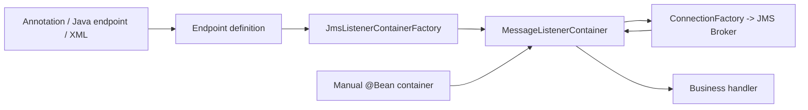
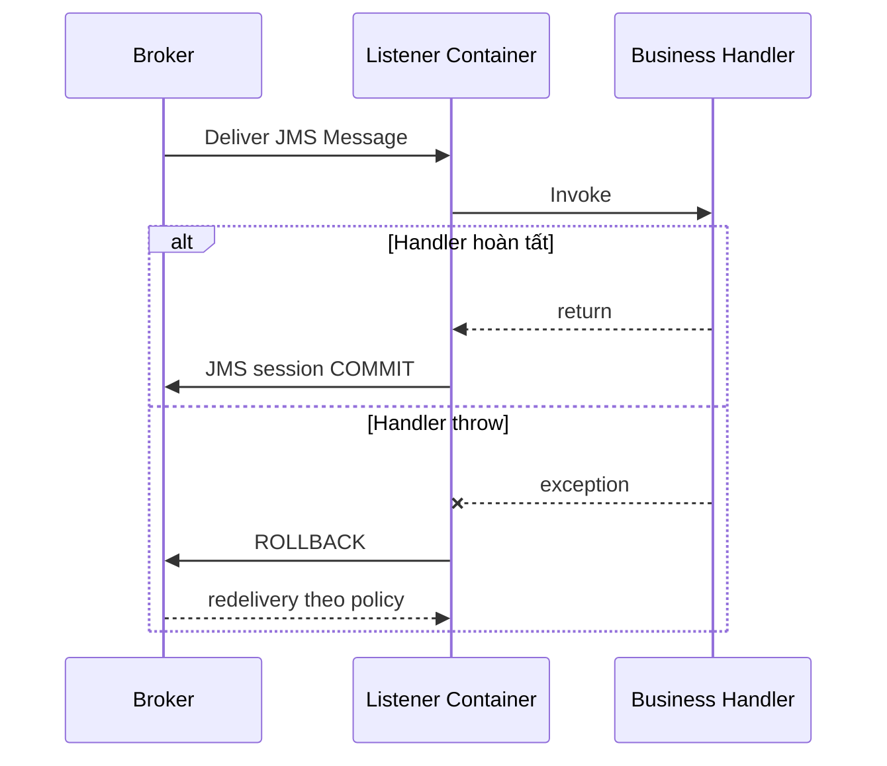

# So sánh các cách khai báo listener trong Spring JMS

> **Chủ đề:** Spring Framework – JMS · **Nhóm:** Listener và container.  
> **Mục tiêu:** Hiểu **cách đăng ký điểm nhận thông điệp** và **container thực sự chạy listener** là hai việc khác nhau. So sánh `@JmsListener`, `jakarta.jms.MessageListener`, `SessionAwareMessageListener`, `MessageListenerAdapter`, đăng ký endpoint bằng Java, XML namespace và các container Spring; chọn cách phù hợp theo loại message, khả năng kiểm soát, giao dịch, recovery, cấu hình động và tính dễ bảo trì. Bài dùng Jakarta JMS, Spring Framework 6.1, Spring Boot 3.3.5 và Java 21.

## 1. Ba lớp đằng sau một listener

Khi nghe “khai báo listener”, thường có ba quyết định độc lập:

1. **Business handler:** phương thức hoặc object nào xử lý dữ liệu? Nhận `String`/DTO hay raw `jakarta.jms.Message`?
2. **Endpoint registration:** Spring biết **destination, selector, ID, subscription và handler** bằng annotation, Java config, XML hay đăng ký động?
3. **Runtime container:** thành phần nào tạo `Connection`, `Session`, `MessageConsumer`, nhận message, điều phối thread, giao dịch, khôi phục kết nối và đóng tài nguyên?



Với `@JmsListener` hoặc `JmsListenerConfigurer`, Spring dùng `JmsListenerContainerFactory` tạo container cho endpoint; `JmsListenerEndpointRegistry` quản lý vòng đời những container đó. Với `@Bean DefaultMessageListenerContainer` khai báo trực tiếp, **container chính là bean** và không tự động trở thành một endpoint trong registry kia.

**Không nên đồng nhất:**

- `@JmsListener` **không phải** một consumer chạy trên thread gọi annotation.
- `MessageListener` **không tự chạy** chỉ vì có một `@Component` implements interface này; nó phải được nối với container hoặc provider consumer.
- `MessageListenerAdapter` **không tạo connection**; nó chuyển JMS callback đến một delegate method.
- `DefaultJmsListenerContainerFactory` **không phải** `DefaultMessageListenerContainer`: cái thứ nhất tạo cái thứ hai theo cấu hình.
- `JmsTemplate.receive(...)` là **synchronous receive** của thread gọi, không phải một cách đăng ký listener bất đồng bộ.

## 2. Bảng so sánh nhanh: chọn API nào?

| Cách khai báo | Handler nhận | Ai tạo container? | Khi nên dùng | Cần chú ý |
| --- | --- | --- | --- | --- |
| **`@JmsListener`** | Method nhận `String`, DTO, raw `Message`, `Session`, `@Header`... | Infrastructure dùng `JmsListenerContainerFactory` | **Mặc định nên chọn** trong Spring Boot; ít boilerplate, dễ đọc và test | Converter, tên factory, selector/transaction thực tế |
| **`MessageListener` + container bean** | `onMessage(jakarta.jms.Message)` | Bạn tự đăng ký `DefaultMessageListenerContainer`/`SimpleMessageListenerContainer` | Cần đọc header/body native hoặc tích hợp thư viện JMS | Checked `JMSException` phải xử lý; nhiều infrastructure code |
| **`SessionAwareMessageListener` + container bean** | `onMessage(Message, Session)` | Bạn tự đăng ký container hỗ trợ Spring interface | Cần dùng cùng `Session` để tạo reply/message | Interface Spring-specific; không áp dụng cho mọi JCA listener container |
| **`MessageListenerAdapter` + container bean** | POJO method như `receiveText(String)` | Container tự đăng ký hoặc XML cấu hình | Di trú hệ thống cũ, muốn handler POJO không có annotation | Default method `handleMessage`, converter của adapter và reply semantics |
| **`JmsListenerConfigurer` + `SimpleJmsListenerEndpoint`** | `MessageListener` do code gắn vào endpoint | `JmsListenerEndpointRegistry` dùng factory | Danh sách endpoint được tạo từ cấu hình lúc startup | Cần ID duy nhất; callback raw, factory phải tồn tại |
| **Đăng ký runtime bằng registry API** | `JmsListenerEndpoint` | `JmsListenerEndpointRegistry.registerListenerContainer(...)` | Tạo endpoint khi ứng dụng đã chạy theo quản trị rõ ràng | Quản lý ID/lifecycle, quyền cấp phát và nguồn cấu hình |
| **XML `<jms:listener-container>`** | Bean delegate và method hoặc raw listener | Spring JMS XML namespace tạo container/adapter | Ứng dụng Spring XML hiện hữu cần bảo trì | XML nhiều cấu hình, khó khám phá bằng IDE hơn annotation |

Không có cách nào tự động làm message “an toàn hơn” chỉ nhờ cú pháp. **ACK/commit, concurrency, retry, DLQ, converter, connection recovery** phần lớn phụ thuộc loại container, broker và thiết lập, không phải tên annotation.

### Quy tắc chọn nhanh

- Hầu hết ứng dụng Spring Boot mới: **`@JmsListener` + factory mặc định hoặc factory có tên riêng**.
- Cần raw `Message` và `Session`: thử **`@JmsListener(Message, Session)` trước**; chỉ xuống interface thấp hơn khi thật sự cần.
- Muốn gắn trực tiếp một callback theo JMS API: **`MessageListener` + `DefaultMessageListenerContainer`**.
- Đã có POJO delegate/namespace XML: **`MessageListenerAdapter`** hoặc `<jms:listener>`, tránh refactor lớn nếu không cần.
- Định nghĩa destination đến từ cấu hình khi start: **`JmsListenerConfigurer`**.
- Phải cấp phát endpoint sau khi ứng dụng đang chạy: **registry API** với kiểm soát vận hành.

## 3. Cách 1 — `@JmsListener`: cách khai báo chuẩn trong Spring Boot

Ví dụ đơn giản nhất:

```java
@Component
class OrderListener {

    @JmsListener(destination = "orders.incoming")
    public void receive(String content) {
        System.out.println("ANNOTATED " + content);
    }
}
```

Đây là **mảnh class** để đặt trong một ứng dụng có Spring component scanning và JMS infrastructure; import `org.springframework.stereotype.Component` và `org.springframework.jms.annotation.JmsListener`.

Spring tìm method được annotate, tạo endpoint và thông qua factory tạo listener container. Đối tượng `OrderListener` thường là **singleton bean**; nhiều container consumer threads có thể cùng gọi method ấy, nên state mutable phải an toàn concurrent.

### 3.1. Bật hạ tầng listener

Trong Spring Framework thuần:

```java
@Configuration
@EnableJms
class JmsConfiguration {
    // Các bean ConnectionFactory/factory phù hợp sẽ được đăng ký.
}
```

Dùng imports `org.springframework.context.annotation.Configuration` và `org.springframework.jms.annotation.EnableJms`. Trong Spring Boot có JMS starter, auto-configuration thường bật annotation infrastructure cho bạn; đặt `@EnableJms` tường minh vẫn hữu ích khi học hoặc chuyển sang cấu hình Spring thuần.

Nếu `@JmsListener` **không chỉ rõ factory**, Spring JMS thường tìm bean có tên:

```text
jmsListenerContainerFactory
```

Spring Boot thường auto-configure factory này nếu chưa có một factory do ứng dụng đăng ký phù hợp. Không thể chỉ khai báo annotation trong một project thiếu JMS provider/ConnectionFactory và kỳ vọng receiver tự kết nối.

### 3.2. Chữ ký method linh hoạt

Spring Framework có thể đưa vào method:

- Payload `String` hoặc DTO Java thông qua converter.
- `jakarta.jms.Message`/`TextMessage` raw để đọc headers/properties.
- `jakarta.jms.Session` cho các tác vụ native JMS cần cùng session.
- `org.springframework.messaging.Message<T>`, `@Header`, `@Headers` khi muốn trừu tượng hóa metadata.
- `@Payload` hoặc `@Valid` khi đã cấu hình chuyển đổi/validation tương thích.

```java
@JmsListener(destination = "orders.incoming")
public void consume(
        String body,
        @Header("eventType") String eventType,
        jakarta.jms.Session session) {
    System.out.println(eventType + ": " + body);
}
```

Đây là **fragment**, cần import `org.springframework.messaging.handler.annotation.Header`; property `eventType` phải thực sự có trong message. Đừng kỳ vọng JSON field `eventType` trong body tự biến thành JMS property. Method có thể ném exception khi payload/metadata không hợp lệ.

### 3.3. ID, selector và factory riêng

```java
@JmsListener(
    id = "priorityOrderConsumer",
    destination = "orders.incoming",
    selector = "priorityClass = 'HIGH'",
    containerFactory = "priorityListenerFactory")
public void receiveHighPriority(String body) {
    // Xử lý hàng ưu tiên cao.
}
```

- `id` giúp định danh container để tra trong `JmsListenerEndpointRegistry`.
- `destination` phải là destination đã resolve/provision phù hợp trên broker; dùng tên string không tự bảo đảm queue vật lý.
- `selector` được broker/provider đánh giá trên **JMS headers/properties**, không phải JSON body.
- `containerFactory` trỏ đến bean `JmsListenerContainerFactory` **theo tên**; nếu sai tên có thể lỗi khi khởi tạo.
- Nếu đặt nhiều `@JmsListener` cho một method (annotation repeatable), mỗi khai báo là một endpoint; đừng nghĩ đó là broadcast mặc định nếu các endpoint cùng đọc một queue.

### 3.4. Trả reply bằng `@SendTo` khi cần

```java
@JmsListener(destination = "quote.requests")
@SendTo("quote.replies")
public String quote(String request) {
    return "ACK:" + request;
}
```

Đây là **fragment**; `@SendTo` có import `org.springframework.messaging.handler.annotation.SendTo`. Spring sẽ chuyển return value thành JMS reply theo cơ chế reply handling; destination có thể chịu ảnh hưởng bởi `JMSReplyTo` trong request hoặc default reply destination. Đừng đặt return value ở listener rồi mặc định nó trở thành message gửi lại nếu adapter/reply configuration không hỗ trợ.

Với luồng event một chiều, thường để method trả `void`, có tracing/correlation và một event/status riêng khi nghiệp vụ cần xác nhận.

## 4. `JmsListenerContainerFactory`: nơi cấu hình chung cho annotation

Một cấu hình Spring Framework trực tiếp:

```java
@Configuration
@EnableJms
class ListenerFactoryConfig {

    @Bean("jmsListenerContainerFactory")
    DefaultJmsListenerContainerFactory defaultFactory(
            ConnectionFactory connectionFactory) {

        DefaultJmsListenerContainerFactory factory =
                new DefaultJmsListenerContainerFactory();

        factory.setConnectionFactory(connectionFactory);
        factory.setPubSubDomain(false);       // queue
        factory.setSessionTransacted(true);  // JMS local transaction
        factory.setConcurrency("1-3");      // mở rộng có giới hạn
        return factory;
    }
}
```

Fragment này cần import `jakarta.jms.ConnectionFactory`, `org.springframework.jms.config.DefaultJmsListenerContainerFactory` và các annotations. Đây là **cấu hình thay thế**, không thêm nguyên xi vào project demo ở mục 11 vốn dùng factory mặc định Boot.

**Ý nghĩa:**

- Factory dùng **ConnectionFactory** để container tạo consumer resources.
- `setSessionTransacted(true)` làm callback hoàn tất thành công thì JMS session commit; exception thường dẫn tới rollback/redelivery theo broker policy.
- `setConcurrency("1-3")` không bảo đảm sẽ luôn có 3 consumers, không bảo đảm thứ tự xử lý hay tăng throughput gấp 3.
- Với topic subscription thường không tùy tiện tăng concurrent consumers lên nhiều như queue; semantics fan-out/shared/durable phải được thiết kế riêng.
- Factory này tạo containers khi Spring phát hiện endpoints; bản thân nó không phải một listener nhận message.

### Boot tự cấu hình và nhiều factory

Spring Boot 3.3.x tự cung cấp factory mặc định thông qua auto-configuration khi điều kiện phù hợp. Nếu muốn thêm factory thứ hai, có thể dùng `DefaultJmsListenerContainerFactoryConfigurer` để mang các settings Boot sang factory mới:

```java
@Bean("batchListenerFactory")
DefaultJmsListenerContainerFactory batchFactory(
        ConnectionFactory connectionFactory,
        DefaultJmsListenerContainerFactoryConfigurer configurer) {

    ConnectionFactory listenerConnectionFactory = connectionFactory;

    if (connectionFactory instanceof CachingConnectionFactory cache
            && cache.getTargetConnectionFactory() != null) {
        listenerConnectionFactory = cache.getTargetConnectionFactory();
    }

    DefaultJmsListenerContainerFactory factory =
            new DefaultJmsListenerContainerFactory();
    configurer.configure(factory, listenerConnectionFactory);
    factory.setConcurrency("2-4");
    return factory;
}
```

Imports cần thiết gồm `org.springframework.boot.autoconfigure.jms.DefaultJmsListenerContainerFactoryConfigurer`, `org.springframework.jms.connection.CachingConnectionFactory` và `jakarta.jms.ConnectionFactory`; fragment đặt trong `@Configuration`.

**Lưu ý version:** Spring Boot **3.4** mới có helper `org.springframework.boot.jms.ConnectionFactoryUnwrapper`. Không import lớp đó trong project Boot **3.3.5**; nếu cần unwrap wrapper ở 3.3, kiểm tra instance và `getTargetConnectionFactory()` như trên. Với listener container, ưu tiên **native ConnectionFactory** cho lifecycle/recovery; tự dùng caching ConnectionFactory cho listener có thể gây hạn chế khi stop/restart/dynamic scaling. Phải chọn chính sách giao dịch/converter nhất quán.

## 5. Cách 2 — triển khai trực tiếp `jakarta.jms.MessageListener`

JMS chuẩn định nghĩa interface:

```java
public interface MessageListener {
    void onMessage(jakarta.jms.Message message);
}
```

Đây là **chữ ký minh họa**, không phải source thay thế package `jakarta.jms`. Với Java, bạn có thể implement:

```java
package com.example.jms;

import jakarta.jms.JMSException;
import jakarta.jms.Message;
import jakarta.jms.MessageListener;
import jakarta.jms.TextMessage;

public final class RawMessageHandler implements MessageListener {

    @Override
    public void onMessage(Message message) {
        if (!(message instanceof TextMessage text)) {
            throw new IllegalArgumentException(
                    "Expected TextMessage");
        }

        try {
            String body = text.getText();
            System.out.println("RAW " + body);
        } catch (JMSException ex) {
            throw new IllegalStateException(
                    "Cannot read JMS message", ex);
        }
    }
}
```

File `RawMessageHandler.java` là một class có thể biên dịch khi project có Jakarta JMS API. Nó **chưa tự nhận message**: cần một JMS consumer từ provider hoặc một Spring listener container.

Đăng ký một `DefaultMessageListenerContainer` để container quản lý callback:

```java
@Bean("rawListenerContainer")
DefaultMessageListenerContainer rawListenerContainer(
        ConnectionFactory connectionFactory,
        RawMessageHandler handler) {

    DefaultMessageListenerContainer container =
            new DefaultMessageListenerContainer();

    container.setConnectionFactory(connectionFactory);
    container.setDestinationName("demo.raw");
    container.setMessageListener(handler);
    container.setSessionTransacted(true);
    container.setConcurrentConsumers(1);
    return container;
}
```

Đây là **fragment `@Bean`**, cần đăng ký `RawMessageHandler` thành Spring bean, có import `DefaultMessageListenerContainer` và đặt trong class `@Configuration`; không gắn thêm vào demo ở mục 11 vì sẽ tạo một queue/consumer thứ tư không được bài demo gửi message.

**Ưu điểm:** tích hợp tốt với callback native Java/JMS, toàn quyền đọc `Message`, headers và typed properties. **Đổi lại:** chính bạn chịu trách nhiệm cấu hình container, converter không tự biến message thành DTO và callback `onMessage` không khai báo checked `JMSException` nên cần xử lý/wrap exception.

## 6. Cách 3 — `SessionAwareMessageListener` khi cần cùng JMS Session

Spring cung cấp:

```java
public interface SessionAwareMessageListener<M extends Message> {
    void onMessage(M message, Session session) throws JMSException;
}
```

Đây là chữ ký mô tả; `SessionAwareMessageListener` thuộc `org.springframework.jms.listener`, các type `Message`/`Session`/`JMSException` thuộc `jakarta.jms`.

Ví dụ fragment:

```java
SessionAwareMessageListener<TextMessage> replyHandler =
        (incoming, session) -> {
            String request = incoming.getText();
            TextMessage reply =
                    session.createTextMessage("ACK:" + request);
            // Nếu cần trả về, hãy định tuyến reply theo JMSReplyTo
            // qua producer gắn vào cùng Session và quản lý tài nguyên.
        };
```

**Khác `MessageListener`:** callback nhận luôn `Session` do container quản lý, có thể tạo message/reply cùng JMS transaction context. Trong fragment trên `reply` mới được **tạo nhưng chưa gửi**; không được mô tả nó như chức năng request/reply đã hoàn chỉnh.

**Khác `@JmsListener`:** method annotated cũng có thể inject `jakarta.jms.Session` khi dùng hạ tầng annotated phù hợp. Vì vậy không nhất thiết phải chọn `SessionAwareMessageListener` chỉ để có access tới session.

**Giới hạn:** `SessionAwareMessageListener` là API riêng Spring, được hỗ trợ bởi `DefaultMessageListenerContainer`/`SimpleMessageListenerContainer` nhưng có thể không được hỗ trợ trong một số JCA-based listener container. Tránh đưa `Session` ra thread khác hoặc giữ lâu sau callback.

## 7. Cách 4 — `MessageListenerAdapter`: gọi method của POJO

Một service thuần có thể chỉ có:

```java
@Component
class LegacyOrderDelegate {

    public void receiveText(String content) {
        System.out.println("ADAPTER " + content);
    }
}
```

Thay vì sửa class để implement `MessageListener` hoặc thêm `@JmsListener`, có thể tạo adapter:

```java
@Bean
MessageListenerAdapter legacyAdapter(LegacyOrderDelegate delegate) {
    MessageListenerAdapter adapter =
            new MessageListenerAdapter(delegate);
    adapter.setDefaultListenerMethod("receiveText");
    return adapter;
}
```

Khi gắn adapter làm `messageListener` của container, nó dùng converter (mặc định `SimpleMessageConverter`) để chuyển `TextMessage` thành `String`, rồi gọi delegate `receiveText(String)`.

**Điểm dễ sai:** tên listener method mặc định của `MessageListenerAdapter` là **`handleMessage`**, không phải `onMessage`. Nếu POJO khai báo `receiveText`, phải gọi `setDefaultListenerMethod("receiveText")`. Nếu method return một giá trị không null, adapter có thể tạo **JMS reply** theo cơ chế reply destination/`JMSReplyTo`; method `void` trong ví dụ không sinh reply.

### MessageListenerAdapter và @JmsListener đều nhận POJO nhưng khác nhau

| Đặc điểm | `@JmsListener` | `MessageListenerAdapter` |
| --- | --- | --- |
| Khai báo trên method | Có, rõ destination, selector/factory | Không bắt buộc; cấu hình adapter/container bên ngoài |
| Conversion | Hạ tầng annotated và message converter được factory gắn | Adapter có converter của riêng nó |
| Chữ ký method | Hỗ trợ payload, raw JMS, Spring Messaging `Message`, `@Header`, `Session` | Thường một payload argument theo converter; hỗ trợ tuỳ biến adapter |
| Reply | Return value với `@SendTo`, `JmsResponse`... | Return value và default reply destination/`JMSReplyTo` |
| Cấu hình runtime | Factory+registry | Container bean/namespace |
| Phù hợp | Code mới, rõ ràng | Legacy POJO, di trú XML, reuse delegate |

Không nhầm annotation trong producer với adapter: `JmsTemplate.convertAndSend` và `@JmsListener` là hai nhánh khác nhau, converter cần được cấu hình tương thích cho send/receive dù bạn dùng kiểu listener nào.

## 8. Cách 5 — `JmsListenerConfigurer`: khai báo endpoint bằng code

Khi danh sách listener phụ thuộc cấu hình deploy hoặc cần sinh endpoint theo domain, `JmsListenerConfigurer` cho phép đăng ký bằng Java mà **không dùng `@JmsListener` ở method**.

Ví dụ:

```java
@Configuration
@EnableJms
class ProgrammaticListenerConfig implements JmsListenerConfigurer {

    @Override
    public void configureJmsListeners(
            JmsListenerEndpointRegistrar registrar) {

        SimpleJmsListenerEndpoint endpoint =
                new SimpleJmsListenerEndpoint();
        endpoint.setId("programmedEvents");
        endpoint.setDestination("events.programmed");
        endpoint.setMessageListener(message -> {
            // Chấp nhận raw jakarta.jms.Message.
            System.out.println("A JMS message arrived");
        });

        registrar.registerEndpoint(endpoint);
    }
}
```

Imports: `org.springframework.jms.annotation.JmsListenerConfigurer`, `org.springframework.jms.config.JmsListenerEndpointRegistrar`, `org.springframework.jms.config.SimpleJmsListenerEndpoint`, `org.springframework.jms.annotation.EnableJms` và `org.springframework.context.annotation.Configuration`. Đây là **fragment cấu hình**, cần một `JmsListenerContainerFactory` mặc định (hoặc truyền factory cụ thể cho `registerEndpoint`) cùng ConnectionFactory.

**Cơ chế:** registrar tạo model endpoint (ID, destination, listener), rồi `JmsListenerEndpointRegistry` dùng factory dựng container và điều khiển lifecycle. Đây là **đăng ký tại startup**, không có nghĩa ứng dụng tự theo dõi file config rồi tạo/xóa consumer mỗi khi file thay đổi.

### Khi nào nên dùng programmatic registration?

- Số endpoints có thể suy ra từ một danh sách cấu hình được **biết tại startup**.
- Cần đăng ký nhiều endpoints nhưng không muốn nhân bản hàng chục annotations tĩnh.
- Có một platform library chịu trách nhiệm tạo các consumers có naming/selector chung.
- Cần callback native `MessageListener` nhưng vẫn muốn container do registry quản lý.

Nếu các destination đến từ người dùng hoặc nguồn không tin cậy, **không** lấy chuỗi tên tùy ý rồi tạo listener tự động: cần allowlist, quyền cấp phát, giới hạn số consumers, quota và kiểm soát endpoint ID. Tạo hàng nghìn endpoints có thể tiêu hao thread/session và ảnh hưởng broker.

## 9. Đăng ký hoặc quản lý endpoint khi runtime: `JmsListenerEndpointRegistry`

Spring dùng `org.springframework.jms.config.JmsListenerEndpointRegistry` quản lý các containers tạo qua annotation/endpoint infrastructure.

Ví dụ lấy container có ID:

```java
// Fragment: JmsListenerEndpointRegistry registry đã được inject.
var container =
        registry.getListenerContainer("priorityOrderConsumer");

if (container != null) {
    container.stop();
    // Sau khi thay đổi/triển khai phù hợp, có thể container.start().
}
```

Lệnh `stop()` làm consumer ngừng nhận, **không xóa queue**. Nếu broker đã có message, backlog có thể tăng khi container dừng. Đừng viết code tự stop toàn bộ production listener chỉ để thử.

Nếu thật sự phải đăng ký **sau khi ứng dụng đã chạy**, registry hỗ trợ method:

```java
// Fragment quản trị runtime; cần registry và factory sẵn có.
SimpleJmsListenerEndpoint endpoint =
        new SimpleJmsListenerEndpoint();
endpoint.setId("dynamicAlertListener");
endpoint.setDestination("alerts.dynamic");
endpoint.setMessageListener(message -> {
    System.out.println("DYNAMIC");
});

registry.registerListenerContainer(
        endpoint, listenerFactory, true);
```

`listenerFactory` ở đây là `JmsListenerContainerFactory<?>` thích hợp; `true` yêu cầu start ngay nếu điều kiện lifecycle cho phép. Đây **không phải** cơ chế CRUD tự động: Spring sẽ từ chối ID trùng và API registry có các giới hạn lifecycle riêng. Nếu cần loại bỏ/sửa endpoints khi runtime, phải thiết kế rõ stop, shutdown, release resources, cấu hình lại và recreate/đăng ký lại trong phạm vi API được hỗ trợ; không chỉ sửa annotation trong source lúc app đang chạy.

**Quan trọng:** containers tạo bởi registry **không phải beans trực tiếp** trong `ApplicationContext`. Không cố inject chúng theo `DefaultMessageListenerContainer` rồi cho rằng mọi `@JmsListener` đều có bean tên giống endpoint ID. Với container tạo bằng `@Bean` thủ công, quản lý bean qua Spring lifecycle/`ApplicationContext`; nó không tự xuất hiện trong danh sách IDs của registry.

## 10. Cách 6 — XML namespace: phù hợp cấu hình Spring cũ

Spring JMS hỗ trợ namespace `jms`; ví dụ đầy đủ khung XML cấu hình (cần `connectionFactory` bean hợp lệ được đăng ký ở một cấu hình khác):

```xml
<?xml version="1.0" encoding="UTF-8"?>
<beans xmlns="http://www.springframework.org/schema/beans"
       xmlns:xsi="http://www.w3.org/2001/XMLSchema-instance"
       xmlns:jms="http://www.springframework.org/schema/jms"
       xsi:schemaLocation="
         http://www.springframework.org/schema/beans
         https://www.springframework.org/schema/beans/spring-beans.xsd
         http://www.springframework.org/schema/jms
         https://www.springframework.org/schema/jms/spring-jms.xsd">

    <bean id="legacyHandler"
          class="com.example.legacy.LegacyHandler"/>

    <jms:listener-container
            connection-factory="connectionFactory"
            acknowledge="transacted">
        <jms:listener
                destination="orders.incoming"
                ref="legacyHandler"
                method="receiveText"/>
    </jms:listener-container>
</beans>
```

Điều kiện: `com.example.legacy.LegacyHandler` phải có phương thức phù hợp tên `receiveText`, bean `connectionFactory` phải tồn tại, và provider/broker/queue sẵn sàng. Đây là **ví dụ cấu hình XML độc lập**, không được trộn nguyên xi với project demo ở mục 11 hoặc trỏ đến một class không có trong repo rồi kỳ vọng runnable.

- `<jms:listener-container>` cấu hình container dùng chung.
- `<jms:listener>` định nghĩa endpoint delegate/method, tương đương ý tưởng dùng container và `MessageListenerAdapter` thủ công.
- `acknowledge="transacted"` dùng local JMS transaction theo container config.
- Có thể cấu hình `selector`, `concurrency`, destination resolver và transaction manager theo XML namespace.
- `<jms:annotation-driven/>` chỉ bật **annotation-driven listener endpoints**, không tự tạo business handlers.

Trong Spring Boot dự án mới, cấu hình bằng Java và `@JmsListener` thường dễ đọc và refactor hơn. XML hữu ích khi di trú/duy trì một hệ thống cấu hình XML sẵn có; không có lợi ích giao dịch đặc biệt chỉ vì dùng XML.

## 11. Khác biệt lớn: `DefaultMessageListenerContainer` và `SimpleMessageListenerContainer`

Hai container đều là Spring listener containers, nhưng cơ chế nhận khác nhau:

| Tiêu chí | `DefaultMessageListenerContainer` (DMLC) | `SimpleMessageListenerContainer` (SMLC) |
| --- | --- | --- |
| Cơ chế | Dùng vòng gọi JMS `MessageConsumer.receive()` trong task/thread Spring | Dùng JMS `MessageConsumer.setMessageListener()`, provider gọi callback |
| Số consumers | Hỗ trợ `concurrentConsumers`/`maxConcurrentConsumers`, dynamic scale theo policy | Thường cố định số sessions/consumers lúc startup |
| Resource recovery | Hỗ trợ recovery/restart linh hoạt, tái tạo consumer/session khi mất kết nối | Đơn giản hơn, giới hạn linh hoạt và cơ chế phụ thuộc provider |
| Transaction | Native JMS session transaction và tùy chọn external transaction manager phù hợp | Native JMS transaction; không hỗ trợ tham gia external transaction manager theo cách DMLC |
| Độ phức tạp | Nhiều cấu hình hơn, tối ưu vận hành hơn | Nhẹ, gần native JMS callback |
| Thực hành phổ biến | **Ưu tiên cho đa số Spring JMS production** | Chọn khi có lý do provider/runtime cụ thể |

**Đừng nhầm:** dùng `@JmsListener` không có nghĩa Spring tự dùng `SimpleMessageListenerContainer` chỉ vì tên có chữ “listener”. `DefaultJmsListenerContainerFactory` thường tạo **`DefaultMessageListenerContainer`**. Nếu muốn loại khác phải chọn factory tương ứng; không thay container chỉ bằng đổi interface handler.

DMLC có caching resources và recovery trong lifecycle container. Spring docs cảnh báo việc bọc bên ngoài bằng `CachingConnectionFactory` có thể làm stop/restart hoặc dynamic scale kém chính xác; nên ưu tiên native factory cho listener, hoặc cấu hình rõ phạm vi cache. Còn `JmsTemplate` phía producer có thể dùng cache để giảm chi phí tạo resource.

## 12. Demo chạy được: ba cách khai báo trong một ứng dụng

Ví dụ thiết kế ba **queue tách biệt** để so sánh công bằng:

- `demo.style.annotated` → listener method có `@JmsListener`.
- `demo.style.adapter` → POJO delegate qua `MessageListenerAdapter` với **DMLC bean khai báo thủ công**.
- `demo.style.programmatic` → `SimpleJmsListenerEndpoint` đăng ký qua `JmsListenerConfigurer` và registry.

Một `ApplicationRunner` gửi cùng một loại String message tới ba queue bằng `JmsTemplate.convertAndSend`. Mỗi queue chỉ có một consumer trong ví dụ, tránh cạnh tranh nhận message làm khó đọc log. Tất cả cùng kết nối **Artemis broker ngoài** tại `tcp://localhost:61616`; cần queue có sẵn hoặc broker bật auto-create và principal có quyền.

### 12.1. Project Gradle

`settings.gradle`:

```groovy
rootProject.name = 'spring-jms-listener-styles'
```

`build.gradle`:

```groovy
plugins {
    id 'java'
    id 'org.springframework.boot' version '3.3.5'
    id 'io.spring.dependency-management' version '1.1.6'
}

group = 'com.example'
version = '0.0.1-SNAPSHOT'

java {
    toolchain { languageVersion = JavaLanguageVersion.of(21) }
}

repositories { mavenCentral() }

dependencies {
    implementation 'org.springframework.boot:spring-boot-starter'
    implementation 'org.springframework.boot:spring-boot-starter-artemis'
}
```

`src/main/resources/application.yml`:

```yaml
spring:
  artemis:
    mode: native
    broker-url: ${JMS_BROKER_URL:tcp://localhost:61616}
    user: ${JMS_USER:artemis}
    password: ${JMS_PASSWORD:artemis}
  jms:
    pub-sub-domain: false
```

Credential defaults chỉ phù hợp broker local. Java 21, Gradle wrapper và Artemis là prerequisites ngoài project; `bootRun` không tự tạo một broker persistent ở chế độ `native`.

### 12.2. Một file Java hoàn chỉnh

Tạo `src/main/java/com/example/receiving/ListenerStylesApplication.java`:

```java
package com.example.receiving;

import jakarta.jms.ConnectionFactory;
import jakarta.jms.JMSException;
import jakarta.jms.TextMessage;

import org.springframework.boot.ApplicationRunner;
import org.springframework.boot.SpringApplication;
import org.springframework.boot.autoconfigure.SpringBootApplication;
import org.springframework.context.annotation.Bean;
import org.springframework.jms.annotation.EnableJms;
import org.springframework.jms.annotation.JmsListener;
import org.springframework.jms.annotation.JmsListenerConfigurer;
import org.springframework.jms.config.JmsListenerEndpointRegistrar;
import org.springframework.jms.config.SimpleJmsListenerEndpoint;
import org.springframework.jms.connection.CachingConnectionFactory;
import org.springframework.jms.core.JmsTemplate;
import org.springframework.jms.listener.DefaultMessageListenerContainer;
import org.springframework.jms.listener.adapter.MessageListenerAdapter;
import org.springframework.stereotype.Component;

@SpringBootApplication
@EnableJms
public class ListenerStylesApplication implements JmsListenerConfigurer {

    public static void main(String[] args) {
        SpringApplication.run(ListenerStylesApplication.class, args);
    }

    // Cách 3: Endpoint đăng ký bằng Java, được registry quản lý.
    @Override
    public void configureJmsListeners(
            JmsListenerEndpointRegistrar registrar) {

        SimpleJmsListenerEndpoint endpoint =
                new SimpleJmsListenerEndpoint();

        endpoint.setId("programmaticReceiver");
        endpoint.setDestination("demo.style.programmatic");
        endpoint.setMessageListener(message -> {
            if (!(message instanceof TextMessage text)) {
                throw new IllegalArgumentException(
                        "Expected TextMessage");
            }

            try {
                System.out.println("PROGRAMMATIC " + text.getText());
            } catch (JMSException ex) {
                throw new IllegalStateException(
                        "Cannot read JMS body", ex);
            }
        });

        registrar.registerEndpoint(endpoint);
    }

    // Cách 2: Adapter chuyển TextMessage -> String -> POJO method.
    @Bean
    MessageListenerAdapter legacyAdapter(AdapterReceiver delegate) {
        MessageListenerAdapter adapter =
                new MessageListenerAdapter(delegate);
        adapter.setDefaultListenerMethod("receiveText");
        return adapter;
    }

    // Container bean: tự khai báo lifecycle, destination, transaction.
    @Bean("adapterListenerContainer")
    DefaultMessageListenerContainer adapterListenerContainer(
            ConnectionFactory connectionFactory,
            MessageListenerAdapter legacyAdapter) {

        ConnectionFactory listenerConnectionFactory = connectionFactory;
        if (connectionFactory instanceof CachingConnectionFactory cache
                && cache.getTargetConnectionFactory() != null) {
            listenerConnectionFactory =
                    cache.getTargetConnectionFactory();
        }

        DefaultMessageListenerContainer container =
                new DefaultMessageListenerContainer();
        container.setConnectionFactory(listenerConnectionFactory);
        container.setDestinationName("demo.style.adapter");
        container.setMessageListener(legacyAdapter);
        container.setSessionTransacted(true);
        container.setConcurrentConsumers(1);
        return container;
    }

    // Chạy sau khi Spring Boot đã khởi tạo context.
    @Bean
    ApplicationRunner demoPublisher(JmsTemplate template) {
        return args -> {
            template.convertAndSend("demo.style.annotated", "ONE");
            template.convertAndSend("demo.style.adapter", "TWO");
            template.convertAndSend("demo.style.programmatic", "THREE");
        };
    }
}

// Cách 1: Spring phát hiện annotation và dùng factory mặc định Boot.
@Component
class AnnotatedReceiver {

    @JmsListener(
            id = "annotatedReceiver",
            destination = "demo.style.annotated")
    public void receive(String content) {
        System.out.println("ANNOTATED " + content);
    }
}

// POJO không implement MessageListener và không có @JmsListener.
@Component
class AdapterReceiver {

    public void receiveText(String content) {
        System.out.println("ADAPTER " + content);
    }
}
```

**Giải thích wiring quan trọng:**

1. `@SpringBootApplication` scan package `com.example.receiving` và các package con.
2. `@EnableJms` kích hoạt annotation và endpoint registrar trong Spring Framework 6.1.
3. Với `AnnotatedReceiver`, container do `jmsListenerContainerFactory` mặc định (Boot auto-config) tạo và registry quản lý. Spring giải mã `TextMessage` thành `String` theo converter thích hợp.
4. Với `AdapterReceiver`, method `receiveText` **không** có annotation. `MessageListenerAdapter` chuyển raw JMS `TextMessage` sang `String` và gọi đúng method đã cấu hình bằng `setDefaultListenerMethod`.
5. Bean `adapterListenerContainer` là **container thực**; nó tự quản lý lifecycle vì được Spring đăng ký `@Bean`. Nó không được tạo bởi endpoint registry.
6. Container adapter nhận `ConnectionFactory` từ Boot, unwrap `CachingConnectionFactory` nếu có target để ưu tiên native factory cho DMLC. Cách này tương thích Boot 3.3.5 và không dùng lớp unwrap chỉ có từ Boot 3.4.
7. `configureJmsListeners` đăng ký endpoint ID `programmaticReceiver`. Nó được tạo qua factory và **có trong registry**; callback nhận raw `jakarta.jms.Message`, nên phải tự đọc `TextMessage`/wrap lỗi.
8. `ApplicationRunner` gửi **một** String đến mỗi queue. Các receiver có thể chạy trên các threads khác nhau và in log theo thứ tự không xác định.
9. Cả ba dùng queue mode (`pub-sub-domain=false`). Chúng không tự tạo/durable queue trên mọi broker; broker Artemis phải có address/queue tương ứng theo policy.

**Không cần tự tạo một `DefaultJmsListenerContainerFactory` trong demo**, bởi Boot đã auto-configure mặc định cho annotated và programmatic endpoints. Bean `adapterListenerContainer` không phải factory nên không loại bỏ default factory chỉ vì cùng xuất hiện trong application context.

### 12.3. Chạy và kiểm tra

Từ thư mục project có Gradle wrapper:

```bash
# Linux/macOS
./gradlew bootRun

# Windows
gradlew.bat bootRun
```

Trong broker test sạch, ba dòng **nghiệp vụ** kỳ vọng xuất hiện (không bảo đảm thứ tự):

```text
ANNOTATED ONE
ADAPTER TWO
PROGRAMMATIC THREE
```

Đây chỉ là **tập dòng log ứng dụng**, không phải toàn bộ stdout (Spring Boot có startup logs). Nếu broker có messages tồn từ lần trước hoặc app được khởi chạy nhiều lần, các dòng có thể lặp lại. Nếu broker down, queue chưa provision và không được auto-create hoặc credential sai, không thể kỳ vọng ba dòng này.

Xác minh bằng Artemis console/management:

- Ba queue tương ứng thực sự tồn tại, routing ANYCAST và quyền nhận đúng.
- Mỗi queue có consumer khi application đã start.
- Message pending giảm khi handler nhận và commit/ACK thành công.
- Nếu handler lỗi, quan sát redelivery/DLQ theo cấu hình thay vì kết luận cả ba cách khai báo có semantics retry giống nhau.

### 12.4. Quan sát registry so với container bean

Đoạn mã sau là **fragment quan sát**, ví dụ đưa vào một `ApplicationRunner` có inject `ApplicationContext` và `JmsListenerEndpointRegistry` sau khi ứng dụng đã start:

```java
Set<String> ids = registry.getListenerContainerIds();

System.out.println(ids.contains("annotatedReceiver"));  // true
System.out.println(ids.contains("programmaticReceiver")); // true

boolean hasManualContainer =
        context.containsBean("adapterListenerContainer");
System.out.println(hasManualContainer);                    // true
```

Imports `java.util.Set`, `org.springframework.context.ApplicationContext`, `org.springframework.jms.config.JmsListenerEndpointRegistry`. Chú thích `true` là kết quả kỳ vọng **khi cấu hình demo được tạo thành công**; không phải các dòng được in tự động bởi source `ListenerStylesApplication.java` mục 12.2.

Nếu gọi `registry.getListenerContainer("adapterListenerContainer")`, giá trị thường là `null`: bean DMLC thủ công không phải container do registry tạo cho một annotated/programmatic endpoint. Đây là khác biệt lifecycle/ownership cần nhớ.

## 13. Transaction, ACK, exception và redelivery: cùng handler, khác cấu hình

Cách khai báo không quyết định chính sách delivery. Một method `@JmsListener` có thể dùng factory A với JMS local transaction, còn một `MessageListenerAdapter` dùng container B với `AUTO_ACKNOWLEDGE`. **Chúng có thể có kết quả khác hoàn toàn khi handler ném exception**.

### 13.1. Khi dùng JMS local transaction



Với `setSessionTransacted(true)`, container commit khi xử lý thành công, rollback khi lỗi chưa được nuốt. Broker quyết định giới hạn retry, delay, redelivery và DLQ. Đừng giả định exactly-once business processing.

### 13.2. Nếu không bật transaction

`AUTO_ACKNOWLEDGE` không có cùng thời điểm ACK trên mọi kiểu container. Chẳng hạn DMLC trong một số chế độ có thể acknowledge **trước** khi chạy listener theo tài liệu Spring; khi handler lỗi, broker có thể **không** redeliver. Vì vậy nên đặt rõ transaction manager/`sessionTransacted` có chủ đích cho workloads quan trọng thay vì tin vào mặc định trừ khi đã kiểm tra.

Nếu dùng `SessionAwareMessageListener` và gửi reply cùng `Session`, thiết kế transaction của reply cần nhất quán; không tự đóng `Session` do container quản lý trong callback.

### 13.3. Độ tin cậy nghiệp vụ không đến từ annotation

- Consumer ghi DB thành công rồi process chết trước JMS commit: message có thể được phát lại → **idempotent consumer** theo event ID.
- Producer DB commit rồi chết trước send: event có thể không được phát → **transactional outbox** hoặc cơ chế tương đương.
- Malformed JSON/cấu hình converter lỗi: retry mãi không thể tự sửa → redelivery hữu hạn, DLQ/quarantine và cảnh báo.
- Một JMS local transaction không tự atomic với DB transaction. Muốn atomic multi-resource cần kiến trúc/transaction manager phù hợp, nhưng vẫn phải tính đến chi phí, availability và retry.

## 14. Concurrency, queue/topic và thứ tự xử lý

Listener có thể khai báo bằng annotation, XML hay Java nhưng đều phải thiết kế:

- **Queue:** một message thường được xử lý bởi **một** consumer cạnh tranh. Tăng concurrency có thể tăng throughput, nhưng mất bảo đảm hoàn thành theo thứ tự gửi.
- **Topic:** thông điệp có thể được fan-out tới nhiều subscriptions. Cần cấu hình đúng `pubSubDomain=true`, durable/shared subscription, client ID và tên subscription theo provider.
- **Selector:** chỉ lọc JMS headers/properties, không đọc JSON body; nếu property thiếu, logic ba trạng thái có thể khiến message không match.
- **Concurrency trên topic:** đừng tăng `3-10` tùy tiện vì có thể tạo các consumers/subscriptions khác semantics và nhận nhiều bản sao.
- **Backpressure:** concurrency tăng kéo theo thread, session, broker credits và tải DB/API; monitor backlog, in-flight, failed/redelivery, completion latency.
- **Idempotency:** concurrency và redelivery khiến việc xử lý trùng/lệch thứ tự có thể xảy ra; sử dụng khóa nghiệp vụ và sequence/version khi cần.

`@JmsListener(concurrency="2-4")` (khi được factory hỗ trợ) là một cách override concurrency cho endpoint, nhưng **không** làm queue thành topic hay khởi tạo producer.

## 15. So sánh theo nhu cầu vận hành

| Tiêu chí | Annotation | Manual DMLC | Adapter | Programmatic endpoint | XML |
| --- | --- | --- | --- | --- | --- |
| Ít code cho service mới | **Rất tốt** | Trung bình | Trung bình | Trung bình | Thấp |
| Handler nhận DTO | Dễ nhờ converter | Phải tự convert/adapter | Có thể convert | Cần custom adapter/converter nếu endpoint raw | Qua delegate+converter |
| Raw Message | Hỗ trợ | Rất trực tiếp | Có thể nhưng thường adapter dùng payload | Hỗ trợ trực tiếp | Hỗ trợ |
| Nhiều endpoint cấu hình startup | Một annotation/endpoint | Nhiều beans | Nhiều adapters | **Linh hoạt** | Có thể trong XML |
| Endpoint tạo lúc runtime | Không chỉ bằng annotation | Có thể quản lý bean/lifecycle riêng | Theo container | **Registry API** | Không phải lựa chọn tự nhiên |
| Quản lý qua registry ID | **Có** | Không tự động | Không nếu dùng manual container | **Có** | Tùy namespace/infrastructure, không đồng nhất |
| Quyền cấu hình thread/transaction | Qua factory | **Tường minh trong bean** | Qua container | Qua factory | Qua XML attributes |
| Hợp code mới | **Ưu tiên** | Khi có yêu cầu đặc thù | Khi di trú | Platform/dynamic config | Hệ thống XML legacy |

**Kiến trúc thường dễ bảo trì:** method nghiệp vụ thuần + `@JmsListener` adapter nhỏ; converter/validation rõ, factory chỉ chứa chính sách nhận, service domain không biết JMS. Khi code tách lớp, test nghiệp vụ không cần khởi động broker cho mọi unit test, nhưng cần integration test endpoint/broker riêng.

## 16. Kiểm thử các phương thức khai báo listener

### 16.1. Unit test logic nghiệp vụ

Nếu listener chỉ gọi một service, unit test service đó với input hợp lệ/không hợp lệ mà không có broker. Đây là test hành vi nghiệp vụ, **chưa** kiểm chứng annotation, selector, transaction hay destination.

Với raw `MessageListener`, có thể mock `TextMessage` bằng Mockito và gọi `onMessage` trực tiếp. Kiểm tra parse/error wrapping; mock không thể chứng minh broker nhận/ACK thành công.

### 16.2. Test ApplicationContext/wiring

- Method annotated được Spring scan? Có `@EnableJms`/auto-config?
- Factory mặc định có tên `jmsListenerContainerFactory` nếu endpoint không chỉ rõ?
- Endpoint IDs là duy nhất? `JmsListenerEndpointRegistry.getListenerContainerIds()` gồm endpoints annotated/programmatic?
- Bean manual `adapterListenerContainer` được Spring tạo? `messageListener` thực sự là adapter mong muốn?
- Converter từ `TextMessage` sang `String` hoặc DTO có thống nhất ở mỗi kiểu listener?
- Không có hai beans `ConnectionFactory` gây `NoUniqueBeanDefinitionException` khi autowire mơ hồ?

Test chỉ start `ApplicationContext` khi broker không chạy **không** bảo đảm mọi JMS connection sẵn sàng; container có thể retry. Dùng broker test khi cần xác minh runtime.

### 16.3. Integration test với broker thật/testcontainer

1. Provision ba queues test tách biệt.
2. Start application với Artemis; verify consumers hiện lên trên broker.
3. Gửi một message khác biệt vào mỗi queue; chờ có giới hạn theo timeout, không sleep vô hạn.
4. Xác minh đúng một handler phù hợp nhận body, không gắn nhầm destination.
5. Dừng handler/container rồi gửi message test; kiểm tra backlog và start lại có nhận không.
6. Gây exception một lần rồi retry; kiểm tra `sessionTransacted`, redelivery count và DLQ.
7. Thử invalid payload/wrong type; adapter/raw/annotated có xử lý lỗi theo policy nhất quán không?
8. Đo concurrency với nhiều messages và chú ý ordering.
9. Verify shutdown giải phóng sessions/consumers và không còn thread rò rỉ.

Không nên thử restart/delete queue production để “kiểm tra listener”. Đặt broker và credentials riêng cho integration test; dọn các destinations test sau khi kết thúc theo quy trình vận hành.

## 17. Lỗi thường gặp khi chuyển đổi giữa các cách khai báo

| Triệu chứng | Nguyên nhân có thể | Cách xử lý |
| --- | --- | --- |
| `@JmsListener` không chạy | Thiếu hạ tầng JMS, component không scan, factory/broker sai | Kiểm tra `@EnableJms`/Boot starter, bean factory, queue, logs |
| Lỗi không có `jmsListenerContainerFactory` | Endpoint không khai báo `containerFactory` nhưng không có factory mặc định | Đăng ký đúng tên bean hoặc chỉ rõ factory |
| `MessageListener` bean tồn tại nhưng không nhận | Chỉ implement interface, chưa gắn vào consumer/container | Tạo container hoặc programmatic endpoint |
| `MessageListenerAdapter` không gọi delegate | Sai tên method, method không public, payload type khác | `setDefaultListenerMethod`, converter và chữ ký method |
| Delegate return value tạo reply ngoài ý muốn | Adapter có reply handling, `JMSReplyTo`/default reply destination | Dùng `void` cho event một chiều và thiết kế reply rõ |
| Container tăng consumers không như dự kiến | Dùng SMLC cố định hoặc factory/limits khác | Chọn DMLC và đo scale; tuning core/max |
| Callback không nhận DTO | Không có converter hoặc factory nhận khác template gửi | Cấu hình converter hai phía |
| Nhiều messages cùng queue nhưng 2 listener không cùng thấy | Queue phân phối cạnh tranh, không broadcast | Topic/subscription hoặc fan-out queues |
| Có annotated endpoint nhưng không có DMLC bean inject theo type | Container của registry không phải ApplicationContext bean | Dùng `JmsListenerEndpointRegistry` theo ID |
| Runtime đăng ký trùng ID | `JmsListenerEndpointRegistry` không cho duplicate id | Dùng naming convention/ID registry có kiểm soát |
| Chạy được local nhưng prod không nhận | Khác broker URL, queue auto-create/ACL, missing selector properties | Xác minh broker config, destination và credentials |
| Message mất khi handler throw | ACK mode không transacted hoặc error bị nuốt | Kiểm tra container ACK/transaction, DLQ/redelivery |
| Message xử lý lại sau crash | Rollback hoặc ACK chưa commit | Idempotency và retry-safe side effects |
| Lifecycle lỗi khi DMLC dùng cached consumer | Bọc `CachingConnectionFactory` bên ngoài listener container | Dùng native factory và để container tự quản lý resources |
| Code dùng `javax.jms.*` không compile trên Boot 3.x | Mismatch Java EE/Jakarta API | Dùng `jakarta.jms.*` |
| Import `ConnectionFactoryUnwrapper` lỗi ở Boot 3.3 | Helper này được thêm ở Boot 3.4 | Dùng API phù hợp 3.3 hoặc unwrap cache có kiểm tra |
| Message ở JSON body nhưng selector không thấy | Selector nhìn JMS properties, không nhìn body | Gắn typed JMS properties trên producer |

## 18. Bài tập lựa chọn và tự đánh giá

1. Giải thích sự khác biệt giữa **handler**, **endpoint**, **listener container** và **container factory**. Thành phần nào thực sự mở JMS consumer?
2. Vì sao gắn `@Component` vào class implements `MessageListener` chưa đủ để message được giao?
3. Bạn có một service mới chỉ nhận `OrderCreated` DTO. Nên bắt đầu bằng `@JmsListener` hay manual DMLC? Vì sao?
4. Khi nào `SessionAwareMessageListener` hợp lý hơn standard `MessageListener`? `@JmsListener` có thể nhận `Session` không?
5. Mặc định `MessageListenerAdapter` tìm method tên gì? Nếu delegate dùng `receiveText`, bạn cần đặt thuộc tính nào?
6. So sánh một container do `@Bean DefaultMessageListenerContainer` tạo với container do `JmsListenerEndpointRegistry` quản lý.
7. Hãy viết một `SimpleJmsListenerEndpoint` có ID duy nhất, destination và callback, đăng ký bằng `JmsListenerConfigurer`.
8. Muốn tạo endpoint sau startup, tại sao `configureJmsListeners` không phải cơ chế hot-reload tự động? API nào hỗ trợ đăng ký runtime?
9. `SimpleMessageListenerContainer` và `DefaultMessageListenerContainer` nhận message bằng API JMS nào và khác nhau về dynamic scale?
10. Vì sao dùng `@JmsListener` hay XML không tự bảo đảm exactly-once hoặc redelivery khi handler throw?
11. Cùng một queue có hai consumers, liệu cả hai có nhận bản sao của mọi message? Nếu cần fan-out phải đổi kiến trúc thế nào?
12. Dùng `JmsListenerEndpointRegistry` để stop/start một endpoint, hãy mô tả điều gì xảy ra với backlog và nguồn tài nguyên JMS.
13. Nếu tăng concurrency từ 1 lên 5, bạn cần kiểm tra ordering/idempotency và tài nguyên broker như thế nào?
14. Một ứng dụng Boot 3.3 có cached `ConnectionFactory`; vì sao nên cân nhắc native provider factory cho DMLC?
15. Thiết kế ba integration tests để chứng minh annotation, adapter và programmatic endpoint mỗi cách đều nhận đúng một message trên ba queue riêng biệt.

**Kết luận:** Trong Spring JMS, **cách khai báo handler không giống cách quản lý container**. `@JmsListener` là lựa chọn tự nhiên cho ứng dụng mới; `MessageListener`, `SessionAwareMessageListener`, `MessageListenerAdapter`, Java programmatic endpoints và XML giải quyết những nhu cầu riêng về quyền điều khiển, di trú hoặc runtime configuration. Mọi cách đều phải cấu hình **ConnectionFactory, destination, converter, container lifecycle, transaction, concurrency, recovery và broker policy** một cách tường minh để hệ thống nhận message an toàn.

### Tài liệu chính thức

- [Spring Framework – Annotation-driven Listener Endpoints](https://docs.spring.io/spring-framework/reference/integration/jms/annotated.html) — `@JmsListener`, `@EnableJms`, method signatures, `JmsListenerConfigurer`, `SimpleJmsListenerEndpoint`, reply.
- [Spring Framework – Receiving JMS Messages](https://docs.spring.io/spring-framework/reference/integration/jms/receiving.html) — asynchronous listeners và đồng bộ `receive`.
- [Spring Framework – JMS Namespace Support](https://docs.spring.io/spring-framework/reference/integration/jms/namespace.html) — `<jms:listener-container>`, `<jms:listener>` và XML attributes.
- [Spring Framework 6.1 – DefaultMessageListenerContainer](https://docs.spring.io/spring-framework/docs/6.1.11/javadoc-api/org/springframework/jms/listener/DefaultMessageListenerContainer.html) — receive-loop, concurrency, transaction/recovery, caching caveats.
- [Spring Framework 6.1 – SimpleMessageListenerContainer](https://docs.spring.io/spring-framework/docs/6.1.11/javadoc-api/org/springframework/jms/listener/SimpleMessageListenerContainer.html) — provider callbacks và số consumers cố định.
- [Spring Framework 6.1 – MessageListenerAdapter](https://docs.spring.io/spring-framework/docs/6.1.11/javadoc-api/org/springframework/jms/listener/adapter/MessageListenerAdapter.html) — delegate methods, mặc định `handleMessage`, converter/reply.
- [Spring Framework 6.1 – JmsListenerEndpointRegistry](https://docs.spring.io/spring-framework/docs/6.1.3/javadoc-api/org/springframework/jms/config/JmsListenerEndpointRegistry.html) — container IDs, lifecycle và registration runtime.
- [Spring Boot – JMS Integration](https://docs.spring.io/spring-boot/3.4/reference/messaging/jms.html) — Boot auto-configuration và listener factory; lưu ý code thực hành cố định Boot 3.3.5.
- [Jakarta Messaging 3.1 Specification](https://jakarta.ee/specifications/messaging/3.1/jakarta-messaging-spec-3.1.html) — `MessageListener`, queue/topic, delivery và acknowledgment.
