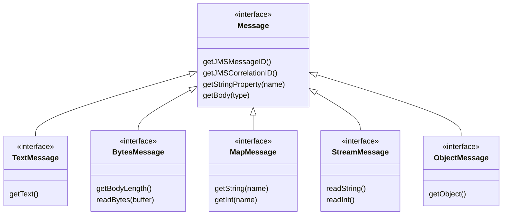
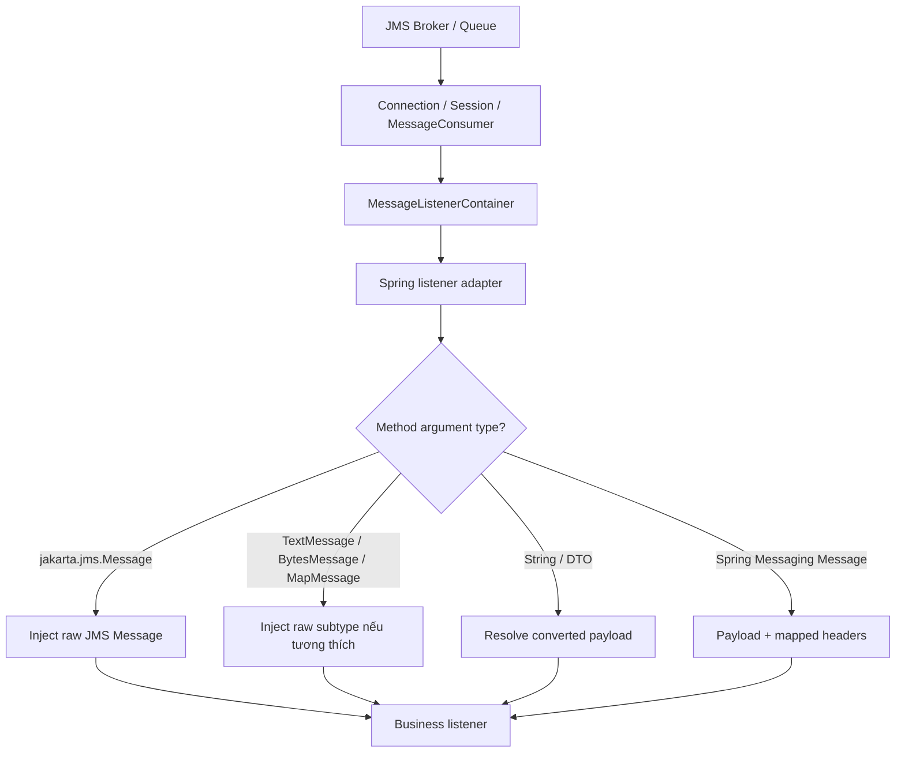

# Nhận jakarta.jms.Message hoặc một kiểu message cụ thể trong Spring JMS

## 1. Mục tiêu và vấn đề

Một phương thức listener của Spring JMS có thể nhận nội dung đã được chuyển đổi thành Java `String`/DTO, **hoặc nhận đối tượng JMS Message gốc** cùng những headers/properties do provider cung cấp.

Ví dụ:

```java
@JmsListener(destination = "orders.text")
public void receiveText(jakarta.jms.TextMessage raw)
        throws jakarta.jms.JMSException {
    String text = raw.getText();
    // Xử lý text sau khi kiểm tra contract.
}
```

Khác với:

```java
@JmsListener(destination = "orders.payload")
public void receivePayload(String body) {
    // Spring đã chuyển payload JMS sang String phù hợp.
}
```

Theo Spring Framework, tham số method của `@JmsListener` có thể là **`jakarta.jms.Message` hoặc bất kỳ subtype nào của nó, với điều kiện incoming message có kiểu tương thích**. Đây là đặc điểm của **annotated listener endpoint**; nó không có nghĩa mọi subtype được tự chuyển thành mọi subtype khác.

Sau bài này, bạn cần:

1. Biết cấu trúc của `jakarta.jms.Message` và năm loại message body chuẩn.
2. Biết cách chọn `Message` tổng quát hoặc `TextMessage`, `BytesMessage`, `MapMessage`, `StreamMessage` hay `ObjectMessage`.
3. Đọc body, JMS headers và custom properties đúng API; tránh nhầm body map với properties.
4. Phân biệt raw `jakarta.jms.Message` với `org.springframework.messaging.Message<T>` và payload Java `String`/DTO.
5. Nhận diện lỗi sai kiểu, lỗi converter xảy ra trước method, tài nguyên JMS và rủi ro deserialization.
6. Thực hành dự án Java 17+ / Spring Boot 3 / Apache ActiveMQ Artemis đọc bốn kiểu message qua bốn Queue riêng.
7. Hiểu transaction/ack, redelivery, DLQ, bảo mật và cách kiểm thử trong môi trường thực tế.

**Trọng tâm:** *Chữ ký method xác định dữ liệu bạn muốn nhận từ Spring; loại JMS Message do producer tạo và broker giao phải khớp hợp đồng đó.*

## 2. Cấu trúc và hệ phân cấp của JMS Message

Mọi `jakarta.jms.Message` có ba phần logic:

- **Headers:** `JMSMessageID`, `JMSTimestamp`, `JMSCorrelationID`, `JMSType`, `JMSPriority`, `JMSRedelivered`, `JMSReplyTo`...
- **Properties:** metadata có tên và kiểu, ví dụ `eventType`, `schemaVersion`, `tenantCategory`, được thêm bằng `setStringProperty`/`setIntProperty`...
- **Body:** nội dung thực sự, định dạng phụ thuộc subtype.



| Subtype JMS | Body chứa | API đọc | Lưu ý |
| --- | --- | --- | --- |
| `TextMessage` | `String`, có thể là JSON/XML/text | `getText()` | Body có thể null; JSON là văn bản, chưa phải Java DTO. |
| `BytesMessage` | Dãy byte không tự mô tả | `getBodyLength()`, `readBytes()`, `getBody(byte[].class)` | Phải biết encoding/schema; kiểm tra kích thước trước cấp phát. |
| `MapMessage` | Các cặp tên–giá trị primitive/String **trong body** | `getString("name")`, `getInt("count")` | Không phải JMS custom properties. |
| `StreamMessage` | Dãy giá trị tuần tự | `readString()`, `readInt()` | Phải đọc đúng thứ tự; có cursor. |
| `ObjectMessage` | Java `Serializable` object | `getObject()` | Có rủi ro Java deserialization với nguồn không tin cậy. |
| `Message` cơ bản | Có thể không có body chuyên biệt | Headers/properties | Có thể được tạo bằng `Session.createMessage()`. |

**JSON không phải JMS Message subtype thứ sáu.** JSON thường nằm trong `TextMessage` hoặc `BytesMessage`; chuyển thành DTO là trách nhiệm của parser/converter theo hợp đồng ứng dụng.

Ví dụ sơ đồ một message:

```text
jakarta.jms.TextMessage
├── JMS Header: JMSMessageID = (provider cấp)
├── JMS Header: JMSCorrelationID = corr-501
├── JMS Property: eventType = "OrderCreated"
├── JMS Property: schemaVersion = 2 (int)
└── BODY: {"orderId":"501","status":"CREATED"}
```

Một String body chứa `"schemaVersion":2` **không tự tạo** JMS property tên `schemaVersion`. Nếu muốn selector hoặc handler đọc property, producer phải gắn metadata đó trước khi gửi.

### 2.1. Namespace Java phù hợp với Spring Boot 3

Sử dụng:

```java
import jakarta.jms.Message;
import jakarta.jms.TextMessage;
import jakarta.jms.BytesMessage;
import jakarta.jms.MapMessage;
import jakarta.jms.JMSException;
```

Spring Framework 6.x / Spring Boot 3.x dùng Jakarta Messaging namespace `jakarta.jms.*`. Các hướng dẫn cũ dùng `javax.jms.*` thuộc thế hệ trước; không trộn hai API và các provider library không tương thích rồi mong Spring tự chuyển.

## 3. Nhận raw jakarta.jms.Message trong @JmsListener

Ví dụ xử lý nhiều subtype trong một Queue:

```java
import jakarta.jms.Message;
import jakarta.jms.TextMessage;
import jakarta.jms.BytesMessage;
import jakarta.jms.MapMessage;
import jakarta.jms.JMSException;
import org.springframework.jms.annotation.JmsListener;

// Mảnh method đặt trong một @Component của Spring.
@JmsListener(destination = "incoming.mixed")
public void onAnyMessage(Message raw) throws JMSException {
    if (raw instanceof TextMessage text) {
        String body = text.getText();
        // Kiểm tra schema và xử lý text.
    } else if (raw instanceof BytesMessage bytes) {
        long size = bytes.getBodyLength();
        // Kiểm tra size, sau đó decode đúng format.
    } else if (raw instanceof MapMessage map) {
        String kind = map.getString("kind");
        // kind nằm trong body map.
    } else {
        throw new IllegalArgumentException("Unsupported JMS message type");
    }
}
```

`instanceof TextMessage text` là pattern matching hợp lệ trong **Java 17**; không cần cast mù. Đây là **mảnh minh họa**, chưa có class/bean/broker nên không phải file chạy riêng.

**Ưu điểm của tham số `Message`:**

- Phù hợp khi một destination có nhiều kiểu message theo contract hoặc cần tương thích legacy.
- Đọc được JMS metadata và kiểm tra subtype khi runtime.
- Có thể phân loại lỗi sai kiểu bằng mã lỗi nghiệp vụ thay vì để `ClassCastException` xảy ra.

**Nhược điểm:**

- Handler phải tự tách body, kiểm tra size/encoding/schema và phụ thuộc Jakarta JMS.
- Khi logic type branching lớn, nên tách các destination hoặc adapter/deserializer riêng.
- Không được bỏ qua transaction, retry, idempotency chỉ vì có raw `Message`.

### 3.1. Nhận subtype cụ thể

```java
@JmsListener(destination = "incoming.text")
public void onText(TextMessage text) throws JMSException {
    System.out.println(text.getText());
}
```

Nếu producer gửi `TextMessage` thì contract thỏa. Nếu producer gửi `BytesMessage` vào destination đó, Spring **không có nghĩa vụ chuyển byte message thành TextMessage** chỉ vì cả hai cùng kế thừa `Message`. Argument binding có thể thất bại **trước khi method được gọi**.

Không khai báo `@JmsListener(TextMessage)` cho Queue trộn TextMessage/ObjectMessage/BytesMessage trừ khi topology và routing chắc chắn chỉ giao text đúng listener.

### 3.2. Cast mù là lỗi dễ gặp

**Không nên:**

```java
@JmsListener(destination = "incoming.any")
public void receive(Message m) throws JMSException {
    TextMessage text = (TextMessage) m;
    System.out.println(text.getText());
}
```

Nếu message thực sự là `BytesMessage`, cast sẽ ném `ClassCastException`. Nên kiểm tra:

```java
if (!(m instanceof TextMessage text)) {
    throw new IllegalArgumentException("Expected a text JMS message");
}
String body = text.getText();
```

Không cần log toàn bộ raw object hay body trong thông báo lỗi để xác định subtype. Có thể log một error code và phân loại message ID đã kiểm soát.

## 4. Vai trò của MessageListenerContainer và adapter Spring

`@JmsListener` **không trực tiếp kết nối broker hay tự gọi `MessageConsumer.receive()`**. Spring tạo listener endpoint, gắn nó vào một **`MessageListenerContainer`**, thường dùng `DefaultMessageListenerContainer`, để quản lý:

1. `ConnectionFactory` và JMS `Connection`/`Session`/`MessageConsumer`.
2. Thread nhận, dispatch và concurrency của listener.
3. Lifecycle khởi động/dừng, recovery khi kết nối lỗi.
4. Transaction/acknowledgement và việc đóng/tái sử dụng resources.
5. Chuyển raw JMS Message tới adapter và xử lý lỗi.



Với các endpoint annotated, `MessagingMessageListenerAdapter` có thể xây dựng một `org.springframework.messaging.Message<?>` trung gian và map headers. **Raw Message gốc và Session được cung cấp như những argument bổ sung** để handler có thể nhận khi cần.

**Sắc thái quan trọng:** Yêu cầu raw `jakarta.jms.Message` cho method **không cam kết** tất cả bước conversion/mapping trong Spring đã bị bỏ qua. Khi bạn gắn một custom converter lỗi cho listener factory, việc tạo Spring Messaging message có thể thất bại trước khi method chạy dù signature là raw. Cần kiểm chứng pipeline ở cấu hình Spring đang dùng.

Nếu thật sự muốn làm việc trực tiếp với callback JMS thuần, có thể triển khai `jakarta.jms.MessageListener` rồi gắn nó vào container. Nhưng khi đó bạn tự chịu trách nhiệm parse body/metadata và xử lý các vấn đề tương ứng.

## 5. Đọc TextMessage và JMS metadata

### 5.1. Body

```java
@JmsListener(destination = "orders.text")
public void handleText(TextMessage message) throws JMSException {
    String text = message.getText();
    if (text == null || text.isBlank()) {
        throw new IllegalArgumentException("Empty body");
    }
    // Parse/validate theo schema, rồi xử lý nghiệp vụ.
}
```

`TextMessage.getText()` có thể trả `null` nếu body không được gán. Nếu text là JSON, `getText()` vẫn trả **String**; muốn DTO cần Jackson/custom converter hoặc tự parse có kiểm soát.

### 5.2. Headers

```java
String jmsId = message.getJMSMessageID();
String correlation = message.getJMSCorrelationID();
String type = message.getJMSType();
int priority = message.getJMSPriority();
boolean redelivered = message.getJMSRedelivered();
```

- `JMSMessageID` do provider gán trong quá trình gửi khi không bị disable; có thể không có ID tùy cấu hình.
- `JMSCorrelationID` do producer có thể đặt, **có thể null**.
- `JMSType` thường do contract ứng dụng đặt, cũng có thể null.
- `JMSRedelivered` là chỉ dấu từ JMS provider, **không** là bằng chứng chắc chắn đã xử lý trùng nghiệp vụ.
- `JMSPriority` là metadata QoS, không bảo đảm callback của mọi Queue chạy theo priority tuyệt đối.

### 5.3. Custom properties

Producer:

```java
jmsTemplate.send("orders.text", session -> {
    TextMessage text = session.createTextMessage("OrderCreated:501");
    text.setJMSCorrelationID("corr-501");
    text.setStringProperty("eventType", "OrderCreated");
    text.setIntProperty("schemaVersion", 1);
    return text;
});
```

Consumer:

```java
@JmsListener(destination = "orders.text")
public void onOrder(TextMessage text) throws JMSException {
    String body = text.getText();
    String eventType = text.getStringProperty("eventType");
    int schemaVersion = text.getIntProperty("schemaVersion");
    String correlation = text.getJMSCorrelationID();
    // ...
}
```

Đây là **mảnh code Spring có `jmsTemplate`, bean listener và broker**, không phải file Java độc lập.

Trường `eventType` là **JMS property**, không phải key tự động được trích từ text body. Nên dùng `propertyExists("eventType")` nếu contract cho phép property vắng mặt; getter có thể trả null hoặc ném exception tùy kiểu/lời gọi.

### 5.4. Received Message thường read-only

Theo Jakarta Messaging, khi message được giao, **body và properties ở trạng thái chỉ đọc**. Gọi `text.setText("changed")` trên body vừa nhận có thể ném `MessageNotWriteableException`.

`clearBody()` cho phép ghi lại body sau khi xóa nội dung cũ, nhưng **không phải cách ack message hay cập nhật trạng thái nghiệp vụ**. Tránh mutate message đã nhận: đọc và tạo DTO riêng, cập nhật database dưới transaction/điều kiện idempotency thích hợp.

## 6. Nhận BytesMessage an toàn

`BytesMessage` chứa bytes **không tự mô tả format**. Có thể là UTF-8 text, Protobuf, Avro, gzip, hình ảnh hoặc dữ liệu nhị phân khác.

```java
@JmsListener(destination = "data.bytes")
public void onBinary(BytesMessage m) throws JMSException {
    long length = m.getBodyLength();
    if (length < 0 || length > 1_024) {
        throw new IllegalArgumentException("Binary body too large");
    }
    byte[] body = m.getBody(byte[].class);
    // Chỉ giải mã UTF-8 khi contract khẳng định body là UTF-8:
    String text = new String(body, java.nio.charset.StandardCharsets.UTF_8);
}
```

`getBody(byte[].class)` là API chuẩn JMS 2.0+ / Jakarta Messaging 3.1, cho phép lấy toàn bộ byte[] khi type tương thích. Với payload lớn, nó có thể cấp phát nhiều RAM; thiết kế ingress limits, broker quotas và streaming/large-message APIs phù hợp. Kiểm tra `getBodyLength()` trước là hữu ích nhưng không bảo đảm provider chưa sử dụng nhiều bộ nhớ khi giao.

### 6.1. Cursor với readBytes

```java
long length = m.getBodyLength();
byte[] buffer = new byte[128];
int n = m.readBytes(buffer);
```

`readBytes` đọc các byte và **tiến cursor**. Đọc thêm sẽ tiếp tục từ vị trí còn lại; khi đã hết body, nó có thể trả `-1` theo contract. Nếu muốn đọc lại từ đầu, `BytesMessage.reset()` reset chế độ đọc và vị trí cursor, nhưng không nên có nhiều thread cùng thao tác trên một message.

Khi body nhỏ, `getBody(byte[].class)` giúp code đơn giản; khi cần xử lý streaming, phải kiểm tra size, số lần đọc, EOF và format.

### 6.2. Encoding và lỗi decode

`new String(bytes, StandardCharsets.UTF_8)` dùng UTF-8 tường minh, nhưng bộ giải mã dạng constructor có thể thay byte sequence không hợp lệ bằng replacement character. Khi hợp đồng không cho phép byte sequence lỗi, dùng `CharsetDecoder` với `CodingErrorAction.REPORT` và xử lý exception. Không suy đoán binary message luôn là text chỉ vì console hiển thị vài ký tự dễ đọc.

## 7. Nhận MapMessage: body map không phải JMS property

Producer:

```java
jmsTemplate.send("inventory.map", session -> {
    MapMessage message = session.createMapMessage();
    message.setString("sku", "SKU-501");
    message.setInt("quantity", 3);
    message.setStringProperty("eventType", "StockReserved");
    return message;
});
```

Consumer:

```java
@JmsListener(destination = "inventory.map")
public void onMap(MapMessage m) throws JMSException {
    String sku = m.getString("sku");
    int quantity = m.getInt("quantity");
    String eventType = m.getStringProperty("eventType");
    // sku/quantity ở MapMessage body, eventType ở JMS properties.
}
```

| Lời gọi | Vị trí dữ liệu |
| --- | --- |
| `setString("sku", "SKU-501")` | Body của MapMessage. |
| `getString("sku")` | Đọc body map. |
| `setStringProperty("sku", "SKU-501")` | JMS property. |
| `getStringProperty("sku")` | Đọc JMS property. |

Kể cả khi body map có key `eventType`, JMS selector `eventType = 'StockReserved'` **không đọc body**; selector cần property tương ứng. `MapMessage.getMapNames()` có thể liệt kê body keys, nhưng production không nên tự động log hết entries vì có thể có dữ liệu nhạy cảm.

## 8. StreamMessage, ObjectMessage và raw Message chỉ có headers

### 8.1. StreamMessage

Body của `StreamMessage` gồm các phần tử theo thứ tự. Code đọc phải biết đúng schema và thứ tự:

```java
@JmsListener(destination = "legacy.stream")
public void onStream(StreamMessage stream) throws JMSException {
    String type = stream.readString();
    int version = stream.readInt();
    // Phải đọc theo đúng thứ tự producer đã ghi.
}
```

Đọc sai kiểu có thể gây `MessageFormatException`; đọc quá cuối stream có thể gây `MessageEOFException`. Nó không phải Map hay JSON có thể truy cập tên trường.

### 8.2. ObjectMessage và deserialization risk

```java
@JmsListener(destination = "legacy.object")
public void onObject(ObjectMessage m) throws JMSException {
    Object value = m.getObject();
    // Chỉ xử lý nếu class/schema được kiểm soát chặt.
}
```

`ObjectMessage.getObject()` liên quan Java native deserialization, có rủi ro bảo mật với dữ liệu không tin cậy. Chỉ dùng với trusted classes/serial filters/provider allowlists được quản lý; ứng dụng mới thường nên dùng TextMessage JSON hoặc BytesMessage với schema rõ ràng.

**Một DTO method argument không nhất thiết là ObjectMessage.** Converter Jackson có thể chuyển TextMessage JSON thành DTO. Không nên đưa mọi Java object vào JMS ObjectMessage chỉ để khỏi định nghĩa schema.

### 8.3. Message không có body chuyên biệt

`Session.createMessage()` tạo JMS Message cơ bản, có thể dùng headers/properties không kèm TextMessage/BytesMessage body. Một handler nhận `Message` vẫn có thể xử lý những thông báo dạng metadata; nếu cố cast sang `TextMessage` sẽ sai.

## 9. Phân biệt ba kiểu tham số thường gặp

**1. Raw JMS Message:**

```java
@JmsListener(destination = "raw.queue")
public void onRaw(jakarta.jms.Message raw) throws JMSException {
    String id = raw.getJMSMessageID();
}
```

**2. Spring Messaging abstraction:**

```java
@JmsListener(destination = "spring.queue")
public void onSpring(
        org.springframework.messaging.Message<String> message) {
    String body = message.getPayload();
    Object value = message.getHeaders().get("eventType");
}
```

**3. Converted payload trực tiếp:**

```java
@JmsListener(destination = "payload.queue")
public void onPayload(String body) {
    // Spring lấy nội dung String từ JMS TextMessage phù hợp.
}
```

Sự khác biệt:

| Kiểu | Đối tượng nhận | Có JMS getter gốc? | Phụ thuộc converter |
| --- | --- | --- | --- |
| `jakarta.jms.Message` | JMS object gốc | Có, như `getJMSMessageID` | Method truy cập raw argument, nhưng infrastructure adapter vẫn có thể map/convert. |
| `jakarta.jms.TextMessage` | JMS raw subtype | Có, kể cả `getText` | Yêu cầu subtype thực tế tương thích. |
| `org.springframework.messaging.Message<String>` | Spring wrapper payload+headers | Không có JMS getters trực tiếp | Payload/headers đã được Spring chuyển đổi/map. |
| `String` | Java payload | Không | Converter phải cung cấp String phù hợp. |
| DTO | Java payload nghiệp vụ | Không | Cần converter/type mapping phù hợp. |

**Lưu ý import:** `jakarta.jms.Message` và `org.springframework.messaging.Message` có cùng simple name `Message`. Trong cùng file, tránh import mơ hồ bằng cách dùng fully qualified name cho ít nhất một loại.

### 9.1. @Header, @Headers và Session

Một method có thể nhận raw message và thêm metadata đã map:

```java
@JmsListener(destination = "events.raw")
public void onEvent(
        TextMessage raw,
        @Header("eventType") String eventType) throws JMSException {
    String body = raw.getText();
}
```

`@Header` là `org.springframework.messaging.handler.annotation.Header`. Khi property/header bắt buộc vắng mặt hoặc không chuyển sang được kiểu Java của tham số, **argument resolution có thể lỗi trước method**. Nếu muốn xử lý metadata tùy chọn linh hoạt, đọc native `raw.propertyExists("eventType")`.

Ngoài ra Spring hỗ trợ `jakarta.jms.Session` là tham số cho các trường hợp cần JMS API native khi phản hồi message. Không lưu Session vào static field hoặc sử dụng từ thread khác sau khi callback kết thúc.

## 10. Demo chạy được: nhận bốn kiểu JMS message trên Artemis

Demo dùng **bốn Queue riêng** để không cho các listener khác kiểu tranh chấp một message. Producer gửi TextMessage vào Queue generic và text, BytesMessage vào Queue bytes, MapMessage vào Queue map. Bốn listener ghi kết quả vào bộ nhớ thread-safe và application runner in sau khi toàn bộ callback thành công, nên **thứ tự stdout do demo in ra không phụ thuộc lịch chạy thread**.

### 10.1. Yêu cầu

- Java 17+ và Maven 3.x.
- Docker, cổng `61616` chưa bị chiếm.
- Spring Boot 3.3.5, Artemis JMS client Jakarta-compatible.
- Broker demo mới hoặc bốn Queue không có message cũ; chỉ chạy một instance ứng dụng.

Khởi động Apache ActiveMQ Artemis local:

```bash
docker run --detach --rm --name artemis-raw-180 \
  -e ARTEMIS_USER=artemis \
  -e ARTEMIS_PASSWORD=artemis \
  -p 127.0.0.1:61616:61616 \
  -p 127.0.0.1:8161:8161 \
  apache/artemis:latest-alpine
```

Đợi broker ready:

```bash
docker logs artemis-raw-180
```

Tài khoản và mật khẩu ở đây chỉ dùng để học thử. Môi trường production cần secret manager, TLS/authorization, network isolation, broker persistence và monitoring. Artemis demo thông thường cho phép auto-create Queue; với broker đã tắt auto-create, phải tạo destination trước.

### 10.2. Cấu trúc project

```text
raw-jms-listener-demo/
├── pom.xml
└── src/main/
    ├── java/demo/raw/RawJmsListenerDemo.java
    └── resources/application.properties
```

### 10.3. pom.xml

```xml
<project xmlns="http://maven.apache.org/POM/4.0.0"
         xmlns:xsi="http://www.w3.org/2001/XMLSchema-instance"
         xsi:schemaLocation="http://maven.apache.org/POM/4.0.0 https://maven.apache.org/xsd/maven-4.0.0.xsd">
    <modelVersion>4.0.0</modelVersion>
    <parent>
        <groupId>org.springframework.boot</groupId>
        <artifactId>spring-boot-starter-parent</artifactId>
        <version>3.3.5</version>
        <relativePath/>
    </parent>
    <groupId>demo</groupId>
    <artifactId>raw-jms-listener-demo</artifactId>
    <version>1.0.0</version>
    <properties>
        <java.version>17</java.version>
    </properties>
    <dependencies>
        <dependency>
            <groupId>org.springframework.boot</groupId>
            <artifactId>spring-boot-starter-artemis</artifactId>
        </dependency>
    </dependencies>
    <build>
        <plugins>
            <plugin>
                <groupId>org.springframework.boot</groupId>
                <artifactId>spring-boot-maven-plugin</artifactId>
            </plugin>
        </plugins>
    </build>
</project>
```

Spring Boot starter có client/JMS infrastructure; **không thêm server artifact `artemis-jakarta-server`** vì broker đã chạy ngoài JVM qua Docker.

### 10.4. application.properties

```properties
spring.artemis.mode=native
spring.artemis.broker-url=tcp://localhost:61616
spring.artemis.user=artemis
spring.artemis.password=artemis
spring.jms.pub-sub-domain=false
```

Nếu app chạy trong container khác, `localhost` ở container ứng dụng là chính nó, không trỏ tới broker. Hãy dùng hostname/DNS của Artemis service có thể truy cập được.

### 10.5. Java đầy đủ

Lưu `src/main/java/demo/raw/RawJmsListenerDemo.java`:

```java
package demo.raw;

import java.nio.charset.StandardCharsets;
import java.util.List;
import java.util.Map;
import java.util.concurrent.ConcurrentHashMap;
import java.util.concurrent.CountDownLatch;
import java.util.concurrent.TimeUnit;

import jakarta.jms.BytesMessage;
import jakarta.jms.JMSException;
import jakarta.jms.MapMessage;
import jakarta.jms.Message;
import jakarta.jms.TextMessage;

import org.springframework.boot.ApplicationRunner;
import org.springframework.boot.SpringApplication;
import org.springframework.boot.autoconfigure.SpringBootApplication;
import org.springframework.context.annotation.Bean;
import org.springframework.jms.annotation.EnableJms;
import org.springframework.jms.annotation.JmsListener;
import org.springframework.jms.core.JmsTemplate;
import org.springframework.stereotype.Component;

@SpringBootApplication
@EnableJms
public class RawJmsListenerDemo {

    public static void main(String[] args) {
        SpringApplication.run(RawJmsListenerDemo.class, args);
    }

    @Bean
    ApplicationRunner sendDemo(JmsTemplate template, RawInbox inbox) {
        return args -> {
            template.send("demo.raw.generic.180", session -> {
                TextMessage msg = session.createTextMessage("HELLO_RAW");
                msg.setStringProperty("kind", "generic");
                return msg;
            });

            template.send("demo.raw.text.180",
                    session -> session.createTextMessage("HELLO_TEXT"));

            template.send("demo.raw.bytes.180", session -> {
                BytesMessage msg = session.createBytesMessage();
                msg.writeBytes(
                        "HELLO_BYTES".getBytes(StandardCharsets.UTF_8));
                return msg;
            });

            template.send("demo.raw.map.180", session -> {
                MapMessage msg = session.createMapMessage();
                msg.setString("name", "HELLO_MAP");
                msg.setInt("count", 3);
                return msg;
            });

            if (!inbox.await(10, TimeUnit.SECONDS)) {
                throw new IllegalStateException(
                        "Timed out waiting for 4 JMS messages");
            }

            for (String key : List.of("generic", "text", "bytes", "map")) {
                System.out.println(inbox.result(key));
            }
            System.out.println("DEMO: completed");
        };
    }
}

@Component
class RawInbox {

    private final CountDownLatch latch = new CountDownLatch(4);
    private final Map<String, String> results = new ConcurrentHashMap<>();

    @JmsListener(destination = "demo.raw.generic.180")
    public void onGeneric(Message raw) throws JMSException {
        if (!(raw instanceof TextMessage text)) {
            throw new IllegalArgumentException("Expected TextMessage");
        }
        results.put("generic",
                "GENERIC: " + text.getText()
                + " | kind=" + raw.getStringProperty("kind"));
        latch.countDown();
    }

    @JmsListener(destination = "demo.raw.text.180")
    public void onText(TextMessage raw) throws JMSException {
        results.put("text", "TEXT: " + raw.getText());
        latch.countDown();
    }

    @JmsListener(destination = "demo.raw.bytes.180")
    public void onBytes(BytesMessage raw) throws JMSException {
        if (raw.getBodyLength() > 1_024) {
            throw new IllegalArgumentException("Body too large");
        }
        byte[] bytes = raw.getBody(byte[].class);
        String decoded = new String(bytes, StandardCharsets.UTF_8);
        results.put("bytes", "BYTES: " + decoded);
        latch.countDown();
    }

    @JmsListener(destination = "demo.raw.map.180")
    public void onMap(MapMessage raw) throws JMSException {
        results.put("map", "MAP: " + raw.getString("name")
                + " | count=" + raw.getInt("count"));
        latch.countDown();
    }

    boolean await(long timeout, TimeUnit unit)
            throws InterruptedException {
        return latch.await(timeout, unit);
    }

    String result(String key) {
        String value = results.get(key);
        if (value == null) {
            throw new IllegalStateException("Missing: " + key);
        }
        return value;
    }
}
```

**Giải thích tính runnable:**

- Một public class `RawJmsListenerDemo` khớp tên file; `RawInbox` là package-private Spring `@Component` trong cùng package.
- `JmsTemplate.send` nhận `MessageCreator` lambda, tạo JMS message **đúng Session và subtype**.
- `@EnableJms` bật annotated listener support; default factory do Boot cấu hình khi starter hiện diện.
- Bốn method nhận riêng raw `Message`, `TextMessage`, `BytesMessage` và `MapMessage`.
- `getBody(byte[].class)` dùng Jakarta Messaging chuẩn. Body bytes do chính demo tạo từ UTF-8, nên giải mã UTF-8 hợp lệ.
- `getString("name")` đọc **body map**; `getStringProperty("kind")` đọc **JMS property**.
- `CountDownLatch` đợi cả bốn listener báo xong; `ConcurrentHashMap` giữ data an toàn giữa các thread. ApplicationRunner in theo thứ tự list cố định.
- Nếu message sai kiểu, callback có thể thất bại trước `latch.countDown` và runner báo timeout thay vì in kết quả giả.

### 10.6. Chạy và output

Đợi Artemis sẵn sàng, chạy từ thư mục có `pom.xml`:

```bash
mvn spring-boot:run
```

Trong điều kiện bốn Queue sạch, một instance ứng dụng và broker cho phép gửi/nhận, năm dòng **do code demo in ra** theo thứ tự là:

```text
GENERIC: HELLO_RAW | kind=generic
TEXT: HELLO_TEXT
BYTES: HELLO_BYTES
MAP: HELLO_MAP | count=3
DEMO: completed
```

Các log của Maven/Spring/Artemis có thể xuất hiện xen kẽ hoặc trước/sau, nhưng năm dòng trên được in **sau khi đủ bốn callback** và theo thứ tự được cố định trong code. Khi test nhiều lần trên cùng broker, Queue có message cũ hoặc nhiều instance cạnh tranh có thể làm kết quả khác; dùng broker mới cho ví dụ.

Sau khi thử, dừng ứng dụng bằng `Ctrl+C`, dừng broker:

```bash
docker stop artemis-raw-180
```

Với `--rm` và không mount volume, container demo không phải môi trường kiểm chứng persistence qua restart/xóa container.

## 11. Nhận raw Message và Session cùng lúc

Spring có thể inject `jakarta.jms.Session` cho listener khi cần tạo reply theo native JMS API:

```java
@JmsListener(destination = "requests.queue")
public void onRequest(Message request, Session session)
        throws JMSException {
    Destination replyTo = request.getJMSReplyTo();
    if (replyTo == null) {
        return;
    }

    TextMessage response = session.createTextMessage("ACCEPTED");
    response.setJMSCorrelationID(request.getJMSMessageID());

    try (MessageProducer producer = session.createProducer(replyTo)) {
        producer.send(response);
    }
}
```

**Mảnh code**, cần import `jakarta.jms.Session`, `Destination`, `MessageProducer` và bean/container. Lưu ý `JMSReplyTo` có thể null; correlation contract phải được thỏa thuận và `JMSMessageID` không phải lúc nào cũng sẵn nếu message ID đã bị disable. Khi cần reply đơn giản, Spring `@SendTo`/return value cũng là lựa chọn; Session native dành cho tình huống cần kiểm soát chi tiết.

Không cache `Session`, `MessageProducer` hoặc raw `BytesMessage` sang một thread khác sau callback nếu chưa có thiết kế quản lý vòng đời/ack rõ ràng. JMS Session có quy tắc single-threaded context; Spring container quản lý resources và transaction.

## 12. Message sai subtype, exception và redelivery

### 12.1. Sai subtype có thể lỗi trước method

```java
@JmsListener(destination = "mixed.queue")
public void onTextOnly(TextMessage text) throws JMSException {
    // Handler chỉ được gọi nếu arg binding hợp lệ.
}
```

Nếu một `BytesMessage` được giao, hạ tầng Spring có thể không resolve được method argument. Một `try/catch` **bên trong onTextOnly** không thể xử lý lỗi xảy ra **trước khi method được gọi**. Đọc log/error metrics ở listener container, không chỉ log đầu method.

**Chữ ký subtype không phải JMS selector tại broker.** Nó không bảo đảm broker sẽ lọc `BytesMessage` ra trước khi giao. Hợp đồng message type cần được producer/destination hoặc routing kiểm soát.

### 12.2. JMSException từ getter

`getText()`, `getBodyLength()`, `getBody(...)`, `getString("key")` và các property getters có thể ném `JMSException`. Handler có thể khai báo `throws JMSException`; behavior khi nó thoát ra phụ thuộc listener container và transaction.

| Trạng thái | Hành vi cần hiểu |
| --- | --- |
| JMS session transacted | Exception thường kéo theo rollback; broker có thể redeliver theo chính sách. |
| Non-transacted ack | Hành vi ack/redelivery phụ thuộc mode và container. Không tự khẳng định message luôn được retry. |
| Message sai schema cố định | Retry vô hạn hiếm khi có ích; cấu hình max-deliveries, DLQ/quarantine. |
| Broker/network lỗi tạm thời | Có thể cần reconnect, backoff, retry idempotent. |
| Business method ghi DB thành công rồi crash trước JMS commit | Message có thể giao lại; cần idempotent consumer/inbox/outbox. |

Spring `DefaultJmsListenerContainerFactory` có thể cấu hình `sessionTransacted` và `ErrorHandler`; ErrorHandler giúp quan sát lỗi nhưng không thay thế broker redelivery/DLQ policy.

### 12.3. Read-only body và cursor

Received JMS body/properties thường read-only. Không chỉnh `TextMessage.setText(...)` trực tiếp trên message nhận rồi coi đó là lưu trạng thái. `BytesMessage.readBytes(...)` hoặc `StreamMessage.read...` có thể làm thay đổi cursor, cần đọc theo hợp đồng nhất quán. Không giữ raw Message để đọc sau khi container đã giải phóng resources.

## 13. Bảo mật và vận hành

- **Không log raw Message hoặc toàn bộ body.** Tránh `logger.info("{}", raw)`, dump bytes, JSON có token/email hoặc headers nhạy cảm.
- **Không dùng ObjectMessage với nguồn không tin cậy** nếu chưa có class allowlist, serial filters, dependency review. Cân nhắc TextMessage JSON hoặc BytesMessage có schema.
- **Giới hạn body ở producer, broker và consumer.** `getBodyLength` trước `getBody(byte[].class)` giảm việc cấp phát array trong application, nhưng không thay ingress limit của broker.
- **Khi body nén**, giới hạn kích thước sau giải nén để tránh decompression bomb; decode đúng charset.
- **JMS properties cũng có thể nhạy cảm.** Broker console, DLQ, traces, backups có thể lưu cả header/property; không gửi token qua `JMSCorrelationID` hoặc custom key.
- **JMS selector không là security boundary.** Tenant isolation cần broker authorization, destination permissions, TLS và audit.
- **Không nhầm message ID với idempotency business key.** Dùng event ID ổn định; redelivery và retry có thể tạo xử lý lặp.
- **Theo dõi lỗi conversion/type mismatch** ở container, queue depth, redelivery, DLQ, body size, latency và số consumer.

### Quy trình chẩn đoán khi listener không nhận được

1. Kiểm tra broker URL/credentials, Queue/Topic, `pubSubDomain` và connection status.
2. Xác định JMS subtype **thực tế** được producer tạo: Text, Bytes, Map, Stream hay Object.
3. Đối chiếu method signature `@JmsListener`; raw `TextMessage` chỉ hợp lệ cho TextMessage đến.
4. Xem listener factory đang hoạt động và custom `MessageConverter`/argument resolver nào có thể fail trước method.
5. Kiểm tra headers/properties có tồn tại, đúng kiểu, đúng tên và chính sách selector.
6. Kiểm tra cách đọc body: `getText`, `getBody(byte[].class)`, `getString/getInt`, read cursor, charset.
7. Kiểm tra exception, transaction, ack, redelivery/DLQ.
8. Kiểm tra concurrency, nhiều instance khác đang tiêu thụ cùng Queue và backlog test cũ.
9. Ghi metric/error code an toàn thay vì log nguyên message.

## 14. Kiểm thử raw listener

### Unit test

Có thể mock JMS interfaces bằng Mockito:

```java
TextMessage stub = org.mockito.Mockito.mock(TextMessage.class);
org.mockito.Mockito.when(stub.getText()).thenReturn("HELLO_TEXT");
listener.onText(stub);
```

Đây là **mảnh test**: cần Mockito, bean/đối tượng `listener` thực và method `onText` tương ứng. Test direct method chỉ kiểm chứng việc đọc/validate payload, **không chứng minh** annotation, binding, broker hay transaction hoạt động.

### Integration test

- Khởi động broker test sạch; đăng ký listeners.
- Gửi từng subtype vào destination tương ứng; kiểm tra method được gọi với đúng kiểu.
- Gửi sai subtype vào một Queue test riêng để đo lỗi binding/pre-method và DLQ.
- Gửi body null, JSON sai, bytes quá lớn, MapMessage thiếu key để kiểm tra validation.
- Gửi message với `JMSCorrelationID`/properties và assert header/property readers.
- Thử rollback/redelivery và idempotency theo transaction mode thật.
- Kiểm tra nhiều listener đồng thời không dùng mutable state không an toàn; demo dùng `ConcurrentHashMap`.
- Không kết luận lỗi ngay lập tức khi callback không in log; có thể lỗi conversion trước callback.

## 15. Bảng lỗi phổ biến

| Lỗi/hiểu nhầm | Vì sao xảy ra | Cách xử lý |
| --- | --- | --- |
| `javax.jms.Message` không tương thích Boot 3 | Namespace JMS đã chuyển sang Jakarta | Dùng `jakarta.jms.*` và provider phù hợp. |
| `ClassCastException` từ Message sang TextMessage | Incoming subtype khác | Dùng `instanceof` hoặc tách destination. |
| `@JmsListener(TextMessage)` không được gọi | Raw type binding hoặc converter/adapter fail | Kiểm tra type message, factory và logs trước method. |
| `String` không có `getJMSMessageID` | String chỉ là payload Java | Inject raw Message hoặc mapped header. |
| `org.springframework.messaging.Message` không có JMS methods | Hai Message interfaces khác nhau | Sử dụng fully qualified types và API tương ứng. |
| `MapMessage.getStringProperty("sku")` trả null | `sku` nằm trong body map | Dùng `getString("sku")`. |
| `BytesMessage` giải mã ra ký tự lỗi | Format không phải UTF-8 hoặc byte stream sai | Đọc đúng schema/encoding; decoder strict khi cần. |
| `BytesMessage` đọc thiếu dữ liệu | Cursor đã tiến do `readBytes` | Kiểm tra state, reset đúng cách hoặc dùng `getBody`. |
| `ObjectMessage.getObject()` lỗi security | Deserialize chưa allowlist/trust | Dùng serial filters/trusted packages hoặc schema format khác. |
| `setText` trên message đã nhận bị lỗi | Received body read-only | Tạo message mới hoặc chỉ đọc dữ liệu. |
| JMSException gây gửi lại nhiều lần | Session rollback/redelivery policy | Xem transaction, max attempts, DLQ, idempotency. |
| Listener byte[] gây heap pressure | Đọc body lớn không giới hạn | Ingress limit, size budget, streaming. |
| Reply dùng Session sau callback bị lỗi | Vòng đời Session bị container quản lý | Chỉ dùng Session trong invocation phù hợp. |
| Topic/Queue cùng tên nhưng không nhận | Producer và listener dùng sai destination type | Đồng bộ `pubSubDomain`, broker và subscription. |

## 16. Câu hỏi tự kiểm tra

**Câu 1.** Spring `@JmsListener` có cho phép nhận trực tiếp `jakarta.jms.Message` không?

**Đáp án:** Có. Raw `Message` và subtype tương thích được hỗ trợ trong annotated endpoint.

**Câu 2.** Một listener có tham số `TextMessage` có nhận được `BytesMessage` do broker gửi không?

**Đáp án:** Không được giả định. Type mismatch có thể gây lỗi binding trước method; subtype raw cần khớp loại incoming message.

**Câu 3.** Khi nào nên dùng `Message` tổng quát thay vì `TextMessage`?

**Đáp án:** Khi destination có thể nhận nhiều loại JMS Message hoặc handler cần kiểm tra subtype trước khi đọc body; sử dụng `instanceof`.

**Câu 4.** `MapMessage.getInt("count")` đọc JMS property `count` hay body?

**Đáp án:** Body MapMessage. Property phải đọc bằng `getIntProperty("count")`.

**Câu 5.** `jakarta.jms.Message` có giống `org.springframework.messaging.Message<String>` không?

**Đáp án:** Không. Một bên là JMS object gốc; một bên là Spring wrapper có Java payload và mapped headers.

**Câu 6.** Có thể gọi `getText()` trên biến kiểu `Message` không?

**Đáp án:** Không trực tiếp vì `getText()` là phương thức `TextMessage`. Phải kiểm tra subtype/cast an toàn hoặc dùng `Message.getBody(String.class)` khi body type tương thích.

**Câu 7.** Vì sao `ObjectMessage.getObject()` cần cảnh giác?

**Đáp án:** Vì Java deserialization có thể rủi ro với nguồn không tin cậy; cần allowlist/filter hoặc định dạng khác.

**Câu 8.** Nhận raw Message có đảm bảo Spring bỏ qua toàn bộ converter không?

**Đáp án:** Không. Infrastructure annotated listener có thể vẫn thực hiện mapping/conversion. Raw argument cho phép method truy cập object gốc.

**Câu 9.** `BytesMessage.getBodyLength()` có tự ngăn mọi cuộc tấn công payload quá lớn không?

**Đáp án:** Không. Nó giúp kiểm tra trước lúc cấp phát trong handler nhưng provider/broker có thể đã dùng tài nguyên; cần ingress/broker controls.

**Câu 10.** JMSException trong listener có luôn làm message retry vô hạn không?

**Đáp án:** Không. Retry và acknowledgement phụ thuộc transaction/ack mode và broker redelivery/DLQ policy.

**Câu 11.** Vì sao demo sử dụng bốn Queue?

**Đáp án:** Để mỗi raw subtype được gửi tới listener phù hợp, không có consumer cạnh tranh làm kết quả khó xác định. Chữ ký subtype không phải routing rule của broker.

**Câu 12.** Khi chỉ cần JSON DTO, nhận raw TextMessage có luôn tốt hơn nhận DTO không?

**Đáp án:** Không. DTO với converter/schema tốt giảm coupling và boilerplate; raw TextMessage hữu ích khi cần JMS-specific metadata, format control hoặc legacy integration.

## Kết luận

**Nhận `jakarta.jms.Message` hoặc một subtype cụ thể là khả năng chính thức của Spring `@JmsListener`.** `Message` giúp đọc raw headers/properties và kiểm tra loại body; `TextMessage`, `BytesMessage`, `MapMessage` cho API đọc thuận tiện khi incoming type được bảo đảm. Không dùng cast mù, không nhầm `MapMessage` body với JMS properties, và không trộn `jakarta.jms.Message` với `org.springframework.messaging.Message<T>`.

Lựa chọn đúng phụ thuộc contract: cần API JMS gốc thì nhận raw; chỉ cần nghiệp vụ thì nhận payload String/DTO. Trong mọi trường hợp, hãy kiểm tra type/schema, lỗi adapter/conversion, transaction/redelivery, size/security và kiểm thử trên broker thực trước khi triển khai.

## Tham khảo chính thức

- [Spring Framework – Annotation-driven Listener Endpoints: raw JMS Message, subclasses, Session](https://docs.spring.io/spring-framework/reference/integration/jms/annotated.html)
- [Spring Framework – Receiving a Message và listener containers](https://docs.spring.io/spring-framework/reference/6.2/integration/jms/receiving.html)
- [Spring Framework – Using Spring JMS](https://docs.spring.io/spring-framework/reference/6.2/integration/jms/using.html)
- [Spring Framework 6.2 – MessagingMessageListenerAdapter Javadoc](https://docs.spring.io/spring-framework/docs/6.2.14/javadoc-api/org/springframework/jms/listener/adapter/MessagingMessageListenerAdapter.html)
- [Spring Boot 3.4 – JMS và ActiveMQ Artemis](https://docs.spring.io/spring-boot/3.4/reference/messaging/jms.html)
- [Jakarta Messaging 3.1 – Specification: message structure, body types, received read-only](https://jakarta.ee/specifications/messaging/3.1/jakarta-messaging-spec-3.1.html)
- [Jakarta Messaging 3.1 – Message API](https://jakarta.ee/specifications/messaging/3.1/apidocs/jakarta.messaging/jakarta/jms/message)
- [Jakarta Messaging 3.1 – BytesMessage API](https://jakarta.ee/specifications/messaging/3.1/apidocs/jakarta.messaging/jakarta/jms/bytesmessage)
- [Jakarta Messaging 3.1 – MapMessage API](https://jakarta.ee/specifications/messaging/3.1/apidocs/jakarta.messaging/jakarta/jms/mapmessage)
- [Apache ActiveMQ Artemis – Docker](https://artemis.apache.org/components/artemis/documentation/latest/docker.html)
