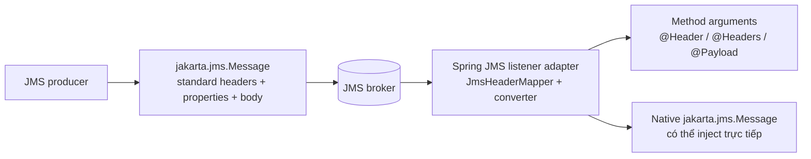

# Đọc header bằng @Header và @Headers trong Spring JMS

> **Module:** Spring Framework – JMS · **Nhóm kiến thức:** Dữ liệu listener.  
> **Mục tiêu:** Dùng `@Header` để lấy **một giá trị metadata** và `@Headers` để lấy **toàn bộ header map đã được Spring ánh xạ** trong method `@JmsListener`. Hiểu rõ **JMS headers chuẩn**, **JMS message properties**, **Spring Messaging headers**, tên hằng số `JmsHeaders`, dữ liệu thiếu, kiểu dữ liệu, ví dụ gửi–nhận trên ActiveMQ Artemis và chiến lược kiểm thử. Ví dụ sử dụng **Java 21, Spring Boot 3.3.5, Spring Framework 6.1 và Jakarta Messaging**.

## 1. Khi listener cần biết nhiều hơn payload

Giả sử producer gửi body:

```text
order:ORD-42
```

Bên nhận cần biết thêm:

- `eventType`: message có thực sự là sự kiện `OrderCreated` không?
- `tenantId`: khách hàng/tenant nào đang sở hữu dữ liệu?
- `attempt`: số lần producer thử gửi, **nếu producer thực sự đặt property này**.
- `JMSCorrelationID`: định danh để ghép log/trace hoặc request/reply.
- `JMSMessageID`: ID do JMS provider gán cho message để điều tra.
- `JMSRedelivered`: message có cờ redelivery hay không.

Nếu không đọc metadata, listener chỉ thấy chuỗi body và phải tự nhúng thông tin vận hành vào payload; điều này làm selector, tracing và chính sách tương thích khó kiểm soát.

Spring cung cấp hai annotation **trên tham số method**:

```java
@JmsListener(destination = "orders.incoming")
public void handle(
        String payload,
        @Header("eventType") String eventType,
        @Headers Map<String, Object> headers) {
    // ...
}
```

Đây là **fragment** để đặt trong Spring-managed component có cấu hình JMS. Import:

```java
import java.util.Map;
import org.springframework.jms.annotation.JmsListener;
import org.springframework.messaging.handler.annotation.Header;
import org.springframework.messaging.handler.annotation.Headers;
```

Hai annotation `@Header` và `@Headers` thuộc **`org.springframework.messaging.handler.annotation`** (Spring Messaging), không thuộc Jakarta JMS, Spring MVC `@RequestHeader` hay `@RequestParam`. Chúng hoạt động nhờ **hạ tầng argument resolution** của `@JmsListener`.

## 2. Phân biệt ba khái niệm "header"

Trong cùng một luồng JMS có ba nguồn thông tin metadata:

| Tầng | Ví dụ | Ai tạo/đặt? | Cách đọc ở listener |
| --- | --- | --- | --- |
| **JMS header chuẩn** | `JMSCorrelationID`, `JMSMessageID`, `JMSPriority`, `JMSType`, `JMSRedelivered` | Ứng dụng hoặc JMS provider, tùy field | `@Header(JmsHeaders.CORRELATION_ID)`, `@Headers` hoặc raw `jakarta.jms.Message` getter |
| **JMS message property** | `eventType`, `tenantId`, `attempt` | Producer đặt bằng `setStringProperty`, `setIntProperty`, v.v. | `@Header("eventType")`, `@Headers` hoặc raw `getObjectProperty` |
| **Spring Messaging header** | `id`, `timestamp`, các tên `jms_*` đã ánh xạ | Spring Messaging/message mapper | `@Headers Map`, `org.springframework.messaging.Message<?>` |



**Quan trọng:** JSON trong `TextMessage` body **không tự biến thành header**. Nếu body có `{"eventType":"OrderCreated"}` nhưng producer **không** gọi `message.setStringProperty("eventType",...)`, thì `@Header("eventType")` không thể lấy nó từ JMS properties.

Một `MapMessage` là loại **JMS body**, không phải tập headers mà `@Headers` nhận. Cùng là `Map` trong Java nhưng ý nghĩa khác hẳn.

### 2.1. Header chuẩn khác message property

JMS header chuẩn có API riêng:

```java
// Fragment: có sẵn jakarta.jms.Message jmsMessage.
jmsMessage.setJMSCorrelationID("corr-ORD-42");
jmsMessage.setJMSType("OrderCreated");
```

Message properties có API khác:

```java
jmsMessage.setStringProperty("eventType", "OrderCreated");
jmsMessage.setStringProperty("tenantId", "store-a");
jmsMessage.setIntProperty("attempt", 1);
```

`JMSCorrelationID` là JMS header chuẩn; `eventType` là user-defined JMS property. Không tự tạo property tên `"JMSCorrelationID"` và kỳ vọng nó được xem như header chuẩn. Hai cách lưu metadata có thể tồn tại song song nhưng không có cùng semantics.

## 3. `@Header`: lấy một metadata theo tên

Cú pháp:

```java
@Header("eventType") String eventType
```

hoặc cùng ý nghĩa:

```java
@Header(name = "eventType") String eventType
```

Spring tìm giá trị tên `eventType` trong **Spring Messaging headers đã ánh xạ** từ JMS message, rồi dùng conversion service nếu cần để đưa vào tham số Java.

### 3.1. Required theo mặc định

`@Header` có `required=true` theo mặc định. Ví dụ:

```java
@JmsListener(destination = "orders.incoming")
public void handle(
        String body,
        @Header("eventType") String eventType) {
    System.out.println(eventType + ": " + body);
}
```

Nếu `eventType` không có trong headers, argument resolution **có thể ném lỗi thiếu header** trước khi body của method được chạy. Với listener có JMS local transaction, exception có thể dẫn đến rollback/redelivery theo container và broker policy. Vì vậy các header nghiệp vụ bắt buộc phải được producer bảo đảm bằng contract và nên được kiểm thử.

### 3.2. Header tùy chọn với `required=false`

```java
@Header(name = "tenantId", required = false) String tenantId
```

Nếu header thiếu, tham số reference có thể nhận `null`. Ví dụ dùng wrapper `Integer` cho một giá trị số tùy chọn:

```java
@Header(name = "attempt", required = false) Integer attempt
```

**Không dùng primitive `int` cho metadata có thể vắng**, vì `null` không biểu diễn được bằng primitive. Với primitive và thiếu header, Spring có thể fail khi bind/convert; đó không phải giá trị 0 nghiệp vụ.

### 3.3. Default value có ý nghĩa riêng

```java
@Header(name = "region", defaultValue = "GLOBAL") String region
```

Nếu header vắng hoặc được coi là không có giá trị theo logic resolver, Spring dùng fallback `GLOBAL`. Theo API `@Header`, khai báo `defaultValue` ngầm khiến `required=false`.

**Lựa chọn giữa `required=false` và `defaultValue` là quyết định nghiệp vụ:**

- `required=false`: giữ phân biệt **thiếu metadata** so với một giá trị hợp lệ.
- `defaultValue="GLOBAL"`: chủ động diễn giải “thiếu region” là `GLOBAL`. Nên chỉ làm khi contract và migration cho phép.
- `required=true`: thiếu property thường được xem là lỗi đầu vào.

Header có String rỗng `""` hoặc số `0` **không đồng nghĩa** header vắng mặt; đừng đánh tráo hai trường hợp khi xử lý.

### 3.4. Kiểu tham số phải tương thích

Nếu producer gọi:

```java
message.setIntProperty("attempt", 3);
```

thì `@Header("attempt") Integer attempt` là kiểu tự nhiên. Nếu producer đặt:

```java
message.setStringProperty("attempt", "3");
```

Spring conversion service **có thể** chuyển String thành số ở method argument, nhưng không nên dựa vào đó làm wire contract: JMS selectors so sánh kiểu theo quy tắc riêng, và giá trị String không phải `int` property. Thống nhất **property name + type + semantic unit** ở producer/consumer.

## 4. `@Headers`: đọc header map tổng hợp

Cú pháp:

```java
@Headers Map<String, Object> headers
```

`@Headers` chỉ áp dụng trên tham số **có kiểu assignable to `java.util.Map`**. Không dùng `@Headers List<String>` hoặc `@Headers String` để mong lấy danh sách tự động.

Nội dung map thường bao gồm:

- Các JMS standard headers được ánh xạ sang tên `JmsHeaders.*` (ví dụ `jms_correlationId`).
- Các JMS properties mà mapper cho phép và chuyển sang header map (ví dụ `eventType`, `tenantId`, `attempt`).
- Các header Spring Messaging được framework tạo/duy trì (chẳng hạn `id` và `timestamp`).

**Không nên khẳng định `@Headers` là bản sao đầy đủ từng byte của JMS message.** Việc mapping phụ thuộc `JmsHeaderMapper`/adapter và version; một số trường có thể không có hoặc kiểu giá trị là `Destination`, `Integer`, `Long`, `Boolean` thay vì `String`. Header map **không chứa JMS body**.

Ví dụ đọc:

```java
@JmsListener(destination = "orders.incoming")
public void onMessage(
        String body,
        @Headers Map<String, Object> allHeaders) {

    Object eventType = allHeaders.get("eventType");
    Object correlation = allHeaders.get(JmsHeaders.CORRELATION_ID);
    boolean hasTenant = allHeaders.containsKey("tenantId");

    System.out.println("eventType=" + eventType);
    System.out.println("correlation=" + correlation);
    System.out.println("hasTenant=" + hasTenant);
}
```

Fragment này cần import `JmsHeaders`, `Map` và các annotations. Dùng `containsKey` khi muốn phân biệt một **header có xuất hiện trong map không**; `get` trả null có thể do key thiếu hoặc dữ liệu null. Trong Spring Messaging, headers thông thường không chứa null values như một entry hợp lệ; tuy vậy code ứng dụng vẫn nên coi map như metadata chỉ đọc và validate input.

**Không sửa `allHeaders.put(...)`** để “gửi lại” thông tin vào broker: map được framework cung cấp có thể không mutable và ngay cả khi chỉnh được cũng không bảo đảm sửa raw JMS message. Để phát metadata ra ngoài, cấu hình producer/header mapper hoặc tạo outgoing message mới.

### So sánh cách chọn

| Yêu cầu | `@Header` | `@Headers` |
| --- | --- | --- |
| Lấy `eventType` bắt buộc | Rất phù hợp: `@Header("eventType")` | Có thể dùng `get` nhưng phải tự validate |
| Lấy `tenantId` có thể thiếu | `required=false` hoặc `defaultValue` | `containsKey` + `get` |
| Lấy nhiều headers chưa biết trước | Dễ rối vì nhiều tham số | **Phù hợp** để inspect/triage |
| Phụ thuộc tên header cụ thể | Rõ và kiểm tra được bằng method signature | Truy cập key động |
| Giới hạn log lộ dữ liệu | Chỉ inject những thứ cần | Phải chủ động lọc khi log vì map có thể chứa PII |
| Thay thế raw JMS API toàn diện | Không | **Không**: map không thay thế `jakarta.jms.Message` |

Trong code nghiệp vụ thông thường, ưu tiên **vài tham số `@Header` rõ ràng**; dùng `@Headers` khi cần log chẩn đoán có lọc, chính sách kiểm tra metadata tổng quát hoặc dispatch dựa trên nhiều properties.

## 5. `JmsHeaders`: tên header chuẩn đã ánh xạ

Spring Framework định nghĩa `org.springframework.jms.support.JmsHeaders`. Đây là **tập hằng số tên của Spring Messaging headers**, không phải interface của `jakarta.jms.Message`.

| Constant | Header name trong Spring Messaging | JMS nguồn |
| --- | --- | --- |
| `JmsHeaders.CORRELATION_ID` | `jms_correlationId` | `getJMSCorrelationID()` |
| `JmsHeaders.MESSAGE_ID` | `jms_messageId` | `getJMSMessageID()` |
| `JmsHeaders.TYPE` | `jms_type` | `getJMSType()` |
| `JmsHeaders.DESTINATION` | `jms_destination` | `getJMSDestination()` |
| `JmsHeaders.REPLY_TO` | `jms_replyTo` | `getJMSReplyTo()` |
| `JmsHeaders.PRIORITY` | `jms_priority` | `getJMSPriority()` |
| `JmsHeaders.REDELIVERED` | `jms_redelivered` | `getJMSRedelivered()` |
| `JmsHeaders.TIMESTAMP` | `jms_timestamp` | `getJMSTimestamp()` |
| `JmsHeaders.DELIVERY_MODE` | `jms_deliveryMode` | `getJMSDeliveryMode()` |
| `JmsHeaders.EXPIRATION` | `jms_expiration` | `getJMSExpiration()` |

Giá trị text của các constants trên đúng với Spring 6.1; **trong code Java nên dùng constant thay vì chép chuỗi literal** để tránh typo và hạn chế phụ thuộc chi tiết nội bộ.

Ví dụ đọc correlation ID:

```java
@JmsListener(destination = "orders.incoming")
public void handle(
        String body,
        @Header(JmsHeaders.CORRELATION_ID) String correlationId) {
    System.out.println("corr=" + correlationId);
}
```

Tên native **`JMSCorrelationID`** không phải tên Spring header `jms_correlationId`; vì vậy dùng `@Header("JMSCorrelationID")` rồi kết luận không có correlation ID là một lỗi phổ biến.

### `MessageHeaders.ID` khác `JmsHeaders.MESSAGE_ID`

Spring Messaging có `MessageHeaders.ID` (tên `id`, thường là UUID do Spring message abstraction quản lý), trong khi JMS provider gán `JMSMessageID` và Spring ánh xạ nó thành `JmsHeaders.MESSAGE_ID` (`jms_messageId`).

**Hai IDs phục vụ hai tầng khác nhau**. Để tìm message trên broker, dùng JMSMessageID; để chống xử lý trùng nghiệp vụ, dùng **eventId nghiệp vụ ổn định** trong payload/property. Không nên dùng Spring `id` để truy vấn broker hoặc giả định JMSMessageID giữ nguyên qua mọi re-publish.

Tương tự, `MessageHeaders.TIMESTAMP` có thể là timestamp của Spring message, không nhất thiết chính là `JMSTimestamp`. Nếu cần timestamp JMS, dùng `JmsHeaders.TIMESTAMP` hoặc `raw.getJMSTimestamp()`.

### Không phải JMS header nào cũng do producer chủ động set

Các header như `JMSMessageID`, `JMSTimestamp`, `JMSDestination`, `JMSPriority`, `JMSExpiration` thường do JMS provider/send operation quyết định ở các thời điểm khác nhau. `SimpleJmsHeaderMapper` chủ yếu đưa những trường này **vào map khi nhận**, nhưng không nhất thiết cho phép bạn gán ngược chúng từ một Spring Message khi gửi.

Ví dụ `JMSPriority` chịu sự kiểm soát của producer QoS khi `send`, chứ không phải chỉ cần viết một property `"jms_priority"` rồi bảo đảm broker ưu tiên như mong muốn.

## 6. Luồng mapping: từ raw JMS Message đến method arguments

Spring Framework có `SimpleJmsHeaderMapper` triển khai `JmsHeaderMapper`. Nó chuyển standard JMS headers sang tên `JmsHeaders`, và sao chép các user-defined JMS properties hợp lệ sang Spring Messaging headers. `MessagingMessageConverter` kết hợp payload converter với header mapper để đưa thông tin vào Spring Messaging `Message<?>`.

```text
JMS TextMessage:
  getText()                      -> String payload
  getJMSCorrelationID()          -> "corr-ORD-42"
  getJMSType()                   -> "OrderCreated"
  getObjectProperty("eventType") -> "OrderCreated"
  getObjectProperty("attempt")   -> Integer(1)

Spring Messaging Message<String>:
  payload = "order:ORD-42"
  headers:
    jms_correlationId = "corr-ORD-42"
    jms_type          = "OrderCreated"
    eventType         = "OrderCreated"
    attempt           = 1
    ... framework/provider metadata

@JmsListener method:
  @Payload String body                  = "order:ORD-42"
  @Header("eventType") String type       = "OrderCreated"
  @Header(JmsHeaders.CORRELATION_ID) cid = "corr-ORD-42"
  @Headers Map<String,Object> map       = mapped headers
```

Đây là **sơ đồ kỳ vọng**, không phải dump nguyên văn từ Artemis hay cam kết tất cả headers đều luôn có mặt. Nếu tự cấu hình `JmsHeaderMapper` hoặc message handler method factory, tên/chiều mapping và conversion có thể khác; nên kiểm tra runtime bằng `@Headers` và raw `Message`.

### Dữ liệu bản thân broker không tự chuyển vào map nếu chưa có

- JMS provider không tự biết business property `eventType` nếu producer chưa set.
- `MessageConverter` chủ yếu chuyển body; metadata kỹ thuật như `_type` có thể được converter thêm khi chuyển JSON, nhưng không thay thế JMS properties nghiệp vụ.
- `MessagePostProcessor` (overload của `JmsTemplate.convertAndSend`) được gọi **sau body conversion, trước send**, thích hợp để gắn headers/properties producer.

## 7. Ba cách đọc cùng metadata trong listener

### 7.1. Dùng @Header và @Headers (cách trọng tâm)

```java
@JmsListener(destination = "orders.incoming")
public void onEvent(
        @Payload String payload,
        @Header("eventType") String type,
        @Header(JmsHeaders.CORRELATION_ID) String correlation,
        @Headers Map<String, Object> headers) {
    // Đọc trường rõ ràng + map tổng hợp.
}
```

Dùng khi chỉ cần một vài thông số nhưng vẫn muốn khả năng inspect.

### 7.2. Dùng Spring Messaging Message<T>

```java
@JmsListener(destination = "orders.incoming")
public void onEvent(org.springframework.messaging.Message<String> message) {
    String payload = message.getPayload();
    Object type = message.getHeaders().get("eventType");
    Object correlation =
            message.getHeaders().get(JmsHeaders.CORRELATION_ID);
}
```

Đây là **phương án thay thế** cho một listener cùng destination, không nên đăng ký đồng thời hai consumers giống nhau lên một queue chỉ để đọc metadata. Với `org.springframework.messaging.Message<T>`, headers và payload đi cùng một object và có thể dùng `JmsMessageHeaderAccessor.wrap(message)` để lấy một số JMS headers theo getter typed.

Ví dụ fragment về accessor:

```java
JmsMessageHeaderAccessor accessor =
        JmsMessageHeaderAccessor.wrap(message);
String correlation = accessor.getCorrelationId();
String messageId = accessor.getMessageId();
Boolean redelivered = accessor.getRedelivered();
```

Lớp accessor thuộc `org.springframework.jms.support.JmsMessageHeaderAccessor`. Các getter có thể trả `null` khi header không có hoặc không được map. Nó không phải công cụ tạo/ack JMS message trực tiếp.

### 7.3. Inject raw JMS Message

```java
@JmsListener(destination = "orders.incoming")
public void onEvent(jakarta.jms.Message raw) throws JMSException {
    String correlation = raw.getJMSCorrelationID();
    String messageId = raw.getJMSMessageID();
    String type = raw.getJMSType();

    boolean exists = raw.propertyExists("tenantId");
    Object tenant = raw.getObjectProperty("tenantId");
}
```

Fragment cần import `jakarta.jms.JMSException`. Dùng raw JMS API khi cần xác minh provider-specific property, `JMSXDeliveryCount` nếu broker hỗ trợ, destination type, bytes body hoặc một header chưa được mapper đưa vào map. **Không giữ raw `Message` bên ngoài thời gian callback và không tự đóng `Session` do container quản lý.**

Ba cách đọc **không phải ba luồng message độc lập**. Trong nhiều tình huống, một listener method có thể kết hợp `@Header`, `@Headers` và raw `Message` để đối chiếu metadata.

## 8. Ví dụ chạy được: Java 21 + Spring Boot 3.3.5 + Artemis

Chúng ta xây dựng một project duy nhất gồm:

- `JmsTemplate` producer gửi hai `TextMessage` cùng eventType.
- Message thứ nhất có `tenantId` và `attempt`.
- Message thứ hai **cố ý thiếu** hai properties tùy chọn.
- Listener nhận `@Payload`, hai `@Header` bắt buộc, hai `@Header(required=false)` và `@Headers Map`; đồng thời đối chiếu `JMSCorrelationID` bằng raw `Message`.

**Điều kiện chạy:** JDK 21, Gradle wrapper tương thích và broker ActiveMQ Artemis **đang chạy riêng** tại `tcp://localhost:61616`. Broker cần queue `demo.headers.orders` (ANYCAST) và ACL send/consume; nếu auto-create bật thì có thể tự tạo, nhưng ứng dụng không đảm bảo mọi broker đều tự provision queue. Ví dụ dùng account `artemis/artemis` chỉ cho local.

### 8.1. Gradle

`settings.gradle`:

```groovy
rootProject.name = 'jms-header-arguments-demo'
```

`build.gradle`:

```groovy
plugins {
    id 'java'
    id 'org.springframework.boot' version '3.3.5'
    id 'io.spring.dependency-management' version '1.1.6'
}

group = 'com.example'
version = '0.0.1-SNAPSHOT'

java {
    toolchain {
        languageVersion = JavaLanguageVersion.of(21)
    }
}

repositories { mavenCentral() }

dependencies {
    implementation 'org.springframework.boot:spring-boot-starter'
    implementation 'org.springframework.boot:spring-boot-starter-artemis'
    testImplementation 'org.springframework.boot:spring-boot-starter-test'
}

tasks.named('test') { useJUnitPlatform() }
```

`src/main/resources/application.yml`:

```yaml
spring:
  artemis:
    mode: native
    broker-url: ${JMS_BROKER_URL:tcp://localhost:61616}
    user: ${JMS_USER:artemis}
    password: ${JMS_PASSWORD:artemis}
  jms:
    pub-sub-domain: false

logging:
  level:
    org.springframework.jms: INFO
```

`pub-sub-domain=false` chọn queue. Spring Boot auto-configures `ConnectionFactory`, `JmsTemplate` và listener container factory khi JMS starter có mặt, provider hợp lệ và ứng dụng không override chúng. `@EnableJms` được khai báo tường minh trong ứng dụng học tập.

### 8.2. Java source đầy đủ

Tạo `src/main/java/com/example/jms/JmsHeaderDemoApplication.java`:

```java
package com.example.jms;

import java.util.Map;
import java.util.Objects;

import jakarta.jms.JMSException;

import org.springframework.boot.ApplicationRunner;
import org.springframework.boot.SpringApplication;
import org.springframework.boot.autoconfigure.SpringBootApplication;
import org.springframework.context.annotation.Bean;
import org.springframework.jms.annotation.EnableJms;
import org.springframework.jms.annotation.JmsListener;
import org.springframework.jms.core.JmsTemplate;
import org.springframework.jms.support.JmsHeaders;
import org.springframework.messaging.handler.annotation.Header;
import org.springframework.messaging.handler.annotation.Headers;
import org.springframework.messaging.handler.annotation.Payload;
import org.springframework.stereotype.Component;

@SpringBootApplication
@EnableJms
public class JmsHeaderDemoApplication {

    public static void main(String[] args) {
        SpringApplication.run(JmsHeaderDemoApplication.class, args);
    }

    @Bean
    ApplicationRunner publishTwoOrders(JmsTemplate template) {
        return args -> {
            send(template, "order:ORD-42",
                    "corr-ORD-42", "store-a", 1);
            send(template, "order:ORD-43",
                    "corr-ORD-43", null, null);
        };
    }

    private static void send(
            JmsTemplate template,
            String payload,
            String correlation,
            String tenantId,
            Integer attempt) {

        template.convertAndSend(
                "demo.headers.orders",
                payload,
                message -> {
                    // User-defined JMS properties:
                    message.setStringProperty(
                            "eventType", "OrderCreated");

                    if (tenantId != null) {
                        message.setStringProperty(
                                "tenantId", tenantId);
                    }
                    if (attempt != null) {
                        message.setIntProperty(
                                "attempt", attempt);
                    }

                    // Standard JMS headers:
                    message.setJMSCorrelationID(correlation);
                    message.setJMSType("OrderCreated");
                    return message;
                });
    }
}

@Component
class OrderHeaderListener {

    @JmsListener(
            destination = "demo.headers.orders",
            selector = "eventType = 'OrderCreated'")
    public void onOrder(
            @Payload String payload,
            @Header("eventType") String eventType,
            @Header(JmsHeaders.CORRELATION_ID) String correlation,
            @Header(JmsHeaders.TYPE) String jmsType,
            @Header(name = "tenantId", required = false)
                    String tenantId,
            @Header(name = "attempt", required = false)
                    Integer attempt,
            @Headers Map<String, Object> allHeaders,
            jakarta.jms.Message raw) throws JMSException {

        // Đối chiếu cùng một header qua mapping Spring và JMS API.
        if (!Objects.equals(
                correlation, raw.getJMSCorrelationID())) {
            throw new IllegalStateException(
                    "JMS correlation ID mapping mismatch");
        }

        String tenantText =
                tenantId == null ? "<missing>" : tenantId;
        String attemptText =
                attempt == null ? "<missing>" : attempt.toString();

        System.out.printf(
                "ORDER payload=%s event=%s corr=%s type=%s"
                + " tenant=%s attempt=%s%n",
                payload, eventType, correlation,
                jmsType, tenantText, attemptText);

        System.out.printf(
                "MAP event=%s corr=%s hasTenant=%s%n",
                allHeaders.get("eventType"),
                allHeaders.get(JmsHeaders.CORRELATION_ID),
                allHeaders.containsKey("tenantId"));
    }
}
```

### 8.3. Giải thích mã

1. `@SpringBootApplication` scan `OrderHeaderListener` trong package `com.example.jms`; `@EnableJms` bật annotated listener.
2. `ApplicationRunner` gửi hai String payload bằng `JmsTemplate.convertAndSend`; mặc định `SimpleMessageConverter` chuyển String thành JMS `TextMessage`.
3. `MessagePostProcessor` (lambda tham số thứ ba) gắn `eventType` bằng `setStringProperty`, `attempt` bằng `setIntProperty` và JMS header chuẩn bằng `setJMSCorrelationID`/`setJMSType`.
4. Với ORD-43, nhánh điều kiện **không gọi setters** cho `tenantId` và `attempt`; hai properties thực sự **vắng mặt**, không phải String `"null"`, `false` hay `0`.
5. Listener chỉ nhận message có JMS property `eventType = 'OrderCreated'`. Selector không đọc body.
6. `@Payload String payload` lấy nội dung message. `@Header("eventType")` lấy property bắt buộc; `@Header(JmsHeaders.CORRELATION_ID)` và `@Header(JmsHeaders.TYPE)` lấy JMS headers đã map.
7. Hai tham số `required=false` nhận `null` nếu properties tùy chọn vắng; sử dụng `Integer` thay vì primitive để có thể biểu diễn missing.
8. `@Headers Map<String,Object>` chứa mapped headers; ở đây đọc eventType, correlation và kiểm tra `containsKey("tenantId")`.
9. `jakarta.jms.Message raw` cho phép đối chiếu trực tiếp header với `getJMSCorrelationID()`. Không dùng raw message từ thread khác.
10. Nếu mapping correlation ID sai hoặc thiếu, code ném exception; transaction/ACK và redelivery do listener factory và broker quyết định.

**Ghi chú về độ chính xác:** `@Headers` có thể chứa thêm `jms_messageId`, `jms_priority`, `jms_redelivered`, `id`, `timestamp`...; bài demo chỉ in ba giá trị đã biết để tránh phụ thuộc provider ID/timing.

### 8.4. Chạy và kết quả dự kiến

Giả sử broker đang chạy, queue hợp lệ, credentials đúng và project có Gradle wrapper:

```bash
# Linux/macOS
./gradlew bootRun

# Windows
gradlew.bat bootRun
```

Hai message được gửi sau khi ứng dụng khởi tạo. Trong broker test sạch, **bốn dòng nghiệp vụ dự kiến** (hai cặp dòng, thứ tự các cặp không phải contract) là:

```text
ORDER payload=order:ORD-42 event=OrderCreated corr=corr-ORD-42 type=OrderCreated tenant=store-a attempt=1
MAP event=OrderCreated corr=corr-ORD-42 hasTenant=true
ORDER payload=order:ORD-43 event=OrderCreated corr=corr-ORD-43 type=OrderCreated tenant=<missing> attempt=<missing>
MAP event=OrderCreated corr=corr-ORD-43 hasTenant=false
```

Đây **không phải toàn bộ stdout**; Spring Boot còn startup logs, message IDs/timestamps và provider logs. Các consumer threads có thể làm thứ tự giao/xử lý khác nhau. Nếu queue còn messages cũ, nếu đã chạy demo trước đó hoặc nếu broker down, các dòng nhìn thấy có thể khác.

### 8.5. Tại sao ví dụ không dùng JSON DTO?

Mục tiêu bài là **đọc headers**, nên body cố ý là String để tránh phụ thuộc Jackson serializer, type ID mapping và JSON schema. Khi chuyển sang DTO, vẫn có thể giữ `@Header`/`@Headers` nguyên cách dùng, nhưng phải đăng ký JMS converter ở producer và listener factory để DTO được decode đúng.

Không được nhầm `@Headers Map` với JSON DTO map. Metadata và payload có **vòng đời, type rules và validation** riêng.

## 9. Khi phải kiểm tra header không bắt buộc

Một số metadata có thể chưa được producer cũ gửi (migrating schema), hoặc do JMS provider gán sau khi send. Có ba cách hợp lý:

| Mục tiêu | Cách triển khai | Ý nghĩa |
| --- | --- | --- |
| Thiếu là lỗi contract | `@Header("eventType") String` | Mặc định `required=true`; listener không chạy business method nếu không bind được |
| Thiếu phải quan sát riêng | `@Header(name="tenantId", required=false) String` | Giá trị Java có thể `null` |
| Thiếu có default rõ | `@Header(name="region", defaultValue="GLOBAL") String` | Đưa default theo business rule |
| Không biết trước tập headers | `@Headers Map<String,Object>` | Duyệt/map với validate/allowlist |
| Phải xác định property tồn tại tại JMS API | `raw.propertyExists("tenantId")` | Phân biệt property vắng ở broker với payload hay binding |

**Trường hợp dễ gây hiểu lầm:** `@Headers Map` là tập headers **sau mapping**, còn `raw.propertyExists("tenantId")` nhìn đúng raw JMS property. Nếu có custom mapper chủ động lọc `tenantId`, map có thể không chứa nó dù JMS message có property. Vì vậy khi debug, so sánh hai tầng thay vì kết luận producer không đặt metadata.

### Bảng thử nghiệm missing property

| Raw JMS message | `@Header(required=true)` | `@Header(required=false)` | `@Headers Map` |
| --- | --- | --- | --- |
| Có `tenantId="store-a"` | `store-a` | `store-a` | Thường có key `tenantId` |
| Không có `tenantId` | Lỗi bind tham số nếu required | `null` | Không có key `tenantId` trong mapping thông thường |
| Có `tenantId=""` | Chuỗi rỗng | Chuỗi rỗng | Key tồn tại, value là String rỗng |
| Có `attempt=0` kiểu int | `Integer(0)` khi tham số tương thích | `Integer(0)` | Key tồn tại, value 0 |
| Không có `attempt` | Lỗi nếu required | `null` với `Integer` | Key vắng |
| Có String `attempt="3"` | Có thể có conversion sang Integer | Có thể có conversion; không coi đây là wire type đúng | Map giữ metadata theo converter/mapper |

Nếu phải giữ “thiếu” khác “0”, luôn dùng wrapper hoặc explicit `containsKey`/`propertyExists`.

## 10. Sự khác nhau giữa @Header và JMS selector

Hai cơ chế đều liên quan metadata nhưng thực hiện tại **hai thời điểm khác nhau**:

```text
Broker / JMS provider đánh giá SELECTOR
   -> nếu selector match mới giao message cho consumer
   -> Spring header mapper tạo Spring Messaging headers
   -> Spring @Header / @Headers resolve method arguments
   -> business method chạy
```

Ví dụ:

```java
@JmsListener(
    destination = "orders.incoming",
    selector = "eventType = 'OrderCreated'")
public void receive(
        @Payload String body,
        @Header("eventType") String eventType) {
    // Chỉ chạy sau khi message thỏa selector.
}
```

Nếu producer **quên đặt JMS property** `eventType`, selector thường đánh giá `UNKNOWN` do property thiếu → message **không match**. Khi đó listener method **không được gọi**, nên cũng **không có exception của `@Header(required=true)`**. Muốn bắt lỗi metadata, cần producer contract tests, broker management và/hoặc một luồng validation/quarantine phù hợp. Không chỉ chờ exception ở listener đã có selector.

### Tên và kiểu cũng quan trọng

- Property `eventType` khác `EventType`.
- `attempt` kiểu `int` khác String `"1"` đối với selector số `attempt > 0`.
- `@Header` có thể dùng Spring conversion service khi binding Java, nhưng JMS selector **không mặc định** chuyển String sang số.
- Property thiếu, property có String rỗng và property có Boolean false là ba tình huống khác nhau.
- `@Headers` map không làm selector thấy JSON body: producer phải đặt property để broker đánh giá.

## 11. Trường hợp JMS header và Spring Messaging header dễ trùng tên

### 11.1. `JMSCorrelationID`

JMS API:

```java
message.setJMSCorrelationID("corr-ORD-42");
```

Spring listener:

```java
@Header(JmsHeaders.CORRELATION_ID) String correlationId
```

`JmsHeaders.CORRELATION_ID` có giá trị `"jms_correlationId"`. Đây là key nên dùng trong Spring Messaging headers. Một key khác tên `"correlationId"` trong hệ thống Spring Integration **không bắt buộc** đồng nhất với JMSCorrelationID. Nếu muốn correlate request–reply, phải xây dựng contract rõ ràng và truyền ID phù hợp qua JMS header.

### 11.2. `JMSMessageID`

`JMSMessageID` thường do JMS provider sinh khi gửi. Trong Spring:

```java
@Header(name = JmsHeaders.MESSAGE_ID, required = false)
String jmsMessageId
```

`JmsHeaders.MESSAGE_ID` không phải `MessageHeaders.ID`. Việc provider sinh JMSMessageID vào thời điểm nào là một chi tiết của send/provider; đừng đặt JMSMessageID từ Java object và hứa broker giữ nguyên.

### 11.3. `JMSPriority`

Khi đọc có thể dùng:

```java
@Header(name = JmsHeaders.PRIORITY, required = false)
Integer priority
```

Nhưng để **gửi** với priority cụ thể, cấu hình QoS của `JmsTemplate`/producer:

```java
// Fragment cho JmsTemplate được tạo riêng và có ConnectionFactory.
template.setExplicitQosEnabled(true);
template.setPriority(8);
```

Đừng chỉ tạo custom property `priority=8` rồi cho rằng JMS provider dispatch message theo `JMSPriority=8`.

### 11.4. `JMSRedelivered`

Spring header `JmsHeaders.REDELIVERED` thường ánh xạ cờ `JMSRedelivered`. Nó có giá trị Boolean khi được provider map. Cờ này là **chỉ báo message có thể đã được gửi lại**, không phải transaction log hoàn chỉnh; muốn biết số lượt delivery có thể kiểm tra `JMSXDeliveryCount` nếu provider cung cấp và hỗ trợ. **Không dùng cờ này thay idempotency key** vì vẫn có producer duplicates ngoài cơ chế JMS redelivery.

### 11.5. `JMSReplyTo`

`JMSReplyTo` là một `jakarta.jms.Destination`, không phải lúc nào cũng là String queue name. Nếu dùng:

```java
@Header(name = JmsHeaders.REPLY_TO, required = false)
jakarta.jms.Destination replyTo
```

thì phải kiểm tra giá trị null, broker và policy trước khi gửi reply. Với request–reply, `JMSCorrelationID` và `JMSReplyTo` có vai trò khác nhau: một trường dùng ghép phản hồi, trường còn lại chỉ nơi gửi phản hồi.

## 12. Kiểm thử header mapping và listener

Có thể kiểm thử nhiều tầng, vì test gọi thẳng business method **không chứng minh** annotation đã được Spring resolve đúng.

### 12.1. Unit test cho logic sử dụng metadata

Tách việc validate header nghiệp vụ ra một hàm thuần:

```java
package com.example.jms;

public final class OrderHeaderPolicy {

    private OrderHeaderPolicy() {
    }

    public static String normalizedTenant(String tenantId) {
        if (tenantId == null || tenantId.isBlank()) {
            return "<missing>";
        }
        return tenantId.trim();
    }

    public static boolean shouldRetry(Integer attempt) {
        return attempt != null && attempt > 0 && attempt < 3;
    }
}
```

Đây là một **class Java độc lập** trong project; hàm `normalizedTenant` chỉ phục vụ **hiển thị/chẩn đoán** chứ không phê duyệt message thiếu tenantId để ghi dữ liệu đa tenant. Với nghiệp vụ nhiều tenant, missing tenant ID thường phải là lỗi contract nghiêm trọng.

Unit test Java 21 + JUnit 5:

```java
package com.example.jms;

import org.junit.jupiter.api.Test;

import static org.junit.jupiter.api.Assertions.*;

class OrderHeaderPolicyTest {

    @Test
    void distinguishesMissingFromPresent() {
        assertEquals("<missing>",
                OrderHeaderPolicy.normalizedTenant(null));
        assertEquals("store-a",
                OrderHeaderPolicy.normalizedTenant(" store-a "));
        assertFalse(OrderHeaderPolicy.shouldRetry(null));
        assertFalse(OrderHeaderPolicy.shouldRetry(0));
        assertTrue(OrderHeaderPolicy.shouldRetry(1));
        assertFalse(OrderHeaderPolicy.shouldRetry(3));
    }
}
```

Lưu file tương ứng:
- `src/main/java/com/example/jms/OrderHeaderPolicy.java`
- `src/test/java/com/example/jms/OrderHeaderPolicyTest.java`

Chạy khi đã có JDK và Gradle wrapper:

```bash
./gradlew test
```

Test này khẳng định **business function**, không xác minh `@Header`, JMS header mapper, broker hay listener container. Các files `OrderHeaderPolicy`/test **là phần bổ sung tùy chọn** cho project demo, không thay đổi chương trình gửi/nhận ở mục 8.

### 12.2. Integration test có JMS broker

Trên Artemis test:

1. Provision queue `demo.headers.orders` hoặc bật auto-create trong namespace riêng.
2. Khởi động ứng dụng; nếu chạy lại nhiều lần, phải dọn đúng dữ liệu test hoặc dùng tên queue riêng để tránh backlog cũ.
3. Gửi message đủ properties; kiểm tra `@Header("eventType")`, `@Header(JmsHeaders.CORRELATION_ID)`, `@Headers` có values như contract.
4. Gửi message thiếu `tenantId`/`attempt`; kiểm tra hai tham số `required=false` nhận null; `@Headers` không chứa các keys ấy.
5. Gửi message có `tenantId=""`; kiểm tra nó khác missing và có trong map.
6. Gửi message có `attempt=0` kiểu int; kiểm tra không bị coi là missing.
7. Gửi message có `eventType` sai; kiểm tra selector không giao tới listener, và quan sát message trên broker.
8. Gửi message thiếu `eventType` trên queue test; selector không match, không coi là `@Header` exception; xử lý backlog/expiry theo broker policy.
9. Gây exception trong handler với JMS transaction; quan sát redelivery và DLQ.
10. So sánh `@Header(JmsHeaders.CORRELATION_ID)` với raw `getJMSCorrelationID()`; nếu có custom mapper, kiểm tra trường bị lọc/đổi tên.
11. Kiểm tra shutdown và resource cleanup; không giữ raw JMS Message sau callback.

### 12.3. Vì sao không snapshot tất cả header keys?

`@Headers` map có thể chứa thêm `jms_messageId`, `jms_timestamp`, `id`, `timestamp` và các property từ provider. Các giá trị này có thể thay đổi theo broker, thời điểm, lần retry và cấu hình mapper. Test nên assert **những keys thuộc contract** và **kiểu dữ liệu**, không assert toàn bộ map bằng một snapshot text cố định. Không nên phụ thuộc thứ tự duyệt `Map`.

## 13. Xử lý lỗi và transaction liên quan đến @Header

Lỗi xảy ra ở nhiều lớp:

| Vị trí | Ví dụ | Hậu quả |
| --- | --- | --- |
| **Broker selector** | Thiếu `eventType` nên selector không match | Listener không được gọi; message có thể còn ở queue |
| **Header mapping** | Custom mapper bỏ property hoặc đổi tên | `@Header` không tìm thấy giá trị |
| **Argument binding** | Required header vắng hoặc giá trị không convert sang kiểu Java | Handler không nhận được tham số; Spring phát sinh exception |
| **Business validation** | `tenantId=""` dù key tồn tại | Có thể xử lý nhầm tenant nếu không validate |
| **Listener processing** | DB timeout sau khi headers hợp lệ | Exception trong handler; transaction/retry tùy container |

Trong listener transacted, exception chưa được xử lý thường khiến JMS session rollback và broker redeliver theo policy. Nếu message **luôn** thiếu required header, retry vô hạn không tự sửa được; cần **redelivery limit**, DLQ/quarantine và cảnh báo. Tránh catch exception rồi return bình thường khiến container có thể ACK/commit message bị lỗi, tùy cấu hình.

**Khi nhận message từ nhiều ứng dụng:** header từ producer không tự là bằng chứng danh tính. `tenantId` trong JMS property phải được xác minh với authorization context và schema policy; không tin rằng chỉ vì sender điền `tenantId=store-a` thì ứng dụng nhận được phép ghi dữ liệu store-a.

### Correlation ID và idempotency

- `JMSCorrelationID` thường liên hệ request/reply hoặc một logical trace; có thể tái sử dụng nhiều message trong một workflow.
- `JMSMessageID` là ID transport; retry/re-publish có thể tạo ID mới.
- `eventId` nghiệp vụ là khóa chống xử lý trùng tốt hơn nếu được giữ ổn định cho cùng sự kiện.
- `JMSRedelivered` và `JMSXDeliveryCount` hữu ích để giám sát nhưng không ngăn producer phát trùng.

Dùng outbox để giảm nguy cơ DB commit nhưng message chưa gửi, và idempotent consumer để ngăn side effects lặp khi delivery không chắc chắn. `@Header` chỉ giúp đọc metadata, không tự cung cấp exactly-once.

## 14. Lỗi phổ biến

| Sai lầm | Triệu chứng | Cách sửa |
| --- | --- | --- |
| Import `@Header` của framework khác | Method không bind JMS header | Dùng `org.springframework.messaging.handler.annotation.Header` |
| Dùng `@Headers String` | Spring không nhận parameter type | Dùng `@Headers Map<String,Object>` |
| Đọc `@Header("JMSCorrelationID")` | Missing header dù raw `getJMSCorrelationID()` có giá trị | Dùng `@Header(JmsHeaders.CORRELATION_ID)` |
| Lấy `MessageHeaders.ID` rồi coi là JMSMessageID | Không tìm được message theo ID trên broker | Dùng `JmsHeaders.MESSAGE_ID` |
| Quên set `eventType` property, chỉ có field trong JSON body | Selector không match, `@Header` không được gọi | Set `message.setStringProperty("eventType", ...)` |
| Header required nhưng producer legacy không đặt | Listener argument resolution lỗi | Sửa producer/contract hoặc `required=false` + validation/migration |
| Dùng `int` với header có thể thiếu | Lỗi binding hoặc null không biểu diễn được | Dùng `Integer` hoặc default có chủ đích |
| Bỏ qua typed property | String `"3"` khác int `3` trên wire | `setIntProperty` và tests kiểm tra type |
| Dùng `@Headers` làm logging `toString()` toàn bộ | Rò rỉ PII, tokens, IDs, huge logs | Allowlist keys, mask dữ liệu nhạy cảm |
| Gọi `headers.put` để sửa JMS message | Map immutable hoặc không ảnh hưởng broker | Tạo outgoing message/postprocessor đúng chỗ |
| Coi `@Headers` là raw body `MapMessage` | Logic xử lý sai schema | Phân biệt JMS body và Spring mapped headers |
| Trông chờ `jms_priority` property tự điều khiển QoS | Broker không đổi delivery priority | Cấu hình `JmsTemplate` QoS/producer API |
| Hai consumers cùng queue, mỗi người mong nhận một bản | Queue phân phối cạnh tranh | Topic/subscriptions/fan-out nếu cần broadcast |
| Coi `JMSRedelivered=false` là chắc chắn chưa trùng | Producer có thể gửi duplicate message | Event ID và idempotency |
| Message lỗi header bị redeliver vô hạn | Không phân biệt lỗi permanent với transient | DLQ/quarantine + alert và retry limit |
| Dùng `javax.jms` trên Spring Boot 3.x | Lỗi compile/mismatch Jakarta | Dùng `jakarta.jms` |
| Dùng một map snapshot làm contract | Fail khi provider bổ sung message ID/timestamp | Assert subset headers thuộc hợp đồng |

## 15. Checklist thực hành cho dự án

- **Hợp đồng producer:** tên JMS property, kiểu wire (`String`, `int`, `boolean`...), required/optional, correlation policy.
- **Listener method:** dùng `@Header` cho key quan trọng; `required=false` hoặc `defaultValue` theo business rule; `@Headers Map` chỉ khi cần toàn cảnh.
- **JMS standard headers:** dùng constants `JmsHeaders.*`; không đoán tên raw field.
- **Validation:** kiểm tra thiếu, null, blank, wrong type, enum/tenant hợp lệ; không nhầm conversion thành authorization.
- **Observability:** log allowlist metadata + eventId/correlation, che PII/secret, không dump toàn bộ map.
- **Testing:** mock business logic riêng, integration test argument resolution và broker header mapping, selector cases.
- **Reliability:** transaction, redelivery, DLQ, outbox, idempotency; không lấy việc @Header bind được làm dấu hiệu processing complete.
- **Version compatibility:** khi thêm header mới, kiểm tra consumer cũ và lựa chọn optional/required có chủ ý.
- **Operation:** quan sát queue pending, consumer count, filter mismatch, retry/DLQ; không sửa message đang tồn bằng cách đổi annotation một cách tùy tiện.

## 16. Câu hỏi tự kiểm tra

1. `@Header` và `@Headers` trong `@JmsListener` thuộc package nào? Khác Spring MVC `@RequestHeader` ra sao?
2. So sánh JMS standard header `JMSCorrelationID` với JMS property `eventType`. Producer set từng loại thế nào?
3. `@Header(JmsHeaders.CORRELATION_ID)` lấy key gì trong Spring Messaging headers? Vì sao `@Header("JMSCorrelationID")` có thể sai?
4. `@Headers Map<String,Object>` có chứa JSON body không? Có thể thay hoàn toàn raw `jakarta.jms.Message` không?
5. `@Header(required=true)` sẽ làm gì khi property bắt buộc không có? Nếu listener có selector loại message trước thì exception có xảy ra không?
6. Dùng `required=false` khác `defaultValue` thế nào về ý nghĩa dữ liệu thiếu?
7. Tại sao một tham số `Integer` thích hợp hơn `int` cho `attempt` có thể thiếu?
8. Vì sao `MessageHeaders.ID` không giống `JmsHeaders.MESSAGE_ID`? Nên dùng ID nào để chống lặp nghiệp vụ?
9. Liệt kê ít nhất ba JMS standard headers do provider quản lý và cách đọc chúng an toàn.
10. Viết listener nhận `@Payload String`, `@Header("eventType")`, `@Header(JmsHeaders.CORRELATION_ID)` và `@Headers Map`.
11. Khi `@Headers` map không thấy property nhưng raw `propertyExists` trả true, bạn nên kiểm tra lớp nào?
12. Sửa ví dụ producer để chỉ gửi `tenantId` khi giá trị không null, rồi dự đoán kết quả `required=false` và `containsKey`.
13. Vì sao `setStringProperty("attempt","3")` và `setIntProperty("attempt",3)` không tương đương khi dùng selector số?
14. Tại sao log toàn bộ `@Headers` map có thể gây rủi ro bảo mật, dù payload không chứa thông tin nhạy cảm?
15. Nếu message thiếu eventType luôn bị redeliver khi listener dùng required header, giải pháp retry/DLQ nào phù hợp?
16. Cần bao nhiêu loại test để chứng minh @Header binding, @Headers mapping, selector và broker thực tế hoạt động đúng?

**Ghi nhớ:** **`@Header` đọc một metadata theo key, `@Headers` đọc map metadata đã được Spring ánh xạ**. Luôn phân biệt **JMS standard headers**, **JMS properties** và **Spring Messaging headers**; dùng `JmsHeaders.*` cho standard JMS fields, typed properties cho metadata tùy biến, và xử lý explicit trường hợp thiếu. Cùng với mapping đúng, hệ thống còn cần validation, kiểm thử broker/selector, bảo mật và độ tin cậy xử lý.

### Tham khảo chính thức

- [Spring Framework – Annotation-driven Listener Endpoints](https://docs.spring.io/spring-framework/reference/integration/jms/annotated.html) — chữ ký `@JmsListener`, `@Header`, `@Headers`, raw JMS Message và Spring Messaging Message.
- [Spring Framework 6.1 – Header annotation](https://docs.spring.io/spring-framework/docs/6.1.x/javadoc-api/org/springframework/messaging/handler/annotation/Header.html) — `name`, `required`, `defaultValue`.
- [Spring Framework 6.1 – Headers annotation](https://docs.spring.io/spring-framework/docs/6.1.x/javadoc-api/org/springframework/messaging/handler/annotation/Headers.html) — Map-based argument.
- [Spring Framework 6.1 – JmsHeaders](https://docs.spring.io/spring-framework/docs/6.1.x/javadoc-api/org/springframework/jms/support/JmsHeaders.html) — constants `jms_*`.
- [Spring Framework 6.1 – SimpleJmsHeaderMapper](https://docs.spring.io/spring-framework/docs/6.1.x/javadoc-api/org/springframework/jms/support/SimpleJmsHeaderMapper.html) — header mapping giữa JMS Message và Spring Messaging.
- [Spring Framework 6.1 – JmsMessageHeaderAccessor](https://docs.spring.io/spring-framework/docs/6.1.x/javadoc-api/org/springframework/jms/support/JmsMessageHeaderAccessor.html) — getter typed cho standard JMS headers.
- [Spring Framework – Sending a Message](https://docs.spring.io/spring-framework/reference/integration/jms/sending.html) — `JmsTemplate.convertAndSend` và `MessagePostProcessor`.
- [Jakarta Messaging 3.1 Specification](https://jakarta.ee/specifications/messaging/3.1/jakarta-messaging-spec-3.1.html) — JMS standard headers, properties, selector và loại message.
- [Spring Boot 3.3 Reference – Messaging](https://docs.spring.io/spring-boot/docs/3.3.0-M1/reference/pdf/spring-boot-reference.pdf) — cấu hình JMS, `JmsTemplate` và annotated listener factory.
