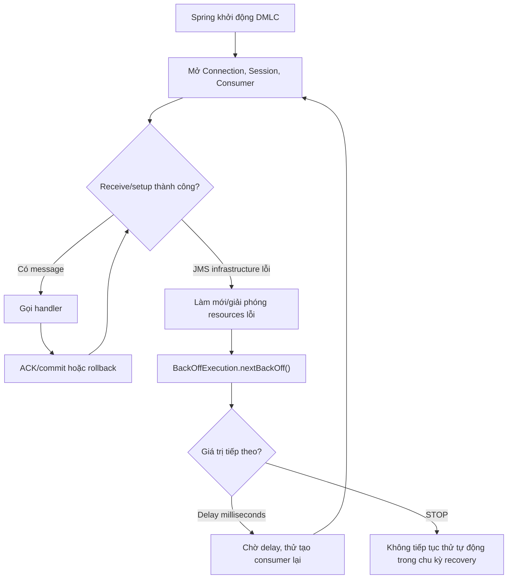

# Phục hồi kết nối bằng recoveryInterval hoặc BackOff trong Spring JMS

> **Nhóm:** Default container · **Module:** Spring Framework – JMS.  
> Bài học tập trung vào cơ chế khôi phục connection, session và consumer của `DefaultMessageListenerContainer` (DMLC); so sánh `setRecoveryInterval(long)` với `setBackOff(BackOff)`; cấu hình cho `@JmsListener` và Spring Boot 3.3.5; kiểm chứng khi broker ActiveMQ Artemis ngừng rồi chạy trở lại. Ví dụ sử dụng **Java 21**, Spring Framework 6.1, Jakarta JMS và Gradle.

## 1. Vấn đề: listener không nên bị bỏ lại sau khi broker ngừng hoạt động

Ứng dụng nhận đơn hàng qua JMS:

```java
@Component
class OrderConsumer {
    @JmsListener(destination = "orders.recovery.demo")
    public void receive(String id) {
        System.out.println("RECEIVED " + id);
    }
}
```

Đây là **fragment**, cần một Spring Boot/Spring Framework application có JMS infrastructure, broker và queue. Khi bình thường, listener nhận message; nhưng broker có thể restart, đường mạng bị cắt, connection hết hiệu lực, failover sang node mới hoặc Spring application được deploy **trước khi broker sẵn sàng**.

Nếu connection/session/consumer đã hỏng mà không được khôi phục, queue có thể tích backlog trong khi ứng dụng vẫn đang chạy. `DefaultMessageListenerContainer` được thiết kế để **thiết lập/refresh JMS resources** và thử phục hồi sau các lỗi phù hợp. Nó có một chính sách chờ giữa các lần thử.

Hai API cần biết:

```java
// Fragment: đã có DefaultMessageListenerContainer container.
container.setRecoveryInterval(5_000L);

// Hoặc một lựa chọn khác, không dùng đồng thời:
container.setBackOff(backOff);
```

**Kết luận trước tiên:** `recoveryInterval` và `BackOff` điều khiển **lịch nỗ lực khôi phục hạ tầng listener**, không điều khiển trực tiếp business message retry, giao dịch database hay producer `JmsTemplate`.

## 2. DefaultMessageListenerContainer hoạt động như thế nào?

DMLC thuộc `org.springframework.jms.listener.DefaultMessageListenerContainer`. Nó dùng các task/thread nhận JMS messages bằng vòng `MessageConsumer.receive()`, rồi gọi `MessageListener` hoặc method `@JmsListener` thông qua adapter. Đừng nhầm với `SimpleMessageListenerContainer` dùng callback của provider qua `setMessageListener()`.



Đây là **sơ đồ khái niệm**, không phải mô tả chính xác từng syscall hoặc thứ tự callback của mọi provider. DMLC có thể phát hiện lỗi khi thiết lập listener ban đầu hoặc khi nhận message sau một thời gian hoạt động.

DMLC giúp xử lý **lỗi connection/setup/receive có khả năng phục hồi**, nhưng không tự:

- Sửa sai username/password, ACL, TLS certificate hoặc broker URL.
- Provision queue vật lý bị xóa trên mọi JMS broker.
- Tạo lại message đã hết hạn, không được persist hoặc đã bị broker purge.
- Bảo đảm xử lý business side effect đúng một lần.
- Áp dụng cùng chính sách retry lên producer `JmsTemplate.convertAndSend`.

### 2.1. Container khác factory

| Thành phần | Vai trò |
| --- | --- |
| `DefaultMessageListenerContainer` | Container **thực** giữ lifecycle và thực hiện recovery. |
| `DefaultJmsListenerContainerFactory` | Tạo/configure DMLC cho các endpoint `@JmsListener`. |
| `JmsListenerEndpointRegistry` | Quản lý các containers sinh ra qua annotation/endpoint infrastructure. |
| `ConnectionFactory` | Provider entry point để tạo connection; bản thân nó có thể có failover/reconnect policy. |
| `JmsTemplate` | Gửi hoặc nhận JMS đồng bộ theo lời gọi của producer; không dùng DMLC BackOff. |

Nếu dùng `@JmsListener`, thông thường cấu hình ở **factory**, không tìm một `@Bean DefaultMessageListenerContainer` mà annotation nhất thiết đang dùng. Nếu tự tạo DMLC như bean riêng, cấu hình trực tiếp trên container.

## 3. recoveryInterval — cố định bao lâu giữa các lần thử?

Spring Framework 6.1 đặt mặc định `DefaultMessageListenerContainer.DEFAULT_RECOVERY_INTERVAL = 5000` **milliseconds** — tức 5 giây. Default tương đương fixed backoff policy của DMLC.

Ví dụ tường minh:

```java
container.setRecoveryInterval(3_000L);  // 3 giây
```

| Giá trị `recoveryInterval` | Khoảng chờ |
| --- | --- |
| `1_000L` | 1 giây |
| `3_000L` | 3 giây |
| `5_000L` | 5 giây (default) |
| `15_000L` | 15 giây |
| `60_000L` | 60 giây |

**Lỗi kinh điển:** `setRecoveryInterval(5)` là **5 milliseconds**, không phải 5 seconds. Một khoảng quá ngắn có thể gây reconnect storm, quá tải auth/broker và bão log.

Khoảng này **không phải** timeout kết nối TCP hay SLA khôi phục. Mỗi attempt có thể cần nhiều thời gian để DNS lookup, TLS handshake, socket connect hoặc provider failover; do đó không thể cam kết cứ đúng 3 giây là có một kết nối thành công.

### 3.1. Lúc nào dùng fixed interval?

- Dev/test với broker gần và ít service instances.
- Outage thông thường ngắn, có nhu cầu retry đều, dễ tính toán.
- Broker chịu được tốc độ mở connection tương ứng với tổng số replicas.
- Muốn hạn chế cấu hình phức tạp.

Với hàng trăm replicas, fixed retry cùng nhịp có thể tạo **thundering herd** khi broker restart. Cần đánh giá số consumers, retries và capacity thay vì mặc định “retry càng nhanh càng tốt”.

## 4. BackOff — mô hình chính sách phục hồi linh hoạt

`org.springframework.util.backoff.BackOff` là interface của Spring Core cung cấp một `BackOffExecution` cho từng chu kỳ thử lại:

```java
// Chữ ký khái niệm, không tự định nghĩa lại interface này:
BackOffExecution execution = backOff.start();
long delayMs = execution.nextBackOff();
```

`delayMs` có thể là khoảng chờ tính bằng **ms**, hoặc `BackOffExecution.STOP`. Khi gặp `STOP`, DMLC **không tiếp tục cố tự phục hồi trong recovery execution đó**, theo hợp đồng của container.

```java
if (delayMs == BackOffExecution.STOP) {
    // Hết lịch recovery trong execution này.
} else {
    // Spring container chờ delayMs rồi thử lại.
}
```

Đây là **fragment mô tả API**; không viết vòng `while(true)` và `Thread.sleep` trong listener business method để làm recovery. DMLC tự tổ chức thread, wait và cleanup để phối hợp với shutdown.

### 4.1. Chính sách có sẵn

- `FixedBackOff`: chờ cố định; có thể vô hạn hoặc giới hạn số lần.
- `ExponentialBackOff`: tăng interval theo multiplier cho đến maxInterval, có thể giới hạn attempts/elapsed time.
- Custom `BackOff`: nếu cần jitter, time windows hoặc chính sách đặc biệt; phải test với nhiều concurrent containers.

**BackOff không đồng nghĩa Spring Retry.** DMLC BackOff điều tiết **hạ tầng nhận**, không tự retry business handler, DB transaction, REST request hay một `JmsTemplate.send` lỗi.

## 5. FixedBackOff — cấu hình tường minh và giới hạn

Cấu hình một policy cố định vô hạn attempts:

```java
import org.springframework.util.backoff.FixedBackOff;

container.setBackOff(
        new FixedBackOff(
                3_000L,
                FixedBackOff.UNLIMITED_ATTEMPTS));
```

Ý nghĩa thực tế gần với `setRecoveryInterval(3_000L)`: delay 3 giây và tiếp tục thử khi container còn chạy. `UNLIMITED_ATTEMPTS` chỉ nói policy không tự dừng; **không có nghĩa service cuối cùng chắc chắn reconnect thành công**.

Muốn giới hạn:

```java
FixedBackOff limited = new FixedBackOff(2_000L, 3L);
container.setBackOff(limited);
```

Chính sách này trả ba khoảng chờ 2 giây rồi `STOP`:

```text
nextBackOff() = 2000
nextBackOff() = 2000
nextBackOff() = 2000
nextBackOff() = STOP
```

`maxAttempts` ở đây kiểm soát **số khoảng backoff mà execution cung cấp**; nó không phải lời cam kết tổng số TCP connection attempts nhìn thấy ở log, vì provider cũng có thể thử kết nối trong nội bộ.

### Khi nào giới hạn nguy hiểm?

Giả sử broker được bảo trì 30 phút, nhưng container dừng recovery sau ba khoảng 2 giây. Broker chạy lại sau đó **không tự chứng minh** DMLC vẫn còn lịch thử. Ứng dụng HTTP có thể sống, nhưng listener không xử lý backlog. Nếu chọn finite attempts, phải có **alert + runbook restart/reinitialize** rõ ràng.

Trong các consumer quan trọng cần sống qua downtime dài, một policy không STOP hoặc giới hạn đủ lớn kèm monitoring thường hợp lý hơn một giới hạn ngắn.

## 6. ExponentialBackOff — tăng khoảng retry khi sự cố kéo dài

Spring Framework 6.1 có `org.springframework.util.backoff.ExponentialBackOff`.

```java
import org.springframework.util.backoff.ExponentialBackOff;

ExponentialBackOff policy =
        new ExponentialBackOff(1_000L, 2.0);
policy.setMaxInterval(8_000L);

container.setBackOff(policy);
```

Với initial interval 1 giây, multiplier 2 và max interval 8 giây:

| `nextBackOff()` lần | Khoảng chờ |
| --- | --- |
| 1 | 1.000 ms |
| 2 | 2.000 ms |
| 3 | 4.000 ms |
| 4 | 8.000 ms |
| 5 | 8.000 ms |
| Tiếp theo (không giới hạn) | Giữ trần 8.000 ms |

Điều này thường làm giảm tần suất reconnect khi broker down lâu. Nhưng một đợt outage ngắn có thể phục hồi chậm hơn fixed 1 giây nếu policy đã tăng delay lên 8 giây.

### 6.1. Giới hạn attempt và elapsed time

Spring Framework 6.1 hỗ trợ:

```java
ExponentialBackOff limited =
        new ExponentialBackOff(1_000L, 2.0);
limited.setMaxInterval(8_000L);
limited.setMaxAttempts(5);
limited.setMaxElapsedTime(30_000L);

container.setBackOff(limited);
```

Khi một trong các giới hạn được đạt đến, `nextBackOff()` có thể trả `STOP`. `maxElapsedTime` là giới hạn của **BackOff policy execution**, không phải watchdog đo chính xác thời gian wall-clock mà provider đang dành cho mỗi lần connect.

**Không dùng finite maxAttempts hoặc maxElapsedTime thấp** nếu mục tiêu là vượt qua những đợt outage bảo trì dài mà không có quy trình restart.

### 6.2. Có jitter mặc định không?

`ExponentialBackOff` của Spring Framework 6.1 tạo sequence theo multiplier/max interval và **không nên giả định có random jitter mặc định**. Với hàng trăm pods đồng pha, exponential vẫn có thể tạo các đợt reconnect tập trung. Nếu cần phân tán attempts, thiết kế policy custom có jitter hoặc dùng cơ chế phù hợp của provider/orchestrator; test dưới tải để tránh gây broker storm.

### 6.3. Bảng chọn nhanh

| Yêu cầu | Fixed recovery interval | Exponential BackOff |
| --- | --- | --- |
| Dễ cấu hình và quan sát | Rất tốt | Trung bình |
| Dễ dự đoán nhịp thử | Rất tốt | Tăng theo multiplier |
| Outage ngắn, ít replicas | Phù hợp | Phù hợp |
| Outage dài, nhiều replicas | Có thể tốn attempts | Thường giảm nhịp attempts |
| Muốn cap delay | Bản chất luôn cố định | `setMaxInterval` |
| Muốn dừng sau N lần | `FixedBackOff` hữu hạn | `setMaxAttempts` |
| Muốn random jitter | Cần custom/provider support | Cần custom/provider support |
| Muốn recovery không dừng | Unlimited attempts | Không đặt giới hạn chặn sớm |

Không có một “best interval” chung cho mọi broker. Chọn chính sách dựa trên connection limits, SLO, số replicas, thời gian outage và loại lỗi.

## 7. Một điểm dễ sai: thứ tự và độ ưu tiên của setters

Ở **trực tiếp `DefaultMessageListenerContainer`**:

- `setRecoveryInterval(ms)` thay `BackOff` hiện tại bằng fixed interval.
- `setBackOff(policy)` đặt policy mới.
- Vì vậy setter gọi **sau** có thể ghi đè ý đồ của setter trước.

```java
container.setBackOff(new ExponentialBackOff(1_000L, 2.0));
container.setRecoveryInterval(5_000L);
// Trên DMLC trực tiếp: thiết lập cuối là fixed 5000 ms.
```

Ở **`DefaultJmsListenerContainerFactory`**:

- Factory lưu cấu hình recoveryInterval và BackOff.
- Khi tạo container, nếu có BackOff thì **ưu tiên BackOff**, bỏ qua recoveryInterval và có thể ghi log thông báo.

Đây là khác biệt giữa **setter trực tiếp lên container** và **factory build container**; dễ khiến thử nghiệm sai khi có nhiều lớp cấu hình.

**Quy tắc dễ bảo trì nhất:** chỉ định **một** policy trên mỗi factory/container, ghi rõ mode, unit và owner.

## 8. Khác biệt retry kết nối và retry message

Một hệ thống JMS có ít nhất bốn cơ chế thường bị gọi chung là “retry”:

| Cơ chế | Ai chịu trách nhiệm | Mục đích |
| --- | --- | --- |
| **JMS provider failover** | Artemis client/provider | Tìm lại broker/node sau lỗi transport |
| **DMLC recovery** | `DefaultMessageListenerContainer` | Khôi phục connection/session/consumer khi setup/receive lỗi |
| **Message redelivery** | JMS transaction + broker policy | Giao lại message khi handler fail/rollback hoặc ACK chưa hoàn tất |
| **Producer retry** | `JmsTemplate` caller/outbox | Gửi lại khi send lỗi hoặc trạng thái gửi chưa rõ |
| **Downstream retry** | Business service/HTTP client | Thử lại API/database dependency |

`setBackOff` của DMLC **không** tự retry một `JmsTemplate.convertAndSend` thất bại. Cũng không phải policy redelivery của broker.

Ví dụ handler:

```java
@JmsListener(destination = "orders.recovery.demo")
public void receive(String eventId) {
    paymentService.charge(eventId);  // Có thể lỗi nghiệp vụ.
}
```

Đây là fragment cần `paymentService`. Nếu method throw, JMS session có thể rollback/redeliver **theo transaction và broker policy**, không phải vì `recoveryInterval` tính một khoảng đợi. Nếu broker mất kết nối sau khi charge thành công nhưng trước ACK/commit, message có thể đến lại: cần **idempotent consumer** bằng eventId/unique constraint. Nếu DB commit nhưng producer chết trước JMS send, có thể dùng **transactional outbox** để giảm nguy cơ mất sự kiện.

## 9. Cấu hình trực tiếp trên DefaultMessageListenerContainer

Nếu không dùng annotation và muốn tự tạo container bean:

```java
@Configuration
class DirectContainerConfig {

    @Bean
    DefaultMessageListenerContainer incomingContainer(
            ConnectionFactory connectionFactory) {
        DefaultMessageListenerContainer container =
                new DefaultMessageListenerContainer();

        container.setConnectionFactory(connectionFactory);
        container.setDestinationName("orders.recovery.demo");
        container.setMessageListener(message -> {
            System.out.println("Incoming native JMS message");
        });
        container.setSessionTransacted(true);
        container.setConcurrentConsumers(1);

        // Chọn MỘT trong hai cấu hình này:
        container.setRecoveryInterval(5_000L);
        return container;
    }
}
```

Fragment cần imports `jakarta.jms.ConnectionFactory`, `org.springframework.context.annotation.Bean`, `org.springframework.context.annotation.Configuration` và `org.springframework.jms.listener.DefaultMessageListenerContainer`. Class được quản lý bằng Spring ApplicationContext; listener callback nhận raw `jakarta.jms.Message` chứ không tự parse DTO.

Để thay chính sách mà không dùng cả hai, **thay dòng** `container.setRecoveryInterval(...)` bằng:

```java
ExponentialBackOff policy =
        new ExponentialBackOff(1_000L, 2.0);
policy.setMaxInterval(8_000L);
container.setBackOff(policy);
```

Nếu một `@JmsListener` khác dùng default factory, nó **không tự sử dụng** bean `incomingContainer` này. Cần cấu hình factory mà endpoint annotated thực sự tham chiếu.

## 10. Demo Spring Boot 3.3.5: đổi giữa fixed và exponential

Một project Spring Boot minh họa bốn hành vi:

1. Bean `jmsListenerContainerFactory` tạo DMLC cho `@JmsListener` và áp dụng đúng một recovery policy.
2. `@JmsListener` nhận String từ queue `orders.recovery.demo`.
3. HTTP `POST` gửi message **khi muốn thử**, không gửi tự động lúc khởi động. Điều này quan trọng để app có cơ hội hoạt động khi broker đang down.
4. HTTP `GET` trả một số chỉ dấu lifecycle và recovery của listener, **không cam kết broker thực sự healthy**.

### 10.1. Điều kiện thực hành

- Java **21**, Gradle wrapper tương thích.
- Spring Boot **3.3.5** (Spring Framework **6.1**), imports `jakarta.jms`.
- Broker ActiveMQ Artemis **riêng** chạy ở `tcp://localhost:61616`; account/password local `artemis/artemis` trong ví dụ.
- Queue `orders.recovery.demo` đã được admin provision hoặc broker cấu hình auto-create phù hợp; cùng một String tên destination không tự đảm bảo queue vật lý tồn tại ở mọi broker.
- **Không thử tắt broker production** hay broker dùng chung để làm bài.

### 10.2. Gradle

`settings.gradle`:

```groovy
rootProject.name = 'spring-jms-recovery-demo'
```

`build.gradle`:

```groovy
plugins {
    id 'java'
    id 'org.springframework.boot' version '3.3.5'
    id 'io.spring.dependency-management' version '1.1.6'
}

group = 'com.example'
version = '0.0.1-SNAPSHOT'

java {
    toolchain {
        languageVersion = JavaLanguageVersion.of(21)
    }
}

repositories {
    mavenCentral()
}

dependencies {
    implementation 'org.springframework.boot:spring-boot-starter-web'
    implementation 'org.springframework.boot:spring-boot-starter-artemis'
    testImplementation 'org.springframework.boot:spring-boot-starter-test'
}

tasks.named('test') { useJUnitPlatform() }
```

`src/main/resources/application.yml`:

```yaml
spring:
  artemis:
    mode: native
    broker-url: ${JMS_BROKER_URL:tcp://localhost:61616}
    user: ${JMS_USER:artemis}
    password: ${JMS_PASSWORD:artemis}
  jms:
    pub-sub-domain: false

demo:
  recovery:
    mode: fixed

server:
  port: 8080
```

`demo.recovery.mode` là **property do ví dụ định nghĩa**, không phải Spring Boot property có sẵn. Đổi từ `fixed` sang `exponential` để thử chính sách còn lại. `spring.jms.pub-sub-domain=false` chọn queue mode; production cần secrets, TLS, ACL, monitoring và storage policy.

### 10.3. Java source hoàn chỉnh

Tạo `src/main/java/com/example/recovery/RecoveryDemoApplication.java`:

```java
package com.example.recovery;

import java.util.Map;

import jakarta.jms.ConnectionFactory;

import org.springframework.beans.factory.annotation.Value;
import org.springframework.boot.SpringApplication;
import org.springframework.boot.autoconfigure.SpringBootApplication;
import org.springframework.boot.autoconfigure.jms.DefaultJmsListenerContainerFactoryConfigurer;
import org.springframework.context.annotation.Bean;
import org.springframework.http.ResponseEntity;
import org.springframework.jms.annotation.EnableJms;
import org.springframework.jms.annotation.JmsListener;
import org.springframework.jms.config.DefaultJmsListenerContainerFactory;
import org.springframework.jms.config.JmsListenerEndpointRegistry;
import org.springframework.jms.connection.CachingConnectionFactory;
import org.springframework.jms.core.JmsTemplate;
import org.springframework.jms.listener.DefaultMessageListenerContainer;
import org.springframework.jms.listener.MessageListenerContainer;
import org.springframework.stereotype.Component;
import org.springframework.util.backoff.ExponentialBackOff;
import org.springframework.web.bind.annotation.GetMapping;
import org.springframework.web.bind.annotation.PathVariable;
import org.springframework.web.bind.annotation.PostMapping;
import org.springframework.web.bind.annotation.RestController;

@SpringBootApplication
@EnableJms
public class RecoveryDemoApplication {

    public static void main(String[] args) {
        SpringApplication.run(RecoveryDemoApplication.class, args);
    }

    @Bean(name = "jmsListenerContainerFactory")
    DefaultJmsListenerContainerFactory listenerFactory(
            ConnectionFactory connectionFactory,
            DefaultJmsListenerContainerFactoryConfigurer configurer,
            @Value("${demo.recovery.mode:fixed}") String mode) {

        // Boot 3.3: unwrap CachingConnectionFactory nếu có.
        ConnectionFactory listenerConnectionFactory =
                connectionFactory;
        if (connectionFactory instanceof CachingConnectionFactory cache
                && cache.getTargetConnectionFactory() != null) {
            listenerConnectionFactory =
                    cache.getTargetConnectionFactory();
        }

        DefaultJmsListenerContainerFactory factory =
                new DefaultJmsListenerContainerFactory();

        // Giữ các thiết lập Boot về transaction và provider:
        configurer.configure(factory, listenerConnectionFactory);
        factory.setConcurrency("1-1");

        if ("fixed".equalsIgnoreCase(mode)) {
            factory.setRecoveryInterval(3_000L);
        } else if ("exponential".equalsIgnoreCase(mode)) {
            ExponentialBackOff policy =
                    new ExponentialBackOff(1_000L, 2.0);
            policy.setMaxInterval(8_000L);
            factory.setBackOff(policy);
        } else {
            throw new IllegalArgumentException(
                    "Unsupported mode: " + mode);
        }
        return factory;
    }
}

@Component
class OrdersListener {

    @JmsListener(
            id = "ordersRecoveryListener",
            destination = "orders.recovery.demo")
    public void receive(String id) {
        System.out.println("RECEIVED " + id);
    }
}

@RestController
class RecoveryController {

    private final JmsTemplate template;
    private final JmsListenerEndpointRegistry registry;

    RecoveryController(
            JmsTemplate template,
            JmsListenerEndpointRegistry registry) {
        this.template = template;
        this.registry = registry;
    }

    @PostMapping("/demo/messages/{id}")
    ResponseEntity<String> publish(@PathVariable String id) {
        template.convertAndSend("orders.recovery.demo", id);
        return ResponseEntity.accepted().body("SENT " + id);
    }

    @GetMapping("/demo/listener")
    Map<String, Object> status() {
        MessageListenerContainer container =
                registry.getListenerContainer("ordersRecoveryListener");

        if (container instanceof DefaultMessageListenerContainer dmlc) {
            return Map.of(
                    "registered", true,
                    "running", dmlc.isRunning(),
                    "recovering", dmlc.isRecovering(),
                    "activeConsumers", dmlc.getActiveConsumerCount());
        }
        return Map.of("registered", false);
    }
}
```

### 10.4. Tại sao cấu hình như vậy?

- `@SpringBootApplication` scan `OrdersListener`/`RecoveryController`; `@EnableJms` bật annotation-driven listener.
- Bean có tên **`jmsListenerContainerFactory`** được hạ tầng `@JmsListener` dùng theo mặc định. Nếu một listener ghi `containerFactory="someOtherFactory"`, policy ở bean này **không áp dụng** cho listener đó.
- `DefaultJmsListenerContainerFactoryConfigurer` trong `org.springframework.boot.autoconfigure.jms` của Boot 3.3 giúp tái sử dụng các settings Boot; bean factory thủ công không nên bỏ quên transaction mode, converter hoặc resource settings.
- `CachingConnectionFactory` có thể bọc native provider factory phía producer. DMLC được ưu tiên giao native factory để tự quản lý recovery/cache; điều kiện `instanceof` tránh cast sai khi provider factory không phải wrapper.
- **Không import `ConnectionFactoryUnwrapper`** trong Boot 3.3.5; helper đó có ở Boot mới hơn.
- Nhánh fixed chỉ gọi `setRecoveryInterval`; nhánh exponential chỉ gọi `setBackOff`, tránh mâu thuẫn.
- `@JmsListener(id="ordersRecoveryListener")` tạo DMLC do registry quản lý; ID này dùng để tìm container. Không mặc định có một Spring bean DMLC có cùng ID.
- `POST /demo/messages/{id}` là **producer đồng bộ**. Khi broker down, lời gọi gửi có thể ném lỗi hoặc block theo client/provider timeout; nó không dùng BackOff của DMLC.
- `GET /demo/listener` trả một snapshot. `isRunning()` là lifecycle, `isRecovering()` là trạng thái tạm thời, `activeConsumers` không đồng nghĩa số broker consumers đang kết nối khỏe.

### 10.5. Transaction và ACK

Boot thường cấu hình default listener factory theo hướng transactional khi không có thiết lập ngoại lệ: có `JtaTransactionManager` phù hợp thì dùng nó, nếu không có thường bật `sessionTransacted`. Bài dùng `configurer.configure(...)` để giữ chính sách này thay vì tự tuyên bố mọi application đều dùng một kiểu transaction.

Nếu bạn tạo factory hoàn toàn thủ công và muốn JMS local transaction, hãy gọi `factory.setSessionTransacted(true)`. Điều này giúp commit khi xử lý listener thành công và rollback/redelivery khi exception chưa được nuốt, tùy broker. **Transaction mode là vấn đề khác recovery interval**.

## 11. Fault test: broker down rồi up

### 11.1. Chuẩn bị trên broker test

Dùng một Artemis instance tách biệt. Xác nhận queue `orders.recovery.demo` tồn tại hoặc auto-create đã được bật với ACL phù hợp. Đừng xóa thư mục data/journal của broker để minh họa sự cố: điều đó có thể khiến messages và queue mất hẳn, không còn là bài kiểm thử reconnect thông thường.

Khởi động app:

```bash
# Linux/macOS:
./gradlew bootRun

# Windows:
gradlew.bat bootRun
```

Khi broker đang hoạt động, gửi:

```bash
curl -i -X POST http://localhost:8080/demo/messages/before
```

Nếu send thành công, HTTP response có thể có body:

```text
SENT before
```

và listener in:

```text
RECEIVED before
```

Đây là **hai bằng chứng độc lập**; listener bất đồng bộ nên thứ tự và thời điểm không cố định, các startup logs khác nhau tùy máy.

### 11.2. Dừng đúng broker test instance

Stop Artemis test theo cơ chế vận hành của instance (ví dụ Ctrl+C khi chạy foreground). Không stop broker shared hoặc production.

Trong lúc broker down, kiểm tra:

```bash
curl -s http://localhost:8080/demo/listener
```

Có thể thấy một snapshot như sau:

```json
{
  "registered": true,
  "running": true,
  "recovering": true,
  "activeConsumers": 1
}
```

**Đây chỉ là ví dụ một trạng thái có thể quan sát**, không phải kết quả bảo đảm. `isRecovering()` có thể đổi rất nhanh; active consumer counter phản ánh tasks của container, không nhất thiết là kết nối broker đã khỏe; `isRunning()=true` không chứng minh producer/consumer đã phục hồi.

Xem logs DMLC về lỗi setup/receive, recovery attempts và causal exception. Độ trễ thực tế gồm thời gian provider thử kết nối + interval của DMLC.

### 11.3. Khởi động lại broker test

Restart broker instance với đúng cấu hình và queue cũ. Kiểm tra trên Artemis console rằng consumer đang kết nối lại, rồi gửi:

```bash
curl -i -X POST http://localhost:8080/demo/messages/after
```

Nếu send và consume thành công, quan sát:

```text
SENT after
RECEIVED after
```

Hai dòng thuộc **HTTP response và application log khác nhau**, không phải một stdout cố định. Nếu message được broker persist trong lúc consumer offline, nó có thể được giao sau reconnect; điều này phụ thuộc broker persistence, TTL, ACL, subscription và routing. Không khẳng định tất cả message sống sót mọi lần restart.

### 11.4. So sánh hai lần chạy

- Đặt `demo.recovery.mode=fixed` và chạy thử: interval cố định 3000 ms.
- Đặt `demo.recovery.mode=exponential` và chạy thử lại: delays 1000, 2000, 4000, 8000... ms, không vượt 8000 ms trong policy.
- Đo log time/metrics. Thời gian nỗ lực connect có thể kéo dài khác nhau do socket timeout và provider failover, nên không so sánh timestamps tuyệt đối với unit test policy từng ms.
- Với broker xuống lâu hơn 30 giây, bảo đảm policy không bị `STOP` trước lúc broker trở lại (trừ khi bạn đang **cố tình** thử finite attempts).

## 12. Kiểm thử BackOff policy không cần broker

Dùng `spring-boot-starter-test` (đã có trong Gradle) để test sequence độc lập với Artemis.

File `src/test/java/com/example/recovery/RecoveryPolicyTest.java`:

```java
package com.example.recovery;

import org.junit.jupiter.api.Test;
import org.springframework.util.backoff.BackOffExecution;
import org.springframework.util.backoff.ExponentialBackOff;
import org.springframework.util.backoff.FixedBackOff;

import static org.junit.jupiter.api.Assertions.assertEquals;

class RecoveryPolicyTest {

    @Test
    void fixedDelaysThenStops() {
        BackOffExecution execution =
                new FixedBackOff(2_000L, 3L).start();

        assertEquals(2_000L, execution.nextBackOff());
        assertEquals(2_000L, execution.nextBackOff());
        assertEquals(2_000L, execution.nextBackOff());
        assertEquals(BackOffExecution.STOP, execution.nextBackOff());
    }

    @Test
    void exponentialDoublesAndCaps() {
        ExponentialBackOff backOff =
                new ExponentialBackOff(1_000L, 2.0);
        backOff.setMaxInterval(8_000L);
        backOff.setMaxAttempts(5);

        BackOffExecution execution = backOff.start();
        assertEquals(1_000L, execution.nextBackOff());
        assertEquals(2_000L, execution.nextBackOff());
        assertEquals(4_000L, execution.nextBackOff());
        assertEquals(8_000L, execution.nextBackOff());
        assertEquals(8_000L, execution.nextBackOff());
        assertEquals(BackOffExecution.STOP, execution.nextBackOff());
    }
}
```

Chạy:

```bash
./gradlew test
```

Các assertions mô tả output **của BackOffExecution** trong Spring 6.1. Đây **không phải integration test**; nó không kiểm tra broker, container wiring, transaction hoặc khả năng phục hồi thật. Khi kiểm thử cả app, cần dùng broker cô lập và giới hạn thời gian chờ.

## 13. Observability: reconnect thành công là bao nhiêu?

DMLC expose các thông tin:

```java
// Fragment: đã có DefaultMessageListenerContainer dmlc.
boolean running = dmlc.isRunning();
boolean recovering = dmlc.isRecovering();
int active = dmlc.getActiveConsumerCount();
```

- `isRunning()`: lifecycle đang chạy; có thể true dù broker down.
- `isRecovering()`: container đang cố recovery; giá trị có thể đổi giữa hai lần poll.
- `getActiveConsumerCount()`: số task/consumer invokers active trong container; không phải network reachability proof.

Đừng dùng một trong ba giá trị trên **đơn độc** để khai báo hệ thống processing khỏe. Cần kết hợp:

| Nguồn | Nên quan sát |
| --- | --- |
| **Spring logs/metrics** | Recovery start/end, exception cause, số lần retry, consumer setup failures |
| **Artemis broker console/management** | Connection count, actual queue consumer count, pending/delivering messages |
| **Delivery metrics** | Số messages hoàn tất, processing lag, redelivery, DLQ, expiry |
| **Service health** | Dependency readiness, thời gian mất khả năng nhận, HTTP/DB status khác nhau |
| **End-to-end probe** | Message test trong destination riêng, được xử lý trong timeout xác định |

**Liveness khác readiness:** khi broker bảo trì tạm thời, kill/restart mọi consumer pods liên tục có thể khiến reconnect storm mạnh hơn. Liveness nên đánh giá process còn có khả năng hoạt động; readiness hay worker availability mới phản ánh khả năng phục vụ công việc theo SLO. Cách áp dụng phụ thuộc kiến trúc service consumer-only hoặc service có HTTP traffic.

Không log password, token, nội dung chứa PII và không ghi mỗi failed attempt ở mức quá chi tiết tạo ngập log.

## 14. Cache, connection timeout và receive timeout

Các timeout dễ bị nhầm:

| Cấu hình | Ý nghĩa |
| --- | --- |
| DMLC `recoveryInterval` / `BackOff` | **Chờ giữa recovery attempts** |
| DMLC `receiveTimeout` | Thời gian một lần gọi `receive()` chờ message trong luồng polling |
| Provider socket/connect timeout | Giới hạn thời gian connect/handshake do JMS client/network kiểm soát |
| Provider failover/reconnect policy | Các retries nội bộ của Artemis client khi lỗi transport |
| Broker redelivery delay | Thời gian trước khi giao lại một **message** rollback |
| Producer `JmsTemplate` timeouts | Thời gian chờ/exception khi phía gửi không liên lạc broker |

`setReceiveTimeout` **không phải** `setRecoveryInterval`. Nếu provider mất 20 giây cho một attempt, interval 3 giây không đồng nghĩa sau 3 giây sẽ có kết nối mới thành công.

### CachingConnectionFactory và native ConnectionFactory

DMLC có chính sách quản lý JMS resources và recovery riêng; dùng cache consumer/session phía ngoài một cách không kiểm soát có thể khiến restart/recovery phức tạp. Spring Boot thường dùng cache cho `JmsTemplate` và ưu tiên native provider factory cho listener.

Trong Boot 3.3.5, có thể unwrap trực tiếp `CachingConnectionFactory` bằng `getTargetConnectionFactory()` như code ví dụ. Không import `org.springframework.boot.jms.ConnectionFactoryUnwrapper` của các phiên bản mới hơn vào Boot 3.3.

## 15. Đặc biệt: khi BackOff trả STOP

`BackOffExecution.STOP` là “**không còn lịch thử phục hồi**” của execution, không phải sự kiện broker đã khỏe hoặc message đã được ACK.

Nếu chọn `FixedBackOff(2000,3)` hoặc exponential có `maxAttempts` thấp:

- Sau vài attempts, DMLC có thể **ngừng thử** dù broker vẫn đang down.
- Broker chạy lại chưa chắc tự kích hoạt lại một execution đã STOP.
- HTTP app có thể tiếp tục sống, còn queue backlog tăng do không có consumer.
- Cần một runbook rõ cho việc alert, restart/reinitialize container hoặc redeploy trong phạm vi lifecycle được hỗ trợ.

Nếu yêu cầu luôn tự phục hồi qua maintenance windows dài, chọn policy không giới hạn số lần hoặc đủ rộng **và** theo dõi sức khỏe. Retry vô hạn với URL/credentials sai vẫn thất bại vô hạn; phải cảnh báo lỗi không có khả năng tự sửa.

## 16. Những lỗi cấu hình thường gặp

| Triệu chứng | Nguyên nhân khả dĩ | Hướng khắc phục |
| --- | --- | --- |
| DMLC retry 5 giây dù không cấu hình | Default 5000 ms | Giữ nếu phù hợp hoặc set policy có chủ đích |
| Retry quá nhanh | Dùng `setRecoveryInterval(5)` tưởng 5 giây | Dùng `5_000L` |
| Đặt exponential nhưng thấy fixed | Bị setter khác ghi đè hoặc listener dùng factory khác | Chọn một policy, kiểm tra bean name/factory reference |
| BackOff dừng trước khi broker phục hồi | `STOP` do maxAttempts/maxElapsedTime | Nâng giới hạn hoặc thêm alert/runbook |
| Broker up nhưng không nhận | ACL, queue không tồn tại, sai broker URL, provider/consumer chưa phục hồi | Kiểm tra broker-side queue/consumer và logs |
| `isRunning()=true` dù broker down | Lifecycle không phải connection health | Dùng broker management và end-to-end probe |
| Producer vẫn gửi lỗi | BackOff chỉ nằm trên listener | Producer retry/outbox riêng |
| Đã reconnect nhưng message nhân đôi | ACK/commit thất bại, broker redelivery | Consumer idempotent, event ID và transaction |
| Message mất sau restart | TTL/non-persistent storage/purge | Kiểm tra broker persistence/expiry policy |
| Lỗi listener JSON bị retry | Malformed payload, sai schema, không phải connection failure | DLQ/quarantine và validation |
| Service replicas tạo reconnect storm | Interval quá ngắn, đồng pha, không có jitter | BackOff dài hơn và đánh giá custom jitter |
| Application start trước broker nhưng fail | Producer/health bootstrap đòi broker đồng bộ | Trì hoãn producer test, cô lập dependency bắt buộc |
| DMLC dùng caching producer factory | Cache lifecycle làm recovery khó đoán | Dùng native provider factory cho listener khi phù hợp |
| Import `javax.jms` với Boot 3 | Không tương thích Jakarta API | Dùng `jakarta.jms` |

## 17. Checklist vận hành trước khi deploy

- Xác nhận destination, queue/topic mode, broker instance và ACL của consumer.
- Xác định SLA outage và số replicas/consumers; kiểm tra broker connection rate limits.
- Chọn **một** recovery policy trên đúng factory/container; ghi rõ đơn vị milliseconds.
- Nếu dùng finite BackOff, thiết kế cảnh báo khi STOP và cơ chế phục hồi thủ công/tự động.
- Tuning provider failover/socket timeouts **độc lập** với DMLC recovery interval.
- Không nhầm container recovery với broker redelivery hoặc business retry.
- Đặt JMS local transaction/JTA đúng nhu cầu; consumer idempotent khi ACK có thể thất bại.
- Giữ queue persistence/retention/TTL/DLQ phù hợp để backlog không mất trước khi reconnect.
- Theo dõi `isRecovering`, broker consumer count, backlog và elapsed outage.
- Fault-test trong broker test: startup before broker, broker restart, network break, sai ACL, invalid destination.
- Kiểm tra việc Spring Boot configurer gắn factory đúng `@JmsListener`; tránh bị overrides ở nhiều nơi.
- Dùng queue test để probe, không xóa queue có dữ liệu hoặc tắt broker shared để kiểm tra.

## 18. Câu hỏi tự kiểm tra

1. DMLC làm gì khi `MessageConsumer.receive()` thất bại vì connection hỏng?
2. Default `DEFAULT_RECOVERY_INTERVAL` của Spring Framework 6.1 là bao nhiêu milliseconds?
3. `setRecoveryInterval(5)` là 5ms hay 5s? Sai số này gây hậu quả gì?
4. `BackOffExecution.nextBackOff()` trả giá trị nào và `STOP` có nghĩa gì?
5. So sánh `setRecoveryInterval(3000)` với `setBackOff(new FixedBackOff(3000, UNLIMITED_ATTEMPTS))`.
6. Vì sao thứ tự setter trên DMLC trực tiếp có thể làm chính sách khác với thứ tự config trên factory?
7. Với `ExponentialBackOff(1000,2.0)` trần 8000, viết năm delay đầu.
8. Nếu `maxAttempts=5` nhưng outage kéo dài 30 phút, cần quan sát và can thiệp thế nào?
9. `ExponentialBackOff` của Spring 6.1 có mặc định random jitter không? Vì sao quan trọng khi có nhiều replicas?
10. Phân biệt producer retry, provider failover, DMLC recovery và broker redelivery.
11. `isRunning()=true` có chứng minh broker đang reachable không? Bạn cần thêm dữ liệu gì?
12. Nếu database side effect thành công nhưng JMS commit fail do connection mất, điều gì xảy ra khi broker phục hồi?
13. Vì sao ứng dụng demo không gửi JMS message tự động trong `ApplicationRunner` khi thử startup-before-broker?
14. Khi `@JmsListener` chỉ rõ container factory khác, policy ở default factory còn áp dụng không?
15. Đề xuất một fault-test có hạn thời gian để xác nhận sau khi broker restart consumer nhận được message `after`.
16. Nếu queue bị xóa khi broker xuống, BackOff có tự provision lại queue trong mọi provider không?
17. Vì sao `receiveTimeout` không thể dùng thay `recoveryInterval`?
18. Khi cần restart/remediate một container đã ngừng recovery, bạn cần runbook/monitoring nào để tránh worker chết lặng?

**Tóm tắt:** `DefaultMessageListenerContainer` có khả năng phục hồi JMS resources sau lỗi setup/receive. `recoveryInterval` là fixed delay theo **milliseconds**, mặc định **5000 ms**; `BackOff` cho lịch chờ tùy biến qua `FixedBackOff`, `ExponentialBackOff` và `BackOffExecution.STOP`. Cần cấu hình trên **đúng DMLC hoặc factory sinh ra nó**, không dùng hai chính sách mâu thuẫn, và kiểm thử broker outage thực tế. Kết nối lại thành công **không thay thế** transaction, redelivery/DLQ, producer outbox và idempotent processing.

### Tài liệu kỹ thuật tham khảo

- [Spring Framework 6.1 – DefaultMessageListenerContainer](https://docs.spring.io/spring-framework/docs/6.1.11/javadoc-api/org/springframework/jms/listener/DefaultMessageListenerContainer.html) — `DEFAULT_RECOVERY_INTERVAL`, `setRecoveryInterval`, `setBackOff`, recovery state.
- [Spring Framework – Using Spring JMS](https://docs.spring.io/spring-framework/reference/integration/jms/using.html) — listener containers, connection recovery, default fixed BackOff.
- [Spring Framework – DefaultJmsListenerContainerFactory](https://docs.spring.io/spring-framework/docs/6.1.11/javadoc-api/org/springframework/jms/config/DefaultJmsListenerContainerFactory.html) — factory setters for recoveryInterval/BackOff.
- [Spring Framework 6.1 – FixedBackOff](https://docs.spring.io/spring-framework/docs/6.1.11/javadoc-api/org/springframework/util/backoff/FixedBackOff.html) — fixed interval, `UNLIMITED_ATTEMPTS`.
- [Spring Framework 6.1 – ExponentialBackOff](https://docs.spring.io/spring-framework/docs/6.1.21/javadoc-api/org/springframework/util/backoff/ExponentialBackOff.html) — multiplier, max interval, max attempts và elapsed time.
- [Spring Framework – Annotation-driven Listener Endpoints](https://docs.spring.io/spring-framework/reference/integration/jms/annotated.html) — `@JmsListener` và container factory.
- [Spring Boot 3.3 JMS Reference](https://docs.spring.io/spring-boot/3.3/reference/messaging/jms.html) — Boot default listener factories and connection setup.
- [ActiveMQ Artemis – Documentation](https://artemis.apache.org/components/artemis/documentation/latest/) — provider failover/reconnect và broker queue/DLQ behavior.
