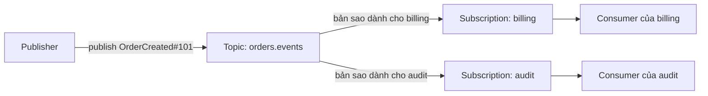

# Mỗi subscription nhận một bản tin của Topic trong Spring JMS

## 1. Quy tắc cần nắm

Với mô hình **publish/subscribe (pub/sub)** của Jakarta Messaging (JMS), một publisher gửi thông điệp lên `Topic`. Broker đưa **một bản sao logic của thông điệp vào mỗi subscription đủ điều kiện** trên Topic đó. Mỗi subscription xử lý và xác nhận bản sao của mình độc lập với các subscription khác.

Vì vậy, câu “mỗi subscription nhận một bản tin của Topic” cần hiểu chính xác là: **với mỗi thông điệp được phát lên Topic, mỗi subscription đang có hiệu lực và thỏa điều kiện lọc nhận một bản sao của thông điệp đó**. Đây là nguyên tắc phân phối giữa các subscription, không phải lời hứa rằng mỗi tiến trình/consumer sẽ xử lý đúng một lần trong mọi tình huống.

Ví dụ: Topic `orders.events` nhận sự kiện `OrderCreated#101`, đang có hai subscription độc lập `billing` và `audit`. Broker có thể phân phối như sau:



Hai consumer nhận cùng **nội dung sự kiện**, nhưng nhận qua **hai bản sao độc lập về vòng đời giao nhận và xác nhận**. `billing` xử lý chậm, rollback hoặc chưa acknowledge không ngăn `audit` xác nhận bản sao của chính mình. Không cần tạo hai Topic hay gửi hai lần từ publisher.

## 2. Phân biệt Topic, subscription và consumer

| Thành phần | Vai trò | Điều dễ nhầm |
| --- | --- | --- |
| **Topic** | Địa chỉ publisher phát thông điệp để phân phối đến các subscription. | Topic tự nó không đồng nghĩa với một hàng đợi cho từng consumer. |
| **Subscription** | Quan hệ đăng ký với Topic được broker quản lý; là đơn vị nhận **một bản sao** của mỗi thông điệp phù hợp. | “Mỗi subscription” khác “mỗi consumer”. |
| **Consumer** | Đối tượng/tiến trình lấy và xử lý thông điệp từ subscription. | Một subscription **shared** có thể có nhiều consumer cùng chia việc. |
| **Publisher** | Gửi một thông điệp tới Topic. | Publisher không phải tự gửi riêng cho từng subscription. |

**Quy trình với một thông điệp `M1`:**

1. Subscription `S_A` và `S_B` đã tồn tại và đủ điều kiện nhận `M1`.
2. Publisher gửi `M1` tới Topic `T` một lần.
3. Broker gán bản sao `M1/A` cho `S_A` và `M1/B` cho `S_B`.
4. Consumer của `S_A` xử lý `M1/A`; consumer của `S_B` xử lý `M1/B`. Thứ tự hoàn thành giữa hai subscription không được đồng bộ hóa.
5. Broker theo dõi trạng thái giao nhận/xác nhận tương ứng; thất bại ở `S_A` có thể dẫn tới redelivery ở `S_A` mà không buộc `S_B` nhận lại.

Cụm “bản sao” nói về **ngữ nghĩa phân phối của JMS**; broker không nhất thiết phải nhân đôi byte payload theo đúng sơ đồ vật lý này.

### Dòng thời gian và thời điểm tạo subscription

Giả sử hai subscription **non-durable** độc lập được tạo và consumer của chúng đang hoạt động:

| Thời điểm | Sự kiện | `billing` | `audit` |
| --- | --- | --- | --- |
| 10:00 | Cả hai subscription đã hoạt động | Sẵn sàng | Sẵn sàng |
| 10:01 | Publish `M1` | Nhận bản sao `M1` | Nhận bản sao `M1` |
| 10:02 | Publish `M2` | Nhận bản sao `M2` | Nhận bản sao `M2` |
| 10:03 | Consumer `audit` bị đóng; subscription non-durable của nó mất | Vẫn hoạt động | Không tồn tại |
| 10:04 | Publish `M3` | Nhận bản sao `M3` | Không nhận `M3` |
| 10:05 | Consumer `audit` tạo subscription mới | Không đổi | Chỉ nhận các thông điệp phù hợp từ khi subscription mới có hiệu lực |

Nếu `audit` là **durable subscription đã đăng ký từ trước**, nó có thể giữ `M3` trong lúc offline để nhận khi consumer kết nối lại, miễn thông điệp còn hợp lệ và chưa bị loại theo chính sách giao nhận. Biến một subscription thành durable ở 10:05 **không khôi phục ngược** `M3` đã gửi lúc 10:04 cho một subscription khi đó chưa tồn tại.

## 3. Quy tắc “một bản sao cho mỗi subscription” có những điều kiện gì?

- **Subscription phải có hiệu lực tại thời điểm phù hợp.** Non-durable chỉ sống khi có consumer (đối với shared non-durable: khi còn ít nhất một consumer). Durable tồn tại xuyên thời gian ngắt kết nối sau khi đã được tạo.
- **Message selector có thể lọc thông điệp.** Nếu subscription chỉ chọn `eventType = 'PAID'`, thông điệp có property `eventType = 'CREATED'` sẽ không được thêm vào subscription ấy. Không phải mọi subscription đều luôn nhận mọi thông điệp.
- **Hạn sử dụng và quy tắc provider vẫn áp dụng.** Thông điệp có thể hết TTL, bị loại vì cấu hình hoặc chịu các tình huống vận hành mà ứng dụng cần kiểm soát. Durable không có nghĩa là lưu vô hạn.
- **Acknowledge/transaction là riêng cho từng bản sao.** Việc subscription A đã xác nhận không có nghĩa B đã xác nhận. Rollback, lỗi kết nối hoặc consumer khởi động lại có thể khiến một bản sao **được phát lại**; thiết kế xử lý idempotent khi có tác động nghiệp vụ.
- **Số bản sao giữa subscription không phải số lần gọi handler.** Một subscription có thể nhận lại cùng thông điệp do redelivery; đây là lý do tránh diễn giải câu hỏi thành “exactly once” ở cấp xử lý.
- **Thứ tự giữa các subscription và giữa nhiều consumer không phải thứ tự log toàn cục.** JMS có quy tắc thứ tự riêng cho luồng giao nhận hợp lệ nhưng không cam kết hai dịch vụ xử lý xong cùng lúc.

Tóm lại, đối với một thông điệp hợp lệ `M`, nếu Topic có ba subscription đủ điều kiện `S1`, `S2`, `S3` thì có ba **bản sao logic theo subscription**; việc mỗi bản sao được xử lý thành công bao nhiêu lần còn phụ thuộc acknowledge, retry và giao dịch.

## 4. Unshared, shared, non-durable và durable

JMS cho phép kết hợp hai chiều độc lập: **shared/unshared** quyết định số consumer có thể đọc cùng một subscription; **durable/non-durable** quyết định subscription có sống khi consumer offline hay không.

| Kiểu subscription | Số consumer cùng subscription | Khi consumer đều ngắt kết nối | Một thông điệp phù hợp được chuyển thế nào? |
| --- | --- | --- | --- |
| **Unshared non-durable** | Một consumer | Subscription bị xóa | Một bản sao cho subscription; consumer đó nhận. |
| **Shared non-durable** | Nhiều consumer | Bị xóa khi consumer cuối đóng | Một bản sao cho cả nhóm; **một** consumer trong nhóm nhận. |
| **Unshared durable** | Tối đa một consumer active | Subscription vẫn tồn tại | Một bản sao; lưu chờ consumer nếu cần và chưa hết hạn. |
| **Shared durable** | Nhiều consumer | Subscription vẫn tồn tại | Một bản sao cho nhóm; **một** consumer trong nhóm nhận, có thể lưu chờ lúc offline. |

### Trường hợp shared dễ gây nhầm lẫn

Giả sử Topic `payments.events` có hai subscription:

- `accounting`: **unshared**, consumer `A`.
- `analytics`: **shared**, hai consumer `B1` và `B2`.

Khi publish `PaymentConfirmed#52`, subscription `accounting` nhận một bản sao và `analytics` cũng nhận một bản sao. Consumer `A` xử lý bản sao của `accounting`; **chỉ một trong `B1` hoặc `B2`** xử lý bản sao của `analytics`. Broker quyết định cách phân phối trong cùng nhóm; không nên mặc định round-robin cố định.

```text
Topic payments.events -- M1
    +--> subscription accounting --> consumer A       : M1
    |
    +--> subscription analytics  --> consumer B1 OR B2 : M1
                                 (shared)
```

Nếu tạo hai **subscription khác nhau** cho `B1` và `B2` thì cả hai có thể cùng nhận `M1`. Nếu cả hai **tham gia cùng một shared subscription**, tổng số lần giao cho nhóm từ bản sao ban đầu là một lần trước các tình huống phát lại. **Ranh giới của fan-out là subscription; ranh giới của chia tải là consumer trong shared subscription.**

### Identity của durable/shared subscription

Tên subscription là một phần của định danh. Đối với unshared durable, danh tính gắn với `clientId` và `subscriptionName`; chỉ một consumer active cho định danh đó. Shared subscription dùng tên subscription và client identifier nếu đã gán (shared durable cho phép client identifier tùy chọn theo đặc tả). Hai tên subscription khác nhau biểu thị hai luồng nhận độc lập. Không tự đổi tên lúc deploy nếu mục tiêu là tiếp tục backlog của cùng subscription durable.

## 5. Đối chiếu Queue và Topic

| Khía cạnh | Queue (point-to-point) | Topic (publish/subscribe) |
| --- | --- | --- |
| Đích gửi | Queue | Topic |
| Đơn vị nhận thông điệp | Một Queue; một trong các consumer phù hợp nhận thông điệp | Mỗi subscription đủ điều kiện nhận một bản sao logic |
| Hai consumer cùng đích | Thường chia nhau thông điệp trong Queue | Nếu là **hai subscription** độc lập: cả hai nhận; nếu cùng **shared subscription**: chia nhau |
| Phù hợp | Nhiều worker cùng thực hiện một công việc | Nhiều nghiệp vụ độc lập cùng phản ứng với một sự kiện |
| Không có consumer | Queue thường có khả năng giữ thông điệp theo chính sách broker | Non-durable subscription không giữ khi không tồn tại; durable subscription có thể giữ |

Ví dụ một đơn đặt hàng hoàn tất cần cập nhật hóa đơn **và** audit: phát một sự kiện trên Topic, tạo subscription riêng cho từng nghiệp vụ. Nếu chỉ cần một trong năm worker xử lý một tác vụ xuất PDF, Queue hoặc shared subscription thích hợp hơn. Đừng kỳ vọng hai listener cùng đọc Queue sẽ đều chạy cho cùng một thông điệp.

## 6. Mô phỏng quy tắc fan-out bằng Java 17, không cần broker

Ví dụ sau **mô hình hóa** hai subscription độc lập để thấy mỗi cái nhận cùng sự kiện. Đây là Java thuần có thể chạy, **không phải** một JMS broker và không mô phỏng ack, retry, durability hay concurrency.

Lưu thành `TopicFanoutDemo.java`:

```java
import java.util.ArrayList;
import java.util.LinkedHashMap;
import java.util.List;
import java.util.Map;

public class TopicFanoutDemo {
    public static void main(String[] args) {
        Map<String, List<String>> inboxBySubscription = new LinkedHashMap<>();
        inboxBySubscription.put("billing", new ArrayList<>());
        inboxBySubscription.put("audit", new ArrayList<>());

        for (String event : List.of("OrderCreated#101", "OrderPaid#101")) {
            for (List<String> inbox : inboxBySubscription.values()) {
                inbox.add(event); // Mot ban sao logic cho moi subscription.
            }
        }

        inboxBySubscription.forEach((name, messages) ->
                System.out.println(name + ": " + messages));
    }
}
```

Biên dịch và chạy bằng JDK 17 trở lên:

```bash
javac TopicFanoutDemo.java
java TopicFanoutDemo
```

Kết quả stdout (theo thứ tự chèn của `LinkedHashMap`):

```text
billing: [OrderCreated#101, OrderPaid#101]
audit: [OrderCreated#101, OrderPaid#101]
```

Thao tác `inbox.add(event)` cho từng subscription là phần mô phỏng fan-out. Trong hệ thống thật, **broker** tạo và quản lý subscription; publisher chỉ gửi một lần. Ví dụ Java trên giúp kiểm chứng quy tắc đếm nhưng không thay thế kiểm thử tích hợp với provider JMS.

## 7. Áp dụng bằng Spring Framework JMS

### 7.1. Cấu hình Topic cho bên gửi và nhận

Giả sử ứng dụng Spring Boot 3.x sử dụng Java 17+, có `ConnectionFactory` của một provider Jakarta JMS (ví dụ ActiveMQ Artemis) đã kết nối broker; có dependency `spring-boot-starter-artemis` hoặc cấu hình tương đương. Broker phải hỗ trợ destination `orders.events`, và cần kiểm tra listener đã hoạt động trước khi phát thông điệp thử.

Các class minh họa dưới đây thuộc cùng package của ứng dụng Spring (hoặc các package được component scan). Đây là **đoạn tích hợp trong ứng dụng Spring có broker**, không phải chương trình chạy độc lập chỉ bằng `javac`. Có thể đặt các class không `public` này trong cùng file `TopicMessagingConfig.java` để thử trong một project đã cấu hình.

```java
import jakarta.jms.ConnectionFactory;
import org.springframework.beans.factory.annotation.Qualifier;
import org.springframework.context.annotation.Bean;
import org.springframework.context.annotation.Configuration;
import org.springframework.jms.annotation.EnableJms;
import org.springframework.jms.annotation.JmsListener;
import org.springframework.jms.config.DefaultJmsListenerContainerFactory;
import org.springframework.jms.core.JmsTemplate;
import org.springframework.stereotype.Component;
import org.springframework.stereotype.Service;

@Configuration
@EnableJms
class TopicMessagingConfig {
    @Bean
    DefaultJmsListenerContainerFactory topicListenerFactory(
            ConnectionFactory connectionFactory) {
        var factory = new DefaultJmsListenerContainerFactory();
        factory.setConnectionFactory(connectionFactory);
        factory.setPubSubDomain(true); // Destination duoc hieu la Topic.
        factory.setSessionTransacted(true);
        factory.setConcurrency("1");  // Moi listener la mot subscription rieng.
        return factory;
    }

    @Bean("topicJmsTemplate")
    JmsTemplate topicJmsTemplate(ConnectionFactory connectionFactory) {
        var template = new JmsTemplate(connectionFactory);
        template.setPubSubDomain(true); // Gui den Topic, khong phai Queue.
        return template;
    }
}

@Component
class BillingTopicListener {
    @JmsListener(
        destination = "orders.events",
        containerFactory = "topicListenerFactory"
    )
    public void handle(String event) {
        System.out.println("BILLING: " + event);
    }
}

@Component
class AuditTopicListener {
    @JmsListener(
        destination = "orders.events",
        containerFactory = "topicListenerFactory"
    )
    public void handle(String event) {
        System.out.println("AUDIT: " + event);
    }
}

@Service
class OrderEventPublisher {
    private final JmsTemplate topicTemplate;

    OrderEventPublisher(@Qualifier("topicJmsTemplate") JmsTemplate topicTemplate) {
        this.topicTemplate = topicTemplate;
    }

    public void publish(String event) {
        topicTemplate.convertAndSend("orders.events", event);
    }
}
```

Khi `OrderEventPublisher.publish("OrderCreated#101")` được gọi **sau khi cả hai listener đã sẵn sàng**, mỗi endpoint `@JmsListener` trên sẽ có một **unshared non-durable subscription riêng** và thường in một dòng tương ứng:

```text
BILLING: OrderCreated#101
AUDIT: OrderCreated#101
```

Hai dòng có thể xuất hiện **theo thứ tự ngược lại** hoặc xen với các log khác do xử lý bất đồng bộ. Đây là **kết quả kỳ vọng trong điều kiện khỏe mạnh**, không phải stdout xác định theo thứ tự cố định hay cam kết exactly-once. Nếu gửi quá sớm, một non-durable listener chưa tạo subscription có thể bỏ lỡ sự kiện.

**Vai trò của từng cấu hình:**

- `factory.setPubSubDomain(true)` khiến listener hiểu destination là **Topic**; nếu để mặc định Queue, hai listener có thể cạnh tranh nhận thay vì cùng có bản sao.
- `template.setPubSubDomain(true)` khiến publisher gửi đúng loại destination. Bên gửi và bên nhận cần thống nhất Topic.
- Hai phương thức `@JmsListener` khác nhau tạo hai listener container và, trong cấu hình non-durable unshared này, hai subscription độc lập. `containerFactory` chỉ chọn cách cấu hình container; nó không biến hai listener thành cùng một subscription.
- `setSessionTransacted(true)` cung cấp ranh giới transaction JMS: handler thành công thì commit; lỗi chưa xử lý có thể rollback dẫn tới redelivery, tùy provider và chính sách retry. Cần xử lý idempotent cho nghiệp vụ có side effect.

### 7.2. Khi muốn nhiều consumer chia nhau **một** subscription

Tạo một factory chuyên cho shared subscription, rồi dùng **cùng tên subscription** cho nhóm worker cần chia tải:

```java
@Bean
DefaultJmsListenerContainerFactory sharedTopicFactory(
        ConnectionFactory connectionFactory) {
    var factory = new DefaultJmsListenerContainerFactory();
    factory.setConnectionFactory(connectionFactory);
    factory.setPubSubDomain(true);
    factory.setSubscriptionShared(true);
    factory.setSessionTransacted(true);
    factory.setConcurrency("2");
    return factory;
}

// Trong mot @Component duoc Spring quan ly:
@JmsListener(
    destination = "orders.events",
    containerFactory = "sharedTopicFactory",
    subscription = "analytics-workers"
)
public void onAnalyticsEvent(String event) {
    processAnalytics(event);
}
```

**Đoạn trên là các mảnh cấu hình và phương thức để thêm vào class Spring hiện có**, không phải file Java độc lập; `processAnalytics` biểu thị phương thức nghiệp vụ do ứng dụng định nghĩa. Hai consumer do container tạo thuộc cùng shared subscription `analytics-workers`. Một sự kiện đi vào subscription này sẽ được **một** consumer trong nhóm nhận (trừ phát lại). Số consumer tăng để tăng khả năng xử lý, **không làm tăng số bản sao theo subscription**.

Nếu mục tiêu là mỗi service `billing` và `audit` đều nhận sự kiện, hãy cho chúng **hai subscription tách biệt**. Đừng vô tình đặt cả hai vào cùng shared subscription và chờ cả hai được gọi.

### 7.3. Khi cần nhận tiếp các sự kiện phát lúc consumer offline

Ví dụ một **unshared durable subscription** được thiết lập từ trước:

```java
@Bean
DefaultJmsListenerContainerFactory durableTopicFactory(
        ConnectionFactory connectionFactory) {
    var factory = new DefaultJmsListenerContainerFactory();
    factory.setConnectionFactory(connectionFactory);
    factory.setPubSubDomain(true);
    factory.setSubscriptionDurable(true);
    factory.setClientId("billing-service-instance-1");
    factory.setSessionTransacted(true);
    factory.setConcurrency("1");
    return factory;
}

// Trong mot @Component duoc Spring quan ly:
@JmsListener(
    destination = "orders.events",
    containerFactory = "durableTopicFactory",
    subscription = "billing-events"
)
public void onBillingEvent(String event) {
    processBilling(event);
}
```

Hai đoạn mã này cũng là **mảnh tích hợp Spring**, giả định có `processBilling`. Sau khi đăng ký thành công, broker quản lý subscription durable theo định danh của nó. Khi consumer đóng và sau đó nối lại với **cùng định danh**, các thông điệp phù hợp đã phát trong thời gian offline có thể được giao tiếp nếu chưa hết hạn. `clientId` của connection cần ổn định cho unshared durable, nhưng phải **duy nhất giữa các connection đang active**: sao chép cứng cùng `clientId` cho nhiều instance chạy đồng thời có thể gây lỗi. Nếu cần nhiều instance xử lý một backlog, cân nhắc **shared durable subscription** với cách quản lý identity được provider hỗ trợ.

## 8. Cách kiểm chứng đúng trên broker thật

Để phân biệt “fan-out theo subscription” với “chia việc trong shared group”, có thể làm thí nghiệm theo thứ tự sau:

1. Khởi chạy broker và **hai listener Topic độc lập** (`billing`, `audit`), đợi cả hai container thực sự kết nối và tạo subscription.
2. Phát đúng **một** sự kiện `OrderCreated#101`. Trong điều kiện không lỗi và không selector lọc, quan sát một lần nhận ở `billing` và một lần ở `audit`; so sánh theo event ID, **không dựa vào thứ tự log**.
3. Đóng consumer non-durable `audit`, rồi phát `OrderPaid#101`. `billing` vẫn nhận, còn `audit` không thể đọc lại sự kiện ấy chỉ vì khởi động lại.
4. Tạo durable subscription `audit-durable` **trước** khi kiểm tra, xác nhận nó tồn tại, ngắt consumer, phát `OrderShipped#101`, sau đó kết nối lại cùng identity; kiểm tra bản sao đang chờ theo cấu hình broker/TTL.
5. Tạo **shared subscription** `analytics-workers` với hai consumer. Phát ba sự kiện có ID khác nhau; kiểm tra mỗi ID được xử lý bởi **một thành viên trong nhóm** ở đường đi không lỗi, không suy ra bắt buộc mỗi worker nhận số lượng bằng nhau.
6. Chủ động gây lỗi trước commit ở một listener có session transacted; quan sát redelivery ở subscription đó. Kiểm tra subscription còn lại vẫn quản lý bản sao riêng.

Với môi trường thật, dùng metric của broker theo **destination, subscription name, consumer count, pending/unacknowledged messages và redelivery count** để đối chiếu. Thông tin cụ thể và tên metric phụ thuộc JMS provider.

## 9. Những lỗi hiểu sai thường gặp

1. **“Hai consumer cùng Topic thì chắc chắn cả hai đều nhận.”** Chỉ đúng khi chúng thuộc **hai subscription riêng** đủ điều kiện; hai consumer **cùng shared subscription** chia nhau bản sao.
2. **“Một Topic chứa một message thì chỉ một người nhận như Queue.”** Topic fan-out theo subscription; Queue thường chuyển một message cho một consumer trong các consumer cạnh tranh.
3. **“Tạo listener sau khi gửi vẫn nhận được lịch sử.”** Non-durable mới tạo không nhận thông điệp cũ. Durable chỉ giữ backlog **từ sau khi subscription được tạo**, trong giới hạn điều kiện giao nhận.
4. **“Đã nhận một bản sao nghĩa là đã xử lý exactly once.”** Có thể rollback/redelivery; dùng event ID, idempotency, transaction phù hợp và theo dõi retry.
5. **“Đã có `@JmsListener` thì chắc chắn đang dùng Topic.”** Cần kiểm tra `pubSubDomain` bên nhận, bên gửi, DestinationResolver và cách broker ánh xạ destination.
6. **“Tăng concurrency làm mỗi consumer nhận mỗi bản sao.”** Trong shared subscription, tăng concurrency tăng số worker; một thông điệp không tự biến thành N bản sao cho N worker.
7. **“Hai durable listener đặt chung tên để tiện quản lý.”** Chung identity có thể gây xung đột (unshared) hoặc chủ động chia tải (shared); đặt identity theo **nghiệp vụ cần nhận độc lập**.

## 10. Tự kiểm tra

**Câu 1.** Một Topic có ba subscription độc lập `S1`, `S2` và `S3`, tất cả active, không có selector. Publisher gửi `M1` một lần. Mỗi subscription có bao nhiêu bản sao logic?  
**Đáp án:** Mỗi subscription một bản sao của `M1`; tổng cộng ba bản sao logic theo subscription.

**Câu 2.** `S1` là shared subscription có bốn consumer. Có phải cả bốn đều nhận `M1`?  
**Đáp án:** Không. Một consumer trong nhóm nhận bản sao `M1` của `S1` ở lần giao ban đầu. Redelivery có thể xảy ra nếu xử lý/xác nhận thất bại.

**Câu 3.** Consumer của non-durable subscription bị đóng trong khi publisher phát `M2`. Khởi động lại consumer sau đó có đọc lại `M2` không?  
**Đáp án:** Không theo ngữ nghĩa non-durable subscription đã bị xóa; cần một durable subscription được tạo **trước khi** `M2` phát, và vẫn phải xét TTL/chính sách provider.

**Câu 4.** `S1` đã acknowledge `M3`, `S2` bị rollback với `M3`. `S1` có bị rollback theo không?  
**Đáp án:** Không. Hai subscription có trạng thái giao nhận/xác nhận độc lập; `S2` có thể được phát lại bản sao của mình.

**Ghi nhớ:** *Một lần publish → một bản sao logic cho mỗi subscription đủ điều kiện. Nhiều consumer trong một shared subscription → chia bản sao đó. Durable → giữ subscription qua thời gian offline, không tự biến quá trình xử lý thành exactly once.*

## Tham khảo chính thức

- [Jakarta Messaging Specification 3.1 – Topic semantics và subscription](https://jakarta.ee/specifications/messaging/3.1/jakarta-messaging-spec-3.1.html)
- [Jakarta EE Tutorial – Consuming Messages from Topics](https://jakartaee.github.io/jakartaee-documentation/jakartaee-tutorial/current/messaging/jms-concepts/jms-concepts.html)
- [Spring Framework Reference – Annotation-driven JMS listeners](https://docs.spring.io/spring-framework/reference/integration/jms/annotated.html)
- [Spring Framework Reference – Receiving a JMS message](https://docs.spring.io/spring-framework/reference/integration/jms/receiving.html)
