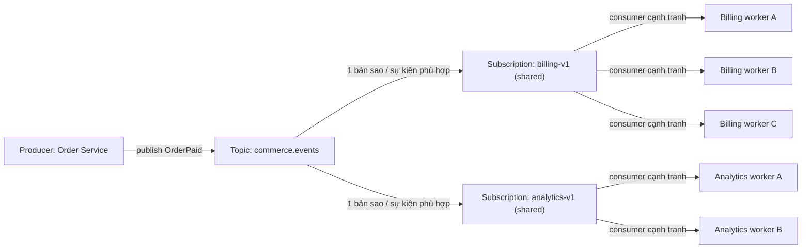

# Shared subscription và việc chia tải trong một nhóm nhận (JMS Topic)

> **Bối cảnh:** Spring Framework – JMS, chủ đề cha **Queue và Topic**. Trọng tâm là cách **nhiều consumer cùng dùng một topic subscription để chia công việc**, đồng thời **nhiều nhóm subscription khác nhau vẫn nhận các bản sao độc lập của sự kiện**. Ví dụ theo Jakarta Messaging 3.1 / JMS 2.0+, Spring Boot 3.3 và Java 21.

## 1. Vấn đề: Topic phát sự kiện cho nhiều dịch vụ, nhưng mỗi dịch vụ cũng cần nhiều worker

Một hệ thống thương mại phát sự kiện `OrderPaid` đến topic `commerce.events`. Dịch vụ **Billing** cần tạo hóa đơn, dịch vụ **Analytics** cần ghi nhận số liệu. Mỗi dịch vụ đều cần xử lý **mọi sự kiện phù hợp với nó**, nhưng khi lưu lượng tăng, ta muốn có 3 Billing worker và 2 Analytics worker chạy đồng thời.

Hai yêu cầu khác nhau cần được kết hợp:

1. **Fan-out theo nhóm:** mỗi thông điệp được thêm vào **subscription của Billing** và **subscription của Analytics** (nếu subscription tồn tại và bộ lọc của nó chấp nhận thông điệp).
2. **Competing consumers trong một nhóm:** ở subscription của Billing, **mỗi lần giao một thông điệp** chỉ chọn **một** trong 3 Billing worker; tương tự, Analytics chọn một trong 2 worker. Từng worker không nhận toàn bộ thông điệp của nhóm.

Nếu chỉ tạo nhiều consumer độc lập trên một topic theo kiểu thông thường (unshared subscriptions), **mỗi consumer có subscription riêng** và có thể nhận bản sao của cùng một sự kiện. Như vậy 3 Billing worker có thể đều chạy tạo hóa đơn cho cùng một đơn, trái với ý định chia tải.

**Shared subscription** giải quyết vấn đề: nhiều consumer cùng gắn với **một subscription có tên**, rồi broker phân phối các message nằm trong subscription đó cho các consumer.

## 2. Mô hình: một topic, nhiều subscription, nhiều consumer trong mỗi subscription



Với sự kiện `e-101`, nếu cả hai subscription đều tồn tại và không lọc bỏ nó, có thể quan sát:

- Nhóm `billing-v1`: **một** trong A/B/C nhận `e-101` trong lần giao thành công đó.
- Nhóm `analytics-v1`: **một** trong A/B nhận `e-101` trong lần giao thành công đó.
- Tổng cộng **hai nhóm nhận hai bản sao logic**, vì mỗi nhóm có trách nhiệm nghiệp vụ khác nhau.

Minh họa phân phối 6 sự kiện, **chỉ là một kịch bản có thể xảy ra**:

| Message | `billing-v1` | `analytics-v1` |
| --- | --- | --- |
| `e-101` | Billing B | Analytics A |
| `e-102` | Billing A | Analytics B |
| `e-103` | Billing C | Analytics A |
| `e-104` | Billing C | Analytics B |
| `e-105` | Billing A | Analytics B |
| `e-106` | Billing B | Analytics A |

Jakarta Messaging **không quy định thuật toán chia tải** giữa các consumer của cùng shared subscription. Không được giả định round-robin, phân chia đều tuyệt đối, đúng thứ tự hoàn thành hay gán cố định một ID cho một worker. Broker có thể dùng prefetch, ưu tiên, mức sẵn sàng, flow control hoặc chính sách riêng. Khi xảy ra rollback/redelivery, một message có thể được giao **lại** cho worker khác; “một consumer cho mỗi lần giao” không đồng nghĩa nghiệp vụ thực thi đúng một lần.

## 3. Ba khái niệm phải tách riêng

| Khái niệm | Ý nghĩa | Ví dụ |
| --- | --- | --- |
| **Topic** | Đích publish/subscribe, nơi producer xuất bản sự kiện. | `commerce.events` |
| **Subscription** | Thực thể logic tại JMS provider theo dõi message của topic cho **một nhóm nhận**; có thể durable hoặc non-durable. | `billing-v1` |
| **Consumer** | Đối tượng `MessageConsumer`/`JMSConsumer` hoặc listener nhận message từ subscription; một shared subscription có thể có nhiều consumer. | 3 instance Billing |

**Một topic có nhiều subscription**, và **một shared subscription có nhiều consumer**. Đây là hai tầng khác nhau: chia sẻ thông điệp *giữa các nhóm* và chia tải *bên trong một nhóm*.

So sánh trực tiếp với queue:

| Thiết kế | Một message có thể tới đâu? | Trường hợp dùng |
| --- | --- | --- |
| **Queue + nhiều consumer** | Một consumer trong nhóm cạnh tranh nhận mỗi lần giao. | Một luồng việc chỉ cần một nhóm thực hiện. |
| **Topic + nhiều unshared subscriptions** | Mỗi subscription riêng nhận một bản sao; mỗi subscription tối đa một consumer cùng lúc. | Nhiều bên độc lập đều cần thấy sự kiện. |
| **Topic + shared subscription** | Mỗi subscription nhận bản sao riêng; nhiều consumer **cùng subscription** chia tải các bản sao ấy. | Nhiều nhóm nghiệp vụ cùng cần sự kiện, mỗi nhóm lại cần scale out. |

Chọn queue nếu bài toán chỉ là nhiều worker cùng xử lý một luồng công việc. Chọn topic + shared subscription nếu cùng một sự kiện phải đến **nhiều nhóm độc lập**, trong khi từng nhóm muốn phân phối công việc cho nhiều consumer.

## 4. Shared và durable là hai trục cấu hình độc lập

`Shared` trả lời: **Có cho phép nhiều consumer gắn vào cùng một subscription đồng thời không?** `Durable` trả lời: **Subscription có được duy trì khi không còn consumer hoạt động không?**

| Kiểu topic subscription | Consumer đồng thời | Khi consumer cuối rời đi | API tạo consumer |
| --- | --- | --- | --- |
| Unshared non-durable | Một | Subscription biến mất; không tích lũy message lúc vắng mặt. | `createConsumer(topic)` |
| **Shared non-durable** | Nhiều | Subscription bị xóa, message chưa giao của subscription này bị xóa; message phát khi nhóm hoàn toàn offline sẽ không chờ nhóm quay lại. | `createSharedConsumer(topic, name)` |
| Unshared durable | Một | Subscription vẫn tồn tại và lưu các message đủ điều kiện đến khi được xử lý/hết hạn; cần client ID. | `createDurableConsumer(topic, name)` |
| **Shared durable** | Nhiều | Subscription vẫn tồn tại; message phù hợp được tích lũy theo khả năng lưu và chính sách của broker. | `createSharedDurableConsumer(topic, name)` |

Ví dụ:

- **Nhóm cập nhật số liệu thời gian thực**, bỏ qua một số sự kiện khi tất cả consumer offline có thể chấp nhận được: shared **non-durable**.
- **Nhóm tạo hóa đơn** cần tiếp tục sau bảo trì: shared **durable**, đi kèm persistent delivery, lưu trữ broker, retry/DLQ và idempotency.

Lưu ý chính xác:

- Durable subscription phải được **tạo trước** khi thông điệp được publish thì mới theo dõi được thông điệp đó; tạo subscription hôm nay không đọc lại lịch sử chưa từng được broker giữ cho subscription.
- “Durable” không có nghĩa message tồn tại vô hạn hoặc bảo đảm bất chấp mọi hỏng hóc: còn phụ thuộc delivery mode `PERSISTENT`, TTL/expiration, transaction, quota, journal/storage/HA và chính sách broker.
- Shared non-durable vẫn có thể nhận message đang chờ **khi còn ít nhất một consumer active**, nhưng khi consumer cuối đóng thì subscription và message còn chờ không được lưu cho lần sau.

## 5. Điều gì làm các consumer thật sự thuộc **cùng một** nhóm?

Một shared subscription được nhận diện bằng **tên subscription**, cộng với **JMS client identifier nếu được đặt**. Để cùng chia một backlog, các consumer phải truy cập **cùng JMS provider/broker namespace**, cùng loại subscription (shared durable hoặc shared non-durable), cùng tên, cùng client ID nếu dùng, và cấu hình topic/selector tương thích.

- **Cùng topic, khác subscription name:** hai **nhóm khác nhau**; mỗi nhóm nhận bản sao riêng.
- **Cùng topic, cùng subscription name, cùng client ID (hoặc cùng không đặt ID):** các consumer chia sẻ subscription đó nếu provider hỗ trợ và các thuộc tính liên quan khớp.
- **Cùng tên nhưng khác client ID:** không mặc nhiên là cùng subscription.
- **Cùng tên nhưng khác topic hoặc selector:** không thể coi là cùng nhóm. Khi subscription đang active, Jakarta Messaging yêu cầu lỗi khi một consumer mới cố tham gia cùng danh tính với topic/selector khác.
- **Thay selector/topic của shared durable lúc không có consumer:** đặc tả cho phép hành vi tương đương xóa subscription cũ và tạo mới. Vì vậy **không thay đổi âm thầm cấu hình của một subscription có backlog quan trọng**; hãy version hóa tên subscription và lập kế hoạch chuyển tiếp.
- **Không đặt `clientId` là hợp lệ với shared durable** (khác unshared durable). Với nhiều replica, thông thường để client ID unset và giữ **một subscription name chung**; tránh gán cùng một client ID tĩnh cho nhiều kết nối hoạt động đồng thời, bởi client ID phải duy nhất tại mỗi thời điểm.

JMS `noLocal` dùng cho một số unshared subscription **không hỗ trợ cho shared subscriptions**. `Message selector` là bộ lọc ở **subscription**, không phải cách cho từng worker cùng nhóm lựa chọn những kiểu message khác nhau.

### Bộ lọc và hai nhóm độc lập

Nếu một topic phát các message có property `eventType`, có thể tạo hai shared subscriptions với selector:

- `billing-v1`: `eventType = 'OrderPaid'`.
- `analytics-v1`: `eventType IN ('OrderPaid', 'OrderCancelled')`.

Khi publish `OrderPaid`, cả hai nhóm nhận một bản sao của subscription mình; khi publish `OrderCancelled`, chỉ nhóm Analytics nhận. **Mọi consumer trong cùng một shared subscription phải tuân theo cùng selector**. Trong code demo dưới đây, không đặt selector để dễ quan sát toàn bộ sự kiện.

## 6. API Jakarta Messaging tương ứng

Trong API simplified `jakarta.jms`, có hai phương thức cốt lõi (được bổ sung từ JMS 2.0):

```java
// Đây là các lời gọi minh họa trong một phương thức có ConnectionFactory cf.
// Mỗi process/worker tạo JMSContext, consumer và lifecycle riêng.
try (jakarta.jms.JMSContext context = cf.createContext()) {
    jakarta.jms.Topic topic = context.createTopic("commerce.events");

    // Nhiều consumer với cùng tên tham gia shared non-durable subscription:
    jakarta.jms.JMSConsumer temporary =
            context.createSharedConsumer(topic, "billing-live-v1");

    // Nhiều consumer với cùng tên tham gia shared durable subscription:
    jakarta.jms.JMSConsumer durable =
            context.createSharedDurableConsumer(topic, "billing-v1");

    // Ví dụ chỉ minh họa API. Không dùng hai consumer cùng nhiệm vụ
    // trong một process này để suy ra thuật toán chia tải.
}
```

Đoạn này **không phải một lớp Java chạy độc lập** (cần biến `ConnectionFactory cf` và provider JMS). Với classic API, các phương thức tương ứng trên `Session` là `createSharedConsumer(...)` và `createSharedDurableConsumer(...)`, trả về `MessageConsumer`.

Khi người học mới dùng Spring, không cần gọi các phương thức này thủ công: `DefaultMessageListenerContainer` đứng sau `@JmsListener` tạo và quản lý consumer tương ứng. Muốn shared subscription, phải cấu hình container chọn **topic**, **shared**, tên subscription và tùy chọn **durable**.

## 7. Ví dụ chạy được với Spring Boot: hai nhóm chia tải trên cùng một topic

Ví dụ sử dụng **Java 21, Spring Boot 3.3.5 và ActiveMQ Artemis hỗ trợ JMS 2.0+**. Một ứng dụng có Billing và Analytics để dễ quan sát; trong triển khai thực tế, chúng có thể là những dịch vụ/replica riêng cùng kết nối một broker.

### 7.1. Phụ thuộc và broker

`build.gradle` trong project Gradle mới:

```groovy
plugins {
    id 'java'
    id 'org.springframework.boot' version '3.3.5'
    id 'io.spring.dependency-management' version '1.1.6'
}

group = 'com.example'
version = '0.0.1-SNAPSHOT'

java {
    toolchain { languageVersion = JavaLanguageVersion.of(21) }
}

repositories { mavenCentral() }

dependencies {
    implementation 'org.springframework.boot:spring-boot-starter-web'
    implementation 'org.springframework.boot:spring-boot-starter-artemis'
}
```

`src/main/resources/application.yml`:

```yaml
spring:
  artemis:
    mode: native
    broker-url: tcp://localhost:61616
server:
  port: 8080
```

Cần **broker Artemis đã chạy** trên `localhost:61616`, cho phép tạo hoặc đã cấu hình **multicast topic** `commerce.events` và hai durable subscriptions. Nếu broker yêu cầu xác thực, cung cấp `SPRING_ARTEMIS_USER` và `SPRING_ARTEMIS_PASSWORD` qua môi trường (hoặc secret manager); không hard-code mật khẩu vào nguồn.

### 7.2. Mã nguồn hoàn chỉnh

Tạo `src/main/java/com/example/sharedjms/SharedSubscriptionApplication.java`:

```java
package com.example.sharedjms;

import jakarta.jms.ConnectionFactory;
import org.springframework.beans.factory.annotation.Qualifier;
import org.springframework.boot.SpringApplication;
import org.springframework.boot.autoconfigure.SpringBootApplication;
import org.springframework.context.annotation.Bean;
import org.springframework.context.annotation.Configuration;
import org.springframework.http.ResponseEntity;
import org.springframework.jms.annotation.JmsListener;
import org.springframework.jms.config.DefaultJmsListenerContainerFactory;
import org.springframework.jms.connection.CachingConnectionFactory;
import org.springframework.jms.core.JmsTemplate;
import org.springframework.stereotype.Component;
import org.springframework.web.bind.annotation.PathVariable;
import org.springframework.web.bind.annotation.PostMapping;
import org.springframework.web.bind.annotation.RestController;

@SpringBootApplication
public class SharedSubscriptionApplication {
    public static void main(String[] args) {
        SpringApplication.run(SharedSubscriptionApplication.class, args);
    }
}

@Configuration(proxyBeanMethods = false)
class TopicConfig {
    @Bean("topicJmsTemplate")
    JmsTemplate topicJmsTemplate(ConnectionFactory connectionFactory) {
        JmsTemplate template = new JmsTemplate(connectionFactory);
        template.setPubSubDomain(true); // publish tới TOPIC
        return template;
    }

    @Bean("sharedDurableTopicFactory")
    DefaultJmsListenerContainerFactory sharedDurableTopicFactory(
            ConnectionFactory connectionFactory) {
        // Listener container nên dùng native factory để tự quản lý
        // connection, consumer lifecycle và recovery.
        ConnectionFactory nativeFactory =
                connectionFactory instanceof CachingConnectionFactory cached
                        ? cached.getTargetConnectionFactory()
                        : connectionFactory;

        DefaultJmsListenerContainerFactory factory =
                new DefaultJmsListenerContainerFactory();
        factory.setConnectionFactory(nativeFactory);
        factory.setPubSubDomain(true);       // TOPIC, không phải queue
        factory.setSubscriptionShared(true); // nhiều consumer / subscription
        factory.setSubscriptionDurable(true); // giữ subscription khi offline
        factory.setSessionTransacted(true);  // commit khi listener thành công
        return factory;
    }
}

@RestController
class EventPublisher {
    private final JmsTemplate topicJmsTemplate;

    EventPublisher(@Qualifier("topicJmsTemplate") JmsTemplate topicJmsTemplate) {
        this.topicJmsTemplate = topicJmsTemplate;
    }

    @PostMapping("/events/{eventId}")
    ResponseEntity<String> publish(@PathVariable String eventId) {
        topicJmsTemplate.convertAndSend("commerce.events", eventId);
        return ResponseEntity.accepted().body("PUBLISHED " + eventId);
    }
}

@Component
class BillingConsumers {
    @JmsListener(
            destination = "commerce.events",
            subscription = "billing-v1",
            containerFactory = "sharedDurableTopicFactory",
            concurrency = "3-3")
    void bill(String eventId) {
        System.out.printf(
                "BILLING   %s via %s%n",
                eventId, Thread.currentThread().getName());
    }
}

@Component
class AnalyticsConsumers {
    @JmsListener(
            destination = "commerce.events",
            subscription = "analytics-v1",
            containerFactory = "sharedDurableTopicFactory",
            concurrency = "2-2")
    void analyze(String eventId) {
        System.out.printf(
                "ANALYTICS %s via %s%n",
                eventId, Thread.currentThread().getName());
    }
}
```

**Giải thích các cấu hình có ý nghĩa:**

1. `topicJmsTemplate.setPubSubDomain(true)`: Spring gửi đến **topic**. Mặc định `JmsTemplate` thường chọn queue nếu không đổi cấu hình.
2. `setPubSubDomain(true)` trên listener factory: consumer cũng đăng ký ở **topic**.
3. `setSubscriptionShared(true)`: consumer của cùng tên subscription có thể hoạt động song song mà không mỗi consumer tạo một bản sao độc lập.
4. `setSubscriptionDurable(true)`: dùng **shared durable**; subscription tồn tại khi mọi consumer đã rời đi.
5. `@JmsListener(subscription = "...")`: đặt **tên nhóm**. `billing-v1` và `analytics-v1` là hai subscription **khác nhau**.
6. `concurrency = "3-3"` và `"2-2"`: lần lượt đặt 3 và 2 consumer đồng thời trong *mỗi instance ứng dụng*; đây là giới hạn số consumer, **không cam kết phân đều message**.
7. `setSessionTransacted(true)`: khi listener xử lý thành công, JMS transaction có thể commit; lỗi trước commit dẫn tới rollback/redelivery theo cấu hình provider. Nó **không tự đồng bộ nguyên tử** với database ngoài JMS.
8. Đoạn nhận được đặt trên một `native ConnectionFactory` nếu Boot đã bọc factory bởi `CachingConnectionFactory`, để listener tự quản lý kết nối và recovery. Phần gửi vẫn có thể dùng wrapper để tận dụng cache.

### 7.3. Chạy và quan sát

Từ thư mục project, sau khi broker sẵn sàng:

```bash
# Linux/macOS
./gradlew bootRun

# Windows PowerShell/CMD: dùng gradlew.bat bootRun
```

Từ terminal khác, gửi vài message:

```bash
curl -i -X POST http://localhost:8080/events/e-101
curl -i -X POST http://localhost:8080/events/e-102
curl -i -X POST http://localhost:8080/events/e-103
```

Một HTTP response ví dụ có status `202 Accepted` và body:

```text
PUBLISHED e-101
```

Một đoạn log **minh họa** có thể là:

```text
BILLING   e-101 via DefaultMessageListenerContainer-1
ANALYTICS e-101 via DefaultMessageListenerContainer-2
ANALYTICS e-102 via DefaultMessageListenerContainer-4
BILLING   e-102 via DefaultMessageListenerContainer-3
BILLING   e-103 via DefaultMessageListenerContainer-5
ANALYTICS e-103 via DefaultMessageListenerContainer-4
```

Tên thread, thứ tự và consumer cụ thể thay đổi theo runtime; **không có stdout cố định** cho ví dụ bất đồng bộ này. Điều cần xác minh sau khi tất cả xử lý thành công và không có retry: **mỗi event ID xuất hiện một lần trong log BILLING và một lần trong log ANALYTICS**, bất kể worker nào thực hiện. Nếu chỉ thấy một worker liên tục nhận message, chưa thể kết luận shared subscription sai; cần tăng lưu lượng, tăng thời gian xử lý có kiểm soát và kiểm tra số consumer active tại broker.

**Khi chạy nhiều replica:** khởi chạy cùng mã ở các instance khác nhau nhưng tránh port HTTP trùng nhau; mỗi replica giữ cùng `subscription` và cùng topic/configuration, không đặt client ID riêng làm đổi danh tính subscription. Ví dụ 2 replica với `concurrency="3-3"` tạo tối đa 6 Billing consumers đang tham gia cùng `billing-v1`. Việc tăng consumer chỉ hữu ích khi broker và downstream còn năng lực xử lý.

**Thử durable khi tất cả consumer offline:** ví dụ một app ở trên đồng thời chứa producer và listener, vì vậy dừng app cũng dừng producer. Muốn kiểm thử đúng, hãy chạy producer ở **tiến trình khác** (hoặc dùng công cụ broker), tạo `billing-v1` khi listener chạy, sau đó dừng **toàn bộ Billing consumers**, publish sự kiện mới bằng producer riêng, rồi bật lại Billing. Với shared durable, broker nên giữ và giao các sự kiện đủ điều kiện đang đợi; đồng thời kiểm tra TTL, persistent delivery và trạng thái broker.

## 8. Vì sao tăng consumer giúp chia tải nhưng không bảo đảm tốc độ vô hạn?

Giả sử tốc độ publish ổn định là 150 message/giây; một Billing worker xử lý được 20 message/giây trong điều kiện kiểm thử:

- Một worker có năng lực lý thuyết khoảng 20 msg/s; backlog tăng khi publish 150 msg/s.
- Năm worker có năng lực lý thuyết khoảng 100 msg/s nếu tác vụ độc lập và downstream đủ sức; backlog **vẫn** tăng.
- Tám worker có năng lực lý thuyết khoảng 160 msg/s, nhưng throughput thật có thể thấp hơn vì DB, API phụ trợ, lock, transaction, prefetch, network và chi phí broker.

Đây là **bài toán capacity**, không phải công thức bảo đảm. Đo thời gian xử lý và tốc độ tiêu thụ thực tế; theo dõi `pending messages`, `in-flight/unacknowledged`, tuổi message cũ nhất, tốc độ publish/ACK, redelivery, DLQ, độ trễ hoàn tất và số consumer active **theo từng subscription**.

### Vấn đề thứ tự

Với nhiều consumer, message `e-101` có thể được xử lý xong **sau** `e-102` dù gửi trước. Không dựa vào thứ tự hoàn thành toàn cục của một shared subscription. Nếu nghiệp vụ bắt buộc xử lý theo thứ tự **trên cùng một orderId**, cần có thiết kế đảm bảo tuần tự: partition/consumer group theo khóa, message grouping nếu broker hỗ trợ, hoặc điều kiện phiên bản/sequence ở database. Đừng giả định `JMSXGroupID` hay một tính năng nhóm message hoạt động giống nhau trên mọi JMS provider mà chưa kiểm chứng.

### Vấn đề công bằng

Shared subscription **không hứa** một worker nhận 1/N message. Worker nhanh có thể nhận nhiều; worker chậm có thể giữ message chưa ACK; prefetch có thể làm phân phối lệch. Quan sát hiệu năng ở cấp nhóm thay vì yêu cầu chia đều tuyệt đối.

## 9. Thất bại, retry và ngữ nghĩa giao hàng

**Mỗi message được giao cho một consumer trong subscription tại một lần giao** là mô tả đúng; câu “message được xử lý chính xác một lần” thường **không đúng** khi có failure.

Tình huống điển hình:

1. Broker giao `e-101` của `billing-v1` cho Billing worker A.
2. A tạo hóa đơn thành công trong database, nhưng chết **trước khi commit/ACK JMS**.
3. Broker chưa ghi nhận lần nhận hoàn tất, nên có thể **redeliver** `e-101` cho worker B.
4. Nếu B tạo thêm hóa đơn, nghiệp vụ bị trùng dù phía producer chỉ publish một lần.

Cách xử lý:

- Tạo **idempotency key** ổn định (ví dụ `eventId`), lưu trạng thái đã xử lý bằng unique constraint/transaction cùng thao tác nghiệp vụ phù hợp. Nếu message được nhận lại thì trả về kết quả đã có.
- Dùng **transacted session** hoặc ACK đúng thời điểm; với Spring cần kiểm tra `DefaultJmsListenerContainerFactory` và chính sách broker. Không nhầm `AUTO_ACKNOWLEDGE` với bảo đảm side effect đã commit ở DB.
- Thiết lập retry có giới hạn, backoff, DLQ và quan sát lỗi. Message hỏng liên tục không được chiếm toàn bộ công suất nhóm.
- Nếu producer vừa ghi database vừa publish JMS, cân nhắc **transactional outbox** để tránh việc DB đã commit nhưng event không được gửi.
- Nếu một nhóm có lỗi hoặc tạm dừng, **các nhóm subscription khác có thể tiếp tục** theo backlog và tài nguyên độc lập; tuy nhiên broker chung vẫn là điểm chia sẻ tài nguyên có thể ảnh hưởng tất cả.

Đối với một shared durable subscription, **message được ACK thành công cho subscription đó** không có nghĩa message đã được ACK tại subscription khác. Billing xử lý xong không xóa nghĩa vụ Analytics, và ngược lại.

## 10. Những sai lầm dễ gặp khi cấu hình Spring/JMS

| Sai lầm | Hệ quả | Cách sửa |
| --- | --- | --- |
| Tạo 3 `@JmsListener` trên cùng topic nhưng không bật `subscriptionShared` | Có thể có 3 subscriptions riêng, khiến mỗi message chạy 3 lần. | Dùng chung subscription name, bật shared trên container và kiểm tra broker thấy **một subscription** có nhiều consumers. |
| Dùng `JmsTemplate` mặc định hướng queue để gửi tên topic | Tên destination có thể bị giải theo queue hoặc lỗi định tuyến. | Chọn `pubSubDomain=true` ở producer và container nhận; xác minh topic multicast trên broker. |
| Billing và Analytics dùng **cùng** subscription name | Hai dịch vụ cạnh tranh với nhau; một event có thể chỉ Billing **hoặc** Analytics nhận. | Đặt **tên subscription khác nhau theo trách nhiệm nghiệp vụ**. |
| Mỗi pod tự gán một client ID hoặc subscription name khác nhau | Mỗi pod thành nhóm độc lập, làm tăng số bản sao thay vì chia tải. | Thống nhất danh tính logical subscription; xử lý quy tắc client ID phù hợp provider. |
| Nhiều pod cố dùng cùng client ID tĩnh trên nhiều connection | JMS provider có thể từ chối vì client ID đang được sử dụng. | Với shared durable, cân nhắc để client ID unset; kiểm tra quy tắc provider. |
| Dùng shared non-durable cho nhiệm vụ không được mất khi nhóm offline | Message có thể bị mất khỏi subscription khi consumer cuối đóng. | Dùng shared durable với persistence và vận hành đúng. |
| Đổi selector/topic dưới một durable subscription đang lưu backlog | Có thể bị lỗi hoặc tái tạo subscription, nguy cơ bỏ backlog cũ. | Version hóa subscription, triển khai chuyển tiếp có kiểm soát. |
| Giả định mỗi worker nhận đều hoặc hoàn tất đúng thứ tự | Thống kê sai, xử lý sai nghiệp vụ phụ thuộc thứ tự. | Thiết kế idempotent, grouping/ordering theo key và đo lường thực tế. |
| Chỉ giám sát mức message ở topic | Không thấy Billing tồn đọng trong khi Analytics khỏe. | Giám sát từng subscription: backlog, consumer count, redelivery, DLQ. |
| Dùng shared subscription rồi kết luận đã có exactly-once business outcome | Retry sau crash vẫn có thể tạo side effect trùng. | Kết hợp JMS transaction, unique constraint/idempotency và cơ chế retry. |

## 11. Cách kiểm chứng shared subscription tại broker

**Bài kiểm thử chức năng tối thiểu:**

1. Tạo `billing-v1` (shared durable, 3 consumers) và `analytics-v1` (shared durable, 2 consumers) trên cùng topic.
2. Publish 10 event ID duy nhất `e-1` đến `e-10` sau khi subscriptions đã active.
3. Khi mọi xử lý thành công, gom log theo **subscription**, xác nhận 10 event ID ở Billing và 10 event ID ở Analytics. Số lần invocation có thể nhiều hơn khi redelivery, vì vậy khi kiểm thử đếm kết quả nghiệp vụ đã idempotent.
4. Trong broker console, xác nhận **2 subscriptions**, Billing có 3 active consumers, Analytics có 2 (khi chỉ chạy một instance).
5. Tắt một Billing consumer; publish thêm. Các consumer Billing còn lại vẫn có thể nhận, Analytics không bị đổi danh tính nhóm.
6. Tắt **tất cả** Billing consumers, giữ producer và broker hoạt động; publish event mới. Bật Billing trở lại và xác nhận backlog của shared durable được tiêu thụ.
7. Lặp thử với **shared non-durable** trên một tên khác; khi consumer cuối đóng, thông điệp publish lúc nhóm không tồn tại sẽ không được lưu để giao sau.

**Các kết quả không nên diễn giải sai:** mỗi worker chạy đúng 1/3 tải, thứ tự log trùng thứ tự publish, hoặc mỗi handler chỉ được gọi một lần suốt vòng đời hệ thống. Những điều đó không nằm trong hợp đồng shared subscription.

## 12. Câu hỏi tự kiểm tra

1. Một topic có `billing-v1` với 4 consumer và `analytics-v1` với 2 consumer. Với một event hợp lệ, có bao nhiêu **bản sao theo subscription**, và bao nhiêu consumer của **mỗi subscription** nhận ở mỗi lần giao?
2. Nếu Billing và Analytics vô tình dùng cùng shared subscription name, điều gì xảy ra? Vì sao đây là lỗi thiết kế?
3. Phân biệt **shared non-durable** và **shared durable** khi consumer cuối đóng rồi producer vẫn publish.
4. Cùng subscription name nhưng mỗi pod có client ID riêng: vì sao chúng có thể không cùng chia tải?
5. Vì sao tăng số consumer có thể cải thiện throughput mà vẫn phá vỡ thứ tự xử lý?
6. A đã ghi DB rồi crash trước khi ACK. B nhận lại message; bạn dùng khóa nào để bảo đảm không tạo hai hóa đơn?
7. Selector khác nhau giữa hai consumer cùng một shared subscription có hợp lệ không? Nếu muốn mỗi loại message đi đến nhóm khác nhau, nên tổ chức subscription thế nào?

**Tổng kết:** Topic giải quyết **phân phối sự kiện đến nhiều nhóm**; shared subscription giải quyết **chia tải giữa nhiều consumer của cùng một nhóm**. Durable là quyết định độc lập về việc giữ subscription/backlog lúc offline. Cấu hình đúng gồm tên nhóm ổn định, đúng topic, shared/durable/selector, ACK/transaction, idempotency và quan sát backlog theo từng subscription.

### Tham khảo kỹ thuật

- [Jakarta Messaging 3.1 Specification – `8.3 Creating a consumer on a topic](https://jakarta.ee/specifications/messaging/3.1/jakarta-messaging-spec-3.1.html): unshared/shared, non-durable/durable, danh tính subscription, selector và redelivery.
- [Jakarta EE Tutorial – Creating Shared Subscriptions](https://jakarta.ee/learn/docs/jakartaee-tutorial/current/messaging/jms-concepts/jms-concepts.html): so sánh topic, queue và shared subscriptions.
- [Jakarta Messaging 3.1 JMSContext API](https://jakarta.ee/specifications/messaging/3.1/apidocs/jakarta.messaging/jakarta/jms/jmscontext): `createSharedConsumer` và `createSharedDurableConsumer`.
- [Spring Framework 6.1 – AbstractMessageListenerContainer API](https://docs.spring.io/spring-framework/docs/6.1.9/javadoc-api/org/springframework/jms/listener/AbstractMessageListenerContainer.html): `setSubscriptionShared`, `setSubscriptionDurable` và `setSubscriptionName`.
- [Spring Framework – @JmsListener](https://www.springframework.org/spring/docs/6.1.11/javadoc-api/org/springframework/jms/annotation/JmsListener.html): `subscription`, `containerFactory`, `concurrency`.
- [Spring Boot – JMS support](https://docs.spring.io/spring-boot/3.4/reference/messaging/jms.html): Artemis, `JmsTemplate`, listener containers và transactions.
- [ActiveMQ Artemis – Virtual Topics / JMS 2.0 shared subscriptions](https://artemis.apache.org/components/artemis/migration-documentation/VirtualTopics.html): hỗ trợ shared subscription với Artemis.
