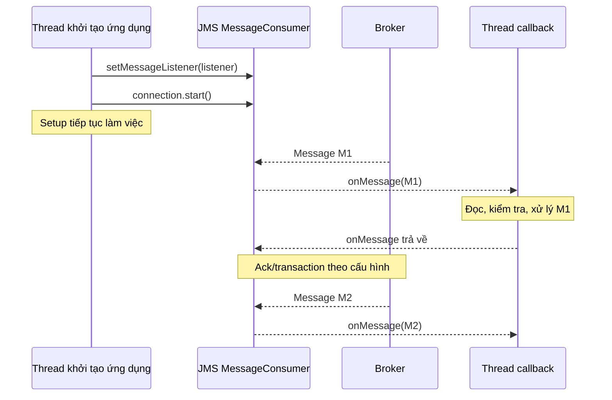

# MessageListener và callback nhận bất đồng bộ trong Jakarta JMS và Spring Framework

## 1. MessageListener giải quyết vấn đề gì?

Trong JMS, ứng dụng có hai cách cơ bản để nhận thông điệp từ `Queue` hoặc `Topic`:

- **Đồng bộ (synchronous receive):** code tự gọi `consumer.receive()`; thread gọi lệnh chờ đến khi có thông điệp, timeout hoặc bị đóng. Nếu ứng dụng muốn tiếp tục nhận nhiều thông điệp, chính nó phải viết vòng lặp.
- **Bất đồng bộ (asynchronous delivery):** code đăng ký một `MessageListener`; khi có thông điệp, JMS provider chủ động gọi `onMessage(Message message)` trên luồng xử lý thông điệp. Thread đã đăng ký listener có thể tiếp tục làm công việc khác.

`MessageListener` là **giao diện callback tiêu chuẩn của Jakarta Messaging**, thuộc package `jakarta.jms`:

```java
public interface MessageListener {
    void onMessage(Message message);
}
```

Đoạn trên mô tả chữ ký API, không phải interface cần tự khai báo trong project. Ta **import `jakarta.jms.MessageListener`**. Vì có một phương thức trừu tượng, có thể dùng class triển khai hoặc lambda.

Điểm cốt lõi: **“bất đồng bộ” diễn tả cách *nhận và thông báo* thông điệp**, không có nghĩa mọi handler chạy song song, không có nghĩa broker tự đảm bảo xử lý thành công, và không có nghĩa publisher đã gửi bất đồng bộ. Đây là ba vấn đề khác nhau.

### Ví dụ nghiệp vụ

Ứng dụng quản lý đơn hàng đặt một listener lên Queue `orders.command`. Khi có thông điệp `order-101`, broker/provider (hoặc listener container trong Spring) kích hoạt callback. Callback đọc message, thực hiện nghiệp vụ và hoàn tất. Trong lúc không có thông điệp, luồng ứng dụng dùng để cấu hình listener **không phải chờ trong một vòng `receive()`**.



Sơ đồ diễn tả contract callback của JMS thuần. Trong Spring, một `DefaultMessageListenerContainer` có thể dùng thread nền để `receive` rồi gọi handler; về phía **ứng dụng nghiệp vụ**, cách tiêu thụ vẫn là bất đồng bộ.

## 2. Contract của MessageListener và các API liên quan

| API | Trách nhiệm | Ghi nhớ |
| --- | --- | --- |
| `ConnectionFactory` | Tạo kết nối JMS. | Phụ thuộc provider như ActiveMQ Artemis, IBM MQ... |
| `Connection` | Đại diện kết nối với provider. | Trong classic API phải gọi `start()` để bắt đầu giao thông điệp. |
| `Session` | Ngữ cảnh gửi/nhận và acknowledge/transaction; **một luồng điều khiển tại một thời điểm**. | Không chia sẻ một Session đang có listener cho main thread gọi nhận/gửi song song. |
| `Destination` (`Queue`/`Topic`) | Địa chỉ thông điệp. | Callback áp dụng được cho cả Queue lẫn Topic. |
| `MessageConsumer` | Consumer được tạo từ Session và Destination. | `setMessageListener(listener)` đăng ký callback nhận bất đồng bộ. |
| `MessageListener` | Code xử lý thông điệp được giao. | `onMessage(Message)` trả về `void`, **không khai báo `throws JMSException`**. |
| `Message` / `TextMessage` | Message gốc chứa payload, header và properties. | Chọn kiểu body phù hợp; đọc có thể phát sinh `JMSException`. |

Một implementation đơn giản:

```java
import jakarta.jms.JMSException;
import jakarta.jms.Message;
import jakarta.jms.MessageListener;
import jakarta.jms.TextMessage;

public final class OrderTextListener implements MessageListener {
    @Override
    public void onMessage(Message message) {
        try {
            if (!(message instanceof TextMessage textMessage)) {
                throw new IllegalArgumentException("Expected TextMessage");
            }

            String orderId = textMessage.getText();
            System.out.println("Processing " + orderId);
        } catch (JMSException ex) {
            throw new IllegalStateException("Cannot read JMS message", ex);
        }
    }
}
```

Code class trên **biên dịch khi project có dependency Jakarta JMS API**, nhưng không tự nhận thông điệp nếu chưa được một `MessageConsumer` hoặc Spring listener container đăng ký. Việc gọi `onMessage` trực tiếp chỉ là một lời gọi Java thông thường, không tạo ra nhận bất đồng bộ và không kiểm chứng broker.

### Nhận đồng bộ và nhận bất đồng bộ khác nhau ở đâu?

| Tiêu chí | `MessageConsumer.receive(...)` | `setMessageListener(...)` |
| --- | --- | --- |
| Ai chủ động nhận? | Code gọi `receive`. | Provider kích hoạt callback khi message có thể giao. |
| Thread gọi API | Chặn trong `receive()` hoặc chờ tối đa timeout. | Trả về sau khi đăng ký; code xử lý chạy khi callback được gọi. |
| Nhiều message liên tục | Thường cần vòng lặp `receive`. | Provider tiếp tục gọi `onMessage` cho từng message. |
| Quyền điều khiển luồng | Ứng dụng tự tổ chức vòng lặp/thời gian chờ. | Provider hoặc framework quản lý vòng giao nhận và lifecycle. |
| Acknowledge/transaction | Phụ thuộc Session mode. | **Vẫn phụ thuộc Session mode**; async không thay đổi tính tin cậy. |
| Có thể trộn trên **cùng Session**? | Không nên; spec xem nhận đồng bộ trong Session đang có listener là sử dụng sai. | Dùng Session riêng nếu cần cả hai kiểu. |

Chú ý phân biệt với **`CompletionListener`**: `MessageListener.onMessage` là callback **nhận** thông điệp; `CompletionListener.onCompletion/onException` là callback báo kết quả của **gửi bất đồng bộ**. Cùng có từ “listener”, nhưng khác chiều dữ liệu và contract.

## 3. Các bước đăng ký và vòng đời callback trong JMS classic API

Trình tự khuyến nghị khi tự viết JMS client:

1. Nhận `ConnectionFactory` do provider hoặc môi trường triển khai cung cấp; tạo `Connection`.
2. Tạo `Session` với chế độ acknowledgement hoặc transaction mong muốn.
3. Tạo `Queue`/`Topic` và `MessageConsumer` trên Session đó.
4. Tạo `MessageListener` và gọi `consumer.setMessageListener(listener)`.
5. **Sau khi chuẩn bị xong**, gọi `connection.start()`; provider lúc đó mới bắt đầu giao message qua callback.
6. Duy trì connection/consumer còn sống để listener có cơ hội nhận. Khi kết thúc, đóng tài nguyên; đừng để khối `try` thoát ngay sau `start()`.
7. Cho phép handler hoàn tất rồi đóng connection/Session/consumer theo lifecycle có kiểm soát.

Đăng ký listener **trước** `connection.start()` tránh tình huống message đến trước khi mã khởi tạo handler chuẩn bị xong. `connection.stop()` tạm dừng giao message mới; `start()` tiếp tục. `close()` là hành động giải phóng resource, không phải “pause”. Không gọi `Session.close()` từ bên trong chính callback trên Session ấy: đặc tả có những hành vi shutdown không portable, dễ gây treo hoặc lỗi.

Cách dùng mẫu (chỉ là **mảnh cấu hình**, giả định đã có `factory` và `queue`):

```java
try (var connection = factory.createConnection()) {
    var session = connection.createSession(false, jakarta.jms.Session.AUTO_ACKNOWLEDGE);
    var consumer = session.createConsumer(queue);

    consumer.setMessageListener(message -> {
        // Nghiệp vụ xử lý message ở callback.
    });

    connection.start();
    // Giữ ứng dụng tồn tại, chờ sự kiện shutdown hoặc chờ tín hiệu test.
}
```

Lệnh `start()` không chờ xử lý xong một message. Lệnh `setMessageListener` cũng không tự khởi chạy một Thread mới cho từng message. JMS provider được quyền quản lý executor/thread của nó, nhưng phải tuân theo contract của Session.

## 4. Ví dụ chạy thực tế: Java 17 + ActiveMQ Artemis + MessageListener

Ví dụ này sử dụng **JMS classic API** để thấy rõ `setMessageListener`, `onMessage` và việc thread chính chờ *kết quả demo* bằng `CountDownLatch`. Có một Queue duy nhất, một consumer và **hai Session**: Session nhận dành riêng cho callback, Session gửi dành cho main thread. Tách Session là chủ ý để không vi phạm giới hạn threading của JMS.

### 4.1. Khởi động broker

Yêu cầu: JDK 17+, Maven 3.x và Docker; cổng TCP `61616` chưa bị chiếm. Tài liệu chính thức Artemis cung cấp image `apache/artemis:latest-alpine` với tài khoản demo mặc định `artemis / artemis`.

```bash
docker run --detach --rm --name artemis-callback-demo -p 61616:61616 -p 8161:8161 apache/artemis:latest-alpine
```

Đợi broker báo sẵn sàng qua `docker logs artemis-callback-demo`. Image mặc định cho phép tự tạo Queue/Address; nếu môi trường vận hành đã tắt `auto-create-queues` hoặc áp dụng quyền truy cập riêng, cần tạo Queue và cấp quyền trên broker trước.

### 4.2. File pom.xml

Tạo project Maven có cấu trúc:

```text
jms-callback-demo/
├── pom.xml
└── src/main/java/demo/JmsCallbackDemo.java
```

Nội dung `pom.xml`:

```xml
<project xmlns="http://maven.apache.org/POM/4.0.0"
         xmlns:xsi="http://www.w3.org/2001/XMLSchema-instance"
         xsi:schemaLocation="http://maven.apache.org/POM/4.0.0 https://maven.apache.org/xsd/maven-4.0.0.xsd">
    <modelVersion>4.0.0</modelVersion>
    <groupId>demo</groupId>
    <artifactId>jms-callback-demo</artifactId>
    <version>1.0.0</version>

    <properties>
        <maven.compiler.release>17</maven.compiler.release>
        <project.build.sourceEncoding>UTF-8</project.build.sourceEncoding>
    </properties>

    <dependencies>
        <dependency>
            <groupId>org.apache.activemq</groupId>
            <artifactId>artemis-jakarta-client</artifactId>
            <version>2.57.0</version>
        </dependency>
    </dependencies>

    <build>
        <plugins>
            <plugin>
                <groupId>org.apache.maven.plugins</groupId>
                <artifactId>maven-compiler-plugin</artifactId>
                <version>3.13.0</version>
            </plugin>
            <plugin>
                <groupId>org.codehaus.mojo</groupId>
                <artifactId>exec-maven-plugin</artifactId>
                <version>3.5.1</version>
            </plugin>
        </plugins>
    </build>
</project>
```

`artemis-jakarta-client` cung cấp client tương thích Jakarta JMS (`jakarta.jms.*`), cùng các dependency cần thiết qua Maven. Không dùng nhầm artifact cũ dành cho namespace `javax.jms`.

### 4.3. File JmsCallbackDemo.java

```java
package demo;

import jakarta.jms.Connection;
import jakarta.jms.MessageConsumer;
import jakarta.jms.MessageProducer;
import jakarta.jms.Queue;
import jakarta.jms.Session;
import jakarta.jms.TextMessage;
import org.apache.activemq.artemis.jms.client.ActiveMQConnectionFactory;

import java.util.UUID;
import java.util.concurrent.CountDownLatch;
import java.util.concurrent.TimeUnit;

public final class JmsCallbackDemo {
    public static void main(String[] args) throws Exception {
        var factory = new ActiveMQConnectionFactory("tcp://localhost:61616");
        CountDownLatch received = new CountDownLatch(2);

        try (Connection connection =
                     factory.createConnection("artemis", "artemis")) {

            // Session callback va Session producer doc lap.
            Session receiveSession =
                    connection.createSession(false, Session.AUTO_ACKNOWLEDGE);
            Session sendSession =
                    connection.createSession(false, Session.AUTO_ACKNOWLEDGE);

            // Ten queue duy nhat, tranh message ton dong tu lan chay truoc.
            Queue queue = receiveSession.createQueue(
                    "demo.callback." + UUID.randomUUID());

            MessageConsumer consumer = receiveSession.createConsumer(queue);
            consumer.setMessageListener(message -> {
                try {
                    if (!(message instanceof TextMessage text)) {
                        throw new IllegalArgumentException("Expected TextMessage");
                    }

                    System.out.println("onMessage: " + text.getText());
                    received.countDown();
                } catch (jakarta.jms.JMSException ex) {
                    throw new IllegalStateException(
                            "Cannot decode TextMessage", ex);
                }
            });

            // Moi bat dau giao message sau khi listener da san sang.
            connection.start();

            try (MessageProducer producer = sendSession.createProducer(queue)) {
                producer.send(sendSession.createTextMessage("first"));
                producer.send(sendSession.createTextMessage("second"));
            }

            // Chi main thread cho ket qua demo, khong phai vong JMS receive().
            boolean complete = received.await(10, TimeUnit.SECONDS);
            if (!complete) {
                throw new IllegalStateException("Timed out waiting for callbacks");
            }
            System.out.println("completed: 2");
        }
    }
}
```

### 4.4. Chạy và đối chiếu

Từ thư mục `jms-callback-demo`:

```bash
mvn -q compile exec:java -Dexec.mainClass=demo.JmsCallbackDemo
```

Khi broker sẵn sàng, kết nối hợp lệ và không có lỗi giao nhận, **các dòng do chương trình in ra** là:

```text
onMessage: first
onMessage: second
completed: 2
```

Đây là thứ tự kỳ vọng của **hai message gửi theo thứ tự từ cùng producer đến một consumer/Session**; không tính log phát sinh từ Maven/client/broker. Dòng `completed: 2` chỉ chứng minh callback đã đi tới `countDown()` hai lần; **không phải bằng chứng xử lý nghiệp vụ đã commit trong mọi mode**, vì demo dùng `AUTO_ACKNOWLEDGE` và chỉ in văn bản.

**Tại sao không cần gọi `receive()`?** Consumer đã đăng ký callback; provider thực hiện giao nhận. **Tại sao có `await()`?** Để tiến trình demo không đóng connection trước khi hai callback diễn ra. Trong Spring Boot hoặc dịch vụ chạy lâu dài, listener container và lifecycle ứng dụng làm nhiệm vụ giữ listener hoạt động; không tự thêm latch.

Có thể dừng broker sau khi thử:

```bash
docker stop artemis-callback-demo
```

Image có `--rm` nên container demo được tự xóa khi dừng. Đây là cấu hình để học và thử cục bộ, không phải hướng dẫn triển khai broker production.

## 5. Callback thực sự chạy trên thread nào?

Đặc tả JMS nêu rõ: **một `Session` chỉ có một luồng điều khiển tại một thời điểm**. `Session` tuần tự hóa các callback từ tất cả consumer/listener thuộc Session đó:

- Nếu `onMessage(M1)` đang chạy trên Session `S1`, callback `onMessage(M2)` của **chính Session `S1`** phải chờ đến khi lời gọi trước hoàn tất.
- Hai consumer tạo trên **cùng Session** không có nghĩa sẽ thực thi đồng thời callback.
- Muốn tăng xử lý song song, dùng **nhiều Session** và consumer phù hợp; mỗi Session vẫn tuần tự trong phạm vi của nó. Các message khác nhau có thể được xử lý trên nhiều thread, thứ tự hoàn tất không còn đảm bảo toàn cục.
- Không dùng cùng Session cho main thread `send`, `receive` hoặc thay đổi cấu hình khi Session đó đã được callback điều khiển, trừ các ngoại lệ quản lý lifecycle được đặc tả cho phép.
- Cùng một instance listener trong Spring có thể được gọi từ nhiều Session/container thread khác nhau nếu cấu hình concurrency lớn hơn một. Field mutable dùng chung, collection không thread-safe và cache tự quản lý đều cần đồng bộ hoặc thiết kế không trạng thái.

Một callback xử lý chậm sẽ chặn message kế tiếp **trong cùng Session**, dù provider còn nhiều message trong Queue. Ví dụ `onMessage` mất 5 giây thì một Session chỉ hoàn tất tối đa khoảng 12 message/phút trong điều kiện không có trễ khác. Muốn tăng thông lượng, cân nhắc số consumer/Session, thời gian xử lý, khả năng của broker, giao dịch và các tác động đến thứ tự.

### Không đẩy nghiệp vụ sang thread khác rồi trả về ngay một cách tùy tiện

Nếu `onMessage` chỉ lập lịch `CompletableFuture.runAsync(...)` hoặc gửi task vào thread pool rồi **trả về ngay**, container có thể xác nhận/commit việc nhận trước khi task thật sự hoàn tất. Nếu task lỗi sau đó, broker có thể xem message đã xử lý thành công. Cách này dễ gây **mất tác vụ nghiệp vụ** và đứt ranh giới transaction.

Khi cần async bên trong nghiệp vụ, phải thiết kế một cơ chế bàn giao bền vững và rõ ràng về thời điểm ack/commit, hoặc để listener container trực tiếp quản lý concurrency. Đừng “tăng async” bằng cách tách detached thread khỏi hợp đồng xác nhận message.

## 6. Khi onMessage bị lỗi: ack, recover, rollback và redelivery

**`onMessage` trả về không phải lúc nào cũng đồng nghĩa “thành công vĩnh viễn”.** Kết quả còn tùy chế độ của Session, container, broker và transaction.

| Chế độ | Điều kiện xác nhận | Hướng xử lý lỗi nên hiểu |
| --- | --- | --- |
| `AUTO_ACKNOWLEDGE` | Provider tự acknowledge theo contract của chế độ sau quá trình giao callback thành công. | Với **JMS listener thuần**, unchecked exception trong callback có cơ chế redelivery theo đặc tả; với **Spring container**, cách nhận/ack và cách container bắt exception có thể khác nên không dựa vào mặc định để bảo đảm nghiệp vụ. |
| `CLIENT_ACKNOWLEDGE` | Ứng dụng gọi `message.acknowledge()`. | Acknowledge áp dụng cho **các message đã tiêu thụ trong cùng Session**, không phải bắt buộc chỉ message hiện tại; có thể dùng `session.recover()` để yêu cầu giao lại các message chưa ack. |
| `DUPS_OK_ACKNOWLEDGE` | Provider được phép ack theo lô/lazy. | Có thể nhận lại message khi lỗi; chỉ dùng khi nghiệp vụ chấp nhận khả năng trùng lặp. |
| `SESSION_TRANSACTED` | `session.commit()` xác nhận, `session.rollback()` khiến message chưa commit có thể được giao lại. | Với **JMS thuần**, tự quản lý commit/rollback; unchecked exception trong `onMessage` **không tự động rollback Session** chỉ nhờ JMS spec. Với **Spring listener container** cấu hình `sessionTransacted=true`, container quản lý commit/rollback quanh handler. |

**Điểm dễ nhầm về lỗi RuntimeException:** `MessageListener.onMessage` không có `throws JMSException`, vì vậy cần catch checked exception khi đọc message. Việc để unchecked exception thoát ra được JMS coi là lỗi lập trình client; đừng biến “ném exception” thành toàn bộ chiến lược retry. Đặc tả phân biệt hành vi theo `AUTO_ACKNOWLEDGE`, `CLIENT_ACKNOWLEDGE` và Session transacted. Khi dùng Spring, container có thể bắt exception, log và rollback, nhưng phải **bật chế độ transaction phù hợp** và biết implementation đang dùng.

**Redelivery ≠ event nghiệp vụ mới.** Broker có thể giao lại cùng message khi rollback, recovery hoặc đứt kết nối. Dùng `JMSMessageID`, định danh nghiệp vụ (`orderId`, `eventId`), `JMSRedelivered` và `JMSXDeliveryCount` (khi provider hỗ trợ/điền) để chẩn đoán; đừng dùng số lượt gọi `onMessage` như số giao dịch nghiệp vụ thành công.

Đọc thông tin chẩn đoán bằng JMS API (mảnh code đặt trong `try` có thể ném `JMSException`):

```java
String messageId = message.getJMSMessageID();
boolean redelivered = message.getJMSRedelivered();
int deliveryCount = message.propertyExists("JMSXDeliveryCount")
        ? message.getIntProperty("JMSXDeliveryCount")
        : -1;
System.out.println(messageId + " / " + redelivered + " / " + deliveryCount);
```

Nếu có side effect như tạo hóa đơn, cập nhật DB hoặc gọi dịch vụ ngoài, thiết kế **idempotency** theo khóa nghiệp vụ, quy tắc retry có giới hạn và xử lý message độc hại (ví dụ dead-letter queue theo cấu hình broker). Không mặc định JMS sẽ đạt **exactly-once business processing** chỉ bằng `AUTO_ACKNOWLEDGE` hoặc `sessionTransacted=true`.

### Lỗi cần xử lý khác nhau

1. **Message không đúng định dạng:** kiểm tra version/schema và loại payload. Tùy nghiệp vụ, đưa thông điệp không xử lý được vào luồng lỗi được quản lý; không loop retry vô hạn.
2. **Lỗi tạm thời:** ví dụ DB mất kết nối, timeout HTTP. Cho rollback/redelivery trong container transacted, giới hạn retry, backoff và có quan sát.
3. **Lỗi không khôi phục:** ví dụ dữ liệu vi phạm quy tắc nghiệp vụ. Nếu cứ rollback mà không có chính sách dead-letter, có thể tạo vòng lặp redelivery.
4. **Callback trả về sớm:** async task phía sau thất bại nhưng message đã ack. Cần thay đổi ranh giới xử lý/commit, không chỉ thêm `catch`.
5. **Ghi DB thành công rồi JMS commit thất bại:** message có thể giao lại. Local JMS transaction không tự bao phủ DB; cần xử lý trùng lặp và cân nhắc outbox/inbox hoặc transaction phối hợp nếu yêu cầu thật sự cần.

## 7. Dùng MessageListener với Spring Framework JMS

Trong ứng dụng Spring, thường không tự quản lý connection/thread thủ công. **Message listener container** chịu trách nhiệm lấy tài nguyên JMS, đăng ký hoặc thực hiện nhận message, kích hoạt callback, xử lý lifecycle và transaction. Có ba phong cách quan trọng:

| Phong cách | Handler triển khai | Khi nên dùng |
| --- | --- | --- |
| `jakarta.jms.MessageListener` | Class hiện thực `onMessage(Message)`. | Cần nhận raw message/header/protocol, muốn hiểu đúng JMS core API. |
| `org.springframework.jms.listener.SessionAwareMessageListener` | `onMessage(Message, Session)`. | Cần Session khi xử lý/gửi phản hồi từ handler; chấp nhận phụ thuộc API của Spring. |
| `@JmsListener` | Phương thức của bean Spring, nhận payload hoặc raw `Message`. | Lựa chọn gọn và thường dùng cho nghiệp vụ; Spring tạo endpoint/container và chuyển đổi message. |

### 7.1. Gắn raw MessageListener vào DefaultMessageListenerContainer

Giả định project Spring Framework 6.x / Spring Boot 3.x có `ConnectionFactory` của Jakarta JMS và dependency Spring JMS đã cấu hình, ví dụ dùng `spring-boot-starter-artemis` kết nối broker. Hai class sau là **các file Java trong project Spring**, không phải chương trình độc lập chạy bằng `javac` thuần.

`OrderMessageListener.java`:

```java
package demo.spring;

import jakarta.jms.JMSException;
import jakarta.jms.Message;
import jakarta.jms.MessageListener;
import jakarta.jms.TextMessage;
import org.springframework.stereotype.Component;

@Component
public final class OrderMessageListener implements MessageListener {
    @Override
    public void onMessage(Message message) {
        try {
            if (!(message instanceof TextMessage text)) {
                throw new IllegalArgumentException("Expected TextMessage");
            }

            String orderId = text.getText();
            // Thay bang service nghiep vu idempotent trong ung dung that.
            System.out.println("received order: " + orderId);
        } catch (JMSException ex) {
            throw new IllegalStateException("Cannot read order message", ex);
        }
    }
}
```

`OrderJmsConfig.java`:

```java
package demo.spring;

import jakarta.jms.ConnectionFactory;
import org.springframework.context.annotation.Bean;
import org.springframework.context.annotation.Configuration;
import org.springframework.jms.listener.DefaultMessageListenerContainer;

@Configuration
public class OrderJmsConfig {
    @Bean
    DefaultMessageListenerContainer ordersContainer(
            ConnectionFactory connectionFactory,
            OrderMessageListener listener) {

        var container = new DefaultMessageListenerContainer();
        container.setConnectionFactory(connectionFactory);
        container.setDestinationName("orders.command"); // Queue
        container.setMessageListener(listener);
        container.setSessionTransacted(true);
        container.setConcurrentConsumers(1);
        return container;
    }
}
```

Spring quản lý `DefaultMessageListenerContainer` như bean lifecycle. Container nhận từ Queue `orders.command` và gọi `listener.onMessage(...)` khi có message. Khi callback ném exception, **container transacted** có thể rollback việc nhận để broker giao lại theo chính sách; nếu callback hoàn tất bình thường, container commit JMS transaction.

Thêm `MessageListener` đơn thuần vào Spring component scan **chưa đủ** để bắt đầu nhận Queue: phải có container/endpoint đăng ký nó. `container.setMessageListener(listener)` cũng không đồng nghĩa lúc nào Spring gọi `MessageConsumer.setMessageListener(listener)` bên dưới.

### 7.2. SimpleMessageListenerContainer và DefaultMessageListenerContainer khác gì?

- **`SimpleMessageListenerContainer`:** tạo một số Session và consumer tương đối cố định, đăng ký listener bằng API **`MessageConsumer.setMessageListener(...)`**, để JMS provider chủ động gọi callback. Gần với `MessageListener` nguyên thủy.
- **`DefaultMessageListenerContainer`:** thường dùng hơn; duy trì các task/invoker nền, sử dụng **synchronous receive trên thread do Spring điều phối** rồi gọi handler. Nó hỗ trợ phục hồi kết nối, tăng giảm concurrency và tích hợp transaction linh hoạt hơn.

Vì thế **nghiệp vụ đều nhận theo callback**, nhưng cơ chế nội bộ không giống nhau. Khi debug, nhìn đúng loại container để hiểu thread stack, thời điểm ack và xử lý exception. Không suy đoán rằng `DefaultMessageListenerContainer` luôn dùng trực tiếp `setMessageListener` của provider.

**Lưu ý transaction:** `setSessionTransacted(true)` bảo vệ transaction của JMS Session. Nếu callback vừa ghi DB vừa nhận message, DB transaction mặc nhiên là một ranh giới riêng; muốn “DB và JMS cùng commit hoặc cùng rollback” cần thiết kế đồng bộ hóa/transaction thích hợp. Thực tế thường dùng idempotent consumer và lưu trạng thái xử lý để chịu được redelivery.

### 7.3. Cách tương đương phổ biến với @JmsListener

`@JmsListener` giúp không phải tự tạo class triển khai `MessageListener`. Spring tự tạo listener endpoint/container cho phương thức được chú thích. Ví dụ các class sau dùng **thay cho** `OrderMessageListener` và `OrderJmsConfig` ở mục 7.1, tránh cấu hình cả hai rồi vô tình có hai consumer cạnh tranh trên cùng Queue.

`AnnotatedJmsConfig.java`:

```java
package demo.spring;

import jakarta.jms.ConnectionFactory;
import org.springframework.context.annotation.Bean;
import org.springframework.context.annotation.Configuration;
import org.springframework.jms.annotation.EnableJms;
import org.springframework.jms.config.DefaultJmsListenerContainerFactory;

@Configuration
@EnableJms
public class AnnotatedJmsConfig {
    @Bean
    DefaultJmsListenerContainerFactory jmsListenerContainerFactory(
            ConnectionFactory connectionFactory) {
        var factory = new DefaultJmsListenerContainerFactory();
        factory.setConnectionFactory(connectionFactory);
        factory.setSessionTransacted(true);
        factory.setConcurrency("1");
        return factory;
    }
}
```

`AnnotatedOrderListener.java`:

```java
package demo.spring;

import org.springframework.jms.annotation.JmsListener;
import org.springframework.stereotype.Component;

@Component
public final class AnnotatedOrderListener {
    @JmsListener(destination = "orders.command")
    public void handle(String orderId) {
        System.out.println("received order: " + orderId);
    }
}
```

`String` ở handler là payload đã được Spring chuyển đổi từ JMS `TextMessage` (với converter phù hợp). Có thể khai báo `jakarta.jms.Message` làm đối số khi cần raw headers/properties. Spring có khả năng gắn `@Header` hoặc `@Payload` để map tham số. Trong Spring Boot khi JMS auto-config được bật, nhiều phần có thể được cấu hình sẵn; ví dụ trên khai báo tường minh để thấy thành phần và chế độ transaction.

Người gửi trong chính ứng dụng có thể sử dụng `JmsTemplate` như mảnh code sau (giả sử Spring đã inject bean template):

```java
jmsTemplate.convertAndSend("orders.command", "order-101");
```

Đừng nhầm `JmsTemplate.receive(...)` với `@JmsListener`: `JmsTemplate.receive` thực hiện **nhận đồng bộ** trên caller thread; `@JmsListener` điều phối handler thông qua container.

### 7.4. Khi nào cần SessionAwareMessageListener?

Đây là **API của Spring**, không phải interface JMS chuẩn:

```java
import jakarta.jms.JMSException;
import jakarta.jms.Message;
import jakarta.jms.Session;
import org.springframework.jms.listener.SessionAwareMessageListener;

public final class ReplyingListener
        implements SessionAwareMessageListener<Message> {

    @Override
    public void onMessage(Message message, Session session)
            throws JMSException {
        if (message.getJMSReplyTo() != null) {
            try (var producer = session.createProducer(message.getJMSReplyTo())) {
                producer.send(session.createTextMessage("ACK"));
            }
        }
    }
}
```

Đây là **class handler để gắn vào Spring listener container**, chưa phải một ứng dụng độc lập. Nó dùng Session được container truyền vào để gửi phản hồi đến `JMSReplyTo`. Nếu container dùng local JMS transaction và xử lý trong cùng Session, việc gửi phản hồi có thể nằm trong cùng transaction JMS. Trong hệ thống thật cần làm rõ contract response, correlation ID, bảo mật và cách xử lý lỗi. Không giữ lại reference của Session để đưa sang thread khác sau khi callback kết thúc.

## 8. Concurrency, thứ tự, timeout và vận hành

### Điều gì đổi khi tăng concurrency?

Ví dụ đặt `factory.setConcurrency("3-5")` trên `DefaultJmsListenerContainerFactory` hoặc đặt `concurrentConsumers=3` trên container: Spring có thể duy trì nhiều consumer/Session để cùng nhận từ Queue. Mỗi Session vẫn tuần tự callback của chính nó; **ba Session có thể xử lý ba message song song**, và thứ tự hoàn thành không nhất thiết trùng thứ tự publish.

Nếu nghiệp vụ bắt buộc bảo toàn thứ tự theo `orderId`, đừng chỉ tăng concurrency tùy ý. Cân nhắc JMS Message Groups (khi provider hỗ trợ), phân vùng theo key, hoặc xử lý tuần tự những sự kiện cùng khóa. Thứ tự ở mức Queue không tự chuyển thành thứ tự commit ở nhiều worker.

### Callback bị kẹt hoặc quá chậm

- Đặt timeout rõ ràng cho DB/HTTP mà handler gọi. Một callback bị treo có thể giữ Session, khiến pending message tiếp tục tăng.
- Quan sát active consumers, pending message count, unacknowledged/inflight, delivery count, redelivery, lỗi kết nối và độ trễ xử lý.
- Không chia sẻ một `Session` giữa nhiều handler thread; với Spring hãy để container quản lý resources.
- Trong graceful shutdown, dừng nhận message mới, cho công việc đang xử lý cơ hội hoàn tất rồi đóng resource theo lifecycle. Không đóng connection ngay khi vừa gọi `start`.
- Nếu broker mất kết nối, Spring `DefaultMessageListenerContainer` có cơ chế recovery; điều này **không xóa nhu cầu idempotency**, vì giao nhận trước khi đứt có thể chưa rõ trạng thái commit.

### Queue và Topic không làm thay đổi contract callback

- Với **Queue**, nhiều consumer thường cùng chia việc: một message được giao tới một consumer ở lần giao ban đầu.
- Với **Topic**, mỗi subscription phù hợp có bản sao logic; listener callback của consumer thuộc subscription đó nhận bản sao của mình.
- Callback được kích hoạt như nhau về mặt API, nhưng mô hình phân phối/định danh subscription, durable/shared và selector cần cấu hình đúng theo đích. Không suy ra “thêm listener thì mọi listener nhận cùng một message” nếu thực tế đang dùng Queue.

## 9. Checklist xử lý callback an toàn

1. **Đăng ký trước khi bắt đầu giao nhận:** tạo consumer/listener xong mới `connection.start()` đối với classic API, hoặc để Spring quản lý lifecycle.
2. **Xác nhận kiểu và hợp đồng message:** `TextMessage`, headers, schema version, event ID; xử lý dữ liệu sai định dạng có quy tắc.
3. **Chọn transaction rõ ràng:** dùng Spring `sessionTransacted=true` cho những Queue handler cần rollback/redelivery; hiểu giới hạn DB và các side effects bên ngoài JMS.
4. **Thiết kế idempotency:** dùng định danh nghiệp vụ ổn định; tránh xử lý lặp khi message được giao lại.
5. **Tôn trọng một Session/một thread điều khiển:** mỗi consumer concurrency cần resource Session phù hợp; mã mutable trên listener singleton phải thread-safe.
6. **Tránh callback trả về sớm:** không đẩy việc quan trọng sang thread khác rồi để transaction của JMS hoàn tất trước.
7. **Có đường xử lý message độc hại:** retry giới hạn, backoff, dead-letter queue hoặc nơi lưu sự kiện lỗi, cảnh báo và khả năng replay.
8. **Kiểm tra khi ngắt kết nối:** restart broker, shutdown service, timeout và rollback đều là kịch bản thực tế cần thử.
9. **Tách giao tiếp và nghiệp vụ:** handler giải mã/validate rồi gọi service; log kèm event ID, không log payload chứa dữ liệu nhạy cảm.
10. **Biết mình dùng container nào:** `SimpleMessageListenerContainer` và `DefaultMessageListenerContainer` khác nhau ở cơ chế nhận/dispatch; đừng dựa vào một giả định chung về ack hoặc thread.

## 10. Lỗi sai điển hình và cách sửa

| Triệu chứng | Nguyên nhân thường gặp | Cách kiểm tra/sửa |
| --- | --- | --- |
| Có message nhưng `onMessage` không chạy | Quên `connection.start`, listener chưa đăng ký, sai Destination, selector lọc, chưa kết nối broker. | Kiểm tra consumer count, connection status, destination và log container. |
| Chạy một lần rồi thoát | `try` đóng connection ngay sau `start`. | Duy trì lifecycle; với demo dùng latch, với Spring để container sống theo ứng dụng. |
| Hai callback không chạy song song | Hai consumer cùng Session, hoặc container chỉ cấu hình một consumer. | Session tuần tự; dùng nhiều Session và concurrency thích hợp. |
| Xử lý được message nhưng DB có bản ghi trùng | Redelivery sau lỗi/rollback hoặc không rõ kết quả commit. | Idempotent handler dựa trên business key và giám sát retry. |
| Handler lỗi mà message bị mất | Ack quá sớm, `AUTO_ACKNOWLEDGE` không phù hợp với Spring container, hoặc detached task thất bại sau callback. | Cấu hình transaction JMS, kiểm tra container, không tách bất đồng bộ khỏi điểm ack. |
| Message bị phát lại mãi | Lỗi nghiệp vụ không phục hồi nhưng luôn rollback. | Thêm giới hạn retry, dead-letter policy và xử lý message độc hại. |
| Thỉnh thoảng sai dữ liệu khi tăng concurrency | Handler singleton giữ mutable state không thread-safe. | Giữ handler stateless hoặc dùng cơ chế đồng bộ/bộ lưu trữ an toàn. |
| Có `@JmsListener` nhưng không chạy | Chưa bật annotation infrastructure hoặc thiếu ConnectionFactory/factory, class không trong component scan. | Kiểm tra `@EnableJms`/Spring Boot auto-config, listener registry và bean registration. |
| Mong `onMessage` được gọi khi tự `receive()` | Đang trộn đồng bộ và callback trên một Session. | Chọn một kiểu tiêu thụ trên mỗi Session; tạo Session riêng khi cần. |

## 11. Tự kiểm tra kiến thức

**Câu 1.** Sau `consumer.setMessageListener(listener)` nhưng trước `connection.start()`, classic JMS callback đã phải nhận message chưa?  
**Đáp án:** Chưa. Trên classic `Connection`, `start()` cho phép bắt đầu giao message. Việc tạo/đăng ký có thể xong trong trạng thái stopped.

**Câu 2.** Hai `MessageConsumer` đăng ký hai listener trên cùng `Session`. `onMessage` của chúng có thể chạy đồng thời không?  
**Đáp án:** Không. Cùng một `Session` tuần tự hóa callback; muốn concurrency thật sự cần nhiều Session và consumer.

**Câu 3.** Vì sao không nên `CompletableFuture.runAsync(process)` bên trong `onMessage` rồi lập tức `return`?  
**Đáp án:** Vì callback có thể kết thúc/commit JMS trong khi task nghiệp vụ chưa hoàn tất, làm mất khả năng rollback khi task phía sau thất bại.

**Câu 4.** `@JmsListener` có bắt buộc class implement `MessageListener` không?  
**Đáp án:** Không. Spring tạo endpoint và dùng listener container để gọi method phù hợp.

**Câu 5.** Trong raw transacted Session, ném `RuntimeException` ra khỏi `onMessage` có mặc nhiên tương đương gọi `session.rollback()` không?  
**Đáp án:** Không. Jakarta Messaging spec không quy định unchecked exception trong listener tự động rollback một Session transacted. Trong Spring container cấu hình `sessionTransacted=true`, container có thể rollback khi handler báo lỗi.

**Câu 6.** Vì sao hai message cùng Queue có thể xử lý hoàn tất đảo thứ tự khi nâng Spring concurrency từ một lên bốn?  
**Đáp án:** Vì có thể có nhiều Session/consumer xử lý song song với thời gian nghiệp vụ khác nhau; thứ tự hoàn tất không được đồng bộ hóa giữa các thread.

### Ghi nhớ

**`MessageListener` = đăng ký callback nhận JMS qua `onMessage(Message)`.** Sự kiện được giao ở thread do provider/container điều phối, trong khi **một Session vẫn xử lý tuần tự**. Với Spring, `@JmsListener` giúp định nghĩa handler dễ hơn, còn listener container quản lý việc nhận, concurrency và transaction. Tính tin cậy phải được thiết kế qua ack/rollback, idempotency và xử lý redelivery; bản thân chữ “asynchronous” không đảm bảo điều đó.

## Nguồn tham khảo chính thức

- [Jakarta Messaging 3.1 Specification – Receiving messages asynchronously, Sessions và threading](https://jakarta.ee/specifications/messaging/3.1/jakarta-messaging-spec-3.1.html)
- [Jakarta Messaging 3.1 API – MessageListener](https://jakarta.ee/specifications/messaging/3.1/apidocs/jakarta.messaging/jakarta/jms/messagelistener)
- [Jakarta Messaging 3.1 API – MessageConsumer](https://jakarta.ee/specifications/messaging/3.1/apidocs/jakarta.messaging/jakarta/jms/messageconsumer)
- [Spring Framework – Receiving a Message](https://docs.spring.io/spring-framework/reference/integration/jms/receiving.html)
- [Spring Framework – Using Spring JMS / Message Listener Containers](https://docs.spring.io/spring-framework/reference/integration/jms/using.html)
- [Spring Framework – Annotation-driven Listener Endpoints](https://docs.spring.io/spring-framework/reference/integration/jms/annotated.html)
- [Apache ActiveMQ Artemis – Docker](https://artemis.apache.org/components/artemis/documentation/latest/docker.html)
- [Apache ActiveMQ Artemis – Client Classpath và Jakarta client dependency](https://artemis.apache.org/components/artemis/documentation/latest/client-classpath)
