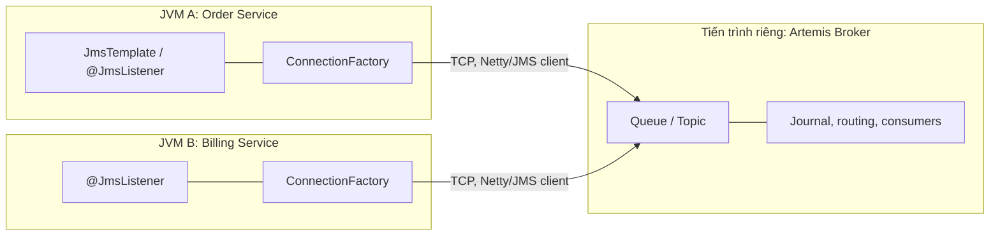
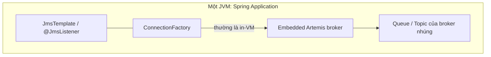

# Phân biệt broker ngoài ứng dụng và broker nhúng trong Spring JMS

## 1. Vấn đề cần hiểu khi thiết lập kết nối JMS

Một ứng dụng Spring sử dụng JMS thường có hai phần **khác vai trò**:

- **JMS client trong ứng dụng:** `JmsTemplate`, `@JmsListener`, `ConnectionFactory` và các đối tượng `Connection`/`Session`/`MessageProducer`/`MessageConsumer`. Chúng gửi hoặc nhận thông điệp qua giao diện Jakarta Messaging.
- **Message broker:** tiến trình/server quản lý destination (Queue, Topic), định tuyến message, lưu message theo cấu hình, điều phối consumer, acknowledge, redelivery và các chức năng vận hành khác. Ví dụ: Apache ActiveMQ Artemis.

Câu hỏi **“broker ngoài ứng dụng và broker nhúng khác nhau ở đâu?”** hỏi về **vị trí triển khai và vòng đời của chính broker**, không phải hai loại thông điệp hoặc hai chế độ `@JmsListener`.

**Broker ngoài ứng dụng (external / standalone broker)** là một broker chạy **thành tiến trình hoặc dịch vụ riêng** so với ứng dụng Spring. Nó có thể chạy trong container Docker, máy ảo, máy chủ, Kubernetes hoặc dịch vụ được quản lý. Spring kết nối qua địa chỉ và giao thức phù hợp. Broker có thể nằm cùng máy tính với ứng dụng nhưng vẫn là **broker ngoài ứng dụng** nếu là tiến trình riêng.

**Broker nhúng (embedded broker)** là broker được **khởi tạo bên trong cùng tiến trình JVM của ứng dụng** bằng thư viện server của provider. Vòng đời broker thường gắn với vòng đời ứng dụng đã khởi tạo nó. Với ActiveMQ Artemis, có thể nhúng server như một đối tượng Java hoặc để Spring Boot tự cấu hình khi có dependency tương ứng.

> **Ghi nhớ:** `ConnectionFactory` là **phía client** và không phải broker. Có `spring-boot-starter-artemis` hoặc `JmsTemplate` chưa đồng nghĩa trong JVM đã có server Artemis. JMS là tiêu chuẩn API; cách khởi tạo broker, URI kết nối và persistence là tính năng của provider.

### Hai sơ đồ triển khai

**A. Broker ngoài ứng dụng:**



Ứng dụng A và B kết nối đến **cùng một broker** và do đó nhìn thấy cùng các destination do broker này sở hữu (với điều kiện tên, quyền, routing và subscription cấu hình đúng).

**B. Broker nhúng trong một ứng dụng:**



Ứng dụng đã **sở hữu cả client lẫn broker** trong JVM. Nếu chạy hai bản sao ứng dụng độc lập và mỗi bản sao tự nhúng một broker, mặc định đó là **hai broker riêng**, không phải một hàng đợi dùng chung.

**Không đồng nhất “nhúng” với “chỉ có RAM”:** broker nhúng vẫn có thể có persistence, journal, selector, transaction, routing và thậm chí acceptor TCP khi được cấu hình. Ngược lại, broker chạy bên ngoài có thể bị cấu hình lưu dữ liệu tạm thời. **Vị trí triển khai** và **chính sách lưu trữ** là hai quyết định khác nhau.

## 2. Bảng so sánh các khía cạnh cốt lõi

| Khía cạnh | Broker ngoài ứng dụng | Broker nhúng |
| --- | --- | --- |
| **Vị trí chạy** | Process/container/service độc lập với Spring app | Cùng JVM với ứng dụng |
| **Ai khởi động broker?** | Docker, service manager, Kubernetes, operator hoặc người vận hành | Code nhúng hoặc Spring Boot trong quá trình startup app |
| **Vòng đời** | Có thể chạy tiếp khi ứng dụng dừng | Thông thường broker dừng khi JVM chứa nó dừng |
| **Kết nối client** | Thường qua TCP tới hostname/port của broker | Thường qua transport in-VM; vẫn có thể mở TCP nếu cấu hình |
| **Chia sẻ giữa nhiều service** | Dễ tạo một hệ thống messaging chung cho nhiều ứng dụng | Mỗi bản sao nhúng thường giữ destination riêng nếu không chủ động cấu hình kết nối liên broker |
| **Mở rộng ứng dụng** | Nhiều instance kết nối vào một hạ tầng broker chung | Nhân bản ứng dụng thường đồng thời nhân bản broker |
| **Lưu message qua restart** | Có thể khi broker bật persistence và dùng storage bền vững | Có thể nếu bật persistence và giữ lại data directory; không tự bảo đảm chỉ vì có broker |
| **Ảnh hưởng khi app crash** | Broker có thể còn hoạt động và giữ pending message | Broker trong JVM đó cũng dừng; khả năng khôi phục dựa vào cấu hình lưu trữ |
| **Ảnh hưởng khi broker lỗi** | Ứng dụng cần reconnect/recovery; các ứng dụng dùng cùng broker có thể bị ảnh hưởng | Thường gắn trực tiếp với sức khỏe và tài nguyên của process ứng dụng |
| **CPU/RAM/thread** | Broker dùng ngân sách tài nguyên có thể quản lý riêng | Cùng cạnh tranh heap, thread, CPU với nghiệp vụ trong JVM |
| **Độ trễ** | Có chi phí mạng và serialization theo transport | In-VM có thể giảm network hop, nhưng không bảo đảm tổng thời gian xử lý luôn tốt hơn |
| **Bảo mật** | Cần xác thực, TLS, quyền destination, network policy phù hợp | Có thể đơn giản cho bài tập cục bộ; nếu mở kết nối ra ngoài vẫn cần bảo mật |
| **Quan sát vận hành** | Console, metric, log, alert và backup riêng | Log/metric và lifecycle gắn ứng dụng; có thể cần thêm cấu hình để quan sát broker |
| **Tình huống điển hình** | Liên lạc giữa các service, staging/production, nhiều replica | Demo, học tập, integration test nhỏ, tác vụ messaging nội bộ có phạm vi rõ |

Bảng không khẳng định broker ngoài ứng dụng **luôn** HA hay broker nhúng **luôn** mất dữ liệu. HA, durability, retry, disk và quorum là các tính năng **phải được cấu hình và kiểm thử**, không tự xuất hiện do cách đóng gói.

### Từ “native” của Spring Boot dễ gây hiểu nhầm

Với **ActiveMQ Artemis** trong Spring Boot, `spring.artemis.mode=native` nghĩa là Spring tạo `ConnectionFactory` để **kết nối broker riêng** bằng Netty transport. Nó **không** có nghĩa đang gọi native/JNI, không có nghĩa Artemis là một thư viện C, và không đồng nghĩa broker được nhúng.

`spring.artemis.mode=embedded` yêu cầu server Artemis được khởi tạo **trong JVM hiện tại**, nếu dependency server có mặt. Đặt mode **tường minh** giúp tránh đổi nhầm mô hình triển khai khi dependency trên classpath thay đổi.

## 3. Theo dõi một message đi qua hai mô hình

Giả sử service `Orders` publish message `OrderPlaced#501` và service `Billing` muốn xử lý nó.

### 3.1. Broker ngoài ứng dụng

1. Broker Artemis khởi động độc lập, cung cấp destination `orders.queue`.
2. `Orders` và `Billing` nhận `ConnectionFactory` trỏ tới **cùng địa chỉ broker** (ví dụ `tcp://artemis:61616` trong Docker Compose).
3. `Orders` gọi `JmsTemplate.convertAndSend("orders.queue", ...)`.
4. JMS client đưa message qua kết nối tới broker; broker lưu, định tuyến và giao theo cấu hình Queue.
5. `Billing` đang có consumer trên **cùng Queue đó** nên có thể nhận.
6. Nếu `Orders` bị tắt sau khi gửi thành công, broker vẫn có thể quản lý pending message cho `Billing`, tùy transaction, persistence, TTL và trạng thái broker.

Điểm quan trọng: **Queue có identity gắn với broker/destination thực tế**, không chỉ với chuỗi `"orders.queue"` được viết trong code.

### 3.2. Hai ứng dụng đều tự nhúng broker

Nếu chạy hai process Spring riêng:

- Process `Orders` khởi tạo embedded broker **E1**, có Queue `orders.queue`.
- Process `Billing` khởi tạo embedded broker **E2**, cũng có Queue `orders.queue`.
- `Orders` gửi message vào `E1/orders.queue`; `Billing` lắng nghe `E2/orders.queue`.

Vì **E1 và E2 là hai broker khác nhau**, thông điệp gửi tới E1 **không tự động xuất hiện** tại E2.

```text
Orders JVM                       Billing JVM
  producer                        listener
     |                                |
  Embedded E1                     Embedded E2
  orders.queue                    orders.queue
       M501                       (không có M501)

Cùng tên queue ≠ cùng broker ≠ cùng tập message.
```

Muốn giao tiếp qua nhiều process, cách đơn giản nhất là **cho cả hai client trỏ đến cùng external broker**. Có thể xây dựng kiến trúc broker-to-broker/cluster/bridge riêng tùy provider, nhưng tính năng ấy **không tự bật** khi bạn thêm embedded dependency.

### 3.3. Nếu có nhiều instance của cùng service

Trong môi trường có ba bản sao `order-worker`:

- **External broker + một Queue chung:** ba JMS consumer cùng chia công việc nhận trên Queue theo cơ chế phân phối của broker. Một message ở lần giao ban đầu thường được giao cho một consumer; lỗi có thể khiến redelivery.
- **Ba embedded broker độc lập:** mỗi worker có Queue riêng. Một worker chỉ đọc thông điệp đi vào broker của mình, không tự nhìn thấy backlog tại hai broker kia. Load balancer HTTP của ứng dụng **không gộp các Queue** này thành một.

Với **Topic**, một broker chung phân phối tới các subscription trên broker đó. Hai broker nhúng độc lập có thể có Topic cùng tên mà không có bất kỳ liên hệ nào. Vì vậy cần hiểu **cả broker identity lẫn subscription identity**.

## 4. Cấu hình Spring Boot với một broker Artemis ngoài ứng dụng

Ví dụ dùng **Spring Boot 3.3.x / Java 17+ / ActiveMQ Artemis**, namespace `jakarta.jms.*`. Đây là ứng dụng Spring dùng JMS thật, không phải giả lập queue bằng collection Java.

### 4.1. Khởi động broker ngoài bằng Docker

Trên máy đã cài Docker, chạy một container Artemis **tách khỏi JVM của Spring**:

```bash
docker run --detach --rm --name artemis-external-demo -p 127.0.0.1:61616:61616 -p 127.0.0.1:8161:8161 apache/artemis:latest-alpine
```

Lệnh dựa trên Docker image chính thức của Apache Artemis. `61616` là cổng message transport; `8161` là cổng web management. Mapping `127.0.0.1` giới hạn truy cập từ máy local cho bài thực hành. Đợi broker sẵn sàng bằng:

```bash
docker logs artemis-external-demo
```

Image demo mặc định dùng tài khoản `artemis` và mật khẩu `artemis`. **Chỉ dùng credentials mặc định trong môi trường thử cục bộ**; thay chúng và cấu hình network/TLS/authorization phù hợp khi triển khai thật.

Bạn có thể mở console tại `http://localhost:8161` để kiểm tra broker. Broker có thể tắt/mở độc lập với tiến trình Java:

```bash
docker stop artemis-external-demo
```

Lưu ý: tùy chọn `--rm` sẽ xóa container khi dừng; nếu không mount volume thì **không nên kỳ vọng dữ liệu tồn tại sau khi xóa container**, kể cả khi một số message đã ghi vào filesystem bên trong container. Lưu dữ liệu qua restart cần cấu hình persistence và volume/storage bền vững.

### 4.2. Phụ thuộc Maven phía ứng dụng

`spring-boot-starter-artemis` cung cấp thư viện client và tích hợp Spring JMS. Khi **chỉ cần kết nối broker ngoài**, ứng dụng không cần thêm `artemis-jakarta-server`.

```xml
<dependency>
    <groupId>org.springframework.boot</groupId>
    <artifactId>spring-boot-starter-artemis</artifactId>
</dependency>
```

Spring Boot có thể tự tạo `ConnectionFactory` và `JmsTemplate` khi classpath và cấu hình phù hợp. Nhắc lại: đây là **client integration**; không khởi động container Docker hoặc service Artemis thay bạn.

### 4.3. application.properties cho external broker

```properties
spring.artemis.mode=native
spring.artemis.broker-url=tcp://localhost:61616
spring.artemis.user=artemis
spring.artemis.password=artemis
```

Với ứng dụng chạy **trên cùng host Docker**, `localhost` có thể kết nối tới cổng đã publish. Với ứng dụng chạy **trong một container khác**, `localhost` là **container ứng dụng**, không phải container broker. Trong Docker Compose, có thể sử dụng tên service như `tcp://artemis:61616` khi cùng mạng; trong Kubernetes dùng DNS của Service broker.

Ở môi trường thật, lưu credentials bằng secret manager/environment, dùng cấu hình bảo mật và chứng chỉ theo yêu cầu. Không hardcode mật khẩu production vào file commit.

Điểm xác nhận nên kiểm tra: application logs cho thấy client kết nối được, broker console có consumer cho destination, và thử gửi/nhận thành công. “Application context started” tự nó chưa chứng minh đã kết nối và tiêu thụ message.

## 5. Cấu hình broker nhúng bằng Spring Boot

### 5.1. Dependency bổ sung bắt buộc

Với Spring Boot 3.x và ActiveMQ Artemis, cần **thư viện broker server** trên classpath bên cạnh starter client:

```xml
<dependency>
    <groupId>org.apache.activemq</groupId>
    <artifactId>artemis-jakarta-server</artifactId>
    <scope>runtime</scope>
</dependency>
```

Version được Spring Boot dependency management lựa chọn khi dùng BOM/parent của Boot. Nếu dùng Gradle cùng Boot BOM, ý tưởng tương đương là thêm runtime dependency `org.apache.activemq:artemis-jakarta-server`.

`artemis-jakarta-server` là thư viện phía **server** cần để nhúng broker. Nếu chỉ thêm `spring-boot-starter-artemis` mà vẫn đặt `spring.artemis.mode=embedded`, cấu hình embedded không đầy đủ và quá trình khởi động có thể báo lỗi. Một embedded broker thực sự vẫn là **server messaging đầy đủ bên trong JVM**, không phải một `HashMap` hay mock của `JmsTemplate`.

### 5.2. application.properties cho embedded mode

```properties
spring.artemis.mode=embedded
spring.artemis.embedded.persistent=false
spring.artemis.embedded.queues=demo.orders
```

Giải thích:

- `mode=embedded` yêu cầu Spring Boot khởi động broker nhúng. Nếu thiếu thư viện server, cần sửa dependency thay vì đổi nhầm về `native` để che lỗi.
- `persistent=false` là lựa chọn **chủ ý cho demo**: broker không lưu bền vững journal message. Không áp dụng cho bài toán phải giữ backlog qua restart.
- `embedded.queues=demo.orders` chuẩn bị Queue được dùng trong ví dụ. Với topic có cấu hình tương ứng `spring.artemis.embedded.topics`.
- Trong embedded mode, bạn **không cần** chạy container Artemis ngoài cho demo này. Thông thường Boot cấu hình kết nối in-VM tới embedded broker.
- Khả năng kết nối từ process khác tới broker nhúng **không tự có**; muốn mở transport TCP/remote acceptor cần cấu hình server rõ ràng và đánh giá giới hạn lifecycle, bảo mật.

**Không sử dụng `spring.artemis.broker-url=tcp://localhost:61616` như bằng chứng broker nhúng.** URI TCP chỉ là địa chỉ transport; để biết broker chạy ở đâu phải xác định process tạo và quản lý server.

### 5.3. Tác động của classpath và auto-detection

Spring Boot có thể **tự nhận biết embedded mode** nếu thấy các lớp Artemis server trên classpath, trừ khi mode đã cấu hình rõ. Vì vậy, chỉ thêm một dependency server cho test hoặc runtime cũng có thể làm application chạy nhầm broker nội bộ.

Quy tắc dễ bảo trì:

- Profile **dev-embedded** đặt `spring.artemis.mode=embedded` và khai báo server dependency.
- Profile **dev-external**, **staging** hoặc **prod** đặt `spring.artemis.mode=native` cùng broker URL/credentials đúng.
- Khi cùng một artifact chứa cả client/server dependency để học hai chế độ, **luôn đặt mode tường minh** theo profile.
- Kiểm tra kết nối và consumer trên **đúng broker kỳ vọng**, tránh tình trạng “gửi nhận vẫn thành công” nhưng thực ra chỉ qua Queue nội bộ.

## 6. Thực hành end-to-end: cùng một ứng dụng, đổi broker qua profile

Mục tiêu của bài thực hành: **mã publisher và listener không phải viết lại khi thay broker ngoài bằng broker nhúng**. Ta chỉ đổi nơi `ConnectionFactory` nhận kết nối từ cấu hình.

Yêu cầu: **JDK 17+, Maven 3.9+**. Khi chạy profile native cần thêm Docker và broker đã sẵn sàng. Để cả hai chế độ dùng chung một project, dependency server nhúng có mặt trong runtime; mode ở hai profile được đặt tường minh.

### 6.1. Cấu trúc thư mục

```text
broker-location-demo/
├── pom.xml
└── src/
    └── main/
        ├── java/demo/jms/BrokerLocationDemoApplication.java
        └── resources/
            ├── application-native.properties
            └── application-embedded.properties
```

### 6.2. pom.xml

```xml
<project xmlns="http://maven.apache.org/POM/4.0.0"
         xmlns:xsi="http://www.w3.org/2001/XMLSchema-instance"
         xsi:schemaLocation="http://maven.apache.org/POM/4.0.0 https://maven.apache.org/xsd/maven-4.0.0.xsd">
    <modelVersion>4.0.0</modelVersion>

    <parent>
        <groupId>org.springframework.boot</groupId>
        <artifactId>spring-boot-starter-parent</artifactId>
        <version>3.3.0</version>
        <relativePath/>
    </parent>

    <groupId>demo</groupId>
    <artifactId>broker-location-demo</artifactId>
    <version>1.0.0</version>
    <properties>
        <java.version>17</java.version>
    </properties>

    <dependencies>
        <dependency>
            <groupId>org.springframework.boot</groupId>
            <artifactId>spring-boot-starter-artemis</artifactId>
        </dependency>

        <!-- Có mặt để profile embedded khởi động Artemis server. -->
        <dependency>
            <groupId>org.apache.activemq</groupId>
            <artifactId>artemis-jakarta-server</artifactId>
            <scope>runtime</scope>
        </dependency>
    </dependencies>

    <build>
        <plugins>
            <plugin>
                <groupId>org.springframework.boot</groupId>
                <artifactId>spring-boot-maven-plugin</artifactId>
            </plugin>
        </plugins>
    </build>
</project>
```

Đây là ví dụ có thể dùng để **thử hai mode trên cùng mã Java**. Với ứng dụng production chỉ dùng external broker, cân nhắc loại bỏ dependency server nhúng khỏi classpath runtime để giảm khả năng khởi động nhầm và giảm bề mặt thư viện không cần thiết.

### 6.3. Mã Java đầy đủ

Lưu file `src/main/java/demo/jms/BrokerLocationDemoApplication.java`:

```java
package demo.jms;

import java.util.concurrent.CountDownLatch;
import java.util.concurrent.TimeUnit;

import org.springframework.boot.ApplicationRunner;
import org.springframework.boot.SpringApplication;
import org.springframework.boot.autoconfigure.SpringBootApplication;
import org.springframework.context.annotation.Bean;
import org.springframework.jms.annotation.EnableJms;
import org.springframework.jms.annotation.JmsListener;
import org.springframework.jms.core.JmsTemplate;
import org.springframework.stereotype.Component;

@SpringBootApplication
@EnableJms
public class BrokerLocationDemoApplication {
    public static void main(String[] args) {
        SpringApplication.run(BrokerLocationDemoApplication.class, args);
    }

    @Bean
    ApplicationRunner sendDemo(JmsTemplate jmsTemplate, DemoInboxListener listener) {
        return args -> {
            jmsTemplate.convertAndSend("demo.orders", "ORDER-501");
            if (!listener.awaitMessage(10, TimeUnit.SECONDS)) {
                throw new IllegalStateException("Timed out waiting for JMS message");
            }
            System.out.println("DEMO: completed");
        };
    }
}

@Component
class DemoInboxListener {
    private final CountDownLatch received = new CountDownLatch(1);

    @JmsListener(destination = "demo.orders")
    public void onMessage(String payload) {
        System.out.println("LISTENER: " + payload);
        received.countDown();
    }

    boolean awaitMessage(long timeout, TimeUnit unit)
            throws InterruptedException {
        return received.await(timeout, unit);
    }
}
```

**Giải thích contract của ví dụ:**

1. `JmsTemplate.convertAndSend` tạo và gửi một JMS TextMessage từ chuỗi.
2. `@JmsListener` khai báo consumer trên Queue `demo.orders`; Spring listener container quản lý giao nhận.
3. `CountDownLatch` chỉ giúp **demo** chờ callback hoàn thành thay vì đóng ứng dụng quá sớm; không phải cơ chế message broker hay xác nhận transaction.
4. `@EnableJms` bật hỗ trợ listener endpoint tường minh. Spring Boot còn có thể tự bật phần infrastructure này khi auto-configuration thích hợp.
5. Chỉ có một instance chạy trong demo. Nếu chạy hai bản sao cùng code trên một external Queue, mỗi bản sao có producer và consumer riêng; không kỳ vọng từng bản sao luôn nhận chính message do bản sao ấy gửi, vì nhiều consumer chia Queue.

**Quan trọng:** Mã này dùng **Queue** mặc định của Spring JMS. Bài học so sánh vị trí broker, không đổi Queue thành Topic. Với Topic cần đổi `pubSubDomain` phù hợp ở cả producer và listener container; cách broker được triển khai vẫn là quyết định độc lập.

### 6.4. Hai file cấu hình

`src/main/resources/application-native.properties`:

```properties
spring.artemis.mode=native
spring.artemis.broker-url=tcp://localhost:61616
spring.artemis.user=artemis
spring.artemis.password=artemis
```

`src/main/resources/application-embedded.properties`:

```properties
spring.artemis.mode=embedded
spring.artemis.embedded.persistent=false
spring.artemis.embedded.queues=demo.orders
```

Tên profile `native` là tên file `application-native.properties`, không phải phép ẩn dụ về code native. Cả hai lần chạy dùng **chính một** `BrokerLocationDemoApplication.java`.

### 6.5. Chạy với external broker

Khởi động container Artemis bằng lệnh ở mục 4.1 và đợi broker sẵn sàng. Từ thư mục có `pom.xml`:

```bash
mvn spring-boot:run -Dspring-boot.run.profiles=native
```

Ứng dụng phải kết nối tới `tcp://localhost:61616`. Trong log có thể đan xen nhiều dòng từ Spring/Artemis; **hai dòng do chính code demo in ra** theo thứ tự là:

```text
LISTENER: ORDER-501
DEMO: completed
```

Thứ tự hai dòng này được bảo vệ bởi `CountDownLatch`: callback in `LISTENER` rồi mới `countDown`; runner chỉ in `DEMO` sau khi `awaitMessage` trả về thành công. Đây là kết quả kỳ vọng khi broker sẵn sàng và gửi/nhận thành công; nếu không, ứng dụng báo timeout hoặc lỗi kết nối.

Sau khi quan sát, nhấn `Ctrl+C` để dừng ứng dụng, rồi có thể dừng broker riêng. Broker **không tự tắt theo app**.

### 6.6. Chạy với broker nhúng

Đảm bảo dependency `artemis-jakarta-server` có trong runtime. Có thể dừng container external để chứng minh ví dụ không cần nó. Chạy:

```bash
mvn spring-boot:run -Dspring-boot.run.profiles=embedded
```

Spring Boot khởi tạo broker Artemis trong JVM ứng dụng và tạo Queue demo theo cấu hình. Code Java in cùng hai dòng:

```text
LISTENER: ORDER-501
DEMO: completed
```

Khi nhấn `Ctrl+C`, Spring application context kết thúc và broker nhúng đi theo lifecycle đó. Với `persistent=false`, không dựa vào bài thực hành để chứng minh giữ backlog qua restart.

**Điểm cần kiểm chứng thêm:** Trong embedded mode, `localhost:61616` không nhất thiết có broker đang lắng nghe; Spring có thể dùng in-VM transport thay vì TCP. `docker ps` không có container external vẫn là tình huống hợp lệ. Cách chắc chắn nhất là đọc cấu hình mode, classpath, process/log startup và kết quả gửi/nhận.

### 6.7. Khi cùng demo được triển khai thành hai process

Nếu muốn kiểm chứng khác biệt giữa hai broker với Queue cùng tên, tránh để mỗi process tự gửi rồi tự nhận (điều đó **không chứng minh** chúng chia sẻ message). Thiết kế thử nghiệm cần **process A chỉ gửi** và **process B chỉ nhận**:

- Native: A và B cùng trỏ một external Artemis; message gửi từ A có thể được B nhận (miễn không có consumer khác lấy trước).
- Embedded: A và B tự tạo broker riêng; message ở E1 không xuất hiện tại E2. Nếu không có cấu hình bridge/cluster, tên Queue giống nhau không tạo được kết nối liên broker.

Bài này minh họa cả producer và consumer trong một process để đơn giản hóa cơ chế chạy; kết luận chia sẻ message giữa process cần kiểm tra bằng bài test A/B như trên.

## 7. Persistence, durability và khả năng phục hồi

Cần tách biệt bốn khái niệm:

1. **Broker location:** broker ngoài process hay nhúng trong JVM.
2. **Delivery mode của message:** `PERSISTENT` hoặc `NON_PERSISTENT` (theo Jakarta Messaging), cùng transaction và acknowledge.
3. **Broker storage:** lưu journal ra disk bền vững, cấu hình persistence, nơi đặt dữ liệu và quyền truy cập.
4. **High availability / recovery:** khả năng hoạt động khi node chết, backup/replication/failover, mạng, cấu hình client reconnect.

### Ma trận lỗi thường gặp

| Sự cố | External broker | Embedded broker |
| --- | --- | --- |
| Spring service đang gửi bị crash | Broker độc lập có thể còn giữ message đã nhận/commit theo chính sách | Broker sống trong process đó có thể bị dừng cùng app |
| Spring consumer dừng nhưng broker còn sống | Backlog có thể nằm tại broker cho Queue; Topic phải xét durable subscription | Nếu broker nằm trong **chính consumer process**, broker cũng dừng theo |
| Broker restart | Khôi phục dựa vào persistent journal/storage, message delivery và policy | Tương tự về mặt storage, nhưng restart thường kèm restart app |
| Process/container bị xóa cùng data directory | Có thể mất dữ liệu nếu volume không được giữ | Có thể mất dữ liệu nếu directory của broker nhúng không được giữ |
| Hai replica xử lý song song | Có thể là nhiều consumer của một Queue chung | Thường mỗi replica là một Queue khác nhau nếu mỗi replica nhúng broker |
| Muốn failover khi broker chết | Cần cluster/HA, client reconnect và cấu hình storage hợp lệ | Nhúng vào app riêng lẻ không tự tạo HA |

`spring.artemis.embedded.persistent=true` có thể bật lưu trữ ở embedded Artemis; phải định nghĩa vị trí data directory và cách giữ storage qua restart. **Nó không biến broker nhúng thành cluster HA.** `spring.artemis.embedded.persistent=false` chỉ nên dùng khi phù hợp với mục đích test và khả năng mất message được chấp nhận.

Broker ngoài cũng không phải luôn “bền vững”: nếu container chạy `--rm` không volume, mất filesystem khi xóa, hoặc broker tắt persistence, thông điệp có thể mất. Muốn bảo đảm nghiệp vụ phải thử **broker restart, process crash, network partition, redelivery và replay** với cấu hình thật.

### Transaction/ack không phụ thuộc chỗ đặt broker

Dù broker nằm đâu, JMS vẫn có các mode acknowledge, transaction và các tình huống redelivery. Nếu handler ghi DB thành công nhưng message chưa được JMS commit và connection mất, broker có thể giao lại message. Vì vậy thiết kế **idempotent consumer**, định danh message nghiệp vụ và cơ chế giải quyết poison message vẫn cần thiết trong cả hai mô hình.

“Nhúng thì message không mất” và “external thì tự động exactly once” đều là kết luận sai.

## 8. Hiệu năng và tài nguyên: nhanh hơn không đồng nghĩa tốt hơn

Broker nhúng có thể giảm độ trễ truyền qua network khi producer/consumer cùng JVM và dùng in-VM transport. Tuy nhiên broker vẫn cần route, queue, persistence, thread scheduling, serialization/copy, quản lý ack và transaction. Nếu app xử lý CPU nặng hoặc heap thiếu, **broker nhúng và nghiệp vụ tranh chấp cùng tài nguyên**.

External broker có thể tạo thêm network hop, nhưng đổi lại có thể cấp riêng memory, CPU, disk IOPS, TLS termination, monitoring và cơ chế vận hành; nhiều service cùng dùng được mà không nhúng server vào từng ứng dụng.

Không thể chọn mô hình chỉ bằng câu “embedded nhanh hơn” hoặc “external chậm hơn”. Cần benchmark với:

- **End-to-end latency** của message từ publish tới nghiệp vụ hoàn tất, kể cả persistence và ack.
- **Throughput** khi tăng producer/consumer, payload size và concurrency.
- **Pending/inflight/redelivery count** ở broker.
- **JVM heap, GC, CPU, số thread** của ứng dụng và broker.
- **Storage latency, disk throughput, fsync**, nhất là khi message persistent.
- Tình huống broker/app restart và thời gian recovery.

Một benchmark in-memory embedded không persistence so với external broker chạy journal sync và TLS **không phải** so sánh công bằng về độ bền và tính năng. Đặt cùng mục tiêu độ tin cậy trước khi đo hiệu năng.

## 9. Bảo mật và vận hành

### External broker

- Có địa chỉ endpoint, port, network policy/firewall. Xác thực client, phân quyền theo Queue/Topic; dùng TLS khi cần và xoay vòng secrets.
- Theo dõi health, queue depth, consumer count, unacknowledged messages, redelivery, dead-letter queue, broker disk usage, connection failure.
- Cấu hình backup, persistence, HA/failover, version upgrade và capacity **độc lập** với lịch release ứng dụng.
- Không để broker management console hoặc transport port công khai chỉ vì ví dụ Docker chạy được.

### Embedded broker

- Dùng cùng tiến trình JVM: cần kiểm soát memory, thread, disk path và quyền file của app.
- Cẩn thận với dependency server bị kéo vào runtime ngoài ý muốn; nên kiểm tra mode khi khởi động.
- Nếu broker chỉ phục vụ trong JVM và không bật remote acceptor, bề mặt network có thể nhỏ hơn; **nếu bật TCP để service khác truy cập** thì vẫn cần xác thực/TLS/quản lý tương tự external.
- Khi có nhiều instance, phải biết message nằm tại broker nào, backup dữ liệu nào và cách chuyển/routing sang instance mới. Không giả định service discovery cho HTTP cũng giải quyết JMS broker identity.
- Khi ứng dụng deploy/restart thường xuyên, broker nhúng cũng restart. Việc giữ queue backlog sau restart phải được thiết kế cụ thể.

## 10. Chọn mô hình theo nhu cầu

| Nhu cầu | Lựa chọn thường phù hợp | Lý do |
| --- | --- | --- |
| Demo cá nhân, chạy thử không muốn cài broker riêng | **Embedded** | Setup nhanh, khởi động cùng ứng dụng, thử logic JMS |
| Integration test ngắn kiểm tra JMS API | **Embedded**, nếu đủ sát môi trường mục tiêu | Có broker thật trong test JVM; reset isolation dễ nhưng cần chú ý lifecycle |
| Test khả năng kết nối qua mạng, auth/TLS và cấu hình giống production | **External test broker** qua Docker/Testcontainers | Kiểm tra đúng boundary mạng và behavior server tách process |
| Hai hay nhiều microservice cần trao đổi thông điệp | **External** | Cần destination chung, broker độc lập |
| Nhiều replica consumer chia một Queue | **External** thông thường | Tất cả replica cùng đọc Queue của broker chung |
| Production có yêu cầu HA, backup, quản trị và giám sát độc lập | **External** được vận hành và cấu hình HA đúng | Tách lifecycle, dễ quan sát và quản trị tập trung |
| Ứng dụng một JVM có hàng đợi nội bộ nhưng vẫn cần JMS semantics | **Embedded** có thể phù hợp | Chỉ khi chấp nhận lifecycle, storage và giới hạn scale của nó |
| Ứng dụng chỉ dùng collection/`BlockingQueue` trong RAM | Không cần JMS broker nếu không có yêu cầu JMS | Đây là giải pháp khác; không gọi một Java Queue thông thường là embedded JMS broker |

**Quy tắc chọn:** Nếu có nhiều process/service độc lập cần cùng một dòng sự kiện, ưu tiên broker được quản lý như một hạ tầng riêng. Nếu chỉ thử JMS trong một JVM và không cần chia sẻ message ra ngoài, embedded thường đơn giản. Trường hợp đặc biệt dùng embedded cho production có thể khả thi, nhưng phải chịu trách nhiệm đầy đủ về storage, topology, HA và vòng đời.

## 11. Chuyển một ứng dụng từ embedded sang external

Một ưu điểm của abstraction JMS là code nghiệp vụ có thể giữ nguyên nếu không phụ thuộc các API riêng của provider.

1. **Giữ ổn định** destination name, Queue/Topic semantics, payload schema, header, selector, transaction và ack mode.
2. **Chuẩn bị broker riêng**: queue/address routing, credentials, permission, persistence, DLQ, retention/TTL và monitoring.
3. **Đặt mode rõ ràng:** thay `spring.artemis.mode=embedded` bằng `spring.artemis.mode=native`.
4. **Chỉ định endpoint:** `spring.artemis.broker-url` trỏ đến broker thực tế; không dùng `localhost` sai bối cảnh container.
5. **Điều chỉnh runtime dependency:** production external không cần Artemis server trong JVM app; test embedded có thể giữ dependency trong test profile/scope.
6. **Kiểm tra thực tế:** producer và consumer ở **hai process khác nhau** thấy cùng destination; thử một message, transaction, restart và redelivery.
7. **Lập kế hoạch chuyển backlog:** message tồn trong broker nhúng cũ **không tự chuyển** sang external chỉ vì đổi `broker-url`. Nếu cần dữ liệu cũ, phải có kế hoạch drain/migration ứng với broker, trạng thái persistence và quy tắc nghiệp vụ.
8. **Triển khai tuần tự:** bảo đảm không có đồng thời hai broker được dùng cho cùng luồng nghiệp vụ mà không có cơ chế bridge/dual-write an toàn.

Nếu ứng dụng đang nhúng broker chỉ để test, chuyển mode thường chỉ vài properties. Nhưng nếu broker nhúng đã giữ dữ liệu thật thì đó là một bài toán **di chuyển trạng thái** chứ không chỉ đổi URL.

## 12. Chẩn đoán các lỗi phổ biến

### Lỗi 1: "Connection refused" ở `localhost:61616`

**Tình huống:** Cấu hình `spring.artemis.mode=native`, nhưng không có broker ngoài đang chạy tại địa chỉ đó.

**Cách kiểm tra:** xem container/service, port mapping, log broker, DNS/network, firewall, client credentials. Nếu app chạy trong container, thay `localhost` bằng địa chỉ broker có thể truy cập từ mạng container. Đừng sửa thành embedded chỉ để làm lỗi kết nối “biến mất” nếu kiến trúc cần broker chung.

### Lỗi 2: Hai service đều gửi/nhận thành công nhưng không trao đổi được với nhau

**Nguyên nhân phổ biến:** cả hai app đang auto-start **broker nhúng riêng**, sau đó mỗi app gửi và đọc Queue local. Giao diện JMS trông bình thường vì mỗi process tự giao tiếp với chính mình.

**Cách kiểm tra:** mode thực tế, dependency server, JVM process, log khởi tạo embedded, URL/transport của ConnectionFactory và console của broker chung. Thử A chỉ gửi, B chỉ nhận. Không suy luận “cùng tên Queue” là cùng broker.

### Lỗi 3: Thêm dependency làm app đổi hành vi

**Nguyên nhân:** server artifact `artemis-jakarta-server` xuất hiện trên classpath và Spring Boot có thể tự phát hiện embedded broker nếu không cấu hình mode.

**Cách sửa:** đặt `spring.artemis.mode=native` rõ trong profile cần broker ngoài; kiểm tra dependency tree, active profile và client connection destination.

### Lỗi 4: Test embedded qua, production mất message khi restart

**Nguyên nhân có thể:** test không bật persistence/không có network failure; production thay đổi semantics của storage, transaction, TTL, subscription hoặc release. Vị trí broker khác chỉ là một yếu tố.

**Cách kiểm tra:** delivery mode, broker persistence, ổ disk, mount volume, journal, ack/commit, DLQ và end-to-end replay. Test có cùng mục tiêu reliability với production.

### Lỗi 5: Nhân bản app dẫn đến nhiều queue tách biệt

**Nguyên nhân:** từng replica tự chạy embedded broker. Replica A không thấy backlog replica B.

**Cách sửa:** nếu yêu cầu một Queue dùng chung, di chuyển sang broker external dùng chung hoặc thiết kế topology cluster/bridge được quản lý rõ. Tránh kỳ vọng Kubernetes replica count tự gộp destination.

### Lỗi 6: Broker nhúng mở TCP port và xung đột cổng

**Nguyên nhân:** cấu hình embedded server có TCP acceptor cố định và hai instance trên cùng host cùng bind cổng; hoặc host đã chạy external broker trên cổng ấy.

**Cách sửa:** xem broker server configuration/acceptors, phân biệt in-VM vs TCP, cấp cổng riêng khi cần; đừng mở cổng TCP nếu bài toán chỉ cần kết nối trong JVM.

### Lỗi 7: Broker ngoài vẫn chạy nhưng app không nhận được message

**Nguyên nhân có thể:** consumer dùng nhầm broker address, Queue/Topic mismatch, sai quyền, client reconnect thất bại, listener chưa start hoặc message bị selector/TTL chặn.

**Cách kiểm tra:** xác minh Queue name và routing type trên **chính broker mà client kết nối**, số consumers, message count, log kết nối, listener container status. External broker đang online không chứng minh mọi JMS client trỏ đúng nơi.

## 13. Bài tập tự kiểm tra

**Câu 1.** Spring Boot app và Artemis chạy trong **hai container khác nhau** trên cùng máy. Đây có phải embedded broker không?

**Đáp án:** Không. Hai process/container độc lập là mô hình broker ngoài ứng dụng, dù cùng một host.

**Câu 2.** Hai instance Spring đều cấu hình `spring.artemis.mode=embedded` và cùng tên `payments.queue`. Instance B có tự đọc message được gửi vào instance A không?

**Đáp án:** Không, nếu không có cơ chế liên kết broker được cấu hình riêng. Đây là hai broker với hai Queue có tên giống nhau.

**Câu 3.** Có `JmsTemplate` và `ConnectionFactory` trong Spring context thì có nghĩa đang chạy broker nhúng?

**Đáp án:** Không. Đây là client abstraction. Phải kiểm tra mode, dependency server và process broker.

**Câu 4.** Vì sao profile native vẫn cần đặt `mode=native` dù project có dependency embedded server phục vụ test?

**Đáp án:** Để Spring Boot không tự suy ra embedded mode từ classpath và kết nối nhầm broker local.

**Câu 5.** Broker nhúng bật `persistent=true` có bảo đảm HA và exactly-once xử lý nghiệp vụ không?

**Đáp án:** Không. Persistence chỉ là một thành phần của độ bền; vẫn cần lưu storage đúng, backup/failover, transaction và idempotent consumer.

**Câu 6.** Vì sao với demo `application-native.properties` phải dùng địa chỉ broker thực, không sao chép `localhost` vào container của service khác?

**Đáp án:** `localhost` trong mỗi container trỏ tới chính container đó. Container ứng dụng phải kết nối qua địa chỉ DNS/host/port truy cập được tới broker.

**Câu 7.** Nếu chỉ thay `spring.artemis.mode=embedded` thành `native`, những message còn nằm trong broker cũ có tự chuyển sang broker mới không?

**Đáp án:** Không. Đó là hai broker có trạng thái riêng; muốn giữ backlog cần quy trình migration/drain cụ thể.

**Câu 8.** Thông điệp đi từ producer tới listener trên cùng JVM khi broker nhúng có chắc chắn nhanh hơn external về end-to-end latency không?

**Đáp án:** Không chắc. In-VM có thể giảm network hop, nhưng tổng latency chịu ảnh hưởng bởi persistence, GC, CPU, thread scheduling, xử lý nghiệp vụ và cách đo.

### Kết luận cần nhớ

**Broker ngoài ứng dụng** có process và lifecycle riêng; nhiều Spring service có thể dùng chung destination của nó nếu cùng kết nối đúng broker. **Broker nhúng** chạy trong JVM của app, thuận tiện cho demo/test hoặc một số use case nội bộ, nhưng mỗi process nhúng thường có **broker và queue riêng**. **`ConnectionFactory` quyết định app kết nối tới đâu; broker location không tự quyết định durability, HA, ack hoặc exactly-once.**

## Nguồn tham khảo chính thức

- [Spring Boot 3.4 – JMS, Artemis embedded và native mode](https://docs.spring.io/spring-boot/3.4/reference/messaging/jms.html)
- [Spring Boot – JMS application properties, embedded persistence, queues và topics](https://docs.spring.io/spring-boot/3.4/appendix/application-properties/index.html)
- [Spring – Messaging with JMS: setup broker và listener](https://spring.io/guides/gs/messaging-jms/)
- [Apache ActiveMQ Artemis – Embedding Apache Artemis](https://artemis.apache.org/components/artemis/documentation/latest/embedding-artemis.html)
- [Apache ActiveMQ Artemis – Docker image, ports và volume](https://artemis.apache.org/components/artemis/documentation/latest/docker.html)
- [Spring Framework – Annotation-driven JMS listener endpoints](https://docs.spring.io/spring-framework/reference/integration/jms/annotated.html)
