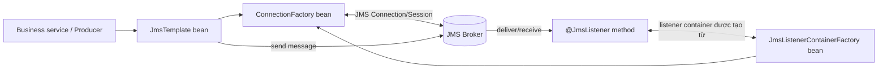
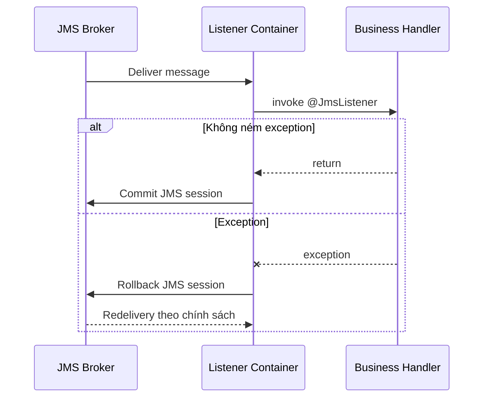

# Đăng ký ConnectionFactory, JmsTemplate và listener factory trong Spring JMS

> **Bối cảnh:** Spring Framework – JMS, nhóm **Thiết lập kết nối**. Bài này đi từ vai trò của ba thành phần đến cách đăng ký chúng bằng Spring Bean, lựa chọn giữa cấu hình tự động của Spring Boot và cấu hình tường minh, rồi kiểm tra một luồng gửi/nhận JMS hoàn chỉnh. Ví dụ sử dụng **Java 21, Spring Boot 3.3.5, Jakarta Messaging và Apache ActiveMQ Artemis**.

## 1. Bức tranh kết nối: ba thành phần, ba trách nhiệm

Khi một ứng dụng dùng JMS, producer không nên tự lặp lại toàn bộ mã mở connection/session/producer cho mỗi chức năng nghiệp vụ; consumer cũng không cần tự tạo thread và vòng lặp receive. Spring JMS phân chia trách nhiệm:

| Thành phần | Vai trò | Được dùng bởi |
| --- | --- | --- |
| `jakarta.jms.ConnectionFactory` | **Nguồn tạo kết nối** tới JMS provider/broker, chứa cấu hình kết nối, xác thực, transport theo provider. | `JmsTemplate` và listener container. |
| `org.springframework.jms.core.JmsTemplate` | **API gửi, nhận chủ động, convert message**; quản lý vòng đời resource của từng lời gọi Spring JMS. | Producer/service gửi thông điệp, đôi khi synchronous receiver. |
| `org.springframework.jms.config.DefaultJmsListenerContainerFactory` | **Khuôn mẫu tạo listener container** khi Spring xử lý `@JmsListener`; cấu hình connection, destination mode, concurrency, transaction, converter, error handling. | Hạ tầng đăng ký `@JmsListener`. |



Đọc sơ đồ theo hướng triển khai: container nhận cấu hình từ listener factory; chính container dùng `ConnectionFactory` để tạo, duy trì, khôi phục connection/session/consumer và gọi phương thức listener khi có message. `DefaultJmsListenerContainerFactory` **không phải** một consumer đang nhận message; nó là factory để tạo `DefaultMessageListenerContainer` cho từng endpoint.

Một số đối tượng dễ nhầm:

- **`ConnectionFactory` khác `Connection`:** Bean factory được tái sử dụng; việc tạo kết nối thực tế có thể diễn ra khi gửi/nhận bắt đầu. Một bean tồn tại không chứng minh broker đã kết nối thành công.
- **`JmsTemplate` khác `MessageProducer`:** template thực thi thao tác gửi/convert và mượn hoặc tạo JMS resources theo `ConnectionFactory`. Nó không phải broker và không lưu hàng đợi.
- **`JmsListenerContainerFactory` khác `@JmsListener`:** annotation chỉ định endpoint; bean factory quyết định cách endpoint được chạy.
- **`Queue` khác `Topic`:** không chỉ thay chuỗi tên destination. `pubSubDomain=false` chọn queue (point-to-point); `true` chọn topic (publish/subscribe) với semantics khác.

## 2. Ai đăng ký bean: Spring Boot hay code của chúng ta?

### 2.1. Spring Boot thường tự cấu hình đủ ba phần

Khi có `spring-boot-starter-artemis`, cấu hình broker hợp lệ và không có bean tùy chỉnh xung đột, Spring Boot thường:

1. Tạo `ConnectionFactory` để kết nối Artemis từ `spring.artemis.*`, thường dùng thêm lớp `CachingConnectionFactory` cho phía ứng dụng.
2. Tạo `JmsTemplate` nếu chưa có bean phù hợp; mặc định hướng queue.
3. Bật hạ tầng nhận `@JmsListener` và tạo listener container factory mặc định, tên `jmsListenerContainerFactory`, nếu chưa có factory do ứng dụng đăng ký.
4. Gắn các tùy chọn chung như `MessageConverter`, `DestinationResolver` và một số cấu hình listener theo cơ chế tự cấu hình được hỗ trợ.

Trong một ứng dụng Spring Boot thông thường, chỉ cần inject `JmsTemplate` và thêm `@JmsListener` đã có thể gửi/nhận. **Không bắt buộc phải khai báo `@Bean` thủ công** nếu cấu hình mặc định đáp ứng nhu cầu.

**Hai hướng bên dưới là các cấu hình thay thế nhau**:

- **Hướng A – Boot auto-config:** ít code, khuyến nghị khi dùng một broker với cấu hình phổ biến.
- **Hướng B – đăng ký rõ ba bean:** để hiểu cơ chế và có quyền quyết định cụ thể khi muốn thay provider, tách destination, transaction hoặc listener concurrency.

Không sao chép toàn bộ hai hướng vào cùng một application rồi mặc định chúng sẽ phối hợp; các `@Bean` tự đăng ký có thể khiến cấu hình tự động của Boot **back off**.

### 2.2. Dependency cho cả hai hướng

Với Gradle project riêng có Java 21, tạo `settings.gradle`:

```groovy
rootProject.name = 'spring-jms-wiring-demo'
```

`build.gradle`:

```groovy
plugins {
    id 'java'
    id 'org.springframework.boot' version '3.3.5'
    id 'io.spring.dependency-management' version '1.1.6'
}

group = 'com.example'
version = '0.0.1-SNAPSHOT'

java {
    toolchain {
        languageVersion = JavaLanguageVersion.of(21)
    }
}

repositories {
    mavenCentral()
}

dependencies {
    implementation 'org.springframework.boot:spring-boot-starter-artemis'
    implementation 'org.springframework.boot:spring-boot-starter-web'
}
```

- `spring-boot-starter-artemis` mang Jakarta Messaging API, client Artemis và Spring JMS integration tương thích với Spring Boot 3.3.x. Không tự trộn các API `javax.jms.*` của JMS cũ vào các ví dụ `jakarta.jms.*`.
- `spring-boot-starter-web` chỉ phục vụ API HTTP trong demo; có thể bỏ nếu producer không có HTTP controller.
- Broker Artemis là **dịch vụ phải chạy riêng** tại URL chỉ định; dependency client **không tự tạo một broker persistent** trong ví dụ `mode: native`.

## 3. Hướng A: đăng ký tự động và chỉ inject bean đã có

`src/main/resources/application.yml` (cấu hình Boot, không cần Java config thủ công):

```yaml
spring:
  artemis:
    mode: native
    broker-url: ${JMS_BROKER_URL:tcp://localhost:61616}
    user: ${JMS_USER:artemis}
    password: ${JMS_PASSWORD:artemis}
  jms:
    pub-sub-domain: false
    cache:
      session-cache-size: 5
```

Đây là ví dụ dành cho môi trường local, hãy thay tài khoản mặc định bằng secret thực tế ở môi trường triển khai. `spring.artemis.mode=native` yêu cầu kết nối broker bên ngoài; `broker-url` là địa chỉ broker, không phải tên queue.

Với Boot auto-config, application có thể dùng:

```java
package com.example.jms;

import org.springframework.jms.annotation.JmsListener;
import org.springframework.jms.core.JmsTemplate;
import org.springframework.stereotype.Service;

@Service
class AutoConfiguredService {
    private final JmsTemplate jmsTemplate;

    AutoConfiguredService(JmsTemplate jmsTemplate) {
        this.jmsTemplate = jmsTemplate;
    }

    void send(String orderId) {
        jmsTemplate.convertAndSend("orders.pending", orderId);
    }

    @JmsListener(destination = "orders.pending")
    public void receive(String orderId) {
        System.out.println("Received " + orderId);
    }
}
```

Đoạn `AutoConfiguredService` là **một component**, cần được component-scan bởi một `@SpringBootApplication` thuộc package cha `com.example.jms` (hoặc package phù hợp); chưa phải chương trình độc lập có `main`. Đây là ví dụ cho **Boot tự đăng ký**: `JmsTemplate` được inject, `@JmsListener` dùng factory mặc định. Spring Boot hỗ trợ hạ tầng annotation nên thông thường không cần `@EnableJms` thủ công trong hướng A.

**Lưu ý:** `CachingConnectionFactory` giúp tái sử dụng session/producer ở phía gửi, nhưng không biến mọi phần của hệ thống thành pool kết nối. `session-cache-size` cần được điều chỉnh theo lưu lượng và tài nguyên. Với listener, container cần chủ động quản lý recovery và lifecycle kết nối của chính nó.

## 4. Hướng B: đăng ký tường minh cả ba bean bằng `@Configuration`

Ở đây ta chủ động tạo:

1. `connectionFactory`: một **native Artemis ConnectionFactory** được cấu hình từ environment.
2. `jmsTemplate`: dùng factory đó để gửi message tới queue.
3. `jmsListenerContainerFactory`: dùng factory đó tạo listener containers với JMS session transaction và concurrency.

Đây là **cấu hình độc lập, có thể chạy thử** cùng Gradle dependencies mục 2.2. Cấu hình tường minh giúp nhìn rõ Bean wiring; nó không mặc định cung cấp cache/pool tối ưu như cấu hình Boot sẵn có. Phần cải tiến cho production sẽ được giải thích riêng.

### 4.1. Properties cho phiên bản tường minh

Thay `application.yml` ở hướng A bằng:

```yaml
app:
  jms:
    broker-url: ${JMS_BROKER_URL:tcp://localhost:61616}
    user: ${JMS_USER:artemis}
    password: ${JMS_PASSWORD:artemis}

server:
  port: 8080
```

`app.jms.*` là namespace do **ứng dụng tự định nghĩa** và đọc qua `@Value`; không phải các keys auto-config `spring.artemis.*`. Ta vẫn giữ Artemis starter để có JMS classes và Spring integration; bean của ứng dụng cung cấp connection factory cụ thể.

### 4.2. Source Java hoàn chỉnh

Tạo file `src/main/java/com/example/jms/JmsWiringApplication.java`. Đường dẫn phải khớp `package com.example.jms`; trong Java chỉ có một top-level `public class` cùng tên file, các class còn lại package-private.

```java
package com.example.jms;

import jakarta.jms.ConnectionFactory;

import org.apache.activemq.artemis.jms.client.ActiveMQConnectionFactory;
import org.springframework.beans.factory.annotation.Value;
import org.springframework.boot.SpringApplication;
import org.springframework.boot.autoconfigure.SpringBootApplication;
import org.springframework.context.annotation.Bean;
import org.springframework.context.annotation.Configuration;
import org.springframework.http.ResponseEntity;
import org.springframework.jms.annotation.EnableJms;
import org.springframework.jms.annotation.JmsListener;
import org.springframework.jms.config.DefaultJmsListenerContainerFactory;
import org.springframework.jms.core.JmsTemplate;
import org.springframework.stereotype.Component;
import org.springframework.web.bind.annotation.PathVariable;
import org.springframework.web.bind.annotation.PostMapping;
import org.springframework.web.bind.annotation.RestController;

@SpringBootApplication
public class JmsWiringApplication {
    public static void main(String[] args) {
        SpringApplication.run(JmsWiringApplication.class, args);
    }
}

@Configuration(proxyBeanMethods = false)
@EnableJms
class JmsConfiguration {

    @Bean(destroyMethod = "close")
    ActiveMQConnectionFactory connectionFactory(
            @Value("${app.jms.broker-url}") String brokerUrl,
            @Value("${app.jms.user}") String user,
            @Value("${app.jms.password}") String password) {
        return new ActiveMQConnectionFactory(
                brokerUrl, user, password);
    }

    @Bean("jmsTemplate")
    JmsTemplate jmsTemplate(ConnectionFactory connectionFactory) {
        JmsTemplate template = new JmsTemplate(connectionFactory);
        template.setPubSubDomain(false); // "orders.pending" là queue
        return template;
    }

    @Bean("jmsListenerContainerFactory")
    DefaultJmsListenerContainerFactory jmsListenerContainerFactory(
            ConnectionFactory connectionFactory) {
        DefaultJmsListenerContainerFactory factory =
                new DefaultJmsListenerContainerFactory();

        factory.setConnectionFactory(connectionFactory);
        factory.setPubSubDomain(false);       // consumer dùng queue
        factory.setSessionTransacted(true);  // commit sau khi handler thành công
        factory.setConcurrency("1-3");      // mỗi instance 1..3 consumers
        return factory;
    }
}

@RestController
class MessageApi {
    private final JmsTemplate jmsTemplate;

    MessageApi(JmsTemplate jmsTemplate) {
        this.jmsTemplate = jmsTemplate;
    }

    @PostMapping("/messages/{id}")
    ResponseEntity<String> send(@PathVariable String id) {
        jmsTemplate.convertAndSend("orders.pending", id);
        return ResponseEntity.accepted().body("QUEUED " + id);
    }
}

@Component
class OrderMessageListener {
    @JmsListener(destination = "orders.pending")
    public void handle(String id) {
        System.out.println("HANDLED " + id);
    }
}
```

**Cơ chế đăng ký thực tế:**

- `@Configuration` đánh dấu class đăng ký bean. Spring gọi từng phương thức `@Bean` theo cơ chế dependency injection và quản lý vòng đời bean singleton mặc định.
- `connectionFactory(...)` nhận giá trị cấu hình rồi tạo **Artemis provider-specific** `ActiveMQConnectionFactory`; kiểu đó thực thi interface `jakarta.jms.ConnectionFactory`. Có một bean này nên `ConnectionFactory` là injection candidate rõ ràng.
- `@Bean(destroyMethod="close")` yêu cầu Spring gọi `close()` của Artemis factory khi context đóng; không tự gọi `connectionFactory.close()` từ service gửi.
- `jmsTemplate(ConnectionFactory connectionFactory)` được Spring truyền bean phía trên; method trả lại một `JmsTemplate`. Tên bean `jmsTemplate` giúp thay thế tên phổ biến do Boot auto-config sinh ra.
- `jmsListenerContainerFactory(ConnectionFactory connectionFactory)` nhận **cùng provider factory**, nhưng tạo một listener **factory** khác với template. Spring JMS tìm bean đúng tên `jmsListenerContainerFactory` khi `@JmsListener` không chỉ rõ `containerFactory`.
- `@EnableJms` bật infrastructure cho `@JmsListener` một cách tường minh; mã có thể dễ chuyển sang Spring Framework application không dùng Boot auto-config.
- `@JmsListener` tạo endpoint khi startup; container sử dụng factory để nhận message. Method `handle` chỉ xử lý payload `String` nên default `SimpleMessageConverter` đáp ứng.
- `setSessionTransacted(true)` bật JMS local transaction ở listener: handler không ném exception → container commit; handler ném exception → rollback và có thể redeliver theo broker policy.
- `setConcurrency("1-3")` cho phép container tăng số consumers trong một application instance tùy tải/implementation. Đây **không phải** số message tối đa đang chờ, không bảo đảm phân đều hay đúng thứ tự hoàn thành.

Spring Boot thường back off khi phát hiện các bean do ứng dụng đăng ký. **Đừng khai báo thêm một `ConnectionFactory` hoặc listener factory cùng vai trò mà không xác định rõ bean nào được inject/được gọi.**

### 4.3. Chạy thử và kiểm chứng đường đi

Cần Java 21, Gradle wrapper tương thích và broker Artemis đang hoạt động tại `tcp://localhost:61616`. Broker cần có queue `orders.pending` hoặc policy tự tạo queue phù hợp. Nếu broker yêu cầu thông tin đăng nhập khác, truyền `JMS_USER/JMS_PASSWORD`.

```bash
# Linux/macOS, trong thư mục project có gradlew
./gradlew bootRun

# Windows, trong thư mục project có gradlew.bat
gradlew.bat bootRun
```

Ở terminal thứ hai:

```bash
curl -i -X POST http://localhost:8080/messages/ORD-101
```

Ví dụ response khi **gửi thành công**:

```http
HTTP/1.1 202
Content-Type: text/plain;charset=UTF-8

QUEUED ORD-101
```

Và khi listener nhận/hoàn thành:

```text
HANDLED ORD-101
```

Vì xử lý bất đồng bộ, không có cam kết dòng `HANDLED` xuất hiện trước hoặc ngay sau HTTP response. Nếu broker không kết nối được, controller không nên trả `202` từ lệnh gửi thất bại; mặc định lỗi có thể trở thành HTTP 500 nếu chưa có xử lý exception phù hợp. Trả `202` chỉ xác nhận **thao tác gửi đã thành công theo cấu hình**, không bảo đảm nghiệp vụ downstream đã hoàn tất.

**Điểm quan sát bắt buộc:** có thể gửi message, broker có queue đúng tên, Spring khởi tạo listener container, và listener xử lý payload. Chỉ thấy ba bean trong ApplicationContext **chưa đủ** để khẳng định broker đang nhận/giao message.

## 5. Vì sao cần ba bean: vòng đời và tài nguyên

Khi producer gọi `convertAndSend`, Spring `JmsTemplate` thực hiện chuỗi thao tác logic:

```text
JmsTemplate.convertAndSend()
    -> lấy Connection từ ConnectionFactory
    -> lấy Session
    -> chuyển payload thành JMS Message
    -> lấy MessageProducer cho Destination
    -> gửi message qua provider
    -> đóng/trả resources thích hợp hoặc dùng resource được cache/transaction
```

Đối với listener:

```text
@JmsListener được phát hiện
    -> chọn bean JmsListenerContainerFactory
    -> tạo DefaultMessageListenerContainer
    -> tạo/quản lý Connection, Session, MessageConsumer
    -> start/poll nhận thông điệp và gọi method listener
    -> commit/ACK hoặc rollback tùy transaction & kết quả xử lý
    -> recover connection sau sự cố theo chính sách
```

Một `JmsTemplate` đã cấu hình xong có thể chia sẻ giữa nhiều producer thread; không cần mỗi request tạo template mới. Đồng thời không nên thay đổi `defaultDestination`, `pubSubDomain` hay `MessageConverter` trên singleton template đang được nhiều thread sử dụng. Nếu hai nhóm producer cần chính sách khác nhau, tạo **hai template beans** với tên riêng.

Listener container có vòng đời `start/stop` gắn với application lifecycle. Việc `@JmsListener` chạy trên nhiều thread có nghĩa bean chứa listener thường vẫn là **singleton**; mọi trạng thái mutable trong method phải được thiết kế an toàn khi concurrent, đồng thời nghiệp vụ cần idempotent khi nhận lại message.

## 6. Cấu hình theo nhu cầu: queue, topic, concurrency, converter

### 6.1. Queue và Topic cần cấu hình khớp ở hai phía

| Mode | `JmsTemplate` | Listener factory | Thông điệp |
| --- | --- | --- | --- |
| **Queue** | `setPubSubDomain(false)` | `setPubSubDomain(false)` | Nhiều consumer cạnh tranh lấy công việc. |
| **Topic** | `setPubSubDomain(true)` | `setPubSubDomain(true)` | Mỗi subscription thích hợp nhận bản sao. |

Trong Boot auto-config, có thể bắt đầu với property `spring.jms.pub-sub-domain`. Với `@Bean` thủ công, hãy set trực tiếp **ở cả phía gửi và phía listener** như trong demo.

Ví dụ chỉ để minh họa **một listener factory thứ hai** cho topic; đây là fragment đặt vào một class `@Configuration` đã có `ConnectionFactory`, **không phải một ứng dụng độc lập**:

```java
@Bean("topicListenerFactory")
DefaultJmsListenerContainerFactory topicListenerFactory(
        ConnectionFactory connectionFactory) {
    DefaultJmsListenerContainerFactory factory =
            new DefaultJmsListenerContainerFactory();
    factory.setConnectionFactory(connectionFactory);
    factory.setPubSubDomain(true);
    factory.setSubscriptionShared(true);
    factory.setSubscriptionDurable(true);
    factory.setSessionTransacted(true);
    factory.setConcurrency("1-2");
    return factory;
}
```

Và listener:

```java
@JmsListener(
        destination = "commerce.events",
        subscription = "billing-v1",
        containerFactory = "topicListenerFactory")
public void onEvent(String event) {
    System.out.println("BILLING EVENT " + event);
}
```

`subscription="billing-v1"` xác định subscription, khác với `destination` là topic. Với shared durable subscription, tên subscription, client ID (nếu dùng), selector, policy broker và cách các replica chia sẻ danh tính cần thống nhất. **Không copy topic factory để xử lý queue** nếu không hiểu semantics.

### 6.2. Nhiều factory hoặc nhiều broker: cần bean name/qualifier rõ ràng

Nếu ứng dụng có hai broker, Spring có thể tìm thấy hai `ConnectionFactory` và ném `NoUniqueBeanDefinitionException` khi code chỉ inject theo type:

```java
// Fragment minh họa, giả sử tồn tại hai beans ConnectionFactory:
@Bean("paymentsJmsTemplate")
JmsTemplate paymentsJmsTemplate(
        @Qualifier("paymentsConnectionFactory") ConnectionFactory factory) {
    return new JmsTemplate(factory);
}

@Bean("auditListenerFactory")
DefaultJmsListenerContainerFactory auditListenerFactory(
        @Qualifier("auditConnectionFactory") ConnectionFactory factory) {
    DefaultJmsListenerContainerFactory result =
            new DefaultJmsListenerContainerFactory();
    result.setConnectionFactory(factory);
    result.setSessionTransacted(true);
    return result;
}
```

Fragment cần import `org.springframework.beans.factory.annotation.Qualifier` cùng các classes khác; `paymentsConnectionFactory` và `auditConnectionFactory` phải được đăng ký riêng. Trong method listener dùng `@JmsListener(containerFactory="auditListenerFactory", destination="audit.events")` để không nhầm broker.

Nếu một bean được chọn làm mặc định, `@Primary` có thể giảm số qualifier cần viết nhưng **không thay thế** việc đặt tên bean chính xác cho từng `@JmsListener`.

### 6.3. MessageConverter phải thống nhất ở sender và listener

`JmsTemplate.convertAndSend(String)` trong demo dùng default `SimpleMessageConverter` và tạo `TextMessage`. Khi gửi object JSON/record:

- Producer cần converter chuyển POJO thành định dạng ổn định, ví dụ JSON `TextMessage`.
- Listener container phải dùng converter tương thích để chuyển message về method argument.
- Có `MessageConverter` bean và dùng **Boot auto-config** thường cho phép Boot tự liên kết nó với `JmsTemplate` và factory mặc định.
- Nếu tự tạo `JmsTemplate` và `DefaultJmsListenerContainerFactory`, **phải set converter nhất quán trên các bean đó**; không suy diễn rằng Boot sẽ cấu hình mọi bean do mình tạo.

Thực hành tốt: thống nhất serialization format, `contentType`/type header nếu cần, schema version, tính tương thích giữa phiên bản producer/consumer và xử lý message không parse được mà không gây retry vô hạn.

### 6.4. Concurrency và tài nguyên

`setConcurrency("1-3")` không có nghĩa cứ có 3 worker thì thông điệp tăng tốc gấp ba. Hiệu năng thực tế phụ thuộc broker dispatch, session, prefetch/consumer window, downstream, transaction, CPU và số instance. Đo số consumers active, backlog, tuổi message, receive latency, retry, và hiệu năng DB/API phía sau.

Không tăng concurrency vô hạn: mỗi consumer có thể tiêu thụ thread, session, broker credit và kết nối; cùng một requestId có thể được redeliver sang worker khác khi lỗi.

## 7. CachingConnectionFactory: cấu hình cho producer khác với listener

Mô hình JMS thuần tạo `Connection`/`Session` khá tốn kém. Spring cung cấp:

- **`SingleConnectionFactory`:** tái sử dụng một connection cho các lời gọi; không cache toàn bộ sessions/producers.
- **`CachingConnectionFactory`:** mở rộng phía trên, có cache `Session`, `MessageProducer` và có thể `MessageConsumer`. Mức cache phải chọn theo tải và quy tắc đóng resources.
- **Provider pooling:** một số client/broker và `pooled-jms` cung cấp pooling phù hợp, cần cấu hình/tuning tách biệt.

**Cạm bẫy khi dùng chung:** `DefaultMessageListenerContainer` đã tự quản lý JMS resources và recovery. Nếu đưa vào một `CachingConnectionFactory` chứa cached consumers, việc stop/restart/recovery và dynamic scaling có thể bị ảnh hưởng; đối với listener thường nên ưu tiên **native ConnectionFactory** để container tự quản lý vòng đời.

Hướng cấu hình khi cần hiệu năng cao (fragment minh họa, **không thêm nguyên xi vào demo** nếu chưa điều chỉnh các injection qualifiers):

```java
// Tạo wrapper riêng cho producer:
CachingConnectionFactory producerCache =
        new CachingConnectionFactory(nativeArtemisFactory);
producerCache.setSessionCacheSize(8);

// Dùng wrapper cho sender:
JmsTemplate sender = new JmsTemplate(producerCache);

// Listener vẫn dùng nativeArtemisFactory:
DefaultJmsListenerContainerFactory listenerFactory =
        new DefaultJmsListenerContainerFactory();
listenerFactory.setConnectionFactory(nativeArtemisFactory);
listenerFactory.setSessionTransacted(true);
```

Fragment cần biến `nativeArtemisFactory` đã được tạo và import `org.springframework.jms.connection.CachingConnectionFactory`. Nếu đăng ký hai factories làm bean, hãy phân biệt bằng `@Qualifier` để không tạo sự mơ hồ khi Spring inject theo `ConnectionFactory`.

Trong Spring Boot 3.3, nếu dùng auto-configured `ConnectionFactory` đã là `CachingConnectionFactory`, bạn có thể dùng `getTargetConnectionFactory()` để lấy native factory **khi wrapper thực sự có target**; nếu không phải wrapper thì giữ nguyên. Spring Boot **3.4 mới giới thiệu** tiện ích `org.springframework.boot.jms.ConnectionFactoryUnwrapper`, nên **không import lớp này trong project Boot 3.3.x**.

## 8. Dùng Boot configurer khi muốn tạo thêm listener factory

Nếu giữ **ConnectionFactory do Boot tự tạo** và cần một listener factory phụ, `DefaultJmsListenerContainerFactoryConfigurer` giúp kế thừa các cấu hình Boot thay vì copy từng setting thủ công.

Ví dụ fragment cho **Spring Boot 3.3.x** (đặt trong class `@Configuration`, giả sử chưa có custom default listener factory gây xung đột):

```java
@Bean("priorityListenerFactory")
DefaultJmsListenerContainerFactory priorityListenerFactory(
        ConnectionFactory connectionFactory,
        DefaultJmsListenerContainerFactoryConfigurer configurer) {

    ConnectionFactory listenerConnectionFactory = connectionFactory;
    if (connectionFactory instanceof CachingConnectionFactory cached
            && cached.getTargetConnectionFactory() != null) {
        listenerConnectionFactory = cached.getTargetConnectionFactory();
    }

    DefaultJmsListenerContainerFactory factory =
            new DefaultJmsListenerContainerFactory();
    configurer.configure(factory, listenerConnectionFactory);
    factory.setConcurrency("2-4");
    return factory;
}
```

Các imports cần thiết:

```java
import jakarta.jms.ConnectionFactory;
import org.springframework.boot.autoconfigure.jms.DefaultJmsListenerContainerFactoryConfigurer;
import org.springframework.jms.config.DefaultJmsListenerContainerFactory;
import org.springframework.jms.connection.CachingConnectionFactory;
```

Listener dùng: `@JmsListener(destination="priority.jobs", containerFactory="priorityListenerFactory")`. **Nếu ứng dụng chỉ định nghĩa một factory tên `priorityListenerFactory` mà không có `jmsListenerContainerFactory`**, listener không chỉ định `containerFactory` có thể gặp lỗi vì hạ tầng kỳ vọng bean factory mặc định theo tên. Khi thay thế default, hãy khai báo bean tên `jmsListenerContainerFactory`; khi tạo factory bổ sung, hãy chỉ rõ `containerFactory` tại endpoint.

Điểm quan trọng là gọi `configurer.configure(...)` **trước** khi override cấu hình riêng. Boot sẽ mang qua các defaults/configuration được hỗ trợ (converter, listener options, transaction policy), sau đó `setConcurrency` chỉ thay thuộc tính cần thiết.

## 9. Transaction, acknowledge và lỗi xử lý

Ba Bean được đăng ký đúng không tự bảo đảm transaction hay exactly-once. Cần xác định rõ **thời điểm thông điệp được coi là xử lý thành công**.

### 9.1. Local JMS transaction

Trong hướng B, `factory.setSessionTransacted(true)` là một quyết định tường minh:



- Với Spring Boot auto-config, listener factory mặc định thường dùng session transaction hoặc kết hợp một transaction manager theo môi trường.
- Với listener factory tự tạo, mặc định `DefaultJmsListenerContainerFactory` **không tự kế thừa toàn bộ thiết lập Boot**; cần chọn `sessionTransacted`/transaction manager có chủ đích.
- `AUTO_ACKNOWLEDGE` khác transacted session và có thể mang semantics xử lý lỗi khác; không chuyển mode để “fix” exception khi chưa hiểu redelivery.
- Không catch exception rồi bỏ qua nếu nghiệp vụ thất bại nhưng cần retry: handler trả về bình thường có thể khiến container commit/ACK. Hãy phân loại lỗi vĩnh viễn (bad payload) và lỗi tạm thời (DB/network), dùng redelivery policy và DLQ có giới hạn.
- Một transaction JMS local **không tự atomic** với database transaction. Khi nghiệp vụ vừa ghi DB vừa phát JMS, cân nhắc **transactional outbox**; khi consumer ghi DB, sử dụng **idempotency key/unique constraint** để chịu được redelivery.

### 9.2. Có cần JmsTransactionManager không?

`JmsTransactionManager` quản lý transaction JMS của **một ConnectionFactory** và đồng bộ một JMS Session với thread Spring transaction. Nó phù hợp khi service cần quản lý transactional send/receive dưới một Spring-managed local JMS transaction. `JtaTransactionManager` với provider/resources hỗ trợ XA là cơ chế khác, phức tạp hơn. **Không thêm JmsTransactionManager chỉ vì đã có @JmsListener**, và không kỳ vọng `@Transactional` dùng DataSource tự động tạo một transaction phân tán JMS + DB.

### 9.3. Thời điểm trả HTTP 202

`JmsTemplate.convertAndSend(...)` được gọi trong thread controller ở ví dụ. Nó **có thể chặn hoặc ném exception** khi broker không nhận, kết nối lỗi, quota đầy hoặc timeout. Nếu send thành công, `202 Accepted` chỉ là **đã nhận để xử lý**, không phải worker đã xử lý xong. Nếu yêu cầu cần trạng thái hoàn tất, thiết kế job ID/status API hoặc callback/event kết quả riêng.

## 10. Lifecycle, startup và cấu hình nhiều môi trường

**Startup:** Spring dựng `ApplicationContext`, đọc properties, tạo beans, phát hiện endpoints rồi start các listener containers. Một số kết nối có thể được mở lazily; một số container có thể retry khi broker chưa sẵn sàng tùy cấu hình. Để khẳng định hệ thống hoạt động, kiểm tra cả **startup logs và khả năng gửi/nhận end-to-end**.

**Shutdown:** hạ tầng Spring đóng listener containers và resources trước khi context kết thúc. Không tự tạo/giữ `Connection` trong một Singleton mà quên đóng; phân biệt resource do Spring quản lý với resource do nghiệp vụ tự mở ngoài Spring.

**Môi trường:**

- URL phải trỏ đúng broker/port/transport `tcp://...`; container Docker/Kubernetes không thể giả định `localhost` là broker chạy trên máy host.
- Username, password, TLS và quyền gửi/nhận destination phải phù hợp; không hard-code secret trong nguồn hoặc log.
- Tên queue/topic, quy tắc auto-create, durability, redelivery/DLQ và session quotas là chính sách broker, không chỉ là thuộc tính của Spring.
- Nếu nhiều replicas cùng chạy listener với một queue, chúng cạnh tranh nhận message. Không đặt state nghiệp vụ chỉ trong memory của một replica; cần idempotency và quan sát message in-flight.
- Dùng message converter, serialization và schema thống nhất giữa producer/consumer; thay schema đồng bộ với triển khai phiên bản.

## 11. Kiểm thử sự kết nối và khả năng phục hồi

Bài kiểm tra có ý nghĩa hơn chỉ assert bean không null:

1. **Wiring:** application khởi động, inject được đúng `ConnectionFactory`, `JmsTemplate` và listener factory theo tên. Không có `NoUniqueBeanDefinitionException`, sai `containerFactory` hoặc thiếu conversion type.
2. **Gửi/nhận:** gọi API, xác nhận broker có queue đúng địa chỉ và handler nhận payload; `202` và `HANDLED` tương ứng cùng ID.
3. **Broker down:** tắt hoặc chặn broker khi gửi; API phải thể hiện lỗi/timeout hợp lý, không trả trạng thái thành công giả. Mở lại broker để xác minh recovery.
4. **Listener lỗi:** thử handler ném exception có kiểm soát; kiểm tra rollback/redelivery/DLQ. Tránh lập bài test gây retry vô hạn trong môi trường chia sẻ.
5. **Concurrency:** gửi nhiều messages, quan sát active consumer count và backlog; không giả định log thứ tự gửi = thứ tự hoàn thành.
6. **Hai broker hoặc hai factory:** xác minh mỗi `@JmsListener(containerFactory="...")` đang dùng đúng connectionFactory và destination.

### Các sai sót thường gặp

| Hiện tượng | Nguyên nhân có thể | Kiểm tra/cách sửa |
| --- | --- | --- |
| `NoSuchBeanDefinitionException` cho `ConnectionFactory` | Thiếu starter hoặc không có provider/JNDI bean. | Kiểm tra dependency và auto-config/`@Bean`. |
| `NoUniqueBeanDefinitionException` | Có nhiều beans `ConnectionFactory` hoặc `JmsTemplate` nhưng inject không rõ. | Dùng `@Qualifier`/`@Primary` có chủ đích. |
| Listener báo không thấy factory mặc định | Đã tạo factory tên khác, không khai báo `containerFactory`. | Dùng tên `jmsListenerContainerFactory` hoặc chỉ rõ factory trên annotation. |
| Gửi thành công nhưng consumer không nhận | Queue/topic mismatch, sai destination, thiếu quyền hoặc broker không có consumer. | So khớp `pubSubDomain`, địa chỉ và broker console. |
| Listener nhận sai kiểu | Converter giữa hai phía khác nhau, message không đúng schema. | Thiết kế đồng nhất converter, payload type, version. |
| Container nhận nhưng message lặp | Listener lỗi hoặc crash trước commit/ACK, broker redelivery. | Kiểm tra transaction, retry, DLQ, idempotency. |
| Kết nối tăng bất thường | Tạo factory/template mới per request, không quản lý session/cache. | Reuse beans; tuning cache/pooling, đảm bảo đóng resource. |
| Listener không khôi phục đúng sau stop/restart | Trộn cache consumer bên ngoài với cache nội tại listener container. | Dùng native connection factory cho listener và kiểm tra lifecycle. |
| Ứng dụng build lỗi khi import `ConnectionFactoryUnwrapper` | Dùng code Spring Boot 3.4 trong project 3.3. | Chọn API đúng version hoặc unwrap `CachingConnectionFactory` rõ ràng. |
| Lỗi xác thực sau triển khai | Đọc nhầm property `spring.artemis.*` với `app.jms.*` hoặc secret chưa inject. | Kiểm tra hướng cấu hình đã chọn và env vars. |

## 12. Câu hỏi và bài tập tự kiểm tra

1. Vì sao `ConnectionFactory` là bean lâu dài nhưng `Connection/Session` có lifecycle khác? Thay đổi gì nếu mỗi HTTP request tự tạo `new ActiveMQConnectionFactory`?
2. Trong Boot auto-config, khi nào cần tự viết `@Bean JmsTemplate`? Nếu tạo bean tên `jmsTemplate`, điều gì có thể xảy ra với auto-config?
3. Vì sao `@JmsListener` không trực tiếp nhận một `JmsTemplate`? Factory nào tạo container chạy listener?
4. So sánh `@Bean("jmsListenerContainerFactory")` với `@Bean("priorityListenerFactory")` và cách annotation chọn chúng.
5. Có hai `ConnectionFactory` cho payments và audit. Bạn dùng `@Qualifier` thế nào để không gửi nhầm broker?
6. Hai phía cùng dùng tên `orders.pending` nhưng producer cấu hình topic, listener queue. Bạn sẽ kiểm tra những đâu?
7. Handler vừa ghi DB thành công rồi lỗi trước JMS commit. Vì sao vẫn phải có idempotency dù listener factory transacted?
8. Vì sao `CachingConnectionFactory` hữu ích cho producer nhưng cần cân nhắc khi đưa vào listener container?
9. Làm sao chứng minh bean registration đã thành công **và** luồng gửi/nhận thật sự hoạt động khi broker bên ngoài?
10. Khi nâng từ Spring Boot 3.3 lên 3.4+, tiện ích unwrap ConnectionFactory nào được thêm? Vì sao ví dụ 3.3 không dùng tiện ích đó?

**Ghi nhớ:** Đường gửi là **producer → JmsTemplate → ConnectionFactory → broker**; đường nhận là **@JmsListener → listener container được tạo bởi JmsListenerContainerFactory → ConnectionFactory → broker**. Spring Boot có thể đăng ký các beans mặc định; khi tự định nghĩa beans cần kiểm soát tên, dependency injection, queue/topic, converter, transaction, concurrency và resource lifecycle. Cấu hình bean đúng là điều kiện cần; gửi/nhận và recovery end-to-end mới kiểm chứng hệ thống vận hành đúng.

### Tài liệu tham khảo

- [Spring Framework – Annotation-driven Listener Endpoints](https://docs.spring.io/spring-framework/reference/integration/jms/annotated.html) — `@EnableJms`, `@JmsListener`, tên factory mặc định và custom factories.
- [Spring Framework – Using Spring JMS](https://docs.spring.io/spring-framework/reference/integration/jms/using.html) — `JmsTemplate`, `ConnectionFactory`, caching, listener containers và transaction.
- [Spring Boot – JMS reference](https://docs.spring.io/spring-boot/3.4/reference/messaging/jms.html) — Boot auto-config, Artemis, `JmsTemplate` và `DefaultJmsListenerContainerFactoryConfigurer`; lưu ý ví dụ chính của bài này dùng Boot 3.3.5.
- [Spring – Getting Started: Messaging with JMS](https://spring.io/guides/gs/messaging-jms/) — ví dụ chạy ứng dụng Spring Boot gửi/nhận qua broker.
- [Spring Boot 3.5 – ConnectionFactoryUnwrapper API](https://docs.spring.io/spring-boot/3.5/api/java/org/springframework/boot/jms/ConnectionFactoryUnwrapper.html) — ghi rõ tiện ích xuất hiện từ Spring Boot 3.4, không có trên Boot 3.3.
