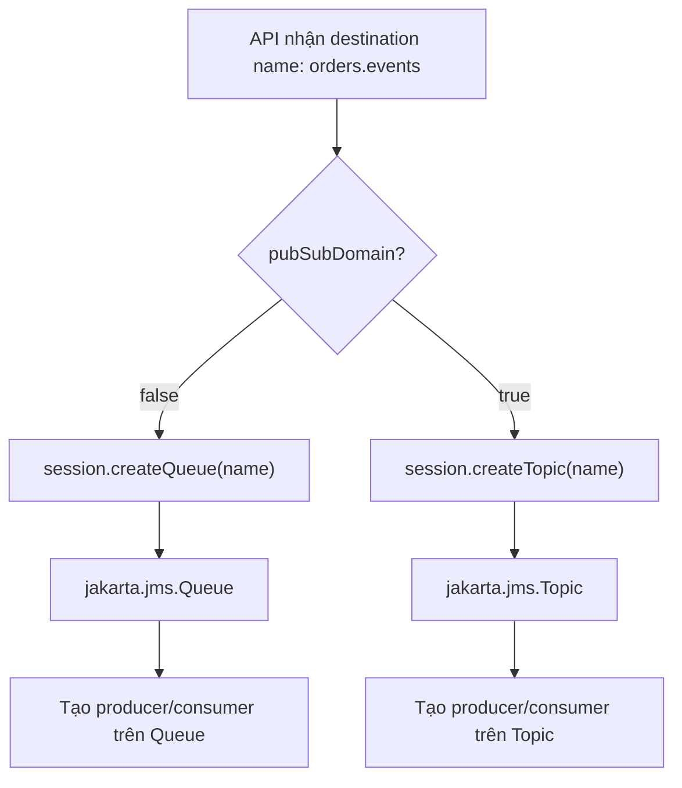

# pubSubDomain khi phân giải Queue hoặc Topic trong Spring JMS

## 1. Vì sao cùng một tên destination nhưng có thể là Queue hoặc Topic?

Trong Jakarta Messaging (JMS), `Queue` và `Topic` đều là `Destination`, nhưng ngữ nghĩa phân phối khác nhau:

- **Queue (point-to-point):** thông điệp gửi vào một hàng đợi; nếu có nhiều consumer cạnh tranh trên cùng Queue, thông thường **một consumer nhận mỗi lần giao ban đầu**. Hợp với tác vụ cần một worker xử lý.
- **Topic (publish/subscribe):** publisher phát thông điệp; **mỗi subscription đủ điều kiện** nhận một bản sao logic. Nếu một shared subscription có nhiều consumer, các consumer đó chia công việc trong cùng subscription.

Spring cho phép gọi API bằng **tên dạng chuỗi** thay vì phải tự tạo đối tượng `jakarta.jms.Queue` hoặc `jakarta.jms.Topic`:

```java
jmsTemplate.convertAndSend("orders.events", "OrderCreated#501");
```

Câu hỏi quan trọng: chuỗi `"orders.events"` đại diện cho **Queue** hay **Topic**?

**`pubSubDomain` chính là cờ chỉ ra loại destination cần phân giải khi Spring nhận một *tên destination* để chuyển thành đối tượng JMS.** Với `JmsTemplate` và các listener container tiêu chuẩn:

| Giá trị | Miền JMS | Với `DynamicDestinationResolver`, tên `"orders.events"` được phân giải bằng |
| --- | --- | --- |
| `false` — **mặc định** | Point-to-point | `Session.createQueue("orders.events")` |
| `true` | Publish/subscribe | `Session.createTopic("orders.events")` |

Do đó, **cùng chuỗi tên có thể dẫn tới hai destination mang *kiểu* khác nhau**, tùy cấu hình và khả năng của provider/broker. Tên giống nhau không bảo đảm hai consumer cùng đọc một đích vật lý.

> **Ghi nhớ:** `pubSubDomain=true` không phải lệnh “biến toàn bộ Queue trong broker thành Topic”. Nó là hướng dẫn của **client-side Spring JMS** cho cơ chế phân giải tên/thiết lập consumer. Broker vẫn phải có địa chỉ và kiểu routing phù hợp; cơ chế tạo destination thật phụ thuộc JMS provider.

## 2. Vai trò của DestinationResolver

Trong Spring JMS, `DestinationResolver` là interface chuyển **chuỗi tên destination** thành `jakarta.jms.Destination`:

```java
Destination resolveDestinationName(
        Session session,
        String destinationName,
        boolean pubSubDomain) throws JMSException;
```

Đây là **chữ ký rút từ interface Spring**, không phải code phải tự định nghĩa. Khi phương thức nhận `pubSubDomain=true`, resolver biết caller muốn Topic; với `false` caller muốn Queue.

### 2.1. DynamicDestinationResolver: lựa chọn mặc định

`DynamicDestinationResolver` là resolver mặc định của `JmsTemplate` và được các container Spring JMS thường sử dụng khi chưa thay thế:



Ví dụ minh họa cách gọi resolver (đây là **mảnh code tích hợp**, `session` phải là một Jakarta JMS Session hợp lệ do `ConnectionFactory` cung cấp):

```java
import jakarta.jms.Destination;
import jakarta.jms.Queue;
import jakarta.jms.Session;
import jakarta.jms.Topic;
import org.springframework.jms.support.destination.DynamicDestinationResolver;

var resolver = new DynamicDestinationResolver();

Destination queue = resolver.resolveDestinationName(
        session, "orders.events", false);
Destination topic = resolver.resolveDestinationName(
        session, "orders.events", true);

System.out.println(queue instanceof Queue);  // true, theo contract
System.out.println(topic instanceof Topic);  // true, theo contract
```

Chữ ký và hai lời gọi phản ánh cơ chế Spring lựa chọn **JMS destination type**. Đây không phải chương trình độc lập: thiếu `session` thật và classpath Spring/JMS. Việc gọi `createQueue`/`createTopic` có tạo ra destination vật lý trên broker hay không còn do provider và cấu hình auto-create quyết định.

### 2.2. Vì sao JNDI và Destination object cần được phân biệt?

Ngoài resolver động, Spring còn hỗ trợ `JndiDestinationResolver` hoặc resolver tùy biến. Nếu tên đã được JNDI ánh xạ đến một đối tượng `Topic`, việc lookup trả về chính đối tượng ấy; **`pubSubDomain` không ép nó thành Queue**. Nếu cấu hình JNDI fallback sang dynamic resolver, cờ này lại có thể được sử dụng ở đường fallback.

Tương tự, nếu API nhận **đối tượng `Destination` có kiểu cụ thể**, không còn bước lấy tên String để tự quyết định Queue hay Topic:

```java
// Mảnh code: session được tạo từ một ConnectionFactory thật.
Queue actualQueue = session.createQueue("orders.events");

JmsTemplate template = new JmsTemplate(connectionFactory);
template.setPubSubDomain(true);

// Overload nhận Destination trực tiếp: actualQueue vẫn là Queue.
template.convertAndSend(actualQueue, "hello");
```

Điều quan trọng là **kiểu thật của `actualQueue`**. Cờ `true` không đổi đối tượng `Queue` thành `Topic`. Trong ví dụ này, `connectionFactory` và `session` là biến do ứng dụng cung cấp, nên không phải file có thể biên dịch độc lập.

**Cảnh báo khi thiết kế:** Không nên đặt cả Queue và Topic cùng tên chỉ để quan sát cơ chế phân giải, nhất là với broker có cơ chế address/routing chung. Để demo dễ kiểm chứng, nên dùng hai tên riêng như `demo.jobs.queue` và `demo.events.topic`.

## 3. pubSubDomain xuất hiện ở những thành phần Spring nào?

### 3.1. Phía gửi với JmsTemplate

`JmsTemplate` là lớp giao tiếp JMS phía client để gửi và nhận đồng bộ. Nếu gọi các overload sử dụng tên String, nó dùng `DestinationResolver`:

```java
import jakarta.jms.ConnectionFactory;
import org.springframework.jms.core.JmsTemplate;

JmsTemplate queueTemplate = new JmsTemplate(connectionFactory);
queueTemplate.setPubSubDomain(false); // Mac dinh: Queue.
queueTemplate.convertAndSend("billing.commands", "CreateInvoice#501");

JmsTemplate topicTemplate = new JmsTemplate(connectionFactory);
topicTemplate.setPubSubDomain(true);  // Topic.
topicTemplate.convertAndSend("orders.events", "OrderCreated#501");
```

Đây là **đoạn code cần có `connectionFactory` và broker**, không thể chạy riêng bằng `javac`. Hai template có thể dùng chung một `ConnectionFactory`; không cần hai broker chỉ để gửi được cả Queue lẫn Topic.

`setPubSubDomain(...)` nên được thiết lập **khi cấu hình bean**, trước khi template được chia sẻ cho các thread. Một `JmsTemplate` đã cấu hình có thể dùng chung an toàn giữa nhiều caller; không nên thay đổi cờ qua lại theo từng request đồng thời.

### 3.2. Phía nhận với listener container/factory

`@JmsListener` nhận `destination` là tên String, nhưng annotation **không có thuộc tính `pubSubDomain`**. Kiểu đích được quyết định qua **listener container factory** mà annotation sử dụng.

Ví dụ tạo hai factory tách biệt:

```java
import jakarta.jms.ConnectionFactory;
import org.springframework.context.annotation.Bean;
import org.springframework.context.annotation.Configuration;
import org.springframework.jms.annotation.EnableJms;
import org.springframework.jms.config.DefaultJmsListenerContainerFactory;

@Configuration
@EnableJms
class JmsDestinationConfig {
    @Bean("queueListenerFactory")
    DefaultJmsListenerContainerFactory queueListenerFactory(
            ConnectionFactory connectionFactory) {
        var f = new DefaultJmsListenerContainerFactory();
        f.setConnectionFactory(connectionFactory);
        f.setPubSubDomain(false);
        f.setSessionTransacted(true);
        return f;
    }

    @Bean("topicListenerFactory")
    DefaultJmsListenerContainerFactory topicListenerFactory(
            ConnectionFactory connectionFactory) {
        var f = new DefaultJmsListenerContainerFactory();
        f.setConnectionFactory(connectionFactory);
        f.setPubSubDomain(true);
        f.setSessionTransacted(true);
        return f;
    }
}
```

Sử dụng đúng factory theo destination:

```java
import org.springframework.jms.annotation.JmsListener;
import org.springframework.stereotype.Component;

@Component
class DomainAwareListeners {
    @JmsListener(
        destination = "billing.commands",
        containerFactory = "queueListenerFactory")
    public void handleInvoiceCommand(String message) {
        System.out.println("billing: " + message);
    }

    @JmsListener(
        destination = "orders.events",
        containerFactory = "topicListenerFactory")
    public void handleOrderEvent(String message) {
        System.out.println("event: " + message);
    }
}
```

Hai đoạn trên là **các class để đặt trong một project Spring có JMS dependencies, broker và ConnectionFactory**, không phải chương trình Java độc lập. Nếu ghép thành file riêng, phải đặt `import` phía trên class trong từng file. Nếu project có nhiều `JmsListenerContainerFactory`, chỉ định `containerFactory` giúp biết chính xác listener nào dùng Queue và listener nào dùng Topic.

**Lưu ý về transaction:** `setSessionTransacted(true)` là lựa chọn riêng cho ví dụ nhằm quản lý commit/rollback JMS; nó **không phải** điều kiện để `pubSubDomain` hoạt động. Trong production cần hiểu transaction JMS, redelivery và nghiệp vụ idempotent.

### 3.3. Vì sao chỉ cấu hình bên gửi là chưa đủ?

Giả sử publisher có:

```java
topicTemplate.setPubSubDomain(true);
topicTemplate.convertAndSend("orders.events", "M1");
```

nhưng listener nhận với:

```java
factory.setPubSubDomain(false);

@JmsListener(
    destination = "orders.events",
    containerFactory = "queueListenerFactory")
public void consume(String body) {
    System.out.println(body);
}
```

Publisher dùng **Topic**, consumer lại yêu cầu **Queue** cùng tên. Broker có thể tạo hai thực thể/routing khác nhau hoặc báo lỗi tùy provider và cấu hình. Không được kỳ vọng consumer nhận `M1` chỉ vì chuỗi `"orders.events"` giống nhau.

Quy tắc cơ bản khi **dùng tên String**:

| Publisher | Consumer | Kết luận |
| --- | --- | --- |
| `pubSubDomain=false` | `pubSubDomain=false` | Cùng yêu cầu Queue; còn phải trỏ cùng broker/destination thật |
| `pubSubDomain=true` | `pubSubDomain=true` | Cùng yêu cầu Topic; còn phải xét subscription đang active/durable |
| `true` | `false` | **Sai miền**: producer Topic, consumer Queue |
| `false` | `true` | **Sai miền**: producer Queue, consumer Topic |

Ngay cả khi cùng loại Queue hoặc Topic, kết nối khác broker, selector, quyền truy cập, expiration hay subscription chưa tồn tại vẫn làm không nhận được message.

## 4. Cấu hình nhanh bằng Spring Boot

Với Spring Boot 3.x và `spring-boot-starter-artemis`, property chuẩn là:

```properties
# false: Queue (mac dinh)
spring.jms.pub-sub-domain=false
```

hoặc:

```properties
# true: Topic
spring.jms.pub-sub-domain=true
```

Khi Spring Boot tự cấu hình `JmsTemplate` và **default JMS listener container factory**, property này được đưa vào các thành phần tương ứng. Do vậy cùng một ứng dụng demo có thể thay đổi từ Queue sang Topic bằng cấu hình thay vì viết lại handler.

Tuy nhiên:

- **Đây là giá trị mặc định của các bean auto-configured.** Nếu tự khai báo `JmsTemplate` hoặc listener factory custom, cần kiểm tra cấu hình bean đó; Boot property không tự “ghi đè” mọi bean mà ứng dụng tạo.
- **Phạm vi thường là toàn ứng dụng auto-configured.** Nếu ứng dụng đồng thời có Queue và Topic, nên dùng các bean template/factory riêng được đặt tên và `@Qualifier`, thay vì bật/tắt một cờ toàn cục trong luồng xử lý.
- **Không cấu hình `spring.artemis.mode` để chọn Queue/Topic.** `spring.artemis.mode=native/embedded` mô tả chỗ broker Artemis chạy, còn `spring.jms.pub-sub-domain` mô tả kiểu destination mặc định của client.
- **Không nhầm với `spring.jms.subscription-durable`**. `pubSubDomain=true` chỉ chọn Topic; subscription có durable hay không là quyết định khác.

### Quyết định ở cấp Spring API

| Địa điểm cấu hình | Thuộc tính/API | Phạm vi |
| --- | --- | --- |
| Spring Boot properties | `spring.jms.pub-sub-domain=true` | Template và listener factory do Boot tự cấu hình mặc định |
| Một bean `JmsTemplate` | `setPubSubDomain(true)` | Các lời gọi của template đó có bước phân giải tên |
| `DefaultJmsListenerContainerFactory` | `setPubSubDomain(true)` | Listener container được tạo từ factory ấy |
| Một `DefaultMessageListenerContainer` trực tiếp | `setPubSubDomain(true)` | Container đó |
| `DynamicDestinationResolver` | Tham số `pubSubDomain` khi gọi `resolveDestinationName` | Mỗi lần phân giải tên |
| `JndiDestinationResolver` hoặc custom resolver | Phụ thuộc cấu hình resolver và lookup | Không bảo đảm cờ làm đổi đối tượng đã lookup |
| Đối tượng `Queue`/`Topic` được cung cấp trực tiếp | Đã có kiểu JMS | Không cần phân giải tên để chọn loại |

## 5. Demo chạy được: cùng Spring Boot app, đổi Queue/Topic bằng profile

Mục tiêu: **chứng minh ý nghĩa `spring.jms.pub-sub-domain`** qua hai cấu hình; chương trình Java và hai listener **giữ nguyên**. Một lần phát message, Queue thường chỉ một listener nhận; Topic cho hai subscription độc lập nhận cùng message.

### 5.1. Môi trường

Dùng Java 17+, Maven và Docker. Mẫu chọn Spring Boot 3.3.x, Jakarta JMS (`jakarta.jms.*`), broker ngoài ứng dụng Apache ActiveMQ Artemis.

Chạy broker thử nghiệm trên máy local:

```bash
docker run --detach --rm --name artemis-pubsub-demo \
  -e ARTEMIS_USER=artemis \
  -e ARTEMIS_PASSWORD=artemis \
  -p 127.0.0.1:61616:61616 \
  -p 127.0.0.1:8161:8161 \
  apache/artemis:latest-alpine
```

Đợi broker sẵn sàng:

```bash
docker logs artemis-pubsub-demo
```

Cổng `61616` dùng cho client JMS, `8161` cho giao diện quản trị. Đây là credentials **demo cục bộ**; môi trường thực cần tài khoản riêng, quyền destination, network policy và TLS theo yêu cầu. Nếu broker tắt auto-create Queue/Topic thì phải chuẩn bị destination và routing thích hợp trước.

### 5.2. Tạo project Maven

Cấu trúc:

```text
pubsub-domain-demo/
├── pom.xml
└── src/main/
    ├── java/demo/jms/
    │   ├── PubSubDomainDemoApplication.java
    │   ├── DemoPublisherController.java
    │   └── DemoConsumers.java
    └── resources/
        ├── application.properties
        ├── application-queue.properties
        └── application-topic.properties
```

Nội dung `pom.xml`:

```xml
<project xmlns="http://maven.apache.org/POM/4.0.0"
         xmlns:xsi="http://www.w3.org/2001/XMLSchema-instance"
         xsi:schemaLocation="http://maven.apache.org/POM/4.0.0 https://maven.apache.org/xsd/maven-4.0.0.xsd">
    <modelVersion>4.0.0</modelVersion>

    <parent>
        <groupId>org.springframework.boot</groupId>
        <artifactId>spring-boot-starter-parent</artifactId>
        <version>3.3.5</version>
        <relativePath/>
    </parent>

    <groupId>demo</groupId>
    <artifactId>pubsub-domain-demo</artifactId>
    <version>1.0.0</version>

    <properties>
        <java.version>17</java.version>
    </properties>

    <dependencies>
        <dependency>
            <groupId>org.springframework.boot</groupId>
            <artifactId>spring-boot-starter-artemis</artifactId>
        </dependency>
        <dependency>
            <groupId>org.springframework.boot</groupId>
            <artifactId>spring-boot-starter-web</artifactId>
        </dependency>
    </dependencies>

    <build>
        <plugins>
            <plugin>
                <groupId>org.springframework.boot</groupId>
                <artifactId>spring-boot-maven-plugin</artifactId>
            </plugin>
        </plugins>
    </build>
</project>
```

`spring-boot-starter-artemis` cung cấp Jakarta JMS client và Spring JMS auto-configuration. `spring-boot-starter-web` chỉ phục vụ endpoint HTTP để chủ động publish **sau khi các listener đã sẵn sàng**; không cần web starter nếu thay endpoint bằng producer khác.

### 5.3. Mã ứng dụng

`src/main/java/demo/jms/PubSubDomainDemoApplication.java`:

```java
package demo.jms;

import org.springframework.boot.SpringApplication;
import org.springframework.boot.autoconfigure.SpringBootApplication;
import org.springframework.jms.annotation.EnableJms;

@SpringBootApplication
@EnableJms
public class PubSubDomainDemoApplication {
    public static void main(String[] args) {
        SpringApplication.run(PubSubDomainDemoApplication.class, args);
    }
}
```

`src/main/java/demo/jms/DemoPublisherController.java`:

```java
package demo.jms;

import org.springframework.beans.factory.annotation.Value;
import org.springframework.jms.core.JmsTemplate;
import org.springframework.web.bind.annotation.PostMapping;
import org.springframework.web.bind.annotation.RequestParam;
import org.springframework.web.bind.annotation.RestController;

@RestController
public class DemoPublisherController {
    private final JmsTemplate jmsTemplate;
    private final String destinationName;

    public DemoPublisherController(
            JmsTemplate jmsTemplate,
            @Value("${demo.destination}") String destinationName) {
        this.jmsTemplate = jmsTemplate;
        this.destinationName = destinationName;
    }

    @PostMapping("/publish")
    public String publish(@RequestParam String value) {
        jmsTemplate.convertAndSend(destinationName, value);
        return "sent: " + value;
    }
}
```

`src/main/java/demo/jms/DemoConsumers.java`:

```java
package demo.jms;

import org.springframework.jms.annotation.JmsListener;
import org.springframework.stereotype.Component;

@Component
public class DemoConsumers {
    @JmsListener(destination = "${demo.destination}")
    public void billing(String payload) {
        System.out.println("billing: " + payload);
    }

    @JmsListener(destination = "${demo.destination}")
    public void audit(String payload) {
        System.out.println("audit: " + payload);
    }
}
```

Hai `@JmsListener` tạo **hai listener endpoint/container**. Với Queue, chúng là hai consumer cạnh tranh. Với Topic, mặc định mỗi listener là một non-durable subscription riêng, khi cả hai đang hoạt động sẽ có bản sao của từng message trên mỗi subscription. Trong demo, không gán cùng shared subscription name cho cả hai.

Controller và hai listener cùng nhận `destinationName` từ một property; **loại Queue/Topic** đến từ `pubSubDomain` trên các bean auto-configured. Bạn không cần gọi `createQueue`/`createTopic` trực tiếp trong code này.

### 5.4. Hai cấu hình môi trường

`src/main/resources/application.properties`:

```properties
spring.artemis.mode=native
spring.artemis.broker-url=tcp://localhost:61616
spring.artemis.user=artemis
spring.artemis.password=artemis
```

`src/main/resources/application-queue.properties`:

```properties
spring.jms.pub-sub-domain=false
demo.destination=demo.jobs.queue
```

`src/main/resources/application-topic.properties`:

```properties
spring.jms.pub-sub-domain=true
demo.destination=demo.events.topic
```

Sử dụng hai tên destination riêng giúp quan sát rõ ràng, tránh ảnh hưởng của message còn tồn từ một lần chạy khác hoặc broker có mô hình address/routing dùng chung. Nếu ứng dụng chạy trong container thay vì trên máy host, `localhost` trong file properties phải đổi thành địa chỉ broker truy cập được từ container ấy.

### 5.5. Chạy chế độ Queue

Trong thư mục `pubsub-domain-demo`:

```bash
mvn spring-boot:run "-Dspring-boot.run.profiles=queue"
```

Sau khi Spring khởi động và broker xác nhận **hai consumer** đã đăng ký trên Queue `demo.jobs.queue`, mở terminal khác và gửi:

```bash
curl --request POST "http://localhost:8080/publish?value=M1"
```

HTTP body kỳ vọng:

```text
sent: M1
```

Trong application logs, **chỉ một trong hai dòng** thường xuất hiện cho `M1` ở lần giao ban đầu:

```text
billing: M1
```

**hoặc**

```text
audit: M1
```

Không dự đoán broker luôn chọn `billing` trước, không suy ra thuật toán round-robin cố định. Nếu acknowledgement/transaction thất bại, redelivery có thể khiến message được giao lần nữa; xác nhận một lần ở đây dựa trên đường đi thành công bình thường.

Dừng ứng dụng bằng `Ctrl+C` sau thí nghiệm Queue.

### 5.6. Chạy chế độ Topic

Chạy cùng Java code với profile khác:

```bash
mvn spring-boot:run "-Dspring-boot.run.profiles=topic"
```

Đợi hai listener tạo subscription trên Topic `demo.events.topic`; với non-durable Topic, **gửi trước khi subscription hoạt động có thể khiến listener bỏ lỡ message**.

Gửi cùng yêu cầu:

```bash
curl --request POST "http://localhost:8080/publish?value=M1"
```

HTTP body vẫn là:

```text
sent: M1
```

Application logs kỳ vọng xuất hiện **cả hai dòng**, nhưng **thứ tự giữa chúng không cố định**:

```text
billing: M1
audit: M1
```

Ở đây mỗi listener/Topic subscription có bản sao riêng của `M1`. Nếu chỉ một dòng xuất hiện, cần kiểm tra broker subscription count, thời điểm các listener đăng ký, selector, kết nối và exception trước khi kết luận logic fan-out sai.

Dừng app; broker ngoài vẫn còn chạy. Dừng broker sau thử nghiệm:

```bash
docker stop artemis-pubsub-demo
```

Container `--rm` sẽ được xóa lúc dừng; không dùng cấu hình demo này để kiểm tra persistence qua restart.

### 5.7. Điều demo chứng minh và chưa chứng minh

**Đã chứng minh trên một broker thực khi chạy thành công:**

- `spring.jms.pub-sub-domain` thay đổi **kiểu destination** được Spring auto-configured phân giải từ String.
- Với hai `@JmsListener` cùng tên destination, Queue tạo **consumer cạnh tranh** còn Topic tạo **subscription độc lập**.
- `JmsTemplate.convertAndSend(String, ...)` và listener factory phải đồng thuận về Queue/Topic.

**Chưa chứng minh:** durable subscription, message selector, exactly-once nghiệp vụ, transaction đồng thời DB/JMS, khả năng chịu lỗi broker hoặc khả năng tạo destination vật lý trên mọi provider. Những điều ấy cần cấu hình và bài test riêng.

## 6. Ứng dụng vừa dùng Queue vừa dùng Topic

Trong một service thực tế, Queue nhận lệnh như `billing.commands` còn Topic phát sự kiện như `orders.events` là nhu cầu phổ biến. Không nên thay đổi `pubSubDomain` của **cùng một `JmsTemplate` được chia sẻ** theo từng request:

```java
// Khong nen lam voi mot shared JmsTemplate dang duoc goi song song:
jmsTemplate.setPubSubDomain(true);
jmsTemplate.convertAndSend("orders.events", "M1");
jmsTemplate.setPubSubDomain(false);
jmsTemplate.convertAndSend("billing.commands", "M2");
```

Hai thread có thể xen kẽ ngay giữa thao tác đổi cờ và gửi, khiến message đi sai loại destination. Hãy tạo **hai bean template tách biệt**, cấu hình một lần:

```java
package demo.jms;

import jakarta.jms.ConnectionFactory;
import org.springframework.context.annotation.Bean;
import org.springframework.context.annotation.Configuration;
import org.springframework.jms.core.JmsTemplate;

@Configuration
public class MixedDomainTemplates {
    @Bean("queueJmsTemplate")
    JmsTemplate queueJmsTemplate(ConnectionFactory cf) {
        JmsTemplate template = new JmsTemplate(cf);
        template.setPubSubDomain(false);
        return template;
    }

    @Bean("topicJmsTemplate")
    JmsTemplate topicJmsTemplate(ConnectionFactory cf) {
        JmsTemplate template = new JmsTemplate(cf);
        template.setPubSubDomain(true);
        return template;
    }
}
```

Và inject chính xác bean cần dùng:

```java
import org.springframework.beans.factory.annotation.Qualifier;
import org.springframework.jms.core.JmsTemplate;

// Trong constructor cua @Service:
public OrderPublisher(
        @Qualifier("topicJmsTemplate") JmsTemplate events,
        @Qualifier("queueJmsTemplate") JmsTemplate commands) {
    this.events = events;
    this.commands = commands;
}

// Trong method nghiep vu:
events.convertAndSend("orders.events", "OrderCreated#501");
commands.convertAndSend("billing.commands", "CreateInvoice#501");
```

**Đoạn injection trên là mảnh code cho class `OrderPublisher` có hai field được khai báo**, không phải một class tự biên dịch độc lập. Nếu dùng cấu hình mixed-domain, tạo luôn hai listener factory tương ứng như mục 3.2 và ghi rõ `containerFactory` trên từng `@JmsListener`. Tránh dùng template auto-configured mặc định một cách mơ hồ khi có nhiều bean cùng kiểu `JmsTemplate`.

Cách này bảo vệ contract: mỗi template và mỗi listener factory đều **cố định miền JMS** của nó, không có race khi các thread cùng hoạt động.

## 7. Những ngoại lệ và sắc thái quan trọng

### 7.1. pubSubDomain không tự sinh subscriber durable

Khi đặt `pubSubDomain=true`, Spring chỉ coi tên là **Topic**. Một listener Topic **non-durable** chỉ có khả năng nhận message trong thời gian subscription của nó tồn tại. Nếu service dừng, message được phát trong thời gian nó không có subscription sẽ không tự được lưu để sau này nhận.

Để dùng **durable subscription**, phải cấu hình thêm `subscriptionDurable=true`, subscription name/client identity phù hợp và broker provider hỗ trợ. Đừng mô tả `pubSubDomain=true` là “message luôn được lưu cho mọi listener”.

### 7.2. pubSubDomain không bật transaction hoặc xác nhận message

Dù Queue hay Topic, broker/JMS vẫn có transaction, acknowledge, retry, TTL và message selector. Một callback nhận message **không** bảo đảm xử lý nghiệp vụ đúng một lần; rollback có thể dẫn đến redelivery. Dùng idempotent consumer, chính sách retry và dead-letter theo nhu cầu.

### 7.3. Topic không có nghĩa mọi consumer đều phải nhận từng message

**Mỗi subscription đủ điều kiện** nhận một bản sao logic; không có nghĩa mỗi consumer nhận. Trong một **shared subscription** có hai consumer, các consumer chia thông điệp của một subscription. Ngược lại, hai subscription độc lập trên một Topic đều có thể nhận cùng message.

### 7.4. Broker có thể ánh xạ destination theo quy tắc riêng

Một số provider chỉ cho một destination type trên một name, một số broker như Artemis có mô hình address/queue với routing kiểu anycast/multicast. Spring gọi `Session.createQueue` hay `Session.createTopic` theo lựa chọn của resolver, còn **quyết định tạo resource/routing vật lý** vẫn phụ thuộc provider và policy. Không suy luận mọi broker đều tự tạo Queue/Topic chỉ từ tên String.

### 7.5. Khi đã có Destination được quản trị sẵn

Nếu dùng JNDI hoặc đưa `jakarta.jms.Destination` cụ thể vào method, hãy ưu tiên xác minh **kiểu thật của đối tượng** và resolver đang được cấu hình. Thay `pubSubDomain` có thể không có tác dụng với đường đi không phân giải tên động.

### 7.6. Tên Topic không quyết định loại destination

Tên `audit.topic`, `topic://audit` hay `jms.topic.audit` tự nó **không phải chuẩn chọn Topic của Spring JMS**. Một custom resolver hoặc provider có thể hiểu prefix đặc biệt, nhưng cách portable là dùng cờ `pubSubDomain` hoặc đối tượng `Topic` thực sự.

### 7.7. Thay pubSubDomain giữa hai lần deploy không “di chuyển” message

Đổi `false → true` làm client hướng sang Topic, **không chuyển backlog Queue đã có** sang Topic. Nếu một hệ thống đang dùng Queue trong production và muốn đổi sang pub/sub, đó là thay đổi ngữ nghĩa và có thể cần migration, versioning, dual-publish/bridge có kiểm soát.

## 8. Checklist chẩn đoán khi listener không nhận message

Một tình huống phổ biến: log bên gửi ghi `sent` nhưng `@JmsListener` không in message.

1. **Đọc cấu hình thực tế**, không chỉ file local: profile đang active? `spring.jms.pub-sub-domain` là `true` hay `false`? Có environment override?
2. **Xác định bean gửi:** Boot auto-configured `JmsTemplate` hay bean tự tạo? Gọi overload String hay truyền `Queue`/`Topic` trực tiếp?
3. **Xác định bean nhận:** `@JmsListener(containerFactory=...)` trỏ factory nào? Factory có `setPubSubDomain` phù hợp không?
4. **Xác định resolver:** `DynamicDestinationResolver` hay `JndiDestinationResolver`/custom? Với JNDI, tên map tới object gì? Có fallback?
5. **Đối chiếu cùng broker:** producer và consumer dùng ConnectionFactory trỏ tới cùng broker/vhost/namespace/credentials không?
6. **Kiểm tra destination trên broker:** có Queue/Topic/routing type đúng không? Producer gửi vào đúng địa chỉ không? Có policy ngăn auto-create không?
7. **Kiểm tra consumer/subscription:** listener đã start và connected chưa? Với Topic non-durable, message gửi trước khi subscriber active sẽ không được giữ cho subscriber đó.
8. **Kiểm tra điều kiện giao nhận khác:** selector, security, expiration, transaction chưa commit, redelivery/dead-letter và exception log.
9. **Kiểm tra nhiều listener:** nếu Queue có hai consumer thì chỉ một nhận thông điệp là hành vi bình thường; nếu Topic có hai subscription tách biệt thì cả hai thường nhận.
10. **Thử một message có ID duy nhất** và quan sát cả broker lẫn app logs; không dựa vào thứ tự callback giữa các container.

### Bảng nhận diện nhanh

| Triệu chứng | Khả năng cần kiểm tra đầu tiên |
| --- | --- |
| Sender dùng `true`, listener dùng `false` | Mismatch Topic/Queue do cấu hình hai bên |
| Hai listener mà chỉ một in khi gửi `M1` | Có thể đang dùng Queue; kiểm tra factory và broker |
| Hai listener Topic đều không in | Kiểm tra consumer đã đăng ký, broker, quyền, routing, subscription |
| Đổi `spring.jms.pub-sub-domain` nhưng không đổi hành vi | Có thể có custom bean hoặc explicit `Destination` bỏ qua phân giải tên |
| Topic chỉ nhận khi app đang bật | Non-durable subscription, chưa có durable identity |
| Vừa thêm tên `.topic` nhưng vẫn có Queue | Tên không mang kiểu; mặc định `pubSubDomain=false` |
| Cùng tên trên hai service nhưng không giao nhận | Có thể trỏ broker khác hoặc khác Queue/Topic |
| Khởi động lại app thấy backlog Queue cũ, Topic mới không thấy | Backlog của Queue không tự được chuyển sang Topic |

## 9. Câu hỏi tự kiểm tra

**Câu 1.** Với Spring `JmsTemplate` dùng resolver động và chưa cấu hình gì thêm, `convertAndSend("audit.events", "M1")` chọn Queue hay Topic?

**Đáp án:** **Queue**, vì `pubSubDomain` mặc định là `false`. Phần `.events` trong tên không tự đổi type.

**Câu 2.** Đặt `spring.jms.pub-sub-domain=true` trên ứng dụng Spring Boot tự cấu hình JMS có ảnh hưởng đến phía gửi và phía nhận không?

**Đáp án:** Có, với các bean `JmsTemplate` và default listener factory do **Spring Boot auto-configure** theo property này. Bean custom có thể dùng cấu hình khác và cần kiểm tra riêng.

**Câu 3.** `@JmsListener(destination="orders.events")` có thể đặt `pubSubDomain=true` trực tiếp trên annotation không?

**Đáp án:** Không. Chọn container factory đã cấu hình Topic hoặc dùng default auto-configured factory với property thích hợp.

**Câu 4.** Gọi `template.setPubSubDomain(true)` rồi `convertAndSend(queueObject, "M1")`, trong đó `queueObject` là `jakarta.jms.Queue` đã được tạo sẵn. Có chuyển thành Topic không?

**Đáp án:** Không. Method nhận `Destination` trực tiếp và sử dụng đối tượng `Queue` hiện có, không cần phân giải chuỗi tên thành Topic.

**Câu 5.** Hai listener cùng một tên Topic nhưng chỉ một listener nhận `M1`. Chắc chắn Spring JMS có lỗi?

**Đáp án:** Không. Phải kiểm tra listener đã active, subscription có shared hay không, selector, transaction và redelivery. Với hai **subscription độc lập** active và đủ điều kiện, kỳ vọng mỗi cái nhận bản sao riêng.

**Câu 6.** Một service dùng cả Queue cho command và Topic cho event. Có nên đổi `pubSubDomain` của shared `JmsTemplate` theo từng request?

**Đáp án:** Không nên. Tạo các template và listener factory riêng, cố định type một lần để tránh race và cấu hình nhầm.

**Câu 7.** Thay `spring.jms.pub-sub-domain=false` bằng `true` có chuyển Queue cũ thành Topic và di chuyển backlog không?

**Đáp án:** Không. Đó là thay đổi lựa chọn domain của client; cần kế hoạch migration nếu dữ liệu cũ phải được bảo toàn.

**Câu 8.** `DynamicDestinationResolver` luôn tự tạo Queue/Topic vật lý trên broker?

**Đáp án:** Không. Nó yêu cầu `Session.createQueue` hoặc `Session.createTopic`; việc broker có tạo resource vật lý hay không là hành vi của JMS provider và broker policy.

## 10. Kết luận áp dụng

- **`pubSubDomain=false`:** Spring phân giải tên động thành **Queue**; mặc định của `JmsTemplate` và nhiều listener factory.
- **`pubSubDomain=true`:** Spring phân giải tên động thành **Topic**; muốn publish/subscribe, phải cấu hình thống nhất cho sender và listener.
- **`spring.jms.pub-sub-domain`:** tiện cho ứng dụng Spring Boot chỉ có một miền JMS; với cả Queue lẫn Topic, dùng **template/factory riêng**.
- **Đối tượng Destination đã có kiểu hoặc JNDI lookup:** cần kiểm tra object/resolver thực tế; cờ không tự ép đổi kiểu.
- **Cờ này không tự bảo đảm** durable, ack, transaction, persistence, redelivery hay migrate backlog.

**Điểm cần nhớ nhất:** Khi API nhận *tên String*, `pubSubDomain` quyết định Spring đề nghị **Queue hay Topic**. Khi đã có *đối tượng JMS Destination*, **kiểu của đối tượng đó** mới là điều quyết định; gửi và nhận muốn khớp phải kết nối tới cùng loại destination trên cùng broker.

## Tham khảo chính thức

- [Spring Framework Reference – Using Spring JMS / Destination Management](https://docs.spring.io/spring-framework/reference/integration/jms/using.html)
- [Spring Framework API – JmsTemplate và pubSubDomain](https://docs.spring.io/spring-framework/docs/6.2.x/javadoc-api/org/springframework/jms/core/JmsTemplate.html)
- [Spring Framework API – DynamicDestinationResolver](https://docs.spring.io/spring-framework/docs/6.2.x/javadoc-api/org/springframework/jms/support/destination/DynamicDestinationResolver.html)
- [Spring Framework Reference – Annotation-driven JMS Listener](https://docs.spring.io/spring-framework/reference/integration/jms/annotated.html)
- [Spring Boot Reference – JMS](https://docs.spring.io/spring-boot/3.4/reference/messaging/jms.html)
- [Spring Boot – Common Application Properties: spring.jms.pub-sub-domain](https://docs.spring.io/spring-boot/3.4/appendix/application-properties/)
- [Spring Guides – Messaging with JMS](https://spring.io/guides/gs/messaging-jms/)
