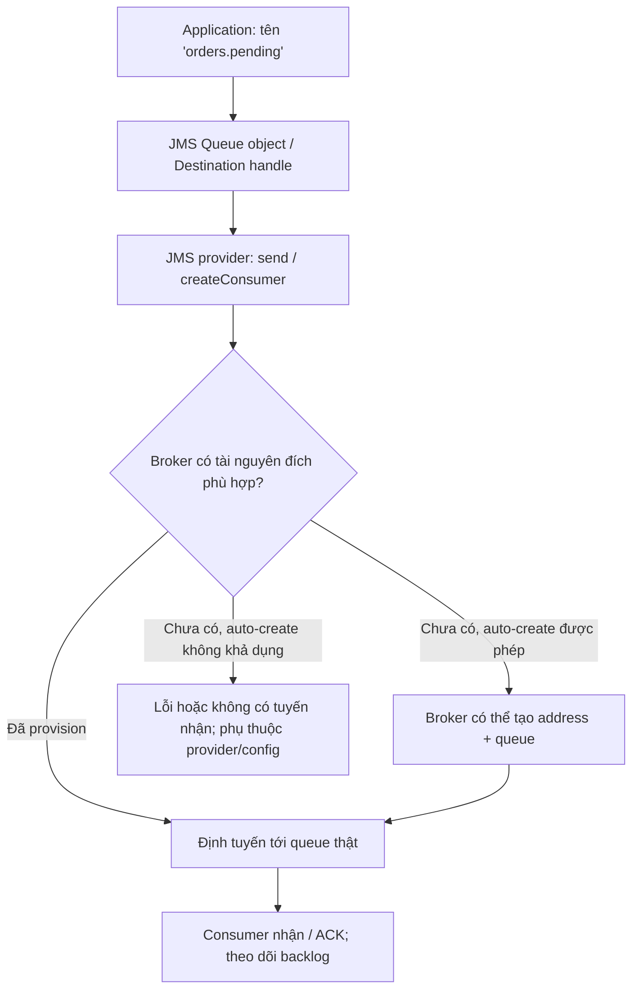

# Không đồng nhất tạo đối tượng Queue với tạo Queue trên mọi broker (Spring JMS)

> **Chủ đề:** Spring Framework – JMS · **Nhóm:** Destination.  
> **Thông điệp cốt lõi:** Có một đối tượng `jakarta.jms.Queue` trong Java **không đồng nghĩa** broker đã có một queue vật lý đang tồn tại, được cấu hình đúng và sẵn sàng lưu/chuyển thông điệp. Cần phân biệt **định danh destination**, **provision tài nguyên trên broker**, và **sử dụng destination khi gửi/nhận**.

## 1. Vì sao dễ hiểu nhầm?

Người học thường thấy một trong các đoạn sau và cho rằng “queue được tạo”:

```java
Queue queue = session.createQueue("orders.pending");
```

hoặc:

```java
jmsTemplate.convertAndSend("orders.pending", "ORD-101");
```

Đoạn thứ nhất gọi phương thức có tên `createQueue`, đoạn thứ hai chỉ truyền một chuỗi tên queue cho Spring. Nhưng **Jakarta Messaging không chuẩn hóa thao tác tạo queue tồn tại lâu dài trên broker**. `Session.createQueue(String)`/`JMSContext.createQueue(String)` tạo một đối tượng mang tên/định danh destination theo provider. Việc một tài nguyên vật lý được tạo khi nào, bằng lệnh quản trị nào, có được tự tạo không, chịu quyền hạn gì, và tồn tại bao lâu là **hành vi phụ thuộc JMS provider/broker và cấu hình**.

Vì thế hai môi trường có cùng Java code vẫn có thể cho kết quả khác:

- Broker A bật auto-create: gửi đến `orders.pending` chưa tồn tại có thể làm broker tự provision address và queue.
- Broker B tắt auto-create: thao tác tạo `Queue` object vẫn có thể hợp lệ, nhưng gửi/nhận đến tên đó bị từ chối hoặc không có tài nguyên phù hợp.
- Broker C yêu cầu destination được quản trị và bind JNDI từ trước: client cần lookup đối tượng đích đã định nghĩa, không dựa vào việc tên Java khiến broker tạo tài nguyên.

**Quy tắc đọc tên API:** `createQueue` trong *JMS Session* ≠ lệnh `create queue` của *broker administration API*. Hai API khác tầng, khác trách nhiệm.

## 2. Ba tầng phải phân biệt



| Tầng | Thứ đang tồn tại | Ai quản lý? | Cách kiểm chứng |
| --- | --- | --- | --- |
| **Tên logic** | Chuỗi `"orders.pending"` trong code/config | Ứng dụng và hợp đồng tích hợp | Kiểm tra config/constant |
| **JMS Destination object** | `Queue` object có `getQueueName()` | JMS API/provider trong tiến trình client | Log tên, kiểm tra instance hoặc callback |
| **Broker-side resource** | Queue thực, binding/address, routing, durability, quota, ACL, consumers, backlog | Broker và quản trị hạ tầng | Broker console/CLI/management API |

Một đối tượng đích Java có thể tồn tại trong memory khi broker chưa provision queue tương ứng. Ngược lại, một queue trên broker có thể được tạo từ lâu, trong khi **chưa có ứng dụng Java nào** xây dựng `Queue` object để gửi/nhận.

### Tên giống nhau không phải toàn bộ hợp đồng

Tên `orders.pending` chưa mô tả: broker host/namespace, queue hay topic, routing type, durable, max consumers, quyền gửi/nhận, DLQ, TTL, transaction hoặc retention. Hai ứng dụng dùng cùng một chuỗi nhưng trỏ tới **hai broker khác nhau** cũng không dùng chung queue.

## 3. Chính xác `Session.createQueue` làm gì theo Jakarta Messaging?

API classic JMS/Jakarta Messaging:

```java
// Fragment: có sẵn một jakarta.jms.Session session đang hợp lệ.
jakarta.jms.Queue queue = session.createQueue("orders.pending");
String name = queue.getQueueName(); // "orders.pending" theo provider
```

API simplified:

```java
// Fragment: có sẵn một jakarta.jms.JMSContext context đang hợp lệ.
jakarta.jms.Queue queue = context.createQueue("orders.pending");
String name = queue.getQueueName();
```

Hai đoạn là **mảnh code**, không phải chương trình Java độc lập. Chúng nhận đối tượng từ provider; không tự khởi tạo `new Queue()` vì `Queue` là interface.

Đặc tả Jakarta Messaging nêu rõ:

1. Phương thức tạo **đối tượng bao tên queue theo cách của provider**.
2. **Không bảo đảm tạo queue vật lý** trong JMS provider.
3. JMS **không cung cấp API portable** để tạo/xóa/quản trị hàng đợi tồn tại lâu dài.
4. Nhà cung cấp có thể chọn **tự provision** trong một số tình huống. Vì thế không nên suy diễn rằng mỗi lần gọi `createQueue` “chắc chắn không thể tác động broker”; cách thực thi là provider-specific.
5. Với ứng dụng cần tính portable cao, đặc tả khuyến nghị dùng **administered destination** được tra cứu qua JNDI, thay vì phụ thuộc cách provider diễn giải tên động.

Hai kết luận đều sai:

- “Gọi `session.createQueue(...)` là **đã tạo queue trên broker**.” → Không có bảo đảm đó.
- “Dùng `createQueue(...)` thì broker **không bao giờ** tự tạo queue.” → Cũng không đúng: provider hoặc cấu hình auto-create có thể có side effect.

### Ngoại lệ quan trọng: `createTemporaryQueue()`

`Session.createTemporaryQueue()`/`JMSContext.createTemporaryQueue()` tạo **temporary destination** theo cơ chế JMS chuẩn: nó là tài nguyên do provider quản lý, được thiết kế có vòng đời gắn với connection, thường dùng nhận reply trong request/reply.

```java
// Fragment minh họa; context còn mở trong lúc sử dụng.
jakarta.jms.TemporaryQueue replyQueue = context.createTemporaryQueue();
String providerGeneratedName = replyQueue.getQueueName();
```

Temporary queue **không phải** cách tạo một queue nghiệp vụ durable như `orders.pending`: tên thường do provider cấp, scope/lifecycle khác, consumer chỉ được tạo trên connection sở hữu temporary queue, và tài nguyên biến mất khi connection đóng hoặc khi bị delete. Không dùng cho hàng đợi phải tồn tại sau khi client tắt.

## 4. Spring JmsTemplate nhận tên đích bằng cách nào?

Ví dụ quen thuộc:

```java
jmsTemplate.convertAndSend("orders.pending", "ORD-101");
```

Ở overload nhận `String destinationName`, `JmsTemplate` không gửi một tên một cách “trừu tượng” rồi tự làm hạ tầng. Nó cần **resolve** tên thành `jakarta.jms.Destination` trước khi giao cho JMS provider.

Spring JMS có hai cơ chế phổ biến:

| Resolver | Ý nghĩa | Có tự provision vật lý theo chuẩn JMS không? |
| --- | --- | --- |
| `DynamicDestinationResolver` | Resolver mặc định của `JmsTemplate`; thường gọi `Session.createQueue(name)` hoặc `createTopic(name)` theo `pubSubDomain`. | **Không có bảo đảm portable**; kết quả phụ thuộc provider và cơ chế auto-create. |
| `JndiDestinationResolver` | Tra JNDI để lấy `Destination` đã được quản trị/bind; có thể cấu hình fallback sang dynamic. | **Lookup**, không phải thao tác tạo broker queue theo JMS chuẩn. |

Vì vậy **Spring tự resolve tên** không có nghĩa **Spring tự provision queue**. Khi nhận bằng `@JmsListener(destination="orders.pending")`, listener container cũng phải resolve destination và tạo consumer. Bản thân việc consumer bắt đầu có thể kích hoạt auto-creation ở broker hỗ trợ; điều đó vẫn là chính sách của broker, **không phải cam kết của annotation**.

### Queue hay Topic là hai loại đích khác nhau

`JmsTemplate` mặc định thường dùng `pubSubDomain=false` cho **queue**. Khi đặt `pubSubDomain=true`, cùng tên `"orders.pending"` có thể được hiểu là **topic** thay vì queue.

```java
// Fragment minh họa trong một @Configuration:
JmsTemplate queueTemplate = new JmsTemplate(connectionFactory);
queueTemplate.setPubSubDomain(false); // Queue

JmsTemplate topicTemplate = new JmsTemplate(connectionFactory);
topicTemplate.setPubSubDomain(true);  // Topic
```

**Đừng suy luận** chỉ cần chuỗi tên giống nhau là hai phía sẽ dùng cùng destination. Broker có thể phân biệt queue/topic bằng routing type, address, subscription và chính sách mapping.

### `Queue` object được khai báo thành `@Bean` thì sao?

Đăng ký một bean kiểu `Queue` hoặc inject `Destination` là **quản lý đối tượng Java trong Spring ApplicationContext**. Bean đó **không phải bản ghi trong broker**. Kể cả khi lúc khởi tạo bean có gọi API của provider, mức độ provision vẫn phụ thuộc provider; nếu muốn bảo đảm tài nguyên tồn tại, phải dùng quy trình quản trị hoặc kiểm tra phía broker.

## 5. ActiveMQ Artemis: queue nằm trong mô hình address/queue/routing

ActiveMQ Artemis là ví dụ dễ thấy vì broker có các khái niệm riêng:

- **Address:** địa chỉ mà producer gửi tới.
- **Queue:** tài nguyên gắn với address, nơi các message được lưu/chờ và từ đó consumer nhận.
- **Routing type:** cách một message tại address được chuyển vào queue(s). **ANYCAST** thường đại diện semantics point-to-point (một trong các queue phù hợp); **MULTICAST** phục vụ fan-out tới các subscriptions/queues phù hợp.

Với JMS queue `orders.pending` thông thường, broker có thể có:

```text
Artemis broker
└── address: orders.pending
    └── routing: ANYCAST
        └── queue: orders.pending
            ├── pending messages
            ├── delivering / unacknowledged messages
            └── active consumers
```

**Đừng nhầm** một *address* tồn tại với một *queue* đã tồn tại: address chỉ là điểm định tuyến; nếu không có queue phù hợp, không có nơi lưu backlog như mong muốn. Khi quan sát Artemis console/CLI, xác minh đủ **address, queue name, routing type, binding, consumer count**.

### 5.1. Auto-create có thể bật hoặc tắt theo address-setting

Artemis hỗ trợ các tùy chọn như:

- `auto-create-addresses`: cho phép tự tạo address khi client kết nối/gửi đến địa chỉ thích hợp.
- `auto-create-queues`: cho phép tự tạo queue phù hợp trong các trường hợp client dùng JMS hoặc protocol được broker hỗ trợ.
- `auto-delete-addresses`, `auto-delete-queues`: kiểm soát vòng đời **tài nguyên được auto-created**, cùng các điều kiện như không còn consumers và message count.
- `default-address-routing-type`, `default-queue-routing-type`: quyết định routing type mặc định khi tự tạo nếu giao thức không chỉ rõ.

Tài liệu Artemis hiện tại nêu mặc định `auto-create-addresses=true` và `auto-create-queues=true` cho address settings; **mặc định cụ thể của môi trường triển khai có thể bị broker.xml, deployment script, operator hoặc chính sách quản trị ghi đè**. Luôn kiểm tra cấu hình đang chạy.

Về mặt vận hành, khi client **send** hoặc **create consumer** đến một queue chưa tồn tại, broker Artemis *có thể* auto-create nếu quyền và address setting cho phép. Cần nhớ rằng tạo một Java Queue handle **không buộc broker phải tạo resource cùng thời điểm**.

Không được ngoại suy tính năng của Artemis sang IBM MQ, ActiveMQ Classic, managed JMS service hoặc broker/provider khác: các hệ thống có thể yêu cầu admin provision riêng, đặt tên/ACL khác hoặc không hỗ trợ dynamic queue theo cùng cách.

## 6. Cách bảo đảm queue vật lý: provision bằng quản trị broker

Đối với queue nghiệp vụ ổn định như `orders.pending`, phương án dễ kiểm soát là tạo cấu hình broker **trước khi ứng dụng gửi/nhận** (hoặc bằng công cụ deployment/management API có quyền rõ ràng).

### 6.1. Artemis `broker.xml`: khai báo address và queue

Ví dụ **mảnh cấu hình** để đặt bên trong phần broker `<core>`, tại vị trí `<addresses>` phù hợp theo cấu trúc file `etc/broker.xml`:

```xml
<addresses>
  <address name="orders.pending">
    <anycast>
      <queue name="orders.pending"/>
    </anycast>
  </address>
</addresses>
```

Đây là cú pháp **một đoạn của broker.xml**, không phải một file XML độc lập đầy đủ và **không đặt trong `application.yml` của Spring Boot**. Tài nguyên này được khai báo ở phía Artemis: address trùng tên queue, routing ANYCAST, phù hợp pattern JMS queue đơn giản. Khả năng persist message còn phụ thuộc delivery mode, journal/storage, TTL và các cấu hình khác; chỉ tạo queue chưa bảo đảm mọi message tồn tại vô hạn.

**Thận trọng khi áp dụng production:** nếu broker đã tồn tại address/queue cùng tên, hãy kiểm tra cấu hình và backlog trước khi sửa, tránh tạo trùng hoặc đổi routing type ngoài kế hoạch. Cần xem chính sách broker khi reload file; không tự xóa queue cũ chỉ để làm ví dụ.

### 6.2. Tắt auto-create ở một namespace có kiểm soát

Ví dụ **mảnh cấu hình** trong phần `<address-settings>` của broker `etc/broker.xml`:

```xml
<address-settings>
  <address-setting match="orders.#">
    <auto-create-addresses>false</auto-create-addresses>
    <auto-create-queues>false</auto-create-queues>
  </address-setting>
</address-settings>
```

Trong Artemis, ký hiệu wildcard/match có nghĩa theo ngữ pháp của broker; hãy kiểm tra pattern khớp đúng destination cần quản lý trước khi triển khai. Cấu hình có thể còn có address-settings khác và broker chọn rule theo mức độ cụ thể.

**Điểm cần học:** khi admin tắt auto-create, ứng dụng vẫn được phép tạo **Queue object** theo cách của provider, nhưng để send/consume thành công nó phải nhắm đến **queue vật lý đã được provision**, có routing type và ACL phù hợp. Nếu chưa provision, kết quả thực thi gửi/nhận phụ thuộc broker/client và có thể là lỗi hoặc không có route hợp lệ. Không xây dựng giả định “gọi send là broker chắc chắn tạo queue”.

### 6.3. Các phương án provision thực tế

Không phải đội phát triển nào cũng sửa trực tiếp `broker.xml`. Tùy vận hành, có thể:

1. Tạo bằng **Artemis web console/CLI** với quyền quản trị, kiểm tra name/address/routing/durable.
2. Dùng **JMX/management API** của Artemis để tạo queue với cấu hình cần thiết, sau đó xác minh hiện trạng.
3. Provision qua **infrastructure as code/automation** hoặc operator trước khi deploy workload.
4. Với hệ thống quản trị qua JNDI, tạo resource theo tài liệu provider và bind `Destination` vào JNDI; ứng dụng chỉ tra cứu.

Nếu dùng Artemis CLI, kiểm tra phiên bản cụ thể:

```bash
# Chạy từ thư mục bin của broker instance, dùng tài khoản có quyền.
./artemis help queue
./artemis queue stat
```

`queue stat` hiển thị các hàng queue ở broker (nếu kết nối/auth thành công); đây là **bằng chứng server-side tốt hơn** so với việc log `queue.getQueueName()`. Lệnh và flags provision chi tiết có thể khác giữa các phiên bản, vì vậy tra `./artemis help queue create` thay vì giả định một cú pháp duy nhất.

## 7. Ví dụ chạy được: Java 21 + Spring Boot + Artemis

Mục tiêu của ví dụ là **tách rõ** hai hành động:

- Endpoint `GET /queue/handle`: Spring/JMS tạo một **Queue handle** và trả tên; **không khẳng định** broker đã provision queue.
- Endpoint `POST /queue/send/{id}`: gửi message; kết quả phụ thuộc queue vật lý, quyền hạn và chính sách auto-create của broker.

Ứng dụng **không đăng ký `@JmsListener` lúc startup**, nhằm tránh việc tự tạo consumer có thể kích hoạt auto-create và làm sai lệch bài kiểm chứng ban đầu.

### 7.1. Công cụ và môi trường

- JDK **21**, Gradle wrapper, Spring Boot **3.3.5**, Jakarta JMS (`jakarta.jms`).
- Apache ActiveMQ Artemis broker **chạy riêng** tại `tcp://localhost:61616`.
- User/password local tương thích broker; thay bằng secrets khi triển khai thực tế.
- Nếu có queue `orders.pending` đã tồn tại, hãy dùng một tên thử nghiệm riêng ở cả code và broker thay vì xóa queue đang chứa dữ liệu.

**settings.gradle**:

```groovy
rootProject.name = 'jms-queue-identity'
```

**build.gradle**:

```groovy
plugins {
    id 'java'
    id 'org.springframework.boot' version '3.3.5'
    id 'io.spring.dependency-management' version '1.1.6'
}

group = 'com.example'
version = '0.0.1-SNAPSHOT'

java {
    toolchain {
        languageVersion = JavaLanguageVersion.of(21)
    }
}

repositories {
    mavenCentral()
}

dependencies {
    implementation 'org.springframework.boot:spring-boot-starter-web'
    implementation 'org.springframework.boot:spring-boot-starter-artemis'
}
```

**src/main/resources/application.yml**:

```yaml
spring:
  artemis:
    mode: native
    broker-url: ${JMS_BROKER_URL:tcp://localhost:61616}
    user: ${JMS_USER:artemis}
    password: ${JMS_PASSWORD:artemis}
  jms:
    pub-sub-domain: false
server:
  port: 8080
```

Giá trị mặc định `artemis/artemis` chỉ nhằm minh họa môi trường học tập; không để credential mặc định trên broker production.

### 7.2. Mã Java đầy đủ

Tạo **src/main/java/com/example/queues/QueueIdentityApplication.java**:

```java
package com.example.queues;

import jakarta.jms.Queue;
import org.springframework.boot.SpringApplication;
import org.springframework.boot.autoconfigure.SpringBootApplication;
import org.springframework.http.ResponseEntity;
import org.springframework.jms.core.JmsTemplate;
import org.springframework.jms.core.SessionCallback;
import org.springframework.web.bind.annotation.GetMapping;
import org.springframework.web.bind.annotation.PathVariable;
import org.springframework.web.bind.annotation.PostMapping;
import org.springframework.web.bind.annotation.RestController;

@SpringBootApplication
public class QueueIdentityApplication {

    public static void main(String[] args) {
        SpringApplication.run(QueueIdentityApplication.class, args);
    }
}

@RestController
class QueueIdentityController {

    private static final String DESTINATION = "orders.pending";

    private final JmsTemplate jmsTemplate;

    QueueIdentityController(JmsTemplate jmsTemplate) {
        this.jmsTemplate = jmsTemplate;
    }

    @GetMapping("/queue/handle")
    ResponseEntity<String> handle() {
        // Spring cung cấp Session thật thông qua JmsTemplate.
        // createQueue tạo/resolve Queue handle theo provider,
        // không phải API portable để provision queue vật lý.
        SessionCallback<String> callback = session -> {
            Queue queue = session.createQueue(DESTINATION);
            return queue.getQueueName();
        };
        String name = jmsTemplate.execute(callback);
        return ResponseEntity.ok("HANDLE " + name);
    }

    @PostMapping("/queue/send/{id}")
    ResponseEntity<String> send(@PathVariable String id) {
        jmsTemplate.convertAndSend(DESTINATION, "order:" + id);
        // Thành công ở đây là gửi theo cơ chế JMS, không có nghĩa
        // worker đã xử lý hoặc queue đã được kiểm tra trong console.
        return ResponseEntity.accepted().body("SENT " + id);
    }
}
```

**Vì sao ví dụ chứng minh đúng vấn đề?**

1. Spring Boot đăng ký `ConnectionFactory` và `JmsTemplate` theo `spring.artemis.*`/`spring.jms.*`. `pub-sub-domain=false` chọn queue.
2. `JmsTemplate.execute(SessionCallback)` cấp một `Session` thật. Trong callback ta gọi `session.createQueue(DESTINATION)` và lấy `queue.getQueueName()`.
3. API chỉ trả về **tên handle**; phần code này **không truy vấn trạng thái broker để xác nhận queue vật lý**.
4. `convertAndSend(DESTINATION, ...)` làm Spring resolve tên và gọi JMS producer gửi. Nếu Artemis bật auto-create và người dùng có quyền, send có thể kích hoạt broker tạo queue. Nếu không, hành vi thất bại/route phải quan sát tại broker.
5. Không có listener/consumer tự khởi động làm side effect; người học có thể quan sát trước và sau mỗi lời gọi.

**Lưu ý runnable:** các file trên đầy đủ cho project Gradle/Spring Boot khi có Gradle wrapper, JDK 21 và Artemis hoạt động. Chúng không thể tạo broker instance chỉ bằng `bootRun`. Mã dùng API ổn định từ Spring Boot 3.3/Jakarta JMS; kết quả provisioning là phụ thuộc cấu hình broker chứ không phải stdout cố định của Java.

### 7.3. Chạy thử có kiểm soát

Đầu tiên kiểm tra tại **Artemis console/CLI** xem đã có address và queue `orders.pending` hay chưa. Nên chạy trên broker test hoặc một namespace riêng.

```bash
# Terminal A: chạy ứng dụng (project đã có Gradle wrapper)
./gradlew bootRun

# Windows:
gradlew.bat bootRun
```

```bash
# Terminal B: chỉ tạo Queue object theo JMS
curl -i http://localhost:8080/queue/handle

# Gửi một message vào destination (sau khi kiểm tra broker)
curl -i -X POST http://localhost:8080/queue/send/ORD-101
```

Nếu nhận handle thành công, body dự kiến:

```text
HANDLE orders.pending
```

Nếu gửi được qua API, body dự kiến:

```text
SENT ORD-101
```

**Không diễn giải quá mức:** `HANDLE orders.pending` chứng minh caller có được identity object (và kết nối/session cần thiết hoạt động đến mức đó); **không** chứng minh broker đã có queue. `SENT ORD-101` cho biết lời gọi JMS gửi không ném lỗi tại thời điểm đó; **chưa** chứng minh message đã được consumer xử lý, đã persist qua restart, hoặc có queue đúng như kỳ vọng. Phải quan sát server-side queue/address/message count và/hoặc tiêu thụ thực tế.

### 7.4. Thử hai chính sách trên broker test

| Trạng thái broker trước thao tác | GET `/queue/handle` | POST `/queue/send/...` | Cần nhìn trên console |
| --- | --- | --- | --- |
| Queue đã được admin provision | Có thể nhận handle tên đó | Có thể gửi nếu quyền/route đúng | Queue đã tồn tại **trước** lệnh gửi, message count/metrics thay đổi |
| Queue chưa có, auto-create bật | Có thể nhận handle; có provider-specific side effect | Có thể kích hoạt tạo address/queue rồi gửi | **Thời điểm** address/queue thật xuất hiện, routing ANYCAST và queue count |
| Queue chưa có, auto-create tắt | Có thể nhận handle; không được coi là provision | Có thể lỗi hoặc không có route phù hợp tùy provider/policy | Sau handle vẫn chưa có queue; kiểm tra exception/logs và queue stats |
| Queue có trên broker khác | Có thể tạo handle với **cùng tên** | Gửi vào broker đã kết nối, không vào broker khác | Server URL/cluster/broker instance chính xác |

**Cách kiểm thử nghiêm ngặt:** dùng broker/queue thử nghiệm chưa có message quan trọng; ghi lại snapshot queue/address từ console **trước** khi chạy app; gọi từng endpoint; ghi snapshot **sau** mỗi bước. Không xóa queue production để tạo tình huống âm tính.

## 8. JNDI lookup không phải provision broker

JMS khuyến nghị portable applications truy cập các **administered objects** qua JNDI khi môi trường cung cấp chúng. Ví dụ container/server binding một `jakarta.jms.Queue` vào tên JNDI `java:comp/env/jms/OrdersQueue`. Ứng dụng:

```java
// Fragment minh họa khi JNDI environment đã được server thiết lập.
Context context = new InitialContext();
Queue queue = (Queue) context.lookup("java:comp/env/jms/OrdersQueue");
```

Imports của fragment: `jakarta.jms.Queue`, `javax.naming.Context`, `javax.naming.InitialContext`. `javax.naming` là Java SE JNDI API; nó không phải `javax.jms` của JMS cũ.

Ý nghĩa:

- **JNDI lookup** trả về destination object/binding mà nhà quản trị đã cung cấp.
- Bản thân `lookup` **không đồng nghĩa** lệnh provision physical queue tại broker.
- Có thể cấu hình JNDI binding sai tới queue đã bị xóa, broker khác hoặc principal thiếu quyền; cần runtime verification.
- Không thể giả định JNDI lookup hoạt động trong Spring Boot local chỉ với một chuỗi tên; phải cấu hình `InitialContextFactory`/environment theo nhà cung cấp.

Trong Spring có `JndiDestinationResolver`. Fragment minh họa (không phải chương trình độc lập):

```java
JndiDestinationResolver resolver = new JndiDestinationResolver();
resolver.setFallbackToDynamicDestination(false);

JmsTemplate template = new JmsTemplate(connectionFactory);
template.setDestinationResolver(resolver);
template.convertAndSend("java:comp/env/jms/OrdersQueue", "ORD-101");
```

Khi `fallbackToDynamicDestination=false`, ứng dụng sẽ không âm thầm dùng fallback dynamic nếu tên JNDI không tồn tại. Cần cấu hình JNDI environment chính xác và import `org.springframework.jms.support.destination.JndiDestinationResolver`. Dùng cách này khi tổ chức yêu cầu tên destination do hạ tầng quản lý, nhưng vẫn phải kiểm tra broker-side existence/ACL.

## 9. Phân biệt auto-create, temporary, durable và message persistence

Bốn ý niệm nghe gần nhau nhưng khác hoàn toàn:

| Thuộc tính | Câu hỏi nó trả lời |
| --- | --- |
| **Auto-create** | Khi client đề cập tên queue chưa tồn tại, broker có tự provision nó không? |
| **Temporary queue** | Destination có vòng đời tạm gắn connection không? |
| **Durable queue** | Tài nguyên queue có được broker lưu/khôi phục theo mô hình của provider không? |
| **Persistent delivery** | Message được gửi với delivery mode/persistence nào và có thể sống qua restart theo cam kết provider không? |

Một queue được auto-create trên Artemis có thể được cấu hình durable; nhưng điều đó không đồng nghĩa mọi message gửi vào được lưu qua restart nếu delivery mode hoặc journal/storage không hỗ trợ. Ngược lại, một queue được provision thủ công có thể hoàn toàn không có consumer mà vẫn giữ message pending theo chính sách.

**Auto-delete** cũng không phải cleanup tùy ý. Nếu broker được cấu hình tự xóa queue khi không còn consumer và thỏa ngưỡng message count, queue có thể biến mất sau một thời gian. Vì vậy screenshot “queue từng tồn tại” chưa chứng minh tài nguyên sẽ tồn tại mãi. Phải theo dõi lifecycle, retention và provisioning policy.

## 10. Lỗi và triệu chứng thường gặp

| Triệu chứng | Có thể do | Cần kiểm tra |
| --- | --- | --- |
| `createQueue("x")` trả object nhưng producer gửi lỗi | Queue chưa được provision, ACL, broker URL, routing/type | Queue/address thực trên broker, policy auto-create, quyền send |
| Producer có response thành công nhưng không thấy consumer xử lý | Sai broker, không có queue/consumer, queue routing khác, backlog, selector | Console/CLI queue stats, queue/topic mode, consumers, DLQ |
| Trên local chạy được, lên staging không | Local bật auto-create, staging tắt | Diff `broker.xml`, operator/IaC, quyền tạo destination |
| Queue xuất hiện khi ứng dụng start, dù code không provision | `@JmsListener` tạo consumer, broker tự tạo | Khởi động với/không với listener, kiểm tra broker event logs |
| Hai app đều dùng `"orders.pending"` nhưng không cùng backlog | Trỏ khác broker/namespace, địa chỉ hoặc routing không trùng | ConnectionFactory, URL, virtual host/namespace, console |
| `JndiDestinationResolver` không tìm thấy đích | JNDI binding thiếu, tên không đúng, environment cấu hình sai | JNDI resource map, fallback policy, InitialContext |
| Queue có address nhưng message không vào queue | Routing type/filter/binding không phù hợp; queue absent | Address model, ANYCAST/MULTICAST, filter, queue list |
| Queue biến mất sau khi consumer ngắt | Auto-delete/temporary queue hoặc cấu hình purge | Flags lifecycle và điều kiện xóa phía broker |
| Consumer tạo ở môi trường khác nhưng báo không được phép | User không có quyền create/consume/browse | Broker ACL, principal, security settings |
| Khi redeploy thấy nhiều queue lạ | Tên động sinh theo version, namespace hoặc typo | Registry/quy ước đặt tên, inventory broker, hạn chế auto-create |
| Queue tồn tại nhưng message vẫn mất sau broker restart | Delivery mode non-persistent, TTL, storage/HA policy, broker crash | Persistence settings, journal, message expiry, logs |

### Nhận diện đúng lỗi từ log

JMS providers có exception types/codes khác nhau. Không thể đặt một mã lỗi cụ thể làm tiêu chuẩn cho tất cả broker. Trong Spring, các lỗi `JMSException` của provider thường được Spring JMS chuyển thành hệ thống `JmsException` runtime; giữ log chain nguyên nhân (broker error code, destination, principal, routing) khi điều tra và không ghi credential vào log.

Gặp lỗi “destination not found”, đừng vội sửa bằng cách thêm `session.createQueue(...)`: rất có thể code đã có **Queue handle** và vấn đề thật là **resource trên broker/ACL**.

## 11. Thiết kế sản phẩm: ai chịu trách nhiệm provision?

Để giảm bất ngờ khi deploy, phân vai rõ:

| Vai trò | Trách nhiệm |
| --- | --- |
| **Ứng dụng** | Định nghĩa tên logical destinations, gửi/nhận đúng kiểu, validate payload, handling/retry/idempotency, health readiness |
| **Broker/IaC/operator** | Tạo resource, ACL, quotas, durability, routing, DLQ, HA/retention, policies auto-create/delete |
| **Pipeline triển khai** | Tạo/kiểm tra tài nguyên trước khi mở traffic; xác thực destination contract đúng môi trường |
| **Observability** | Đo address/queue count, pending/delivering, consumer count, routing failure, DLQ, lỗi auth |
| **Team sở hữu dữ liệu** | Quản lý schema, version, quy trình đổi tên/migration mà không mất backlog |

### Khi nào nên auto-create?

**Hợp lý** cho dev/test và các use case destination động được thiết kế rõ, khi kiểm soát được quota, naming, lifecycle và cleanup. **Cần cân nhắc kỹ** trong production có queue nghiệp vụ quan trọng: typo trong tên destination có thể tạo queue mới ngoài ý muốn; autoscaling và redeploy có thể sinh tài nguyên rác; định tuyến không đúng cấu hình bảo mật có thể gây lỗi khó phát hiện.

**Lựa chọn an toàn thường gặp:** queue quan trọng được tạo trước bằng broker config/IaC, ứng dụng chỉ dùng; môi trường dev có thể bật auto-create để trải nghiệm nhanh nhưng không được giả định hành vi này sẽ giữ nguyên khi deploy.

### Một bài kiểm tra readiness đúng bản chất

`ApplicationContext` tạo được `JmsTemplate` chưa đủ. Health/readiness cần phù hợp yêu cầu vận hành: xác thực đến broker, khả năng gửi/consume theo quyền hạn mà ứng dụng cần, sự hiện diện queue và policy được provision đúng. Nếu có quyền read-only, kiểm tra qua management API/console; nếu dùng probe message, phải tách queue thử nghiệm và tránh tác động nghiệp vụ thực.

Một lệnh `JmsTemplate.convertAndSend` thành công **không phải** bằng chứng consumer đã ACK. Muốn xác minh end-to-end, nên có worker test độc lập nhận message, correlation/event ID, kiểm tra timeout và trạng thái queue metrics sau khi xử lý.

## 12. Quy trình thực hành chuẩn để tránh “tạo nhầm queue”

1. **Định danh rõ:** `orders.pending` thuộc broker instance/cluster nào? Queue hay topic? JMS client URL, protocol và principal gì?
2. **Xác minh trước deploy:** broker admin hoặc IaC tạo queue thật, xác minh address và routing ANYCAST, durability/ACL/DLQ phù hợp.
3. **Quyết định auto-create:** bật/tắt theo môi trường và namespace, không phụ thuộc default mơ hồ. Khi cần tài nguyên tĩnh, ưu tiên provision rõ ràng.
4. **Chạy app với `/queue/handle`:** ghi nhận tên Queue handle, **không kết luận broker đã có queue**.
5. **Quan sát broker:** kiểm tra queue list/bindings trước và sau khi tạo handle. Nếu resource thay đổi, xác định chính xác provider-side side effect.
6. **Gửi tin nhắn kiểm thử:** chạy `/queue/send/ORD-101` trong môi trường an toàn; phân biệt thành công gửi với thành công xử lý.
7. **Thử nhận và ACK:** dùng consumer/CLI test độc lập và kiểm tra message count, redelivery hoặc DLQ; không chạy consumer trên queue production chỉ để thử.
8. **Thử policy khác:** kiểm tra môi trường tắt auto-create; xác nhận app không coi `Queue` object là cơ chế provision.
9. **Bảo vệ vận hành:** quyền create/browse/send/consume phải được phân tách; theo dõi queue lạ, quota, auto-delete, disk và backlog.
10. **Ghi thành hợp đồng:** owner queue, destination name, routing, policy, cách provision và cách rollback/migrate.

## 13. Câu hỏi tự kiểm tra

1. Tại sao `Session.createQueue("orders.pending")` có thể trả `Queue` object hợp lệ mà broker vẫn chưa có queue vật lý? Bạn kiểm chứng bằng công cụ nào?
2. Vì sao có cùng source Java nhưng ở local queue tự xuất hiện, còn production gửi lỗi? Nêu ít nhất ba khác biệt cần kiểm tra.
3. Trong Artemis, phân biệt **address**, **queue** và **ANYCAST**. Vì sao chỉ có address chưa chắc đã có backlog?
4. `JmsTemplate.convertAndSend("orders.pending", ...)` dùng resolver nào mặc định? Khi nào nên dùng JNDI?
5. Thế nào là khác biệt giữa `createQueue` và `createTemporaryQueue` về vòng đời và tài nguyên thực?
6. Một `@JmsListener` tự động chạy sau startup có thể làm sai kết quả thí nghiệm kiểm tra auto-create như thế nào?
7. Tại sao tạo `@Bean Queue` trong Spring không đồng nghĩa hạ tầng đã provision queue? Cần thêm bằng chứng gì?
8. Broker cho auto-create nhưng cũng auto-delete. Queue có thể biến mất khi nào? Vì sao không thể đánh đồng auto-create với tính bền vững?
9. Gửi trả HTTP 202 nhưng consumer không nhận. Những chỉ số broker nào giúp phân biệt thiếu tài nguyên, sai route, backlog và lỗi listener?
10. Hãy thiết kế pipeline deploy cho ứng dụng có queue critical mà **không phụ thuộc** cấu hình auto-create của broker.

**Kết luận:** `Queue` trong Java là **định danh destination**; queue trên broker là **tài nguyên vận hành**. Jakarta Messaging chuẩn hóa giao tiếp với destination, nhưng không chuẩn hóa provisioning của long-lived queues. Hành vi auto-create là lựa chọn provider/broker và có thể khác nhau giữa các môi trường. Để viết Spring JMS bền vững, hãy xác minh **cả đối tượng đích trong app và queue thực sự tại broker**, với trách nhiệm provisioning rõ ràng.

### Tham khảo kỹ thuật

- [Jakarta Messaging 3.1 – Specification, Queue management](https://jakarta.ee/specifications/messaging/3.1/jakarta-messaging-spec-3.1.html) — `Queue` object, `Session.createQueue`, giới hạn của API và temporary destinations.
- [Jakarta EE Platform 11 – `Session.createQueue` API](https://jakarta.ee/specifications/platform/11/apidocs/jakarta/jms/session) — phân biệt create Queue handle và physical queue.
- [Spring Framework – Using Spring JMS / Destination Management](https://docs.spring.io/spring-framework/reference/integration/jms/using.html) — `DynamicDestinationResolver`, `JndiDestinationResolver` và hành vi phụ thuộc JMS provider.
- [ActiveMQ Artemis – Address Model](https://artemis.apache.org/components/artemis/documentation/latest/address-model.html) — address/queue/ANYCAST/MULTICAST, ví dụ `broker.xml`.
- [ActiveMQ Artemis – Address Settings](https://artemis.apache.org/components/artemis/documentation/latest/address-settings.html) — auto-create/delete policies, authorization và lifecycle.
- [ActiveMQ Artemis – Command Line Interface](https://artemis.apache.org/components/artemis/documentation/latest/using-cli.html) — thống kê hàng đợi, CLI management và kiểm chứng tại broker.
