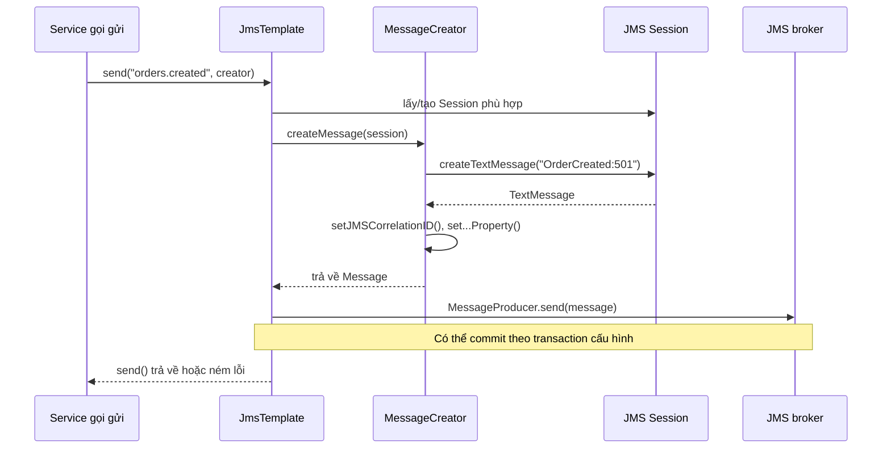

# Gửi TextMessage bằng MessageCreator trong Spring JMS

## 1. Mục tiêu bài học

Sau bài này, bạn có thể:

1. Giải thích đúng vai trò của **`JmsTemplate`**, **`MessageCreator`**, **`Session`** và **`TextMessage`** trong thao tác gửi thông điệp.
2. Sử dụng `jmsTemplate.send("ten.queue", messageCreator)` để tạo **`TextMessage` ngay trong Session do Spring cung cấp**, thay vì tự tạo connection/session/producer.
3. Thiết lập payload, `JMSCorrelationID`, `JMSType` và các **message properties** đúng thời điểm.
4. Phân biệt `send(..., MessageCreator)` với `convertAndSend(...)`, `MessagePostProcessor`, `MessageListener` và khái niệm gửi bất đồng bộ.
5. Thực hành Java 17+ với Spring Boot, Apache ActiveMQ Artemis, kiểm tra body và metadata khi nhận.
6. Hiểu các giới hạn của acknowledgement, transaction, QoS, retry, tính idempotent và kiểm thử.

**Bài toán mẫu:** hệ thống Đơn hàng cần gửi một thông báo dạng văn bản `"OrderCreated:501"` tới hàng đợi `orders.created`. Ngoài nội dung chính, người gửi cần gắn mã tương quan `corr-501`, loại sự kiện `OrderCreated` và phiên bản dữ liệu `1` để consumer xử lý đúng.

Trong Spring JMS, cách tường minh là:

```java
jmsTemplate.send("orders.created", session -> {
    TextMessage message = session.createTextMessage("OrderCreated:501");
    message.setJMSCorrelationID("corr-501");
    message.setStringProperty("eventType", "OrderCreated");
    message.setIntProperty("schemaVersion", 1);
    return message;
});
```

Đây là **đoạn dùng bên trong ứng dụng đã cấu hình `JmsTemplate` và broker**, không phải chương trình Java độc lập. Phần thực hành phía dưới sẽ cung cấp project hoàn chỉnh, lệnh chạy và kết quả mong đợi.

## 2. Tổng quan cơ chế gửi bằng MessageCreator

Trong Jakarta Messaging (JMS), một message thường được tạo bằng `Session`, ví dụ `session.createTextMessage("...")`, rồi đưa đến một `Destination` thông qua `MessageProducer`.

Nếu code tự làm thủ công, nó phải quản lý `ConnectionFactory`, `Connection`, `Session`, `MessageProducer` và việc đóng resource/transaction. Spring bọc các thao tác lặp lại này trong `org.springframework.jms.core.JmsTemplate`.

**`MessageCreator` là callback phía gửi** có nhiệm vụ **tạo đúng đối tượng `jakarta.jms.Message` trên Session đang được sử dụng cho lần gửi ấy**. Spring sẽ gọi callback trước khi thực hiện `MessageProducer.send(...)`.

Chữ ký interface Spring JMS:

```java
package org.springframework.jms.core;

// Chữ ký API minh họa; project phải import interface thật từ spring-jms.
@FunctionalInterface
public interface MessageCreator {
    jakarta.jms.Message createMessage(jakarta.jms.Session session)
            throws jakarta.jms.JMSException;
}
```

Vì là functional interface, có thể dùng lambda (`session -> ...`) hoặc anonymous class. `createMessage` trả về `Message`, không bắt buộc chỉ trả về `TextMessage`: có thể tạo `BytesMessage`, `MapMessage`, `ObjectMessage` tùy nhu cầu. **Riêng bài này tập trung vào `TextMessage`.**

### 2.1. Luồng thực thi điển hình



**Thứ tự quan trọng:**

- `MessageCreator` chạy **trong quá trình gọi `JmsTemplate.send`**, khi Session đang hợp lệ.
- `Session` do **Spring cung cấp**; không phải Session bạn tự tạo bằng `new` hoặc lấy tùy ý từ thread khác.
- `createTextMessage` **chỉ xây dựng message**, chưa phải thao tác gửi broker.
- `return message` đưa message lại cho `JmsTemplate` để gửi. **Không gọi `producer.send` trong callback**, vì như vậy dễ gửi hai lần.
- `JmsTemplate` quản lý resource và chuyển `JMSException` của provider sang Spring `JmsException` (unchecked) trên đường gọi API.
- `send` trả về không có nghĩa một consumer đã xử lý xong nghiệp vụ; thành công của gửi, xác nhận/commit và xử lý ở consumer là các mốc khác nhau.

### 2.2. Những tên API không được nhầm

| Thành phần | Đúng vai trò |
| --- | --- |
| `org.springframework.jms.core.MessageCreator` | Tạo message ở **phía gửi** bằng Session được cung cấp. |
| `jakarta.jms.TextMessage` | Loại message JMS có payload text String. |
| `jakarta.jms.Session.createTextMessage(...)` | Tạo `TextMessage` trong Session JMS. |
| `org.springframework.jms.core.JmsTemplate.send(...)` | Điều phối tạo/gửi message và quản lý resource. |
| `org.springframework.jms.core.JmsTemplate.convertAndSend(...)` | Dùng `MessageConverter` tạo message từ Java object rồi gửi. |
| `org.springframework.jms.core.MessagePostProcessor` | Thay đổi **message sau chuyển đổi, trước khi gửi** trong overload `convertAndSend`. |
| `jakarta.jms.MessageListener.onMessage(...)` | Callback **nhận** message, không dùng để tạo message gửi. |
| `jakarta.jms.CompletionListener` | Callback báo kết quả **gửi bất đồng bộ qua JMS API tương ứng**, không phải `MessageCreator`. |

`MessageCreator` nghe giống một “listener”, nhưng bản chất là **callback để tạo nội dung trước khi gửi**. Nó không biến `JmsTemplate.send` thành gửi bất đồng bộ.

## 3. TextMessage gồm những gì?

`jakarta.jms.TextMessage` là một `Message` có body dạng `String`. Các thao tác chính:

```java
TextMessage text = session.createTextMessage("Xin chào JMS");
// Hoặc: TextMessage text = session.createTextMessage();
//         text.setText("Xin chào JMS");
String content = text.getText();
```

Cả `createTextMessage`, `setText` và `getText` thuộc Jakarta JMS API; thao tác liên quan provider có thể ném `JMSException`.

Message còn có **headers** và **properties**:

| Vị trí | Ví dụ | Ý nghĩa |
| --- | --- | --- |
| Body | `"OrderCreated:501"` | Dữ liệu chính. Có thể là text thường hoặc chuỗi JSON/XML được serialize có kiểm soát. |
| Header do ứng dụng đặt | `JMSCorrelationID="corr-501"` | Liên kết request/response, tracing hoặc chuỗi hoạt động. |
| Header do ứng dụng đặt | `JMSType="OrderCreated"` | Nhãn loại message theo contract nghiệp vụ. |
| Header do ứng dụng đặt | `JMSReplyTo` | Destination nơi bên gửi mong nhận phản hồi, nếu dùng request/reply. |
| Property | `eventType="OrderCreated"` | Metadata dạng key-value, có thể được consumer hoặc selector sử dụng. |
| Property | `schemaVersion=1` | Phiên bản schema để consumer đọc đúng payload. |
| Header do provider thiết lập lúc gửi | `JMSMessageID`, `JMSTimestamp`, `JMSDestination` | Được provider gán theo JMS send semantics; không tự chế trước khi gửi. |
| QoS của producer | delivery mode, priority, time-to-live | Thông thường được chọn bằng producer/template send settings; không coi là custom property. |

**Body và property khác nhau:** gọi `message.setStringProperty("eventType", ...)` **không chèn thêm văn bản** vào `TextMessage.getText()`. Ở consumer, phải lấy body qua `getText()` và lấy property riêng qua `getStringProperty()` hoặc getter tương ứng.

**Kiểu property có ý nghĩa:** `setIntProperty("schemaVersion", 1)` tạo property kiểu số; nếu consumer kỳ vọng `int` thì dùng `getIntProperty`. Tên property phải hợp lệ theo quy tắc JMS; nên dùng tên ngắn, rõ ràng, không tùy tiện dùng prefix `JMSX`/`JMS_` dành cho chuẩn/provider.

### 3.1. Tạo và bổ sung metadata

```java
MessageCreator creator = session -> {
    TextMessage text = session.createTextMessage("OrderCreated:501");
    text.setJMSCorrelationID("corr-501");
    text.setJMSType("OrderCreated");
    text.setStringProperty("eventType", "OrderCreated");
    text.setIntProperty("schemaVersion", 1);
    text.setBooleanProperty("retryable", false);
    return text;
};

jmsTemplate.send("orders.created", creator);
```

Mảnh code trên cần import `org.springframework.jms.core.MessageCreator`, `jakarta.jms.TextMessage` và `jmsTemplate` đã được inject. `setJMSCorrelationID` nhận chuỗi do ứng dụng quy định; **không giả mạo `JMSMessageID` của provider**. Với request/reply, `JMSCorrelationID` thường liên kết request và response, nhưng contract cụ thể phải được hai phía thống nhất.

### 3.2. Không tự đặt nhầm những headers do provider quản lý

Các header như `JMSMessageID`, `JMSTimestamp`, `JMSDestination`, `JMSDeliveryMode`, `JMSExpiration` và `JMSPriority` thuộc nhóm được provider xác định lúc gửi. Đừng cố làm QoS bằng cách gọi `setJMSExpiration(...)` hoặc `setJMSPriority(...)` trong `MessageCreator` rồi cho rằng broker phải tôn trọng các giá trị đó.

Ví dụ **không nên dựa vào**:

```java
jmsTemplate.send("orders.created", session -> {
    TextMessage text = session.createTextMessage("OrderCreated:501");
    text.setJMSExpiration(System.currentTimeMillis() + 10_000);
    return text;
});
```

TTL đúng được cấu hình thông qua `MessageProducer.send(..., deliveryMode, priority, timeToLive)` hoặc những tùy chọn QoS tương ứng trên `JmsTemplate`; nhà cung cấp sẽ xác lập `JMSExpiration` thích hợp.

## 4. Các overload send của JmsTemplate

Ba overload cần nhớ:

```java
// 1. Destination được định danh bằng tên String:
jmsTemplate.send("orders.created", session ->
        session.createTextMessage("OrderCreated:501"));

// 2. Đã có đối tượng Destination thật:
jmsTemplate.send(queue, session ->
        session.createTextMessage("OrderCreated:501"));

// 3. Dùng destination mặc định đã cấu hình trên JmsTemplate:
jmsTemplate.send(session ->
        session.createTextMessage("OrderCreated:501"));
```

Ở đây `queue` là biến kiểu `jakarta.jms.Destination`/`Queue` được cung cấp từ JMS provider, và overload thứ ba chỉ chạy khi template đã có default destination/destination name. Nếu không có, Spring báo lỗi do thiếu destination mặc định.

### 4.1. Tên String được phân giải Queue hay Topic?

`JmsTemplate` có `pubSubDomain`. Khi dùng resolver động mặc định và nhận một tên String:

- `pubSubDomain=false`: tên được phân giải thành **Queue** (mặc định).
- `pubSubDomain=true`: tên được phân giải thành **Topic**.

`MessageCreator` không tự quyết định Queue/Topic nếu caller đã chọn đích bằng `jmsTemplate.send(String, ...)`. Với `send(Destination, ...)`, kiểu thực tế của `Destination` mới có ý nghĩa. Cần cấu hình phía listener tương thích; nếu producer gửi Topic mà consumer lại lắng nghe Queue cùng tên, hai bên có thể không gặp nhau.

Trong Spring Boot thường có thể dùng:

```properties
spring.jms.pub-sub-domain=false
```

Bài này dùng Queue; với Topic còn phải xét subscription có tồn tại, durable/shared và thời điểm publisher phát tin.

### 4.2. Ví dụ anonymous class và lambda tương đương

**Anonymous class** (rõ chữ ký interface):

```java
jmsTemplate.send("orders.created", new MessageCreator() {
    @Override
    public Message createMessage(Session session) throws JMSException {
        return session.createTextMessage("OrderCreated:501");
    }
});
```

**Lambda** (Java 8+, phù hợp Java 17+):

```java
jmsTemplate.send("orders.created",
        session -> session.createTextMessage("OrderCreated:501"));
```

Hai phiên bản thực hiện cùng hợp đồng. Nếu thêm nhiều header/properties, lambda dạng block với `return` ở cuối sẽ rõ ràng hơn. Lambda có thể capture biến local **final hoặc effectively final**; tránh lấy trực tiếp mutable state sẽ bị thread khác thay đổi trước khi gửi.

## 5. Demo chạy được: Spring Boot 3 + Java 17 + Artemis

Bài thực hành dùng **một Queue thực**, gửi `TextMessage` qua `MessageCreator` và một `@JmsListener` đọc lại đầy đủ body/metadata. Không giả lập broker bằng collection Java.

### 5.1. Điều kiện

- JDK 17 trở lên; kiểm tra `java -version`.
- Maven 3.6.3 trở lên; kiểm tra `mvn -version`.
- Docker để chạy Apache ActiveMQ Artemis, trừ khi đã có broker Artemis tương thích khác.
- Cổng local `61616` chưa được process khác sử dụng.

Lệnh Docker sử dụng image Artemis chính thức:

```bash
docker run --detach --rm --name artemis-messagecreator-demo \
  -e ARTEMIS_USER=artemis \
  -e ARTEMIS_PASSWORD=artemis \
  -p 127.0.0.1:61616:61616 \
  -p 127.0.0.1:8161:8161 \
  apache/artemis:latest-alpine
```

Quan sát broker đến khi sẵn sàng:

```bash
docker logs artemis-messagecreator-demo
```

`61616` là transport TCP cho JMS client; `8161` là giao diện quản trị. Cấu hình credential đơn giản chỉ dùng cho **môi trường học trên máy cá nhân**. Khi triển khai production phải dùng secret, authorization, network isolation và TLS tùy yêu cầu. Nếu broker tắt auto-create destination thì tạo Queue trước khi chạy.

### 5.2. Cấu trúc project

```text
jms-messagecreator-demo/
├── pom.xml
└── src/main/
    ├── java/demo/jms/MessageCreatorDemoApplication.java
    └── resources/application.properties
```

### 5.3. pom.xml

Sử dụng Spring Boot **3.3.5**, Spring JMS được starter Artemis cung cấp, API thuộc namespace `jakarta.jms`:

```xml
<project xmlns="http://maven.apache.org/POM/4.0.0"
         xmlns:xsi="http://www.w3.org/2001/XMLSchema-instance"
         xsi:schemaLocation="http://maven.apache.org/POM/4.0.0 https://maven.apache.org/xsd/maven-4.0.0.xsd">
    <modelVersion>4.0.0</modelVersion>

    <parent>
        <groupId>org.springframework.boot</groupId>
        <artifactId>spring-boot-starter-parent</artifactId>
        <version>3.3.5</version>
        <relativePath/>
    </parent>

    <groupId>demo</groupId>
    <artifactId>jms-messagecreator-demo</artifactId>
    <version>1.0.0</version>

    <properties>
        <java.version>17</java.version>
    </properties>

    <dependencies>
        <dependency>
            <groupId>org.springframework.boot</groupId>
            <artifactId>spring-boot-starter-artemis</artifactId>
        </dependency>
    </dependencies>

    <build>
        <plugins>
            <plugin>
                <groupId>org.springframework.boot</groupId>
                <artifactId>spring-boot-maven-plugin</artifactId>
            </plugin>
        </plugins>
    </build>
</project>
```

Không thêm `artemis-jakarta-server`: ứng dụng đóng vai trò **JMS client** kết nối broker đang chạy riêng. `spring-boot-starter-artemis` cung cấp các dependency cần thiết để Spring Boot auto-configure `ConnectionFactory`, `JmsTemplate` và listener container.

### 5.4. application.properties

Tạo file `src/main/resources/application.properties`:

```properties
spring.artemis.mode=native
spring.artemis.broker-url=tcp://localhost:61616
spring.artemis.user=artemis
spring.artemis.password=artemis

# Gửi và nhận trên Queue, không phải Topic
spring.jms.pub-sub-domain=false
```

Nếu chạy ứng dụng **trong container khác**, `localhost` bên trong container ứng dụng **không phải** máy chủ broker. Khi đó cấu hình bằng DNS/hostname và port thật của broker có thể truy cập từ mạng container.

### 5.5. Java đầy đủ: MessageCreator + @JmsListener

File `src/main/java/demo/jms/MessageCreatorDemoApplication.java`:

```java
package demo.jms;

import java.util.concurrent.CountDownLatch;
import java.util.concurrent.TimeUnit;

import jakarta.jms.JMSException;
import jakarta.jms.Message;
import jakarta.jms.TextMessage;

import org.springframework.boot.ApplicationRunner;
import org.springframework.boot.SpringApplication;
import org.springframework.boot.autoconfigure.SpringBootApplication;
import org.springframework.context.annotation.Bean;
import org.springframework.jms.annotation.EnableJms;
import org.springframework.jms.annotation.JmsListener;
import org.springframework.jms.core.JmsTemplate;
import org.springframework.stereotype.Component;

@SpringBootApplication
@EnableJms
public class MessageCreatorDemoApplication {

    public static void main(String[] args) {
        SpringApplication.run(MessageCreatorDemoApplication.class, args);
    }

    @Bean
    ApplicationRunner sendOne(JmsTemplate jmsTemplate, DemoReceiver receiver) {
        return args -> {
            jmsTemplate.send("demo.messagecreator.queue", session -> {
                TextMessage message =
                        session.createTextMessage("OrderCreated:501");
                message.setJMSCorrelationID("corr-501");
                message.setJMSType("OrderCreated");
                message.setStringProperty("eventType", "OrderCreated");
                message.setIntProperty("schemaVersion", 1);
                return message;
            });

            // Chờ demo nhận message để in kết quả có thứ tự kiểm chứng.
            if (!receiver.await(10, TimeUnit.SECONDS)) {
                throw new IllegalStateException(
                        "Timed out waiting for JMS consumer");
            }
            System.out.println("SENDER: completed");
        };
    }
}

@Component
class DemoReceiver {
    private final CountDownLatch received = new CountDownLatch(1);

    @JmsListener(destination = "demo.messagecreator.queue")
    public void onMessage(Message raw) throws JMSException {
        if (!(raw instanceof TextMessage textMessage)) {
            throw new IllegalArgumentException("Expected TextMessage");
        }

        System.out.println("BODY: " + textMessage.getText());
        System.out.println(
                "TYPE: " + textMessage.getJMSType());
        System.out.println(
                "CORRELATION: " + textMessage.getJMSCorrelationID());
        System.out.println(
                "EVENT: " + textMessage.getStringProperty("eventType"));
        System.out.println(
                "SCHEMA: " + textMessage.getIntProperty("schemaVersion"));
        received.countDown();
    }

    boolean await(long timeout, TimeUnit unit)
            throws InterruptedException {
        return received.await(timeout, unit);
    }
}
```

**Giải thích từng phần:**

1. Spring Boot khởi tạo `ConnectionFactory` và `JmsTemplate` từ properties; `@EnableJms` cho phép Spring tạo listener endpoint cho `@JmsListener`.
2. `ApplicationRunner` chạy sau khi ứng dụng khởi động, thực hiện đúng **một lời gọi `jmsTemplate.send(...)`**.
3. Lambda nhận `session` do template cung cấp, tạo **`TextMessage` với body** và gắn headers/properties khi message còn ở trạng thái ghi được.
4. `return message` giúp template thực hiện send đến Queue `demo.messagecreator.queue` trên Artemis broker.
5. `@JmsListener` đọc **raw `jakarta.jms.Message`**; Spring JMS hỗ trợ đối số này. `instanceof TextMessage` giúp kiểm tra kiểu trước khi đọc text.
6. `CountDownLatch` chỉ phục vụ **thời điểm kết thúc ví dụ**: chờ callback in đủ dữ liệu để runner in dòng cuối. Nó không phải công cụ xác nhận broker đã lưu bền vững, cũng không thay thế JMS transaction.
7. Mã dùng **một public class và một package-private component** trong cùng file, đúng cú pháp Java. Không có `new Session()`, `new TextMessage()` hay tự đóng Spring-managed connection.

### 5.6. Chạy và kiểm chứng output

Đợi Docker Artemis sẵn sàng. Từ thư mục có `pom.xml`:

```bash
mvn spring-boot:run
```

Trong điều kiện broker kết nối được, Queue tạo được, và không có message cũ tồn đọng cùng tên đang chờ trước khi demo gửi, **các dòng do mã ví dụ tự in** theo thứ tự là:

```text
BODY: OrderCreated:501
TYPE: OrderCreated
CORRELATION: corr-501
EVENT: OrderCreated
SCHEMA: 1
SENDER: completed
```

Spring, Maven và Artemis có thể ghi thêm các dòng log, nên hãy tập trung vào sáu dòng có tiền tố trên. Hai số cuối được tạo từ `JMSCorrelationID`/property của chính message mới gửi, không phải từ ngẫu nhiên hay thời gian hiện tại.

**Tại sao `SENDER: completed` đứng cuối?** Receiver thực hiện năm lệnh in trước rồi `received.countDown()`; `ApplicationRunner` chỉ in sau khi `await(...)` nhận tín hiệu. Nếu broker chưa sẵn sàng, nhận bị chặn, hoặc listener lỗi, chương trình có thể ném exception/timeout thay vì in đúng sáu dòng.

Ứng dụng Spring Boot vẫn chạy để giữ listener hoạt động. Nhấn `Ctrl+C` để dừng; sau đó có thể dừng broker:

```bash
docker stop artemis-messagecreator-demo
```

Vì Docker demo dùng `--rm` mà không mount volume, không dùng môi trường này để kết luận dữ liệu giữ nguyên sau khi broker/container bị xóa.

**Chạy lại nhiều lần trên cùng broker:** Queue tên cố định có thể chứa thông điệp cũ nếu lần chạy trước gặp lỗi. Trong bài học, nên tạo broker/container mới, xóa Queue demo đúng cách hoặc dùng tên Queue riêng cho lần thử. Nếu thấy nhiều log nhận, đừng kết luận tự động rằng `MessageCreator` đã gửi lặp khi chưa kiểm tra backlog và redelivery.

## 6. Tại sao MessageCreator có lợi so với tạo TextMessage thủ công?

### 6.1. Cách dùng JMS client thuần

Ý tưởng JMS classic API khi chưa có Spring (mảnh code, `connectionFactory` là biến được cung cấp từ provider):

```java
try (var connection = connectionFactory.createConnection()) {
    var session = connection.createSession(
            false, jakarta.jms.Session.AUTO_ACKNOWLEDGE);
    var queue = session.createQueue("orders.created");

    try (var producer = session.createProducer(queue)) {
        var message = session.createTextMessage("OrderCreated:501");
        message.setStringProperty("eventType", "OrderCreated");
        producer.send(message);
    }
}
```

Đây là **đoạn minh họa**, chưa phải chương trình độc lập: cần `connectionFactory` thật, quyền truy cập broker và classpath JMS provider. Trong classic JMS, tự quản lý connection/session/producer nghĩa là phải xử lý vòng đời và transaction đúng cách. Đối với **gửi** thì không cần `connection.start()`; `start()` điều khiển việc giao message đến consumer. Khi nhận message phải chú ý start/lifecycle tương ứng.

### 6.2. Cách dùng Spring

```java
jmsTemplate.send("orders.created", session -> {
    TextMessage message = session.createTextMessage("OrderCreated:501");
    message.setStringProperty("eventType", "OrderCreated");
    return message;
});
```

Spring xử lý phần lớn boilerplate tạo/giải phóng JMS resources, tích hợp Session vào transaction khi được cấu hình, và thống nhất cơ chế xử lý exception. Callback vẫn có quyền dùng **API JMS gốc** để tạo đúng loại message và gắn metadata.

Đây là điểm cân bằng: **không phải tự quản lý tài nguyên ở application service**, nhưng vẫn chủ động thiết kế message format.

### 6.3. Không giữ Session hoặc Message để tái sử dụng sai vòng đời

`Session` do template cấp cho callback chỉ dùng trong phạm vi lần gọi gửi. Không đưa nó ra ngoài để lưu trong field, cache, hoặc cho thread khác gọi `createTextMessage` sau khi `send` kết thúc.

Sai lầm có thể thấy:

```java
// CHI DE MINH HOA MOT ANTIPATTERN:
private Session cachedSession;

// Trong MessageCreator:
cachedSession = session; // Khong lam viec nay!
return session.createTextMessage("M1");
```

`Session` không thread-safe theo nghĩa sử dụng đồng thời tùy ý và thường bị quản lý/đóng/trả pool theo request. Nếu cần gửi nhiều thông điệp từ các request khác nhau, **tái sử dụng `JmsTemplate` đã được cấu hình**, không tái sử dụng Session lấy ra từ callback.

## 7. So sánh send(MessageCreator) và convertAndSend

### 7.1. Khi chỉ có String payload

Với Spring `SimpleMessageConverter` mặc định, String được chuyển thành `TextMessage`:

```java
jmsTemplate.convertAndSend("orders.created", "OrderCreated:501");
```

Đây là lựa chọn ngắn gọn, thích hợp khi chỉ gửi String mà không cần tùy chỉnh gì thêm. Nếu chỉ muốn bổ sung header/property cho String, có thể truyền một `MessagePostProcessor`:

```java
jmsTemplate.convertAndSend(
        "orders.created",
        "OrderCreated:501",
        message -> {
            message.setJMSCorrelationID("corr-501");
            message.setStringProperty("eventType", "OrderCreated");
            return message;
        });
```

Ở đây **message đã được converter tạo ra** trước khi `MessagePostProcessor` được gọi.

### 7.2. Khi cần điều khiển kiểu và body tường minh

```java
jmsTemplate.send("orders.created", session -> {
    TextMessage message = session.createTextMessage("OrderCreated:501");
    message.setJMSCorrelationID("corr-501");
    message.setStringProperty("eventType", "OrderCreated");
    return message;
});
```

Trong `MessageCreator`, bạn quyết định **tạo loại message gì** trước khi chuyển nó cho template. Không cần phụ thuộc việc converter đang map String hay một DTO ra kiểu JMS nào.

| Tiêu chí | `send(..., MessageCreator)` | `convertAndSend(...)` |
| --- | --- | --- |
| Đầu vào | Callback có `Session` | Java object, ví dụ String/DTO |
| Kiểu message | Bạn tạo `TextMessage` hoặc loại khác | `MessageConverter` quyết định |
| Metadata | Gắn trực tiếp trong `MessageCreator` | Có thể gắn qua `MessagePostProcessor` |
| Khi đọc code | Thể hiện rõ toàn bộ quy tắc tạo JMS Message | Ngắn gọn với use case chuyển đổi đơn giản |
| Cần quan tâm `JMSException` khi tạo? | Callback có chữ ký `throws JMSException`; Spring quản lý exception | Converter/post-processor cũng có thể phát sinh exception theo contract |
| Rủi ro thường thấy | Boilerplate; lẫn chuyện tạo và gửi; tự giữ Session sai cách | Không biết converter nào hoạt động; DTO/JSON schema không được quản lý |
| Phù hợp | Muốn kiểm soát tường minh `TextMessage` + headers/properties | Payload đơn giản hoặc có converter thống nhất |

**Không có lựa chọn “luôn tốt nhất”.** Với mã dự án lớn, điều quan trọng là có contract ổn định về payload/schema/headers, không phải dùng càng nhiều callback càng tốt.

### 7.3. MessageCreator không thay thế converter cho JSON phức tạp

Nếu gửi JSON text, bạn có thể serialize một đối tượng bằng Jackson trước, rồi tạo `TextMessage` từ chuỗi JSON ấy:

```java
String json = objectMapper.writeValueAsString(orderEvent);

jmsTemplate.send("orders.created", session -> {
    TextMessage message = session.createTextMessage(json);
    message.setStringProperty("contentType", "application/json");
    message.setIntProperty("schemaVersion", 2);
    return message;
});
```

Đây là **mảnh code ứng dụng**, cần bean `objectMapper`, biến `orderEvent`, dependency JSON và xử lý exception khi serialize. Không giả định Spring JMS tự dùng Jackson với mọi `convertAndSend`; converter phải được cấu hình đúng. Quan trọng hơn, producer và consumer phải thống nhất version/schema, không chỉ tên property `contentType`.

## 8. Headers, properties và cách thiết kế contract

### 8.1. JMSCorrelationID và request/reply

`JMSCorrelationID` là header do ứng dụng có thể thiết lập để liên kết message. Với một workflow:

```text
Sender                       Receiver
 request: order-501  ---->    handle order
 correlation=corr-501        |
                             +----> reply:
                                    correlation=corr-501
```

Nếu hai bên thỏa thuận dùng ID tương quan, consumer có thể log và trả lại ID ấy trên response. Đừng tự ý dùng một chuỗi correlation **trùng nhau cho nhiều request đồng thời** khi cơ chế ghép response cần tính duy nhất; trong thực tế có thể tạo ID dạng UUID hoặc định danh nghiệp vụ đảm bảo không va chạm.

Đừng nhầm:

- `JMSMessageID`: do provider sinh theo quy tắc gửi message.
- `JMSCorrelationID`: thường do ứng dụng đặt để liên kết message.
- `eventId` trong custom property: ID nghiệp vụ phục vụ idempotency; **không bắt buộc bằng** hai header JMS trên.

### 8.2. JMSType và property eventType

`JMSType` là header tùy chọn biểu diễn một định danh loại message theo contract hệ thống. `eventType` là **custom property** do chính ứng dụng đặt. Cùng chứa `"OrderCreated"` trong demo, nhưng hai vị trí khác nhau:

```java
message.setJMSType("OrderCreated");
message.setStringProperty("eventType", "OrderCreated");
```

Không bắt buộc phải đặt cả hai nếu hệ thống chỉ dùng một convention; bài học cố ý đặt cả hai để thấy khả năng thao tác qua `MessageCreator`.

### 8.3. Message selectors và metadata

Một consumer có thể dùng message selector để lọc theo JMS properties hoặc một số header được quy định, ví dụ selector logic:

```text
eventType = 'OrderCreated' AND schemaVersion = 1
```

Đây là **selector expression**, không phải SQL query trên database. Nếu áp dụng selector trên listener container/`@JmsListener(selector=...)`, consumer chỉ nhận message phù hợp. Cần cân nhắc tác động tới routing, subscription và tài nguyên broker. Body text không thể tự được selector chuẩn đọc thành field SQL như `eventType`; muốn lọc qua selector phải đặt property/header thích hợp.

### 8.4. Tránh ghi dữ liệu nhạy cảm vào headers/properties

Payload có thể được bảo vệ theo thiết kế transport/storage; headers và properties thường xuất hiện trong logging, message browser và broker console. Hạn chế token, mật khẩu, dữ liệu riêng tư trong `JMSCorrelationID`, selector properties hoặc log toàn bộ message.

## 9. QoS: delivery mode, priority và time-to-live

`MessageCreator` tạo body + application metadata, **không phải công cụ chính để điều khiển QoS**. JMS có các thông số phía producer:

- **Delivery mode:** `DeliveryMode.PERSISTENT` hoặc `NON_PERSISTENT`.
- **Priority:** số 0–9 (thông thường mặc định là 4), là gợi ý ưu tiên theo broker/provider.
- **Time-to-live (TTL):** thời gian tồn tại của message theo milliseconds; `0` thường là không hết hạn theo TTL.

Trong `JmsTemplate` có thể cấu hình QoS một lần:

```java
import jakarta.jms.ConnectionFactory;
import org.springframework.context.annotation.Bean;
import org.springframework.context.annotation.Configuration;
import org.springframework.jms.core.JmsTemplate;

@Configuration
class JmsQoSConfig {
    @Bean
    JmsTemplate reliableSender(ConnectionFactory cf) {
        JmsTemplate template = new JmsTemplate(cf);
        template.setPubSubDomain(false);
        template.setExplicitQosEnabled(true);
        template.setDeliveryPersistent(true);
        template.setPriority(6);
        template.setTimeToLive(60_000L);
        return template;
    }
}
```

**Đây là cấu hình thay thế để minh họa, không chèn trực tiếp vào demo `JmsTemplate` auto-configured ở phần 5** nếu bạn muốn giữ demo tối giản.

Điểm dễ quên: **`setExplicitQosEnabled(true)`** cho biết template sử dụng các giá trị mode/priority/TTL đã thiết lập thay vì để producer/provider dùng các giá trị mặc định. Riêng `setTimeToLive(60_000)` mà bỏ qua cờ này có thể không cho kết quả như mong muốn.

**Persistent ≠ exactly-once business:** độ bền còn phụ thuộc transaction, cấu hình journal/storage của broker, acknowledgement và cách consumer xử lý. TTL có thể khiến message hết hạn trước khi consumer kịp nhận; priority không bảo đảm thứ tự xử lý nghiệp vụ tuyệt đối.

Nếu mỗi loại message cần QoS khác nhau, dùng sender/template được cấu hình riêng hoặc callback producer nâng cao (`ProducerCallback`) có contract rõ ràng. Đừng thay đổi `setTimeToLive`/`setPriority` trên cùng `JmsTemplate` singleton đang bị nhiều thread sử dụng.

## 10. Transaction, kết quả send và các trường hợp lỗi

### 10.1. Send hoàn tất không đồng nghĩa consumer hoàn tất

Từ phía publisher:

```text
Tạo TextMessage -> gửi tới provider -> provider/transaction nhận kết quả
                                             |
                                          consumer nhận
                                             |
                                          xử lý nghiệp vụ
                                             |
                                          ack/commit
```

`JmsTemplate.send(...)` làm việc đồng bộ với lời gọi gửi của provider theo cấu hình. Nó **không chờ consumer xử lý xong**. Broker có thể lưu message và trả kết quả trước khi có consumer. Nếu cần xác nhận nghiệp vụ, phải có cơ chế khác như reply message, callback từ dịch vụ đích hoặc trạng thái do ứng dụng quản lý.

`MessageCreator` cũng không phải cơ chế gửi async: callback này được gọi để **tạo** message trong đường gửi của caller.

### 10.2. Khi MessageCreator ném lỗi

`createMessage(session)` có thể ném `JMSException` nếu việc tạo message/đặt property thất bại. `JmsTemplate` bắt và chuyển những lỗi Jakarta JMS phù hợp thành exception unchecked của Spring JMS, giúp tầng service không phải lặp lại quá nhiều `try/catch JMSException`.

```java
try {
    jmsTemplate.send("orders.created",
            session -> session.createTextMessage("OrderCreated:501"));
} catch (org.springframework.jms.JmsException ex) {
    // Log context an toàn; áp dụng chính sách retry/alert của ứng dụng.
    throw ex;
}
```

Không “nuốt lỗi” chỉ vì business API không khai báo `throws`. Khi gửi lỗi do mất kết nối hoặc transaction có kết quả không rõ ràng, một thao tác gửi lại có thể tạo **hai bản sao logic** nếu lần trước đã vào broker. Dùng `eventId` nghiệp vụ và idempotent consumer để kiểm soát việc gửi/nhận lặp.

### 10.3. Gửi trong transaction

Khi Spring có transaction JMS được cấu hình đúng, `JmsTemplate` có thể sử dụng Session tham gia transaction hiện tại. Message trở nên có hiệu lực với consumer theo quy tắc commit/rollback của broker/Session.

Nếu service vừa ghi database vừa gửi JMS, **một local JMS transaction không tự động bao phủ giao dịch database**. Không suy ra `@Transactional` bất kỳ sẽ tạo atomic commit giữa DB và JMS. Các kiến trúc thường dùng transactional outbox/inbox hoặc transaction phối hợp khi được hỗ trợ và thật sự cần.

### 10.4. Retry và MessageCreator

- Broker giao lại message cho consumer (`redelivery`) **không có nghĩa `MessageCreator` của publisher được chạy lại**.
- Application-level retry một lời gọi `send(...)` thì **callback có thể được thực hiện lại**, tạo message mới trên Session/lần gửi khác.
- Nếu event ID được tạo ngẫu nhiên **bên trong callback mỗi lần retry**, hai lần gửi có thể có hai ID khác nhau dù cùng nghiệp vụ. Nên tạo event ID ổn định ở lớp nghiệp vụ và truyền vào callback.
- Không tạo side effect như ghi database, gọi HTTP hay trừ tiền **bên trong `MessageCreator`**: callback nên tập trung tạo message, tránh hành vi không thể rollback đồng bộ cùng thao tác gửi.

## 11. Thiết kế MessageCreator dùng lại trong service

Khi cùng một hợp đồng message được gửi từ nhiều method, có thể trích xuất một hàm tạo `MessageCreator`:

```java
import org.springframework.jms.core.MessageCreator;
import jakarta.jms.TextMessage;

public final class OrderMessages {
    private OrderMessages() {
    }

    public static MessageCreator orderCreated(
            String orderId,
            String correlationId) {
        if (orderId == null || orderId.isBlank()) {
            throw new IllegalArgumentException("orderId is required");
        }
        if (correlationId == null || correlationId.isBlank()) {
            throw new IllegalArgumentException(
                    "correlationId is required");
        }

        final String body = "OrderCreated:" + orderId;
        return session -> {
            TextMessage text = session.createTextMessage(body);
            text.setJMSType("OrderCreated");
            text.setJMSCorrelationID(correlationId);
            text.setStringProperty("eventType", "OrderCreated");
            text.setIntProperty("schemaVersion", 1);
            return text;
        };
    }
}
```

Đặt class trong một file `OrderMessages.java` ở project Spring có JMS dependencies; code này là **một helper độc lập có thể biên dịch** sau khi đặt trong package phù hợp và có classpath. Khi dùng:

```java
jmsTemplate.send(
        "orders.created",
        OrderMessages.orderCreated("501", "corr-501"));
```

Lợi ích: validation diễn ra trước lúc tạo JMS Message; các field của event được cố định trong closure để callback dễ kiểm thử; mỗi lần gọi `send` vẫn tạo một `TextMessage` mới bằng Session tương ứng.

**Không cache một `TextMessage` rồi gửi trên nhiều Session** và không tái sử dụng Session bên ngoài phạm vi callback. Nếu dùng lại helper, tái sử dụng **logic tạo message**, không tái sử dụng **đối tượng JMS message có trạng thái**.

## 12. Kiểm thử và chẩn đoán

### 12.1. Cần xác minh những gì?

Khi kiểm thử integration với broker thật, đừng chỉ khẳng định “không ném exception”:

1. Có đúng **một lần gọi gửi** mong muốn hay application-level retry? 
2. Destination đúng Queue/Topic và đúng broker?
3. Consumer nhận đúng `TextMessage`, `getText()` khớp payload?
4. `getJMSCorrelationID()` và `getStringProperty("eventType")` có giá trị không?
5. Property kiểu số `schemaVersion` được đọc đúng bằng `getIntProperty`?
6. Transaction/QoS/TTL có đúng hợp đồng không?
7. Khi broker offline, exception có được log và xử lý thay vì bị bỏ qua?
8. Khi nhận redelivery, consumer xử lý trùng bằng business key thế nào?

### 12.2. Kiểm thử callback mà không cần broker

Vì `MessageCreator` là một callback phụ thuộc `Session` và `TextMessage`, bạn có thể **unit test** riêng logic tạo message bằng mock `jakarta.jms.Session` và `TextMessage`, dùng Mockito/JUnit với dependencies test trong project. Ví dụ kiểm tra rằng `session.createTextMessage("OrderCreated:501")` được gọi, `setStringProperty("eventType", "OrderCreated")` được gọi, rồi trả đúng message giả.

Đây chỉ kiểm chứng **logic cấu tạo message**, không kiểm chứng broker nhận được, JMS transaction commit hoặc conversion tương thích giữa hai client. Integration test vẫn cần broker chạy thật hoặc Testcontainers/embedded broker đủ sát production.

### 12.3. Lỗi thường gặp

| Triệu chứng | Nguyên nhân thường gặp | Hướng giải quyết |
| --- | --- | --- |
| `Cannot resolve symbol MessageCreator` | Import nhầm package hoặc thiếu `spring-jms` | Dùng `org.springframework.jms.core.MessageCreator` qua Spring JMS dependency. |
| `TextMessage` không tạo được với `new TextMessage(...)` | `TextMessage` là JMS interface | Gọi `session.createTextMessage(...)`. |
| Lỗi `javax.jms`/`jakarta.jms` | Trộn API cũ với Spring Boot 3/Spring 6 | Thống nhất `jakarta.jms.*` và client phù hợp. |
| Gọi `setText(...)` không làm consumer nhận tin | Tạo message xong nhưng không gọi `jmsTemplate.send` hoặc gửi sai broker/Queue | Kiểm tra producer send và Queue/Topic type, connection. |
| Consumer nhận String nhưng thiếu metadata | Handler chỉ nhận payload, không đọc raw headers/properties | Dùng raw `Message` hoặc mapping `@Header` đúng. |
| Gửi xong mà consumer không thấy | Listener chưa chạy, sai destination/selector, transaction chưa commit, broker không kết nối | Kiểm tra logs, destination, consumer count và acknowledgement/transaction. |
| Dùng Queue nhưng muốn tất cả listener cùng nhận | Queue thường chia việc giữa các consumer | Dùng Topic/subscription nếu nghiệp vụ fan-out, cấu hình sender/receiver thống nhất. |
| Mong `JMSMessageID` có giá trị tự chọn trong callback | Header này được provider gán khi gửi | Dùng `JMSCorrelationID` hoặc custom `eventId` cho business ID. |
| TTL không đổi dù gọi `setTimeToLive` | Chưa bật `setExplicitQosEnabled(true)` | Thiết lập explicit QoS hoặc cấu hình producer tương ứng. |
| Đọc property số bằng String rồi parse lỗi | Kiểu property không khớp contract | Dùng typed getters và schema rõ ràng. |
| Chỉ một lần gửi nhưng nhận hai lần | Redelivery/rollback hoặc message còn tồn từ test trước | Kiểm tra `JMSRedelivered`, broker backlog, JMS transaction và idempotency. |
| Mã trong `MessageCreator` ghi DB/HTTP nhiều lần | Retry của tầng gửi có thể chạy lại callback | Giữ callback tập trung tạo message, tách side effect. |
| `MessageCreator` dùng Session sau `send` | Giữ reference Session quá vòng đời | Không cache Session; để Spring quản lý tài nguyên. |

### 12.4. Vì sao phải phân biệt lỗi tạo và lỗi gửi?

Thử tạo message với property sai có thể thất bại **trước khi provider nhận message**. Ngược lại, kết nối có thể mất **sau khi broker đã nhận nhưng trước khi client nhận được xác nhận**, khiến ứng dụng không chắc chắn kết quả. Hai tình huống có phương án retry khác nhau. Cần đặt ID nghiệp vụ ổn định, logging theo correlation, giám sát backlog/DLQ, và viết test cho cả hai.

## 13. Câu hỏi tự kiểm tra

**Câu 1.** `MessageCreator` thuộc `jakarta.jms` hay Spring Framework?

**Đáp án:** Spring JMS: `org.springframework.jms.core.MessageCreator`. `Session` và `TextMessage` thuộc `jakarta.jms`.

**Câu 2.** Vì sao callback nhận `Session`?

**Đáp án:** Để tạo `Message` bằng **chính Session đã được Spring sử dụng cho lần gửi**, giữ resource/transaction context nhất quán; không cần application tự quản lý Session.

**Câu 3.** `session.createTextMessage("M1")` đã gửi M1 tới broker chưa?

**Đáp án:** Chưa. Nó chỉ tạo đối tượng `TextMessage`. `JmsTemplate` thực hiện gửi sau khi callback trả về message.

**Câu 4.** Muốn gửi TextMessage và tự đặt `JMSCorrelationID`, có bắt buộc dùng `MessageCreator` không?

**Đáp án:** Không bắt buộc. Có thể dùng `convertAndSend` với `MessagePostProcessor` nếu converter tạo TextMessage phù hợp. `MessageCreator` có lợi khi muốn chỉ định kiểu message rõ ràng và kiểm soát cách xây dựng message từ Session.

**Câu 5.** `MessageCreator` có giống `MessageListener` không?

**Đáp án:** Không. `MessageCreator` chạy ở **phía gửi để tạo message**, còn `MessageListener.onMessage` là callback **nhận** message từ consumer/provider.

**Câu 6.** Có nên đặt `message.setJMSMessageID("my-id")` để lưu ID đơn hàng không?

**Đáp án:** Không. `JMSMessageID` do provider gán khi gửi. ID nghiệp vụ có thể đặt trong body/custom `eventId` property, hoặc dùng `JMSCorrelationID` khi contract phù hợp.

**Câu 7.** `jmsTemplate.send(...)` trả về thì consumer đã xử lý xong chưa?

**Đáp án:** Chưa chắc. Send chỉ đại diện cho phía gửi/transaction tương ứng; consumer xử lý và ack/commit là giai đoạn độc lập.

**Câu 8.** Vì sao bật `setTimeToLive(60_000L)` đôi khi không đủ?

**Đáp án:** Với `JmsTemplate`, cần `setExplicitQosEnabled(true)` để dùng QoS cấu hình trên template thay vì mặc định producer/provider.

**Câu 9.** Vì sao không nên lưu `Session` vào field từ trong `MessageCreator`?

**Đáp án:** Session do template/transaction quản lý có vòng đời giới hạn và quy tắc thread riêng; dùng sau callback có thể dẫn tới lỗi tài nguyên hoặc vi phạm luồng điều khiển.

**Câu 10.** Một send bị timeout rồi application retry. Làm sao hạn chế tạo hai lần nghiệp vụ ở consumer?

**Đáp án:** Tạo business event ID ổn định trước khi gửi, dùng idempotent processing và policy retry/redelivery phù hợp; không dựa vào giả định mọi send chỉ xuất hiện đúng một lần.

## 14. Checklist dùng trong dự án thật

- Xác định **Queue hay Topic**, broker address và client namespace/version.
- Chuẩn hóa body (text hay JSON string), charset/encoding theo provider, schema version và maximum payload size.
- Tạo `TextMessage` bằng `Session.createTextMessage(...)` bên trong `MessageCreator`; **trả về đúng message**, không gửi thủ công lần thứ hai.
- Đặt `JMSCorrelationID`, `JMSType`, custom properties theo contract; để provider đặt các send headers.
- Đặt QoS/TTL/priority ở template/producer có cấu hình tường minh; không đổi shared template lúc nhiều thread gửi song song.
- Cấu hình transaction, retry, DLQ và idempotent consumers cho kịch bản đứt mạng hoặc gửi/nhận trùng.
- Giữ callback ngắn, thuần về tạo message; tránh side effect không thể rollback bên trong.
- Log correlation/event ID đủ để truy vết; không log bí mật hoặc payload nhạy cảm.
- Kiểm tra integration trên broker thật với producer và listener phù hợp; unit test callback chỉ là một phần.
- Không nhầm `MessageCreator` với async JMS send hay `MessageListener`.

### Kết luận

**`jmsTemplate.send(destinationName, session -> session.createTextMessage(...))`** là cách Spring JMS tường minh, dễ kiểm soát để gửi `TextMessage`. `MessageCreator` được Spring gọi với một `Session` hợp lệ nhằm **tạo body, headers và properties**, còn `JmsTemplate` chịu trách nhiệm gửi và quản lý tài nguyên. Nếu chỉ gửi `String` đơn giản, `convertAndSend` ngắn hơn; nếu cần kiểm soát message rõ ràng, `MessageCreator` là lựa chọn tự nhiên. Thành công ở phía gửi không thay thế thiết kế transaction, retry và idempotency ở tầng nghiệp vụ.

## Nguồn tham khảo chính thức

- [Spring Framework – Sending a Message với JmsTemplate và MessageCreator](https://docs.spring.io/spring-framework/reference/integration/jms/sending.html)
- [Spring Framework – Using JmsTemplate, lifecycle, QoS, Session/Producer callbacks](https://docs.spring.io/spring-framework/reference/integration/jms/using.html)
- [Spring Framework – Annotation-driven JMS listener endpoints](https://docs.spring.io/spring-framework/reference/integration/jms/annotated.html)
- [Jakarta Messaging 3.1 – Message API headers và properties](https://jakarta.ee/specifications/messaging/3.1/apidocs/jakarta.messaging/jakarta/jms/message)
- [Jakarta Messaging 3.1 – TextMessage API](https://jakarta.ee/specifications/messaging/3.1/apidocs/jakarta.messaging/jakarta/jms/textmessage)
- [Jakarta Messaging 3.1 – Specification, headers và send behavior](https://jakarta.ee/specifications/messaging/3.1/jakarta-messaging-spec-3.1.html)
- [Spring Boot 3.4 – JMS / Apache ActiveMQ Artemis support](https://docs.spring.io/spring-boot/3.4/reference/messaging/jms.html)
- [Spring Guide – Messaging with JMS](https://spring.io/guides/gs/messaging-jms/)
- [Apache ActiveMQ Artemis – Docker](https://artemis.apache.org/components/artemis/documentation/latest/docker.html)
