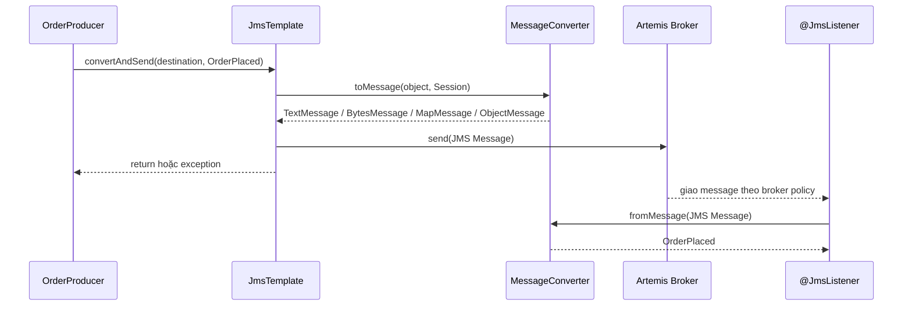

# Gửi đối tượng nghiệp vụ bằng convertAndSend trong Spring JMS

> **Chủ đề:** Spring Framework – JMS · **Nhóm:** Gửi thông điệp. Bài học hướng dẫn gửi một **business object/DTO Java** qua `JmsTemplate.convertAndSend`, từ lựa chọn `MessageConverter` đến định dạng dữ liệu, JMS properties, listener nhận, xử lý lỗi và vận hành. Ví dụ dùng **Java 21, Spring Boot 3.3.5, Jakarta Messaging và ActiveMQ Artemis**.

## 1. Từ đối tượng nghiệp vụ tới JMS Message

Ứng dụng có một sự kiện đơn hàng:

```java
public record OrderPlaced(
        String eventId,
        String orderId,
        long totalMinor,
        String currency) {
}
```

Record trên là một **type declaration**, không phải ứng dụng độc lập. Producer muốn gửi đối tượng mà không phải tự tạo `TextMessage`, mở `Session` hoặc serialize JSON bằng tay:

```java
jmsTemplate.convertAndSend("orders.created", event);
```

`convertAndSend` là API của `org.springframework.jms.core.JmsTemplate`. Nó **không gửi nguyên tham chiếu Java** và **không mặc định mã hóa mọi object thành JSON**. Khi gọi phương thức, Spring phải chuyển giá trị Java thành đối tượng `jakarta.jms.Message` thông qua `MessageConverter` của template; sau đó mới gửi qua JMS provider.



**Ba lớp trách nhiệm khác nhau:** model nghiệp vụ (`OrderPlaced`) định nghĩa nội dung; `MessageConverter` định nghĩa **wire format**; `JmsTemplate` quản lý resource và gọi send. Broker định tuyến/durability theo chính sách riêng, còn listener thực thi nghiệp vụ sau khi nhận.

Một lời gọi `convertAndSend` trả về **không có nghĩa consumer đã xử lý xong**. Nó có thể bị chặn hoặc ném lỗi nếu conversion, kết nối, xác thực hoặc send gặp vấn đề.

## 2. `convertAndSend` khác `send` ở đâu?

| API | Đầu vào | Ai tạo JMS message? | Khi dùng |
| --- | --- | --- | --- |
| `send("orders.created", MessageCreator)` | Callback nhận `Session` | Ứng dụng tự tạo `session.createTextMessage(...)`/`createMapMessage(...)` | Muốn điều khiển JMS message type và các trường trực tiếp. |
| **`convertAndSend("orders.created", event)`** | Java object/DTO | `MessageConverter` đang cấu hình | Gửi model mà không viết JMS boilerplate. |
| `convertAndSend("orders.created", event, postProcessor)` | DTO và callback | Converter tạo message, rồi callback chỉnh message trước send | Thêm metadata, type/version, correlation. |
| `convertAndSend(event)` | DTO | Converter | Chỉ khi template có **default destination**. |
| `receiveAndConvert("orders.created")` | Tên destination | Converter giải mã message nhận được | Nhận chủ động, không phải mô hình listener bất đồng bộ mặc định. |

Một đoạn minh họa API (cần biến `JmsTemplate jmsTemplate` và `OrderPlaced event` đã tạo):

```java
// Gửi vào một destination có tên:
jmsTemplate.convertAndSend("orders.created", event);

// Chỉ dùng overload một tham số nếu đã cấu hình default destination:
// jmsTemplate.convertAndSend(event);

// Khi muốn bổ sung metadata lên JMS Message:
jmsTemplate.convertAndSend("orders.created", event, message -> {
    message.setStringProperty("eventType", "OrderPlaced");
    message.setIntProperty("schemaVersion", 1);
    return message;
});
```

Đoạn này **không phải chương trình chạy độc lập**. Phân biệt `JmsTemplate` với `JmsMessagingTemplate`: cả hai có API convert/send nhưng tầng abstraction và các loại `MessageConverter` khác nhau. Trong bài này dùng **JMS-specific** `org.springframework.jms.support.converter.MessageConverter`.

### Thứ tự thao tác

```text
Java domain object
  -> JmsTemplate.convertAndSend()
  -> MessageConverter.toMessage(object, Session)
  -> MessagePostProcessor (nếu được cung cấp)
  -> resolve Destination (queue/topic, tên)
  -> JMS MessageProducer.send()
  -> JMS provider / broker
  -> return hoặc throw JmsException
```

`MessagePostProcessor` nhận một **JMS Message đã được converter tạo** và trả message sẽ được gửi; đó không phải nơi broker tự chuyển đổi domain object lần nữa.

## 3. `SimpleMessageConverter` mặc định và giới hạn quan trọng

Nếu ứng dụng không cấu hình converter khác, Spring JMS thường dùng `SimpleMessageConverter`. Nó hiểu một tập kiểu Java cơ bản:

| Object gửi vào | JMS message thường tạo | Ghi chú |
| --- | --- | --- |
| `String` | `TextMessage` | Text nguyên gốc; nếu là JSON thì chính ứng dụng phải tạo chuỗi trước. |
| `byte[]` | `BytesMessage` | Dữ liệu bytes. |
| `Map` với các giá trị được JMS hỗ trợ | `MapMessage` | Body là map phẳng, **không phải JSON**. |
| Java object implements `Serializable` | `ObjectMessage` | Dựa vào Java native serialization, rủi ro tương thích/bảo mật. |
| POJO hoặc Java record **không** implements `Serializable` | Không có mapping mặc định thích hợp | Thường ném `MessageConversionException`. |

Ví dụ, `Map<String,Object>` với các giá trị String/long:

```java
Map<String, Object> payload = new LinkedHashMap<>();
payload.put("orderId", "ORD-42");
payload.put("totalMinor", 125_000L);
payload.put("currency", "VND");

jmsTemplate.convertAndSend("orders.created", payload);
```

Đây là **fragment**, cần import `java.util.Map`, `java.util.LinkedHashMap` và có `jmsTemplate`. Với converter mặc định, nội dung gửi thường là `MapMessage`, không tự phát sinh JSON text.

### Vì sao `Serializable` không phải phương án mặc định tốt cho domain event?

`ObjectMessage` buộc consumer quan tâm tới class Java, classloader, phiên bản class và quy tắc Java serialization; nó khó tích hợp liên ngôn ngữ và có rủi ro deserialize dữ liệu không đáng tin. Việc gửi thẳng JPA entity còn có thể gây lazy loading, vòng tham chiếu, rò rỉ trường dữ liệu riêng tư hoặc lỗi class không serializable.

Hướng an toàn hơn cho sự kiện nghiệp vụ: **tách DTO của giao thức**, dùng một định dạng wire ổn định (thường JSON), khai báo schema/version và giới hạn các kiểu được phép deserialize.

## 4. Chuyển POJO/record sang JSON với MappingJackson2MessageConverter

Spring Framework 6.1 cung cấp `org.springframework.jms.support.converter.MappingJackson2MessageConverter` dùng Jackson 2 để chuyển Java object sang JSON và giải mã ngược.

Các cấu hình cốt lõi:

- `setTargetType(MessageType.TEXT)`: tạo `TextMessage` chứa JSON. **Mặc định của converter này là `BytesMessage`**, nên phải set nếu muốn inspect JSON text.
- `setTypeIdPropertyName("_type")`: một **JMS property** lưu type ID, cần để converter phía nhận xác định class Java khi deserialization.
- `setTypeIdMappings(Map.of("order-placed-v1", OrderPlaced.class))`: ánh xạ ID logic sang class. Wire contract giữ type ID ổn định khi đổi tên Java class.
- Dùng `ObjectMapper` được cấu hình thống nhất để kiểm soát enum, thời gian, nullability, unknown fields và encoding.

Khi gửi `OrderPlaced`, cấu trúc mong đợi:

```text
JMS TextMessage
├── Standard JMS headers
│   └── JMSCorrelationID: "order:ORD-42"
├── JMS properties
│   ├── _type: "order-placed-v1"      (String; cho Jackson converter)
│   ├── eventType: "OrderPlaced"      (String; cho message selector)
│   └── schemaVersion: 1             (int; cho contract)
└── Body: JSON string
    {"eventId":"evt-...","orderId":"ORD-42",
     "totalMinor":125000,"currency":"VND"}
```

**Phân biệt:** `_type` hỗ trợ converter, `eventType` hỗ trợ định tuyến/lọc, `schemaVersion` diễn tả phiên bản hợp đồng. Cả ba là **JMS message properties**, không phải tự nhiên được đọc từ JSON body bởi message selector.

Không dùng tên Java class thô làm type ID công khai cho event lâu dài. Không cho phép payload bên ngoài tự chọn arbitrary class để deserialize: cần mapping type IDs được cho phép, broker ACL, schema checks và xử lý message không hợp lệ.

## 5. Ví dụ chạy được: Java 21, Spring Boot 3.3.5, ActiveMQ Artemis

Ví dụ dùng **một project** có HTTP producer và listener nhận để học luồng: `OrderPlaced record` → `JmsTemplate.convertAndSend` → `TextMessage` JSON → `@JmsListener(OrderPlaced)`.

Yêu cầu môi trường: Java 21, Gradle wrapper tương thích, Artemis broker chạy tại `tcp://localhost:61616`, queue `orders.created` đã provision hoặc broker được cấu hình auto-create phù hợp. Credentials `artemis/artemis` chỉ dùng cho môi trường local.

### 5.1. Gradle và cấu hình ứng dụng

`settings.gradle`:

```groovy
rootProject.name = 'jms-domain-event-demo'
```

`build.gradle`:

```groovy
plugins {
    id 'java'
    id 'org.springframework.boot' version '3.3.5'
    id 'io.spring.dependency-management' version '1.1.6'
}

group = 'com.example'
version = '0.0.1-SNAPSHOT'

java {
    toolchain { languageVersion = JavaLanguageVersion.of(21) }
}

repositories { mavenCentral() }

dependencies {
    implementation 'org.springframework.boot:spring-boot-starter-web'
    implementation 'org.springframework.boot:spring-boot-starter-artemis'
}
```

`spring-boot-starter-web` kéo theo Jackson `ObjectMapper`; `spring-boot-starter-artemis` cung cấp JMS client và Spring JMS integration theo Jakarta JMS. Không trộn `javax.jms.*` của JMS cũ với `jakarta.jms.*` trên Boot 3.x.

`src/main/resources/application.yml`:

```yaml
spring:
  artemis:
    mode: native
    broker-url: ${JMS_BROKER_URL:tcp://localhost:61616}
    user: ${JMS_USER:artemis}
    password: ${JMS_PASSWORD:artemis}
  jms:
    pub-sub-domain: false

server:
  port: 8080
```

`spring.jms.pub-sub-domain=false` chọn **queue**, không phải topic. Trong production cần secret manager, TLS, quyền send/consume, destination provisioning và broker persistence policy phù hợp.

### 5.2. Java source đầy đủ

Tạo `src/main/java/com/example/orders/OrderMessagingApplication.java`:

```java
package com.example.orders;

import java.util.Map;
import java.util.UUID;

import com.fasterxml.jackson.databind.ObjectMapper;

import org.springframework.boot.SpringApplication;
import org.springframework.boot.autoconfigure.SpringBootApplication;
import org.springframework.context.annotation.Bean;
import org.springframework.http.ResponseEntity;
import org.springframework.jms.annotation.EnableJms;
import org.springframework.jms.annotation.JmsListener;
import org.springframework.jms.core.JmsTemplate;
import org.springframework.jms.support.converter.MappingJackson2MessageConverter;
import org.springframework.jms.support.converter.MessageType;
import org.springframework.stereotype.Component;
import org.springframework.web.bind.annotation.PathVariable;
import org.springframework.web.bind.annotation.PostMapping;
import org.springframework.web.bind.annotation.RestController;

@SpringBootApplication
@EnableJms
public class OrderMessagingApplication {
    public static void main(String[] args) {
        SpringApplication.run(OrderMessagingApplication.class, args);
    }

    // Domain event DTO. Không gửi JPA entity trực tiếp.
    public record OrderPlaced(
            String eventId,
            String orderId,
            long totalMinor,
            String currency) {
    }

    @Bean
    MappingJackson2MessageConverter jmsJsonMessageConverter(
            ObjectMapper objectMapper) {
        MappingJackson2MessageConverter converter =
                new MappingJackson2MessageConverter(objectMapper);
        converter.setTargetType(MessageType.TEXT);
        converter.setTypeIdPropertyName("_type");
        converter.setTypeIdMappings(
                Map.of("order-placed-v1", OrderPlaced.class));
        return converter;
    }
}

@RestController
class OrderPublisher {
    private final JmsTemplate jmsTemplate;

    OrderPublisher(JmsTemplate jmsTemplate) {
        this.jmsTemplate = jmsTemplate;
    }

    @PostMapping("/orders/{orderId}/publish")
    ResponseEntity<String> publish(@PathVariable String orderId) {
        OrderMessagingApplication.OrderPlaced event =
                new OrderMessagingApplication.OrderPlaced(
                        UUID.randomUUID().toString(),
                        orderId,
                        125_000L,
                        "VND");

        jmsTemplate.convertAndSend("orders.created", event, message -> {
            message.setStringProperty("eventType", "OrderPlaced");
            message.setIntProperty("schemaVersion", 1);
            message.setJMSCorrelationID("order:" + orderId);
            return message;
        });

        return ResponseEntity.accepted().body("QUEUED " + orderId);
    }
}

@Component
class OrderPlacedConsumer {
    @JmsListener(
            destination = "orders.created",
            selector = "eventType = 'OrderPlaced' AND schemaVersion = 1")
    public void onEvent(OrderMessagingApplication.OrderPlaced event) {
        System.out.printf(
                "CONSUMED order=%s amount=%d currency=%s%n",
                event.orderId(), event.totalMinor(), event.currency());
    }
}
```

**Vì sao đúng cơ chế:**

1. `@SpringBootApplication` + `@EnableJms` bật component scanning và hạ tầng phát hiện `@JmsListener`; Boot auto-config provider từ Artemis starter.
2. `@Bean MappingJackson2MessageConverter` là một bean `org.springframework.jms.support.converter.MessageConverter`. Khi không tự thay thế `JmsTemplate`/default listener factory, Boot liên kết converter bean với **cả sender và default listener factory**.
3. `setTargetType(MessageType.TEXT)` tạo JSON `TextMessage`; `setTypeIdPropertyName` và mappings làm converter bên nhận giải mã về `OrderPlaced`.
4. `jmsTemplate.convertAndSend(destination, event, callback)` gửi object nhưng giao phần chuyển đổi cho converter. Callback thêm JMS property và header **sau conversion, trước send**.
5. `selector` chỉ nhìn JMS properties `eventType` và `schemaVersion`, không đọc JSON body. `schemaVersion` là kiểu `int` nên selector so sánh số `1` đúng kiểu.
6. Listener nhận record `OrderPlaced` đã được Jackson converter khôi phục, không cần tự gọi `ObjectMapper.readValue` trong business method.
7. `totalMinor` dùng số nguyên đơn vị nhỏ nhất thay vì `double` cho số tiền; `eventId` giúp thiết kế idempotency.
8. Lệnh gửi chạy trong request thread và có thể block/fail; phương thức HTTP chỉ trả `202 Accepted` khi lời gọi gửi không ném lỗi trong ví dụ.

**Đây là ví dụ học tập:** giá trị `125_000L` được đặt cố định; hệ thống thật lấy amount/currency từ trạng thái nghiệp vụ đã xác nhận. `UUID` mới trên mỗi request không phải cơ chế idempotency khi caller retry cùng một đơn; production phải giữ eventId ổn định cho **một sự kiện**.

### 5.3. Chạy và kiểm chứng

Đảm bảo broker Artemis đã chạy, queue `orders.created` phù hợp địa chỉ/ANYCAST của JMS queue, quyền và credentials đúng:

```bash
# Linux/macOS, từ thư mục có Gradle wrapper:
./gradlew bootRun

# Windows:
gradlew.bat bootRun
```

Từ terminal khác:

```bash
curl -i -X POST http://localhost:8080/orders/ORD-42/publish
```

Nếu thao tác JMS send thành công, HTTP response có thể như sau:

```http
HTTP/1.1 202
Content-Type: text/plain;charset=UTF-8

QUEUED ORD-42
```

Khi consumer nhận và converter giải mã thành công, phương thức listener in:

```text
CONSUMED order=ORD-42 amount=125000 currency=VND
```

**Không có thứ tự thời gian cố định** giữa HTTP 202 và log bất đồng bộ. Các startup logs, JMS message ID và UUID khác nhau từng lần chạy. Không tuyên bố đây là stdout hoàn chỉnh.

Muốn inspect wire format, hãy tạm dừng consumer trên **môi trường test**, publish một message, rồi dùng Artemis console/CLI xem: body `TextMessage` là JSON, properties có `_type`, `eventType`, `schemaVersion`, header `JMSCorrelationID`. Sau khi bật consumer, kiểm tra queue backlog/consumer count và log handler.

## 6. MessagePostProcessor không giống MessageConverter

`MessageConverter` định nghĩa **body** và thường metadata kỹ thuật cần để decode. `MessagePostProcessor` được gọi **sau khi body đã được chuyển đổi**, trước khi send; nó cho phép thiết lập JMS headers và properties theo nghiệp vụ:

```java
jmsTemplate.convertAndSend("orders.created", event, message -> {
    message.setStringProperty("eventType", "OrderPlaced");
    message.setStringProperty("tenantId", "store-a");
    message.setIntProperty("schemaVersion", 1);
    message.setJMSCorrelationID("order:" + event.orderId());
    return message;
});
```

Đây là **fragment** cần `event` và `jmsTemplate` đã có. Không tự gọi `convertAndSend` từ bên trong postprocessor để tránh vòng gọi bất ngờ.

| Trường | Nằm ở đâu? | Mục đích |
| --- | --- | --- |
| `orderId`, `totalMinor`, `currency` | JSON body của `TextMessage` | Payload nghiệp vụ |
| `_type` | JMS string property | Decoder ánh xạ type ID thành class |
| `eventType` | JMS string property | Selector/phân loại |
| `schemaVersion` | JMS int property | Chọn phiên bản hợp đồng |
| `JMSCorrelationID` | JMS header | Liên hệ request/event với trace |

**Các giới hạn về properties:** JMS properties không được mang object bất kỳ; các kiểu hỗ trợ gồm boolean, byte, short, int, long, float, double, String. Tên property phải hợp lệ như một JMS selector identifier. Selector **không truy cập body JSON**, nên muốn broker lọc theo tenant/eventType phải gắn một property phù hợp. Không đưa thông tin bí mật hoặc payload lớn vào properties.

### Hai lỗi dễ gặp

- Gắn `schemaVersion` vào JSON body rồi viết selector `schemaVersion = 1`: selector không nhìn thấy body.
- Gắn `setStringProperty("schemaVersion", "1")` nhưng selector so sánh số `1`: selector không nhất thiết tự áp dụng conversion giống `getIntProperty`. Hãy gửi property đúng kiểu `int`.

## 7. Khi tự tạo các bean Spring JMS

Trong Spring Boot, có thể dùng auto-config khi chỉ cần một broker và converter bean. Nếu **tự tạo** `JmsTemplate` thì phải gắn converter:

```java
@Bean("jsonJmsTemplate")
JmsTemplate jsonJmsTemplate(
        ConnectionFactory connectionFactory,
        MappingJackson2MessageConverter converter) {
    JmsTemplate template = new JmsTemplate(connectionFactory);
    template.setMessageConverter(converter);
    template.setPubSubDomain(false);
    return template;
}
```

Đây là **fragment trong `@Configuration`**, cần import `jakarta.jms.ConnectionFactory`, `org.springframework.jms.core.JmsTemplate`, annotation `@Bean` và converter class. Tạo bean custom có thể khiến auto-config template mặc định của Boot back off.

Với listener factory tự tạo, cũng cần gắn cùng chính sách chuyển đổi:

```java
@Bean("jsonJmsListenerFactory")
DefaultJmsListenerContainerFactory jsonJmsListenerFactory(
        ConnectionFactory connectionFactory,
        MappingJackson2MessageConverter converter) {
    DefaultJmsListenerContainerFactory factory =
            new DefaultJmsListenerContainerFactory();
    factory.setConnectionFactory(connectionFactory);
    factory.setPubSubDomain(false);
    factory.setSessionTransacted(true);
    factory.setMessageConverter(converter);
    return factory;
}
```

Listener dùng `@JmsListener(destination="orders.created", containerFactory="jsonJmsListenerFactory")`. Cần import `org.springframework.jms.config.DefaultJmsListenerContainerFactory`. Fragment trên chưa cấu hình error handler, destination resolver hay factory unwrapping phù hợp mọi môi trường; trong Boot 3.3 có thể dùng `DefaultJmsListenerContainerFactoryConfigurer` để kế thừa settings Boot, thay vì tái tạo toàn bộ mặc định bằng tay.

Không mặc định rằng mọi `JmsTemplate` và mọi listener factory tùy chỉnh sẽ tự nhận `MessageConverter` bean. Nếu có nhiều `ConnectionFactory` hay converters, sử dụng bean name/`@Qualifier` để tránh tiêm nhầm broker hoặc serializer.

## 8. JSON event DTO và tiến hóa schema

Một domain event là **hợp đồng tích hợp lâu dài**, không nên xem là snapshot JPA entity. Trong ví dụ, record có:

- `eventId`: định danh duy nhất cho **sự kiện** để chống xử lý trùng và tracing.
- `orderId`: khóa nghiệp vụ để tìm đơn.
- `totalMinor`: số nguyên đơn vị nhỏ nhất; không dùng số thực dấu phẩy động để lưu tiền.
- `currency`: loại tiền, cần validation.
- `schemaVersion`: đặt bên ngoài body để consumer/selector có thể phân loại trước khi đọc.

Đối với schema evolution:

1. Giữ tên/type/ngữ nghĩa của field cũ, thêm field tùy chọn có default khi phù hợp.
2. Test producer phiên bản mới với consumer phiên bản cũ và ngược lại; Jackson có thể từ chối unknown field hoặc thiếu constructor property tùy config.
3. Version type ID khi thay đổi breaking: `order-placed-v1`, `order-placed-v2`; không âm thầm dùng class mới với cùng contract cũ.
4. Quy định cách biểu diễn `Instant`, enum, decimal, null và nested object; đừng tin rằng `ObjectMapper` mặc định hiểu mọi custom Java type.
5. Chỉ deserialize các message types được chấp nhận; ưu tiên logical type ID mapping/allowlist, không chấp nhận class name tùy ý từ nguồn không đáng tin.
6. Giới hạn kích thước và dữ liệu nhạy cảm. Logging nên in correlation/event ID, không dump toàn bộ customer/PII payload.
7. Có consumer fallback/DLQ cho payload không hợp lệ, tránh redelivery vô hạn cùng một message lỗi schema.

Ví dụ JSON mang tính minh họa, không phải một bản chụp chính xác UUID được sinh ở runtime:

```json
{
  "eventId": "evt-1001",
  "orderId": "ORD-42",
  "totalMinor": 125000,
  "currency": "VND"
}
```

**Lưu ý về Java class:** đổi package từ `com.example.orders` sang package khác không nên là breaking change trên wire. Điều này đạt được khi hợp đồng wire là field schema + type ID logic, không phải raw Java serialization.

## 9. Thành công của convertAndSend chưa phải xử lý xong

Có ít nhất năm mốc độc lập: DB transaction của nghiệp vụ, chuyển đổi object, gửi đến broker, broker lưu/định tuyến message, consumer xử lý và ACK. `convertAndSend` chỉ tương tác trực tiếp một phần đầu của chuỗi này.

### Producer mất sự kiện sau khi ghi DB

Nếu DB commit thành công, process crash trước lệnh gửi JMS, đơn hàng có thể tồn tại nhưng event chưa được publish. Nếu gửi trước DB commit rồi DB rollback, consumer có thể nhận “đơn đã tạo” dù đơn thật không tồn tại. **Transactional outbox** giúp gắn việc ghi domain state và outbox event trong cùng một DB transaction; worker/CDC gửi JMS với retry và trạng thái.

### Consumer xử lý lặp

Broker có thể redeliver khi handler exception hoặc process crash trước ACK/commit. Consumer có thể đã ghi invoice vào DB nhưng message vẫn bị gửi lại. Cần thiết kế idempotent dựa trên `eventId` ổn định, ví dụ unique constraint bảng processed events kết hợp nghiệp vụ trong DB transaction phù hợp.

Trong demo, event ID được tạo mới mỗi HTTP request; nếu hệ thống thật retry cùng một sự kiện thì cần giữ **cùng eventId** thay vì tạo ID mới trong mỗi lần retry. Không hứa exactly-once business outcome chỉ vì dùng `convertAndSend` hay `@JmsListener`.

### Transaction và thông báo lỗi

- `JmsTemplate` có thể ném `org.springframework.jms.JmsException` runtime khi convert/send không thành công; code không được trả HTTP 202 giả khi gặp lỗi.
- Nếu có JMS session transaction đang mở, lệnh gửi trả về chưa đồng nghĩa message đã **commit**.
- Khi send bị timeout sau trạng thái không rõ, retry có thể tạo message trùng. Phải dùng idempotency/event ID và retry policy có giới hạn.
- `@JmsListener` nhận bất đồng bộ; nếu phải biết kết quả cuối, xây dựng status endpoint hoặc reply/event kết quả riêng.
- `DeliveryMode.PERSISTENT`, TTL, quota, disk, DLQ và HA do template/provider/broker phối hợp; JSON converter không quyết định durability.

## 10. Lưu ý QoS, timeout, destination

`JmsTemplate.convertAndSend("orders.created", ...)` sẽ resolve destination thành queue/topic theo `pubSubDomain` và `DestinationResolver`. Cùng tên chuỗi nhưng queue/topic hoặc broker URL khác có thể là hai đích hoàn toàn khác. Việc tạo đối tượng Java `Queue` không đồng nghĩa queue vật lý đã provision.

Nếu muốn cấu hình TTL/priority/delivery mode trên template tường minh:

```java
JmsTemplate template = new JmsTemplate(connectionFactory);
template.setExplicitQosEnabled(true);
template.setDeliveryPersistent(true);
template.setPriority(4);
template.setTimeToLive(60_000L);
```

Đây là **fragment**, cần `jakarta.jms.ConnectionFactory connectionFactory` hợp lệ. TTL ở đây áp dụng cho các send qua template đó và cần được chọn theo SLA; một consumer offline lâu hơn TTL có thể không còn message để xử lý. `setExplicitQosEnabled(true)` làm template gửi các QoS option tường minh.

Đừng nhầm `MessagePostProcessor` với thay đổi toàn bộ policy gửi. Postprocessor thích hợp cho JMS message properties/header; cấu hình delivery mode, TTL và priority nên dùng API/template/provider dành cho QoS.

## 11. Lỗi thường gặp

| Lỗi/triệu chứng | Vì sao xảy ra | Cách xử lý |
| --- | --- | --- |
| `MessageConversionException` khi gửi record | `SimpleMessageConverter` không biết chuyển DTO không Serializable | Đăng ký converter JSON hoặc custom converter phù hợp. |
| Gửi ra `ObjectMessage` thay vì JSON | POJO Serializable bị converter mặc định xử lý | Chỉ định `MappingJackson2MessageConverter` và wire type rõ ràng. |
| Broker có `BytesMessage` nhưng muốn JSON text | Jackson converter mặc định target BYTES | Set `MessageType.TEXT`. |
| Bên nhận không giải mã được `OrderPlaced` | Không cấu hình type ID, mapping hoặc converter listener | Set `_type`/mappings và cấu hình converter đồng bộ. |
| Selector không chọn message | Property eventType/schemaVersion thiếu hoặc đặt trong body | Set properties qua `MessagePostProcessor`, kiểm tra kiểu. |
| Lỗi default destination | Gọi overload một tham số mà chưa set default | Gọi `convertAndSend("orders.created", event)`. |
| Gửi thành công nhưng không thấy xử lý | Sai destination, ACL, broker, listener không chạy | Kiểm tra routing, queue metrics, consumer count và logs. |
| Serialization lộ dữ liệu | Gửi trực tiếp entity/đồ thị đối tượng quá rộng | Tách event DTO tối thiểu, kiểm soát ObjectMapper. |
| Java compilation lỗi `javax.jms` | Trộn Boot 3/Jakarta JMS với API cũ | Dùng `jakarta.jms` và dependencies nhất quán. |
| Message bị xử lý nhiều lần | Redelivery hoặc retry sau timeout | Event ID ổn định + consumer idempotency. |
| Consumer cũ lỗi khi thêm field | Schema evolution/Jackson không tương thích | Version contract, tests tương thích hai chiều. |
| HTTP 202 bị coi là đã hoàn tất | Nhầm thành công send với side effect downstream | Theo dõi trạng thái xử lý/ACK, không hứa hoàn tất sớm. |

## 12. Bài kiểm tra end-to-end

Một bộ kiểm chứng hữu ích trong môi trường test:

1. Khởi chạy broker Artemis, xác minh queue `orders.created`, account/ACL, address routing đúng.
2. Start Spring Boot, xác nhận `JmsTemplate` và `jmsJsonMessageConverter` đã được tạo và listener factory dùng converter tương thích.
3. Gửi `POST /orders/ORD-42/publish`; xác nhận HTTP 202 khi send thành công.
4. Trên broker test, tạm dừng consumer để inspect message: JMS `TextMessage` có JSON đúng field, property `_type="order-placed-v1"`, `eventType="OrderPlaced"`, `schemaVersion` kiểu int, header `JMSCorrelationID`.
5. Start lại consumer, xác nhận `@JmsListener` nhận đúng `OrderPlaced` và log đúng orderId/amount/currency. Log runtime có thể không trùng thứ tự publish.
6. Thử payload sai JSON, type ID không hỗ trợ, selector không khớp; xác nhận error/retry/DLQ policy, không retry vô hạn.
7. Tắt broker và gọi publish: kiểm tra response lỗi phù hợp; lệnh gửi không được tự báo thành công.
8. Giả lập consumer chết sau side effect nhưng trước ACK; xác minh idempotency hoạt động.
9. Kiểm tra nhiều producer/consumer với cùng schema và phiên bản tương thích; đo queue backlog, redelivery, DLQ và độ trễ xử lý.

Unit test chỉ xác nhận service **đã gọi** `jmsTemplate.convertAndSend` là chưa đủ: cần integration test để bắt lỗi serialization, broker config và việc listener nhận đúng class.

## 13. Câu hỏi tự kiểm tra

1. `convertAndSend` thực hiện những bước nào sau khi nhận Java object? Component nào quyết định body JMS message?
2. Vì sao `SimpleMessageConverter` không tự biến mọi POJO thành JSON?
3. So sánh `convertAndSend(Map)`, `convertAndSend(String)` và `convertAndSend(OrderPlaced)` khi chưa/đã có Jackson converter.
4. Vì sao phải set `MessageType.TEXT` nếu muốn inspect JSON `TextMessage`?
5. Phân biệt `_type`, `eventType`, `schemaVersion`, `JMSCorrelationID` và các field trong JSON.
6. Selector `eventType='OrderPlaced'` đọc message properties hay body? Gắn metadata vào chỗ nào?
7. `MessagePostProcessor` chạy trước hay sau converter? Có dùng nó để thay `MessageConverter` được không?
8. Vì sao event DTO nên độc lập với JPA entity và có `eventId`?
9. Khi tự tạo `JmsTemplate` và listener factory, cần cấu hình converter ở những bean nào?
10. Một lệnh send đã trả về bình thường có nghĩa consumer đã hoàn tất và DB đã commit chưa?
11. Domain DB commit xong nhưng process crash trước send: nên dùng cơ chế gì?
12. Consumer xử lý side effect xong rồi chết trước ACK: phải chống trùng thế nào?
13. Làm sao kiểm tra thực tế broker đang nhận `TextMessage` JSON chứ không phải `ObjectMessage`?

**Kết luận:** `JmsTemplate.convertAndSend` giúp gửi đối tượng nghiệp vụ ngắn gọn, nhưng **không tự định nghĩa định dạng trên wire**. Với sự kiện liên dịch vụ, hãy dùng DTO và converter JSON có type/version mapping rõ ràng, dùng `MessagePostProcessor` cho JMS headers/properties, cấu hình converter cả sender/receiver, rồi kiểm chứng broker, transaction và idempotency thay vì coi thành công gửi là xử lý hoàn tất.

### Tài liệu tham khảo

- [Spring Framework 6.1 – JmsTemplate API](https://docs.spring.io/spring-framework/docs/6.1.1/javadoc-api/org/springframework/jms/core/JmsTemplate.html) — các overload `convertAndSend` và `MessagePostProcessor`.
- [Spring Framework – Sending a Message](https://docs.spring.io/spring-framework/reference/integration/jms/sending.html) — `SimpleMessageConverter`, JMS message conversion và metadata post-processing.
- [Spring Framework 6.1 – MappingJackson2MessageConverter](https://docs.spring.io/spring-framework/docs/6.1.0/javadoc-api/org/springframework/jms/support/converter/MappingJackson2MessageConverter.html) — `setTargetType`, `setTypeIdMappings`, `setTypeIdPropertyName`.
- [Spring Boot 3.3 JMS reference](https://docs.spring.io/spring-boot/docs/3.3.0-M1/reference/pdf/spring-boot-reference.pdf) — auto-config `JmsTemplate` và default `@JmsListener` factory dùng `MessageConverter` bean.
- [Jakarta Messaging 3.1 Specification](https://jakarta.ee/specifications/messaging/3.1/jakarta-messaging-spec-3.1.html) — headers/properties, selector, delivery và ACK.
- [ActiveMQ Artemis Documentation](https://artemis.apache.org/components/artemis/documentation/latest/) — broker, queue/address và vận hành.
