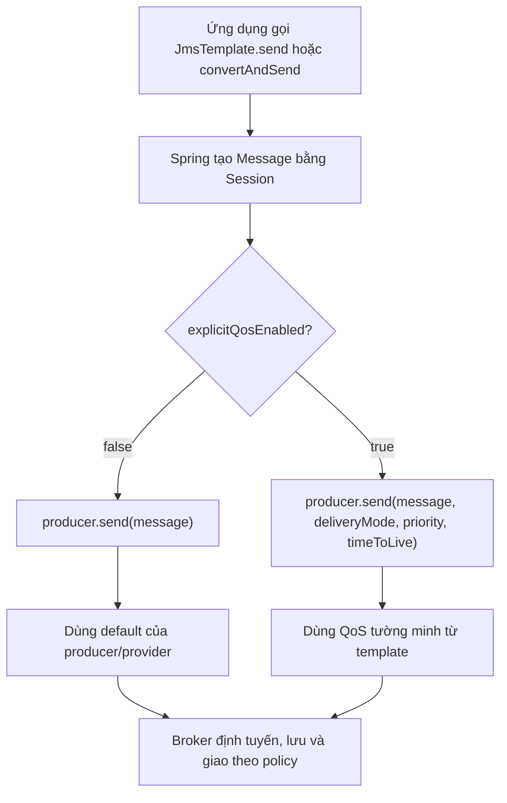

# explicitQosEnabled và giá trị QoS trên JmsTemplate (Spring JMS)

## 1. Mục tiêu và tình huống thực tế

Khi gửi thông điệp JMS, ứng dụng không chỉ chọn **nội dung** và **Queue/Topic**, mà còn phải quyết định một số thuộc tính **Quality of Service (QoS)** của lần gửi: gửi theo chế độ persistent hay non-persistent, mức ưu tiên bao nhiêu, và thông điệp có hạn sử dụng trong bao lâu.

Ví dụ, hệ thống đặt hàng gửi hai loại dữ liệu:

- `payment.command`: lệnh nghiệp vụ quan trọng, nên yêu cầu **PERSISTENT**, ưu tiên phù hợp và hạn dùng có thể dài.
- `dashboard.refresh`: thông báo làm mới giao diện, có thể chấp nhận **NON_PERSISTENT**, ưu tiên thấp và TTL ngắn để tránh xử lý dữ liệu đã cũ.

Trong Spring Framework, `org.springframework.jms.core.JmsTemplate` có các setter:

```java
template.setDeliveryMode(DeliveryMode.PERSISTENT);
template.setPriority(7);
template.setTimeToLive(60_000L);
template.setExplicitQosEnabled(true);
```

**Trọng tâm của bài học:** ba giá trị delivery mode / priority / time-to-live **chỉ được `JmsTemplate` truyền tường minh cho lời gọi gửi khi `explicitQosEnabled=true`**. Nếu cờ này là `false`, dù đã gọi các setter QoS trên template, Spring vẫn gửi bằng overload dùng **default QoS của JMS `MessageProducer`**. Các default này có thể được provider/administrator cấu hình khác giá trị mặc định của đặc tả JMS.

> **Ghi nhớ ngắn:** `setPriority(7)` là đặt *giá trị trong cấu hình template*; `setExplicitQosEnabled(true)` là bật *cơ chế áp dụng các giá trị đó khi gửi*. Cần cả hai nếu mục tiêu là priority 7 qua cơ chế QoS tường minh của `JmsTemplate`.

Bài này nằm trong phạm vi **chất lượng gửi thông điệp**. QoS ở đây **không đồng nghĩa** với consumer đã xử lý thành công, transaction database đã commit, broker đạt high availability hay nghiệp vụ xử lý exactly-once.

## 2. Ba tham số QoS của lần gửi JMS

| Tham số | API Spring `JmsTemplate` | Miền giá trị / đơn vị | Mặc định JMS khi không có override | Ý nghĩa |
| --- | --- | --- | --- | --- |
| **Delivery mode** | `setDeliveryMode(int)` hoặc `setDeliveryPersistent(boolean)` | `DeliveryMode.PERSISTENT` (2) / `NON_PERSISTENT` (1) | `PERSISTENT` | Yêu cầu mức bảo đảm lưu/truyền thông điệp từ provider, tùy chế độ và hệ thống lưu trữ. |
| **Priority** | `setPriority(int)` | Số nguyên từ **0 đến 9** | **4** | Chỉ dẫn mức ưu tiên cho provider: 0 thấp nhất, 9 cao nhất. Không bảo đảm thứ tự xử lý toàn cục. |
| **Time-to-live (TTL)** | `setTimeToLive(long)` | **Mili giây**; `0` nghĩa là không hết hạn theo TTL | **0 ms** | Giới hạn thời gian thông điệp còn hợp lệ để giao nhận; liên quan `JMSExpiration`. |

Thông số này đi theo cơ chế QoS của **MessageProducer lúc gửi**; chúng không phải các custom properties mà bạn có thể gắn tùy ý vào body rồi chờ broker hiểu.

### 2.1. Delivery mode: PERSISTENT và NON_PERSISTENT

`jakarta.jms.DeliveryMode` định nghĩa:

```java
DeliveryMode.PERSISTENT      // 2
DeliveryMode.NON_PERSISTENT  // 1
```

- **PERSISTENT**: provider phải áp dụng cơ chế bảo vệ message trước lỗi của chính messaging provider theo đặc tả; hiệu quả trong thực tế còn phụ thuộc persistence/journal, durable destination/subscription, transaction và hạ tầng.
- **NON_PERSISTENT**: JMS provider không bắt buộc bảo đảm thông điệp không mất khi provider gặp sự cố; thường giảm chi phí lưu trữ nhưng chỉ phù hợp dữ liệu có thể bỏ qua.

Không kết luận “PERSISTENT = đảm bảo database đã cập nhật” hoặc “NON_PERSISTENT = message lập tức biến mất”. Đây là chính sách **gửi/giữ message ở hệ thống messaging**, không phải kết quả nghiệp vụ cuối cùng.

### 2.2. Priority: 0 đến 9

Các mức ưu tiên trong JMS là gợi ý cho provider; mức 4 thường là mặc định. Chuẩn xem 0–4 là các mức bình thường, 5–9 là các mức khẩn hơn. Ví dụ `priority=7` có thể hữu ích cho lệnh cần phản ứng nhanh hơn thông báo không cấp thiết.

Nhưng thứ tự **gửi**, **nhận**, **hoàn tất callback** và **commit nghiệp vụ** là bốn thứ tự khác nhau. Broker có thể có FIFO, message groups, nhiều consumer, prefetch, selector và cơ chế priority riêng. JMS **không yêu cầu** một hệ thống tuyệt đối gửi mọi message priority 9 trước tất cả message priority 4 đã vào hàng đợi trước.

### 2.3. TTL: thời gian sống của thông điệp

Với `timeToLive=60_000L`, người gửi yêu cầu thông điệp hết hạn sau khoảng 60 giây tính từ thời điểm gửi theo quy tắc provider/JMS. Khi gửi thành công, header `JMSExpiration` biểu diễn mốc hết hạn tính theo epoch milliseconds nếu TTL khác 0; với TTL 0, header thông thường bằng 0.

Ví dụ gửi lúc `12:00:00` với TTL 10 giây thì thông điệp không còn có ích sau khoảng `12:00:10`. Nếu consumer tắt đến `12:00:30`, broker có thể đã loại/di chuyển thông điệp hết hạn theo expiration policy. **Đặt TTL không bảo đảm consumer nhận đúng trước deadline.**

`TTL=0` không có nghĩa message được “giữ vĩnh viễn” bất chấp mọi policy: broker vẫn có thể dùng TTL/expiry policy riêng, quota, purge, DLQ/expiry address hoặc cấu hình storage. TTL của producer chỉ là một yếu tố trong vận hành.

## 3. explicitQosEnabled thực sự thay đổi lời gọi nào?

JMS `MessageProducer` có hai overload gửi đồng bộ phổ biến:

```java
// Dùng các default QoS đang có trên MessageProducer:
producer.send(message);

// Truyền tường minh cả ba tham số cho lần gửi:
producer.send(message, deliveryMode, priority, timeToLive);
```

`JmsTemplate` có trách nhiệm tạo/nhận Session, MessageProducer, gọi `MessageCreator` hoặc converter rồi thực hiện lời gửi. Logic quan trọng được khái quát chính xác như sau (đây là **pseudocode rút gọn**, không phải file mã nguồn Spring đầy đủ):

```java
if (isExplicitQosEnabled()) {
    producer.send(
        message,
        getDeliveryMode(),
        getPriority(),
        getTimeToLive());
} else {
    producer.send(message);
}
```

Trong implementation Spring, còn có thao tác riêng để đặt `deliveryDelay` khi được cấu hình. Điều này không làm thay đổi cách chọn hai overload QoS ở trên.

### 3.1. Khi explicitQosEnabled = false (mặc định với JmsTemplate tạo thủ công)

```java
JmsTemplate template = new JmsTemplate(connectionFactory);
template.setDeliveryMode(DeliveryMode.NON_PERSISTENT);
template.setPriority(9);
template.setTimeToLive(5_000L);
// template.setExplicitQosEnabled(false); // Mặc định

template.convertAndSend("demo.queue", "M1");
```

Mặc dù template đã giữ ba giá trị cấu hình nói trên, Spring gọi `producer.send(message)`. Lần gửi sử dụng **producer/provider defaults** chứ không nhất thiết là NON_PERSISTENT, priority 9 hay TTL 5 giây. Theo mặc định của đặc tả JMS nếu không có admin override, thường là PERSISTENT, priority 4 và TTL 0.

**Sai lầm cần tránh:** nhìn vào `getPriority() == 9` rồi khẳng định thông điệp vừa gửi có `JMSPriority == 9`. Getter cho biết cấu hình của template; phải kiểm tra **lời gửi và message đã được provider tạo/định tuyến** mới có bằng chứng.

### 3.2. Khi explicitQosEnabled = true

```java
JmsTemplate template = new JmsTemplate(connectionFactory);
template.setExplicitQosEnabled(true);
template.setDeliveryMode(DeliveryMode.NON_PERSISTENT);
template.setPriority(9);
template.setTimeToLive(5_000L);

template.convertAndSend("demo.queue", "M1");
```

Bây giờ Spring dùng overload `producer.send(message, 1, 9, 5000L)`. Provider nhận ba giá trị tường minh theo contract JMS. Nếu cấu hình mạng/broker hợp lệ, message khi nhận được dự kiến có header tương ứng, trừ những xử lý/giới hạn đặc thù của provider.

**Chú ý:** `setExplicitQosEnabled(true)` bật **cả bộ ba giá trị** của template. Không có nghĩa chỉ riêng property bạn vừa gọi setter được truyền đi. Nếu chỉ muốn sửa priority thành 7 nhưng vẫn giữ delivery mode và TTL mặc định của JMS, các giá trị còn lại trên template phải được hiểu và chọn rõ. Nếu ConnectionFactory quản trị có default QoS khác, việc bật explicit có thể vô tình **ghi đè default do administrator cấu hình** cho các tham số chưa chủ động thay đổi.

### 3.3. Luồng hoạt động



Đây là sự phân biệt giữa **đặt giá trị vào cấu hình** và **sử dụng giá trị ấy trong lệnh gửi**. Không phải hai loại message khác nhau và cũng không phải hai broker khác nhau.

## 4. Các setter và getter cần biết

| Phương thức | Tác dụng | Ghi chú |
| --- | --- | --- |
| `setExplicitQosEnabled(boolean)` | Chọn có truyền QoS tường minh khi gửi không | Không tự đổi ba thông số thành giá trị đặc biệt. |
| `isExplicitQosEnabled()` | Kiểm tra cờ hiện tại | Chỉ kiểm tra cấu hình của template, không kiểm chứng header một message cụ thể. |
| `setDeliveryMode(int)` | Đặt `DeliveryMode.PERSISTENT` hoặc `NON_PERSISTENT` | Chỉ được dùng trong đường explicit QoS. |
| `setDeliveryPersistent(boolean)` | Đặt delivery mode bằng true/false | `true` = PERSISTENT, `false` = NON_PERSISTENT. Không thay cờ explicit. |
| `getDeliveryMode()` | Đọc delivery mode được template lưu | Không suy ra chính xác mode message nếu explicit đang tắt. |
| `setPriority(int)` / `getPriority()` | Đặt/đọc priority | Chọn 0–9, ưu tiên chuẩn mặc định 4. |
| `setTimeToLive(long)` / `getTimeToLive()` | Đặt/đọc TTL | Đơn vị **milliseconds**, không phải seconds. |
| `setQosSettings(QosSettings)` | Nạp cả bộ ba QoS từ value object | **Tự bật `explicitQosEnabled=true`** theo implementation của Spring. |
| `setDeliveryDelay(long)` | Đặt delay trước thời điểm message đủ điều kiện giao | **Khác TTL** và không nằm trong bộ ba truyền bởi explicit QoS. |

Ví dụ cách viết tương đương cho delivery mode:

```java
template.setDeliveryMode(DeliveryMode.PERSISTENT);
template.setDeliveryPersistent(true);

// Cả hai cùng đặt mode PERSISTENT trong template.
// Chúng KHÔNG tự gọi setExplicitQosEnabled(true).
```

### 4.1. QosSettings gom ba giá trị

Spring JMS cung cấp `org.springframework.jms.support.QosSettings`:

```java
import jakarta.jms.DeliveryMode;
import org.springframework.jms.core.JmsTemplate;
import org.springframework.jms.support.QosSettings;

// template là JmsTemplate đã có ConnectionFactory.
template.setQosSettings(
        new QosSettings(DeliveryMode.PERSISTENT, 7, 60_000L));

System.out.println(template.isExplicitQosEnabled());
```

Với template Spring tương ứng, kết quả dòng trên là:

```text
true
```

Đây là **mảnh code ứng dụng**, không phải class độc lập: cần biến `template`, thư viện Spring JMS và provider khi gửi thật. `setQosSettings(...)` không chỉ set bộ ba giá trị mà còn **bật explicit QoS**. Đây là điểm khác quan trọng so với việc gọi từng setter riêng.

### 4.2. Giá trị mặc định của JmsTemplate

Trên template mới theo Spring JMS thông thường:

```text
explicitQosEnabled = false
deliveryMode       = PERSISTENT (2)
priority           = 4
timeToLive         = 0 (ms)
```

Những giá trị là **cấu hình mặc định của template**, nhưng khi `explicitQosEnabled=false`, lời gửi dùng `producer.send(message)` và có thể chịu **default đã được quản trị trên ConnectionFactory/provider**. Không nhầm “default template” với “kết quả thực tế trong mọi broker”.

### 4.3. Khi nào nên dùng từng cách?

- Dự án chỉ có một profile gửi chung: đặt các setter cùng `explicitQosEnabled=true` trong bean `JmsTemplate`.
- Muốn truyền trọn bộ QoS như một đối tượng: dùng `setQosSettings(new QosSettings(...))`.
- Spring Boot auto-configured `JmsTemplate`: dùng properties dành riêng cho `spring.jms.template.*`.
- Các loại message có QoS khác nhau: tạo **nhiều template đã cấu hình riêng** hoặc chọn API producer có contract cụ thể; không thay đổi cờ/setter của singleton trong lúc chạy các request đồng thời.

## 5. Spring Boot: cấu hình QoS bằng application.properties

Spring Boot 3.x hỗ trợ properties cho `JmsTemplate` **do Boot tự cấu hình**:

```properties
spring.jms.template.delivery-mode=persistent
spring.jms.template.priority=7
spring.jms.template.time-to-live=60s
spring.jms.template.qos-enabled=true
```

Ý nghĩa:

- `delivery-mode=persistent`: yêu cầu PERSISTENT.
- `priority=7`: yêu cầu mức ưu tiên 7.
- `time-to-live=60s`: dùng kiểu thời lượng được Spring Boot hỗ trợ, tương đương 60.000 milliseconds.
- `qos-enabled=true`: bật explicit QoS trên template tạo bởi auto-configuration.

Theo tài liệu Spring Boot, **khi đặt ít nhất một trong ba giá trị delivery mode/priority/TTL**, Boot thường **tự bật explicit QoS** cho template do nó cấu hình. Đặt `qos-enabled=true` tường minh trong ví dụ giúp người đọc thấy rõ ý định và không nhầm với `JmsTemplate` tạo thủ công.

**Giới hạn rất quan trọng:** Nếu bạn tự viết `@Bean JmsTemplate`, Spring Boot có thể không tạo/không tùy chỉnh bean ấy bằng các property trên. Khi đó phải tự gọi `setExplicitQosEnabled(true)`, các setter QoS hoặc dùng customizer được nối đúng. Đừng chỉ thay `application.properties` rồi tin rằng mọi `JmsTemplate` trong context đều đổi theo.

### 5.1. Ví dụ tắt explicit QoS

```properties
spring.jms.template.qos-enabled=false
```

Nếu không có override khác, đây là cách yêu cầu template auto-configured dùng default provider trong lúc gửi. Với code tự tạo:

```java
template.setExplicitQosEnabled(false);
template.setPriority(7);
template.setTimeToLive(60_000L);
```

Hai setter vẫn lưu giá trị vào template, nhưng chúng không được truyền trong overload send có QoS. Khi cố ý dựa vào default của provider (ví dụ quản lý tập trung trên ConnectionFactory), đây có thể là lựa chọn hợp lý.

### 5.2. Cấu hình theo môi trường

Một ví dụ quản lý profile:

```properties
# application-dev.properties
spring.jms.template.delivery-mode=non_persistent
spring.jms.template.priority=4
spring.jms.template.time-to-live=10s
spring.jms.template.qos-enabled=true
```

```properties
# application-prod.properties
spring.jms.template.delivery-mode=persistent
spring.jms.template.priority=7
spring.jms.template.time-to-live=2m
spring.jms.template.qos-enabled=true
```

Các giá trị trên **chỉ là ví dụ điều chỉnh theo nhu cầu**, không phải khuyến nghị dùng `NON_PERSISTENT` cho mọi môi trường dev hoặc `priority=7` cho mọi message production. Cần đánh giá workflow, loại message, SLA và broker policy.

### 5.3. Properties khác không thuộc bộ ba explicit QoS

```properties
spring.jms.pub-sub-domain=false
spring.jms.template.receive-timeout=5s
spring.jms.template.delivery-delay=1s
```

- `pub-sub-domain` chọn Queue/Topic khi phân giải tên destination, **không phải độ tin cậy của lần gửi**.
- `receive-timeout` giới hạn thời gian chờ của **lệnh nhận đồng bộ**, không ảnh hưởng TTL gửi.
- `delivery-delay` yêu cầu hoãn thời điểm message được phép giao theo API JMS 2.0+ (tùy provider), không phải time-to-live. Spring xử lý delay bằng cài đặt trên producer riêng với nhánh explicit QoS.

Không đặt tất cả ba thuộc tính chỉ vì chúng đều có liên quan thời gian.

## 6. Demo Java 17+ chạy với Spring Boot và Apache ActiveMQ Artemis

Mục tiêu demo: **gửi một `TextMessage` qua `JmsTemplate` được cấu hình explicit QoS**, rồi nhận lại message để đọc **`JMSDeliveryMode`, `JMSPriority`, `JMSExpiration`**. Đây là kiểm chứng broker thật, không đơn thuần in getter của template.

Demo sử dụng:

- Java 17+ và Maven 3.6.3+.
- Spring Boot **3.3.5** cùng Jakarta JMS namespace `jakarta.jms.*`.
- Broker **Apache ActiveMQ Artemis** chạy riêng bằng Docker.
- Một Queue có tên ngẫu nhiên theo lần chạy để tránh đọc nhầm backlog cũ.
- Một chương trình Spring Boot dùng `ApplicationRunner` để gửi rồi gọi `JmsTemplate.receive(...)` **đồng bộ có timeout**; không cần `@JmsListener` vì trọng tâm bài học là **QoS phía gửi**.

### 6.1. Khởi động broker

Với Docker đã cài và cổng local 61616 chưa bị chiếm:

```bash
docker run --detach --rm --name artemis-explicit-qos-demo \
  -e ARTEMIS_USER=artemis \
  -e ARTEMIS_PASSWORD=artemis \
  -p 127.0.0.1:61616:61616 \
  -p 127.0.0.1:8161:8161 \
  apache/artemis:latest-alpine
```

Theo dõi broker đến khi sẵn sàng:

```bash
docker logs artemis-explicit-qos-demo
```

Đây là môi trường thử cục bộ. Image Artemis thường hỗ trợ tự tạo Queue theo chính sách broker mặc định; nếu instance bạn đang dùng vô hiệu hóa auto-create, cần tạo Queue hoặc bật policy phù hợp. Credentials `artemis/artemis` dùng cho demo **không được đưa nguyên vào production**.

### 6.2. Cấu trúc project

```text
jms-explicit-qos-demo/
├── pom.xml
└── src/main/
    ├── java/demo/qos/ExplicitQosDemoApplication.java
    └── resources/application.properties
```

### 6.3. pom.xml

```xml
<project xmlns="http://maven.apache.org/POM/4.0.0"
         xmlns:xsi="http://www.w3.org/2001/XMLSchema-instance"
         xsi:schemaLocation="http://maven.apache.org/POM/4.0.0 https://maven.apache.org/xsd/maven-4.0.0.xsd">
    <modelVersion>4.0.0</modelVersion>

    <parent>
        <groupId>org.springframework.boot</groupId>
        <artifactId>spring-boot-starter-parent</artifactId>
        <version>3.3.5</version>
        <relativePath/>
    </parent>

    <groupId>demo</groupId>
    <artifactId>jms-explicit-qos-demo</artifactId>
    <version>1.0.0</version>

    <properties>
        <java.version>17</java.version>
    </properties>

    <dependencies>
        <dependency>
            <groupId>org.springframework.boot</groupId>
            <artifactId>spring-boot-starter-artemis</artifactId>
        </dependency>
    </dependencies>

    <build>
        <plugins>
            <plugin>
                <groupId>org.springframework.boot</groupId>
                <artifactId>spring-boot-maven-plugin</artifactId>
            </plugin>
        </plugins>
    </build>
</project>
```

`spring-boot-starter-artemis` cung cấp client Artemis phù hợp với Jakarta JMS và tích hợp Spring. Project **không** thêm dependency broker server nhúng vì ta đã chạy broker ngoài Docker.

### 6.4. application.properties

Lưu tại `src/main/resources/application.properties`:

```properties
spring.artemis.mode=native
spring.artemis.broker-url=tcp://localhost:61616
spring.artemis.user=artemis
spring.artemis.password=artemis
```

**Vì ví dụ tự định nghĩa `@Bean JmsTemplate` ở bước tiếp theo, các giá trị QoS sẽ được đặt tường minh trong code**, không dựa vào `spring.jms.template.*` auto-configuration. Nếu ứng dụng Java chạy trong **container khác**, thay `localhost` bằng hostname/port broker có thể truy cập từ container đó.

### 6.5. Java đầy đủ

Lưu tại `src/main/java/demo/qos/ExplicitQosDemoApplication.java`:

```java
package demo.qos;

import java.util.UUID;

import jakarta.jms.ConnectionFactory;
import jakarta.jms.DeliveryMode;
import jakarta.jms.Message;
import jakarta.jms.TextMessage;

import org.springframework.boot.ApplicationRunner;
import org.springframework.boot.SpringApplication;
import org.springframework.boot.autoconfigure.SpringBootApplication;
import org.springframework.context.annotation.Bean;
import org.springframework.jms.core.JmsTemplate;

@SpringBootApplication
public class ExplicitQosDemoApplication {

    public static void main(String[] args) {
        SpringApplication.run(ExplicitQosDemoApplication.class, args);
    }

    @Bean
    JmsTemplate qosJmsTemplate(ConnectionFactory connectionFactory) {
        JmsTemplate template = new JmsTemplate(connectionFactory);

        // Cau hinh QOS cho lan gui:
        template.setPubSubDomain(false); // Queue
        template.setExplicitQosEnabled(true);
        template.setDeliveryMode(DeliveryMode.PERSISTENT);
        template.setPriority(7);
        template.setTimeToLive(60_000L);

        // Chi gioi han viec cho NHAN dong bo trong demo:
        template.setReceiveTimeout(5_000L);
        return template;
    }

    @Bean
    ApplicationRunner runDemo(JmsTemplate jmsTemplate) {
        return args -> {
            // Ten Queue moi cho moi lan khoi dong: khong nhan message cu.
            String destination = "demo.explicit.qos." + UUID.randomUUID();

            jmsTemplate.send(destination, session -> {
                TextMessage message =
                        session.createTextMessage("HELLO_QOS");
                message.setStringProperty("demoTag", "qos-116");
                return message;
            });

            Message message = jmsTemplate.receive(destination);
            if (!(message instanceof TextMessage textMessage)) {
                throw new IllegalStateException(
                        "No TextMessage received before timeout");
            }

            boolean persistent =
                    message.getJMSDeliveryMode() == DeliveryMode.PERSISTENT;
            boolean priority7 = message.getJMSPriority() == 7;
            boolean ttlApplied =
                    message.getJMSExpiration() > message.getJMSTimestamp()
                    && message.getJMSTimestamp() > 0;

            if (!persistent || !priority7 || !ttlApplied) {
                throw new IllegalStateException(
                        "Unexpected JMS QoS headers");
            }

            System.out.println("BODY: " + textMessage.getText());
            System.out.println("MODE: PERSISTENT");
            System.out.println("PRIORITY: " + message.getJMSPriority());
            System.out.println("TTL_APPLIED: " + ttlApplied);
            System.out.println(
                    "TAG: " + message.getStringProperty("demoTag"));
            System.out.println("DEMO: completed");
        };
    }
}
```

**Tại sao chương trình biên dịch và chạy được khi đặt đúng file?**

- `ExplicitQosDemoApplication` là class `public` khớp tên file; tất cả `import` được khai báo ở đầu file.
- `@SpringBootApplication` cho Spring Boot cấu hình ứng dụng; `@Bean JmsTemplate` dùng `ConnectionFactory` mà starter Artemis tạo từ properties.
- `ApplicationRunner` được gọi sau khi context khởi tạo, thực hiện lệnh gửi, rồi nhận một message qua cùng broker và Queue.
- `UUID.randomUUID()` chỉ đổi tên Queue để tránh backlog từ lần trước; **không in tên ngẫu nhiên**, vì vậy stdout phần demo ổn định.
- `JmsTemplate.send` gọi `MessageCreator` trong cùng một Session tương thích để tạo `TextMessage`.
- `setExplicitQosEnabled(true)` khiến Spring truyền `PERSISTENT, 7, 60000` cho overload send tường minh.
- `receiveTimeout=5000ms` là thời gian chờ nhận, không phải TTL. Nếu broker/consumer không hoạt động, `receive` có thể trả về `null` và demo ném exception rõ ràng.
- Các getter `getJMSDeliveryMode`, `getJMSPriority`, `getJMSExpiration` và `getJMSTimestamp` kiểm tra **message đã đi qua provider**, không phải giá trị template.
- Ứng dụng in kết quả **sau khi kiểm tra**; nếu broker không tôn trọng QoS hoặc kết nối lỗi, không giả vờ đã thành công.

Lưu ý: demo mặc định dùng Queue auto-created, JMS producer/consumer trên broker Artemis đang hoạt động, không có selector, không đặt delay, không tắt JMS timestamp. Các chính sách broker đặc thù có thể ảnh hưởng kết quả và cần được khảo sát khi dùng môi trường riêng.

### 6.6. Lệnh chạy và stdout

Từ thư mục chứa `pom.xml`:

```bash
mvn spring-boot:run
```

Khi broker chạy bình thường, các dòng **do chính chương trình ví dụ in ra** là:

```text
BODY: HELLO_QOS
MODE: PERSISTENT
PRIORITY: 7
TTL_APPLIED: true
TAG: qos-116
DEMO: completed
```

Maven, Spring Boot và Artemis có thể ghi nhiều log khác trước/sau sáu dòng trên. Chỉ so khớp sáu dòng có nhãn cụ thể. `JMSExpiration` được tính từ mốc thời gian thực khi gửi nên **không in con số timestamp tuyệt đối** để tránh stdout phụ thuộc đồng hồ.

**Có thể kết luận gì?** Nếu chương trình chạy và các assertion qua, provider đã trả về một `TextMessage` có delivery mode, priority và expiration như cấu hình yêu cầu. Điều này xác nhận QoS **được áp dụng trên đường gửi của demo**. Nó **không tự chứng minh** broker HA, dữ liệu sống sau xóa Docker container, consumer xử lý exactly-once hoặc DB + JMS cùng một transaction.

Sau khi thử, dùng:

```bash
docker stop artemis-explicit-qos-demo
```

Container được chạy với `--rm` nên bị xóa khi dừng; không dùng demo này làm kiểm thử persistence qua việc xóa container. Ứng dụng Java không cần mở port HTTP hoặc có `@JmsListener` trong bài tập QoS này.

## 7. Thử nghiệm đối chứng: tắt explicit QoS

Để chứng minh **cờ bật/tắt** quan trọng hơn việc chỉ ghi setter, có thể làm một biến thể trong `qosJmsTemplate(...)`:

```java
template.setExplicitQosEnabled(false);
template.setDeliveryMode(DeliveryMode.NON_PERSISTENT);
template.setPriority(9);
template.setTimeToLive(10_000L);
```

Khi template gửi, Spring chọn `producer.send(message)`. Do vậy ba giá trị `NON_PERSISTENT/9/10000` **không được áp tường minh từ template**, dù bạn có thể in getter và thấy template đang giữ chúng.

Trong một Artemis broker không bị override defaults, message thường mang header mặc định theo JMS: `PERSISTENT`, priority 4 và TTL 0. Tuy nhiên **không cố định stdout đối chứng** vì default có thể do JMS provider/ConnectionFactory/administrator cấu hình. Nếu muốn chạy biến thể, hãy **bỏ hoặc điều chỉnh assertion** của demo vốn yêu cầu priority 7 và expiration dương, rồi in các header thật:

```java
System.out.println("MODE: " + message.getJMSDeliveryMode());
System.out.println("PRIORITY: " + message.getJMSPriority());
System.out.println("EXPIRATION: " + message.getJMSExpiration());
```

Khi `explicitQosEnabled=false`, đừng khẳng định cụ thể ba số trong mọi hệ thống. Thí nghiệm nên so sánh **thực tế broker** với **giá trị đang lưu trong template** để tránh nhầm cấu hình dự kiến với QoS đã được áp dụng.

### Bảng kịch bản

| Cờ `explicitQosEnabled` | Template giữ mode/priority/TTL | JMS producer API dùng | Kết quả kỳ vọng |
| --- | --- | --- | --- |
| `false` | `NON_PERSISTENT/9/10000` | `send(message)` | **Producer/provider defaults**; không bắt buộc là 1/9/10000. |
| `true` | `NON_PERSISTENT/9/10000` | `send(message, 1, 9, 10000)` | Truyền 1/9/10000 tường minh cho lần gửi. |
| `true` | `PERSISTENT/7/60000` | `send(message, 2, 7, 60000)` | Truyền 2/7/60000 tường minh cho lần gửi. |
| `false` | Không thay setter | `send(message)` | Dựa vào default JMS/provider. |
| Sau `setQosSettings(...)` | Theo `QosSettings` | Thông thường overload explicit | `setQosSettings` tự bật explicit QoS. |

Không cần thay đổi `MessageCreator`, body, `Destination` hay broker chỉ để kiểm chứng cơ chế này.

## 8. Phân biệt QoS với những khái niệm gần tên

### 8.1. TTL khác receive timeout

`setTimeToLive(60_000L)` định nghĩa **tuổi thọ thông điệp sau khi gửi**.

`setReceiveTimeout(5_000L)` giới hạn **thời gian luồng gọi `JmsTemplate.receive` chờ nhận**. Một message có TTL 1 giờ vẫn có thể làm `receive()` trả `null` nếu trong 5 giây tiếp theo không có message. Ngược lại, TTL 1 giây không buộc `receive()` chờ đúng 1 giây.

### 8.2. TTL khác delivery delay

`setDeliveryDelay(10_000L)` yêu cầu **hoãn thời điểm provider cho phép giao message**. `setTimeToLive(10_000L)` yêu cầu **giới hạn tuổi thọ của message**. Hai tham số có mục tiêu ngược nhau:

- Delay: “chưa giao trước một mốc”.
- TTL: “đừng giao khi message đã quá hạn”.

Chúng có thể tương tác: một message bị delay quá lâu so với TTL/policy của broker có thể hết hạn trước khi kịp giao. Trong Spring `JmsTemplate`, delivery delay được chuyển riêng qua `MessageProducer.setDeliveryDelay(...)` khi được cấu hình, không thuộc ba giá trị nằm dưới cờ `explicitQosEnabled`. Đây là API JMS 2.0+; cần broker/provider hỗ trợ.

### 8.3. Priority khác thứ tự xử lý

Một Queue có hai consumer song song có thể bắt đầu message B sau A nhưng **B hoàn tất trước A** do thời gian nghiệp vụ khác nhau. Priority không bắt buộc đảo mọi hàng đợi theo một thuật toán cố định; cần đo đạc trên broker/consumer thật và cân nhắc starvation của low-priority messages.

### 8.4. Persistent không đồng nghĩa durable Topic subscriber

`DeliveryMode.PERSISTENT` là **chế độ gửi message**. Durable subscription là **đặc điểm của Topic subscription** để broker giữ message phù hợp khi subscriber tạm offline. Gửi persistent lên Topic với non-durable subscriber không làm subscription đó tự nhiên durable; nếu không có subscription phù hợp, fan-out/offline behavior vẫn phụ thuộc Topic semantics.

### 8.5. Persistent không đồng nghĩa exactly-once business

Một consumer có thể nhận lại cùng message sau rollback, reconnect hoặc lỗi commit. Nếu callback đã tạo hóa đơn rồi crash trước khi ack, broker có thể redeliver message. Cần **idempotent consumer**, khóa nghiệp vụ, transaction phù hợp và retry/DLQ. `explicitQosEnabled` chỉ điều khiển QoS **phía producer** chứ không xử lý các rủi ro đó.

### 8.6. Đổi Spring property không phải thay broker policy

Nếu broker có TTL tối đa, policy expiration hoặc cơ chế ép persistence riêng, việc đặt TTL/mode từ client không thể tùy tiện vô hiệu hóa chính sách quản trị. Chọn broker và provider cụ thể, kiểm tra policy thực tế, log và header message khi triển khai.

## 9. Cách tổ chức nhiều nhóm QoS trong một ứng dụng

Giả sử ứng dụng gửi hai loại thông điệp:

- `payments.commands`: quan trọng, bền vững; priority 7; TTL 2 phút (theo hợp đồng nghiệp vụ).
- `ui.refresh`: không cấp thiết, có thể mất; priority 2; TTL 5 giây.

**Không nên** thay đổi `setPriority`, `setDeliveryMode` hoặc `setExplicitQosEnabled` trên **một `JmsTemplate` singleton đang được gọi bởi nhiều thread**. `JmsTemplate` được thiết kế để dùng chung an toàn **sau khi đã cấu hình**, không phải để tùy tiện thay đổi cấu hình trước/sau từng send.

### 9.1. Tạo hai bean có QoS cố định

```java
package demo.qos;

import jakarta.jms.ConnectionFactory;
import jakarta.jms.DeliveryMode;

import org.springframework.context.annotation.Bean;
import org.springframework.context.annotation.Configuration;
import org.springframework.jms.core.JmsTemplate;

@Configuration
public class MultiQosConfig {

    @Bean("paymentJmsTemplate")
    JmsTemplate paymentTemplate(ConnectionFactory connectionFactory) {
        var template = new JmsTemplate(connectionFactory);
        template.setExplicitQosEnabled(true);
        template.setDeliveryMode(DeliveryMode.PERSISTENT);
        template.setPriority(7);
        template.setTimeToLive(120_000L);
        return template;
    }

    @Bean("refreshJmsTemplate")
    JmsTemplate refreshTemplate(ConnectionFactory connectionFactory) {
        var template = new JmsTemplate(connectionFactory);
        template.setExplicitQosEnabled(true);
        template.setDeliveryMode(DeliveryMode.NON_PERSISTENT);
        template.setPriority(2);
        template.setTimeToLive(5_000L);
        return template;
    }
}
```

Đây là **class cấu hình dành cho một project Spring có `ConnectionFactory`**, không phải một chương trình Java độc lập. Khi áp dụng vào project demo ở phần 6, hãy dùng **thay cho cấu hình một template**, hoặc quản lý rõ các bean/qualifier để không bị xung đột injection.

### 9.2. Chọn đúng bean bằng @Qualifier

```java
package demo.qos;

import org.springframework.beans.factory.annotation.Qualifier;
import org.springframework.jms.core.JmsTemplate;
import org.springframework.stereotype.Service;

@Service
public class MessageService {
    private final JmsTemplate paymentTemplate;
    private final JmsTemplate refreshTemplate;

    public MessageService(
            @Qualifier("paymentJmsTemplate") JmsTemplate paymentTemplate,
            @Qualifier("refreshJmsTemplate") JmsTemplate refreshTemplate) {
        this.paymentTemplate = paymentTemplate;
        this.refreshTemplate = refreshTemplate;
    }

    public void sendPayment(String paymentId) {
        paymentTemplate.convertAndSend(
                "payments.commands", "PAY:" + paymentId);
    }

    public void sendRefresh(String viewId) {
        refreshTemplate.convertAndSend("ui.refresh", "REFRESH:" + viewId);
    }
}
```

Hai template sử dụng chung một `ConnectionFactory` và broker nhưng **khác QoS**. Điều này rõ ràng, thread-safe ở mức cấu hình và dễ quan sát. Nếu một message cần TTL dựa trên từng request, xem xét API producer có QoS theo lần gửi hoặc tách chính sách vào lớp publisher; đừng sửa shared template ngay trước lệnh gửi vì race condition.

### 9.3. Khi dùng Spring Boot auto-config và custom beans

Nếu đã tự khai báo nhiều bean `JmsTemplate`, Spring Boot có thể không tạo bean mặc định. Các điểm cần làm:

1. Đặt tên bean `@Bean("paymentJmsTemplate")` và `@Bean("refreshJmsTemplate")`.
2. Inject bằng `@Qualifier` để tránh ambiguous beans.
3. Gọi setters QoS **trên chính bean được inject**.
4. Cấu hình destination/Queue/Topic và broker nhất quán.
5. Test cả hai luồng và kiểm tra headers nhận được.

Đừng suy luận property `spring.jms.template.priority` tự động viết lên toàn bộ các template custom.

## 10. Chất lượng gửi và trade-off về hiệu năng

### 10.1. Bật persistent thường tốn tài nguyên hơn

Persistent có thể khiến broker phải ghi/đồng bộ journal hoặc dùng cơ chế storage bền hơn. Non-persistent có thể tăng throughput trong một số tải, nhưng đánh đổi khả năng bảo vệ message khi broker gặp lỗi. Độ chênh lệch phụ thuộc broker, disk I/O, batching, network, transaction và payload.

Không có đáp án “luôn bật NON_PERSISTENT để nhanh hơn”. Với thanh toán hoặc dữ liệu không thể tái tạo, nguy cơ mất message thường nghiêm trọng hơn chi phí lưu trữ.

### 10.2. Priority cao không phải “ưu tiên miễn phí”

Nếu mọi producer cùng dùng priority 9, hệ thống gần như không còn phân tầng mức quan trọng. Nếu broker áp dụng ưu tiên mạnh, message priority thấp có thể chờ lâu dưới tải liên tục. Đặt chính sách ưu tiên có giới hạn theo business SLA, đo hàng đợi và đảm bảo tài nguyên xử lý phù hợp.

### 10.3. TTL quá ngắn có thể tạo mất dữ liệu hợp lệ

Một message có TTL 1 giây có thể hết hạn khi có backlog, retry hoặc bảo trì consumer. Nếu message mang lệnh “thanh toán” cần được xử lý chắc chắn, TTL cực ngắn thường là lựa chọn không phù hợp trừ khi có cơ chế bù trừ rõ.

### 10.4. TTL quá dài cũng có rủi ro

Notification đã lỗi thời có thể chiếm queue/disk, hoặc gây tác động nghiệp vụ khi consumer quay lại hoạt động nhiều giờ sau. Với thông báo trạng thái giao diện, TTL phù hợp có thể làm hệ thống bớt xử lý dữ liệu đã hết giá trị.

### 10.5. Điều cần đo

- Số message publish thành công, exception gửi và retry.
- `JMSDeliveryMode`/`JMSPriority`/`JMSExpiration` từ các message kiểm chứng.
- Queue depth, pending, inflight, expired messages, dead-letter count.
- Thời gian publish-to-consume và end-to-end processing latency.
- Broker disk IOPS, journal throughput, network, CPU và heap.
- Thời gian recovery sau restart và hành vi khi broker không truy cập được.
- Tỷ lệ redelivery và xử lý trùng.

Các chỉ số này giúp đánh giá **chính sách QoS có đáp ứng mục tiêu** hay không, thay vì chỉ đọc ba con số setter.

## 11. Kiểm thử đúng cơ chế, không chỉ kiểm tra getter

### 11.1. Unit test cấu hình template

Có thể kiểm tra bean sau khởi tạo:

```java
if (!template.isExplicitQosEnabled()) {
    throw new IllegalStateException("Explicit QoS must be enabled");
}
if (template.getDeliveryMode() != DeliveryMode.PERSISTENT) {
    throw new IllegalStateException("Wrong delivery mode");
}
if (template.getPriority() != 7) {
    throw new IllegalStateException("Wrong priority");
}
if (template.getTimeToLive() != 60_000L) {
    throw new IllegalStateException("Wrong TTL");
}
```

**Đây là mảnh code kiểm tra cấu hình** trong context đã có `template` và thư viện Spring/Jakarta JMS. Nó hữu ích, nhưng chỉ xác minh **state của JmsTemplate**; chưa xác minh lời gọi send thật sự hoặc broker áp dụng header.

### 11.2. Integration test qua JMS broker thật

Quy trình kiểm chứng đầy đủ:

1. Khởi động Artemis thử nghiệm bằng Docker/Testcontainers với policy known-good.
2. Dùng template có `explicitQosEnabled=true` và một Queue cô lập.
3. Gửi một `TextMessage` có ID nhận diện duy nhất.
4. Nhận message ngay và assert body, `JMSDeliveryMode`, `JMSPriority`.
5. Kiểm tra `JMSExpiration` dương khi TTL > 0, có tương quan hợp lý với mốc gửi.
6. Dùng một case TTL ngắn, cố ý chờ quá hạn rồi quan sát expiration; chú ý policy/độ trễ provider, không dùng `Thread.sleep` cố định để chứng minh mọi broker giống nhau.
7. Thử `explicitQosEnabled=false` khi producer defaults đã biết; so sánh header thực tế và các getter.
8. Thử lỗi gửi khi broker mất kết nối, không dùng `send returned` như bằng chứng consumer xử lý.
9. Tách test persistence qua **broker restart với volume bền vững**, không dùng container `--rm` không volume để chứng minh durability.

### 11.3. Kiểm chứng lời gọi overload bằng mock

Trong unit test tập trung vào lựa chọn API, có thể dùng Mockito mock `MessageProducer`, `Session` và các callback thích hợp. Mục tiêu là xác minh:

- Khi `explicitQosEnabled=true`, producer nhận `send(message, mode, priority, ttl)`.
- Khi `false`, producer nhận `send(message)`.

Cách viết mock phụ thuộc cấu trúc test và phương thức mở rộng `JmsTemplate`; **mock không thay thế integration test trên broker**. Đừng suy ra phần mềm chạy bền vững chỉ vì Mockito xác nhận một overload đã được gọi.

## 12. Lỗi thường gặp và cách khắc phục

| Triệu chứng | Nguyên nhân thường gặp | Cách sửa |
| --- | --- | --- |
| `setPriority(9)` nhưng broker vẫn nhận priority 4 | `explicitQosEnabled=false`, producer dùng defaults | Bật `setExplicitQosEnabled(true)` hoặc xác minh provider policy. |
| `setTimeToLive(10000)` nhưng `JMSExpiration=0` | TTL không được truyền qua overload explicit; hoặc provider có behavior/policy riêng | Kiểm tra cờ, call path, header và broker. |
| Bật explicit mà PERSISTENT/NON_PERSISTENT không như kỳ vọng | Truyền delivery mode sai, custom template chưa cấu hình, provider policy | Xác minh đúng bean, mode int và header của message thật. |
| Chỉnh `spring.jms.template.*` không có tác dụng | Ứng dụng tự tạo `@Bean JmsTemplate` hoặc có template khác được inject | Áp setter lên bean thực tế, kiểm tra auto-config/`@Qualifier`. |
| TTL kéo dài dù kỳ vọng 5 giây | Nhầm `5_000L` với `5L` hoặc nhầm seconds/milliseconds | API Java nhận ms; Boot properties có thể dùng `5s`. |
| `receive()` trả về null dù TTL dài | Receive timeout ngắn, destination sai, broker mất kết nối | Phân biệt `receiveTimeout` và TTL, kiểm tra Queue/broker. |
| Message ưu tiên cao vẫn được xử lý sau message khác | Provider/consumer concurrency/prefetch/inflight | Không dựa vào strict priority ordering; kiểm tra consumer và SLA. |
| Persistent message mất sau xóa container | Không mount volume, broker persistence/storage chưa được giữ | Cấu hình journal/storage bền vững và test restart đúng cách. |
| Xử lý lặp dù gửi PERSISTENT | Redelivery sau rollback/crash | Idempotent consumer và retry/DLQ, không gán “exactly once” cho QoS. |
| Thay QoS theo từng request khiến hành vi lẫn lộn | Mutate shared `JmsTemplate` giữa các thread | Dùng template tách biệt hoặc API QoS per-send. |
| Topic subscriber offline không nhận dù producer PERSISTENT | Non-durable subscription hoặc policy không giữ message | Cấu hình durable subscription đúng thay vì chỉ thay delivery mode. |
| `setDeliveryDelay` không đi theo `explicitQosEnabled` | Đây là trường điều khiển riêng | Phân biệt delay với deliveryMode/priority/TTL; kiểm tra provider JMS 2.0+. |
| Gọi `message.setJMSExpiration(...)` trong MessageCreator rồi hy vọng đúng TTL | Header expiration do producer/provider quản lý khi gửi | Đặt `JmsTemplate.setTimeToLive(...)` và bật explicit QoS. |
| Thêm `@Transactional` nhưng DB + JMS vẫn không atomic | Không có transaction manager/coordinator phù hợp | Thiết kế outbox/inbox hoặc transaction phối hợp; tách khỏi QoS send. |

## 13. Checklist cấu hình production

1. **Xác định QoS theo loại message**: lệnh bắt buộc xử lý, event có thể replay, notification có thể bỏ qua.
2. **Hiểu default quản trị**: broker/ConnectionFactory có thể đặt QoS default riêng; chỉ bật explicit khi chủ động muốn ghi đè.
3. **Chọn cả bộ ba giá trị**: delivery mode, priority, TTL; tránh chỉ đổi một giá trị rồi vô tình truyền hai giá trị mặc định template không mong muốn.
4. **Bật đúng cờ**: custom `JmsTemplate` gọi `setExplicitQosEnabled(true)` hoặc `setQosSettings(...)`; với Boot auto-config có properties hỗ trợ.
5. **Cố định cấu hình bean trước khi dùng chung**: không thay priority/TTL đồng thời trong runtime request.
6. **Đặt đúng đơn vị TTL**: Java milliseconds; Spring Boot `Duration` như `60s` hoặc `2m`.
7. **Phân biệt ba khái niệm thời gian**: TTL, delivery delay, receive timeout.
8. **Không lạm dụng priority 9**: có phân tầng message thực sự, tránh starvation.
9. **Xác minh header nhận được trên broker thật**: `JMSDeliveryMode`, `JMSPriority`, `JMSExpiration`, message ID và trace ID.
10. **Thiết kế transaction/retry/idempotency riêng**: QoS không thay thế các bảo đảm nghiệp vụ.
11. **Quan sát expiration và DLQ**: message hết hạn có thể là tín hiệu TTL quá ngắn hoặc consumer backlog quá lớn.
12. **Test đúng môi trường**: broker version, persistence, security và ConnectionFactory policy phải gần production khi đánh giá reliability.

## 14. Câu hỏi tự kiểm tra

**Câu 1.** `JmsTemplate` có priority 9 và TTL 10 giây nhưng `explicitQosEnabled=false`. Nó có bắt buộc truyền priority 9 và TTL 10 giây tới broker không?

**Đáp án:** **Không.** Spring dùng `producer.send(message)` với producer/provider defaults; hai giá trị trong template không được truyền qua overload explicit.

**Câu 2.** `setDeliveryPersistent(false)` có tự bật `explicitQosEnabled=true` không?

**Đáp án:** Không. Nó chỉ đặt delivery mode `NON_PERSISTENT` trong cấu hình template. Muốn áp dụng bằng đường explicit phải bật cờ.

**Câu 3.** `setQosSettings(new QosSettings(PERSISTENT, 7, 60000))` có bật explicit QoS không?

**Đáp án:** **Có.** `JmsTemplate.setQosSettings` nạp bộ ba giá trị và gọi `setExplicitQosEnabled(true)`.

**Câu 4.** Với `explicitQosEnabled=true`, nếu chỉ gọi `setPriority(8)` mà không chỉnh delivery mode/TTL, điều gì được truyền?

**Đáp án:** Overload explicit truyền **toàn bộ** mode/priority/TTL đang lưu trong template: thường là `PERSISTENT, 8, 0`. Điều này có thể ghi đè default do administrator định nghĩa cho hai trường còn lại.

**Câu 5.** JMS priority có giá trị từ đâu đến đâu, và có bảo đảm xử lý theo thứ tự giảm dần không?

**Đáp án:** Từ **0 đến 9**, mặc định 4. Đây là chỉ dẫn ưu tiên, **không** là bảo đảm thứ tự nghiệp vụ tuyệt đối.

**Câu 6.** `setTimeToLive(5_000L)` tương đương 5 giây hay 5.000 giây?

**Đáp án:** **5 giây** vì API Java nhận milliseconds.

**Câu 7.** `JMSExpiration` phản ánh điều gì?

**Đáp án:** Thời điểm hết hạn do provider gán theo TTL khi message được gửi (nếu không có TTL, thường là 0). Không nên tự đặt trực tiếp header này thay cho QoS producer.

**Câu 8.** `setReceiveTimeout(5_000L)` có đặt TTL 5 giây cho message được gửi không?

**Đáp án:** Không. Nó chỉ giới hạn thời gian chờ của **lệnh nhận đồng bộ**.

**Câu 9.** `spring.jms.template.priority=7` trong Spring Boot có luôn tác động tới mọi `@Bean JmsTemplate` tự khai báo không?

**Đáp án:** Không. Nó áp dụng cho những thành phần do Spring Boot tự cấu hình theo cơ chế của nó; custom bean cần cấu hình trực tiếp hoặc customizer phù hợp.

**Câu 10.** Gửi PERSISTENT và được broker trả kết quả thành công có bảo đảm consumer sẽ cập nhật database đúng một lần không?

**Đáp án:** Không. Hệ thống còn phải quản lý ack/transaction, redelivery, idempotency và tình huống kết quả commit chưa rõ.

**Câu 11.** Hai loại message cần priority và TTL khác nhau; có nên đổi setter của một `JmsTemplate` singleton trước từng lệnh gửi?

**Đáp án:** Không nên trong môi trường đa luồng. Dùng nhiều bean có QoS cố định hoặc API per-send được thiết kế rõ để tránh race.

**Câu 12.** `setDeliveryDelay(5_000L)` có nằm trong ba giá trị bị `explicitQosEnabled` điều khiển không?

**Đáp án:** Không. Nó là cấu hình riêng của producer về **thời điểm được phép giao message**, khác delivery mode/priority/TTL.

## Tóm tắt cuối bài

- `JmsTemplate` có **ba giá trị QoS gửi**: `deliveryMode`, `priority`, `timeToLive`.
- **`explicitQosEnabled=false`:** dùng `producer.send(message)`, nghĩa là dùng QoS default của producer/provider, có thể đã được quản trị từ bên ngoài.
- **`explicitQosEnabled=true`:** dùng `producer.send(message, deliveryMode, priority, timeToLive)` với **toàn bộ ba giá trị** đang được template lưu.
- `setDeliveryMode`, `setDeliveryPersistent`, `setPriority`, `setTimeToLive` **không tự bật cờ**; `setQosSettings(...)` **có bật cờ**.
- Spring Boot hỗ trợ `spring.jms.template.delivery-mode`, `priority`, `time-to-live` và `qos-enabled` cho template auto-configured.
- QoS send ảnh hưởng hành vi broker nhưng **không thay thế** transaction, durable subscription, consumer idempotency, monitoring hay chiến lược replay.

**Một câu cần nhớ:** *Đặt QoS trên `JmsTemplate` chưa đủ; muốn Spring dùng các giá trị đó trong lệnh gửi, phải bật `explicitQosEnabled` — và khi bật, cả ba tham số được áp dụng cùng nhau.*

## Nguồn tham khảo chính thức

- [Spring Framework Reference – Using Spring JMS và QoS trên JmsTemplate](https://docs.spring.io/spring-framework/reference/integration/jms/using.html)
- [Spring Framework 6.2 Javadoc – JmsTemplate](https://docs.spring.io/spring-framework/docs/6.2.14/javadoc-api/org/springframework/jms/core/JmsTemplate.html)
- [Spring Framework 6.2 Javadoc – QosSettings](https://docs.spring.io/spring-framework/docs/6.2.14/javadoc-api/org/springframework/jms/support/QosSettings.html)
- [Spring Boot 3.4 – Common Application Properties cho spring.jms.template.*](https://docs.spring.io/spring-boot/3.4/appendix/application-properties/index.html)
- [Jakarta Messaging 3.1 API – MessageProducer và send QoS](https://jakarta.ee/specifications/messaging/3.1/apidocs/jakarta.messaging/jakarta/jms/messageproducer)
- [Jakarta Messaging 3.1 API – Message headers, JMSExpiration và JMSPriority](https://jakarta.ee/specifications/messaging/3.1/apidocs/jakarta.messaging/jakarta/jms/message)
- [Apache ActiveMQ Artemis – Docker](https://artemis.apache.org/components/artemis/documentation/latest/docker.html)
