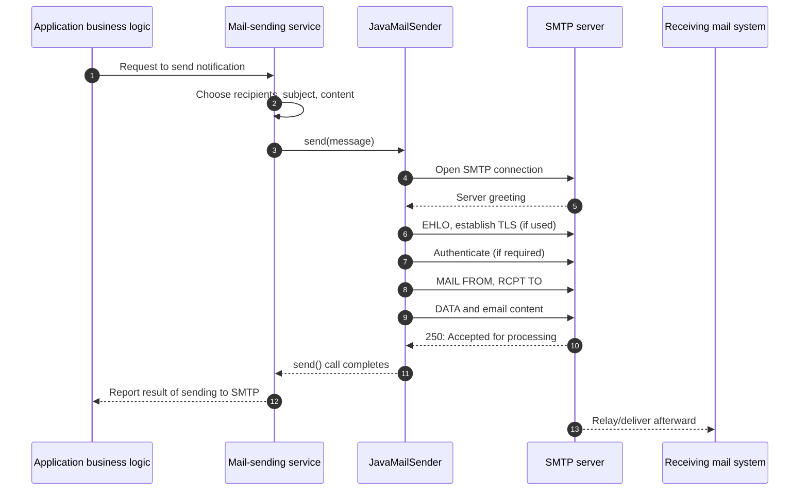

# Email-Sending Flow from Application to Mail Server

When a user registers an account, resets a password, or receives a notification, the application often has to send an email. In **Spring Framework Mail**, the application creates the message content and hands it over to an **SMTP server** responsible for accepting and relaying it. Understanding this boundary clearly helps developers configure connections properly, determine when sending succeeded, and handle errors appropriately.

After this lesson, you will be able to trace the path of an email from the `JavaMailSender.send(...)` call to the mail server's response, and distinguish what Spring performs from what the email infrastructure handles.

## 1. Participating Components

| Component | Role |
|---|---|
| **Business code** | Decides when an email needs to be sent, the recipients, and the content. |
| **Spring Framework Mail** | Provides `MailSender`, `JavaMailSender`, and helper classes to build and send messages. |
| **Jakarta Mail** | Handles message formatting details and SMTP communication through the mail library beneath Spring. |
| **SMTP submission server** | Receives emails from the application, typically authenticates the account, and applies sending policies. |
| **Relay system / receiving server** | Finds the path to the recipient's domain, receives the message, filters spam, and places the message in the mailbox if accepted. |

**SMTP** (Simple Mail Transfer Protocol) is the protocol used to transmit emails between mail-sending agents. On the application side, we typically use a pre-configured SMTP server, such as an organization's email service. The application does not need to locate each recipient's mail server itself.

There are two boundaries to remember:

- **Application → SMTP submission server:** the direct scope of a single mail-sending call in Spring.
- **Server accepted the message → recipient's mailbox:** the subsequent process of the email system, which may occur later and is subject to many other policies and filters.

## 2. Sending Flow Diagram



The diagram illustrates the case where the server agrees to accept the message. If a failure occurs at any step before acceptance, `send(...)` may throw an exception. After the acceptance response, whether the message reaches the destination mailbox depends on downstream systems.

## 3. Each Stage in a Single Send

### Step 1: Business Logic Generates a Send Request

For example, after a user registers successfully, the business service requests sending a welcome email. At this point the application needs to determine:

- Sender address (`From`), recipient addresses (`To`, possibly `Cc`/`Bcc`).
- Subject (`Subject`), plain-text or HTML content, and attachments if any.
- Message type and business context, such as a request ID or display language.

Unnecessary sensitive information should not be placed in emails or logs. If the application builds HTML from user data, that data must be properly escaped/encoded.

### Step 2: Spring Creates the Email Object

Spring supports two common approaches:

| Need | API | Characteristics |
|---|---|---|
| Plain-text email | `SimpleMailMessage` + `JavaMailSender.send(SimpleMailMessage)` | Suitable for simple notifications. |
| HTML, multipart, attachment email | `MimeMessage` + `MimeMessageHelper` + `JavaMailSender.send(MimeMessage)` | Represents content using MIME and more complex headers. |

`MimeMessage` comes from Jakarta Mail, while `MimeMessageHelper` is a Spring utility for setting the sender, recipients, charset, HTML, and attachments. Vietnamese content should be represented with an appropriate character encoding, typically UTF-8.

### Step 3: Open a Connection to the SMTP Server

`JavaMailSender` uses the configured connection details: hostname, port, transport security method, credentials, and timeouts. There are two common submission configurations:

| Port | How the connection is secured | Notes |
|---|---|---|
| **587** | SMTP, then upgraded to TLS via `STARTTLS` | Common when an application sends email through an SMTP service. |
| **465** | TLS established immediately from the start of the connection (implicit TLS/SMTPS) | Used when the provider requires this port. |
| **25** | Commonly used for relaying between email servers | Not chosen by default for an application to log in and send mail. |

With port 587, the client typically receives the SMTP greeting, sends `EHLO` to inspect supported capabilities, requests `STARTTLS`, performs the TLS handshake, and then sends `EHLO` again over the secured connection. If the server requires authentication, the client performs `AUTH` after establishing a secure connection. Some servers use other mechanisms or internal relay services that do not require authentication; the actual configuration must follow the provider.

**TLS secures the transport channel between the application and the connected SMTP server**; it does not automatically mean the email is end-to-end encrypted for the recipient. Enable the *required* option if the application must enforce STARTTLS, avoiding silently sending over an unprotected connection.

### Step 4: Declare the SMTP Envelope

After connecting and authenticating, the client begins a mail transaction with these commands:

- `MAIL FROM:<no-reply@example.net>`: the sender address in the **SMTP envelope** (envelope sender), typically used for routing error/bounce notifications.
- `RCPT TO:<user@example.org>`: the recipient address in the **SMTP envelope**. A message can have multiple `RCPT TO` commands.
- `DATA`: begins transmitting the message headers and body after the server responds with permission.

The SMTP envelope and the headers displayed inside the email are two different concepts:

| SMTP envelope | Headers inside the email |
|---|---|
| `MAIL FROM`, `RCPT TO` are protocol information for transport. | `From:`, `To:`, `Subject:` are written inside the message. |
| Used to determine where to route the message and where to report errors. | Used to describe the message for mail readers and filters. |
| May differ from headers due to relay, bounce, or Bcc rules. | `Bcc` is normally not disclosed in the headers sent to recipients. |

The SMTP server may reject some recipients at the `RCPT TO` step (for example, an address not permitted for relay) before receiving the message body.

### Step 5: Transmit Content and Receive Response

After `DATA`, the application transfers the headers and body formatted by the mail library. In the SMTP protocol, a line containing only a dot (`.`) terminates the data. The mail client handles dot-stuffing, line endings, and formatting details on behalf of business code.

A **simplified illustrative** SMTP session, omitting secondary responses, authentication payloads, and TLS handshake details:

```text
S: 220 smtp.example.net ESMTP ready
C: EHLO app.example.net
S: 250-STARTTLS
S: 250 OK
C: STARTTLS
S: 220 Ready to start TLS
   [TLS handshake succeeded]
C: EHLO app.example.net
S: 250-AUTH PLAIN LOGIN
S: 250 OK
   [Client and server perform SMTP authentication]
S: 235 2.7.0 Authentication successful
C: MAIL FROM:<no-reply@example.net>
S: 250 2.1.0 OK
C: RCPT TO:<user@example.org>
S: 250 2.1.5 OK
C: DATA
S: 354 End data with <CRLF>.<CRLF>
C: From: no-reply@example.net
C: To: user@example.org
C: Subject: Welcome
C:
C: Your account is ready.
C: .
S: 250 2.0.0 Queued as ABC123
C: QUIT
S: 221 2.0.0 Bye
```

In the example, `250 2.0.0 Queued` after `DATA` means the server **has accepted the message for further processing**. It is not confirmation that the message has appeared in the Inbox. A server may accept a message, then later encounter a delivery failure and send a bounce; the message may also be filtered into Spam.

### Step 6: The Mail Server Performs the Next Steps

From here, the mail infrastructure can place the email in a queue, select the destination server using the recipient domain's MX record, relay over SMTP, apply anti-spam checks, and deliver it to the mailbox. The recipient domain's DNS **MX record** primarily serves the server-side relay stage; the application only needs to configure the exact SMTP server address it connects to.

Mechanisms such as SPF, DKIM, and DMARC affect whether the destination server trusts and accepts the email. They are usually configured by the domain operator or email-sending service; creating a `MimeMessage` in Spring does not automatically configure all of those mechanisms.

## 4. Minimal Example with Spring Mail

Suppose a Spring Boot application uses `spring-boot-starter-mail` (which includes Spring Mail and Jakarta Mail infrastructure). Boot can auto-create the `JavaMailSender` bean from `spring.mail.*` configuration. In a plain Spring Framework project, we can manually register a `JavaMailSenderImpl` bean with equivalent properties.

### 4.1. SMTP Configuration

Example using port 587 with mandatory STARTTLS:

```yaml
# application.yml
spring:
  mail:
    host: smtp.example.net
    port: 587
    username: ${MAIL_USERNAME}
    password: ${MAIL_PASSWORD}
    properties:
      "[mail.smtp.auth]": true
      "[mail.smtp.starttls.enable]": true
      "[mail.smtp.starttls.required]": true
      "[mail.smtp.connectiontimeout]": 5000
      "[mail.smtp.timeout]": 5000
      "[mail.smtp.writetimeout]": 5000

app:
  mail:
    from: no-reply@example.net
```

`MAIL_USERNAME` and `MAIL_PASSWORD` are environment variables supplied in the runtime environment. Do not write real passwords in source code or commit configuration containing secrets. The `from` address must be permitted by the SMTP provider; successful SMTP authentication does not mean you can spoof any sender address.

The timeouts in the example are in milliseconds. Specific values must be tuned according to infrastructure and application requirements.

### 4.2. Sending a Plain-Text Email

```java
import org.springframework.beans.factory.annotation.Value;
import org.springframework.mail.SimpleMailMessage;
import org.springframework.mail.javamail.JavaMailSender;
import org.springframework.stereotype.Service;

@Service
public class WelcomeMailService {
    private final JavaMailSender mailSender;
    private final String from;

    public WelcomeMailService(
            JavaMailSender mailSender,
            @Value("${app.mail.from}") String from) {
        this.mailSender = mailSender;
        this.from = from;
    }

    public void sendWelcome(String recipient) {
        SimpleMailMessage message = new SimpleMailMessage();
        message.setFrom(from);
        message.setTo(recipient);
        message.setSubject("Welcome");
        message.setText("Your account is ready.");

        mailSender.send(message);
    }
}
```

When `sendWelcome("user@example.org")` runs, Spring converts `SimpleMailMessage` into mail transmission data and uses the SMTP connection. By default, the `send(...)` call executes synchronously: the calling thread waits until sending to SMTP finishes or fails, unless the application explicitly places the send operation into a queue or another thread.

### 4.3. When HTML or Attachments Are Needed

```java
import jakarta.mail.MessagingException;
import jakarta.mail.internet.MimeMessage;
import org.springframework.mail.javamail.JavaMailSender;
import org.springframework.mail.javamail.MimeMessageHelper;

public void sendHtml(JavaMailSender sender, String from, String recipient)
        throws MessagingException {
    MimeMessage mime = sender.createMimeMessage();
    MimeMessageHelper helper = new MimeMessageHelper(mime, "UTF-8");

    helper.setFrom(from);
    helper.setTo(recipient);
    helper.setSubject("Account notification");
    helper.setText("<h1>Welcome</h1><p>Your account is ready.</p>", true);

    sender.send(mime);
}
```

The `true` parameter of `setText(html, true)` indicates that the content is HTML. When creating multipart emails or attaching files, use a `MimeMessageHelper` constructor with multipart enabled and the `addAttachment(...)` API. `MessagingException` may occur during the MIME preparation stage; SMTP sending errors are typically represented by Spring through the `MailException` family.

## 5. Distinguishing Success and Failure States

Suppose the application calls `mailSender.send(message)`. There are at least three different outcome levels:

| Status | What can be concluded |
|---|---|
| Cannot connect, login rejected, or message rejected by SMTP | Sending to SMTP failed; the application must handle the exception. |
| SMTP returns an acceptance response after `DATA` | The server has taken responsibility for processing the message further; `send(...)` normally completes without an exception. |
| The system finally delivered to the mailbox | Requires data from the mail service side, such as a delivery event/webhook or logs; a single `send(...)` call does not prove this. |

Some common SMTP codes:

| Code | General meaning | Perspective from the application |
|---|---|---|
| `2xx`, e.g. `250` | Successfully completed the corresponding SMTP step | Proceed to the remaining steps; `250` after `DATA` indicates the server accepted the message. |
| `3xx`, e.g. `354` | Server asks client to send more data | Not an error. |
| `4xx`, e.g. `421` or `450` | Temporary error | May retry according to a bounded retry policy. |
| `5xx`, e.g. `535`, `550`, `554` | Error usually considered permanent for the current operation | Check authentication, address, and policy; do not retry indefinitely. |

In Spring, sending errors may appear as `MailAuthenticationException`, `MailSendException`, or another subclass of `MailException`. To determine the actual cause, inspect the error type, message, root cause, and SMTP response code (if present), while avoiding logging credentials or full message content.

Note: a network failure right around the time the server accepts the message can leave the application **uncertain** whether the email was received or not. Therefore, blind retries risk sending duplicates. For important emails, there should be a business event ID, saved send status, and a policy for handling ambiguous outcomes.

## 6. Designing the Sending Flow in Real Applications

Sending directly from the HTTP request-handling thread is easy to understand, but makes response time depend on the network and SMTP server. Simple flow:

```text
HTTP request
  → business processing
  → JavaMailSender.send(...)
  → SMTP response
  → HTTP response
```

If the system needs high reliability or high volume, processing can be decoupled:

```text
HTTP request
  → save business changes and mail-sending request
  → return HTTP response

Mail-sending worker
  → read send request
  → JavaMailSender.send(...)
  → record status / controlled retry
```

A resilient implementation approach is **transactional outbox**: save the send request in the same transaction as the business change, then have a worker process the record after commit. This reduces the risk that business data is saved while the send request is lost. It does not by itself guarantee that an email is sent exactly once; the worker still needs to manage retries, duplicates, and unknown states.

In operations, keep in mind:

- Set timeouts so SMTP connections do not block indefinitely.
- Distinguish transient errors from configuration or address errors.
- Track send counts, failure counts, latency, and response codes without exposing sensitive data.
- Respect sending quotas, verified sender addresses, and provider policies.
- Test the SMTP flow in development using a catch-all mail server like Mailpit or GreenMail; avoid accidentally sending to real users.

## 7. Walkthrough Scenario

A user enters the email `linh@example.org` to receive a registration notification:

1. `RegistrationService` finishes business logic and calls `WelcomeMailService.sendWelcome(...)`.
2. `WelcomeMailService` creates a `SimpleMailMessage` with `From`, `To`, `Subject`, and body.
3. `JavaMailSender` creates a communication session to `smtp.example.net:587`, establishes STARTTLS, and authenticates.
4. The server accepts the envelope and message body, returning `250` after receiving `DATA`.
5. The `send(...)` call returns. The application can record **accepted by SMTP**.
6. The server relays further to `example.org`'s mail system. The email may land in Inbox, Spam, be delayed, or be rejected later.

If there is only a log entry "`send()` completed" and the user does not see the email, check the mail service side: message ID/queue ID, relay status, bounces, spam, and domain policies. Immediately calling `send()` again without knowing the status can create duplicate emails.

## Key Takeaways

- `JavaMailSender` is Spring Mail's integration point that lets applications send messages over SMTP; business code does not have to write SMTP commands manually.
- Connection, TLS, authentication, envelope (`MAIL FROM`/`RCPT TO`), `DATA`, and server responses are the core steps from the application to the mail server.
- `250` after `DATA` indicates that **the SMTP server has accepted the email for processing**, not that the recipient has read or even received the message.
- When a system requires reliability, manage send requests, SMTP results, and final delivery outcomes separately.
