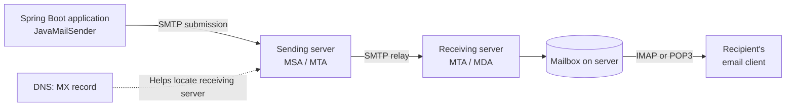

# SMTP, IMAP, and POP3 in the Email Ecosystem

When a user clicks **Send** in an email client, the message does not travel directly from the sender's screen to the recipient's mailbox. It passes through servers tasked with accepting, relaying, and storing messages. When the recipient opens their email client, a different protocol is used to access the stored messages.

The three foundational protocols in this workflow are:

- **SMTP (Simple Mail Transfer Protocol):** sends and relays emails.
- **IMAP (Internet Message Access Protocol):** accesses and synchronizes messages on the server.
- **POP3 (Post Office Protocol version 3):** retrieves messages from the server to a client application, typically following a model of downloading messages for local processing.

In **Spring Framework Mail**, distinguishing these three protocols helps explain why a Spring Boot application normally configures SMTP to send notification emails, yet must use a different mechanism if it needs to read incoming emails.

## 1. The Big Picture: Where Does an Email Travel From and To?

Suppose a Spring Boot system needs to send a registration confirmation code to `recipient@example.net`:



Terms in the diagram:

| Component | Role |
|---|---|
| **MUA** (Mail User Agent) | The application a user uses to compose, send, or read email, such as a mobile mail app. |
| **MSA** (Mail Submission Agent) | Accepts messages submitted by client applications, typically with sender authentication. |
| **MTA** (Mail Transfer Agent) | Relays emails between servers; may queue and retry sending. |
| **MDA** (Mail Delivery Agent) | Places accepted emails into the target mailbox or storage repository. |
| **Mailbox** | Where messages are stored so the recipient can access them. |

A single provider may combine several roles within one system; the diagram illustrates **logical responsibilities**, not necessarily six separate physical machines. When sending to another domain, the sending system normally queries **MX records in DNS** to determine the mail-receiving servers for that domain. If a transient issue occurs, the MTA can queue the message and retry later.

Key point to remember: **SMTP transports messages to the receiving system; IMAP/POP3 allow client applications to access messages already residing in a mailbox.**

## 2. SMTP: Protocol for Sending and Relaying Email

### 2.1. What Problem Does SMTP Solve?

SMTP is a client–server communication protocol using TCP and exchanging commands and responses. It appears at two common hops:

1. **Submission:** a Spring Boot application or email client submits a message to the email service server, commonly over port **587** or **465**.
2. **Relay/transfer:** a sending server transfers a message to the receiving server of the destination domain, commonly over port **25**.

SMTP is not designed for users to browse folders, search unread messages, or synchronize read status. That is the job of IMAP or POP3.

### 2.2. SMTP Envelope vs. Email Content

An email has at least two layers of information:

| Layer | Example | Purpose |
|---|---|---|
| **SMTP envelope** | `MAIL FROM:<bounce@example.com>`, `RCPT TO:<recipient@example.net>` | Used by servers to route messages, handle failures, or return bounces. |
| **Headers and body** (message) | `From:`, `To:`, `Subject:`, message body | Visible to users when reading mail; may contain plain text, HTML, and attachments. |

`MAIL FROM` does not have to match the `From:` field shown to the recipient. Recipients in `RCPT TO` do not necessarily appear in `To:`; **BCC** is an important example: the recipient address is in the envelope but is not shown as a regular recipient. Consequently, you cannot determine all actual recipients simply by reading the headers.

**MIME** (Multipurpose Internet Mail Extensions) adds representations for email content such as UTF-8 text, HTML, multiple content parts, and attachments. MIME describes **message formatting**; SMTP still handles **transporting** that message.

### 2.3. How Does an SMTP Session Unfold?

The example below illustrates the main steps after an application connects to a submission server supporting STARTTLS. It is a simplified view for understanding the protocol, not commands to log directly into a live service.

```text
S: 220 smtp.example.com Service ready
C: EHLO app.example.com
S: 250-smtp.example.com
S: 250-STARTTLS
S: 250 AUTH PLAIN LOGIN
C: STARTTLS
S: 220 Ready to start TLS
   [Both sides establish TLS; client verifies certificate]
C: EHLO app.example.com
S: 250-smtp.example.com
S: 250 AUTH PLAIN LOGIN
   [Application authenticates over TLS channel, if required by server]
C: MAIL FROM:<bounce@example.com>
S: 250 OK
C: RCPT TO:<recipient@example.net>
S: 250 OK
C: DATA
S: 354 End data with <CRLF>.<CRLF>
C: From: Notifications <notify@example.com>
C: To: recipient@example.net
C: Subject: Registration confirmation
C:
C: This is a confirmation email.
C: .
S: 250 Queued for delivery
C: QUIT
S: 221 Bye
```

Key milestones to understand:

- `EHLO` introduces the client and retrieves the server's list of capabilities; after upgrading to TLS with `STARTTLS`, the client sends `EHLO` again.
- `AUTH` authenticates the client identity when required by the submission server. Do not transmit credentials over an unencrypted connection.
- `MAIL FROM` and one or more `RCPT TO` declare the delivery envelope.
- `DATA` starts the headers and body; a line containing only a dot terminates the data according to SMTP rules.
- Response codes **2xx** usually indicate success at the current step, **4xx** indicate temporary errors that may be retried, and **5xx** usually indicate permanent errors whose cause must be addressed.

**`250 Queued for delivery` only indicates that the server at that hop accepted the message.** It does not prove the message reached the Inbox, passed spam filters, or was opened by the recipient. A sending application must distinguish the *accepted by SMTP* state from the *delivered to recipient* state.

## 3. IMAP: Accessing and Synchronizing a Server-Side Mailbox

IMAP allows an email application to interact with messages **managed on the server**. Rather than treating mail retrieval as merely downloading a list of messages, IMAP provides a mailbox model with multiple folders and message states.

Common capabilities:

- Listing and opening mailboxes/folders such as `INBOX`, `Sent`, `Archive` (folder names may vary by server).
- Fetching headers, bodies, or individual message parts on demand, allowing clients to avoid downloading all attachments immediately.
- Synchronizing status flags such as `\Seen` (read), `\Answered` (replied), `\Flagged` (starred/flagged), `\Deleted` (marked for deletion).
- Server-side search, folder management, and multi-device access to a single account.
- Receiving near-real-time change notifications via the **IMAP IDLE** mechanism when supported by server and client.

Example: you read an email on your phone. With IMAP, the `\Seen` flag can be updated on the server so the app on your laptop displays that message as read. Emails can still be cached offline by each client app; **IMAP does not mean you must always be online to read messages**.

In IMAP, **message sequence numbers** can change when mailbox contents change. Sync applications should use **UID along with UIDVALIDITY** to identify messages stably within a mailbox, noting that a UID is not a globally permanent identifier. Messages marked `\Deleted` are not necessarily deleted physically right away; an expunge command or equivalent operation completes removal on the server.

IMAP is a **message access** protocol, not a replacement for SMTP when sending email. A typical email application may use **SMTP to send + IMAP to read and synchronize**.

## 4. POP3: Downloading Messages from the Server

POP3 has a simpler model than IMAP: the client connects to the server, checks which messages are available to download, retrieves their content, and can optionally request deleting messages from the server.

A basic POP3 session might include:

```text
S: +OK POP3 server ready
C: USER mailbox@example.net
S: +OK
C: PASS [example-password]
S: +OK
C: STAT
S: +OK 2 3500
C: LIST
S: +OK 2 messages
   ...
C: RETR 1
S: +OK message follows
   [Message headers and body]
C: DELE 1
S: +OK message marked
C: QUIT
S: +OK goodbye
```

The example uses `USER`/`PASS` to illustrate classic commands; in real usage, protect the connection with TLS and follow the provider's authentication mechanism. Key commands:

- `STAT`: retrieves the number of messages and total size in the current maildrop.
- `LIST`: lists basic information about the messages.
- `RETR`: downloads the full content of a message.
- `DELE`: **marks** a message for deletion; actual deletion is usually applied when the session enters the update state after a successful `QUIT`.

POP3 **does not by default require deleting messages after download**. Keeping a copy on the server or deleting upon receipt depends on client behavior and account configuration. However, POP3 does not provide multi-folder synchronization and rich status flags like IMAP. This is why POP3 is generally less suitable if a single mailbox is used concurrently across a phone, tablet, and laptop.

## 5. Comparing SMTP, IMAP, and POP3

| Criterion | SMTP | IMAP | POP3 |
|---|---|---|---|
| Primary purpose | Send/relay messages | Read and synchronize mailboxes | Download messages to client |
| Typical communication direction | Client sends → server, server → server | Mailbox server ↔ reading app | Mailbox server → reading app |
| Server-side folder management | No | Yes | Not a core feature |
| Read/answered flag synchronization | No | Yes | No IMAP-equivalent mechanism |
| Suitability for multiple devices | Paired with a reading protocol | Very suitable | More limited |
| Used to send email in Spring Boot | **Yes** | No | No |

Do not treat the three protocols as peer alternatives: **SMTP answers "how to send?", while IMAP and POP3 answer "how to retrieve and manage incoming messages?"**.

### Common Ports

| Protocol / purpose | TCP port | Connection security and notes |
|---|---:|---|
| SMTP server-to-server relay | **25** | May upgrade via STARTTLS; not the usual submission port for client apps. |
| SMTP message submission | **587** | Common with STARTTLS; application config should require TLS when sending credentials. |
| SMTP submission over TLS from start | **465** | **Implicit TLS**: establishes TLS before exchanging SMTP commands. |
| IMAP | **143** | Can use STARTTLS if supported by server and required by client. |
| IMAP over TLS | **993** | Implicit TLS (`imaps`). |
| POP3 | **110** | May support security upgrade; do not send passwords over a plaintext connection. |
| POP3 over TLS | **995** | Implicit TLS (`pop3s`). |

**STARTTLS and implicit TLS differ in when encryption begins:** STARTTLS initiates the protocol connection first and then upgrades; implicit TLS begins with a TLS handshake. In both cases, the application must verify the server certificate, check the hostname, and prevent downgrading to unencrypted communication when policy requires TLS.

## 6. Authentication, Security, and Deliverability

There are two authentication layers that are easily confused:

**Sending client authentication (SMTP AUTH):** enables the submission server to verify which application/account is permitted to send. The specific mechanism may be username and app password, OAuth2, or a method supported by the provider. Credentials must reside in secrets or environment variables, never hardcoded in source code.

**Sending domain authentication (SPF, DKIM, DMARC):** helps receiving systems evaluate whether an email was legitimately sent on behalf of a domain.

- **SPF:** the domain publishes which servers or services are authorized to send on its behalf according to SPF checks.
- **DKIM:** the email carries a cryptographic signature; receiving systems use a public key published via DNS to verify it.
- **DMARC:** uses SPF/DKIM results together with domain alignment against the `From:` field to enforce policy and receive reports.

These mechanisms **do not replace TLS**, nor do they guarantee that an email will definitely reach the Inbox. An email can still be rejected, delayed, or placed in spam due to address/domain reputation, content, receiving system policies, and other factors.

For applications sending OTP codes or critical notifications, additional design is needed: sending queues, rate limiting, handling 4xx/5xx SMTP errors, duplicate prevention, and tracking bounce/delivery events if supported by the provider. Do not equate a send function returning without error to the user actually receiving the message.

## 7. Direct Connection to Spring Framework Mail

### 7.1. Spring Boot Sends Email via SMTP

Spring Boot can auto-configure `JavaMailSender` when the application adds the Spring Boot Mail starter and declares SMTP server properties. For a Gradle project using Spring Boot:

```groovy
dependencies {
    implementation 'org.springframework.boot:spring-boot-starter-mail'
}
```

Example `application.yml` for an SMTP submission server on port 587:

```yaml
spring:
  mail:
    host: ${MAIL_HOST}
    port: 587
    username: ${MAIL_USERNAME}
    password: ${MAIL_PASSWORD}
    properties:
      mail:
        smtp:
          auth: true
          starttls:
            enable: true
            required: true
          connectiontimeout: 5000
          timeout: 5000
          writetimeout: 5000

app:
  mail:
    from: ${MAIL_FROM}
```

Environment variables `MAIL_HOST`, `MAIL_USERNAME`, `MAIL_PASSWORD`, and `MAIL_FROM` must be supplied in the deployment environment. The `From` address must comply with authentication policies and domains allowed by the provider. The configuration above uses **STARTTLS on 587**; if the provider requires **implicit TLS on 465**, both the port and the corresponding TLS settings must be changed, not just the port number.

Example plain-text email-sending service:

```java
import org.springframework.beans.factory.annotation.Value;
import org.springframework.mail.SimpleMailMessage;
import org.springframework.mail.javamail.JavaMailSender;
import org.springframework.stereotype.Service;

@Service
public class NotificationMailService {
    private final JavaMailSender mailSender;
    private final String from;

    public NotificationMailService(
            JavaMailSender mailSender,
            @Value("${app.mail.from}") String from) {
        this.mailSender = mailSender;
        this.from = from;
    }

    public void sendWelcomeEmail(String recipient) {
        SimpleMailMessage message = new SimpleMailMessage();
        message.setFrom(from);
        message.setTo(recipient);
        message.setSubject("Welcome to the system");
        message.setText("Your account has been created successfully.");

        mailSender.send(message);
    }
}
```

In this example:

1. `JavaMailSender` is Spring's abstraction for **sending** email; the underlying implementation uses Jakarta Mail and SMTP.
2. `SimpleMailMessage` is suitable for plain-text emails. HTML, multipart content, or attachments normally use `MimeMessage` with `MimeMessageHelper`.
3. `mailSender.send(...)` can throw `MailException` when sending fails at the application/SMTP layer. Success here does not mean the recipient read it or even received it in their Inbox.
4. For business applications, consider sending asynchronously or via a queue so email service errors and latency do not block the main processing thread; when send events must not be lost, a transactional outbox can be applied.

Note on naming: **Spring Framework Mail / `JavaMailSender` primarily addresses sending email**. It does not turn SMTP into a mailbox-reading protocol.

### 7.2. What If a Spring Application Needs to Read Incoming Mail?

Suppose a system processes support requests sent to `support@example.com`. Options include:

- Use **Jakarta Mail** with `Store`/`Folder` and `imap`/`imaps` or `pop3`/`pop3s` protocols to read the mailbox.
- Use **Spring Integration Mail** when incoming emails need to enter an integration flow, poll a mailbox, or use an appropriate inbound mail adapter.
- If the provider supports inbound email webhooks/event APIs, consider that architecture based on system needs.

Simply adding `spring-boot-starter-mail` **does not automatically create a scheduled incoming email receiver**. You must proactively design connectivity, sync state persistence, access permissions, duplicate handling, network error handling, and security. If a mailbox is synchronized across multiple devices or services, IMAP is usually a better choice than POP3.

## 8. Scenarios for Choosing the Right Protocol

| Scenario | Appropriate protocol/mechanism | Why? |
|---|---|---|
| Spring Boot sends registration confirmation email | **SMTP submission** or provider mail-sending API | The system needs to hand the message off to mail transport infrastructure. |
| User reads the same mailbox on phone and laptop | **IMAP** to receive/sync, **SMTP** to send | Folders and read states need consistency across multiple devices. |
| Simple program periodically downloads messages to one machine | **POP3**, if it meets business requirements | Convenient for downloading messages, though synchronization capabilities are limited. |
| Internal system reads and classifies support emails | **IMAP** or inbound mail API | Needs to access incoming messages, track processed ones, and possibly synchronize folders. |
| Two email providers transfer messages to each other | **SMTP relay** | This is the server-to-server transport hop. |

### Some Common Misconceptions

**"Configuring IMAP is enough to send email."** Incorrect. IMAP manages and reads messages; sending email normally still uses SMTP submission or a mail-sending API.

**"POP3 always deletes emails from the server."** Incorrect. Deletion behavior depends on commands sent by the client and server-side retention settings.

**"SMTP returning 250 means the email reached the Inbox."** Incorrect. That is confirmation at the current processing/handover step, not proof of reading or spam classification outcome.

**"Port 465 and 587 differ only in number."** Incorrect. Port 465 typically uses TLS immediately upon connection, while 587 typically starts SMTP and upgrades via STARTTLS; security configuration must match the service.

**"SMTP AUTH, SPF, DKIM, DMARC are all the same kind of login."** Incorrect. SMTP AUTH authenticates the sending application to the submission server; SPF/DKIM/DMARC help receiving systems verify and enforce policy on the sending domain identity.

## 9. Self-Check Knowledge Questions

1. A Spring Boot application needs to send an email containing a password reset link. Will it use SMTP, IMAP, or POP3 for the sending step? When the send call completes without error, does the system know for certain that the user received the email?
2. A user reads an email on their phone and then opens their laptop expecting to see the "read" status. How does IMAP support this scenario? Why is POP3 usually less convenient?
3. Why can `MAIL FROM` in an SMTP session differ from the `From:` field in the email content? How does BCC relate to this difference?
4. On port 587, when should STARTTLS take place relative to the authentication step? If a provider only accepts implicit TLS on 465, what does the application need to change?
5. A message gets `250 Queued` back from the SMTP server, yet the user does not see it in their Inbox. Name at least three points to inspect at downstream stages.

**Key takeaway:** SMTP handles **sending and relaying**; IMAP handles **access and synchronization**; POP3 handles **downloading messages**. In Spring Boot, `JavaMailSender` serves the sending flow via SMTP, whereas handling incoming mail requires designing a separate receiving flow using IMAP, POP3, or a suitable API.
