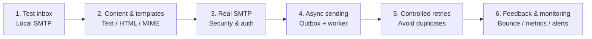
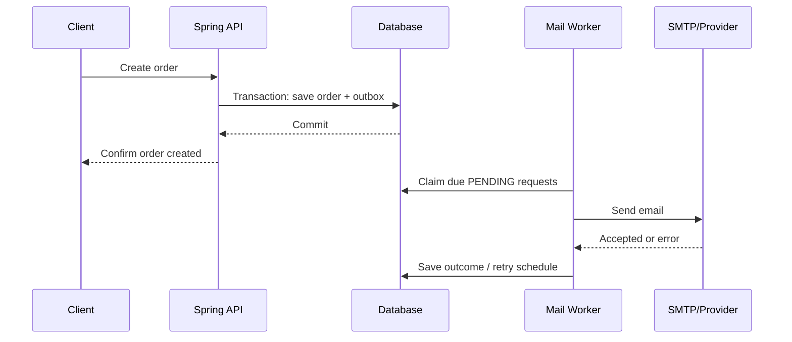
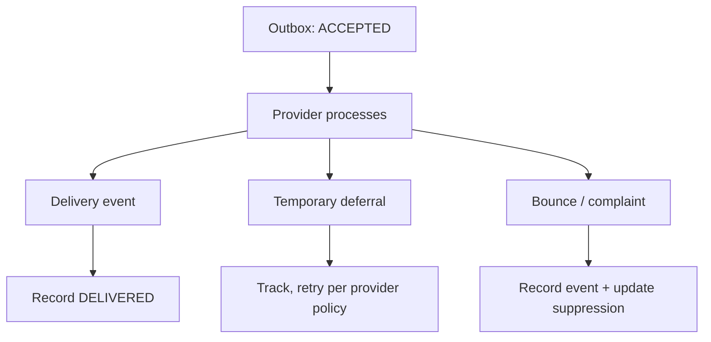

# Roadmap from Test Emails to a Reliable Mail-Sending System

Successfully sending an email from a Spring application is the first milestone, yet it is not enough for a reliable mail-sending system. In a test environment, you usually only need to see the message appear in a mock inbox. In practice, an SMTP server can be overloaded, connections can drop, recipient addresses may not exist, messages can be flagged as spam, or a user can receive two identical copies after a retry.

This lesson constructs a staged roadmap in **Spring Framework Mail**: sending the first message, producing standards-compliant content, configuring securely, decoupling sending from HTTP requests, handling errors and retries, recording provider feedback, and operating based on metrics. Examples use Java 21, Spring Boot 3.x, and the Jakarta Mail library; the principles regarding SMTP, reliability, and sending statuses also apply to Spring Framework applications without Boot.

## 1. Understanding the Goal Properly: What Does "Sent Successfully" Mean?

An email notification crosses several boundaries:

1. **Application records the send request**: a business event created the intent to send an email.
2. **System processes the send**: a process picks up the request and executes an SMTP call or provider API call.
3. **Sending server accepts the message**: SMTP returns an acceptance response, or the API returns an accepted status.
4. **Recipient-side system handles the message**: the message may be delivered, deferred, bounced, or filtered.
5. **Recipient interacts**: they may read, click links, or ignore the message; those events are not synonymous with the message having been sent.

`JavaMailSender.send(...)` returning normally only proves that the send operation completed at the level observed by the protocol and library. It **does not prove the message entered the inbox, was opened, or was read**. If a system relies solely on a boolean `sent = true`, operators will struggle to distinguish application errors, transport errors, and subsequent bounces.

| Concept | Practical meaning | Where can it be confirmed? |
|---|---|---|
| `QUEUED` / `PENDING` | Send request has been saved for processing | Application database or queue |
| `PROCESSING` | A worker has claimed the send request | Worker/lease state |
| `ACCEPTED` | SMTP relay or provider took responsibility for processing | SMTP/API send result |
| `DELIVERED` | Provider reports delivered to destination system per its definition | Delivery event from provider (if available) |
| `BOUNCED` | Destination system or provider rejected/returned the message | Bounce/event/webhook |
| `PERMANENT_FAILURE` | System decided not to retry sending again | Error classification and retry policy result |

> A sound operational goal is **never losing send intent**, **never retrying indefinitely**, **minimizing duplicate sends**, and **knowing precisely what the system observed**. Never promise "exactly once" when using standard SMTP, because there are cases where the server accepted the message before the application could record the outcome.

## 2. Journey Map



Each milestone answers a different question:

- **Are messages created and sent in the right format?** — verify with local SMTP.
- **Can recipients read the content across email clients?** — standardize MIME, text fallback, HTML, and links.
- **Does the application communicate securely with real servers?** — TLS, credentials, configuration, domain.
- **If the application stops mid-flight, are send requests lost?** — persist send intent in the database.
- **If the provider temporarily fails, does it recover automatically?** — error classification, retries, backoff, idempotency.
- **If an email bounces or receives complaints, does the system know and act?** — feedback, suppression, metrics, and alerts.

## 3. Milestone 1 — Sending Mail in a Test Environment

### 3.1. Using a Mock SMTP Server to Verify the Sending Flow

**Mailpit** is a mock SMTP tool that captures emails and displays them in a web UI. It does not forward messages to the Internet, making it suitable for practice and preventing accidental sends to real customers.

Example startup via Docker:

```bash
docker run --rm --name mailpit -p 1025:1025 -p 8025:8025 axllent/mailpit
```

- SMTP listens at `localhost:1025`.
- Web UI for viewing messages is at `http://localhost:8025`.
- If Spring runs inside another container on the same Docker Compose network, use the service name `mailpit` instead of `localhost`.
- In real projects, pin a verified image version so CI environments remain reproducible.

With Spring Boot, add the dependency:

```groovy
dependencies {
    implementation 'org.springframework.boot:spring-boot-starter-mail'
}
```

Spring Boot auto-configures `JavaMailSender` when the dependency and matching properties are present. In a plain Spring Framework application, you need to declare `JavaMailSenderImpl` and the corresponding Jakarta Mail libraries.

Create configuration for the local profile in `application-local.yml`:

```yaml
spring:
  mail:
    host: localhost
    port: 1025
    default-encoding: UTF-8
    properties:
      mail:
        smtp:
          auth: false
          starttls:
            enable: false

app:
  mail:
    from: demo@example.test
```

Run the application with the `local` profile so this configuration takes effect. Do not use `auth: false` and `starttls.enable: false` for real SMTP servers that require security.

### 3.2. Creating a Plain-Text Mail-Sending Service

`JavaMailSender` is Spring's abstraction for sending emails. `SimpleMailMessage` holds basic fields such as sender, recipients, subject, and text body.

```java
package com.example.mail;

import org.springframework.beans.factory.annotation.Value;
import org.springframework.mail.SimpleMailMessage;
import org.springframework.mail.javamail.JavaMailSender;
import org.springframework.stereotype.Service;

@Service
public class WelcomeMailService {

    private final JavaMailSender mailSender;
    private final String from;

    public WelcomeMailService(
            JavaMailSender mailSender,
            @Value("${app.mail.from}") String from) {
        this.mailSender = mailSender;
        this.from = from;
    }

    public void sendWelcome(String recipient) {
        SimpleMailMessage message = new SimpleMailMessage();
        message.setFrom(from);
        message.setTo(recipient);
        message.setSubject("Welcome");
        message.setText("Your account has been created successfully.");

        mailSender.send(message);
    }
}
```

In a test workflow, call `sendWelcome("learner@example.test")` from an intentional action (such as an internal test command). Open Mailpit and inspect sender, recipient, subject, body, and Vietnamese encoding.

Do not place automatic test send calls inside startup logic shared with production: every application restart could generate extra emails.

### 3.3. What to Understand After the First Email

Seeing the message in Mailpit confirms that the application correctly configured the **Spring → local SMTP → mock inbox** flow. This is an important integration check, yet it does not verify TLS, SMTP authentication, DNS, domain reputation, or real-world deliverability.

## 4. Milestone 2 — Creating Emails Users Can Read and Use

### 4.1. Choosing the Right Format

| Need | Commonly used API | Notes |
|---|---|---|
| Simple text notification | `SimpleMailMessage` | Easy to use, no HTML/attachments |
| HTML message and text fallback | `MimeMessage` + `MimeMessageHelper` | Should include both parts for diverse email clients |
| Attachments, inline images | `MimeMessageHelper` in multipart mode | Must enforce size limits and input validation |
| Templated/localized content | Template engine builds content then passes to mail service | Separates business data from presentation |

Example creating an email with both plain text and HTML:

```java
package com.example.mail;

import jakarta.mail.MessagingException;
import jakarta.mail.internet.MimeMessage;
import org.springframework.beans.factory.annotation.Value;
import org.springframework.mail.javamail.JavaMailSender;
import org.springframework.mail.javamail.MimeMessageHelper;
import org.springframework.stereotype.Service;
import org.springframework.web.util.HtmlUtils;

@Service
public class AccountNotificationMailService {

    private final JavaMailSender sender;
    private final String from;

    public AccountNotificationMailService(
            JavaMailSender sender,
            @Value("${app.mail.from}") String from) {
        this.sender = sender;
        this.from = from;
    }

    public void sendAccountCreated(String to, String displayName)
            throws MessagingException {
        String safeName = HtmlUtils.htmlEscape(displayName);
        String plainText = "Hello " + displayName
                + ", your account has been created.";
        String html = "<html><body><p>Hello <strong>"
                + safeName
                + "</strong>, your account has been created.</p></body></html>";

        MimeMessage message = sender.createMimeMessage();
        MimeMessageHelper helper =
                new MimeMessageHelper(message, true, "UTF-8");
        helper.setFrom(from);
        helper.setTo(to);
        helper.setSubject("Account creation confirmation");
        helper.setText(plainText, html);

        sender.send(message);
    }
}
```

In this snippet:

1. `createMimeMessage()` creates a Jakarta Mail message.
2. `MimeMessageHelper` sets UTF-8 and assists with the MIME structure.
3. `setText(plainText, html)` creates two content representations.
4. `HtmlUtils.htmlEscape(...)` encodes the display name before inserting it into HTML, preventing user input from becoming HTML tags.

In larger systems, HTML templates should live in separate files and be rendered by an engine supporting context-aware escaping. For URLs, validate URL origins and allow only trusted domains; HTML escaping does not replace link validation.

### 4.2. Separating Data and Templates

A send request might look like:

```text
templateId: account-created
templateVersion: 3
locale: vi-VN
recipient: learner@example.test
variables:
  displayName: Minh
```

From that information, the template rendering layer generates `subject`, `plainText`, and `html`. An appropriate separation of responsibilities:

- **Business logic** decides when to send, the notification type, and recipients.
- **Renderer** selects the template/locale, validates required variables, and produces content.
- **Mail adapter** converts content into `SimpleMailMessage` or `MimeMessage` and calls `JavaMailSender`.
- **Delivery workflow** decides send timing, attempt count, and status; do not put these decisions inside templates.

Never write passwords, OTP codes, access tokens, or secrets into logs. For password reset links, use short-lived, single-use tokens on HTTPS URLs under controlled domains; store and handle tokens under dedicated security policies.

### 4.3. Details Easily Missed in Real Emails

- Vietnamese formatting must use UTF-8 consistently across subject, text, and HTML.
- HTML emails need a plain-text option for clients that do not support HTML.
- Sender (`From`) should belong to an authorized sending domain; `Reply-To` may differ depending on business rules.
- Links should be absolute HTTPS URLs pointing to the right environment; avoid `localhost` links leaking into real emails.
- For attachments, check format, data source, size, antivirus/content policies, and provider limits. Do not put sensitive data into attachments without protection mechanisms.
- Templates must clarify message category: transactional (verification, invoices) vs. marketing. Marketing messages must comply with applicable consent and unsubscribe rules.

## 5. Milestone 3 — Moving Safely to Real SMTP

### 5.1. Minimum Parameters

A production SMTP account typically requires host, port, username, password or dedicated credential, sender address, and TLS mode. Reference configuration for a server supporting **STARTTLS on port 587**:

```yaml
spring:
  mail:
    host: ${SMTP_HOST}
    port: ${SMTP_PORT:587}
    username: ${SMTP_USERNAME}
    password: ${SMTP_PASSWORD}
    default-encoding: UTF-8
    properties:
      mail:
        smtp:
          auth: true
          starttls:
            enable: true
            required: true
          connectiontimeout: 5000
          timeout: 10000
          writetimeout: 10000

app:
  mail:
    from: ${MAIL_FROM}
```

The environment values above are examples only. In real deployments, fetch secrets from a secret management system or protected runtime configuration with restricted access and credential rotation support. Never commit usernames/passwords to source repositories.

**Distinguish two common TLS modes:**

- **Port 587 + STARTTLS:** initial connection upgrades to TLS; the example sets `starttls.required: true` to prevent silently sending when upgrading fails.
- **Port 465 + implicit TLS (SMTPS):** establishes TLS from the start; configuration must enable the matching SSL mode (e.g., `mail.smtp.ssl.enable=true`) per provider requirements.

Do not change the port while blindly keeping the old TLS properties. In both cases, verify server certificates using standard TLS settings; never disable certificate validation to work around connection errors.

### 5.2. Sending Domain and Inbox Deliverability

A MIME-valid email can still fail to be trusted by receiving systems. When sending with a real domain, coordinate with DNS administrators and your email provider to configure:

- **SPF:** declares which servers/services are authorized to send on behalf of the domain.
- **DKIM:** provider signs messages; receiving systems verify signatures against DNS records.
- **DMARC:** defines how to handle messages failing alignment checks and where to send reports.
- **Return domain/address:** handles bounces and feedback per the provider's mechanism.

These records belong to email and DNS infrastructure and are not created by Spring Mail merely by calling `send()`. Verify domain verification with the provider, alignment between From and authentication mechanisms, and sending-limit policies.

### 5.3. Controlling Data and Sending Permissions

Right from the real-connection stage, establish boundaries:

1. Separate accounts/parameters between test environments and production.
2. Never allow arbitrary users to supply unchecked `from`, `replyTo`, or raw HTML content.
3. Validate and normalize recipients at business boundaries; apply rate limits to actions that trigger emails.
4. Enforce sending quotas per tenant, user, or notification type to curb abuse.
5. Suppress sending to addresses that opted out or were flagged undeliverable.

## 6. Milestone 4 — Moving Email Sending Out of the HTTP Thread

### 6.1. Why Does Calling SMTP Directly in a Request Cause Problems?

Suppose an order-creation API does three things: writes the order to the database, calls SMTP to send a confirmation, and returns HTTP 200. If the SMTP connection takes 10 seconds, the API slows down too. If sending fails, the application must decide whether to abort creating the order. If the database commits and the application crashes before sending the email, no trace remains indicating the email still needs to be sent.

The solution for critical notifications is saving the **send intent** within the business transaction, then having an independent worker perform the send. A common pattern is the **Transactional Outbox**.



The HTTP response here confirms the business action (e.g., order created), not that the email reached the recipient. If a feature needs to show email progress, expose a separate sending status.

### 6.2. Illustrative Outbox Schema

The table below is a **suggested data schema** to adapt to your database and actual data model:

```sql
CREATE TABLE mail_outbox (
    id UUID PRIMARY KEY,
    deduplication_key VARCHAR(200) NOT NULL UNIQUE,
    recipient VARCHAR(320) NOT NULL,
    template_id VARCHAR(100) NOT NULL,
    payload_json TEXT NOT NULL,
    status VARCHAR(32) NOT NULL,
    attempts INT NOT NULL DEFAULT 0,
    next_attempt_at TIMESTAMP NOT NULL,
    lease_until TIMESTAMP NULL,
    provider_message_id VARCHAR(255) NULL,
    last_error_code VARCHAR(100) NULL,
    created_at TIMESTAMP NOT NULL,
    updated_at TIMESTAMP NOT NULL
);
```

Each column has a specific role:

- `deduplication_key` represents **one business notification**, such as `order-confirmed:order-123:customer-456`; the unique constraint prevents inserting the same send intent multiple times.
- `status` records processing progress without equating acceptance with successful delivery.
- `attempts` and `next_attempt_at` allow scheduling retries.
- `lease_until` enables reclaiming a record held by a worker that crashed.
- `provider_message_id` helps correlate with provider events if the integration supplies this identifier.

When sending to multiple recipients, create separate send records (or per-recipient deliveries) so retries/bounces are tracked individually; do not share a single status across recipients with different outcomes.

### 6.3. Writing Send Intent Within the Business Transaction

In a `@Transactional` business service, write both the primary record and an outbox record before committing:

```java
@Transactional
public Order placeOrder(CreateOrderCommand command) {
    Order order = orderRepository.save(
            Order.from(command));

    mailOutboxRepository.save(
            MailOutbox.pending(
                    "order-confirmed:" + order.getId(),
                    order.getCustomerEmail(),
                    "order-confirmed",
                    order.getId().toString()));

    return order;
}
```

This is **code illustrating the business flow**; `Order`, `MailOutbox`, and the repositories are application-defined classes. The key lies in a single transaction: either the order data and send intent commit together, or both roll back together.

If you only call `@Async` right after `save()`, the background task can still be lost when the process stops or in the window between commit and queuing into the executor. `@Async` is useful for in-process async execution, yet cannot replace durable storage when send requests must not be lost.

### 6.4. How Should the Worker Process Records?

A worker running periodically or woken by a queue executes this lifecycle:

```text
1. Select PENDING/RETRY records with next_attempt_at <= now.
2. Claim records atomically; attach a lease so no other worker picks the same row.
3. Render template and send via JavaMailSender / provider adapter.
4. If accepted: record ACCEPTED, timestamp, and correlation ID (if any).
5. If temporary failure: increment attempts, set RETRY + next_attempt_at.
6. If permanent error: record PERMANENT_FAILURE and a safe error code.
7. Reclaim expired leases to handle abandoned tasks.
```

In PostgreSQL, row selection and locking such as `FOR UPDATE SKIP LOCKED` lets multiple workers claim work concurrently. With other databases, use an equivalent claim mechanism. Do not hold a transaction lock across the entire SMTP wait: claim and commit briefly, perform I/O outside any transaction, then update the outcome conditioned on lease ownership. This avoids long locks and prevents a stale worker from overwriting a newer worker's result.

When high throughput is required, a message broker (RabbitMQ, Kafka, etc.) can wake workers. Even so, durable source state and duplicate handling must be explicitly designed; adding a broker alone does not make SMTP exactly-once.

## 7. Milestone 5 — Retrying the Right Errors, Reducing Duplicates, and Stopping on Time

### 7.1. Categorize Before Retrying

Spring Mail has exceptions such as `MailAuthenticationException`, `MailSendException`, `MailPreparationException`, and nested causes. Classification should be based on exception type, SMTP codes, and provider contract rather than retrying every `MailException`.

| Scenario | Example | Recommended handling |
|---|---|---|
| Configuration error | Wrong password, authentication failure | Stop prolonged auto-retries; alert operators |
| Temporary error | Timeout, overload, SMTP 4xx | Bounded retries with increasing wait times |
| Permanent recipient error | Non-existent address, definitive SMTP 5xx | Mark failed, consider suppression |
| Content error | Missing template variable, invalid MIME | Fix data/template; avoid futile resend loops |
| Ambiguous state | Connection lost when SMTP may have accepted | Handle duplicate risk carefully; reconcile via provider if available |

Not all 5xx codes behave identically; providers may use extended codes and custom policies. Therefore, production should log normalized error codes rather than guessing solely from exception prose.

### 7.2. Exponential Backoff with Jitter

Retrying too quickly can keep overloading the provider. An example policy:

```text
1st failure: wait roughly 1 minute
2nd failure: wait roughly 5 minutes
3rd failure: wait roughly 15 minutes
4th failure: wait roughly 1 hour
After configured limit: move to PERMANENT_FAILURE / DEAD_LETTER for inspection
```

These thresholds are **illustrative**, not Spring Mail defaults. You can apply `min(base × 2^n, maximumDelay) + jitter`, while also respecting any `Retry-After`/rate-limit guidance from the provider.

Enforce limits on attempt count, total allowed retry window, and overall send rate together. Time-sensitive messages (such as verification codes) must stop once they are no longer valid.

### 7.3. Practical Idempotency Has Limits

Two safeguards complement each other:

1. **Deduplicate on request creation**: a unique `deduplication_key` prevents the same business event from creating multiple outbox rows.
2. **Deduplicate when calling the provider**: if the provider API supports an idempotency key, pass a stable key and reuse stored outcomes.

Standard SMTP usually **has no cross-attempt idempotency key**. If a worker sends successfully and crashes before updating the database, another worker may send one more time. Thus, the design must acknowledge **at-least-once** delivery across this boundary and mitigate impact via reconciliation, bounded retries, duplicate-tolerant messaging, and special safeguards for sensitive actions.

Do not rely on the `Message-ID` header as guaranteed proof that receiving systems will deduplicate copies; many servers still accept two messages carrying the same header.

## 8. Milestone 6 — Receiving Feedback After Provider Acceptance

### 8.1. Why Is ACCEPTED Not Yet DELIVERED?

An intermediate SMTP server can return success and only later discover the destination mailbox is full, the address does not exist, or policy rejects the message. With provider APIs, a send call usually just means the system queued the request for processing.

If the provider supports events/webhooks, build a feedback path:



Webhooks must verify signatures or provider-specified security checks, guard against replay, store raw events within needed scope, and **deduplicate event IDs** because providers may redeliver events. Apply ordered state transitions: a late-arriving event must not accidentally overwrite `BOUNCED` back to `ACCEPTED`.

For SMTP relays without callbacks, never mark `DELIVERED` simply because the send call returned normally. In that case, the highest verifiable state is `ACCEPTED`, unless another reliable feedback channel exists.

### 8.2. Bounces, Complaints, and Suppression Lists

Delivery feedback directly affects future sending capability:

- **Hard bounce** typically signals an invalid address or definitive rejection. Consider adding it to a suppression list per policy.
- **Soft bounce/deferral** may be temporary; follow provider guidance and retry appropriately without looping endlessly.
- **Spam complaint** signals the need to stop further sends and audit consent sources.
- **Unsubscribe** must be honored per notification category, consent status, and applicable regulations; stop sending marketing mail to unsubscribed users.

Store auditable suppression reasons, timestamps, data sources, and scopes. For instance, opting out of marketing emails does not automatically mean blocking essential transactional notices; this requires explicit business and legal policy.

## 9. Operational Observability: Logs, Metrics, and Alerts

If logs only say `"Mail sent"`, investigating incidents is nearly impossible. An observability record must tie back to a request identifier without leaking sensitive data.

Structured log example:

```json
{
  "event": "mail.delivery_attempt",
  "notificationId": "6a0f0b41-0e07-4b0d-990f-061eaaaf0081",
  "templateId": "order-confirmed",
  "attempt": 2,
  "result": "TEMPORARY_FAILURE",
  "errorCode": "SMTP_TEMPORARY",
  "provider": "primary-smtp",
  "durationMs": 1270
}
```

Do not put email bodies, verification tokens, SMTP passwords, or full recipient addresses into broadly accessible logs. When recipient lookup is needed, use appropriate protection/access controls or internal identifiers.

| Metric | Question the metric answers |
|---|---|
| `mail_outbox_pending` | How many requests remain unprocessed? |
| `mail_oldest_pending_age_seconds` | How long has the oldest request been waiting? |
| `mail_send_attempts_total{result}` | What are the rates of success, temporary failure, and permanent failure? |
| `mail_provider_accept_latency_seconds` | How long from intent creation until provider acceptance? |
| `mail_bounce_total` / `mail_complaint_total` | How are recipient address quality and sending reputation trending? |
| `mail_dead_letter_total` | How many requests exhausted automatic retries? |

Pair dashboards with alerts when backlog grows abnormally, oldest pending age breaches thresholds, bulk auth errors appear, bounces/complaints spike, or workers stall. Specific thresholds depend on message type and business needs; for example, verification codes have tighter SLAs than daily summary emails.

**Distinguish two latencies**: *application → provider accepted* time is largely within your control; *provider → mailbox delivered* time additionally depends on networks, filters, and receiving systems. Do not combine both onto one chart and call the whole thing "delivery latency".

## 10. Testing Across Each Boundary

A reliable email-sending setup should be verified across distinct scenario layers:

| Test layer | What to prove | Tool/approach |
|---|---|---|
| Content generation | Template has all variables, valid text/HTML, right environment links | Isolated renderer test |
| SMTP integration | Spring actually sends proper From/To/subject/body | Mailpit or test SMTP server |
| Transport failures | Timeouts, disconnects, auth failures are classified | SMTP stub/fault injection |
| Business durability | Rollback creates no outbox; commit creates exactly one intent | Integration test with real DB or equivalent |
| Concurrency | Two workers never claim the same job simultaneously | Parallel lease/transaction test |
| Crash and retry | Worker dies mid-flight; remaining work recovers cleanly | Stop worker at simulated checkpoint |
| Provider feedback | Duplicate, bad-signature, late webhooks are handled safely | Event handler test |
| Email rendering | Displays properly on target clients with text fallback | Test on representative email clients |

A valuable integration test scenario:

1. Execute business action and verify the database contains exactly one outbox row.
2. Let the worker send via Mailpit; verify the message appears in the UI.
3. Replay the same event with the same deduplication key; verify no second outbox row is created.
4. Stop the mock SMTP server; verify the worker records a temporary error and schedules a retry.
5. Restart SMTP; verify the worker resumes sending and transitions to `ACCEPTED`.
6. Simulate a crash after SMTP acceptance before DB commit; note the duplicate possibility and mitigation policy.

Never use real customer mailboxes in automated tests. End-to-end tests with real providers should run in controlled environments with designated test recipients, quotas, and clear budgets.

## 11. Implementation Roadmap by Acceptance Milestones

| Milestone | Deliverable needed before advancing |
|---|---|
| **A — Local SMTP** | Can send Vietnamese text, inspect emails in Mailpit, understand what `send()` means |
| **B — MIME and templates** | Has HTML + text fallback; escaped variables; controlled links and attachments |
| **C — Production connection** | SMTP uses proper TLS, protected credentials, verified From/domain, clear quotas |
| **D — Durable sending** | Send intent commits with business work; worker claims and updates status independent of HTTP |
| **E — Failure recovery** | Has error classification, backoff, retry cap, deduplication, and expired-lease reclamation |
| **F — Operations** | Has metrics/alerts; bounces, complaints, suppression, and webhooks handled if provider supports them |

Milestones can be rolled out according to notification criticality. For instance, a low-frequency internal utility might stop at milestone C; ordering systems, account security, or transactional notifications requiring crash recovery typically need D–F.

## 12. Common Design Mistakes

**Confusing accepted with delivered.** Calling `send()` without error does not prove the message is in the inbox. Name statuses according to actual evidence.

**Sending SMTP inside an open database transaction.** Network I/O can be slow and hold locks too long; SMTP side effects also cannot roll back with the transaction. Save to outbox in the transaction, then send outside.

**Using `@Async` to guarantee no lost messages.** In-memory tasks can still vanish if the app stops. Durable persistence/queues with recovery are needed when send requests are critical.

**Retrying indefinitely or retrying every error.** Wrong passwords and missing template data will not heal on their own; categorize, cap, and alert.

**Assuming a database unique key guarantees exactly one real-world email.** It only guards inserting the request; crashes at the SMTP boundary can still produce duplicates.

**Putting secrets in source code and logs.** SMTP passwords, reset tokens, and sensitive bodies need dedicated protection policies. Limit data stored in the outbox and its retention period.

**Sending uncontrolled bursts.** A sudden spike can hit quotas and impact all other messages; use rate limiting, prioritization, and isolation when needed.

**Lacking a bounce/unsubscribe intake path.** Continuing to send to invalid addresses drives up errors and degrades sender reputation.

## 13. Comprehensive Practice Exercise

Suppose an order management application needs to send a confirmation email after an order is created. Build it in three iterations:

**Iteration 1 — Running locally on a dev machine**

- Create a Spring Boot application with `spring-boot-starter-mail`.
- Connect to Mailpit using the `local` profile and send a `SimpleMailMessage`.
- Upgrade to `MimeMessageHelper` with plain text, HTML, Vietnamese content, and an order-view URL pointing to a test domain.
- Explain why seeing the message in Mailpit is not equivalent to delivering to the customer.

**Iteration 2 — No lost requests when the application crashes**

- Create `mail_outbox` and a business key such as `order-confirmed:<orderId>`.
- Persist the order and outbox row in the same transaction.
- Write a worker that claims due records, sends the email, and updates `ACCEPTED` or `RETRY`.
- Test stopping SMTP, restarting the application, starting SMTP again, and observing recovery.

**Iteration 3 — Operable and investigable**

- Apply bounded retries and route unprocessable records to a manual-intervention state.
- Add logs with `notificationId`, pending/attempt/error metrics, and backlog alerts.
- If a real sending service provides webhooks, simulate `delivered`, `bounce`, and duplicate webhooks; verify state transition rules.
- Explain the scenario of crashing after SMTP acceptance before DB persistence, noting the limits of exactly-once and how to reduce impact.

By completing these steps, you have progressed from a single mail-sending call to a **recoverable and observable notification workflow**. The focus of Spring Framework Mail is building and sending messages via `JavaMailSender`; end-to-end reliability comes from how the application structures data, transactions, workers, retry policies, provider feedback, and operational monitoring.
