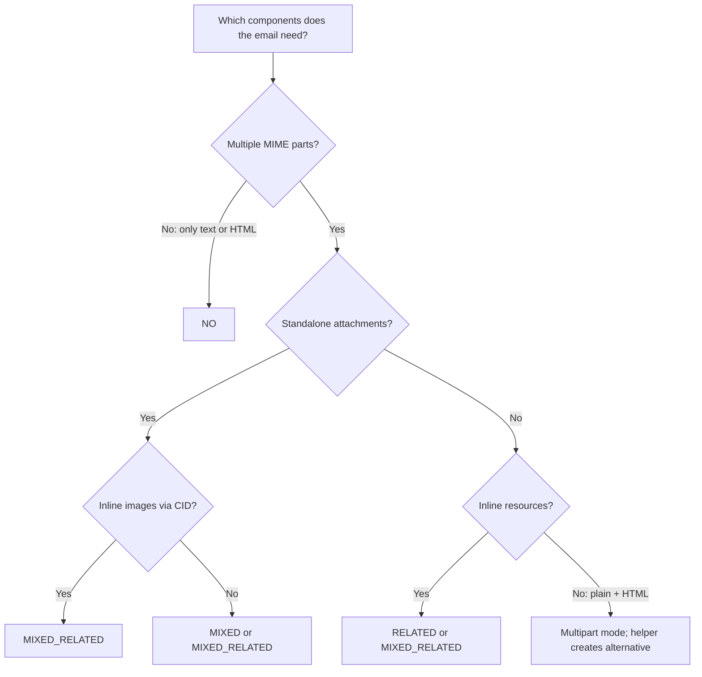

# Multipart mode and choosing the right mode

When sending email with **Spring Framework Mail**, a message with only a few lines of text can be created with `MimeMessageHelper` without needing a multi-part MIME structure. But when an email has **both a text and an HTML version**, **images that appear in the content**, or **file attachments**, the parts must be arranged into a MIME tree with clear semantics. At that point, the **multipart mode** parameter of `MimeMessageHelper` determines how Spring organizes those parts.

Choosing the wrong mode can cause the mail-reading application to show images as file attachments, repeat both the text and HTML versions, fail to show images referenced by `cid:`, or confuse which part is the main content. Therefore, choosing a multipart mode is a decision about **message structure and mail client compatibility**, not a choice about decorating the email.

This lesson explains the four `MULTIPART_MODE_*` modes of `MimeMessageHelper`, their relationship with `multipart/mixed`, `multipart/related`, and `multipart/alternative`, how to choose according to need, Java examples that send real mail, and the limitations to remember when testing across mail clients.

## 1. Why does an email need multipart?

A simple text email can have a single body:

```text
MimeMessage
└── text/plain; charset=UTF-8
    "Your account has been created."
```

A plain HTML email can also have just one body:

```text
MimeMessage
└── text/html; charset=UTF-8
    "<p>Your account has been created.</p>"
```

In these two cases, using `multipart/*` is **not required**. But a message may need several components at the same time:

- A `text/plain` version so that text-only clients can still understand the content.
- A `text/html` version to support presentation, links, and formatting.
- A logo image that the HTML references through `cid:brandLogo`.
- A PDF for the user to download.

These components do not all have the same role. Some are **alternative representations** of the same content; some are **related resources** used to build the HTML; and some are **standalone file attachments**. MIME provides different `multipart/*` types to describe those relationships.

### What does a multi-part message look like?

```text
MimeMessage
└── multipart/mixed
    ├── multipart/related
    │   ├── multipart/alternative
    │   │   ├── text/plain
    │   │   └── text/html
    │   └── image/png; Content-ID: <brandLogo>
    └── application/pdf; attachment; filename="report.pdf"
```

This tree is not something the user sees directly in the Inbox. It is the structure that the mail client reads to decide **which content to display, where to get the images, and which files to put in the attachment list**.

## 2. Three kinds of multipart to understand before choosing a mode

### 2.1. `multipart/alternative` — versions that replace each other

`multipart/alternative` usually contains a text version and an HTML version that express **the same business information**:

```text
multipart/alternative
├── text/plain
└── text/html
```

Per the MIME principle, the alternatives should go from the simpler representation to the richer one. For the common pair of **plain text and HTML**, put **plain first, HTML after**. The mail client can choose the version that it supports and is allowed to display.

If the text and HTML parts are placed side by side in `multipart/mixed`, some clients may display both as different content. `alternative` states clearly that they are **the same message in two formats**, so they do not need to be presented at the same time.

In Spring, the API:

```java
helper.setText(plainText, htmlText);
```

is the convenient way to create two alternative versions. **The helper must be initialized in multipart mode** to use this two-parameter overload.

### 2.2. `multipart/related` — parts that depend on each other for display

An example of HTML referencing a logo:

```html
<p>Hello!</p>

```

The logo can be sent as a MIME part:

```text
Content-Type: image/png
Content-ID: <brandLogo>
Content-Disposition: inline
```

`multipart/related` indicates that the HTML and the referenced resources belong to **the same presentation content**. In the simple form, the root part for display is usually placed first; the MIME related standard also supports specifying the root with the `start` parameter.

```text
multipart/related
├── text/html with src="cid:brandLogo"
└── image/png; Content-ID: <brandLogo>
```

Note: `cid:brandLogo` in the HTML must match the image's `Content-ID: <brandLogo>`. Not every client displays inline resources the same way. Some clients even show the image in the attachment list although the image is marked `inline`.

### 2.3. `multipart/mixed` — several components sent together

`multipart/mixed` is usually used when the message has **main content and file attachments**:

```text
multipart/mixed
├── text/plain: "See the attached report."
└── application/pdf
    Content-Disposition: attachment
    filename="report.pdf"
```

The two parts coexist but are **not two alternatives of the same content**. The mail client usually tries to present the main body and provides the attachment for the reader to open or download.

If the HTML body has inline images and there is also a PDF attachment, the structure usually has `related` inside `mixed` to express the roles of the two kinds of resources correctly.

### Summary of the three relationships

| MIME type | The question it answers | Common case |
|---|---|---|
| `multipart/alternative` | “Which **one** version of the content should be chosen?” | Plain text and HTML |
| `multipart/related` | “Which parts **depend on each other to build the content**?” | HTML and images via `cid:` |
| `multipart/mixed` | “Which components **coexist** in the email?” | Body and file attachments |

These three types can be **nested**; they do not exclude each other. The multipart mode of `MimeMessageHelper` mainly determines the **structural frame** in which the helper adds the body, inline resources, and attachments in the right place.

## 3. The four multipart modes of `MimeMessageHelper`

Spring provides the following constants:

```java
MimeMessageHelper.MULTIPART_MODE_NO
MimeMessageHelper.MULTIPART_MODE_MIXED
MimeMessageHelper.MULTIPART_MODE_RELATED
MimeMessageHelper.MULTIPART_MODE_MIXED_RELATED
```

You can picture the structure that the helper sets up:

| Mode | Main shape | Strengths / limitations |
|---|---|---|
| **`NO`** | Does not create multipart | Compact for single-part text or HTML; you cannot add inline/attachments through the helper as in multipart. |
| **`MIXED`** | `multipart/mixed` root | Puts the body and other parts into one mixed group; some mail clients may treat inline resources like attachments. |
| **`RELATED`** | `multipart/related` root | Ties the body and related resources together; a standalone attachment may be handled by the client in an unexpected way. |
| **`MIXED_RELATED`** | `multipart/mixed` on the outside, `multipart/related` on the inside | Separates attachments from the body/inline image group; a flexible choice for emails that have both. |

The constants describe the **MIME structure produced**, not a character-encoding mode, the SMTP security level, or the type of HTML content.

### 3.1. `MULTIPART_MODE_NO`

Example:

```java
MimeMessage message = mailSender.createMimeMessage();
MimeMessageHelper helper =
        new MimeMessageHelper(message, false, "UTF-8");

helper.setFrom("no-reply@example.org");
helper.setTo("user@example.net");
helper.setSubject("Confirmation");
helper.setText("The account has been activated.");

mailSender.send(message);
```

The constructor with `multipart=false` is equivalent to not initializing a multipart structure in the helper. When you need only **a single text/plain body** or **a single text/html body**, this is enough.

Single-part HTML:

```java
helper.setText("<p>The account has been activated.</p>", true);
```

The `true` argument in `setText(String, boolean)` means the body is HTML; it does **not** enable multipart. A message can be `text/html` and still be **single-part**.

Do not use the `NO` mode if you intend to call `addInline(...)` or `addAttachment(...)` through the helper, or want to create plain and HTML versions with the `setText(plain, html)` overload. Operations that need multipart will not suit a helper in the non-multipart state.

### 3.2. `MULTIPART_MODE_MIXED`

Example:

```java
MimeMessageHelper helper = new MimeMessageHelper(
        message,
        MimeMessageHelper.MULTIPART_MODE_MIXED,
        "UTF-8"
);
```

General shape:

```text
multipart/mixed
├── main content part
├── inline resources if added
└── attachments if added
```

With this mode, the body, inline resources, and attachments can sit at the same `mixed` level. This simple arrangement can work in some environments, but the relationship between the HTML and the images referenced by `cid:` is **not expressed with a separate `related` group**. Some mail clients may treat inline images as attachments or may not render the images as desired.

If the email **has only a body and attachments**, the `MIXED` mode is a reasonable structure. If you add inline images and want to optimize compatibility, you should usually consider `MIXED_RELATED`.

### 3.3. `MULTIPART_MODE_RELATED`

Example:

```java
MimeMessageHelper helper = new MimeMessageHelper(
        message,
        MimeMessageHelper.MULTIPART_MODE_RELATED,
        "UTF-8"
);
```

Shape:

```text
multipart/related
├── main content part
└── related resources used to build the content
```

This mode suits the case where the HTML part needs inline images or auxiliary resources and the email **does not need a standalone attachment**. If you add an attachment to the related group at the root level, some clients may interpret that file as a resource serving the display, rather than as an ordinary attached file.

Therefore, `RELATED` is usually worth considering for **HTML + CID images emails with no downloadable files**, while `MIXED_RELATED` is clearer when adding a PDF or other documents.

### 3.4. `MULTIPART_MODE_MIXED_RELATED`

Example:

```java
MimeMessageHelper helper = new MimeMessageHelper(
        message,
        MimeMessageHelper.MULTIPART_MODE_MIXED_RELATED,
        "UTF-8"
);
```

General shape:

```text
multipart/mixed
├── multipart/related
│   ├── main content part
│   └── related inline images/resources
└── standalone attachments
```

If you use `helper.setText(plainText, htmlText)`, the main content part may also contain `multipart/alternative`:

```text
multipart/mixed
├── multipart/related
│   ├── multipart/alternative
│   │   ├── text/plain
│   │   └── text/html
│   ├── image/png; Content-ID: <brandLogo>
│   └── image/jpeg; Content-ID: <banner>
├── application/pdf; attachment
└── text/csv; attachment
```

This is a pragmatic choice when a message has **an HTML body, inline images, and attachments all at once**. It keeps the resources related to the presentation in `related` and keeps the downloadable files in the outer `mixed`.

The short constructor:

```java
new MimeMessageHelper(message, true, "UTF-8");
```

uses **`MimeMessageHelper`'s default multipart mode**, usually `MIXED_RELATED` in modern Spring Framework. When the lesson's goal or the business need calls for a specific MIME shape, using an explicit constant helps code readers recognize the intent and makes compatibility easier to discuss.

## 4. Diagram for choosing a mode by need



The diagram is **initial selection guidance**. It is not a rule that every mail client will display correctly when a particular mode is chosen. For important emails, you need to look at the MIME source and the results on the target clients.

### Quick selection matrix

| Email to send | Mode to consider | Reason |
|---|---|---|
| Plain text only | `NO` | No multipart tree needed. |
| HTML only, no CID images or attachments | `NO` | A single `text/html` body is enough. |
| Plain text and HTML for the same content | Multipart-enabled helper; `MIXED_RELATED` can be used | `setText(plain, html)` needs multipart to create `alternative`. |
| HTML + inline logo, no attachment | `RELATED` or `MIXED_RELATED` | Keeps the HTML and the logo in the related resource group. |
| Text or HTML + one attached PDF, no inline | `MIXED` or `MIXED_RELATED` | Separates the body and the standalone file. |
| Plain + HTML + CID image + PDF | `MIXED_RELATED` | Distinguishes `alternative`, `related`, and `mixed`. |
| Multiple PDFs/CSVs, no inline | `MIXED` or `MIXED_RELATED` | The attachments belong to the mixed group. |
| Mail used across many inconsistent mail clients | Choose the mode by component, test on real clients | No single mode guarantees absolute compatibility. |

You do not need to use `MIXED_RELATED` in every case just because it has more capabilities. A plain-text-only email can stay in `NO` mode so the structure is easier to understand.

## 5. Spring Boot example: configuration and sending a complete MIME message

Suppose the project uses `spring-boot-starter-mail` and has an SMTP submission server. The Gradle dependency:

```groovy
dependencies {
    implementation 'org.springframework.boot:spring-boot-starter-mail'
}
```

An example configuration for port 587 and STARTTLS:

```yaml
spring:
  mail:
    host: smtp.example.net
    port: 587
    username: ${SMTP_USERNAME}
    password: ${SMTP_PASSWORD}
    default-encoding: UTF-8
    properties:
      "[mail.smtp.auth]": true
      "[mail.smtp.starttls.enable]": true
      "[mail.smtp.starttls.required]": true
      "[mail.smtp.connectiontimeout]": 5000
      "[mail.smtp.timeout]": 5000
      "[mail.smtp.writetimeout]": 5000
```

The SMTP values are for illustration only; the real server, TLS mechanism, and sending identity must follow the provider's requirements. Secrets are supplied from the runtime environment, not written directly in the source code.

Prepare the resources:

```text
src/main/resources/
└── mail/
    ├── brand-logo.png
    └── welcome-guide.pdf
```

Write the service:

```java
import jakarta.mail.MessagingException;
import jakarta.mail.internet.MimeMessage;
import org.springframework.core.io.ClassPathResource;
import org.springframework.mail.javamail.JavaMailSender;
import org.springframework.mail.javamail.MimeMessageHelper;
import org.springframework.stereotype.Service;

@Service
public class WelcomeMailService {

    private final JavaMailSender mailSender;

    public WelcomeMailService(JavaMailSender mailSender) {
        this.mailSender = mailSender;
    }

    public void sendWelcome(String recipient) throws MessagingException {
        // Each send request uses its own MimeMessage.
        MimeMessage message = mailSender.createMimeMessage();

        // Choose the mode explicitly when there are both an inline image and a PDF.
        MimeMessageHelper helper = new MimeMessageHelper(
                message,
                MimeMessageHelper.MULTIPART_MODE_MIXED_RELATED,
                "UTF-8"
        );

        helper.setFrom("no-reply@example.org");
        helper.setTo(recipient);
        helper.setSubject("Welcome");

        String plainText = """
                Hello!

                Your account has been activated.
                See the attached welcome-guide.pdf document.
                """;

        String htmlText = """
                <html>
                  <body>
                    
                    <h1>Welcome!</h1>
                    <p>Your account has been activated.</p>
                    <p>See the attached document to get started.</p>
                  </body>
                </html>
                """;

        // The helper creates an alternative: plain first, HTML after.
        helper.setText(plainText, htmlText);

        // Add the image after the body has been set.
        helper.addInline(
                "brandLogo",
                new ClassPathResource("mail/brand-logo.png"),
                "image/png"
        );

        // The downloadable file goes into the outermost mixed branch.
        helper.addAttachment(
                "welcome-guide.pdf",
                new ClassPathResource("mail/welcome-guide.pdf"),
                "application/pdf"
        );

        mailSender.send(message);
    }
}
```

### What happens at each statement?

| Statement | Effect |
|---|---|
| `createMimeMessage()` | Creates a new message, no SMTP sending yet. |
| Constructor with `MULTIPART_MODE_MIXED_RELATED` | Prepares the MIME frame consisting of an outermost mixed and an inner related. |
| `setFrom(...)`, `setTo(...)`, `setSubject(...)` | Sets the required headers. |
| `setText(plain, html)` | Creates two alternative versions; lets the client choose text or HTML. |
| `addInline("brandLogo", ...)` | Adds an image MIME part with a Content-ID for the HTML to reference via `cid:brandLogo`. |
| `addAttachment(...)` | Adds the PDF file as a standalone attachment in the mixed group. |
| `mailSender.send(message)` | Starts the operation of sending the created message to SMTP. |

This is a common design for emails that need several content forms. The order **`setText(...)` before `addInline(...)`** is recommended by Spring to avoid some mail clients having trouble recognizing the main content part.

## 6. Smaller examples by case

### 6.1. Plain text: multipart not enabled

```java
MimeMessage message = mailSender.createMimeMessage();
MimeMessageHelper helper =
        new MimeMessageHelper(message, false, "UTF-8");

helper.setFrom("notice@example.org");
helper.setTo("user@example.net");
helper.setSubject("Notification");
helper.setText("The system has recorded the request.");

mailSender.send(message);
```

This is the most compact choice when multiple parts are not needed. If the system sends only text, you can also use `SimpleMailMessage` through `MailSender`.

### 6.2. Single-part HTML: multipart not required

```java
MimeMessage message = mailSender.createMimeMessage();
MimeMessageHelper helper =
        new MimeMessageHelper(message, false, "UTF-8");

helper.setFrom("notice@example.org");
helper.setTo("user@example.net");
helper.setSubject("HTML notification");
helper.setText(
        "<html><body><h1>Hello!</h1></body></html>",
        true
);

mailSender.send(message);
```

The `true` in `setText(html, true)` specifies HTML, which differs from the `true` in the constructor `new MimeMessageHelper(message, true)` that enables multipart.

### 6.3. Plain text and HTML: multipart is needed when using the two-string overload

```java
MimeMessage message = mailSender.createMimeMessage();
MimeMessageHelper helper =
        new MimeMessageHelper(message, true, "UTF-8");

helper.setTo("user@example.net");
helper.setFrom("notice@example.org");
helper.setSubject("Registration confirmation");
helper.setText(
        "Registration successful. Visit https://example.org/account",
        "<p>Registration successful. " +
        "<a href=\"https://example.org/account\">Open account</a></p>"
);

mailSender.send(message);
```

The helper will use an alternative structure for the two bodies. Even though this sample has no image or PDF, the `multipart=true` constructor makes it possible to call the `setText(plain, html)` API. If you want a tree with only `multipart/alternative` at the root level, you can build the MIME by hand with Jakarta Mail; that is a need for separate structural control, not a requirement for every Spring application.

### 6.4. HTML and an inline image, no attachment

```java
MimeMessage message = mailSender.createMimeMessage();
MimeMessageHelper helper = new MimeMessageHelper(
        message,
        MimeMessageHelper.MULTIPART_MODE_RELATED,
        "UTF-8"
);

helper.setTo("user@example.net");
helper.setFrom("notice@example.org");
helper.setSubject("Membership card");

helper.setText(
        "<p>Here is your card:</p>" +
        "",
        true
);

helper.addInline(
        "membershipCard",
        new ClassPathResource("mail/member-card.png"),
        "image/png"
);

mailSender.send(message);
```

The example assumes the file `mail/member-card.png` exists. If you later add a PDF that the user needs to download, consider switching from `RELATED` to `MIXED_RELATED` to distinguish attachments from inline resources.

### 6.5. Body and PDF, no inline image

```java
MimeMessage message = mailSender.createMimeMessage();
MimeMessageHelper helper = new MimeMessageHelper(
        message,
        MimeMessageHelper.MULTIPART_MODE_MIXED,
        "UTF-8"
);

helper.setTo("user@example.net");
helper.setFrom("reports@example.org");
helper.setSubject("Report");
helper.setText("Your report is in the attached PDF file.");

helper.addAttachment(
        "report.pdf",
        new ClassPathResource("mail/report.pdf"),
        "application/pdf"
);

mailSender.send(message);
```

In this case, `MIXED` already expresses correctly that a body and a standalone attachment are being sent. If you add an inline logo to the HTML body, choosing `MIXED_RELATED` will express the HTML/image relationship more clearly.

## 7. Are the API call order and the part order the same?

These are two related issues that need to be distinguished:

1. **The order of method calls when building the message:** for example `setText(...)` before `addInline(...)`.
2. **The order of parts in the MIME source:** for example `text/plain` before `text/html` in `multipart/alternative`.

With `MimeMessageHelper`, Spring creates the parts itself and chooses the appropriate position within the multipart. You should not rely on calling `addAttachment(...)` earlier or later to change the semantic rules of MIME. Even if you can create the parts in an arbitrary order, the mail client still reads the structure by `Content-Type` and the relationships between the parts.

### Order with `multipart/alternative`

When calling:

```java
helper.setText(plainText, htmlText);
```

the intent is two versions of the same content. Plain text usually comes **first**, HTML **after**, so that the client understands the priority.

You should not put in two versions with different business content. If the HTML version has a verification code or a required link but the text version lacks it, a user who chooses a text-only mode will not be able to act.

### Order with inline images

When using CID images, you should do:

```java
helper.setText(htmlText, true);
helper.addInline("logo", logoResource, "image/png");
```

rather than adding the image before setting the body. Some mail readers handle CID links incorrectly if the message structure is built in an unfavorable order. You need to check that the ID used in the HTML and the MIME part match exactly.

### Putting attachments in the right group

If the helper uses `MIXED_RELATED`, the standalone attachment belongs to the `mixed` root, while the inline image belongs to the inner `related` group. This matters more than whether a mail client puts the attachment icon above or below the content in its interface.

## 8. Content-ID, Content-Disposition, and Content-Type

The multipart mode sets up the **relationship frame**, while each part's headers say **what kind of data it is** and **how it is used**.

| Information | Example | Meaning |
|---|---|---|
| `Content-Type` | `text/html; charset=UTF-8` | Determines the body type and the text encoding. |
| `Content-Type` | `multipart/related; boundary="..."` | Declares the set of related parts; `boundary` separates them in the MIME source. |
| `Content-ID` | `<brandLogo>` | Identifies the part so the HTML can reference it via `cid:brandLogo`. |
| `Content-Disposition` | `inline` | Hints that the resource is tied to the displayed content. |
| `Content-Disposition` | `attachment; filename="report.pdf"` | Hints that the part is an attached file to download. |
| `Content-Transfer-Encoding` | `base64` or `quoted-printable` | Specifies how data is represented when transported through the email system. |

A file with `Content-Disposition: inline` is **not guaranteed** to be displayed inline on every client. The mail reader also weighs the MIME tree, Content-ID, media type, security policy, and its own rendering.

### `cid:` is not the same as an external image URL

```html
<!-- The image travels with the email via a MIME part -->


<!-- The image is requested over the network -->

```

A `cid:` image is referenced from parts within the message; an external-URL image requires the client to download it from the Internet and may be blocked or go through a proxy. The multipart mode relates directly to **inline images attached via MIME**; it does not automatically turn images from external URLs into files in the message.

Whether you use CID images or external images, do not put all the important information only in images; keep appropriate text and alt text so that users still understand the mail if the images are not displayed.

## 9. Encoding is not the multipart mode

`"UTF-8"` and `MULTIPART_MODE_MIXED_RELATED` appear next to each other in the constructor:

```java
new MimeMessageHelper(
    message,
    MimeMessageHelper.MULTIPART_MODE_MIXED_RELATED,
    "UTF-8"
);
```

But they solve two different problems:

- **Multipart mode:** determines the **tree of parts** (`mixed`, `related`, and the content group).
- **Encoding:** specifies how **text characters** are represented in the subject, display names, and text/HTML when the helper creates the message.

UTF-8 does not mean every part is text. PDF and PNG are still **binary data**, usually encoded by Jakarta Mail through an appropriate Content-Transfer-Encoding for transport.

In Spring Boot, `spring.mail.default-encoding=UTF-8` can provide the default encoding for messages created through the sender; passing `"UTF-8"` explicitly to the helper constructor helps define the charset right where the mail is composed.

## 10. Compatibility across mail clients

A MIME tree being valid per the standard does not guarantee that every mail client will display it the same way. Application families such as Gmail, Outlook, Apple Mail, and many mobile apps have different HTML engines, safety rules, and ways of classifying attachments. A nested structure helps describe the intent correctly, while the actual result needs to be observed on the clients that recipients commonly use.

| Symptom | Possible relation | How to handle |
|---|---|---|
| The logo image appears as an attached file | The image and body are not grouped in a suitable related group, or the client displays inline parts by its own policy | Use `RELATED`/`MIXED_RELATED`, check the Content-ID and the target mail client. |
| The HTML displays but the CID image is broken | `src="cid:..."` does not match the Content-ID, the resource is missing, or the client does not handle it as expected | Compare the ID and the MIME part; check the actual image. |
| The PDF shows as part of the content or has no download icon | The attachment is placed in the related group or lacks suitable metadata | Use `MIXED`/`MIXED_RELATED`, check the Content-Disposition. |
| The recipient sees both the text and the HTML versions | The two versions are not grouped in alternative, or the client misunderstands the structure | Use `setText(plain, html)` with a multipart helper; look at the raw MIME. |
| The client displays only plain text | The user turned off HTML, the client does not support HTML, or the alternative order is wrong | Ensure the plain text has enough information, monitor the MIME structure. |
| An email works on webmail but fails on desktop | Differences in renderer, inline and attachment handling | Try the target clients, adjust the structure/HTML when there is evidence. |
| The attachment cannot be read | The resource is broken, the stream is exhausted, or the transfer encoding is wrong | Check the data source, size, content type, and MIME source. |

These cases may relate to the **MIME structure**, **resources**, **HTML/CSS**, or the **mail client's policy**. You should not change the multipart mode at random before determining which part is being misinterpreted.

### HTML email is not the same as browser HTML

Many mail clients do not fully support CSS/JavaScript like a browser. Even if `MIXED_RELATED` has arranged the body, images, and files correctly, a complex CSS layout can still break. The multipart mode does not replace designing simple HTML email with a text fallback and a layout tested on the target clients.

## 11. How to see the MIME tree that is actually created

When you need to determine the message structure, you should look at the **raw message source** rather than only the Inbox interface. You can use an SMTP server that captures mail in the development environment, for example Mailpit or GreenMail, to observe the message and its parts without sending email to real users.

An observation procedure:

1. Configure `JavaMailSender` to point to a test SMTP server in the development environment.
2. Send an email with the mode you want to check.
3. View the original source of the message in the test mailbox.
4. Find the `MIME-Version` header, `Content-Type: multipart/...`, and the `boundary` values.
5. Rebuild the tree of parts; see which is `mixed`, `related`, and `alternative`.
6. Check that the parts have `Content-ID` values that match the `cid:` references in the HTML.
7. Check the `Content-Disposition` and the filename of the PDF/CSV.
8. Open the same email in the target clients to observe the real differences.

An abbreviated raw MIME example, with boundaries that are illustrative only:

```text
MIME-Version: 1.0
Content-Type: multipart/mixed; boundary="mix"

--mix
Content-Type: multipart/related; boundary="rel"

--rel
Content-Type: multipart/alternative; boundary="alt"

--alt
Content-Type: text/plain; charset=UTF-8

Hello! See the attached PDF.

--alt
Content-Type: text/html; charset=UTF-8

<p>Hello!</p>


--alt--

--rel
Content-Type: image/png
Content-ID: <brandLogo>
Content-Disposition: inline

[encoded PNG bytes]
--rel--

--mix
Content-Type: application/pdf
Content-Disposition: attachment; filename="report.pdf"

[encoded PDF bytes]
--mix--
```

A real mail library may add headers, character encoding, Content-Transfer-Encoding, and different boundaries. What to observe is the **relationship between the parts**, not the boundary string values generated by the library.

### Use `MimeMessage.writeTo(...)` to observe when needed

Jakarta Mail's `MimeMessage` provides:

```java
message.writeTo(outputStream);
```

This API writes the Internet mail representation to a stream, useful for checking the structure in a controlled environment. **`writeTo(...)` does not send the message via SMTP.** The data may contain recipient addresses, verification codes, sensitive content, and attachments; do not dump the entire MIME straight into production logs.

## 12. Programming errors related to the multipart mode

### 12.1. Not enabling multipart but calling `addAttachment(...)`

Example:

```java
MimeMessageHelper helper =
        new MimeMessageHelper(message, false, "UTF-8");

helper.addAttachment("guide.pdf", pdfResource);
```

The helper was not initialized with a multipart structure. When adding a part that needs multipart, the API may throw an error (for example `IllegalStateException`). The fix is to choose a multipart constructor before adding resources, not to try to patch each header by hand.

### 12.2. Not enabling multipart but calling `setText(plain, html)`

```java
MimeMessageHelper helper =
        new MimeMessageHelper(message, false, "UTF-8");

helper.setText(plainText, htmlText);
```

The two-string overload must organize a `multipart/alternative` group, so it does not suit a non-multipart helper. If you want only an HTML version, you can use `helper.setText(htmlText, true)` in `NO` mode. If you want both plain and HTML, use a multipart constructor.

### 12.3. Adding an inline resource before the body

```java
helper.addInline("logo", logoResource, "image/png");
helper.setText(htmlText, true);
```

Although the call order may not cause a Java error in every situation, some mail readers may handle the relationship between the HTML and the inline image incorrectly. The recommended pattern:

```java
helper.setText(htmlText, true);
helper.addInline("logo", logoResource, "image/png");
```

### 12.4. Mismatched IDs

```java
helper.setText("", true);
helper.addInline("logo", logoResource, "image/png");
```

`brandLogo` and `logo` are different, so the client cannot link the image through the intended reference. You need to use a consistent ID, without angle brackets in the `addInline(...)` parameter:

```java
helper.addInline("brandLogo", logoResource, "image/png");
```

### 12.5. Trying to use an attachment as an inline image

An image that needs to be displayed **inside the HTML** should be added with `addInline(...)` and have a suitable CID reference. An image offered to the user **to download as a separate file** should use `addAttachment(...)`. The two APIs have different purposes even though both can be passed an `image/png` resource.

### 12.6. Using one mutable `MimeMessage` for many requests

`MimeMessage` and `MimeMessageHelper` operate on mutable state. You should not keep a shared instance and let multiple requests modify `To`, `Subject`, the body, or attachments. Each sending task should create a new message through `mailSender.createMimeMessage()`.

## 13. Does choosing the multipart mode decide whether SMTP sends successfully?

The multipart mode determines **how the email content is packaged**, while SMTP is the transport protocol. When you call:

```java
mailSender.send(message);
```

an SMTP implementation will open a connection, set up TLS/authentication according to the configuration, send the `MAIL FROM`/`RCPT TO` envelope, and then transmit the message in `DATA`.

If the server accepts the content, the call may complete without an exception. However:

- The SMTP server may accept a message while the mail client still displays the CID image incorrectly.
- A mail server may reject an email because the attachment size exceeds the limit.
- A mail with a good MIME structure may still be spam-filtered or have its HTML reduced in functionality.
- A send accepted by SMTP does not prove that the mail reached the Inbox or was read by the user.

You need to distinguish the groups of errors:

| Layer | Example | Where to check |
|---|---|---|
| MIME construction | Multipart not enabled in the mode, wrong Content-ID, unreadable resource | `MimeMessageHelper` code, MIME tree, attachment data. |
| SMTP transport | Wrong host, TLS, auth, connection timeout, quota | Sender configuration and SMTP/provider responses. |
| Delivery | Bounce, spam filtering, rejection by the receiving domain | The mail-sending system and delivery events. |
| Display at the client | CID image not shown, attachment classified differently | Raw MIME and real mail clients. |

Do not confuse a display error with a send failure. If SMTP accepted the message and the email reached the recipient but the logo is displayed as an attached file, prioritize checking the MIME tree and how the client understands the parts.

## 14. Attachment data sources and when they are read

`MimeMessageHelper` allows adding files from a `Resource`, an `InputStreamSource`, or equivalent sources. The mail library's **actual reading of the content** may happen when the message is written out as MIME for sending, rather than at the moment `addAttachment(...)` is called.

An example of a PDF created in memory:

```java
import org.springframework.core.io.ByteArrayResource;

byte[] pdfData = reportService.createPdf();
helper.addAttachment(
        "report.pdf",
        new ByteArrayResource(pdfData),
        "application/pdf"
);
```

Here `reportService.createPdf()` is an example of a business function that returns PDF bytes. Using `ByteArrayResource` allows the data to be read multiple times if the library needs to access the content again. If you use a stream that can be read only once, or a file that was deleted before sending, the message may fail to serialize.

The right multipart mode **cannot fix a broken attachment source**, nor does it bypass the SMTP provider's email size limit. MIME encoding can make the transmitted size larger than the total original bytes of the attachments.

## 15. When do you need direct MIME control instead of using the helper?

`MimeMessageHelper` suits most email-sending applications: it saves you from creating `MimeMultipart` and `MimeBodyPart` yourself, setting headers, and arranging parts. But some systems need a specific MIME structure, such as:

- A receiving party accepts only one specific multipart shape under an integration contract.
- The email needs `multipart/alternative` at the root without the `mixed/related` frame.
- You need to create multipart types that the helper does not directly support, or complex relationships among several groups.
- You need to work with MIME source coming from an external system.

In those cases, you can use the Jakarta Mail API to build `MimeMultipart` and `MimeBodyPart` manually and then assign them to the `MimeMessage`. In exchange, the code must manage the order, Content-Type, Content-ID, Content-Disposition, encoding, data sources, and compatibility itself.

For an ordinary email with plain/HTML, images, and attachments, you should start with `MimeMessageHelper` and choose the right multipart mode. Only switch to manual MIME when there is a **specific structural requirement** that the helper cannot adequately represent.

## 16. Things to remember when choosing a multipart mode

- **`MULTIPART_MODE_NO`:** use for emails with only a single text or HTML body, with no additional inline resources or attachments through the helper.
- **`MULTIPART_MODE_MIXED`:** provides `multipart/mixed`, suitable when there are a body and attachments; consider the limitations when using inline resources.
- **`MULTIPART_MODE_RELATED`:** provides `multipart/related`, suitable when the body depends on CID images/inline resources and no standalone attached file is needed.
- **`MULTIPART_MODE_MIXED_RELATED`:** provides `mixed` on the outside and `related` on the inside, usually the clear choice when the email has both inline images and attachments.
- **`setText(plainText, htmlText)`** creates two alternative content versions and needs the helper in multipart mode. **`setText(html, true)`** can be used for single-part HTML.
- **`setText(...)` before `addInline(...)`** is the order to apply when there are images referenced by the HTML.
- **`Content-ID`, `Content-Disposition`, and the MIME tree** all affect how mail clients understand each part; the mode is only the structure-setup step.
- **UTF-8**, SMTP TLS, and email delivery results are different issues from the multipart mode.
- **Check the raw MIME and real clients** when you need to ensure readers see the body, images, and attached files as intended.

When choosing a mode, determine **which content replaces each other (`alternative`), which are resources serving presentation (`related`), and which are standalone files (`mixed`)**. From those three relationships, choosing `MULTIPART_MODE_NO`, `MIXED`, `RELATED`, or `MIXED_RELATED` becomes a well-founded technical decision that is easy to maintain and easy to verify.
