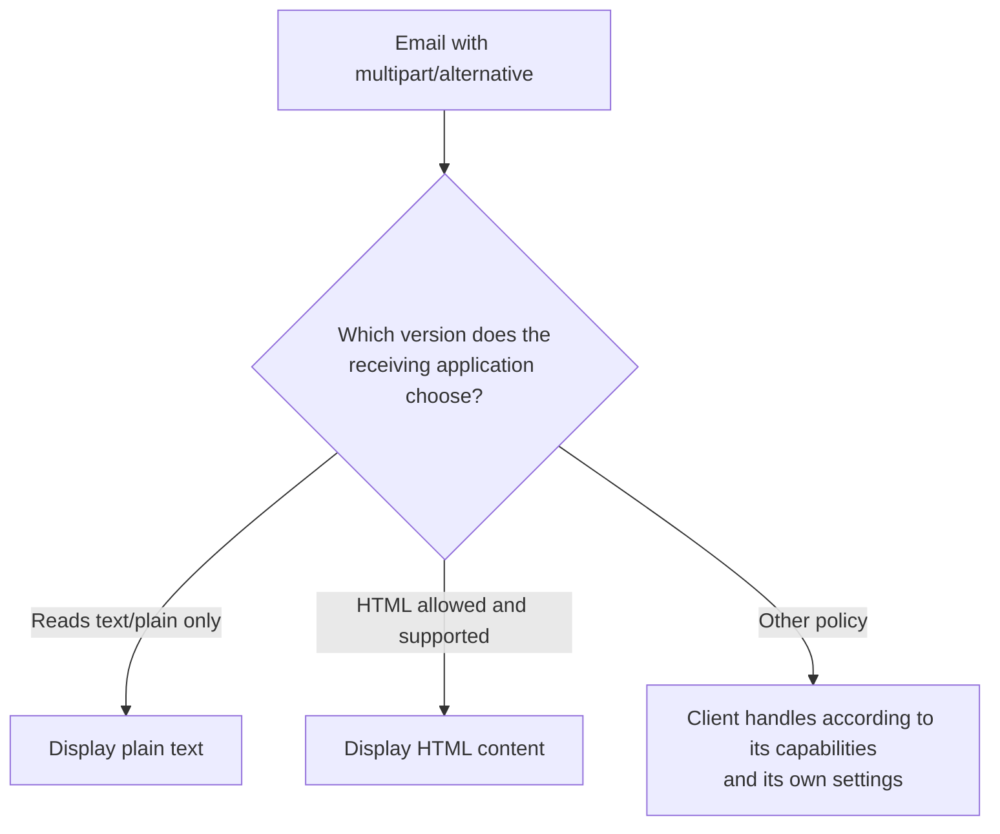
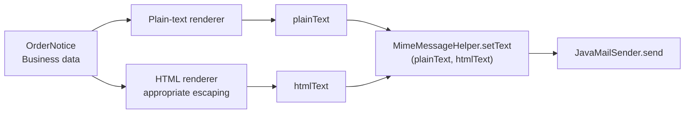
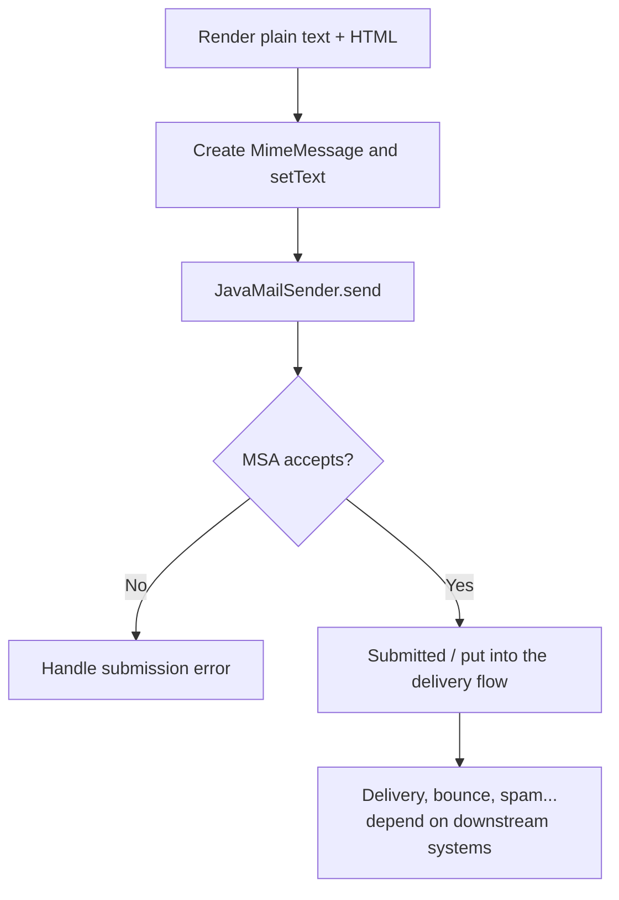

# Sending plain text and HTML in the same email with MimeMessageHelper

When sending transactional email with Spring Framework Mail, an application usually wants the content to **display nicely on mail clients that support HTML** while still being **fully readable on clients that use only plain text**. The solution is not to send two independent emails. Instead, we put two **presentation versions of the same content** in one MIME message, using `multipart/alternative`.

Spring provides a very suitable method:

```java
helper.setText(plainText, htmlText);
```

Here, `plainText` is the content of the `text/plain` part and `htmlText` is the content of the `text/html` part. The `MimeMessageHelper` object creates the necessary MIME parts, while `JavaMailSender` transfers **one message** to the configured SMTP server. The mail-reading application chooses the version that fits its display capabilities and the user's preferences.

This lesson presents the meaning of the two versions, the MIME structure, the overloads of `setText`, how to create a complete email in Spring, notes about Vietnamese encoding, safe HTML, inline images, file attachments, and handling display situations that do not go as expected.

## 1. How do plain text and HTML differ?

An email can be presented in two common forms:

| Content form | MIME type | Purpose | Example |
|---|---|---|---|
| Plain text | `text/plain` | Reading the content as text and line breaks | `Your order has been confirmed.` |
| HTML | `text/html` | Displaying the structure, links, colors, and layout that the mail client supports | `<p>Your order <strong>has been confirmed</strong>.</p>` |

For example, the same order-confirmation notice has two versions.

**Plain text**:

```text
Hello An,

Order DH-2048 has been confirmed.
Total: 450.000 ₫

View details:
https://shop.example.org/orders/DH-2048

Best regards,
The store team
```

**HTML**:

```html
<!doctype html>
<html lang="en">
  <body>
    <h2>The order has been confirmed</h2>
    <p>Hello An,</p>
    <p>Order <strong>DH-2048</strong> has been confirmed.</p>
    <p>Total: <strong>450.000 ₫</strong></p>
    <p>
      <a href="https://shop.example.org/orders/DH-2048">
        View order details
      </a>
    </p>
    <p>Best regards,<br>The store team</p>
  </body>
</html>
```

The two versions must convey the **same business event and important information**. The HTML can add formatting or images; the plain text still needs to state the order code, amount, link, and necessary instructions in full. You should not leave the plain text saying only “Please open the HTML to read” if the content is meaningful to the recipient.

### Plain text does not mean “unencrypted SMTP”

In the context of this lesson, `plain text` refers to the **format of the email body part (`text/plain`)**. It is entirely different from the question of whether the application connects to the SMTP server over TLS.

- `text/plain` and `text/html` are MIME content types.
- STARTTLS and implicit TLS protect the channel to the SMTP server.
- An email with two MIME versions can still be transmitted over TLS.
- TLS between the application and the SMTP server does not by itself turn the whole delivery process into end-to-end encryption.

Therefore, there is no need to change the SMTP configuration just to add a text/plain and an HTML version in the same email.

## 2. Why use `multipart/alternative`?

MIME extends traditional email so that a message can contain multiple kinds of content. The `multipart/alternative` type expresses that **the parts are alternative ways of representing the same content**.

For example, an email may have the structure:

```text
MimeMessage
└── multipart/alternative
    ├── text/plain; charset=UTF-8
    │   "The order has been confirmed.
    │    See: https://shop.example.org/orders/2048"
    └── text/html; charset=UTF-8
        "<p><strong>The order has been confirmed.</strong></p>
         <a href='https://shop.example.org/orders/2048'>View order</a>"
```

These parts are **not two messages sent to the recipient twice**. They are in **one message**, usually sharing the same `From`, `To`, `Subject`, `Date`, and `Message-ID`.

According to the meaning of `multipart/alternative`, the parts are usually arranged from the version with fewer display features to the version with richer features: **plain text first, HTML after**. A mail client can choose the HTML version when it can display HTML; a client that uses text only, or a user who has turned off HTML, can choose the text/plain version.



The final decision belongs to the mail client or the email-processing system. The sending application cannot force every client to choose HTML, nor can it rely on having HTML to ensure recipients see the same layout.

### Illustrative MIME source

A simple email can be represented as follows; the boundary is only an example:

```text
From: notifications@example.org
To: an@example.net
Subject: Order confirmation
MIME-Version: 1.0
Content-Type: multipart/alternative; boundary="part-boundary-01"

--part-boundary-01
Content-Type: text/plain; charset=UTF-8
Content-Transfer-Encoding: quoted-printable

Order DH-2048 has been confirmed.

--part-boundary-01
Content-Type: text/html; charset=UTF-8
Content-Transfer-Encoding: quoted-printable

<p>Order <strong>DH-2048</strong> has been confirmed.</p>

--part-boundary-01--
```

This is a format diagram for readability, not a requirement to create the boundary yourself or concatenate MIME headers in Java. The actual content will be transcoded appropriately by Jakarta Mail, and Spring Mail may use a nested multipart tree depending on the `MimeMessageHelper` constructor.

## 3. Commonly used `setText` methods

`MimeMessageHelper` has overloads with different meanings:

| Call | Content created | When to use |
|---|---|---|
| `setText(String text)` | Plain-text body part | Email with plain text only |
| `setText(String text, boolean html)` | Chooses **one** version, text or HTML | `false`: text/plain; `true`: text/html |
| **`setText(String plainText, String htmlText)`** | **Two alternative versions**, plain text and HTML | Email that wants the client to choose how to display |

For example:

```java
// Plain text only
helper.setText("Hello there!");

// HTML only
helper.setText("<p>Hello <strong>there</strong>!</p>", true);

// Both plain text and HTML of the same email
helper.setText(
        "Hello there!",
        "<p>Hello <strong>there</strong>!</p>");
```

The first two calls are not equivalent to the last call. Passing `true` to `setText(html, true)` **does not automatically generate a text/plain version**. Conversely, sending HTML tags through `setText(html, false)` can cause the mail client to display the literal `<p>`, `<strong>` because the data is declared as plain text.

### Enable multipart before using the two versions

The method `setText(plainText, htmlText)` needs a `MimeMessageHelper` initialized in **multipart mode**.

```java
MimeMessage message = mailSender.createMimeMessage();
MimeMessageHelper helper =
        new MimeMessageHelper(message, true, "UTF-8");

helper.setText(
        "The notification has been sent.",
        "<p>The notification <strong>has been sent</strong>.</p>");
```

If you create the helper without a multipart mode and then call the overload containing two versions, you may hit an error because the helper has no multipart structure to hold the alternative parts. When you need only a text/plain body or only an HTML body, you can create a non-multipart helper:

```java
MimeMessageHelper plainOnly =
        new MimeMessageHelper(message, false, "UTF-8");
plainOnly.setText("The content is plain text only", false);
```

In this example, `false` in the constructor chooses **not to enable multipart**; `false` in `setText(..., false)` chooses **not to treat the body as HTML**. These are parameters of two different APIs, even though they have the same boolean type.

If you need a specific structure for inline images or attachments, you can use the constructor with an explicit `multipartMode`, for example `MimeMessageHelper.MULTIPART_MODE_MIXED_RELATED`.

## 4. Preparing the Spring Boot application

An application using Spring Boot and Spring Mail usually adds the mail starter dependency.

**Gradle**:

```groovy
dependencies {
    implementation 'org.springframework.boot:spring-boot-starter-mail'
}
```

**Maven**:

```xml
<dependency>
    <groupId>org.springframework.boot</groupId>
    <artifactId>spring-boot-starter-mail</artifactId>
</dependency>
```

Then configure the SMTP server so that `JavaMailSender` can submit mail. For example, a provider that requires port 587, STARTTLS, and SMTP AUTH:

```yaml
spring:
  mail:
    host: ${SMTP_HOST}
    port: 587
    username: ${SMTP_USERNAME}
    password: ${SMTP_PASSWORD}
    default-encoding: UTF-8
    properties:
      "[mail.smtp.auth]": true
      "[mail.smtp.starttls.enable]": true
      "[mail.smtp.starttls.required]": true
      "[mail.smtp.ssl.checkserveridentity]": true
      "[mail.smtp.connectiontimeout]": 5000
      "[mail.smtp.timeout]": 10000
      "[mail.smtp.writetimeout]": 10000

app:
  mail:
    from: ${MAIL_FROM}
```

In which:

- `spring.mail.host`, `port`: the SMTP submission endpoint provided by the provider, not the MX address of each recipient.
- `username`, `password`: authentication information when the server requires it.
- `default-encoding`: the default charset, which should be consistent with the application's Unicode content.
- `mail.smtp.starttls.enable` and `required`: upgrade and **mandatorily require** TLS on port 587.
- `mail.smtp.ssl.checkserveridentity`: verifies the hostname in the SMTP server's certificate.
- `app.mail.from`: a property that the **application defines itself** to read the sender address.

The environment variables `SMTP_HOST`, `SMTP_USERNAME`, `SMTP_PASSWORD`, and `MAIL_FROM` must be supplied by the deployment environment or a secret manager. Do not put SMTP passwords into the repository or logs.

When the provider uses **port 465 with implicit TLS**, switch to the corresponding configuration: `port: 465` and `"[mail.smtp.ssl.enable]": true`, while still keeping valid hostname/TLS verification. Sending two content versions in MIME does not affect the choice between STARTTLS and implicit TLS.

### About namespaces and versions

The Java examples in this lesson use `jakarta.mail`, corresponding to Spring Framework 6+ and Spring Boot 3+. For older projects using Spring Framework 5/Spring Boot 2, the MIME imports may belong to `javax.mail`. Choose the library that matches the project version; do not mix the two namespaces in the same configuration.

## 5. A complete example: one email with both plain text and HTML

Let's write a service that sends an account-confirmation notice. The two bodies provide the same information; the HTML adds structure and a link.

```java
package com.example.notification;

import jakarta.mail.MessagingException;
import jakarta.mail.internet.MimeMessage;
import org.springframework.beans.factory.annotation.Value;
import org.springframework.mail.javamail.JavaMailSender;
import org.springframework.mail.javamail.MimeMessageHelper;
import org.springframework.stereotype.Service;

@Service
public class WelcomeMailService {

    private final JavaMailSender mailSender;
    private final String fromAddress;

    public WelcomeMailService(
            JavaMailSender mailSender,
            @Value("${app.mail.from}") String fromAddress) {
        this.mailSender = mailSender;
        this.fromAddress = fromAddress;
    }

    public void sendWelcome(String recipient) throws MessagingException {
        String plainText = """
                Welcome to Example!

                Your account has been created successfully.
                You can log in at:
                https://app.example.org/login

                If you did not register an account, please contact
                support@example.org.

                Best regards,
                The Example team
                """;

        String htmlText = """
                <!doctype html>
                <html lang="en">
                  <body>
                    <h2>Welcome to Example!</h2>
                    <p>Your account has been created successfully.</p>
                    <p>
                      <a href="https://app.example.org/login">
                        Log in to your account
                      </a>
                    </p>
                    <p>
                      If you did not register an account, please contact
                      <a href="mailto:support@example.org">
                        support@example.org
                      </a>.
                    </p>
                    <p>Best regards,<br>The Example team</p>
                  </body>
                </html>
                """;

        MimeMessage message = mailSender.createMimeMessage();
        MimeMessageHelper helper = new MimeMessageHelper(
                message,
                true,        // Allows multipart/alternative
                "UTF-8");

        helper.setFrom(fromAddress);
        helper.setTo(recipient);
        helper.setSubject("Welcome to Example");
        helper.setText(plainText, htmlText);

        mailSender.send(message);
    }
}
```

An explanation step by step:

1. `mailSender.createMimeMessage()` creates a MIME message object. This is the message that will be sent; the two bodies are not two independent email objects.
2. `new MimeMessageHelper(message, true, "UTF-8")` initializes a helper with multipart mode and the UTF-8 charset.
3. `setFrom`, `setTo`, `setSubject` set the necessary message headers.
4. `setText(plainText, htmlText)` builds the alternative content parts `text/plain` and `text/html`.
5. `mailSender.send(message)` uses the SMTP transport to transfer one message to the configured server.

The program does not need to insert `Content-Type: multipart/alternative`, create the `boundary` string, or encode the content to base64 itself. Jakarta Mail builds the appropriate MIME portion based on the APIs that were called.

In the example, the HTML body contains only content that the application controls. When putting user data, order data, or dynamic URLs into HTML, you need to protect the data before inserting it, as presented in the security section below.

**The meaning of a successful `send()`:** the message was processed successfully at the submission hop according to the response from the sending infrastructure; you cannot conclude that the recipient opened the email, viewed the HTML version, or even that the message was delivered to the inbox.

## 6. What does the MIME type that is actually created look like?

When using `MimeMessageHelper(message, true, "UTF-8")`, Spring may create a **nested multipart structure** rather than just a single `multipart/alternative` root. This is a way to easily support inline resources and attachments later.

A typical logical MIME tree:

```text
MimeMessage
└── multipart/mixed
    └── multipart/related
        └── multipart/alternative
            ├── text/plain; charset=UTF-8
            └── text/html; charset=UTF-8
```

The nesting above reflects the structure that the helper supports; **the part containing the text and HTML still carries the alternative meaning**, that is, two ways of presenting the same content. Depending on the Jakarta Mail version, the multipart mode, and whether inline resources/attachments are added, the actual tree may differ.

The multipart types have their own roles:

| MIME type | Meaning |
|---|---|
| `multipart/alternative` | Alternative representations of the same content |
| `multipart/related` | The main content and the resources it depends on for display, such as HTML and CID images |
| `multipart/mixed` | Groups independent parts, usually the message content and file attachments |

In other words, when you see `multipart/mixed` at the root, you should not immediately conclude that the email lacks `multipart/alternative`. You need to look at the inner part tree to see the two text and HTML versions.

## 7. Creating a quality plain-text version from the same business data

For a notification with dynamic values, both bodies should be created from **the same business model**, rather than maintaining two data sources that can easily diverge.

For example:

```java
public record OrderNotice(
        String orderCode,
        String totalDisplay,
        String detailUrl) {
}
```

Suppose the fields have been checked and computed from the system (not taking an arbitrary URL as-is from the request). You can render the plain-text version:

```java
String plainText = """
        Order %s has been confirmed.
        Total: %s

        View details:
        %s
        """.formatted(
                notice.orderCode(),
                notice.totalDisplay(),
                notice.detailUrl());
```

For HTML, the important thing is to **escape data in the right context**. If you use Spring Web, the utility `org.springframework.web.util.HtmlUtils.htmlEscape(...)` helps escape text when placed into an HTML text node:

```java
import org.springframework.web.util.HtmlUtils;

String safeOrderCode = HtmlUtils.htmlEscape(notice.orderCode());
String safeTotal = HtmlUtils.htmlEscape(notice.totalDisplay());

String htmlText = """
        <h2>The order has been confirmed</h2>
        <p>Order code: <strong>%s</strong></p>
        <p>Total: <strong>%s</strong></p>
        """.formatted(safeOrderCode, safeTotal);
```

`HtmlUtils` belongs to the `spring-web` module; if the project has only the mail starter without Spring Web, you need to use a suitable HTML-escaping library/template engine instead of assuming this class is always present. For applications with many HTML templates, a template engine with an automatic escape policy is usually easier to maintain.

**You need to distinguish escaping a text node from escaping a URL:** calling `htmlEscape(...)` on a string does not make an arbitrary URL safe to put in an `href`. The URL must be authorized by the system (the `https` scheme, a trusted host, a correctly generated path/parameters), and only then encoded safely for the HTML attribute context. Avoid directly concatenating an `href` from uncontrolled input.

### The content of the two versions must be equivalent

When the same email has plain text and HTML, the important content should be consistent:

| Information | Plain text | HTML |
|---|---|---|
| Order status | Yes | Yes |
| Order code | Yes | Yes |
| Amount and currency | Yes | Yes |
| Link to view details | Full URL | Link with a clear label |
| Support contact | A clear address | Can use `mailto:` |
| Important security instructions | Yes | Yes |

An example of what not to do: the HTML says the OTP code is valid for 5 minutes but the plain text says 10 minutes. This is a business-content error, not an SMTP error. The two versions should be rendered from unified data, then passed together to `setText(plainText, htmlText)`.

### Should HTML be converted to plain text automatically?

You can use a tool that converts HTML to text when the template already exists, but **simply stripping HTML tags** usually does not produce a quality text version: links can lose their destinations, lists and tables lose their structure, and line breaks disappear. For important business emails, you should compose two equivalent templates from the same data or use a converter that knows how to preserve links, ordering, tables, and meaningful text content.

## 8. Unicode and Vietnamese characters

For Vietnamese email, you need a consistent charset across plain text, HTML, and the data source. For example, `UTF-8` helps preserve characters such as `Đơn hàng đã xác nhận`, `Cảm ơn bạn`, and `₫`.

In the API:

```java
MimeMessageHelper helper =
        new MimeMessageHelper(message, true, "UTF-8");
helper.setSubject("Thông báo xác nhận đơn hàng");
helper.setText(
        "Đơn hàng đã được xác nhận.",
        "<p>Đơn hàng <strong>đã được xác nhận</strong>.</p>");
```

Jakarta Mail creates the appropriate `Content-Type` and `Content-Transfer-Encoding` when representing Unicode characters as bytes. In the MIME source, the text may be encoded with `quoted-printable` or `base64`; that is a transport method, and does not mean the email is no longer plain text/HTML in terms of semantics.

For example, a plain-text part may appear as:

```text
Content-Type: text/plain; charset=UTF-8
Content-Transfer-Encoding: quoted-printable

=C4=90=C6=A1n h=C3=A0ng =C4=91=C3=A3 x=C3=A1c nh=E1=BA=ADn.
```

The mail-reading application will decode it back to the content `Đơn hàng đã xác nhận.` if the MIME is processed correctly.

If the data was already corrupted when read from a database or a template file, setting UTF-8 on the helper **cannot restore** the lost characters. You need to ensure the template source and data are also stored and read with the correct encoding.

### Does HTML need a meta charset tag?

You can declare `<meta charset="UTF-8">` in the HTML, but for MIME email, the **MIME part's charset** such as `Content-Type: text/html; charset=UTF-8` is the important information for the email decoder. The `MimeMessageHelper` charset configuration is still necessary; adding only a meta tag cannot replace it.

## 9. Sending HTML with inline images and plain text

HTML email sometimes needs a logo or a chart displayed at a specific position. You can add inline resources with `addInline(...)`, with the HTML referencing `cid:...`.

An example using a PNG logo packaged in `src/main/resources/mail/logo.png`:

```java
import jakarta.mail.internet.MimeMessage;
import org.springframework.core.io.ClassPathResource;
import org.springframework.mail.javamail.MimeMessageHelper;

MimeMessage message = mailSender.createMimeMessage();
MimeMessageHelper helper = new MimeMessageHelper(
        message,
        MimeMessageHelper.MULTIPART_MODE_MIXED_RELATED,
        "UTF-8");

helper.setFrom("notifications@example.org");
helper.setTo("customer@example.net");
helper.setSubject("Welcome");

String plainText = """
        Welcome to Example!

        You can visit https://app.example.org to get started.
        """;

String htmlText = """
        <html>
          <body>
            <p></p>
            <h2>Welcome to Example!</h2>
            <p>Visit the <a href="https://app.example.org">application</a>
               to get started.</p>
          </body>
        </html>
        """;

// Set the text/HTML content before adding inline resources.
helper.setText(plainText, htmlText);
helper.addInline(
        "example-logo",
        new ClassPathResource("mail/logo.png"),
        "image/png");

mailSender.send(message);
```

Points to note:

1. `cid:example-logo` in the HTML points to the MIME part whose ID is set through `addInline("example-logo", ...)`.
2. When passing `contentId` to the helper, use `"example-logo"`, without adding the `<` and `>` characters yourself; the helper takes care of creating the header.
3. Setting `setText(...)` before `addInline(...)` is the order Spring recommends to reduce compatibility problems with mail clients.
4. The plain text **does not need to contain the `` tag**, but it must state the main information of the message in full, because the reader may not see the image.
5. `multipart/related` expresses the relationship between the HTML and the image; `multipart/alternative` is still used for the two content forms. Depending on the mail client, the inline image may additionally be listed as an attachment.

Do not rely on images to convey **the only important information** such as an OTP code, a price, or a deadline. A reader in text-only mode, or with a policy that blocks images, must still receive the necessary information.

### Combining with file attachments as well

If you need an email with two bodies and a PDF document:

```java
import org.springframework.core.io.ByteArrayResource;

helper.setText(
        "The report is ready. Please see the attached PDF.",
        "<p>The report is ready. "
                + "Please see the <strong>attached PDF</strong>.</p>");

helper.addAttachment(
        "report.pdf",
        new ByteArrayResource(pdfBytes),
        "application/pdf");
```

The example assumes `helper` has multipart mode enabled and `pdfBytes` is valid PDF data from an authorized source. When using inline images and attachments together, `MULTIPART_MODE_MIXED_RELATED` is usually a suitable choice to express `related` and `mixed`. Do not try to attach the attachment to the `text/plain` version using an unusual syntax; the attached MIME part is independent of the two content-display choices.

For large files, consider a file resource or a protected download link instead of holding all the data in RAM and packaging it as base64.

## 10. Creating separate templates for text and HTML

For a simple email, two Java text blocks may be enough. With many kinds of mail and many languages, you should put the templates outside the service class:

```text
src/main/resources/mail/
├── order-confirmed.txt
└── order-confirmed.html
```

**`order-confirmed.txt`**:

```text
Hello {customerName},

Order {orderCode} has been confirmed.
Total: {total}

View details:
{detailUrl}

Best regards,
The store team
```

**`order-confirmed.html`**:

```html
<html lang="en">
  <body>
    <p>Hello <strong>{customerName}</strong>,</p>
    <p>Order <strong>{orderCode}</strong> has been confirmed.</p>
    <p>Total: <strong>{total}</strong></p>
    <p><a href="{detailUrl}">View details</a></p>
    <p>Best regards,<br>The store team</p>
  </body>
</html>
```

The strings `{customerName}`, `{orderCode}`, `{total}`, and `{detailUrl}` in the example are **illustrative placeholders**. Spring Mail does not render them itself; you need to use a separate template engine or application code to replace them with controlled business data.

The template engine should have **context-aware HTML escaping**; data inserted in a text node and in the `href` attribute needs to be handled differently. Do not use many arbitrary `String.replace` operations on HTML with uncontrolled data, because they can easily break the structure or create an injection vulnerability.

One way to organize it:



The two renderers must take data from the same record/a consistent point in time. If the HTML and plain text are rendered in two separate steps with a data update in between, content such as the price or the deadline may differ.

### Multiple languages

An application can have pairs of templates:

```text
mail/vi/order-confirmed.txt
mail/vi/order-confirmed.html
mail/en/order-confirmed.txt
mail/en/order-confirmed.html
```

Choose both versions by the **same locale**, the same display time zone, and the same business information. Do not let the plain text be Vietnamese but the HTML English if the user has chosen Vietnamese. For amounts or date-times, format them according to the intended locale/time zone before rendering into the two templates.

## 11. Accessibility and mail client compatibility

An important reason to have plain text is to **not depend entirely on HTML mode**. Some users turn off HTML, some applications access email through command-line tools, and accessibility mechanisms may handle each type of content differently.

Practices that help make the two versions usable:

- Write a **clearly descriptive subject** for the message's purpose; do not make the reader look at a logo to understand the email.
- In plain text, write the full URL and a brief description of what the link does.
- In HTML, use headings, paragraphs, lists, and meaningful link labels such as “View invoice” instead of many “Click here” buttons.
- Use helpful `alt` text for meaningful images; decorative images should not be the only way to convey information.
- Do not depend only on color or CSS to represent status.
- Actionable content such as the OTP deadline, support contact, and confirmation link needs to be present in both versions.
- Avoid complex HTML, JavaScript, and presentation techniques that mail clients often block or support inconsistently.

For example, an error-notification email has both a text and an HTML part but its text/plain contains only:

```text
The HTML version has the detailed information. Please open the HTML.
```

A text-mode reader will lose the important information. Instead, you must put the error status, the related code, and how to handle it into the plain text:

```text
Payment for order DH-2048 has not been completed.

You can try again in your account:
https://app.example.org/orders/DH-2048/payment

If you need support, contact support@example.org.
```

## 12. Security when containing HTML and plain text in the same email

A message with two MIME forms is not automatically safer. Both versions can carry sensitive data, and HTML has additional risks from markup content and URLs.

### Escape data when rendering HTML

If the customer name is `<script>alert(1)</script>`, putting that string directly into HTML can create unwanted markup. Mail clients usually filter scripts, but you should not rely on the receiving-side filter to protect the whole application.

You should:

1. Escape the variables inserted into the **HTML text content**.
2. Control the variables that go into **HTML attributes**, especially `href` and `src`.
3. Create links only from schemes and domains that the application trusts, avoiding spoofed links or uncontrolled redirects.
4. Limit inserting HTML that users enter themselves. If the business allows rich text, there must be an appropriate HTML sanitization policy.
5. Do not put tokens/passwords or unnecessary private data into the email, whether in the plain-text or HTML version.

For plain text, although there is no HTML execution, you still need to handle user content clearly and so that it does not distort the notification. For example, a name containing many lines can create a message block that makes the reader misunderstand; you need to limit the length and the way it is represented.

### TLS and sending permission

The connection to the SMTP server must have TLS and AUTH per policy. This is independent of the MIME type. Enabling HTML does **not** replace `mail.smtp.starttls.required`; having plain text does **not** mean the SMTP connection is allowed to send unencrypted.

### Links and images from external servers

HTML can contain remote images in the form `https://...`. Some mail clients block remote images by default to protect privacy; loading an image can also reveal access metadata. For important content, write the full information in both plain text and HTML instead of putting all the content in an image. If you use a CID image, you need to package the MIME part correctly and accept differences between clients.

### Do not trust `Content-Type` as an access-control mechanism

The type `text/plain` or `text/html` only describes how the content is interpreted. It does not authenticate the sender, the recipient, the viewing permission, or the trustworthiness of a link. The application must still correctly identify the entities allowed to receive and control the data before sending.

## 13. Sending in a real application: timing, errors, and status

`JavaMailSender` sends through the configured SMTP server. Creating the text/plain and HTML bodies is the **message-composing** step; submitting the email is the **transmission** step.



Some notes in the service:

- `setText(...)` can throw `MessagingException` when building the MIME part; errors from `mailSender.send(...)` are usually represented by Spring with an exception of the `MailException` family.
- A normal return from `send(...)` usually indicates a successful submission step, **and does not prove the recipient saw the HTML or the plain text**.
- If you use a queue/outbox, you should render both versions from **consistent data**, and you can pin the template version to avoid unintended content changes on retry.
- Timeouts, SMTP AUTH, TLS, and 4xx/5xx responses need to be handled in the sending layer. 4xx errors usually allow a limited retry; configuration/5xx errors usually need the cause fixed.
- If the SMTP server accepts the message but the connection is lost right before the client reads the response, a retry can cause a duplicate send. SMTP does not guarantee exactly-once by itself.

In a system that requires observing delivery status, you need to add events from the mail provider or the transport system. Having two MIME versions in one message does not change the limits of SMTP.

## 14. Common errors and misunderstandings

| Symptom | Common cause | How to handle |
|---|---|---|
| The recipient sees the `<p>`, `<strong>` tags | HTML was sent as `text/plain` | Use `setText(html, true)` or `setText(plain, html)` |
| The email has only HTML, no plain text visible | `setText(html, true)` was used instead of the two-string overload | Call `setText(plainText, htmlText)` with a multipart helper |
| Error when calling `setText(plain, html)` | The helper did not enable multipart mode | Initialize the helper with `true` or the corresponding multipart mode |
| The same email displays two bodies one after the other | The MIME structure was built by hand incorrectly or the client handles it non-standardly | Let the helper create `multipart/alternative`; check the raw MIME source |
| The client displays only plain text | The reader's settings, the client does not support or does not allow HTML | Ensure the plain-text version is complete |
| The client displays only HTML | This may be normal behavior when the client chooses HTML | Check the raw MIME if you need to confirm the plain-text version exists |
| The CID image is not displayed | No `addInline`, wrong Content-ID, unsuitable part order, client blocking | Use the same ID in the HTML and the helper; call `setText` before `addInline` |
| The image appears in the attachment list | The client lists inline resources or the MIME structure is unsuitable | Use an appropriate multipart mode; check on the target clients |
| Vietnamese is broken | Inconsistent charset across file/template/SMTP | Use UTF-8 from the source data to the MIME |
| Text and HTML state two different amounts | The two versions were rendered from different sources or times | Use the same view model and control the template version |
| The link in the text version is lost | Only an HTML button with `href` was created, with the URL omitted from the plain text | Put the full URL and a clear description in the text version |
| A script or strange HTML in the body | User data was not escaped/sanitized | Use a template engine with correct context escaping |
| `send()` succeeds but it has not reached the inbox | Submission is done, later delivery may be delayed/bounced/filtered | Track provider events, bounces, and the sending domain's status |

### Checking raw MIME in a test environment

When you want to know whether the email really contains both parts, you can send it to an SMTP sink such as Mailpit in the development environment, or look at the mail client's “Show original/View source”.

Read the MIME structure rather than only observing one display screen. In the raw source, look for:

```text
Content-Type: multipart/alternative
Content-Type: text/plain; charset=UTF-8
Content-Type: text/html; charset=UTF-8
```

They may be **inside nested parts**, not necessarily three consecutive lines. The plain-text and HTML parts usually have their own `Content-Transfer-Encoding`. Do not use the appearance of one `Content-Type` line at the root to conclude the whole structure.

In a test environment, you can point `JavaMailSender` to a local SMTP sink (for example port 1025), but a configuration without TLS/without AUTH is only for a controlled development network, not for production SMTP. Avoid writing the entire MIME source of emails containing tokens, invoices, personal information, or sensitive data into shared logs.

## 15. Frequently asked questions

**Does `helper.setText(plainText, htmlText)` send two emails?** No. It creates two alternative parts in **one MimeMessage**. `mailSender.send(message)` still sends one message to the recipient list.

**Why must multipart mode be used?** Because the message needs to contain multiple parts: `text/plain` and `text/html`. A non-multipart constructor suits a single content part; the two-string overload needs multipart support.

**Is the text/plain version required?** SMTP does not require every HTML mail to have an additional plain-text version. However, if you want to support text-only clients and improve readability, you should provide a text version with equivalent content.

**When the client shows HTML, is the text/plain version dropped from the email?** No. Both parts are still in the message; the client chooses to display one of the two in its own way.

**Does the `setText(body, true)` statement have the same meaning as `setText(plain, html)`?** No. The boolean `true` marks **one body as HTML**, while the two-string overload creates **two alternative versions**.

**Can you use `SimpleMailMessage` to create HTML and text in the same mail?** Not per the `SimpleMailMessage` API. This type suits a simple text body; use `MimeMessage` and `MimeMessageHelper` when you need multipart/alternative.

**Can you add inline images and a PDF file to this email?** Yes. After enabling multipart mode, you can use `addInline(...)` and `addAttachment(...)`. You need to organize `related`/`mixed` appropriately, and the plain-text version still needs to contain the necessary information even without the images.

**Can you send only HTML and rely on the mail client to convert it to text itself?** Some clients have their own display mechanisms but do not guarantee to produce a complete text version, especially for links or content in tables. When you need a text version, you should create it actively with `setText(plainText, htmlText)`.

**Does the HTML need to contain `<html>` and `<body>`?** Not required in every case; many mail clients handle HTML fragments. However, having a clear structure and simple markup usually makes the template easier to maintain. You need to check the target clients because CSS/HTML support levels differ.

**Is setting UTF-8 on the helper enough to fix every Vietnamese error?** Not necessarily. If the Java string or template file already has the wrong encoding, the helper cannot restore the content. You need the correct encoding from the data source to the MIME part.

**Do you need to create the MIME boundary and Content-Type yourself?** Usually not. `MimeMessageHelper` and Jakarta Mail manage the organization of parts, boundaries, charset, and content-transfer-encoding.

**Can you create a beautiful HTML template but a text version that is not complete?** Technically yes, but readers who use only plain text may miss information. For transactional email, you need to ensure the important content is consistent in both versions.

**Is `multipart/alternative` sending the email to two addresses at the same time?** No. It only describes **multiple representations of one content in one email**, which is completely different from the `To`, `Cc`, and `Bcc` fields.

**Can the SMTP provider modify the MIME?** Depending on the provider, intermediary systems may add or transform some headers/content according to policy. If you need to diagnose differences, compare the MIME created in the application, the received version, and the provider's traces.

## 16. Technical reference documents

- **Spring Framework Mail — `MimeMessageHelper`:** the APIs `setText(String)`, `setText(String, boolean)`, `setText(String, String)` and the multipart modes.
- **Spring Framework Mail — `JavaMailSender`:** creates `MimeMessage` and sends through the mail infrastructure.
- **Jakarta Mail — `MimeMessage` / `MimeMultipart`:** the structure and representation of MIME messages.
- **RFC 2045–2049 — MIME:** `Content-Type`, `text/plain`, `text/html`, `multipart/alternative`, encoding and part organization.
- **RFC 5322 — Internet Message Format:** the header and body structure of email.
- **Spring Boot Mail:** how to configure the SMTP sender and charset with `spring.mail.*`.

---

**Remember:** when you want **plain text and HTML in the same email**, create a `MimeMessageHelper` in **multipart mode** and then call **`setText(plainText, htmlText)`**. The two strings must have equivalent business content and be encoded with the correct charset; the HTML version needs to escape data appropriately, while the plain-text version needs to be easy to understand and contain enough information. For inline images or attachments, add `addInline`/`addAttachment` on an appropriate MIME structure. `JavaMailSender.send(...)` still sends **one message** over SMTP.
