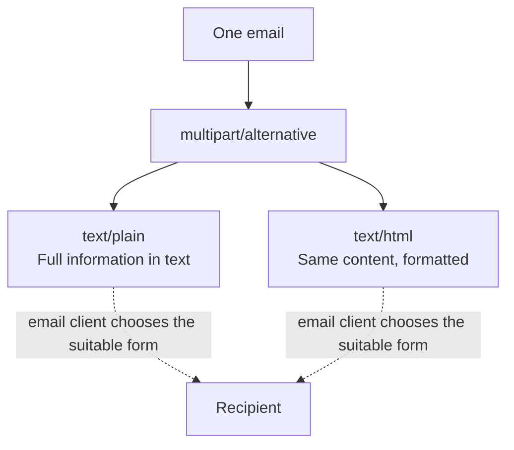

# `MimeMessageHelper.setText` with two content versions: plain text and HTML

In Spring Framework Mail, an email message can be presented in **two equivalent content versions**: plain text (`text/plain`) and HTML (`text/html`). Each version serves a different group of mail-reading applications, display environments, or accessibility needs. Instead of sending two independent emails, the application puts **both representations into the same MIME message** using the method:

```java
helper.setText(plainText, htmlText);
```

This is an important overload of `org.springframework.mail.javamail.MimeMessageHelper`. It lets the application send richly formatted email while still having a readable text version when the email client does not support HTML, when the user selects text view mode, or when automated systems need to process simple content.

For example, the same order notification can contain:

```text
[text/plain]
Hello Alice,
Order ORD-184 is ready.
View details: https://shop.example/orders/ORD-184
```

```html
<!-- [text/html] -->
<p>Hello <strong>Alice</strong>,</p>
<p>Order <strong>ORD-184</strong> is ready.</p>
<p><a href="https://shop.example/orders/ORD-184">View order details</a></p>
```

The recipient normally sees only **one** of the two versions, chosen by the email client. The two versions are not two sends and do not create two separate notifications.

## 1. Why are both `text/plain` and `text/html` needed?

HTML gives emails headings, links, call-to-action buttons, layout tables, fonts, and inline images. However, mail-reading environments are not uniform: some applications have very limited HTML support, have a text-only reading mode, filter HTML content, or use assistive readers in specific ways.

Plain text has independent benefits:

- **Readable when HTML is not rendered.** The message still conveys important content and instructions.
- **Easy to extract and process automatically.** Some business systems, readers, archival tools, and forwarders prefer plain text.
- **Useful for accessibility.** Users can choose text-reading mode; you still need to write clear, structured content rather than just adding a perfunctory text version.
- **Resilient against dependence on CSS/images.** The main content does not disappear when images are blocked or the HTML template changes.
- **Does not force the recipient to use HTML.** The email client can choose the version that it understands and the user wants.

| Criterion | `text/plain` version | `text/html` version |
| --- | --- | --- |
| Content | Text, blank lines, URLs as text | HTML elements and labeled links |
| Display | No HTML/CSS | Structured, formatted, images per client support |
| Links | Usually writes out the full URL | Can use `<a href="...">` |
| Layout | Based on paragraphs, lines, and punctuation | Based on HTML and CSS accepted by the email client |
| Inline images via `cid:` | Does not render images | Can use `` |
| Purpose | Preserves full meaning when HTML is not rendered | Presents information in a friendly, visually rich form |

**You should not treat plain text as an “unimportant secondary version”.** For important notification emails (payment deadlines, appointment confirmations, status notices), both versions should convey the **same events, figures, and required actions**.

## 2. What MIME structure does `setText(plainText, htmlText)` create?

MIME (Multipurpose Internet Mail Extensions) allows an email to carry multiple content parts with different `Content-Type` values. When there are two representations of the **same content**, the common structure is **`multipart/alternative`**:

```text
MimeMessage
└── multipart/alternative
    ├── text/plain; charset=UTF-8
    │   └── Plain content
    └── text/html; charset=UTF-8
        └── HTML content
```

`multipart/alternative` indicates that the parts are **alternative ways of presenting the same message**. This is a fundamental difference from `multipart/mixed`, where parts usually represent different components such as the message body and file attachments.



Per MIME rules, versions are usually ordered from the **simpler form to the richer form**: plain text first, HTML after. The email client can choose the last representation that it supports and the user prefers. Therefore:

- The recipient **does not necessarily see both passages one after another**.
- The application does not need to make two separate SMTP transactions.
- If HTML is blocked, the client can use the plain-text part.
- If the client can display HTML, many clients will prefer HTML, though the actual selection is decided by the client.

### Illustrative raw MIME

```mime
MIME-Version: 1.0
From: notifications@shop.example
To: alice@company.example
Subject: Order ORD-184 is ready
Content-Type: multipart/alternative; boundary="alternative-184"

--alternative-184
Content-Type: text/plain; charset=UTF-8
Content-Transfer-Encoding: quoted-printable

Hello Alice,
Order ORD-184 is ready.
View details: https://shop.example/orders/ORD-184

--alternative-184
Content-Type: text/html; charset=UTF-8
Content-Transfer-Encoding: quoted-printable

<html><body>
  <p>Hello <strong>Alice</strong>,</p>
  <p>Order <strong>ORD-184</strong> is ready.</p>
  <a href="https://shop.example/orders/ORD-184">View details</a>
</body></html>
--alternative-184--
```

This is a **structural example for reading**, not a complete `.eml` source guaranteed valid in every detail: line-break encoding, the `quoted-printable` body, boundary markers, and headers may differ in an email actually generated by Jakarta Mail. The `Content-Transfer-Encoding` field is used to transmit data across mail transport and **does not change the meaning** that the two parts are two versions of the same message.

### What if there are both inline images and attachments?

When a message has both two content versions and inline images or PDF attachments, MIME will have **multiple nested multipart layers**. A common logical tree:

```text
multipart/mixed
├── multipart/related
│   ├── multipart/alternative
│   │   ├── text/plain
│   │   └── text/html     <-- 
│   └── image/png         <-- Content-ID: <logo@shop.example>
└── application/pdf       <-- attachment
```

In Spring, `MimeMessageHelper` uses the appropriate multipart mode to build the MIME tree. The exact structure may vary depending on the constructor, mode, and implementation version, but the meanings remain the same:

1. `multipart/alternative`: **plain text and HTML as alternatives to each other**.
2. `multipart/related`: **HTML and the resources referenced by the HTML**, for example images with a Content-ID.
3. `multipart/mixed`: **the main content and standalone attachments**.

Some email clients decode MIME structures slightly differently, so when facing display issues you should inspect the actual MIME message rather than looking only at the HTML.

## 3. The overloads of `MimeMessageHelper.setText`

`MimeMessageHelper` has several ways to set content. You need to understand the parameters properly to avoid accidentally sending HTML as plain text.

| Call | Meaning | When to use |
| --- | --- | --- |
| `helper.setText("Hello")` | Sets **one** plain-text version | Simple text only |
| `helper.setText(html, true)` | Sets **one** HTML version | Need HTML without creating a plain-text version via this overload |
| `helper.setText(text, false)` | Sets **one** plain-text version | Want to be explicit that the content is not HTML |
| **`helper.setText(plainText, htmlText)`** | Sets **two** versions into multipart/alternative | Need both HTML and an equivalent text version |

Direct comparison:

```java
// Plain text only:
helper.setText("The order is ready.");

// HTML only:
helper.setText("<strong>The order is ready.</strong>", true);

// Both versions of the same content:
helper.setText(
        "The order is ready.",
        "<p><strong>The order is ready.</strong></p>");
```

**Do not confuse `setText(String text, boolean html)` with `setText(String plainText, String htmlText)`.** The second overload does not take a boolean flag; it takes *two separate content strings*.

### Does not automatically turn HTML into plain text

The call:

```java
helper.setText(plainText, htmlText);
```

**does not ask Spring to extract plain text from HTML automatically**. The application must supply **both strings**. If `plainText` lacks URLs, important values, or terms of use that the HTML has, readers in text mode will miss information.

Conversely, simply taking HTML and stripping all tags with regex does not guarantee a good text version: link labels may lose URLs, tables lose relationships between columns, lists lose structure, and illustrations lose meaning.

## 4. Creating a two-version email in Spring Boot

With a Spring Boot application, add the mail starter if it is not already present:

```groovy
// build.gradle
dependencies {
    implementation 'org.springframework.boot:spring-boot-starter-mail'
}
```

Example SMTP submission configuration via STARTTLS:

```yaml
# application.yml
spring:
  mail:
    host: smtp.provider.example
    port: 587
    username: ${SMTP_USERNAME}
    password: ${SMTP_PASSWORD}
    default-encoding: UTF-8
    properties:
      "[mail.smtp.auth]": "true"
      "[mail.smtp.starttls.enable]": "true"
      "[mail.smtp.starttls.required]": "true"
      "[mail.smtp.ssl.checkserveridentity]": "true"
      "[mail.smtp.connectiontimeout]": "5000"
      "[mail.smtp.timeout]": "10000"
      "[mail.smtp.writetimeout]": "10000"

app:
  mail:
    from: notifications@shop.example
```

`spring.mail.username` and `spring.mail.password` are SMTP login credentials, not the `From:` content of the email. `app.mail.from` is an **application-defined property** that needs to be used explicitly when building the message. The SMTP account must have permission to send with the `From:` domain/address according to the provider's policy.

### Complete Java service

The example below creates **one email with two equivalent contents**, containing an order code and a link to view details:

```java
package com.example.mail;

import jakarta.mail.MessagingException;
import jakarta.mail.internet.MimeMessage;

import org.springframework.beans.factory.annotation.Value;
import org.springframework.mail.javamail.JavaMailSender;
import org.springframework.mail.javamail.MimeMessageHelper;
import org.springframework.stereotype.Service;
import org.springframework.web.util.HtmlUtils;

@Service
public class OrderReadyMailService {

    private final JavaMailSender mailSender;
    private final String fromAddress;

    public OrderReadyMailService(
            JavaMailSender mailSender,
            @Value("${app.mail.from}") String fromAddress) {
        this.mailSender = mailSender;
        this.fromAddress = fromAddress;
    }

    public void sendReadyNotice(
            String recipientEmail,
            String customerName,
            String orderId) throws MessagingException {

        // The example assumes values have already been validated by the business layer.
        // Validate orderId against a schema to avoid creating arbitrary paths.
        if (!orderId.matches("[A-Za-z0-9-]{1,40}")) {
            throw new IllegalArgumentException("Invalid orderId");
        }

        String orderUrl = "https://shop.example/orders/" + orderId;

        String plainText = """
                Hello %s,

                Your order %s is ready.
                View details: %s

                Thank you for your purchase.
                """.formatted(customerName, orderId, orderUrl);

        // Dynamic content placed into HTML must be appropriately escaped.
        String safeName = HtmlUtils.htmlEscape(customerName);
        String safeOrderId = HtmlUtils.htmlEscape(orderId);
        String safeUrl = HtmlUtils.htmlEscape(orderUrl);

        String htmlText = """
                <!doctype html>
                <html>
                  <body>
                    <p>Hello <strong>%s</strong>,</p>
                    <p>Your order <strong>%s</strong> is ready.</p>
                    <p><a href="%s">View order details</a></p>
                    <p>Thank you for your purchase.</p>
                  </body>
                </html>
                """.formatted(safeName, safeOrderId, safeUrl);

        MimeMessage message = mailSender.createMimeMessage();
        MimeMessageHelper helper = new MimeMessageHelper(
                message,
                MimeMessageHelper.MULTIPART_MODE_MIXED_RELATED,
                "UTF-8");

        helper.setFrom(fromAddress);
        helper.setTo(recipientEmail);
        helper.setSubject("Order " + orderId + " is ready");
        helper.setText(plainText, htmlText);

        mailSender.send(message);
    }
}
```

Explanation:

1. `mailSender.createMimeMessage()` creates the email object according to Jakarta Mail.
2. The constructor `MimeMessageHelper(..., MULTIPART_MODE_MIXED_RELATED, "UTF-8")` enables multipart to support MIME parts and specifies the charset for generating content.
3. `setFrom`, `setTo`, `setSubject` set the headers and recipients for the message.
4. **`setText(plainText, htmlText)`** places both versions into the MIME tree.
5. `mailSender.send(message)` submits the email over the SMTP transport.

In the example, `orderId` is constrained to fit a path segment; if your project's ID has different rules, you need to use **your application's own rules** and URL-encode it per context before putting it into HTML. `HtmlUtils.htmlEscape` escapes HTML characters, but **does not check URL trustworthiness**; if a URL is supplied by a user, you must also control the scheme, host, path, and access permissions.

`customerName` needs to be normalized and have a fallback if empty, applying length/control-character limits at the data layer. HTML escaping addresses part of the rendering risk but does not by itself protect the subject or text content from invalid business data.

### Why use `MULTIPART_MODE_MIXED_RELATED`?

This mode is commonly used when the application may extend the email to **HTML, inline images, and attachments**. It provides a MIME structure compatible with those needs. In an example with only two content versions, you could also choose a simple multipart helper; the core point is that **`setText(plainText, htmlText)` creates alternative parts**, not that you are forced to always use one single multipart mode.

If a project sends only plain text, `SimpleMailMessage` is usually more concise. If a project sends text + HTML, use `MimeMessage` and the helper, because `SimpleMailMessage` has no mechanism to represent MIME alternatives.

## 5. Designing the two versions to be equivalent

The two parts **do not need to match character-for-character**, but they must preserve the same meaning. For example, HTML has a `View order` button; in plain text, the reader needs a full URL they can copy or open.

| Information | HTML | Plain text should have |
| --- | --- | --- |
| Greeting | `<p>Hello <strong>Alice</strong></p>` | `Hello Alice,` |
| Order code | Displayed in bold | Keep the exact order code |
| Action button | `<a href="...">View order</a>` | `View order: https://...` |
| List of items | `<ul><li>...</li></ul>` | Bullet lines `- ...` |
| Schedule table | `<table>...` | Line-by-line label–value pairs |
| Logo/image | `` | Text with the brand name or meaning of the image |
| Important warning | Highlighted box and color | Clear wording, not dependent on color |
| Support footer | Link or info block | Support address and direct instructions |

### Do not put important information in HTML that is missing from text

HTML example:

```html
<p>Payment deadline: <strong>20/11/2026 17:00</strong>.</p>
<a href="https://shop.example/pay/ORD-184">Pay now</a>
```

**Unsuitable** text version:

```text
Please view the HTML version for details.
```

**More suitable** text version:

```text
Payment deadline: 17:00 on 20/11/2026 (Asia/Ho_Chi_Minh).
Pay at: https://shop.example/pay/ORD-184
```

Practical rule: someone reading only `text/plain` must **understand what happened, whether action is required, and how to take it** without being forced to open the HTML version.

### Plain text does not need HTML notation

Do not put `<p>`, `<strong>`, `<table>` tags into `plainText`; text-reading email clients will display them as literal characters. You can use blank lines, punctuation, bullet hyphens, and clear labels:

```text
ORDER ORD-184

Status: Ready for pickup
Location: Counter 2, Floor 1
Pickup deadline: 17:00 on 15/11/2026

Details: https://shop.example/orders/ORD-184
```

Avoid generating text by stripping HTML tags with a simple regex; the result can run words together, lose table contents, and lose URLs from `<a href>`.

## 6. From business data to two templates

When there are many email types, writing both strings directly inside the sending service can mix business logic with presentation content. Another structure is to create a **shared view model**, then render two templates:

```text
OrderReadyEvent / DB snapshot
          |
          v
OrderReadyMailModel
  - name
  - orderId
  - localDeadline
  - orderUrl
          |
          +---------------------+
          |                     |
          v                     v
  order-ready.txt        order-ready.html
          |                     |
          v                     v
       plainText              htmlText
          |                     |
          +----------+----------+
                     v
         helper.setText(plainText, htmlText)
```

Example template folder structure:

```text
src/main/resources/
└── templates/
    └── mail/
        ├── order-ready.txt
        └── order-ready.html
```

The text template can use:

```text
Hello {{name}},
Order {{orderId}} is ready.
View details: {{orderUrl}}
```

Corresponding HTML template:

```html
<p>Hello <strong>{{name}}</strong>,</p>
<p>Order <strong>{{orderId}}</strong> is ready.</p>
<p><a href="{{orderUrl}}">View details</a></p>
```

The `{{...}}` notation here is an **illustrative placeholder**, not default Spring or Thymeleaf syntax. If you use Thymeleaf, FreeMarker, or another engine, you must use the syntax of the respective engine and configure escaping for each context.

### Designing a renderer with two outputs

A simple interface:

```java
public record MailBody(String plainText, String htmlText) {
}

public interface OrderReadyMailRenderer {
    MailBody render(OrderReadyMailModel model);
}
```

The sending service can use:

```java
MailBody body = renderer.render(model);
helper.setText(body.plainText(), body.htmlText());
```

Thus, SMTP rules are independent of rendering rules. The same `OrderReadyMailModel` keeps amounts, deadlines, contact addresses, and links synchronized between the two versions. If multi-language support is needed, the renderer can also accept a `Locale` and timezone to format values consistently.

For links, do not take an arbitrary URL provided by a template or user and put it straight into `href`. The application should build URLs from a trusted base URL and properly encoded/controlled data, then HTML-escape for the attribute context.

## 7. Combining two-version `setText` with inline images

When HTML has a logo or QR code embedded via `cid:`, plain text still exists **alongside it**, but cannot display images. You must leave the important meaning of the image in text.

For example, after creating a multipart `MimeMessageHelper`:

```java
import org.springframework.core.io.ClassPathResource;

String logoCid = "brand-logo@shop.example";

String plainText = """
        Shop Example
        Order ORD-184 is ready.
        View details: https://shop.example/orders/ORD-184
        """;

String htmlText = """
        <html><body>
          
          <p>Order <strong>ORD-184</strong> is ready.</p>
          <a href="https://shop.example/orders/ORD-184">View details</a>
        </body></html>
        """;

// Set the content part before adding inline resources.
helper.setText(plainText, htmlText);
helper.addInline(
        logoCid,
        new ClassPathResource("mail/images/logo.png"),
        "image/png");
```

The example assumes `helper` was created with an appropriate multipart mode and the image file exists at `src/main/resources/mail/images/logo.png`.

Points to remember:

- `src="cid:brand-logo@shop.example"` links to the image part that has the header `Content-ID: <brand-logo@shop.example>`.
- The `addInline` parameter accepts the **ID without `cid:` and without `<...>`**.
- With `MimeMessageHelper`, you should call **`setText(...)` before `addInline(...)`** to keep a structure compatible with many mail clients.
- The plain-text version needs the brand name and key URLs, because it does not render ``.
- Embedded images increase the MIME size of the email. If mandatory information sits only inside a QR/image without a fallback, text readers may not be able to use the email.

### So where does `multipart/alternative` sit when there are images?

When combining two versions with inline images, `multipart/alternative` may be a branch **inside** the `multipart/related`/`multipart/mixed` structure created by the helper. Do not interpret `setText(plainText, htmlText)` as creating two independent root messages; it still resides in **one** `MimeMessage` in a single submission.

## 8. Combining two versions with attachments

If an email has text, HTML, and a PDF invoice, you can write:

```java
import org.springframework.core.io.ClassPathResource;

helper.setText(plainText, htmlText);
helper.addAttachment(
        "invoice-ORD-184.pdf",
        new ClassPathResource("mail/docs/invoice-ORD-184.pdf"));
```

The text/html versions are **alternatives**; the PDF file is an **additional attachment**. In both HTML and plain text, you should clearly note that there is an attached file:

```text
The PDF invoice is attached to this email.
```

Do not try to pass a PDF into `setText`: this overload takes text content, not binary files. If you want to attach a file, use `addAttachment` or the appropriate MIME API.

With large attachments, the actual email size can exceed the file size due to Base64 encoding and MIME overhead. The SMTP provider or receiving server may reject large messages; that is a message size limit issue, not that having both text and HTML makes SMTP send twice.

## 9. Charset and Vietnamese display capability

Accented Vietnamese, recipient names, and Unicode symbols need to be encoded appropriately. For MIME emails, the charset applies to text parts, while `Content-Transfer-Encoding` governs how data is carried over mail transport.

```java
MimeMessage message = mailSender.createMimeMessage();
MimeMessageHelper helper = new MimeMessageHelper(
        message,
        MimeMessageHelper.MULTIPART_MODE_MIXED_RELATED,
        "UTF-8");
```

This configuration helps the helper create text parts in UTF-8. With Spring Boot, you can configure:

```yaml
spring:
  mail:
    default-encoding: UTF-8
```

`default-encoding` is the sender's configuration for generating content; passing an explicit charset to the helper constructor makes the intent clear in the email-building method. Jakarta Mail may choose `quoted-printable` or `base64` when serializing a part, depending on the content and implementation. These two encoding types **do not mean the email is encrypted for security**; they serve transport compatibility.

Illustrative raw header example:

```text
Content-Type: text/plain; charset=UTF-8
Content-Transfer-Encoding: quoted-printable
```

And the HTML part:

```text
Content-Type: text/html; charset=UTF-8
Content-Transfer-Encoding: quoted-printable
```

The email client decodes the MIME part before displaying it. If you see garbled characters like `á` or `?` instead of Vietnamese, check the **data source, template charset, MIME headers, and client**; do not rush to fix it by Base64-encoding the entire string yourself before calling `setText`.

## 10. Protecting data when creating both text and HTML

`setText(plainText, htmlText)` builds the MIME structure; **it does not act as a filter for application input data**. Business data may come from users, other systems, or databases and must be handled according to the display context.

### Context-appropriate HTML escaping

Example username:

```text
Alice <script>alert('x')</script>
```

If concatenated directly into HTML, the data is interpreted as markup when the client renders it (many email clients have their own filters, but the application should not depend on that). For displayed content, use appropriate HTML escaping:

```java
String escapedName = HtmlUtils.htmlEscape(customerName);
String html = "<p>Hello " + escapedName + "</p>";
```

`HtmlUtils.htmlEscape` is an HTML character-escaping utility, not an HTML content filter that permits accepting arbitrary markup. If templates allow users to author HTML, there must be a sanitize/allowlist workflow appropriate to security requirements.

### URLs in HTML and URLs in text

```java
String url = trustedBaseUrl + encodedPath;
String html = "<a href=\"" + HtmlUtils.htmlEscape(url) + "\">Open order</a>";
String plain = "Open order: " + url;
```

Here `trustedBaseUrl` is a trusted configured base URL, and `encodedPath` is encoded according to appropriate URL rules; both are example variables in an existing context. **HTML escaping does not replace checking scheme/host or URL encoding**. Do not put `javascript:`, `data:`, or uncontrolled user-supplied URLs into `href`.

### Subjects and headers also need control

Strings going into `helper.setSubject(...)`, `setFrom(...)`, `setTo(...)` have a different context than HTML. Do not apply HTML escaping to recipient addresses or subjects and treat them as validated. Use validation per business schema, control control characters, sending permissions, and email address formats.

If the email has sensitive values, both **plain text and HTML** contain that content inside the MIME message. Having a plain-text version does not make the email more secure; emails can be saved, forwarded, or extracted. Include only necessary data in the message and follow the product's data-protection policy.

## 11. Checking MIME structure without sending real email

One way to directly observe the output of `setText(plainText, htmlText)` is to create a `MimeMessage` in memory, write it as `.eml`, and inspect the `multipart/alternative` structure.

Java example:

```java
import java.io.ByteArrayOutputStream;
import java.nio.charset.StandardCharsets;
import java.util.Properties;

import jakarta.mail.Session;
import jakarta.mail.internet.MimeMessage;

import org.springframework.mail.javamail.MimeMessageHelper;

public class AlternativeMailSourceExample {

    public static void main(String[] args) throws Exception {
        Session session = Session.getInstance(new Properties());
        MimeMessage message = new MimeMessage(session);

        MimeMessageHelper helper = new MimeMessageHelper(
                message,
                MimeMessageHelper.MULTIPART_MODE_MIXED_RELATED,
                "UTF-8");

        helper.setFrom("notifications@shop.example");
        helper.setTo("alice@company.example");
        helper.setSubject("Notification");
        helper.setText(
                "Hello Alice!\nYour order is ready.",
                "<p>Hello <strong>Alice</strong>!</p>"
                        + "<p>Your order is ready.</p>");

        message.saveChanges();

        try (ByteArrayOutputStream out = new ByteArrayOutputStream()) {
            message.writeTo(out);
            String rawEml = out.toString(StandardCharsets.UTF_8);
            System.out.println(rawEml);
        }
    }
}
```

This is a **diagnostic example in a development environment** and does not open an SMTP connection. It helps observe real MIME headers and boundaries. Source content can contain personal names/emails/data, so use only mock addresses and do not print production emails to logs.

### How to read the result

In raw MIME, look for:

1. `MIME-Version: 1.0`.
2. A `multipart/alternative` (which may sit inside other multipart groups).
3. A part with `Content-Type: text/plain; charset=UTF-8`.
4. A part with `Content-Type: text/html; charset=UTF-8`.
5. Both parts contain the **same business information** in an appropriate presentation.
6. If there is a `cid:` image, the corresponding `Content-ID` MIME part must be present and inside the related structure.

You should not inspect only `message.getContent().toString()`: when a message is multipart, `getContent()` may return a `Multipart` object rather than the combined plain text or HTML content.

### Example inspecting both versions with Jakarta Mail

If you need to read a multi-layered MIME tree, you can traverse the parts with Jakarta Mail:

```java
import jakarta.mail.Multipart;
import jakarta.mail.Part;

static void printMimeStructure(Part part, String indent) throws Exception {
    System.out.println(indent + part.getContentType());

    Object content = part.getContent();
    if (content instanceof Multipart multipart) {
        for (int i = 0; i < multipart.getCount(); i++) {
            printMimeStructure(multipart.getBodyPart(i), indent + "  ");
        }
    }
}
```

The function above illustrates how to traverse multiple multipart layers, not a complete MIME validator. It does not automatically compare the meaning of the two versions nor verify that an email client can render all HTML. To observe real-world behavior across many mail readers, use test addresses and inspect the MIME source of the received message.

## 12. Common mistakes

### Mistake 1: Calling `setText(html)` and expecting HTML display

```java
helper.setText("<h1>The order is ready</h1>");
```

With the single-parameter overload, the string is set as **plain text**. Readers may see the literal `<h1>` tags. If you want HTML only, use `setText(html, true)`; if you want both versions, use `setText(plainText, htmlText)`.

### Mistake 2: Confusing the two-parameter overloads

```java
helper.setText("Hello", true);        // text + boolean
helper.setText("Hello", "<b>Hello</b>"); // plainText + htmlText
```

The two calls have different meanings. Do not pass two strings thinking the second parameter is some kind of flag.

### Mistake 3: Plain-text version only says “view HTML”

Because `multipart/alternative` lets the client **choose one representation**, a text version lacking information will make the email unusable for a group of readers. Provide key details, deadlines, full links, and action instructions in the text version.

### Mistake 4: Sending two separate emails

```java
// Not the way to create multipart/alternative:
sendOnePlainEmail();
sendOneHtmlEmail();
```

Two calls can generate two independent emails to the same recipient. The `setText(plainText, htmlText)` overload is what represents **two contents in one message**.

### Mistake 5: Using `SimpleMailMessage` for HTML

`SimpleMailMessage` is suitable for plain-text emails. When MIME alternatives are needed, use `MimeMessage` and `MimeMessageHelper`; do not try to insert HTML as a plain-text string.

### Mistake 6: Confusing `multipart/alternative` with `multipart/mixed`

`alternative` carries multiple ways to display the same content; `mixed` usually carries additional components like attachments. If a client displays plain text and HTML as two separate attachments, inspect the real MIME tree and how the parts were created.

### Mistake 7: Calling `addInline` before `setText`

For inline resources, Spring recommends **`setText` first, `addInline` after** to avoid some mail readers failing to resolve related parts properly. When debugging, check `Content-ID`, `cid:`, and `multipart/related`.

### Mistake 8: Not escaping dynamic data in HTML

Concatenating arbitrary usernames or notes into HTML without escaping can alter markup and create security risks. Handle according to the right context: text nodes, attributes, URLs, subjects, and recipient addresses are not one data type.

### Mistake 9: The two versions state different numbers

For example, the text states deadline **17:00** while HTML states **19:00**, because each template recalculates the time from a different timezone. Create a **normalized view model** and render both versions from the same display data.

### Mistake 10: Using an image instead of the entire message

HTML has `` while text only says “image sent”. If the client does not display images or the reader uses only plain text, the core content is lost. Have fallback wording describing the necessary information.

### Mistake 11: Setting `Content-Type` manually and expecting the helper to fix it

If a developer manually constructs an unsuitable multipart/header before the helper processes it, the MIME tree may break or be misinterpreted by clients. It is best to use the helper's proper APIs for text/HTML, inline, and attachments; manipulate low-level MIME only when truly needed and when you understand the structure.

### Mistake 12: Equating a successful `send()` with HTML having rendered

A successful `JavaMailSender.send(message)` only indicates the submission operation did not report an error at the time of the call. It does not prove the message reached the inbox or that the email client rendered HTML as expected. Distinguish **SMTP sending, message delivery, MIME alternative selection, and HTML rendering**.

## 13. Self-check questions

**1. How many emails does `helper.setText(plainText, htmlText)` send?**

One email, with two content representations packaged as MIME alternatives. The client chooses the appropriate part when displaying.

**2. Why is `multipart/alternative` needed?**

To represent different versions of the **same logical content**, such as plain text and HTML, rather than treating them as two independent components like an attachment.

**3. Does `setText(html, true)` automatically create plain text?**

No. That call sets one HTML version. If you want a text fallback, provide both strings in the `setText(plainText, htmlText)` overload.

**4. Why shouldn't plain text be created by stripping HTML tags with regex?**

Because table structure, lists, line breaks, and especially URLs in `href` can be lost or become confusing. You should render the text version with clear semantics from the same business data.

**5. When there is a `cid:` image in HTML, does plain text display that image?**

No. The text version must contain the necessary information in text form; inline images are resources for the HTML representation.

**6. When using `MimeMessageHelper.addInline`, should `setText` be called before or after?**

Call `setText` before, and then `addInline`, following Spring's usage recommendation for the helper.

**7. Why must recipient names in HTML be escaped even though email clients filter scripts?**

Because untrusted data has no right to alter markup unintentionally; client content filtering is a receiving-side mechanism and does not replace safe HTML construction by the application.

**8. Does a successful `mailSender.send()` guarantee the client displays HTML?**

No. Message receipt and display depend on the mail relay, destination server, MIME structure, and email client.

**9. If `multipart/mixed` is used for attachments, can `multipart/alternative` still be present?**

Yes. MIME allows nested structures: the alternative group serves as the main content, while attachments sit in the mixed group at the appropriate level.

**10. How can you check whether an email truly carries both versions?**

Inspect the raw MIME source/`.eml`, look for `multipart/alternative` with two parts `text/plain` and `text/html`, or traverse the MIME tree using the Jakarta Mail API.

## Conclusion

**`MimeMessageHelper.setText(plainText, htmlText)` is the way to create an email with two alternative content versions:** `text/plain` and `text/html`. They are packaged in a MIME alternative structure so the email client chooses the appropriate representation, **not sending two messages**. In Spring Framework Mail, create a `MimeMessage`, use `MimeMessageHelper` with the appropriate charset, build both versions from the same business data, keep the content equivalent, escape dynamic HTML by context, and call `setText` before adding inline resources. When encountering display errors, check the `multipart/alternative` structure and related parts in the actual email rather than looking only at the HTML source or the SMTP submission result.
