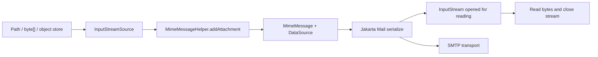
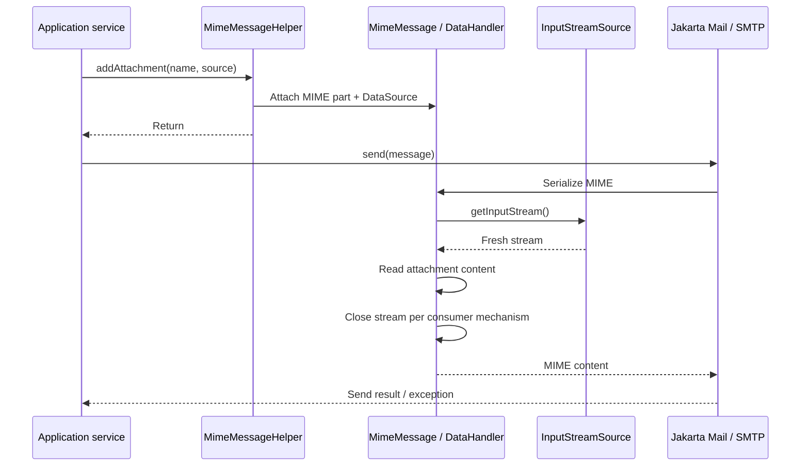
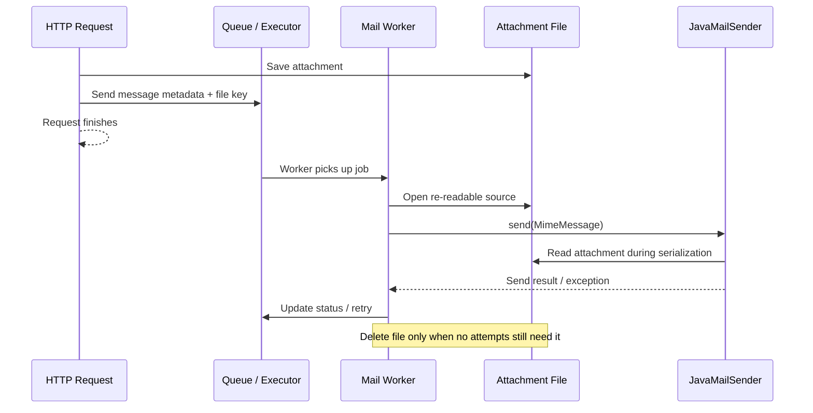

# Closing InputStream and resource ownership in MimeMessageHelper

Sending an email with attachments using Spring Framework Mail usually starts very simply: create a `MimeMessage`, use `MimeMessageHelper`, and call `addAttachment(...)`. However, when attachment data comes from an `InputStream`, an important question arises: **who is responsible for opening, closing, retaining, and releasing the resource, and at what time?**

If the stream is closed right after `addAttachment()`, the email may send partially or fail when Jakarta Mail starts reading the content. If an already-open, read-once stream is passed in, MIME construction or sending may need to re-read it and cause an error. Conversely, if the application opens files, streams, or data-download connections without a closing policy, the system can leak file descriptors, network connections, memory, and temporary files. These issues are especially prone to occur when using `@Async`, retries, or email sending queues.

This lesson focuses on **Spring's `InputStreamSource` contract**, how `MimeMessageHelper` links an attachment with a data source, the ownership scope of an `InputStream`, the differences between `ByteArrayResource`, `FileSystemResource`, and `InputStreamResource`, as well as safe code patterns for synchronous and worker-based sending. Examples use Spring Framework 6.x, Spring Boot 3.x, Java 21, and `jakarta.mail.*` APIs.

> **Core principle:** `MimeMessageHelper.addAttachment(...)` usually only **binds the data source** to the MIME message; it does not mean the entire attachment has been read, uploaded to SMTP, or safely retained in memory. Provide a **source that can open a fresh stream each time it is requested**, and keep the underlying data alive until all operations needing to read it have finished.

## 1. Distinguishing stream, data source, and MIME message

Three objects are easily confused as one:

| Object | Role | Lifecycle to manage |
|---|---|---|
| `InputStream` | **A single read** of bytes from a source such as a file, network, or memory | Has read-position state; must be closed when no longer used |
| `InputStreamSource` | **Capability to supply a stream** when someone calls `getInputStream()` | Underlying source must still exist; each call needs an independently readable stream |
| `MimeMessage` and MIME part | **Description of content to send**, including headers and parts/attachments | Can be serialized after the helper has finished building; does not own all source files by default |

Look at the typical flow:



The diagram separates **when the attachment description is created** from **when the content is consumed**. Specifically, in the `MimeMessageHelper.addAttachment(String, InputStreamSource, ...)` path, Spring can place a `DataSource` onto the MIME part and forward `getInputStream()` to the `InputStreamSource` when Jakarta Mail needs data. Therefore, do not assume that when `addAttachment()` returns, the file data has already been fully read.

### 1.1. An InputStream has state, not a file

Example:

```java
try (InputStream in = Files.newInputStream(path)) {
    byte[] first = in.readNBytes(10);
    byte[] rest = in.readAllBytes();
}
```

In the example above, `rest` continues reading **from the current position**, not starting over from the beginning. After `close()`, most streams cannot continue reading. To re-read the whole file, **open another stream**, for instance calling `Files.newInputStream(path)` again.

An `InputStream` reference does not automatically provide rewind or replay capability. Some streams have `mark/reset`, but they only work when the implementation supports it and usually have limits; this cannot be treated as a general solution for attachments.

### 1.2. Who owns the resource?

Two questions need to be separated:

1. **Who owns the opened stream?** The party that actively opens a stream to read it itself must usually close it with `try-with-resources`. When you supply a source to the library, the library's consumer mechanism obtains the stream, yet you need to honor the contract and verify the stream-management behavior of the implementation in use.
2. **Who owns the underlying data?** Temporary files, objects in storage, buffers in memory, or remote resources may still belong to the application. A stream being closed **does not mean the source file was deleted** or the lifecycle of the object-store key has ended.

For example, `FileSystemResource` can open multiple streams from the same file. Jakarta Mail can close the opened streams, while the application must still decide **when the temporary file may be deleted**. These are two independent layers of ownership.

## 2. Contract of InputStreamSource: must be re-readable

Spring defines `org.springframework.core.io.InputStreamSource` with the operation:

```java
public interface InputStreamSource {
    InputStream getInputStream() throws IOException;
}
```

The meaning of the interface is that **each call to `getInputStream()` returns a stream that can read the content from the beginning**, rather than a single reference being reused. This requirement is especially important with JavaMail because content may need to be read **multiple times** during MIME processing.

A proper mental model:

```text
getInputStream() call 1 -> InputStream A, position = 0
getInputStream() call 2 -> InputStream B, position = 0
getInputStream() call 3 -> InputStream C, position = 0

A, B, C are streams reading the same data;
reading or closing A does not break readability of B/C.
```

Do not depend on how many times `getInputStream()` will be called. The mail provider may need to open the source to prepare encoding, estimate content, or serialize; calling `MimeMessage.writeTo(...)` in tests can also cause the content to be read another time. The application's API must withstand valid reopenings, rather than being designed to work only in one accidental path.

### 2.1. Wrong pattern: closing the stream before sending

```java
// Do not do this.
InputStream in = Files.newInputStream(reportPath);
try {
    helper.addAttachment(
            "report.pdf",
            new InputStreamResource(in),
            "application/pdf");
} finally {
    in.close();
}

mailSender.send(message); // May need to read attachment afterward.
```

Beyond the closed stream, `InputStreamResource` has a bigger issue: it wraps **an already-opened stream**. Spring's `MimeMessageHelper` in common versions may actively reject a `Resource` carrying an already-open stream, because attachments require a re-readable source. If it slips past another layer, an exhausted or closed stream still causes subsequent reads to fail.

### 2.2. Wrong pattern: holding the same stream in a lambda

```java
// Do not do this: every getInputStream returns the same object.
InputStream shared = Files.newInputStream(reportPath);
InputStreamSource source = () -> shared;

helper.addAttachment("report.pdf", source, "application/pdf");
mailSender.send(message);
```

The lambda looks like a factory yet does not actually create a fresh reading source. After the first read, the stream position changes; if closed, it cannot be used next time. Holding a shared reference also easily creates race conditions when multiple threads/serializers read concurrently.

### 2.3. Right pattern: lambda opens a fresh stream from Path

```java
Path reportPath = Path.of("/srv/app/reports/monthly.pdf");

InputStreamSource source =
        () -> Files.newInputStream(reportPath, StandardOpenOption.READ);

helper.addAttachment("report.pdf", source, "application/pdf");
mailSender.send(message);
```

The example above requires importing `java.nio.file.Path`, `java.nio.file.Files`, `java.nio.file.StandardOpenOption`, and `org.springframework.core.io.InputStreamSource`. Every time Jakarta Mail calls `getInputStream()`, the lambda opens a stream from the start. **Condition:** the file still exists, read permissions remain valid, and the content is not altered throughout the send.

Note that a correct lambda statement **does not automatically create a file cleanup policy**. If the file is a temporary file created by the application, business code must still manage when to delete it after use.

## 3. Three common Resource types and their differences

Spring Core provides several ways to represent data sources. Choosing the right type is an important part of preserving the re-read contract.

| Type | Underlying data | Can `getInputStream()` read from the start multiple times? | Suitable for attachments |
|---|---|---|---|
| `ByteArrayResource` | `byte[]` array in memory | Yes, normally returns a fresh `ByteArrayInputStream` | **Yes**, small/medium files |
| `FileSystemResource` | File on filesystem | Yes, opens a fresh file stream each time | **Yes**, larger files or stored files |
| `InputStreamResource` | An already-opened `InputStream` | **No**, usually single-read only | **Avoid using** directly with `MimeMessageHelper.addAttachment` |
| `ClassPathResource` | Resource on classpath | Usually re-openable if resource exists and class loader supports it | Possible, for static files shipped with the application |
| Custom `InputStreamSource` | Depends on implementation | Only if implementing the contract properly | Yes, if opening a fresh stream each time and keeping data stable |

`ByteArrayResource` is convenient because the source is a byte array that can create many separate streams, though it keeps attachment data on the heap. `FileSystemResource` is convenient for larger files because it reads from the filesystem as needed, in return requiring the file to remain present throughout sending and ensuring access permissions.

### 3.1. ByteArrayResource: fewer stream lifecycle issues, uses memory

```java
byte[] pdf = reportRenderer.renderPdf(reportId);

helper.addAttachment(
        "report.pdf",
        new ByteArrayResource(pdf),
        "application/pdf");

mailSender.send(message);
```

Here `reportRenderer` is an application component, not a Spring class. `ByteArrayResource` creates streams reading from the byte array; there is no underlying file descriptor to close after each read. There is neither a need nor a benefit in opening an `InputStream` yourself outside and passing it into the helper.

In exchange, you need to:

- Limit the size of rendered PDFs/CSVs.
- Anticipate memory costs when many emails are sent concurrently.
- Remember that converting to MIME/Base64 can create extra buffers/overhead.
- Avoid keeping large `byte[]` arrays in in-memory queues or caches longer than required.

Do not assume `ByteArrayResource` is safe for attachments of several hundred MB just because the code is easy to write. If many workers concurrently hold many byte arrays, the heap can grow rapidly and cause GC pressure or `OutOfMemoryError`.

### 3.2. FileSystemResource: re-openable, requires managing the underlying file

```java
Path reportPath = Path.of("/srv/app/reports/report-1042.pdf");
FileSystemResource resource = new FileSystemResource(reportPath);

helper.addAttachment("report-1042.pdf", resource, "application/pdf");
mailSender.send(message);
```

`FileSystemResource` represents a file and can open a fresh stream when requested. In this code **there is no need to call `resource.getInputStream()` yourself to pre-read**. The mail-sending library itself will request the data when serializing the attachment.

For files supplied by another service, the application must clarify:

- Can the file be deleted before the mail finishes sending?
- Can the file be overwritten between two `getInputStream()` calls?
- Can a worker running on another machine read the same Path?
- Is there an access-permission and file-cleanup policy?

Do not attach a resource pointing to a file in a temporary request folder and then queue sending on another worker without guaranteeing the file still exists and the worker has read permission.

### 3.3. InputStreamResource: not a general solution for attachments

`InputStreamResource` is especially useful in certain contexts where data is **streamed once**; it represents an already-open stream. Yet for `MimeMessageHelper.addAttachment(...)`, this trait goes against the mail provider's re-readability requirement.

Example to avoid:

```java
try (InputStream in = remoteService.openPdfStream(reportId)) {
    InputStreamResource resource = new InputStreamResource(in);
    helper.addAttachment("report.pdf", resource);
    mailSender.send(message);
}
```

Even when `try-with-resources` wraps `send()`, the **single-use** problem does not disappear. `try-with-resources` guarantees the stream you opened is closed upon exiting the block, yet does not turn `InputStreamResource` into a replayable source.

If you only have a read-once source from the network, **materialize** it into:

1. A size-bounded `byte[]` and then create a `ByteArrayResource`, or
2. A managed temporary file and then create a `FileSystemResource`, or
3. An object in storage that can open fresh streams via an immutable key/version.

## 4. addAttachment does not mean the attachment has been uploaded

A complete example:

```java
MimeMessage mime = mailSender.createMimeMessage();
MimeMessageHelper helper =
        new MimeMessageHelper(mime, true, "UTF-8");

helper.setFrom("notifications@example.test");
helper.setTo("alice@example.test");
helper.setSubject("Your report");
helper.setText("The PDF file is attached to this email.");

FileSystemResource resource =
        new FileSystemResource(Path.of("/srv/app/out/report.pdf"));
helper.addAttachment("report.pdf", resource, "application/pdf");

// At this point we only know the MIME message has been built.
// We cannot conclude the file data has been fully read or sent.

mailSender.send(mime);
```

To understand when data is read, examine:



This is a **conceptual lifecycle diagram**; the order and number of `getInputStream()` calls may vary across implementations and serialization passes. In particular, `MimeMessage.writeTo(...)` may be called to export MIME in tests or systems with another transport layer. What must not be inferred from the diagram is that Spring always reads content strictly once right inside `addAttachment()`.

### 4.1. MIME can be serialized multiple times

Before sending, an application might export a message as `.eml` for diagnostics in a test environment:

```java
mime.saveChanges();

try (OutputStream out = Files.newOutputStream(debugEmlPath)) {
    mime.writeTo(out);
}

// After the debug step, the application still calls:
mailSender.send(mime);
```

The `writeTo(...)` pass may request the attachment content, and `send(...)` may request it again. If the data source is read-once, the debug step can make the actual send fail or produce an empty attachment.

In production, do not save full MIME with customer data solely for debugging. An `.eml` file can contain bodies, headers, email addresses, tokens, and attachments; if used in tests, generate mock data and delete per policy.

### 4.2. When JavaMail calls getInputStream() a second time

A mail implementation may call `DataSource.getInputStream()` multiple times when:

- Determining how to encode `Content-Transfer-Encoding`.
- Serializing content out to SMTP.
- Writing the message to an `OutputStream` for testing.
- Another component in the pipeline needs to read the MIME part.
- The application explicitly resends or re-serializes a retained `MimeMessage`.

This list states reasons **why re-reading must be supported**, not a promise that every sending session makes those exact reads. Conversely, if a simple test only calls once and succeeds, that does not prove a single-use stream is valid.

## 5. Who closes the InputStream opened by JavaMail?

When `MimeMessageHelper` receives an `InputStreamSource`, Spring connects it with the MIME `DataSource/DataHandler` mechanism. When the Jakarta Mail/activation layer needs data, it obtains an `InputStream` from the source. In normal processing paths, **the layer actively consuming the stream is responsible for closing the provided stream** after finishing reading, including when I/O encounters an error.

That differs from passing **a stream already opened by the application**: the application should not assume the framework will always close a shared stream on its behalf, especially if the stream is held externally, used by another component, or violates the `InputStreamSource` contract.

Practical ownership rules:

| Situation | Who opens the stream? | Who needs to close? | Who manages underlying resource? |
|---|---|---|---|
| Application reads file directly to build `byte[]` | Application | Application via `try-with-resources` | Application manages file/buffer |
| `ByteArrayResource` supplies `ByteArrayInputStream` | Resource when requested | Reader; closing memory stream holds no OS handle | Application manages byte array lifecycle |
| `FileSystemResource` supplies file stream for MIME | Resource/consumer when reading attachment | Consuming layer per mail provider contract | Application manages file existence/deletion |
| Custom `InputStreamSource` returns stream from object storage | Source when called | Stream-receiving layer after reading, per implementation contract | Application manages key, read rights, and object lifecycle |
| Application opens `InputStream` itself, wraps in `InputStreamResource` | Application | Application must close the stream it opened; yet this wrapping **is unsuitable** for attachments needing re-reads | Application |
| Stream of an upload request | Server/multipart framework or code obtaining stream | Per upload API and actual ownership | Depends on request/temporary upload lifetime |

**No single sentence “MimeMessageHelper always closes every resource” is true for all resource types.** The helper API does not automatically delete source files, does not close `Connection`/`Client` objects owned by other code, does not delete objects in storage, and cannot know when an asynchronous worker has finished needing the data. Identify the **open stream** and the **referenced underlying resource** separately.

### 5.1. When reading a stream yourself, use try-with-resources

Example converting a read-once source into a byte array for a size-bounded file:

```java
private byte[] readSmallAttachment(Path path) throws IOException {
    long maxBytes = 5L * 1024 * 1024;
    if (Files.size(path) > maxBytes) {
        throw new IllegalArgumentException("Attachment too large");
    }

    try (InputStream in = Files.newInputStream(path)) {
        // The demo assumes a stable file; a real system needs to
        // bound bytes read to guard against file growth.
        byte[] result = in.readAllBytes();
        if (result.length > maxBytes) {
            throw new IllegalArgumentException("Attachment too large");
        }
        return result;
    }
}
```

`try-with-resources` closes the stream **right after the application finishes reading and returns byte[]**. Afterward you can create `new ByteArrayResource(result)`; Jakarta Mail no longer needs the original stream.

This is a proper pattern because the two phases are separated: **the application reads and closes** the initial stream itself, while the subsequent attachment relies on **re-readable data in memory**.

## 6. Standard pattern for small files: ByteArrayResource

Suppose a CSV report is below the allowed size limit. We can render it to `byte[]`, create a `ByteArrayResource`, and send:

```java
package com.example.mail;

import jakarta.mail.MessagingException;
import jakarta.mail.internet.MimeMessage;
import org.springframework.core.io.ByteArrayResource;
import org.springframework.mail.javamail.JavaMailSender;
import org.springframework.mail.javamail.MimeMessageHelper;
import org.springframework.stereotype.Service;

import java.nio.charset.StandardCharsets;

@Service
public class SmallReportMailService {

    private final JavaMailSender mailSender;

    public SmallReportMailService(JavaMailSender mailSender) {
        this.mailSender = mailSender;
    }

    public void sendCsv(String recipient, String csvText)
            throws MessagingException {
        byte[] csv = csvText.getBytes(StandardCharsets.UTF_8);

        if (csv.length > 5L * 1024 * 1024) {
            throw new IllegalArgumentException("CSV exceeds size limit");
        }

        MimeMessage message = mailSender.createMimeMessage();
        MimeMessageHelper helper =
                new MimeMessageHelper(message, true, "UTF-8");

        helper.setFrom("reports@example.test");
        helper.setTo(recipient);
        helper.setSubject("CSV Report");
        helper.setText("You have a CSV report attached.");

        helper.addAttachment(
                "report.csv",
                new ByteArrayResource(csv),
                "text/csv; charset=UTF-8");

        mailSender.send(message);
    }
}
```

Advantages:

- Does not hold open file descriptors while building MIME.
- `ByteArrayResource` can supply fresh streams for reads.
- Simple when content is small and generated quickly.
- Attachment data can be reused reliably within a single send.

Limitations:

- May keep multiple copies of data on the heap during rendering, encoding, and sending.
- When files are overly large or concurrency is high, memory consumption grows rapidly.
- `byte[]` is still potentially sensitive data; do not keep in caches for long or dump heaps arbitrarily.

A size limit should be enforced on **actual bytes**, not just `String` length. For data coming from the network, also enforce limits while reading; looking only at `Content-Length` metadata supplied by an untrusted source is insufficient.

## 7. Standard pattern for larger files: FileSystemResource

For large reports or attachments created on disk, use a stably existing file and `FileSystemResource`:

```java
package com.example.mail;

import java.nio.file.Path;

import jakarta.mail.MessagingException;
import jakarta.mail.internet.MimeMessage;
import org.springframework.core.io.FileSystemResource;
import org.springframework.mail.javamail.JavaMailSender;
import org.springframework.mail.javamail.MimeMessageHelper;
import org.springframework.stereotype.Service;

@Service
public class DiskReportMailService {

    private final JavaMailSender mailSender;

    public DiskReportMailService(JavaMailSender mailSender) {
        this.mailSender = mailSender;
    }

    public void sendReport(String recipient, Path existingPdf)
            throws MessagingException {

        MimeMessage message = mailSender.createMimeMessage();
        MimeMessageHelper helper =
                new MimeMessageHelper(message, true, "UTF-8");

        helper.setFrom("reports@example.test");
        helper.setTo(recipient);
        helper.setSubject("Report is ready");
        helper.setText("Please see the attached PDF file.");

        FileSystemResource resource =
                new FileSystemResource(existingPdf);

        helper.addAttachment("report.pdf", resource, "application/pdf");
        mailSender.send(message);
    }
}
```

The service accepts `existingPdf` under the premises:

- The file was fully created before calling.
- The file is valid, within size limits, and authorized to be sent to the recipient.
- The file still exists, is readable, and **is not modified** during sending.
- File ownership is defined at the calling layer; this service **does not delete the file itself** because it does not know whether another component is using it.

On Windows platforms, deleting a file while a stream still holds a handle can cause a file-in-use error. On some other systems, unlinking an open file may succeed yet cause discrepancies when Jakarta Mail opens another fresh stream by path. Therefore, **do not delete the file until all reads needed by the workflow have finished**.

### 7.1. Why not open the file yourself at the sending layer?

No need for:

```java
// Do not do this when FileSystemResource is available.
InputStream in = Files.newInputStream(existingPdf);
helper.addAttachment("report.pdf", new InputStreamResource(in));
```

Opening the file before the helper needs the data both increases handle retention time, loses re-openability, and makes ownership harder to manage. `FileSystemResource` is the exact representation of “here is a file; open a fresh stream when needed”.

## 8. Temporary files: when is the right time to delete?

Temporary files are application-created resources and must have a cleanup rule. The danger is deleting too early:

```java
Path temp = Files.createTempFile("report-", ".pdf");
Files.write(temp, reportBytes);

MimeMessage message = mailSender.createMimeMessage();
MimeMessageHelper helper =
        new MimeMessageHelper(message, true, "UTF-8");
helper.addAttachment("report.pdf", new FileSystemResource(temp));

Files.deleteIfExists(temp); // Wrong: MIME part may not have read yet.
mailSender.send(message);
```

After `addAttachment()`, the MIME message holds only a **reference to the source**. If the file was deleted, when `mailSender.send(...)` needs to read, `getInputStream()` may throw `FileNotFoundException` or another I/O error.

### 8.1. With synchronous send calls

If certain you are using a standard synchronous sender like `JavaMailSenderImpl`, the message is used for **one send within the same method**, and no other work needs the file afterward, you can guard with `try/finally`:

```java
public void sendGeneratedPdf(
        String recipient, byte[] pdfBytes) throws Exception {

    Path temp = Files.createTempFile("mail-report-", ".pdf");
    try {
        Files.write(temp, pdfBytes);

        MimeMessage message = mailSender.createMimeMessage();
        MimeMessageHelper helper =
                new MimeMessageHelper(message, true, "UTF-8");

        helper.setFrom("reports@example.test");
        helper.setTo(recipient);
        helper.setSubject("Your report");
        helper.setText("The PDF report is attached.");
        helper.addAttachment(
                "report.pdf",
                new FileSystemResource(temp),
                "application/pdf");

        // Reading/serialization and SMTP operations occur inside this call
        // for a standard synchronous JavaMailSenderImpl.
        mailSender.send(message);
    } finally {
        Files.deleteIfExists(temp);
    }
}
```

**Scope of applicability is critical:** this pattern assumes `mailSender.send(...)` is a synchronous call and the message is not retained for reuse. If `mailSender` is a wrapper offloading sending to another thread/queue and returning immediately, `finally` runs before the attachment is read and breaks the send.

Additionally, `Files.deleteIfExists(temp)` can also throw `IOException`. In a production method that needs to preserve the original error when SMTP fails, handle cleanup errors separately (for example recording metrics/warnings) so they do not mask the send failure cause. Leaked temporary files must not be ignored; an expired-file sweep mechanism is needed to recover when the JVM crashes before `finally`.

### 8.2. File cleanup is a different responsibility from closing streams

Suppose the library closed every stream it opened. The file still remains on disk:

```text
Created file --+--> stream A (closed)
               +--> stream B (closed)
               +--> temp path still exists
```

The application must delete the path or return ownership to another component. Conversely, if deleting the file while a stream is still in use, behavior varies by OS and storage type. Hence, **the deletion decision must be based on completing the workflow using the data**, not on having called `addAttachment()` or an individual stream having closed.

## 9. When receiving data as MultipartFile from HTTP upload

A controller may receive:

```java
@PostMapping("/mail/upload")
public ResponseEntity<Void> send(
        @RequestParam("file") MultipartFile uploadedFile) {
    // ...
}
```

`MultipartFile` provides a way to read content, but underlying data may be stored by the framework in memory or in temporary files **tied to the HTTP request lifecycle**. If passing an upload object into a job running long after the request finishes, the framework may have already cleaned up the temp file and subsequent reads will fail.

### 9.1. For small files and synchronous sending inside the request

You can obtain `byte[]` from the upload after enforcing limits:

```java
if (uploadedFile.getSize() > MAX_ATTACHMENT_BYTES) {
    throw new IllegalArgumentException("File exceeds allowed size");
}

byte[] attachment = uploadedFile.getBytes();

if (attachment.length > MAX_ATTACHMENT_BYTES) {
    throw new IllegalArgumentException("File exceeds allowed size");
}

helper.addAttachment(
        safeAttachmentName,
        new ByteArrayResource(attachment),
        trustedContentType);

mailSender.send(message);
```

This example assumes `MAX_ATTACHMENT_BYTES`, `safeAttachmentName`, `trustedContentType`, and `message` have been set up by the application layer. The MIME helper receives a re-readable source, decoupled from the upload's single-use stream lifetime. Even so, sending SMTP inside an HTTP request can prolong the request; for important notifications, move to an asynchronous workflow with durable storage.

### 9.2. When asynchronous sending is needed

Do not do:

```java
// Do not queue the raw MultipartFile to read later.
mailQueue.submit(() -> sendAttachment(uploadedFile));
```

Instead:

1. Verify upload permissions, file type, and size limits.
2. Save the file to a durable location such as object storage or a managed shared filesystem.
3. Record the file metadata/key along with the send intent in an outbox/queue.
4. Worker retrieves the file by key and opens fresh streams via `InputStreamSource` as needed.
5. After the workflow completes and the retention window expires, clean up data per policy.

That means uploaded data must **outlive the request** if the processing work outlives the request.

## 10. Pattern for sources from object storage or external services

For data residing in S3-compatible storage, Azure Blob, a database, or an external API, the principle remains: supply **a fresh stream on each request**, do not return an already-read stream.

Suppose the application has an `ObjectStore` abstraction:

```java
public interface ObjectStore {
    InputStream openReadStream(String objectKey) throws IOException;
}
```

You can create the source:

```java
String key = "reports/2026/11/report-1042.pdf";

InputStreamSource source =
        () -> objectStore.openReadStream(key);

helper.addAttachment(
        "report.pdf",
        source,
        "application/pdf");
mailSender.send(message);
```

`ObjectStore` is an application-designed interface. Internally, each `openReadStream(key)` call must return a fresh stream and the corresponding network/HTTP connection must be properly closed when the stream is consumed. Furthermore, if the object can change, use a **version ID** or immutable key to guarantee repeated reads yield the exact same bytes.

### 10.1. Do not open an HTTP response and return its stream out of try-with-resources

Anti-pattern example:

```java
InputStreamSource source = () -> {
    try (InputStream in = httpResponseBodyStream()) {
        return in; // Wrong: stream closed before caller reads.
    }
};
```

Another wrong pattern is keeping a shared `HTTP Response` or network connection across multiple calls. To use as an `InputStreamSource`, each call must establish an independent read source or materialize data somewhere re-openable.

### 10.2. Closing a network stream may entail closing the response

With some HTTP clients or object-store SDKs, closing the returned stream is how the underlying HTTP connection or response body is released. Therefore:

- Use stream-opening APIs per SDK documentation.
- Ensure the stream consumer closes the stream even when copying fails.
- Do not rely on the assumption that networks close automatically when the garbage collector runs.
- Bound connection/read timeouts and content size.
- Do not return the same response body across multiple `getInputStream()` calls.

If ownership of a remote stream cannot be clearly determined, the pattern of **downloading to a controlled temporary file and using `FileSystemResource`** is usually easier to test and manage, especially for long-running retries.

## 11. @Async, queues, and retries: source lifetime must exceed the job

When using `@Async` or an email-sending worker, the timeline changes:



An async lambda holding references to a `MultipartFile`, `InputStream`, or a `FileSystemResource` of a temporary request file may become invalid before the worker uses it. Using a **file key and durably stored data** recovers much more easily than a Java object holding a stream.

### 11.1. Create a fresh MimeMessage for each attempt

In a worker:

```text
claim delivery job
    |
    +-- load immutable attachment key/version
    +-- create fresh MimeMessage
    +-- create MimeMessageHelper
    +-- addAttachment using repeatable source
    +-- send synchronously
    +-- persist outcome / nextAttemptAt
```

If SMTP is temporarily unavailable, the next send attempt should rebuild the message from **intent + still-existing data source**. Do not hold a `MimeMessage` containing a one-shot stream in memory and hope it survives retries or JVM restarts.

A `MimeMessage` may have its headers or boundaries modified by Jakarta Mail during `saveChanges()`/serialization. For systems requiring reproducibility, store the necessary information in an outbox: template/version, recipient, attachment storage key/version, approved content, creation time, and business idempotency key.

### 11.2. Do not delete the file immediately when the first attempt fails

If a temporary file is the attachment source for retries, it cannot be deleted immediately in the `finally` block of a single attempt while the workflow still plans to retry.

Example:

```text
T0: Create file /storage/report-A.pdf
T1: Attempt #1 -> SMTP 451, needs retry
T2: Worker finishes attempt
T3: Attempt #2 starts after 5 minutes
T4: SMTP relay accepts message
T5: Job completes, no further need to access file
T6: Cleanup file per retention policy
```

Deleting at T2 leaves T3 with no data to send. Cleanup policy must be tied to the **job lifecycle**, not individual `send()` calls.

### 11.3. Immutability across retries

Because the helper may open the source multiple times, the file/object must have **stable content**. If a path points to a report file overwritten every hour, attempt #1 and attempt #2 may send different versions even with the same `notificationId`.

Best practices:

- Use a unique key per report version or content hash.
- Write the complete file to a new name before publishing it to workers.
- Do not overwrite a file currently being read.
- Keep content-type and attachment-name metadata per intent.
- Set a file retention duration sufficient for retries, manual handling, and archival policies.

**Repeatable read** is not just “able to open a fresh stream”, it also requires opening the **same bytes** for the same send request.

## 12. Sensitive data and resource access permissions

Attachments often contain personal, financial, or internal data. When managing file/stream lifecycles, also manage access permissions:

- Do not take paths directly from user input and let `FileSystemResource` read arbitrarily; prevent path traversal.
- Generate internal storage names independent of MIME `filename` display names.
- Use dedicated directories with minimal permissions, avoiding world-readable temporary files.
- Do not log full sensitive paths, URLs with tokens, or attachment contents when sending fails.
- Enforce size and file-type limits before entering the send queue.
- Restrict object-store key scopes and worker permissions so workers read only authorized files.
- Encrypt data at rest per policy; clean up objects/files after retention periods.
- Do not assume SMTP TLS automatically protects temporary files on disk.

Attachment names displayed to recipients also need normalization. `helper.addAttachment("../secret.pdf", resource)` does not mean Spring will grant permission to read a file at that path; attachment name and storage location are separate concepts. User-supplied display names need limits on control characters, path separators, and length.

### 12.1. Temp files and crashes

`finally { Files.deleteIfExists(path); }` handles normal execution or Java exceptions, yet does not run if the process is killed or the server loses power. For temporary files:

1. Create inside an application-dedicated directory.
2. Assign random names without mixing in personal data.
3. Record creation timestamp or management metadata.
4. Have a cleanup job finding expired files **not belonging to running or retry-pending jobs**.
5. Avoid deleting files currently used by another worker; use ownership/lease/reference count or job status.
6. Cap total directory size and alert on abnormal growth.

If storage spans multiple hosts/containers, a cleanup job looking only at the local filesystem may be insufficient. Choose a storage location matching the actual topology.

## 13. Errors encountered when the attachment source is no longer readable

| Symptom | Possible cause | How to handle |
|---|---|---|
| `FileNotFoundException` on send | Temp file deleted after `addAttachment()` or missing on worker | Keep file until serialization finishes; use durable storage |
| `Stream closed` | Pre-opened stream closed before Jakarta Mail reads | Supply an `InputStreamSource` opening a fresh stream |
| `InputStream has already been read` | Used single-read `InputStreamResource` | Switch to `ByteArrayResource`/`FileSystemResource` |
| Attachment empty or truncated | Returned same partially read stream, source mutated | Open fresh stream from offset 0, protect immutable data |
| `Too many open files` | Code failed to close streams/sockets it opened, many concurrent jobs | Establish clear ownership, bound concurrency, use try-with-resources |
| Windows cannot delete temp file | Stream/handle still open or another process holds file | Delete only after usage completes, investigate unclosed streams |
| Memory spikes | Rendered all attachments into `byte[]`, sent batches in parallel | Bound sizes, use file/object storage and backpressure |
| Retry fails after restart | Stored `InputStream`/`MultipartFile` instead of storage key | Persist durable intent with accessible source |
| Two sends use different content | File overwritten between reads/attempts | Store attachments by immutable version/key |
| Email times out yet file was deleted | Cleanup tied to attempt instead of job | Separate send state from attachment lifecycle |

### 13.1. Distinguishing resource errors from SMTP errors

Suppose Jakarta Mail cannot open an attachment file because it no longer exists. This is a **data source error**, not a sign that the SMTP server is overloaded. If a worker classifies every `MailSendException` as a transient error and retries, it may retry repeatedly without recovering the source.

Useful classification:

```text
ATTACHMENT_MISSING
ATTACHMENT_UNREADABLE
ATTACHMENT_TOO_LARGE
ATTACHMENT_CONTENT_CHANGED
SMTP_TEMPORARY_FAILURE
SMTP_PERMANENT_FAILURE
SMTP_UNKNOWN_RESULT
```

Classification must rely on actual cause and evidence. Some attachment read errors may be wrapped inside Jakarta Mail/Spring exceptions; code needs to inspect the cause chain and failure stage, not just the top-level exception name.

When a source file is missing due to premature deletion, **SMTP retries will not recreate the file**. Recreate the attachment from business data or restore from storage before rescheduling the send.

## 14. Testing repeatability and stream closing

To verify a source satisfies the contract, distinguish:

1. **Unit test for `InputStreamSource`:** each call returns a fresh stream, same bytes from the start, closing one stream does not break the source.
2. **MIME integration test:** create `MimeMessage`, attach attachment, and serialize via Jakarta Mail.
3. **Send integration test:** send through a mock SMTP server, confirm data arrives accurately.
4. **Cleanup verification:** file is retained during sending, deleted at the right time after workflow stops needing it, even on send failure.

### 14.1. Unit testing a repeatable source

Example source based on a byte array:

```java
package com.example.mail;

import static org.junit.jupiter.api.Assertions.assertArrayEquals;
import static org.junit.jupiter.api.Assertions.assertNotSame;

import java.io.InputStream;
import java.nio.charset.StandardCharsets;
import org.junit.jupiter.api.Test;
import org.springframework.core.io.ByteArrayResource;

class AttachmentSourceTest {

    @Test
    void byteArraySourceGivesIndependentStreams() throws Exception {
        byte[] expected =
                "test report".getBytes(StandardCharsets.UTF_8);
        ByteArrayResource source = new ByteArrayResource(expected);

        try (InputStream first = source.getInputStream();
             InputStream second = source.getInputStream()) {
            assertNotSame(first, second);
            assertArrayEquals(expected, first.readAllBytes());
            assertArrayEquals(expected, second.readAllBytes());
        }

        // Closing both streams does not lose underlying byte[].
        try (InputStream third = source.getInputStream()) {
            assertArrayEquals(expected, third.readAllBytes());
        }
    }
}
```

This test proves the independence property of streams in `ByteArrayResource`, independent of SMTP.

### 14.2. Unit testing a source from Path

```java
package com.example.mail;

import static org.junit.jupiter.api.Assertions.assertArrayEquals;
import static org.junit.jupiter.api.Assertions.assertNotSame;

import java.io.InputStream;
import java.nio.file.Files;
import java.nio.file.Path;
import org.junit.jupiter.api.Test;
import org.junit.jupiter.api.io.TempDir;
import org.springframework.core.io.InputStreamSource;

class PathSourceTest {

    @TempDir
    Path tempDir;

    @Test
    void opensFromStartOnEveryCall() throws Exception {
        Path file = tempDir.resolve("report.txt");
        byte[] expected = new byte[] {1, 2, 3, 4};
        Files.write(file, expected);

        InputStreamSource source = () -> Files.newInputStream(file);

        try (InputStream a = source.getInputStream();
             InputStream b = source.getInputStream()) {
            assertNotSame(a, b);
            assertArrayEquals(expected, a.readAllBytes());
            assertArrayEquals(expected, b.readAllBytes());
        }
    }
}
```

If replacing the lambda with `() -> sharedInputStream`, the test opening two independent streams will fail the contract. Writing only a “send once succeeds” test usually misses this bug.

### 14.3. Serializing MimeMessage in tests

You can create a MIME message without sending SMTP:

```java
import java.io.ByteArrayOutputStream;
import java.nio.charset.StandardCharsets;
import java.util.Properties;

import jakarta.mail.Session;
import jakarta.mail.internet.MimeMessage;
import org.springframework.core.io.ByteArrayResource;
import org.springframework.mail.javamail.MimeMessageHelper;

byte[] attachment = "test-data".getBytes(StandardCharsets.UTF_8);

MimeMessage mime = new MimeMessage(Session.getInstance(new Properties()));
MimeMessageHelper helper =
        new MimeMessageHelper(mime, true, "UTF-8");
helper.setFrom("sender@example.test");
helper.setTo("recipient@example.test");
helper.setSubject("Attachment test");
helper.setText("See the attached file.");
helper.addAttachment(
        "report.txt",
        new ByteArrayResource(attachment),
        "text/plain");

mime.saveChanges();

ByteArrayOutputStream first = new ByteArrayOutputStream();
mime.writeTo(first);

ByteArrayOutputStream second = new ByteArrayOutputStream();
mime.writeTo(second);

// A valid source must withstand serializing multiple times.
// Do not hardcode expectations on the number of DataSource.getInputStream() calls.
```

These operations use in-memory streams supplied by `ByteArrayResource`; no real SMTP needs to be created. To verify content after decoding, parse the corresponding MIME part instead of comparing raw strings because header folding, boundaries, and encoding may vary.

### 14.4. Testing temp file cleanup by send status

Using a fake `JavaMailSender` or SMTP stub, you can:

- Intercept between serialization and attachment reading to prove the file must still exist.
- Return an error and confirm cleanup in the synchronous non-retry send case.
- Rerun a retry job and confirm the file still exists across attempts.
- Verify the cleanup job does not delete files holding an active lease.
- Verify file-deletion errors are reported without losing original send-error info.

Do not turn these tests into an assertion that every provider closes streams in the exact same order. What to verify is that **the source lives long enough**, can reopen, and resources are released per the system's contract.

## 15. Choosing architecture by size and lifetime

| Context | Attachment supply method to prefer | Who manages underlying data? |
|---|---|---|
| Small file rendered right at send time | `ByteArrayResource` from bounded byte array | Service or worker retains bytes during send |
| Existing file on same host, synchronous send | `FileSystemResource` | File-owning component; keep until send finishes |
| Temp file just created by service | `FileSystemResource` and cleanup after synchronous send | Service creates temp file and deletes when certainly no longer needed |
| Upload sent right in request, small file | `MultipartFile.getBytes()` then `ByteArrayResource` | Request/service, size-bounded |
| Upload sent after request ends | Store durably, worker opens via file/object-store key | Workflow/outbox/storage |
| Large report needing multiple retries | Immutable object key/version or durable file | Storage lifecycle tied to job and retention |
| Read-once remote stream | Bounded download into byte array or temp file | Application closes remote stream and manages copy |
| Email with multiple attachments | Each part uses its own repeatable source | Manage entire set of sources until end of workflow |

The longer the span from preparation to actual sending, the less suitable pre-opened streams or request-bound temporary files become. For multi-worker distributed systems, **durable data keys** are usually a safer contract than a local `Path` on one host.

## 16. Questions to ask yourself when designing

**“I closed InputStream with try-with-resources, why does the email still fail?”**

Because `try-with-resources` only manages closing that stream; it does not ensure the attachment can be re-read. If you wrapped the stream in `InputStreamResource` and closed it before Jakarta Mail serialized, the source is no longer usable. Switch to `ByteArrayResource` or a source that opens fresh streams.

**“Can I call addAttachment and then close the stream?”**

Not safely if the attachment still points to that stream. `addAttachment()` does not mean all bytes have been copied. Moreover, `InputStreamResource` does not fit the re-read contract even if you have not closed the stream yet.

**“Do I need to close FileSystemResource's stream myself?”**

If you **do not call** `resource.getInputStream()` yourself and simply hand the resource to `MimeMessageHelper`, you have no stream opened by yourself to close. The mail provider layer opens/consumes the streams per contract. Yet you remain responsible for managing the source file, and if you open a stream yourself in another code branch, you must close that stream.

**“When may the file be deleted after mailSender.send()?”**

With a **synchronous** sender that has finished serializing and has no retries/message reuse/other consumers, cleanup can happen after the call finishes (including in `finally`). With async queues or retries, keep the file until all permitted attempts have completed and no consumers still need to read it.

**“JavaMail reads the attachment exactly once, right?”**

Do not rely on that assumption. The `InputStreamSource` contract exists to support re-reading. Some MIME processing paths may open the stream multiple times; code must be prepared for this valid scenario.

**“If I use ByteArrayResource, are all problems solved?”**

Most **single-use stream** problems are solved, yet memory limits, attachment send permissions, sensitive data, SMTP size limits, and job durability across restarts are not. Choose a solution suited to real-world load.

**“Does a successful send mean the file reached the recipient's inbox?”**

No. `JavaMailSender.send(...)` completing at transport is not confirmation of inbox delivery. The SMTP relay may accept the message and later issue a bounce, or mail filters may handle it differently. Handling message receipt status belongs to delivery feedback/provider tracking.

## 17. Practice exercises

### Exercise A — Prove addAttachment is lazy

Create a custom `InputStreamSource` whose `getInputStream()` increments a counter and returns a fresh `ByteArrayInputStream`. Attach it to `MimeMessageHelper.addAttachment(...)`, call `MimeMessage.writeTo(...)`, and observe when the counter increments. Do not assert a fixed call count; the goal is to see that consumption timing can differ from attachment configuration timing.

### Exercise B — Compare three Resource types

Test the same attachment in three forms:

1. `ByteArrayResource`.
2. `FileSystemResource`.
3. `InputStreamResource` wrapping an already-opened stream.

Explain why the first two sources fit the re-read contract while the third may be rejected by the helper or fail a second read. Use test files, not real data.

### Exercise C — Temp files and cleanup

Write a service that creates a mock PDF on disk and sends email synchronously. Put cleanup in `finally`, then simulate the sender throwing an exception. Observe file cleanup and how to handle cleanup errors without masking the send error. Explain why this design must not be copied verbatim for jobs with asynchronous retries.

### Exercise D — Upload and asynchronous send

Have a controller accept a `MultipartFile`. Initially try passing the raw object into `@Async`, then fix it into a durable file-storage flow passing the storage key to the worker. Design a file retention policy lasting until the job status is complete/retries exhausted.

### Exercise E — Repeatable remote source

Build a fake object store with an `openReadStream(key)` method returning fresh streams from immutable data. Attach an `InputStreamSource` to the helper, serialize MIME twice, and verify attachment content remains identical. Try an implementation returning the same stream to observe the contract violation.

### Exercise F — Resource leaks and multiple workers

Simulate multiple workers sending large files; measure open stream/file handles, heap, and queue depth. Apply concurrency bounds, stream-closing policies, expired-file cleanup, and monitor cases where files go missing, lose read permissions, or change between attempts.

## 18. Summary

In `MimeMessageHelper`, **an attachment is a data source that Jakarta Mail may read after the `addAttachment()` call finishes**. Therefore, do not pass in an open `InputStream` and close it immediately, and do not think `InputStreamResource` can substitute for a re-readable source. The key contract is that `InputStreamSource.getInputStream()` must supply a **fresh stream starting from the beginning with stable data** each time requested.

For small files, use `ByteArrayResource`; for files on disk, use `FileSystemResource`; for remote sources, build a factory opening fresh streams or materialize data into re-readable storage. When the application reads a stream itself, use `try-with-resources` to close it; when the library consumes the provided stream, follow the provider's ownership mechanism and **do not delete underlying data prematurely**.

Finally, **closing a stream**, **deleting a file**, and **completing the send workflow** are three distinct milestones. Temporary files can be deleted after a synchronous send finishes if no one else uses them; with `@Async`, outboxes, or retries, attachment lifecycles must be managed across the entire job and retention policy. Designing these boundaries properly makes MIME attachment sending reliable, leak-free, and safe from data loss across send attempts.
